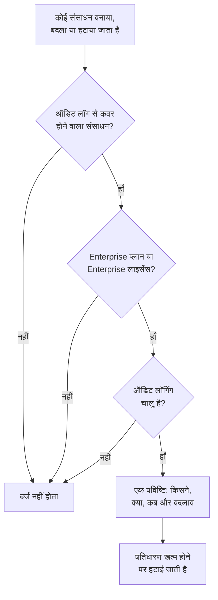

# ऑडिट लॉग

ऑडिट लॉग दर्ज करता है कि आपके प्रोजेक्ट में किसने क्या बदला: जिन संसाधनों को यह कवर करता है, उनका हर निर्माण, बदलाव और हटाना, पहले और बाद के मानों के साथ। इसका उपयोग यह पता लगाने के लिए करें कि किसने कोई मॉनिटर बंद किया या कोई API कुंजी बदली, और अनुपालन समीक्षाओं के लिए रिकॉर्ड रखने के लिए। यह OneUptime Cloud पर Enterprise प्लान का, और सेल्फ-होस्ट करने पर Enterprise Edition का हिस्सा है।

:::cards
- [ऑडिट लॉगिंग चालू करें](#ऑडिट-लॉगिंग-चालू-करें): यह हर प्रोजेक्ट में शुरुआत में बंद रहती है।
- [ऑडिट लॉग पढ़ें](#ऑडिट-लॉग-पढ़ें): किसने क्या और कब बदला।
- [क्या दर्ज होता है](#क्या-दर्ज-होता-है): वे संसाधन और कार्रवाइयाँ जिन्हें यह कवर करता है।
- [प्रविष्टियाँ कितने समय तक रहती हैं](#प्रविष्टियाँ-कितने-समय-तक-रहती-हैं): 7 से 180 दिन तक।
:::

## कोई बदलाव प्रविष्टि कैसे बनता है

- **यह शुरुआत में बंद रहती है।** जब तक कोई ऑडिट लॉगिंग चालू नहीं करता, प्रोजेक्ट कुछ भी दर्ज नहीं करता, और उस पल से पहले का कुछ भी नहीं।
- **यह दर्ज करती है कि लोग क्या करते हैं।** किसी व्यक्ति, API कुंजी, MCP क्लाइंट या वर्कफ़्लो द्वारा किया गया बदलाव दर्ज होता है। OneUptime द्वारा खुद किया गया बदलाव, जैसे किसी बैकग्राउंड जॉब से, तब तक छोड़ दिया जाता है जब तक आप **सिस्टम इवेंट संग्रहित करें** चालू नहीं करते।
- **प्रविष्टियाँ बदली नहीं जा सकतीं।** कोई भी किसी प्रविष्टि को संपादित या हटा नहीं सकता, न डैशबोर्ड में और न API से। कोई प्रविष्टि केवल तब जाती है जब उसका प्रतिधारण खत्म होता है।

## शुरू करने से पहले

- **OneUptime Cloud पर, Enterprise प्लान।** दूसरे प्लानों पर ऑडिट लॉग पेज दिखाते हैं कि सुविधा क्या करती है और इसे कैसे पाएं।
- **सेल्फ-होस्ट करने पर, Enterprise Edition**, ऐसे लाइसेंस के साथ जिसमें ऑडिट लॉग शामिल हों। देखें [एंटरप्राइज़ संस्करण](/docs/self-hosted/enterprise)।
- **ऑडिट लॉग पढ़ सकने वाली भूमिका।** Project Owner, Project Admin, Settings Admin, या **Read Audit Log** अनुमति। ऑडिट लॉगिंग चालू करने और उसकी सेटिंग्स बदलने के लिए Project Owner, Project Admin, या प्रोजेक्ट संपादित करने की अनुमति चाहिए।

## ऑडिट लॉगिंग चालू करें

:::steps
### ऑडिट लॉग सेटिंग्स खोलें

**प्रोजेक्ट सेटिंग्स → ऑडिट लॉग → सेटिंग्स** पर जाएं। **ऑडिट लॉग** साइड मेनू में शुरुआत में बंद रहता है: उसे खोलने के लिए उस पर क्लिक करें।

### सेटिंग्स संपादित करें

**Edit Audit Log Settings** पर क्लिक करें।

### इसे चालू करें

**ऑडिट लॉग्स सक्षम करें** चालू करें, **धारण (दिन)** सेट करें, और चुनें कि **सिस्टम इवेंट संग्रहित करें** या नहीं। **परिवर्तन सहेजें** पर क्लिक करें।
:::

| सेटिंग | शुरुआती मान | यह क्या करती है |
| --- | --- | --- |
| **ऑडिट लॉग्स सक्षम करें** | बंद | अब से प्रोजेक्ट के संसाधनों में बदलाव दर्ज करती है। |
| **धारण (दिन)** | 7 | हर प्रविष्टि कितने दिन रखी जाती है: 7 से 180 तक। |
| **सिस्टम इवेंट संग्रहित करें** | बंद | वे बदलाव भी दर्ज करती है जो OneUptime खुद करता है, जिन्हें किसी व्यक्ति या कुंजी ने शुरू नहीं किया। |

इन सेटिंग्स में बदलाव एक मिनट के भीतर लागू हो जाता है।

## ऑडिट लॉग पढ़ें

**प्रोजेक्ट सेटिंग्स → ऑडिट लॉग → ऑडिट लॉग** प्रोजेक्ट की हर प्रविष्टि दिखाता है, सबसे नई पहले:

| कॉलम | यह क्या दिखाता है |
| --- | --- |
| **कब** | कितनी देर पहले, तारीख और समय के साथ। |
| **कार्रवाई** | `Create`, `Update` या `Delete`, या किसी पैकेट कैप्चर फ़ाइल के लिए `Download` जिसे किसी ने डाउनलोड किया। |
| **संसाधन** | संसाधन का नाम, जो उसके मौजूद रहने तक उसे खोलता है, और उसका प्रकार। |
| **एक्टर** | बदलाव किसने किया: कोई व्यक्ति, API कुंजी, वर्कफ़्लो, या OneUptime द्वारा खुद किए गए बदलाव के लिए `System`। MCP क्लाइंट के ज़रिए किसी व्यक्ति के बदलाव में बताया जाता है कि कौन-सा क्लाइंट। |
| **परिवर्तन** | कितने फ़ील्ड बदले गए, या निर्माण या हटाने पर कितने दर्ज हुए। हर फ़ील्ड देखने के लिए क्लिक करें। |

**संसाधन प्रकार**, **संसाधन नाम**, **कार्रवाई**, **उपयोगकर्ता ईमेल** या **समय** से फ़िल्टर करें। किसी बदलाव में केवल वे फ़ील्ड दिखते हैं जो बदले, पहले और बाद में, और ऐसा सहेजना जो कुछ नहीं बदलता, कोई प्रविष्टि नहीं जोड़ता।

मॉनिटर, घटनाएं, अलर्ट, स्थिति पृष्ठ, SLO और कई दूसरे संसाधनों का भी अपना **ऑडिट लॉग** पेज होता है, उनके साइड मेनू के किसी बंद सेक्शन में, जैसे **उन्नत**। यह केवल उसी संसाधन की प्रविष्टियाँ दिखाता है, उसके अंतर्गत आने वाली चीज़ों की प्रविष्टियों के साथ: किसी SLO का पेज उसके नियम और मालिक भी दिखाता है।

## क्या दर्ज होता है

| संसाधन | लॉग में **संसाधन प्रकार** |
| --- | --- |
| मॉनिटर | `Monitor` |
| घटनाएं | `Incident` |
| अलर्ट | `Alert` |
| स्थिति पृष्ठ | `Status Page` |
| अनुसूचित रखरखाव इवेंट | `Scheduled Maintenance Event` |
| ऑन-कॉल नीतियां | `On-Call Policy` |
| सेवा स्तर उद्देश्य (SLO) | `Service Level Objective` |
| किसी SLO के नियम और मालिक | `SLO Burn Rate Rule`, `SLO Monitor Rule`, `Service Level Objective User Owner`, `Service Level Objective Team Owner` |
| टीमें | `Team` |
| कस्टम भूमिकाएँ, और उन्हें पाने वाली टीमें और API कुंजियाँ | `Custom Role`, `Team Custom Role`, `API Key Custom Role` |
| लेबल | `Label` |
| घटना स्थितियाँ और गंभीरताएं | `Incident State`, `Incident Severity` |
| अलर्ट स्थितियाँ और गंभीरताएं | `Alert State`, `Alert Severity` |
| मॉनिटर स्थितियाँ | `Monitor Status` |
| अनुसूचित रखरखाव स्थितियाँ | `Scheduled Maintenance State` |
| घटना भूमिकाएं | `Incident Role` |
| पोस्टमॉर्टम स्थितियां | `Postmortem Status` |
| API कुंजियाँ | `API Key` |
| लोगों द्वारा कनेक्ट किए गए MCP क्लाइंट | `MCP Client Authorization` |
| इन्वेंटरी आइटम | `Inventory Item` |
| कलेक्टर कॉन्फ़िग | `Collector Config` |
| vCenter सर्वर | `vCenter` |
| पैकेट कैप्चर और उनके डाउनलोड | `Packet Capture` |
| सुरक्षा केस, प्लेबुक और उनके रन, और संरक्षित एंटिटी | `Security Case`, `Security Playbook`, `Security Playbook Run`, `Protected Entity` |
| ऑडिट लॉग एक्सपोर्ट | `Audit Log Export` |

यह भी दर्ज होता है जब कोई एडमिन किसी और के खाते पर सूचना विधि या व्यक्तिगत ऑन-कॉल नियम जोड़ता या हटाता है, बिना खुद पते या नंबर के।

दूसरा डेटा ऑडिट लॉग में नहीं होता, जैसे टीम में कौन है, या किसी टीम में अलग से जोड़ी गई अनुमति। जिन फ़ील्ड को कोई नहीं पढ़ सकता, उन्हें हर प्रविष्टि से बाहर रखा जाता है, और कुंजियाँ, टोकन और पासवर्ड `[REDACTED]` के रूप में दर्ज होते हैं: प्रविष्टि बताती है कि वे बदले, उनका मान कभी नहीं।

## प्रविष्टियाँ कितने समय तक रहती हैं

हर प्रविष्टि उतने समय रखी जाती है जितना दर्ज होते समय प्रोजेक्ट का **धारण (दिन)** था, फिर हटा दी जाती है। नया प्रतिधारण नई प्रविष्टियों पर लागू होता है: पहले से दर्ज प्रविष्टियाँ अपनी तारीखें रखती हैं।

180 दिन से ज़्यादा समय तक प्रविष्टियाँ रखने के लिए, उन्हें दर्ज होते ही अपने स्टोरेज या SIEM में भेजें: देखें [ऑडिट लॉग एक्सपोर्ट](/docs/configuration/audit-log-export)। आप उन्हें **Read Audit Log** वाली API कुंजी के साथ API से पढ़कर, जहाँ ज़रूरत हो वहाँ संग्रहित भी कर सकते हैं। देखें [OneUptime API संदर्भ](/docs/api-reference/api-reference)।

## जब प्लान या लाइसेंस में अब ऑडिट लॉग शामिल नहीं होते

- **OneUptime Cloud पर**, Enterprise प्लान छोड़ने वाला प्रोजेक्ट दर्ज करना बंद कर देता है, और उसके ऑडिट लॉग पेज तब तक अपग्रेड कार्ड दिखाते हैं जब तक वह फिर से उस प्लान पर नहीं आता।
- **सेल्फ-होस्ट करने पर**, ऑडिट लॉगिंग तब दर्ज करना बंद कर देती है जब Enterprise ट्रायल या ग्रेस अवधि बिना लाइसेंस के खत्म हो जाती है, या जब लाइसेंस में ऑडिट लॉग शामिल नहीं होते। ऑडिट लॉग इसे लाल रंग में दिखाता है। पहले से दर्ज प्रविष्टियाँ रखी जाती हैं, और लाइसेंस सक्रिय होते ही उन्हीं सेटिंग्स के साथ दर्ज करना फिर शुरू हो जाता है। देखें [जब लाइसेंस समाप्त हो जाए या न हो](/docs/self-hosted/enterprise#जब-लाइसेंस-समाप्त-हो-जाए-या-न-हो)।

## समस्या निवारण

:::details ऑडिट लॉग खाली है
ऑडिट लॉगिंग शुरुआत में बंद रहती है, और चालू होने से पहले का कुछ भी दर्ज नहीं करती। अगर सूची कहती है कि ऑडिट लॉगिंग बंद है, तो उसके लिंक से सेटिंग्स पर जाएं और इसे चालू करें। नहीं तो, कोई मॉनिटर या घटना बदलें और सूची रीफ़्रेश करें।
:::

:::details ऑडिट लॉग में कोई बदलाव नहीं है
जांचें कि संसाधन [क्या दर्ज होता है](#क्या-दर्ज-होता-है) में है, और बदलाव ऑडिट लॉगिंग चालू होने के बाद किया गया था। OneUptime द्वारा खुद किया गया बदलाव केवल तब दर्ज होता है जब **सिस्टम इवेंट संग्रहित करें** चालू हो।
:::

## अगले कदम

:::cards
- [ऑडिट लॉग एक्सपोर्ट](/docs/configuration/audit-log-export): ऑडिट लॉग को अपने स्टोरेज या SIEM में भेजें।
- [उपयोगकर्ता, टीमें और अनुमतियाँ](/docs/permissions/index): तय करें कि ऑडिट लॉग कौन पढ़ सकता है।
- [प्रोजेक्ट सेटिंग्स](/docs/configuration/project-settings): प्रोजेक्ट की बाकी सेटिंग्स।
- [बिलिंग और उपयोग](/docs/configuration/billing): प्रोजेक्ट का प्लान बदलें।
- [एंटरप्राइज़ संस्करण](/docs/self-hosted/enterprise): सेल्फ-होस्टेड इंस्टॉलेशन पर ऑडिट लॉग।
:::
