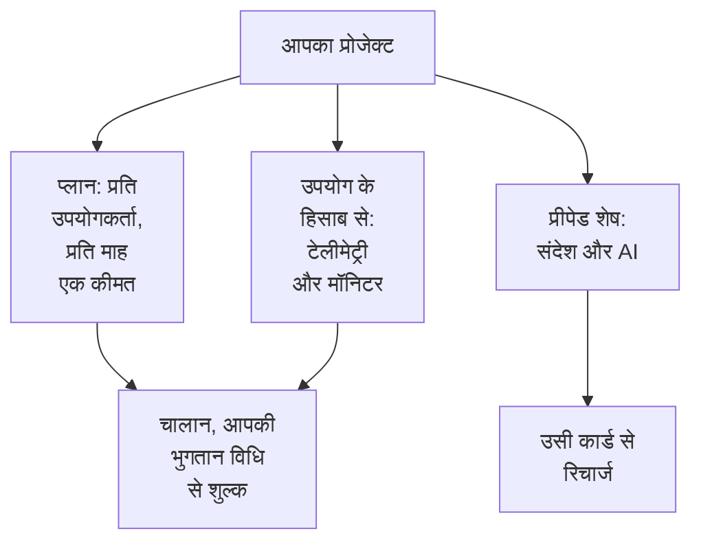

# बिलिंग और उपयोग

OneUptime Cloud पर, एक प्रोजेक्ट अपने प्लान के लिए, प्रति उपयोगकर्ता, और जो वह इस्तेमाल करता है उसके लिए भुगतान करता है: टेलीमेट्री, सक्रिय मॉनिटर, और वे संदेश और AI का काम जिनका भुगतान वह प्रीपेड शेष से करता है। यह पेज दिखाता है कि इनमें से हर एक को कहाँ देखें और बदलें, और कौन बदल सकता है। सेल्फ-होस्टेड इंस्टॉलेशन में कोई बिलिंग नहीं होती, और इनमें से कोई पेज नहीं होता।

:::cards
- [आपका प्लान और सीटें](#आपका-प्लान-और-सीटें): प्लान की लागत क्या है, और कौन सीट गिना जाता है।
- [भुगतान विधियां](#भुगतान-विधियां): वह कार्ड जिससे आपके चालान का शुल्क लिया जाता है।
- [चालान](#चालान): उनका भुगतान करें, उन्हें डाउनलोड करें, और अपना उपयोग जांचें।
- [प्रीपेड शेष](#प्रीपेड-शेष): संदेश और AI, हाथ से या अपने आप रिचार्ज।
:::

## प्रोजेक्ट किसके लिए भुगतान करता है

| क्या | इसकी कीमत कैसे तय होती है |
| --- | --- |
| प्लान | प्रति उपयोगकर्ता, प्रति माह एक कीमत, मासिक या वार्षिक बिल। प्रोजेक्ट का हर व्यक्ति एक सीट है। |
| टेलीमेट्री | इंजेस्ट किए गए हर GB के लिए $0.10, 15 दिन के प्रतिधारण के साथ। लंबे प्रतिधारण की लागत ज़्यादा होती है, और 7 दिन से कम के प्रतिधारण का बिल 7 दिन के हिसाब से बनता है: देखें [प्रतिधारण की लागत](/docs/telemetry/data-retention#प्रतिधारण-की-लागत)। |
| सेशन रीप्ले | $2 प्रति GB, 15 दिन के प्रतिधारण के साथ। |
| सक्रिय मॉनिटर | $1 प्रति मॉनिटर प्रति माह। मैनुअल मॉनिटर को छोड़कर हर मॉनिटर सक्रिय है, बंद होने पर भी। |
| SMS, कॉल, WhatsApp और Telegram | हर संदेश भेजे जाने पर प्रोजेक्ट के शेष से भुगतान होता है। |
| OneUptime AI | प्रोजेक्ट के AI क्रेडिट से भुगतान होता है, जब तक यह आपके अपने LLM प्रदाता पर नहीं चलता। |

[प्राइसिंग पेज](https://oneuptime.com/pricing) प्लानों की तुलना करता है।

## शुरू करने से पहले

- **OneUptime Cloud।** **प्रोजेक्ट सेटिंग्स** का **बिलिंग और चालान** सेक्शन केवल OneUptime Cloud पर है, और शुरुआत में बंद रहता है: उसे खोलने के लिए उसके शीर्षक पर क्लिक करें।
- **बिलिंग पढ़ सकने वाली भूमिका।** Project Owners, **Manage Billing** वाले लोग, और तीनों बिलिंग भूमिकाएँ हर बिलिंग पेज पढ़ सकती हैं। देखें [कौन क्या कर सकता है](#कौन-क्या-कर-सकता-है)।

## आपका प्लान और सीटें

**प्रोजेक्ट सेटिंग्स → बिलिंग और चालान → बिलिंग** पर जाएं। **वर्तमान योजना** कार्ड प्रोजेक्ट का प्लान और प्रति उपयोगकर्ता उसकी कीमत दिखाता है, और **सीटें**: प्रोजेक्ट के हर व्यक्ति के लिए एक।

कोई व्यक्ति उस पल से सीट गिना जाता है जब आप उसे आमंत्रित करते हैं, उसके स्वीकार करने से पहले भी, जब तक आप उसे हटा नहीं देते। सीटों की संख्या बदलने के लिए लोगों को आमंत्रित करें या हटाएं: देखें [लोगों को आमंत्रित करना](/docs/permissions/inviting-people)।

## प्लान बदलें

:::steps
### पहले भुगतान विधि जोड़ें

प्लान बदलने के लिए भुगतान विधि चाहिए। उसके बिना, **Change Plan** इसके बजाय **Add a Payment Method** खोलता है: देखें [भुगतान विधियां](#भुगतान-विधियां)।

### Change Plan पर क्लिक करें

**वर्तमान योजना** कार्ड पर **Change Plan** पर क्लिक करें। **वार्षिक योजना** शुरुआत में चालू होती है: मासिक कीमतें देखने के लिए इसे बंद करें।

### प्लान चुनें

हर प्लान प्रति उपयोगकर्ता अपनी कीमत दिखाता है। प्लानों के नीचे का नोट बताता है कि आपके ट्रायल का क्या होता है: जब तक प्रोजेक्ट अभी ट्रायल पर है, **Your free trial carries over**, और जब नहीं है, **Changing plan does not start a free trial**।

### बदलाव सहेजें

**परिवर्तन सहेजें** पर क्लिक करें। पेड प्लान का बिल उसी पल से बनता है जब आप उस पर बदलते हैं, और उस पर आप जिस भी व्यक्ति को आमंत्रित करते हैं, उसका बिल आमंत्रित करते समय बनता है।
:::

API कुंजियों के लिए Growth प्लान या उससे ऊँचा प्लान चाहिए, और Scale प्लान से नीचे SCIM कनेक्शन केवल लोगों को हटाते हैं। जो प्लान उन्हें रोकता है, वह आपके चुनने से पहले बताता है कि कितने रुकेंगे, और जब तक वे रुके रहते हैं, **बिलिंग** पेज **इस प्लान में शामिल नहीं** दिखाता है। कुछ भी हटाया नहीं जाता: जिस प्लान में वे शामिल हैं, उस पर वे फिर से काम करते हैं।

> [!NOTE]
> क्या आपने OneUptime किसी रीसेलर या क्लाउड मार्केटप्लेस (AWS Marketplace, Microsoft Marketplace, Google Cloud Marketplace या Vercel Marketplace) से खरीदा है? **बिलिंग** पेज यह बताता है। रीसेलर आपके लिए आपका प्लान बदलता है, और मार्केटप्लेस प्रोजेक्ट के प्लान और उपयोग का बिल आपके क्लाउड बिल पर बनाता है।

## भुगतान विधियां

**भुगतान विधियां** कार्ड प्रोजेक्ट के कार्ड दिखाता है। चालान का शुल्क अपने आप डिफ़ॉल्ट कार्ड से लिया जाता है।

:::steps
### भुगतान विधि जोड़ने पर क्लिक करें

**भुगतान विधियां** कार्ड पर **भुगतान विधि जोड़ें** पर क्लिक करें।

### कार्ड दर्ज करें

भुगतान विवरण दर्ज करें और **Save payment method** पर क्लिक करें। आप जो विधि जोड़ते हैं वह डिफ़ॉल्ट बन जाती है, और एक जोड़ने से उपयोग के हिसाब से भुगतान चालू हो जाता है। इससे आपका प्लान नहीं बदलता।
:::

- **डिफ़ॉल्ट के रूप में सेट करें** सूची की किसी दूसरी विधि को वह विधि बनाता है जिससे चालान का शुल्क लिया जाता है।
- डिफ़ॉल्ट विधि पर **Re-sync Autopay** ऐसे नवीनीकरण को ठीक करता है जो अब भी किसी पुराने कार्ड से शुल्क लेता है।
- प्रोजेक्ट में कम से कम एक भुगतान विधि रहती है: आखिरी विधि हटाने से पहले दूसरी जोड़ें।

## बिलिंग पता और चालान ईमेल

**व्यवसाय विवरण / बिलिंग पता** कार्ड में वह होता है जो आपके चालान आपके बारे में कहते हैं। **अपडेट करें** पर क्लिक करें और दो चरण भरें:

| चरण | फ़ील्ड |
| --- | --- |
| **बिलिंग पता** | **व्यवसाय विवरण / बिलिंग पता**: आपकी कंपनी का कानूनी नाम, पता, और VAT या टैक्स ID। **देश**: आपका बिलिंग देश। |
| **चालान** | **वित्त / लेखांकन ईमेल**: जहाँ चालान, रसीदें और बिलिंग संदेश जाते हैं, कई पते अल्पविराम से अलग करके। **ईमेल द्वारा चालान भेजें**: हर चालान जारी होते ही वहाँ भेजें। |

## चालान

**प्रोजेक्ट सेटिंग्स → बिलिंग और चालान → चालान** प्रोजेक्ट के चालान दिखाता है, हर एक **इनवॉइस संख्या**, **इनवॉइस तिथि**, **राशि** और **इनवॉइस स्थिति** के साथ।

- **चालान का भुगतान करें** ऐसे चालान का भुगतान करता है जो अब भी बकाया है।
- **डाउनलोड करें** चालान को PDF के रूप में खोलता है। जो चालान अब भी बकाया है, उस पर यह पंक्ति के मेनू **⋯** में होता है।

जब आपका बैंक अभी भुगतान प्रोसेस कर रहा होता है, OneUptime यह बताता है: कुछ बैंक कार्ड भुगतान की पुष्टि में 2 दिन तक लेते हैं, और चालान अपने आप अपडेट हो जाता है। इसका दोबारा भुगतान न करें।

## उपयोग इतिहास

**प्रोजेक्ट सेटिंग्स → बिलिंग और चालान → उपयोग इतिहास** प्रोजेक्ट द्वारा भेजी गई टेलीमेट्री दिखाता है, हर उत्पाद, सेवा और दिन के लिए एक पंक्ति:

| कॉलम | यह क्या दिखाता है |
| --- | --- |
| **उत्पाद** | लॉग, ट्रेस, मेट्रिक्स और टेलीमेट्री के दूसरे प्रकार। |
| **दिन** | वह दिन जब इसे भेजा गया। |
| **सेवा** | सेवा, या होस्ट, क्लस्टर या दूसरा संसाधन जिसने इसे भेजा। |
| **इंजेस्ट किया गया डेटा (GB में)** | कितना आया। |
| **डेटा प्रतिधारण (दिनों में)** | इसे कितने समय तक रखा जाता है। |
| **कुल लागत** | इसकी लागत क्या रही, अमेरिकी डॉलर में। |

किसी दिन का उपयोग उस दिन के खत्म होने के बाद दिखता है। जो बढ़ा है उसे ढूंढने के लिए **उत्पाद**, **दिन** या **सेवा** से फ़िल्टर करें।

## प्रीपेड शेष

SMS, कॉल, WhatsApp और Telegram संदेशों का भुगतान प्रोजेक्ट के शेष से होता है, और OneUptime AI का उसके AI क्रेडिट से। आप हर एक को पहले से रिचार्ज करते हैं:

| शेष | कहाँ |
| --- | --- |
| SMS, कॉल, WhatsApp और Telegram | **प्रोजेक्ट सेटिंग्स → सूचनाएं → सूचना सेटिंग्स** |
| OneUptime AI | **प्रोजेक्ट सेटिंग्स → एआई → AI क्रेडिट** |

:::steps
### अभी रिचार्ज करें

पेज के **वर्तमान शेष** कार्ड पर **शेष रिचार्ज करें** पर क्लिक करें। $20 से $1,000 तक की राशि दर्ज करें, और **रिचार्ज** पर क्लिक करें। राशि का शुल्क प्रोजेक्ट के कार्ड से लिया जाता है।

### या इसे अपने आप भरने दें

**ऑटो रिचार्ज** कार्ड पर **ऑटो रिचार्ज संपादित करें** पर क्लिक करें, और **ऑटो रिचार्ज सक्षम करें** चालू करें। यह शुरुआत में बंद रहता है। चालू होने पर, जब भी शेष $10 तक गिरता है, OneUptime $20 जोड़ता है, या वे राशियाँ जो आप चुनें।
:::

जब कोई शेष भुगतान नहीं कर पाता, तो संदेश नहीं भेजा जाता या OneUptime AI रुक जाता है, और प्रोजेक्ट के मालिकों को ईमेल मिलता है। देखें [जब पेज नहीं भेजा जाता](/docs/on-call/escalation-rules#जब-पेज-नहीं-भेजा-जाता) और [जब AI क्रेडिट खत्म हो जाएं](/docs/ai/ai-sre#जब-ai-क्रेडिट-खत्म-हो-जाएं)।

## कौन क्या कर सकता है

| करने के लिए | ज़रूरी है |
| --- | --- |
| बिलिंग पेज पढ़ना: प्लान, चालान, उपयोग, शेष और भुगतान विधियां | Project Owner, **Manage Billing**, **बिलिंग एडमिन**, **बिलिंग सदस्य** या **बिलिंग दर्शक** |
| चालान डाउनलोड करना | Project Owner, Project Admin, **Manage Billing**, **Read Invoices**, **बिलिंग एडमिन** या **बिलिंग सदस्य** |
| बिलिंग पता और चालान ईमेल बदलना | Project Owner, **Manage Billing**, **बिलिंग एडमिन** या **बिलिंग सदस्य** |
| SMS, कॉल, WhatsApp या Telegram चालू या बंद करना | Project Owner, **Manage Billing** या **बिलिंग एडमिन** |
| भुगतान विधि जोड़ना | Project Owner, **Manage Billing** या **Create Payment Method** |
| चालान का भुगतान करना | Project Owner, **Manage Billing** या **Edit Invoices** |
| प्लान बदलना, शेष रिचार्ज करना या ऑटो रिचार्ज बदलना | Project Owner या **Manage Billing** |

जिस बटन का उपयोग आप नहीं कर सकते, वह लॉक दिखता है और बताता है कि कौन कर सकता है। बिलिंग भूमिकाओं के लिए देखें [उपयोगकर्ता, टीमें और अनुमतियाँ](/docs/permissions/index#टीमें)।

## वे सेटिंग्स जिनके लिए प्लान चाहिए

OneUptime Cloud पर, इन एडमिनिस्ट्रेशन सेटिंग्स के लिए प्लान चाहिए। जिस पेज का प्लान आपके पास नहीं है, वह दिखाता है कि सुविधा क्या करती है और उसके लिए कौन-सा प्लान चाहिए।

| सेटिंग | ज़रूरी प्लान |
| --- | --- |
| लेबल | Growth |
| API कुंजियाँ | Growth |
| आपके अपने SMTP सर्वर और Twilio खाते | Growth |
| आपके अपने LLM प्रदाता | Growth |
| MCP क्लाइंट कनेक्ट करना | Growth |
| टीमें बनाना | Scale |
| SSO, OIDC और SCIM | Scale |
| प्रतिधारण ओवरराइड | Scale |
| ऑडिट लॉग | Enterprise |

## प्लान रद्द करें

किसी प्रोजेक्ट के लिए भुगतान बंद करने के लिए उसे हटाएं: उसके हटते ही बिलिंग रुक जाती है। देखें [प्रोजेक्ट हटाएं](/docs/configuration/project-settings#प्रोजेक्ट-हटाएं)। रीसेलर से खरीदा गया प्रोजेक्ट रीसेलर के ज़रिए रद्द होता है, और क्लाउड मार्केटप्लेस से खरीदा गया प्रोजेक्ट मार्केटप्लेस पर।

## समस्या निवारण

:::details "Add a payment method in Project Settings > Billing and Invoices > Billing before using paid monitoring or telemetry"
Free प्लान वाले प्रोजेक्ट को सक्रिय मॉनिटर बनाने या टेलीमेट्री भेजने से पहले भुगतान विधि चाहिए, क्योंकि इनका भुगतान उपयोग के हिसाब से होता है। [भुगतान विधियां](#भुगतान-विधियां) में एक जोड़ें। मैनुअल मॉनिटर मुफ़्त रहते हैं।
:::

:::details लाल बैनर कहता है कि चालान बकाया हैं
बकाया चालान वाला प्रोजेक्ट निष्क्रिय हो जाता है, और अगर वे बकाया रहते हैं तो हटा दिया जाता है। **चालान** खोलें, और हर बकाया चालान पर **चालान का भुगतान करें** पर क्लिक करें।
:::

:::details Change Plan से Add a Payment Method खुलता है
प्रोजेक्ट में अभी कोई भुगतान विधि नहीं है। एक जोड़ें, फिर प्लान बदलें।
:::

:::details उपयोग इतिहास खाली है
उपयोग दिन के हिसाब से गिना जाता है, और कोई दिन उसके खत्म होने के बाद दिखता है। जिस प्रोजेक्ट ने टेलीमेट्री नहीं भेजी है, उसकी कोई पंक्ति नहीं होती।
:::

## अगले कदम

:::cards
- [प्रोजेक्ट सेटिंग्स](/docs/configuration/project-settings): बाकी सब कुछ जो पूरे प्रोजेक्ट पर लागू होता है।
- [लोगों को आमंत्रित करना](/docs/permissions/inviting-people): उन लोगों को जोड़ें जिनके लिए आपकी सीटें हैं।
- [डेटा प्रतिधारण](/docs/telemetry/data-retention): टेलीमेट्री उतनी देर रखें जितनी ज़रूरत है, उससे ज़्यादा नहीं।
- [ड्रॉप फ़िल्टर और स्क्रब नियम](/docs/telemetry/drop-filters-and-scrub-rules): जिस टेलीमेट्री का आप उपयोग नहीं करते, उसके लिए भुगतान बंद करें।
:::
