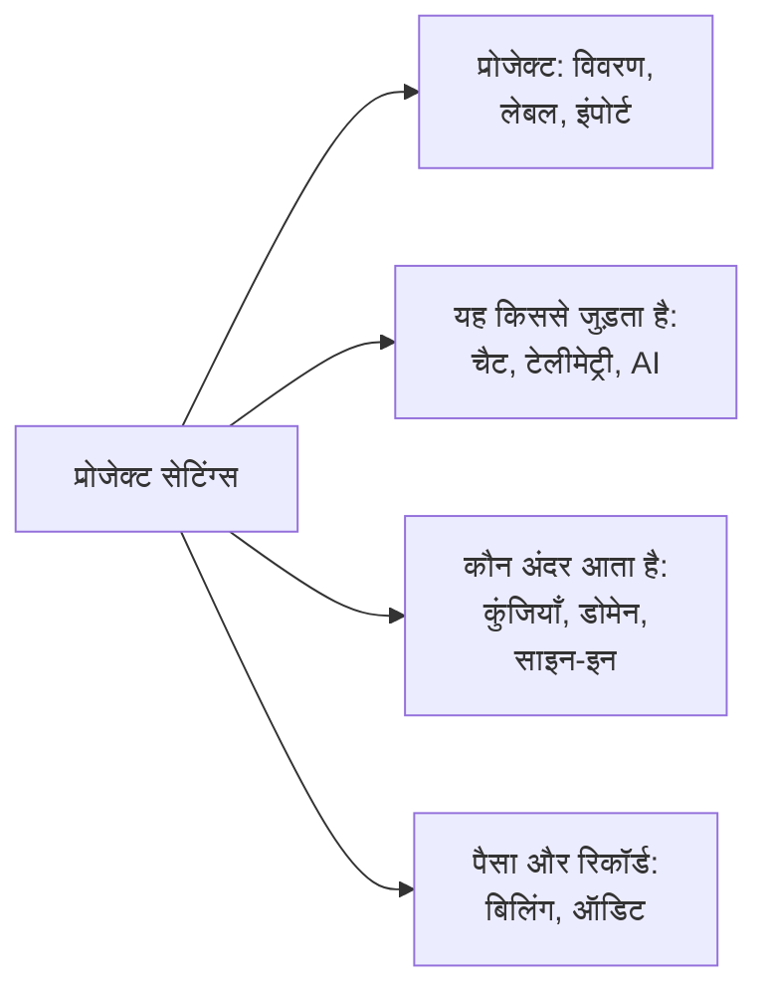

# प्रोजेक्ट सेटिंग्स

प्रोजेक्ट सेटिंग्स में वह सब होता है जो पूरे प्रोजेक्ट पर लागू होता है: उसका नाम, वे टूल जिनसे वह जुड़ा है, उसकी कुंजियाँ, लोग कैसे साइन इन करते हैं, उसकी बिलिंग और उसका ऑडिट ट्रेल। इनमें से ज़्यादातर आप एक बार सेट करते हैं और शायद ही कभी दोबारा देखते हैं। यह पेज इनका नक्शा है, और उन सेटिंग्स को कवर करता है जिनका अपना कोई पेज नहीं है: प्रोजेक्ट का विवरण, लेबल, फ़ीचर फ़्लैग और प्रोजेक्ट हटाना।

:::cards
- [कोई सेटिंग ढूंढें](#कोई-सेटिंग-ढूंढें): साइड मेनू के हर सेक्शन में क्या है।
- [प्रोजेक्ट का विवरण](#प्रोजेक्ट-का-विवरण): इसका नाम, ID और सहायता पहुँच।
- [लेबल](#लेबल): संसाधनों, अनुमतियों और नियमों के लिए टैग।
- [प्रोजेक्ट हटाएं](#प्रोजेक्ट-हटाएं): इसके लिए क्या चाहिए, और इसके साथ क्या चला जाता है।
:::

## प्रोजेक्ट सेटिंग्स खोलें

**उत्पाद → सेटिंग्स → प्रोजेक्ट सेटिंग्स** पर जाएं। साइड मेनू पेजों को सेक्शन में समूहित करता है, और शुरुआत में केवल **बेसिक** खुला होता है: किसी सेक्शन को खोलने के लिए उसके शीर्षक पर क्लिक करें। किसी सेक्शन के किसी भी पेज पर वह सेक्शन अपने आप खुल जाता है।

## शुरू करने से पहले

- **प्रोजेक्ट बदल सकने वाली भूमिका।** Project Owners और Project Admins इनमें से ज़्यादातर सेटिंग्स बदलते हैं। बिलिंग, सूचना चैनल और प्रोजेक्ट हटाने के लिए ज़्यादा चाहिए, जैसा हर सेक्शन बताता है।
- **OneUptime Cloud पर, वह प्लान जिसमें कोई सेटिंग शामिल है।** कुछ सेटिंग्स के लिए प्लान चाहिए: देखें [वे सेटिंग्स जिनके लिए प्लान चाहिए](/docs/configuration/billing#वे-सेटिंग्स-जिनके-लिए-प्लान-चाहिए)।

## कोई सेटिंग ढूंढें

| सेक्शन | पेज | कहाँ और पढ़ें |
| --- | --- | --- |
| **बेसिक** | **प्रोजेक्ट**, **लेबल** | [प्रोजेक्ट का विवरण](#प्रोजेक्ट-का-विवरण), [लेबल](#लेबल) |
| **वर्कस्पेस** | **Slack**, **Microsoft Teams**, **Video Calls** | [Slack](/docs/workspace-connections/slack), [Microsoft Teams](/docs/workspace-connections/microsoft-teams), [वीडियो कॉल](/docs/workspace-connections/video-calls) |
| **टेलीमेट्री और APM** | **इंजेशन कुंजियाँ**, **डेटा प्रतिधारण** | [इंजेशन कुंजियाँ](/docs/telemetry/ingestion-keys), [डेटा प्रतिधारण](/docs/telemetry/data-retention) |
| **सूचनाएं** | **सूचना सेटिंग्स**, **सूचना लॉग**, **मोबाइल ऐप्स** | [सूचनाएं](#सूचनाएं) |
| **एआई** | **AI Features**, **LLM प्रदाता**, **बाहरी MCP सर्वर**, **AI क्रेडिट**, **AI लॉग**, **MCP सर्वर** | [LLM प्रदाता](/docs/ai/llm-provider), [बाहरी MCP सर्वर](/docs/ai/external-mcp-servers), [MCP सर्वर](/docs/ai/mcp-server), [AI SRE](/docs/ai/ai-sre#लागत-नियंत्रण) |
| **उन्नत** | **डोमेन**, **API कुंजियाँ**, **फ़ीचर फ़्लैग**, **किसी दूसरे टूल से इंपोर्ट करें** | [कस्टम डोमेन](/docs/status-pages/branding-and-domains#कस्टम-डोमेन), [API कुंजियाँ](/docs/permissions/index#api-कुंजियाँ), [फ़ीचर फ़्लैग](#फ़ीचर-फ़्लैग), [Opsgenie से आना](/docs/moving-to-oneuptime/opsgenie) और बाकी माइग्रेशन गाइड |
| **सुरक्षा** | **SSO**, **SCIM** | [SSO](/docs/identity/sso), [SCIM](/docs/identity/scim) |
| **बिलिंग और चालान** | **बिलिंग**, **उपयोग इतिहास**, **चालान** | [बिलिंग और उपयोग](/docs/configuration/billing) |
| **ऑडिट लॉग** | **ऑडिट लॉग**, **सेटिंग्स**, **एक्सपोर्ट** | [ऑडिट लॉग](/docs/configuration/audit-logs), [ऑडिट लॉग एक्सपोर्ट](/docs/configuration/audit-log-export) |
| **खतरा क्षेत्र** | **खतरा क्षेत्र** | [प्रोजेक्ट हटाएं](#प्रोजेक्ट-हटाएं) |

**बिलिंग और चालान** और **AI क्रेडिट** केवल OneUptime Cloud पर हैं: सेल्फ-होस्टेड इंस्टॉलेशन में कोई बिलिंग नहीं होती।

## प्रोजेक्ट का विवरण

**प्रोजेक्ट सेटिंग्स → बेसिक → प्रोजेक्ट** में दो कार्ड हैं।

**प्रोजेक्ट विवरण** प्रोजेक्ट का नाम और ID दिखाता है:

- **प्रोजेक्ट नाम**: प्रोजेक्ट का नाम बदलने के लिए **प्रोजेक्ट संपादित करें** पर क्लिक करें। नाम में कम से कम 2 अक्षर होते हैं। नाम बदलने के लिए Project Owner, या प्रोजेक्ट संपादित करने या बिलिंग प्रबंधित करने की अनुमति चाहिए।
- **प्रोजेक्ट ID**: इसे API, CLI और Terraform के लिए, या सहायता को लिखते समय कॉपी करें।
- **Data Residency**: OneUptime Cloud पर, आपके प्रोजेक्ट का डेटा कहाँ रहता है, जब OneUptime ने इसे दर्ज कर लिया हो। इसे केवल OneUptime सेट करता है।

**ग्राहक सहायता पहुँच** OneUptime Cloud पर तय करता है कि OneUptime की सहायता टीम प्रोजेक्ट खोल सकती है या नहीं। जब आपको मदद चाहिए, तो **OneUptime सहायता को इस प्रोजेक्ट तक पहुंचने दें** चालू करें: OneUptime पहले पूछता है, क्योंकि तब सहायता प्रोजेक्ट में सब कुछ देख और बदल सकती है, और आप **सहायता को आने दें** पर क्लिक करते हैं। उनका काम पूरा होने पर इसे बंद करें: यह तुरंत सहेजा जाता है। Project Owners और Project Admins इसे बदलते हैं।

## लेबल

लेबल वे टैग हैं जो आप मॉनिटर, घटनाओं, स्थिति पृष्ठों और दूसरे संसाधनों पर लगाते हैं। ये सूचियों को फ़िल्टर और समूहित करते हैं, और तय करते हैं कि किसी टीम की अनुमतियाँ और प्रोजेक्ट के नियम कहाँ तक पहुँचते हैं।

:::steps
### लेबल खोलें

**प्रोजेक्ट सेटिंग्स → बेसिक → लेबल** पर जाएं।

### एक लेबल बनाएं

**लेबल बनाएँ** पर क्लिक करें। इसे एक **नाम** दें और, अगर चाहें, एक **विवरण**। **लेबल रंग** पहले से चुना होता है, ऐसा रंग जो पेज पर अभी कोई लेबल इस्तेमाल नहीं करता: चाहें तो कोई दूसरा चुनें। इसे सहेजने के लिए **लेबल बनाएँ** पर क्लिक करें।
:::

OneUptime Cloud पर, लेबल बनाने और बदलने के लिए Growth प्लान चाहिए। लेबल अनुमतियों को कैसे सीमित करते हैं, इसके लिए देखें [लेबल](/docs/permissions/index#लेबल), और संसाधन बनाते समय उन पर लेबल लगाने के लिए देखें [लेबल और स्वामी नियम](/docs/configuration/label-and-owner-rules)।

किसी सूची में किसी रिकॉर्ड के लेबल एक के नीचे एक दिखते हैं; चार से ज़्यादा होने पर पहले तीन दिखते हैं, साथ में बाकी देखने का एक लिंक। जहाँ भी लेबल सूचीबद्ध होते हैं (सूचियों में, किसी रिकॉर्ड के पेज पर और हर लेबल चुनने की जगह में), वे स्वाभाविक क्रम में होते हैं: जिन लेबलों के नाम किसी संख्या से शुरू होते हैं, वे पहले आते हैं, उस संख्या के क्रम में (`2. Team` पहले, `10. Owner` बाद में), फिर बाकी लेबल वर्णानुक्रम में, बड़े और छोटे अक्षरों का भेद किए बिना। अपने लेबलों का क्रम तय करने के लिए उनके नाम किसी संख्या से शुरू करें, जैसे `1. Category` और `2. Subcategory`।

### लेबल को संग्रहित करना

किसी लेबल का उपयोग बंद करने के लिए, उसे हटाने के बजाय उसकी पंक्ति के **⋯** मेनू से संग्रहित करें। जिन चीज़ों में लेबल है, वे इसे बनाए रखती हैं, और आप अब भी इससे फ़िल्टर कर सकते हैं, लेकिन कोई इसे फिर से किसी चीज़ में नहीं जोड़ सकता: हर लेबल चयनकर्ता इसे नहीं दिखाता, और API, Terraform और MCP इसे अस्वीकार करते हैं। डायलॉग उन नियमों और अनुमतियों को सूचीबद्ध करता है जो इस लेबल का उपयोग करने के लिए सेट हैं, और जब तक आप इन्हें नहीं बदलते, ये इसका उपयोग करते रहते हैं। संग्रहीत लेबल मुड़े हुए अनुभाग **संग्रहीत लेबल** में अलग से सूचीबद्ध होते हैं, जहाँ **अनसंग्रहीत करें** किसी लेबल को वापस लाता है। **हटाएं** पहले वह सब सूचीबद्ध करता है जिससे लेबल हट जाएगा, और **इसके बजाय संग्रहित करें** का विकल्प देता है।

## सूचनाएं

**प्रोजेक्ट सेटिंग्स → सूचनाएं** में यह होता है कि प्रोजेक्ट सूचनाएं कैसे भेजता है:

- **सूचना सेटिंग्स**: **सूचना चैनल** कार्ड प्रोजेक्ट के लिए SMS, फ़ोन कॉल, WhatsApp और Telegram चालू या बंद करता है। शुरुआत में चारों बंद रहते हैं। Project Owner, **बिलिंग एडमिन**, या **Manage Billing** वाला कोई व्यक्ति इन्हें चालू करता है। इस पेज पर **कस्टम SMTP कॉन्फ़िग्स** के अंदर प्रोजेक्ट के अपने मेल सर्वर (देखें [SMTP](/docs/emails/smtp)) और उसका अपना Twilio खाता (देखें [Twilio इंटीग्रेशन](/docs/self-hosted/twilio-integration)) भी होते हैं। OneUptime Cloud पर, इसमें वह शेष राशि भी होती है जिससे इन संदेशों का भुगतान होता है: देखें [प्रीपेड शेष](/docs/configuration/billing#प्रीपेड-शेष)।
- **सूचना लॉग**: प्रोजेक्ट द्वारा भेजी गई हर सूचना, हर चैनल के लिए एक टैब के साथ: **ईमेल**, **SMS**, **WhatsApp**, **Telegram**, **वेबहुक**, **कॉल**, **पुश** और **वर्कस्पेस**।
- **मोबाइल ऐप्स**: iOS और Android के ऐप्स कहाँ से लें। देखें [ऐप्स का अवलोकन](/docs/mobile-desktop-apps/index)।

## फ़ीचर फ़्लैग

**प्रोजेक्ट सेटिंग्स → उन्नत → फ़ीचर फ़्लैग** प्रोजेक्ट के लिए वैकल्पिक सुविधाएँ चालू या बंद करता है। हर एक स्विच है जो पलटते ही सहेज लिया जाता है। आज इस पेज पर **मॉनिटर समूह** है, जो नए प्रोजेक्ट में बंद रहता है: मॉनिटर मेनू में मॉनिटर समूह जोड़ने के लिए इसे चालू करें। इसे बंद करने से कोई समूह नहीं हटता। देखें [मॉनिटर समूह](/docs/monitor/monitor-groups)।

## प्रोजेक्ट हटाएं

प्रोजेक्ट हटाने से उसमें मौजूद सब कुछ, हर सदस्य के लिए, हट जाता है: मॉनिटर, घटनाएं, स्थिति पृष्ठ, ऑन-कॉल सेटअप और टेलीमेट्री। कुछ भी इसे वापस नहीं लाता।

:::steps
### खतरा क्षेत्र खोलें

**प्रोजेक्ट सेटिंग्स → खतरा क्षेत्र** पर जाएं।

### हटाने का बटन क्लिक करें

**प्रोजेक्ट हटाएँ** पर क्लिक करें। एक डायलॉग पुष्टि करने को कहता है।

### प्रोजेक्ट का नाम लिखें

नाम ठीक वैसे ही लिखें जैसा वह है। जब तक आप ऐसा नहीं करते, **प्रोजेक्ट हटाएँ** लॉक रहता है। OneUptime Cloud पर डायलॉग यह भी पूछता है कि आप क्यों जा रहे हैं: जवाब वैकल्पिक है।

### पुष्टि करें

**प्रोजेक्ट हटाएँ** पर क्लिक करें। OneUptime प्रोजेक्ट हटाता है और आपको उससे बाहर ले जाता है।
:::

> [!CAUTION]
> प्रोजेक्ट हटाना पूर्ववत नहीं किया जा सकता। इसके लिए Project Owner, या प्रोजेक्ट हटाने की अनुमति चाहिए।

OneUptime Cloud पर, आप प्रोजेक्ट को हटाकर उसका प्लान रद्द करते हैं: प्रोजेक्ट हटते ही बिलिंग रुक जाती है। क्लाउड मार्केटप्लेस के ज़रिए बिल होने वाले प्रोजेक्ट पर उसके उपयोग का एक आखिरी शुल्क लगता है, और मार्केटप्लेस की खरीद तब तक सक्रिय रहती है जब तक आप उसे वहाँ रद्द नहीं करते।

## समस्या निवारण

:::details साइड मेनू का कोई सेक्शन गायब लगता है
**बेसिक** को छोड़कर हर सेक्शन शुरुआत में बंद रहता है। उसे खोलने के लिए सेक्शन के शीर्षक पर क्लिक करें। सेल्फ-होस्टेड इंस्टॉलेशन पर न **बिलिंग और चालान** सेक्शन होता है, न **AI क्रेडिट** पेज।
:::

:::details प्रोजेक्ट संपादित करें लॉक है
नाम बदलने के लिए Project Owner, या प्रोजेक्ट संपादित करने या बिलिंग प्रबंधित करने की अनुमति चाहिए। लॉक बटन उस अनुमति का नाम बताता है जो आपके पास नहीं है।
:::

:::details डायलॉग में प्रोजेक्ट हटाएँ लॉक ही रहता है
प्रोजेक्ट का नाम ठीक वैसे लिखें जैसा डायलॉग दिखाता है: बड़े और छोटे अक्षर मायने रखते हैं।
:::

## अगले कदम

:::cards
- [लोगों को आमंत्रित करना](/docs/permissions/inviting-people): अपनी टीम को प्रोजेक्ट में लाएं।
- [बिलिंग और उपयोग](/docs/configuration/billing): आपका प्लान, भुगतान विधियां, चालान और उपयोग।
- [ऑडिट लॉग](/docs/configuration/audit-logs): देखें कि प्रोजेक्ट में किसने क्या बदला।
- [SSO](/docs/identity/sso): लोगों को अपने पहचान प्रदाता से साइन इन करने दें।
:::
