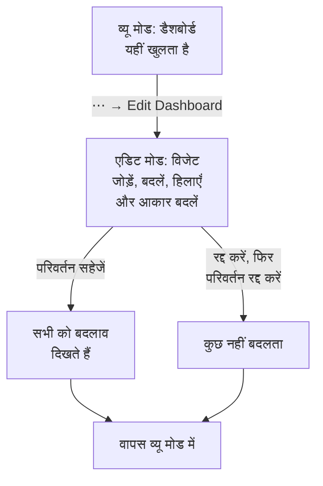

# डैशबोर्ड बनाना

डैशबोर्ड बनाने के लिए, **उत्पाद → डैशबोर्ड** खोलें और **डैशबोर्ड बनाएँ** पर क्लिक करें। **एक डैशबोर्ड बनाएं** डायलॉग पहले पूछता है कि आप कैसे शुरू करना चाहते हैं, फिर नाम। **शुरू से बनाएं** आपको एक खाली डैशबोर्ड देता है; टेम्पलेट आपके लिए अपने विजेट, और अक्सर अपने वेरिएबल भी, बना देता है और अपना नाम भर देता है (अगर प्रोजेक्ट में पहले से वैसा एक है, तो क्रमांक के साथ, जैसे "Kubernetes Dashboard 2")। **डैशबोर्ड बनाएँ** पर क्लिक करें, और नया डैशबोर्ड खुल जाता है। खाली डैशबोर्ड अपने कैनवास पर खुलता है, जिसमें पहले विजेट के लिए **विजेट जोड़ें** बटन होता है।

:::cards
- [डैशबोर्ड बनाएँ](#डैशबोर्ड-बनाएँ): शुरू से, या किसी टेम्पलेट से शुरू करें।
- [संपादित करें और सहेजें](#संपादित-करें-और-सहेजें): जब तक आप "परिवर्तन सहेजें" पर क्लिक नहीं करते, किसी के लिए कुछ नहीं बदलता।
- [विजेट जोड़ना](#विजेट-जोड़ना): उसे कैटलॉग से चुनें, सेट करें और जगह पर रखें।
- [उछाल पर ज़ूम करना](#उछाल-पर-ज़ूम-करना): किसी चार्ट पर ड्रैग करके उस पल का पूरा डैशबोर्ड पढ़ें।
:::

## शुरू करने से पहले

प्रोजेक्ट के मालिक और एडमिन हर डैशबोर्ड बना और संपादित कर सकते हैं। बाकी सभी को टीम की अनुमति चाहिए: डैशबोर्ड बनाने के लिए `CreateDashboard`, और उन्हें बदलने के लिए `EditDashboard`। प्रोजेक्ट के सदस्य और व्यूअर इनमें से किसी के बिना भी डैशबोर्ड पढ़ सकते हैं। जो व्यक्ति किसी डैशबोर्ड को संपादित नहीं कर सकता, वह फिर भी उसका **⋯** मेनू खोलता है, जहाँ **डैशबोर्ड संपादित करें** लॉक रहता है और बताता है कि उसे कौन-सी अनुमति चाहिए।

## डैशबोर्ड बनाएँ

:::steps
### शुरू करने का तरीका चुनें

**उत्पाद → डैशबोर्ड** खोलें और **डैशबोर्ड बनाएँ** पर क्लिक करें। **एक डैशबोर्ड बनाएं** डायलॉग **शुरू से बनाएं** पर खुलता है, जो आपके अपने विजेट के लिए एक खाली डैशबोर्ड है। उसके नीचे **या किसी टेम्पलेट से शुरू करें** छह **सुझाए गए** टेम्पलेट दिखाता है।

### टेम्पलेट चुनें

कोई टेम्पलेट क्लिक करें और देखें कि वह क्या जोड़ता है: उसके विजेट, उन्हीं नामों से जो **विजेट जोड़ें** में हैं, और वे वेरिएबल जिनसे आप उसके टूलबार में उसे सीमित करते हैं। बाकी के लिए खोज बॉक्स के पास कोई श्रेणी चुनें, या **सभी टेम्पलेट**, या **टेम्पलेट खोजें…** में लिखें: आपका लिखा हर शब्द मेल खाना चाहिए। फिर **यह टेम्पलेट इस्तेमाल करें** पर क्लिक करें, या टेम्पलेट पर डबल-क्लिक करें। खोज बॉक्स में तीर कुंजियाँ टेम्पलेट चुनती हैं और **Enter** उसे इस्तेमाल करता है।

### डैशबोर्ड को नाम दें

टेम्पलेट का नाम पहले से भरा होता है, और प्रोजेक्ट में मौजूद नामों के बाद का क्रमांक लिए होता है। **शुरू से बनाएं** में नाम खाली रहता है: एक नाम लिखें। विवरण वैकल्पिक है, **और फ़ील्ड** के नीचे मुड़ा हुआ है, और आप उसे बाद में डैशबोर्ड के **अवलोकन** पेज पर जोड़ सकते हैं। **वापस** आपको टेम्पलेट पर वैसे ही लौटाता है जैसे आपने उन्हें छोड़ा था।

### उसे बनाएँ

**डैशबोर्ड बनाएँ** पर क्लिक करें। नया डैशबोर्ड खुल जाता है: टेम्पलेट के विजेट तुरंत, या एक खाली कैनवास जिस पर **विजेट जोड़ें** होता है।
:::

टेम्पलेट, उस श्रेणी के अनुसार जिसके तहत पिकर उन्हें दिखाता है:

| श्रेणी | टेम्पलेट |
| --- | --- |
| निगरानी और APM | Monitor Dashboard, Metrics Dashboard, Real User Monitoring Dashboard, SLO Dashboard |
| घटना प्रतिक्रिया | Incident Dashboard, Alert Dashboard |
| बुनियादी ढांचा | Kubernetes Dashboard, Kubernetes Cost Dashboard, Hosts Dashboard, Proxmox Dashboard, VMware Dashboard, Ceph Dashboard, Storage Array Dashboard, Docker Swarm Dashboard, Network Dashboard |

**सुझाए गए** में Monitor Dashboard, Incident Dashboard, Alert Dashboard, Kubernetes Dashboard, Hosts Dashboard और Metrics Dashboard हैं। टेम्पलेट एक शुरुआती बिंदु है, कोई जुड़ाव नहीं: डैशबोर्ड बन जाने के बाद उसे अपनी मर्ज़ी से बदलें। बाद में टेम्पलेट उसे अपडेट नहीं करता।

## संपादित करें और सहेजें

डैशबोर्ड पढ़ने के लिए व्यू मोड में खुलता है। उसे बदलने के लिए, उसके टूलबार में **⋯** मेनू खोलें और **डैशबोर्ड संपादित करें** चुनें। टूलबार नाम के बगल में **संपादन** दिखाता है, और समय सीमा व उसके बाकी नियंत्रणों की जगह **विजेट जोड़ें**, **वेरिएबल**, **रद्द करें** और **परिवर्तन सहेजें** दिखाता है। उनके नीचे एक पंक्ति डैशबोर्ड की **डिफ़ॉल्ट समय सीमा** और **डिफ़ॉल्ट स्वतः-रिफ्रेश** तय करती है।

जब तक आप अपने बदलाव सहेजते नहीं, वे सिर्फ़ आपके हैं। संपादन के दौरान कुछ भी सहेजा नहीं जाता, इसलिए दूसरे लोग डैशबोर्ड को पहले जैसा ही देखते रहते हैं।

- **परिवर्तन सहेजें** विजेट, उनकी जगहें और आकार, वेरिएबल, और डिफ़ॉल्ट समय सीमा व ऑटो-रीफ़्रेश एक साथ सहेजता है, और व्यू मोड में लौट आता है। अगर सहेजना अस्वीकार हो जाए, जैसे कि इस बीच आपकी अनुमति चली गई हो, तो आप अपने बदलावों के साथ एडिट मोड में ही रहते हैं, और कारण ग्रिड के ऊपर दिखता है।
- **रद्द करें** पहले पूछता है, क्योंकि यह आपके बदलाव फेंक देता है: **परिवर्तन रद्द करें** डैशबोर्ड को सहेजी गई स्थिति में लौटाता है, और **संपादन जारी रखें** आपको आपके काम पर वापस ले जाता है।

संपादन के दौरान ऑटो-रीफ़्रेश रुक जाता है, और ज़ूम की गई समय सीमा आपकी चुनी हुई सीमा पर लौट जाती है।

## विजेट जोड़ना

:::steps
### विजेट कैटलॉग खोलें

**विजेट जोड़ें** पर क्लिक करें: संपादन के दौरान टूलबार में, या खाली डैशबोर्ड के कैनवास पर। कैटलॉग अपने विजेट को इस आधार पर समूहों में रखता है कि वे क्या दिखाते हैं। नाम या उद्देश्य से कोई विजेट ढूँढने के लिए उसके खोज बॉक्स में टाइप करें ("error budget", "pods"), और पहला परिणाम जोड़ने के लिए Enter दबाएँ।

### विजेट चुनें

उस पर क्लिक करें। विजेट ग्रिड पर उस पहली खाली जगह पर आ जाता है जहाँ वह फ़िट हो, और उसकी सेटिंग्स खुल जाती हैं।

### तय करें कि वह क्या दिखाए

सेटिंग्स डायलॉग विजेट का **Live Preview** उसकी सेटिंग्स के ऊपर दिखाता है, और प्रीव्यू आपके हर बदलाव के साथ बदलता है। चुनें कि विजेट क्या पढ़ता है (एक मेट्रिक क्वेरी, एक फ़िल्टर, एक टेक्स्ट) और वह कैसा दिखता है, फिर **हो गया** पर क्लिक करें।

### उसे जगह पर रखें

विजेट को हिलाने के लिए उसे ड्रैग करें, और आकार बदलने के लिए उसके किनारे या कोने ड्रैग करें। देखें [ग्रिड पर विजेट](#ग्रिड-पर-विजेट)।
:::

[डैशबोर्ड विजेट](/docs/dashboards/widgets) हर विजेट और उसकी सेटिंग्स की सूची देता है।

## ग्रिड पर विजेट

कैनवास बारह कॉलम चौड़ा एक ग्रिड है। विजेट उस पर स्नैप होते हैं, और जैसे-जैसे आप पंक्तियाँ जोड़ते हैं, पेज नीचे की ओर बढ़ता है। जब आप कोई विजेट ड्रैग करते हैं, तो एक डैश वाली रूपरेखा दिखाती है कि वह कहाँ आएगा, उसके कॉलम और पंक्ति के साथ; जब आप किसी का आकार बदलते हैं, तो रूपरेखा उसका आकार ग्रिड इकाइयों में दिखाती है। रास्ते में आने वाले विजेट हट जाते हैं, इसलिए दो विजेट कभी एक-दूसरे पर नहीं चढ़ते।

हर तरह के विजेट का एक न्यूनतम आकार होता है, ताकि वह जो बनाता है वह पढ़ने लायक रहे: एक चार्ट कम से कम छह कॉलम चौड़ा और तीन पंक्ति ऊँचा होता है, जबकि एक अकेली संख्या एक सेल में आ जाती है।

बाद में किसी विजेट को बदलने के लिए, संपादन के दौरान उस पर क्लिक करें। उसकी सेटिंग्स फिर से खुलती हैं, नीचे दो और बटनों के साथ:

- **Duplicate Widget** उन्हीं सेटिंग्स के साथ एक कॉपी पहली खाली जगह पर जोड़ता है।
- **विजेट हटाएं** आपकी पुष्टि के बाद उसे हटा देता है।

## समय सीमा और ऑटो-रीफ़्रेश

व्यू मोड में, टूलबार का समय सीमा पिकर वह अवधि तय करता है जिसे हर चार्ट, संख्या, लॉग और ट्रेस विजेट पढ़ता है। पिछले 5 मिनट से पिछले 3 महीनों तक का कोई प्रीसेट चुनें, या अपनी शुरुआत और समाप्ति। डैशबोर्ड अपनी डिफ़ॉल्ट समय सीमा पर खुलता है: पिछला एक घंटा, जब तक संपादन करने वाला कोई और सीमा तय न करे।

घटनाओं, अलर्ट, मॉनिटर और संसाधनों की सूचियाँ अपनी मौजूदा स्थिति दिखाती हैं, समय सीमा चाहे जो हो।

समय सीमा के बगल में, ऑटो-रीफ़्रेश मेनू हर विजेट को हर 5 सेकंड, 10 सेकंड, 30 सेकंड, 1 मिनट, 5 मिनट या 15 मिनट पर फिर से पढ़ता है, और अगले रीफ़्रेश तक उलटी गिनती दिखाता है। जाँच-पड़ताल के दौरान इसे बंद रखें, ताकि दृश्य स्थिर रहे। डैशबोर्ड अपने डिफ़ॉल्ट ऑटो-रीफ़्रेश के साथ खुलता है: बंद, जब तक संपादन करने वाला कोई और अंतराल तय न करे।

समय सीमा पिकर, वेरिएबल और ऑटो-रीफ़्रेश तभी दिखते हैं जब डैशबोर्ड में कोई विजेट हो।

### डैशबोर्ड के डिफ़ॉल्ट

जब आप डैशबोर्ड संपादित करते हैं, टूलबार के बटनों के नीचे की पंक्ति तय करती है कि हर कोई उसे किस पर खोलता है: **डिफ़ॉल्ट समय सीमा**, पिछले 5 मिनट से पिछले 3 महीनों तक का कोई प्रीसेट, और **डिफ़ॉल्ट स्वतः-रिफ्रेश**। **परिवर्तन सहेजें** उन्हें डैशबोर्ड के बाकी हिस्से के साथ सहेजता है, आपकी टीम और उसके सार्वजनिक लिंक के आगंतुकों, दोनों के लिए। कोई अपनी शुरुआत और समाप्ति डिफ़ॉल्ट नहीं हो सकती: डैशबोर्ड हमेशा के लिए उसी पल पर रुका रह जाएगा। यह पंक्ति तभी दिखती है जब डैशबोर्ड में कोई विजेट हो।

इन सेटिंग्स से पहले सहेजे गए डैशबोर्ड पिछले एक घंटे पर, अपने पुराने ऑटो-रीफ़्रेश के साथ खुलते हैं। API और Terraform के ज़रिए, दोनों डैशबोर्ड के `dashboardViewConfig` में होते हैं: `timeRange`, API संदर्भ की वर्तनी में एक प्रीसेट, जैसे `Past 1 Day`, और `refreshInterval`, जैसे `1m`। कोई भी दूसरा मान अस्वीकार कर दिया जाता है।

### आपके अपने चुनाव

व्यू मोड में आप जो समय सीमा और ऑटो-रीफ़्रेश चुनते हैं, वे सिर्फ़ आपके होते हैं, और आपका ब्राउज़र उन्हें हर डैशबोर्ड के लिए याद रखता है: रीफ़्रेश करने, ब्राउज़र दोबारा शुरू करने या किसी दीवार की स्क्रीन के रीबूट होने पर भी डैशबोर्ड वैसे ही खुलता है जैसा आपने छोड़ा था। सिर्फ़ प्रीसेट याद रखा जाता है। अपनी सीमा या ज़ूम तभी तक रहता है जब तक आप पेज नहीं छोड़ते, ताकि डैशबोर्ड कभी बीते पल पर अटका न रहे।

हर पिकर का पहला विकल्प डैशबोर्ड का डिफ़ॉल्ट बताता है, जैसे डिफ़ॉल्ट (Past 1 Day)। डिफ़ॉल्ट पर लौटने के लिए इसे चुनें: आपका ब्राउज़र आपका चुनाव भूल जाता है, और डैशबोर्ड फिर से अपने डिफ़ॉल्ट पर चलता है, तब भी जब कोई संपादक बाद में उसे बदल दे। जब आप खुद नए डिफ़ॉल्ट सहेजते हैं, तो वे आपको तुरंत दिखते हैं।

### उछाल पर ज़ूम करना

किसी उछाल को देखने के लिए आपको समय सीमा पिकर की ओर जाने की ज़रूरत नहीं है। किसी भी लाइन या एरिया चार्ट के दिलचस्प हिस्से पर ड्रैग करें, और **पूरा डैशबोर्ड** उसी अवधि पर चला जाता है, बिल्कुल वैसे ही जैसे आपने उसे समय सीमा पिकर में चुना हो — समय सीमा का उपयोग करने वाला हर विजेट साथ-साथ फिर से क्वेरी करता है, इसलिए आप पूरे डैशबोर्ड पर एक ही पल पढ़ते हैं, न कि अपने पड़ोसियों से अलग पैमाने पर एक चार्ट। लाइव सूचियाँ हमेशा की तरह वही दिखाती रहती हैं जो अभी हो रहा है।

इसे पूर्ववत करने के लिए **किसी भी चार्ट पर डबल-क्लिक करें**: आपने कितनी भी बार ज़ूम किया हो, डैशबोर्ड उसी सीमा पर लौट जाता है जो ज़ूम शुरू करने से पहले थी। ज़ूम सक्रिय रहने तक समय सीमा पिकर के बगल में **ज़ूम रीसेट करें** बटन दिखता है, और बिना ज़ूम वाले डैशबोर्ड पर डबल-क्लिक करने से कुछ नहीं होता।

ज़ूम की गई अवधि स्थिर होती है, इसलिए ऑटो-रीफ़्रेश चालू रहने पर भी वह आगे नहीं खिसकती — यह जान-बूझकर है, क्योंकि जाँच के बीच में खिसक जाने वाली अवधि और बुरी होती। उसे फिर से आगे बढ़ाने के लिए ज़ूम रीसेट करें।

ज़ूम सिर्फ़ व्यू मोड में काम करता है; एडिट मोड में ड्रैग करने से विजेट हिलते हैं और उनका आकार बदलता है। बार चार्ट भी इसी तरह ज़ूम होते हैं — बार पर ड्रैग करें — और किसी पर डबल-क्लिक करने से डैशबोर्ड किसी भी दूसरे चार्ट की तरह रीसेट हो जाता है। ज़ूम सिर्फ़ ड्रैग से होता है: किसी चार्ट पर साधारण क्लिक डैशबोर्ड की समय सीमा कभी नहीं बदलता। यही इशारे पूरे OneUptime के चार्ट पर काम करते हैं; देखें [समय सीमा पर ज़ूम इन करना](/docs/telemetry/charts-and-time-ranges)।

## फ़ुल स्क्रीन

**⋯ → फ़ुल स्क्रीन** डैशबोर्ड के विजेट पूरी स्क्रीन पर दिखाता है, दीवार की डिस्प्ले या मीटिंग के लिए। इससे बाहर निकलने के लिए Esc दबाएँ।

## लंबे समय तक काम आने वाले डैशबोर्ड के लिए सुझाव

- **एक डैशबोर्ड, एक विषय।** कुछ केंद्रित डैशबोर्ड उस एक पेज से बेहतर हैं जिसमें आपकी हर निगरानी वाली चीज़ हो।
- **सबसे ज़रूरी विजेट सबसे ऊपर रखें।** लोग ऊपर से नीचे पढ़ते हैं, इसलिए जो चीज़ सबसे पहले दिखे वह इस सवाल का जवाब दे कि "क्या सब ठीक है?"
- **टेक्स्ट विजेट से सेक्शन के नाम दें।** हर कुछ पंक्तियों पर एक छोटा शीर्षक ("लेटेंसी", "त्रुटियाँ", "क्षमता") पेज को कमरे के दूसरे छोर से भी आसानी से पढ़ने लायक बनाता है।
- **कॉपी के बजाय वेरिएबल इस्तेमाल करें।** अगर आप दूसरी सेवा के लिए वही डैशबोर्ड बनाने जा रहे हैं, तो उसकी जगह एक `service` वेरिएबल जोड़ें। देखें [डैशबोर्ड वेरिएबल और फ़िल्टर](/docs/dashboards/variables)।
- **बड़े बदलाव से पहले कॉपी बनाएँ।** डैशबोर्ड के **सेटिंग्स** पेज पर **डैशबोर्ड की प्रतिलिपि बनाएँ** आपके विचार आज़माने के लिए एक सुरक्षित कॉपी बनाता है।

## अगले कदम

:::cards
- [डैशबोर्ड विजेट](/docs/dashboards/widgets): हर विजेट, उसकी सेटिंग्स, और कौन-सा चुनें।
- [डैशबोर्ड वेरिएबल और फ़िल्टर](/docs/dashboards/variables): हर सेवा, होस्ट या ग्राहक के लिए एक डैशबोर्ड।
- [साझाकरण और सार्वजनिक डैशबोर्ड](/docs/dashboards/sharing): डैशबोर्ड को अपनी टीम के बाहर साझा करें।
- [डैशबोर्ड कॉन्फ़िगरेशन और अनुमतियाँ](/docs/dashboards/configuration): मालिक, लेबल, संग्रहण और कौन क्या कर सकता है।
:::
