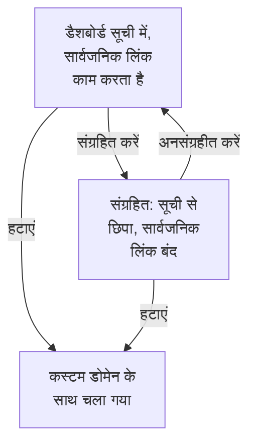

# डैशबोर्ड कॉन्फ़िगरेशन और अनुमतियाँ

जब आपके पास रखने लायक कोई डैशबोर्ड हो, तो यह पेज बताता है कि उसे कौन पढ़ और बदल सकता है, मालिक और लेबल आपके डैशबोर्ड को कैसे व्यवस्थित करते हैं, और किसी डैशबोर्ड की कॉपी, निर्यात, संग्रहण और हटाना कैसे करें।

:::cards
- [कौन क्या कर सकता है](#कौन-क्या-कर-सकता-है): हर कार्रवाई के पीछे की अनुमतियाँ, और वे किसके पास हैं।
- [मालिक](#मालिक): वे उपयोगकर्ता और टीमें जिनका डैशबोर्ड है।
- [डैशबोर्ड की प्रतिलिपि बनाना](#डैशबोर्ड-की-प्रतिलिपि-बनाना): एक सुरक्षित कॉपी, आपके लिए क्रमांकित।
- [डैशबोर्ड संग्रहित करना](#डैशबोर्ड-संग्रहित-करना): किसी डैशबोर्ड को हटाए बिना अलग रख दें।
:::

## कौन क्या कर सकता है

डैशबोर्ड आपके प्रोजेक्ट की [अनुमतियों](/docs/permissions/index) का पालन करते हैं। हर कार्रवाई के लिए इनमें से एक चाहिए, जो किसी टीम के ज़रिए मिलती है:

| इसके लिए | यह चाहिए |
| --- | --- |
| डैशबोर्ड पढ़ना | `ReadDashboard`, या कोई प्रोजेक्ट भूमिका: Project Owner, Project Admin, Project Member, Viewer, या कोई Settings भूमिका |
| डैशबोर्ड बनाना | `CreateDashboard`, Project Owner या Project Admin |
| डैशबोर्ड बदलना: उसके विजेट, वेरिएबल, साझाकरण, ब्रांडिंग, और उसे संग्रहित करना | `EditDashboard`, Project Owner या Project Admin |
| डैशबोर्ड हटाना | `DeleteDashboard`, Project Owner या Project Admin |
| मालिक जोड़ना और हटाना | डैशबोर्ड मालिक अनुमतियाँ, Project Owner, Project Admin या Project Member |
| कस्टम डोमेन जोड़ना और बदलना | डैशबोर्ड डोमेन अनुमतियाँ, Project Owner, Project Admin, Project Member, Settings Admin या Settings Member |
| स्वामी नियम और लेबल नियम बनाना | नियम अनुमतियाँ, Project Owner या Project Admin |

तो एक Project Member हर डैशबोर्ड पढ़ता है, पर उन्हें बनाने के लिए उसे `CreateDashboard` और `EditDashboard` चाहिए। पढ़ना, संपादन और हटाना, हर एक को किसी टीम के अपने डैशबोर्ड तक, या कुछ लेबल वाले डैशबोर्ड तक सीमित किया जा सकता है: देखें [दायरा: कोई अनुमत अधिकार कितनी दूर पहुँचता है](/docs/permissions/index#दायरा-कोई-अनुमत-अधिकार-कितनी-दूर-पहुँचता-है)।

इन्हें किसी टीम के **अनुमतियाँ** पेज पर असाइन करें: **उत्पाद → टीमें** खोलें और टीम चुनें।

प्रोजेक्ट के बाहर डैशबोर्ड कौन देख सकता है, यह एक अलग सवाल है, जिसका जवाब उसके **साझाकरण** पेज पर मिलता है: देखें [सार्वजनिक डैशबोर्ड की पहुँच](#सार्वजनिक-डैशबोर्ड-की-पहुँच)।

## मालिक

किसी डैशबोर्ड के **मालिक** वे उपयोगकर्ता और टीमें हैं जिनका वह है। उन्हें डैशबोर्ड के **मालिक** पेज पर जोड़ें, या **डैशबोर्ड** सूची में कई डैशबोर्ड चुनकर सभी में एक साथ मालिक जोड़ें।

मालिक तभी पहुँच को सीमित करते हैं जब आप ऐसा चाहें: किसी टीम के अपने डैशबोर्ड तक सीमित टीम अनुमति सिर्फ़ उन डैशबोर्ड तक पहुँचती है जिनमें वह टीम, या कार्रवाई करने वाला व्यक्ति, मालिक के रूप में दर्ज हो। सिर्फ़ मालिक होने से कुछ नहीं मिलता।

**डैशबोर्ड** सूची हर डैशबोर्ड के मालिक दिखाती है, और उसका **स्वामी** फ़िल्टर किसी व्यक्ति या टीम के डैशबोर्ड ढूँढता है।

## लेबल

लेबल डैशबोर्ड को व्यवस्थित करने के टैग हैं। इन्हें डैशबोर्ड के **अवलोकन** पेज पर जोड़ें, जहाँ आप उसका नाम और विवरण भी संपादित करते हैं, या **डैशबोर्ड** सूची से एक साथ कई डैशबोर्ड में।

आम तरीके:

- **टीम के अनुसार**: `team:platform`, `team:checkout`, `team:growth`।
- **एनवायरनमेंट के अनुसार**: `env:prod`, `env:staging`।
- **उद्देश्य के अनुसार**: `purpose:oncall`, `purpose:exec`, `purpose:investigation`।

**डैशबोर्ड** सूची पर **लेबल** फ़िल्टर ऐसे प्रोजेक्ट में डैशबोर्ड ढूँढने का सबसे तेज़ तरीका है जिसमें बहुत सारे डैशबोर्ड जमा हो गए हों। लेबल अनुमतियाँ भी सीमित करते हैं: कुछ लेबल तक सीमित टीम अनुमति सिर्फ़ उन डैशबोर्ड तक पहुँचती है जिन पर उनमें से कोई लेबल हो।

## स्वामी और लेबल नियम

मालिक और लेबल हाथ से जोड़ने के बजाय, नियमों को यह करने दें। **डैशबोर्ड** साइड मेनू में **सेटिंग्स** के तहत, **स्वामी नियम** मालिक जोड़ते हैं और **लेबल नियम** लेबल जोड़ते हैं, हर उस नए डैशबोर्ड में जो उनसे मेल खाता हो: उसके पहले से लगे लेबल से, या उसके नाम या विवरण में किसी पैटर्न से। [लेबल और स्वामी नियम](/docs/configuration/label-and-owner-rules) बताता है कि नियम कैसे मेल खाते हैं, और पहले से मौजूद डैशबोर्ड पर कोई नियम कैसे चलाएँ।

## सार्वजनिक डैशबोर्ड की पहुँच

प्रोजेक्ट के बाहर डैशबोर्ड कौन देख सकता है, यह उसके **साझाकरण** पेज पर एक ही विकल्प है (डैशबोर्ड पर **⋯ → साझा करें** से भी; देखें [साझाकरण और सार्वजनिक डैशबोर्ड](/docs/dashboards/sharing)):

1. **केवल इस प्रोजेक्ट के लोग** (डिफ़ॉल्ट) — डैशबोर्ड का कोई सार्वजनिक लिंक नहीं होता; उसका सार्वजनिक पता "नहीं मिला" वाला पेज दिखाता है।
2. **लिंक वाला कोई भी व्यक्ति** — जिसके पास सार्वजनिक लिंक है वह साइन इन किए बिना उसे देख सकता है।
3. **लिंक और पासवर्ड वाला कोई भी व्यक्ति** — डैशबोर्ड दिखने से पहले आगंतुक एक पासवर्ड डालते हैं।

उसी पेज पर **और सेटिंग्स** के तहत, **IP अनुमति सूची** (Scale प्लान) सार्वजनिक लिंक पर आने वाले उन सभी अनुरोधों को अस्वीकार करती है जिनका IP पता उसमें नहीं है। सबसे कसा हुआ सार्वजनिक सेटअप है **लिंक और पासवर्ड वाला कोई भी व्यक्ति** के साथ IP अनुमति सूची — उन पार्टनर पोर्टलों के लिए उपयोगी जहाँ आप दोनों परतें चाहते हैं।

## डैशबोर्ड की प्रतिलिपि बनाना

किसी डैशबोर्ड की कॉपी बनाने के लिए, उसे खोलें, उसके **सेटिंग्स** पेज पर जाएँ और **डैशबोर्ड की प्रतिलिपि बनाएँ** पर क्लिक करें। कॉपी का नाम आपके लिए भर दिया जाता है: डैशबोर्ड का नाम, प्रोजेक्ट में पहले से मौजूद नामों के बाद के क्रमांक के साथ ("Checkout API" की कॉपी "Checkout API 2" बनती है, और उसकी कॉपी "Checkout API 3")। चाहें तो उसे बदलें, **डैशबोर्ड की प्रतिलिपि बनाएँ** से पुष्टि करें, और कॉपी खुल जाती है। उसमें डैशबोर्ड के विजेट, वेरिएबल, विवरण और लेबल होते हैं। ब्रांडिंग और कस्टम डोमेन मूल डैशबोर्ड के साथ रहते हैं, और सार्वजनिक साझाकरण हमेशा बंद से शुरू होता है, ताकि आप तय कर सकें कि उसे चालू करना है या नहीं।

यह सही कदम है जब आप किसी टेम्पलेट (जैसे "हमारा ऑन-कॉल डैशबोर्ड") से किसी खास सेवा के लिए एक कॉपी निकालना चाहते हैं।

## निर्यात और आयात

डैशबोर्ड JSON के रूप में एक जगह से दूसरी जगह जाता है:

- डैशबोर्ड के **सेटिंग्स** पेज पर **डैशबोर्ड निर्यात करें** उसे JSON फ़ाइल के रूप में डाउनलोड करता है। कई डैशबोर्ड निर्यात करने के लिए, उन्हें **डैशबोर्ड** सूची में चुनें और **JSON निर्यात करें** चुनें।
- **डैशबोर्ड** सूची के ऊपर **JSON आयात करें** ऐसी फ़ाइल से डैशबोर्ड बनाता है, इस प्रोजेक्ट में या किसी दूसरे में।

निर्यात में डैशबोर्ड की अपनी सेटिंग्स होती हैं, जिनमें उसके विजेट और वेरिएबल भी शामिल हैं। उसके मालिक और लेबल छोड़ दिए जाते हैं, और जो विजेट इस प्रोजेक्ट के संसाधनों की ओर इंगित करते हैं, जैसे कोई SLO या डेटा स्रोत, उन्हें किसी दूसरे प्रोजेक्ट में वे संसाधन फिर से चुनने पड़ सकते हैं।

## डैशबोर्ड संग्रहित करना

ऐसे डैशबोर्ड को संग्रहित करें जिसका आप अब उपयोग नहीं करते पर रखना चाहते हैं। संग्रहित डैशबोर्ड **डैशबोर्ड** सूची से हट जाता है और, अगर वह सार्वजनिक है, तो उसका सार्वजनिक लिंक काम करना बंद कर देता है — उसका URL और कस्टम डोमेन "Dashboard not found" जवाब देते हैं। उसके विजेट, वेरिएबल, ब्रांडिंग, डोमेन और सार्वजनिक सेटिंग्स सब रखे जाते हैं, इसलिए अनसंग्रहीत करने पर वह बिल्कुल पहले जैसा लौट आता है, सार्वजनिक लिंक समेत।

एक डैशबोर्ड संग्रहित करने के लिए, उसे खोलें, उसके **सेटिंग्स** पेज पर जाएँ और **संग्रहित करें** पर क्लिक करें। कई डैशबोर्ड संग्रहित करने के लिए, उन्हें **डैशबोर्ड** सूची में चुनें और **संग्रहित करें** चुनें। किसी को वापस लाने के लिए, **डैशबोर्ड → उन्नत → संग्रहीत** खोलें, उसे चुनें और **अनसंग्रहीत करें** चुनें, या उसे खोलें और उसके पेजों के ऊपर बैनर में **अनसंग्रहीत करें** पर क्लिक करें।

संग्रहण हटाने का उलटा जा सकने वाला विकल्प है: पक्का न हों तो पहले इसे अपनाएँ।

## डैशबोर्ड हटाना

डैशबोर्ड का **हटाएं** पेज खोलें। हटाना पूर्ववत नहीं किया जा सकता: डैशबोर्ड, उसके विजेट और वेरिएबल, और उससे जुड़े सभी कस्टम डोमेन हटा दिए जाते हैं। आपकी टेलीमेट्री को छुआ नहीं जाता।

अगर डैशबोर्ड किसी कस्टम डोमेन पर सार्वजनिक है, तो उसे हटाते ही वह पता जवाब देना बंद कर देता है। पते को परोसते रहने के लिए, इसे हटाने के बाद डोमेन को किसी दूसरे डैशबोर्ड में जोड़ें: एक डोमेन एक समय में एक ही डैशबोर्ड का होता है।

## ऑडिट लॉग

डैशबोर्ड का **ऑडिट लॉग** पेज डैशबोर्ड में किए गए हर बदलाव की सूची देता है, और यह कि उसे किसने किया। ऑडिट लॉग Enterprise प्लान का हिस्सा हैं; देखें [एंटरप्राइज़ संस्करण](/docs/self-hosted/enterprise)।

## डेटा प्रतिधारण और बैकअप

डैशबोर्ड खुद समाप्त नहीं होते। वे जो डेटा दिखाते हैं वह आपके प्रोजेक्ट की प्रतिधारण सेटिंग्स का पालन करता है: समय सीमा पिछले 3 महीनों पर सेट होने पर, अपने लॉग 15 दिन रखने वाला प्रोजेक्ट उनमें से पिछले 15 दिन दिखाता है।

अगर आप OneUptime खुद होस्ट करते हैं, तो डेटाबेस का नियमित बैकअप काफ़ी है: डैशबोर्ड का कॉन्फ़िगरेशन आपके बाकी प्रोजेक्ट के साथ सहेजा जाता है। OneUptime Cloud पर, बैकअप आपके लिए संभाले जाते हैं। अपनी एक कॉपी के लिए, डैशबोर्ड को JSON के रूप में निर्यात करें, या उसे [OneUptime API](/docs/api-reference/api-reference) से पढ़ें।

## अगले कदम

:::cards
- [साझाकरण और सार्वजनिक डैशबोर्ड](/docs/dashboards/sharing): सार्वजनिक लिंक, पासवर्ड, IP अनुमति सूचियाँ और कस्टम डोमेन।
- [उपयोगकर्ता, टीमें और अनुमतियाँ](/docs/permissions/index): टीमें, भूमिकाएँ, दायरे और ब्लॉक।
- [डैशबोर्ड वेरिएबल और फ़िल्टर](/docs/dashboards/variables): हर सेवा के लिए एक डैशबोर्ड।
- [डैशबोर्ड अवलोकन](/docs/dashboards/index): पूरी तस्वीर।
:::
