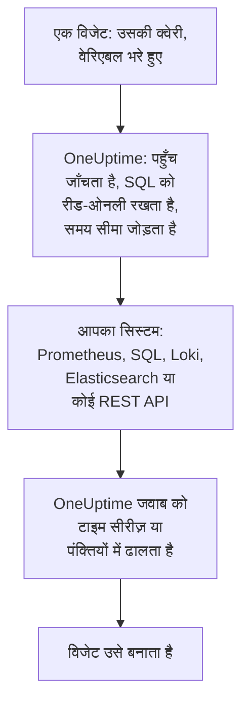

# बाहरी डेटा स्रोत

बाहरी डेटा स्रोत OneUptime के बाहर के किसी सिस्टम को कनेक्ट करता है, जैसे Prometheus, कोई SQL डेटाबेस, ClickHouse, Loki, Elasticsearch या कोई REST API, ताकि आपके डैशबोर्ड उसके डेटा को आपके अपने डेटा के बगल में चार्ट कर सकें। आप सिस्टम को एक बार कनेक्ट करते हैं; उसके बाद हर विजेट उस सिस्टम की अपनी भाषा में एक रीड-ओनली क्वेरी चलाता है।

:::cards
- [डेटा स्रोत कनेक्ट करें](#डेटा-स्रोत-कनेक्ट-करें): प्रकार चुनें, फिर बताएँ कि वह कहाँ है और साइन इन कैसे करना है।
- [क्वेरी लिखें](#क्वेरी-लिखें): PromQL, SQL, LogQL, Query DSL या कोई अनुरोध।
- [सीमाएँ](#सीमाएँ): वे टाइमआउट और ऊपरी सीमाएँ जो दोनों पक्षों की रक्षा करती हैं।
- [सुरक्षित रखना](#सुरक्षित-रखना): रीड-ओनली क्वेरी और सिर्फ़ लिखी जा सकने वाली क्रेडेंशियल।
:::

## क्वेरी कैसे चलती है

विजेट अपनी क्वेरी OneUptime को भेजता है, वेरिएबल पहले से भरे हुए। OneUptime जाँचता है कि आप उस डेटा स्रोत को पढ़ सकते हैं, समय सीमा भरता है, और अपनी रखी क्रेडेंशियल से आपके सिस्टम से पूछता है। फिर वह जवाब को टाइम सीरीज़ या पंक्तियों का रूप देता है, जिन्हें विजेट बनाता है।



## शुरू करने से पहले

- **ऐसा प्लान जिसमें यह शामिल हो।** OneUptime Cloud पर, डेटा स्रोत बनाने और बदलने के लिए **Growth** प्लान चाहिए। किसी को हटाना हर प्लान पर काम करता है।
- **उन्हें जोड़ने की अनुमति।** प्रोजेक्ट के मालिक और एडमिन डेटा स्रोत जोड़ सकते हैं; बाकी सभी को `CreateDataSource` चाहिए, और उन्हें बदलने व हटाने के लिए `EditDataSource` और `DeleteDataSource`। प्रोजेक्ट के डेटा स्रोत पढ़ सकने वाला हर व्यक्ति, सदस्य और व्यूअर समेत, उनके विजेट का डेटा देखता है।
- **एक रीड-ओनली अकाउंट।** डैशबोर्ड सिर्फ़ पढ़ते हैं। डेटाबेस को ऐसे अकाउंट से कनेक्ट करें जो सिर्फ़ पढ़ सके, और HTTP स्रोतों को ऐसे टोकन से जो सिर्फ़ क्वेरी कर सके।
- **अंदर पहुँचने का रास्ता।** आपके सिस्टम से OneUptime का API सर्वर कनेक्ट होता है, इसलिए उसे सिस्टम तक पहुँच पाना चाहिए: अस्वीकार किए जाने वाले पतों के लिए [सुरक्षित रखना](#सुरक्षित-रखना) देखें।

## समर्थित सिस्टम

| प्रकार | क्वेरी भाषा | किसके साथ काम करता है |
| --- | --- | --- |
| Prometheus | PromQL | Prometheus, Thanos, Cortex, Mimir, VictoriaMetrics |
| PostgreSQL | SQL | PostgreSQL, TimescaleDB, CockroachDB |
| MySQL | SQL | MySQL, MariaDB |
| Microsoft SQL Server | T-SQL | SQL Server, Azure SQL |
| ClickHouse | SQL | ClickHouse, उसके HTTP इंटरफ़ेस के ज़रिए |
| Grafana Loki | LogQL | Loki और Loki-संगत एंडपॉइंट |
| Elasticsearch | Query DSL (JSON) | Elasticsearch, OpenSearch |
| REST API | अनुरोध (JSON) | JSON में जवाब देने वाला कोई भी HTTP(S) API |

## डेटा स्रोत कनेक्ट करें

:::steps
### डेटा स्रोत खोलें

**उत्पाद → डैशबोर्ड** खोलें, साइड मेनू में **सेटिंग्स** फैलाएँ और **डेटा स्रोत** पर क्लिक करें।

### प्रकार चुनें

**Data Source बनाएँ** पर क्लिक करें। **Choose a Data Source Type** डायलॉग प्रकारों को इस आधार पर समूहों में रखता है कि उनमें क्या होता है: मेट्रिक्स, लॉग, डेटाबेस, खोज और API। किसी एक पर क्लिक करें।

### उसे नाम दें

**मूल जानकारी** के तहत, उसे एक **नाम** दें, जैसे "प्रोडक्शन Prometheus", और चाहें तो एक **विवरण**।

### बताएँ कि वह कहाँ है

**कनेक्शन** के तहत, HTTP स्रोत को वह **URL** चाहिए जिस पर वह जवाब देता है। डेटाबेस को अपना **Database Host**, अपना **Database Port** (5432, 3306, 1433 या 8123 के लिए खाली छोड़ें), और अपना **डेटाबेस नाम** चाहिए।

### बताएँ कि साइन इन कैसे करना है

**प्रमाणीकरण** के तहत, एक **उपयोगकर्ता नाम** और **पासवर्ड** दर्ज करें, या HTTP स्रोत के लिए एक **API टोकन**, जो बेयरर टोकन के रूप में भेजा जाता है। **और फ़ील्ड** में **Custom HTTP Headers** होते हैं, जैसे `{ "X-Scope-OrgID": "tenant-1" }`, और **Additional Options**: डेटाबेस के लिए `sslEnabled` और `sslRejectUnauthorized`, और Elasticsearch के लिए `elasticsearchIndex`, जिसके बिना वह हर इंडेक्स (`*`) पढ़ता है।

### उसका परीक्षण करें

**Data Source बनाएँ** पर क्लिक करें, फिर उसकी पंक्ति में **परीक्षण** पर। OneUptime आपकी दी गई जानकारी से कनेक्ट होता है, और बताता है कि यह काम किया या क्या गलत हुआ।
:::

बाद में किसी डेटा स्रोत को बदलने के लिए, उसे सूची से खोलें। **Data Source Details** पर **संपादित करें** उसके रहस्यों को छोड़कर सब कुछ बदलता है; **क्रेडेंशियल अपडेट करें** पासवर्ड, टोकन या हेडर बदलता है, और जिन फ़ील्ड को आप खाली छोड़ते हैं उन्हें जैसा था वैसा रहने देता है; **परीक्षण** उसे फिर से जाँचता है।

## इसे किसी विजेट में इस्तेमाल करें

कोई डैशबोर्ड संपादित करें, **विजेट जोड़ें** पर क्लिक करें और बाहरी डेटा स्रोत समूह का कोई विजेट चुनें: **चार्ट**, **मान**, **गेज** या **तालिका**। उसकी सेटिंग्स में:

- **Data Source** चुनें और **क्वेरी** लिखें। एडिटर क्वेरी भाषा का नाम बताता है और उस प्रकार का एक उदाहरण दिखाता है।
- किसी चार्ट पर, **क्वेरी जोड़ें** उन्हीं अक्षों पर और क्वेरी जोड़ता है, और **Legend (optional)** हर सीरीज़ को उसके लेबल से नाम देता है: `{{instance}} — errors` सीरीज़ का `instance` लेबल सबसे आगे लिखता है।
- किसी मान या गेज पर, **Reduce** बिंदुओं को एक संख्या में बदलता है: अंतिम मान (डिफ़ॉल्ट), पहला, औसत, योग, न्यूनतम या अधिकतम। **Unit** एक प्रत्यय जोड़ता है, और जानी-पहचानी इकाइयों को स्केल करता है: `Bytes` 1.5 MB के रूप में, और `ms` 2.4 s के रूप में पढ़ा जाता है।
- किसी तालिका पर, कोई भी रीड-ओनली क्वेरी काम करती है, और उसकी पंक्तियाँ वैसे ही दिखती हैं जैसे लौटती हैं।

## क्वेरी लिखें

हर प्रकार अपनी भाषा लेता है, पर जो लौटता है उसके नियम वही हैं:

- **चार्ट, मान और गेज को टाइम सीरीज़ चाहिए।** SQL क्वेरी `time`, `timestamp`, `date` या `ts` नाम का एक समय कॉलम, और एक संख्यात्मक `value` कॉलम (या उसका पहला संख्यात्मक कॉलम) लौटाती है; बाकी हर कॉलम सीरीज़ लेबल बन जाता है। Elasticsearch को `date_histogram` एग्रीगेशन चाहिए, और Loki को `rate()` या `count_over_time()` जैसी मेट्रिक क्वेरी।
- **तालिकाएँ पंक्तियाँ दिखाती हैं** जैसे क्वेरी उन्हें लौटाती है: SQL पंक्तियाँ, Prometheus सीरीज़, Loki लॉग पंक्तियाँ, Elasticsearch हिट, या किसी REST API के `rowsPath` पर मौजूद ऑब्जेक्ट।

:::tabs
@tab Prometheus
```text title="PromQL"
sum by (job) (rate(http_requests_total{job=~"{{job}}"}[5m]))
```
@tab SQL
```sql title="SQL"
SELECT date_trunc('minute', created_at) AS time, COUNT(*) AS value
FROM orders
WHERE created_at BETWEEN $__startTime AND $__endTime
GROUP BY 1
ORDER BY 1
```
@tab Loki
```text title="LogQL"
sum by (app) (rate({app="api"} |= "error" [5m]))
```
@tab Elasticsearch
```json title="Query DSL"
{
  "query": { "range": { "@timestamp": { "gte": "$__startTime", "lte": "$__endTime" } } },
  "aggs": {
    "over_time": {
      "date_histogram": { "field": "@timestamp", "fixed_interval": "1m" }
    }
  }
}
```
@tab REST API
```json title="Request"
{
  "path": "/api/stats?from=$__startTimeMs&to=$__endTimeMs",
  "method": "GET",
  "rowsPath": "data.items",
  "timestampField": "time",
  "valueField": "count",
  "seriesField": "service"
}
```
:::

### समय मैक्रो

Prometheus और Loki को हर अनुरोध के साथ डैशबोर्ड की समय सीमा मिलती है, इसलिए उनकी क्वेरी को और कुछ नहीं चाहिए। बाकी प्रकार समय सीमा वहाँ रखते हैं जहाँ आप कोई मैक्रो लिखते हैं:

| मैक्रो | क्या बनता है | कहाँ |
| --- | --- | --- |
| `$__startTime`, `$__endTime` | सीमा की शुरुआत और अंत, UTC में: SQL में `'2026-10-13 09:00:00'`, बाकी जगह ISO 8601 | SQL, Elasticsearch, REST API |
| `$__startTimeMs`, `$__endTimeMs` | वही, 1970 से मिलीसेकंड के रूप में | SQL, Elasticsearch, REST API |
| `$__rangeSeconds` | सीमा की लंबाई, सेकंड में | SQL |

SQL मैक्रो UTC में लिखे जाते हैं, इसलिए अपने डेटाबेस सेशन UTC में चलाएँ, या क्वेरी में बदलें।

### डैशबोर्ड वेरिएबल

किसी क्वेरी में कहीं भी `{{name}}` लिखें, और विजेट क्वेरी भेजने से पहले वहाँ वेरिएबल का मान रख देता है। मल्टी-सेलेक्ट वेरिएबल के कई मान `|` से जोड़े जाते हैं, जो PromQL या LogQL के रेगुलर एक्सप्रेशन मैचर को चाहिए: `job=~"{{job}}"`। जिस वेरिएबल में कुछ भी नहीं चुना गया, वह प्लेसहोल्डर को लिखे अनुसार छोड़ देता है, इसलिए त्रुटि उसका नाम बताती है। [डैशबोर्ड वेरिएबल और फ़िल्टर](/docs/dashboards/variables) बताता है कि वेरिएबल कैसे जोड़ें।

## सीमाएँ

हर क्वेरी सीमित है, ताकि हर मिनट रीफ़्रेश होने वाले बीस विजेट का डैशबोर्ड OneUptime या आपके सिस्टम पर ज़्यादा बोझ न डाल सके:

| सीमा | मान |
| --- | --- |
| कनेक्ट होना | 10 सेकंड |
| क्वेरी चलाना | 30 सेकंड |
| टाइम सीरीज़ जवाब में बिंदु | 11,000 |
| किसी तालिका में पंक्तियाँ | 1,000 |
| किसी एक जवाब में सीरीज़ | 100 |
| HTTP स्रोत से जवाब | 20 MB |

Prometheus और Loki की रेंज क्वेरी पूरी समय सीमा में लगभग 250 बिंदु माँगती हैं, जो 10 सेकंड से ज़्यादा पास नहीं और एक दिन से ज़्यादा दूर नहीं होते।

## सुरक्षित रखना

- **SQL रीड-ओनली रहता है।** क्वेरी एक ऐसा अकेला स्टेटमेंट होनी चाहिए जो `SELECT`, `WITH`, `SHOW`, `EXPLAIN`, `DESCRIBE` या `DESC` से शुरू हो। लिखने या सेशन बदलने वाले शब्द, जैसे `INSERT`, `UPDATE`, `DELETE`, `DROP`, `INTO` या `SET`, स्ट्रिंग और कोट किए गए नामों के बाहर कहीं भी अस्वीकार किए जाते हैं, इसलिए इनमें से किसी के नाम वाले कॉलम को कोट करें। किसी स्ट्रिंग के अंदर कोट को दो कोट (`''`) के रूप में लिखें: कोट से पहले बैकस्लैश अस्वीकार किया जाता है। PostgreSQL, MySQL और ClickHouse के सेशन भी रीड-ओनली होते हैं। SQL Server में रीड-ओनली सेशन नहीं होता, इसलिए उसे रीड-ओनली लॉगिन से कनेक्ट करें।
- **क्रेडेंशियल सिर्फ़ लिखे जा सकते हैं।** **पासवर्ड**, **API टोकन** और **Custom HTTP Headers** स्टोर होने पर एन्क्रिप्ट किए जाते हैं, और API उन्हें कभी नहीं लौटाता, आपको भी नहीं।
- **पते जाँचे जाते हैं।** लूपबैक, लिंक-लोकल (जहाँ क्लाउड मेटाडेटा रहता है) और दूसरे आरक्षित पते हर जगह अस्वीकार किए जाते हैं। निजी पते OneUptime Cloud पर अस्वीकार किए जाते हैं, और सेल्फ़-होस्टेड इंस्टॉलेशन पर अनुमत होते हैं, जब तक `DATA_SOURCE_BLOCK_PRIVATE_ADDRESSES` का मान `true` न हो: देखें [निजी नेटवर्क पहुँच](/docs/self-hosted/private-network-access)।
- **सार्वजनिक डैशबोर्ड इन्हें कभी नहीं चलाते।** बाहरी डेटा स्रोत विजेट क्वेरी समेत [सार्वजनिक डैशबोर्ड](/docs/dashboards/sharing) से बाहर रखे जाते हैं।

## समस्या निवारण

:::details परीक्षण कहता है कि कनेक्ट नहीं हो सकता
URL, या होस्ट और पोर्ट, उस जगह से जाँचें जहाँ OneUptime चलता है: फ़ायरवॉल, OneUptime Cloud पर कोई निजी पता, या सिर्फ़ अपनी मशीन पर सुनने वाला डेटाबेस, यहाँ से सब एक जैसे दिखते हैं। TLS माँगने वाले डेटाबेस के लिए, **Additional Options** में `{ "sslEnabled": true }` जोड़ें।
:::

:::details "Only read-only queries are allowed"
क्वेरी `SELECT`, `WITH`, `SHOW`, `EXPLAIN`, `DESCRIBE` या `DESC` से शुरू नहीं होती। एक ऐसा स्टेटमेंट भेजें जो सिर्फ़ पढ़ता हो: किसी `;` के बाद का दूसरा स्टेटमेंट भी अस्वीकार किया जाता है, "Only a single SQL statement is allowed per query." के रूप में।
:::

:::details "Query contains a keyword that is not allowed"
लिखने वाला कोई शब्द किसी स्ट्रिंग के बाहर आता है, अक्सर कॉलम नाम के रूप में, जैसे `delete` या `set`। उसे वैसे कोट करें जैसे डेटाबेस करता है: PostgreSQL में `"delete"`, SQL Server में `[delete]`, और MySQL व ClickHouse में बैकटिक में।
:::

:::details चार्ट खाली रहता है, पर तालिका पंक्तियाँ दिखाती है
क्वेरी पंक्तियाँ लौटाती है, पर कोई टाइम सीरीज़ नहीं। SQL में समय कॉलम का नाम `time` और संख्या का नाम `value` रखें, Elasticsearch में `date_histogram` एग्रीगेशन जोड़ें, या Loki लॉग क्वेरी को `rate()` या `count_over_time()` से मेट्रिक क्वेरी में बदलें।
:::

:::details कुछ डेटा गायब है
जवाब किसी [सीमा](#सीमाएँ) तक पहुँच गया। समय सीमा छोटी करें, क्वेरी को फ़िल्टर करें, या उसे कम सीरीज़ में एग्रीगेट करें।
:::

## अगले कदम

:::cards
- [डैशबोर्ड विजेट](/docs/dashboards/widgets): हर विजेट, बाहरी डेटा स्रोत समूह समेत।
- [डैशबोर्ड वेरिएबल और फ़िल्टर](/docs/dashboards/variables): आपकी क्वेरी में इस्तेमाल करने के लिए वेरिएबल।
- [निजी नेटवर्क पहुँच](/docs/self-hosted/private-network-access): सेल्फ़-होस्टेड इंस्टॉलेशन से किसी निजी नेटवर्क के सिस्टम तक पहुँचें।
- [डैशबोर्ड कॉन्फ़िगरेशन और अनुमतियाँ](/docs/dashboards/configuration): कौन डेटा स्रोत जोड़ सकता है, और कौन उन्हें पढ़ता है।
:::
