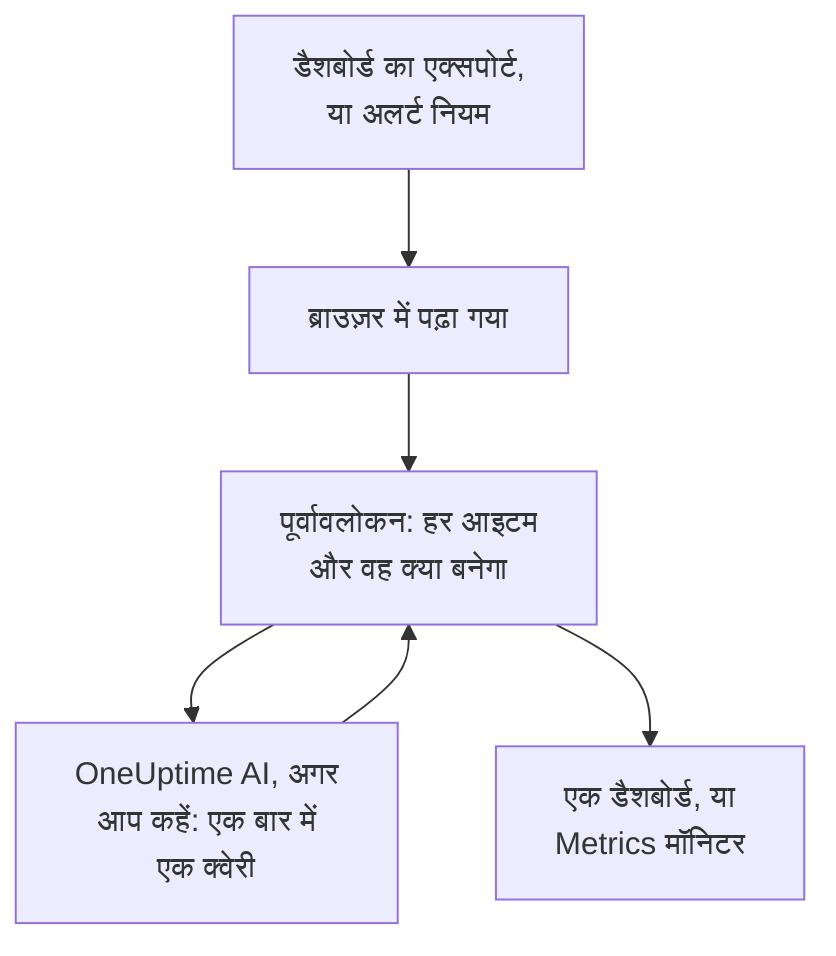

# Grafana और Datadog से आयात

Grafana या Datadog में बनाया गया कोई डैशबोर्ड, या Prometheus, Grafana या Datadog के लिए लिखे गए अलर्ट नियम, OneUptime में लाएँ। आप फ़ाइल पेस्ट या अपलोड करते हैं, देखते हैं कि हर पैनल और हर नियम क्या बनेगा, और उसके बाद ही डैशबोर्ड या मॉनिटर बनाते हैं।

:::cards
- [डैशबोर्ड आयात करें](#डैशबोर्ड-आयात-करें): Grafana डैशबोर्ड का JSON मॉडल, या Datadog डैशबोर्ड का एक्सपोर्ट।
- [अलर्ट नियम आयात करें](#अलर्ट-नियम-आयात-करें): Prometheus नियम फ़ाइलें, Grafana अलर्ट नियम और Datadog मॉनिटर।
- [हर आइटम कैसे बदलता है](#हर-आइटम-कैसे-बदलता-है): ठीक-ठीक, लगभग, या बिल्कुल नहीं, और क्यों।
- [OneUptime AI से क्वेरी बदलें](#oneuptime-ai-से-क्वेरी-बदलें): ऐसी क्वेरी के लिए जिसे कोई नियम नहीं बदलता।
:::

## आयात कैसे होता है

OneUptime आपके ब्राउज़र में फ़ाइल पढ़ता है और हर पैनल, विजेट, वेरिएबल और नियम को अलग-अलग बदलता है। पूर्वावलोकन उन सभी को, हर एक जो बनेगा उसके साथ, सूची में दिखाता है। जब तक आप बनाना नहीं चुनते, कुछ नहीं बनता, और तब यह आपकी अपनी अनुमतियों से बनता है, जैसे डैशबोर्ड और मॉनिटर के फ़ॉर्म इसे बनाते हैं।

## शुरू करने से पहले

- आयात किए गए विजेट और मॉनिटर इस प्रोजेक्ट के अपने मेट्रिक्स PromQL से पढ़ते हैं। उन्हें Prometheus remote write, OpenTelemetry या Datadog Agent से भेजें, और वे वहाँ के अपने नाम बनाए रखते हैं।
- डैशबोर्ड आयात करने के लिए ऐसी भूमिका चाहिए जो डैशबोर्ड बना सके, और अलर्ट नियम आयात करने के लिए ऐसी भूमिका जो मॉनिटर बना सके।
- फ़ाइल 10 MB तक हो सकती है, और उसके अधिकतम 500 पैनल या नियम पढ़े जाते हैं।

## डैशबोर्ड आयात करें

:::steps
### डैशबोर्ड आयात खोलें

**उत्पाद → डैशबोर्ड** खोलें, फिर **अधिक विकल्प → Import from Grafana or Datadog** चुनें।

### डैशबोर्ड पेस्ट करें

Grafana में, डैशबोर्ड की सेटिंग्स से JSON मॉडल कॉपी करें। Datadog में, डैशबोर्ड का JSON एक्सपोर्ट करें। उसे पेस्ट करें, या **Upload a File** चुनें, फिर **पूर्वावलोकन** चुनें।

### डैशबोर्ड बनाएँ

देखें कि हर पैनल और हर वेरिएबल क्या बनेगा, डैशबोर्ड को नाम दें, और **डैशबोर्ड बनाएँ** चुनें। नया डैशबोर्ड खुल जाता है।
:::

Grafana का PromQL जैसा लिखा है वैसा ही रहता है: OneUptime `$__interval`, `$__rate_interval` और `$__range` को Grafana की तरह भरता है, और All पर रखा वेरिएबल हर मान से मेल खाता है। Datadog क्वेरी Datadog Agent के भेजे मेट्रिक्स पर PromQL बन जाती है: `avg:system.cpu.user{host:web-1}` पढ़ता है `system_cpu_user{host="web-1"}`।

## अलर्ट नियम आयात करें

:::steps
### अलर्ट आयात खोलें

**उत्पाद → मॉनिटर** खोलें, फिर **अधिक विकल्प → Import Alerts** चुनें।

### नियम पेस्ट करें

Prometheus नियम फ़ाइल या PrometheusRule संसाधन, Grafana के अलर्ट नियमों का एक्सपोर्ट, या JSON में एक्सपोर्ट किए गए Datadog मॉनिटर पेस्ट करें, फिर **पूर्वावलोकन** चुनें।

### मॉनिटर बनाएँ

जो नियम नहीं चाहिए उनका निशान हटाएँ, **When a rule fires** में चुनें कि चलने वाला नियम क्या खोले, और **मॉनिटर बनाएँ** चुनें।
:::

हर नियम एक Metrics मॉनिटर बन जाता है, जिसमें एक PromQL क्वेरी, नियम की शर्त और उसकी समय-सीमा होती है। यह सीमा पार करने वाली हर सीरीज़ के लिए एक अलर्ट, या एक घटना, खोलता है, और सीरीज़ ठीक होने पर उसे हल कर देता है। शीर्षक और विवरण नियम के सारांश या संदेश से आते हैं, जिनमें सीरीज़ के लेबल भरे जाते हैं।

## हर आइटम कैसे बदलता है

| स्थिति | इसका अर्थ |
| --- | --- |
| **Converted exactly** | यह वही डेटा पढ़ता है और उसे उसी तरह दिखाता है। |
| **Converted approximately** | यह बनता है, और इसके नोट बताते हैं कि क्या अलग है। |
| **Not converted** | इसके लिए कुछ नहीं बनता, और इसके नोट बताते हैं क्यों। |

रिकॉर्डिंग नियम, लॉग पर अलर्ट नियम, लॉग, ट्रेस या इवेंट पढ़ने वाले Datadog विजेट, और Datadog के विसंगति, आउटलायर और पूर्वानुमान मॉनिटर नहीं बदले जाते।

## OneUptime AI से क्वेरी बदलें

जिस क्वेरी को कोई नियम नहीं बदलता, उस पर **Convert with OneUptime AI** दिखता है, जिसके लिए प्रोजेक्ट में AI चालू होना चाहिए। केवल वह क्वेरी, डैशबोर्ड के वेरिएबल के नामों के साथ, आपके प्रोजेक्ट के AI प्रदाता को जाती है। उत्तर को किसी भी क्वेरी की तरह जाँचा जाता है और आपको दिखाया जाता है: उसे इस्तेमाल करने के लिए **Use This Query** चुनें। जब तक आप डैशबोर्ड या मॉनिटर नहीं बनाते, कुछ नहीं बनता।

## अगले कदम

:::cards
- [डैशबोर्ड विजेट](/docs/dashboards/widgets): बदलें कि आयात किया गया विजेट क्या दिखाता है।
- [डैशबोर्ड वेरिएबल और फ़िल्टर](/docs/dashboards/variables): वे वेरिएबल जो आयात ने बनाए।
- [मेट्रिक्स मॉनिटर](/docs/monitor/metrics-monitor): वे मॉनिटर जो आयात ने बनाए।
- [PromQL](/docs/telemetry/promql): वह भाषा जो आयात किए गए विजेट और मॉनिटर पढ़ते हैं।
:::
