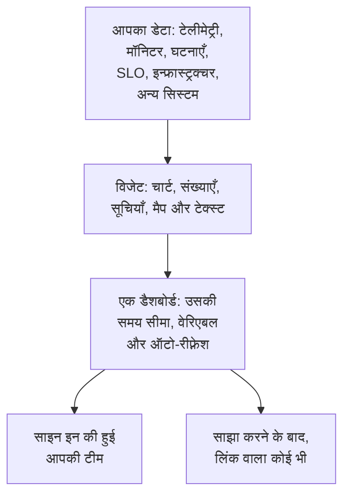

# डैशबोर्ड अवलोकन

डैशबोर्ड विजेट से बना एक पेज है जिसे आप खुद व्यवस्थित करते हैं: आपके मेट्रिक्स, लॉग और ट्रेस के चार्ट, घटनाओं, अलर्ट और मॉनिटर की सूचियाँ, आपके SLO और इन्फ्रास्ट्रक्चर, यहाँ तक कि OneUptime के बाहर के सिस्टम का डेटा भी। ऑन-कॉल स्क्रीन, टीम की सुबह की जाँच या अपने ग्राहकों के लिए एक पेज के रूप में डैशबोर्ड बनाएँ, और उसे अपने प्रोजेक्ट के साथ या लिंक वाले किसी भी व्यक्ति के साथ साझा करें।

:::cards
- [डैशबोर्ड कैसे काम करता है](#डैशबोर्ड-कैसे-काम-करता-है): उसका डेटा कहाँ से आता है, और उसे कौन देखता है।
- [अपने डैशबोर्ड ढूँढें](#अपने-डैशबोर्ड-ढूँढें): डैशबोर्ड सूची और हर डैशबोर्ड के अपने पेज।
- [अपना पहला डैशबोर्ड बनाएँ](#अपना-पहला-डैशबोर्ड-बनाएँ): टेम्पलेट से साझा पेज तक, पाँच चरणों में।
- [एक उदाहरण: ऑन-कॉल डैशबोर्ड](#एक-उदाहरण-ऑन-कॉल-डैशबोर्ड): एक पेज जो हर सेवा के लिए काम करता है।
:::

## डैशबोर्ड कैसे काम करता है

हर विजेट एक स्रोत से पढ़ता है, डैशबोर्ड की समय सीमा के भीतर और उसके वेरिएबल से फ़िल्टर करके। डैशबोर्ड खोलने वाले सभी लोग वही विजेट देखते हैं: आपकी टीम साइन इन करने पर, और आगंतुक आपके साझा करने के बाद उसके सार्वजनिक लिंक से।

| शब्द | इसका अर्थ |
| --- | --- |
| डैशबोर्ड | एक पेज: एक नाम, विजेट का ग्रिड, एक समय सीमा, वेरिएबल और एक ऑटो-रीफ़्रेश सेटिंग। |
| विजेट | ग्रिड पर एक टाइल: एक चार्ट, एक संख्या, एक सूची, एक मैप, एक घड़ी या टेक्स्ट का एक ब्लॉक। |
| वेरिएबल | टूलबार में एक पिकर, जो इसे सपोर्ट करने वाले हर विजेट को किसी एक सेवा, होस्ट या ग्राहक तक सीमित करता है। |
| समय सीमा | वह अवधि जिसे हर चार्ट और संख्या पढ़ती है। डैशबोर्ड अपने डिफ़ॉल्ट पर खुलता है, जो पिछला एक घंटा है जब तक संपादन करने वाला कोई और तय न करे, और हर दर्शक अपना चुन सकता है। |
| ऑटो-रीफ़्रेश | विजेट कितनी बार अपना डेटा फिर से पढ़ते हैं: बंद, या हर 5 सेकंड से लेकर हर 15 मिनट तक। |
| देखना और संपादन | डैशबोर्ड पढ़ने के लिए खुलता है। संपादन एक अलग चरण है, जो आपके बदलाव सहेजने या छोड़ने पर खत्म होता है। |

## डैशबोर्ड किस काम आते हैं

- **"क्या सब ठीक है?" वाला पेज।** ऑन-कॉल इंजीनियर, टीम स्टैंडअप या दीवार पर लगी स्क्रीन के लिए।
- **संबंध देखना**: CPU में उछाल, बढ़ती लेटेंसी और एक खुली घटना एक ही पेज पर साफ़ दिखती हैं, और तीन पेजों में बिखरी हों तो आसानी से छूट जाती हैं।
- **जाँच-पड़ताल**: जिन चार्ट को आप बार-बार खोलते हैं उन्हें अगल-बगल रखें, और किसी उछाल पर ड्रैग करके उस पल के सभी विजेट पढ़ें।
- **टीम के बाहर साझा करना**: किसी ग्राहक या पार्टनर के लिए प्रदर्शन पेज, चाहें तो पासवर्ड या IP अनुमति सूची से सुरक्षित।

## अपने डैशबोर्ड ढूँढें

**उत्पाद → डैशबोर्ड** खोलें। **डैशबोर्ड** सूची प्रोजेक्ट के डैशबोर्ड उनके विवरण, लेबल और मालिकों के साथ दिखाती है। नाम या विवरण से खोजें, **स्वामी** और **लेबल** फ़िल्टर से सूची छोटी करें, या कई डैशबोर्ड चुनकर उनके लेबल या मालिक बदलें, उन्हें संग्रहित करें या JSON के रूप में निर्यात करें।

सूची के साइड मेनू में वे पेज हैं जो आपके सभी डैशबोर्ड सँभालते हैं:

| पेज | वहाँ आप क्या करते हैं |
| --- | --- |
| **डैशबोर्ड** | प्रोजेक्ट के डैशबोर्ड। एक नया बनाएँ, या **JSON आयात करें** से डैशबोर्ड लाएँ। |
| **सेटिंग्स → स्वामी नियम** | नए डैशबोर्ड में अपने आप मालिक जोड़ें। |
| **सेटिंग्स → लेबल नियम** | नए डैशबोर्ड में अपने आप लेबल जोड़ें। |
| **सेटिंग्स → डेटा स्रोत** | Prometheus, SQL डेटाबेस, ClickHouse, Loki, Elasticsearch या REST API कनेक्ट करें। |
| **उन्नत → संग्रहीत** | वे डैशबोर्ड जिन्हें आपने संग्रहित किया। उन्हें यहाँ से अनसंग्रहीत करें। |

कोई डैशबोर्ड खोलें, तो उसके अपने साइड मेनू में ये पेज होते हैं। **बेसिक** को छोड़कर हर सेक्शन मुड़ा हुआ शुरू होता है: उसे खोलने के लिए उसके शीर्षक पर क्लिक करें।

| पेज | वहाँ आप क्या करते हैं |
| --- | --- |
| **डैशबोर्ड** | डैशबोर्ड खुद। उसे पढ़ें, या उसके **⋯** मेनू से संपादित करें। |
| **अवलोकन** | उसका नाम, विवरण और लेबल। |
| **साझाकरण** | उसे कौन देख सकता है, उसका सार्वजनिक लिंक, और "और सेटिंग्स" के तहत IP अनुमति सूची। |
| **मालिक** | वे उपयोगकर्ता और टीमें जिनका यह है। |
| **ब्रांडिंग** | सार्वजनिक डैशबोर्ड का पृष्ठ शीर्षक, विवरण, लोगो, थीम और Favicon। |
| **कस्टम डोमेन** | सार्वजनिक डैशबोर्ड को अपने डोमेन पर होस्ट करें। |
| **सेटिंग्स** | डैशबोर्ड की प्रतिलिपि बनाएँ, उसे निर्यात करें या संग्रहित करें। |
| **ऑडिट लॉग** | डैशबोर्ड में किया गया हर बदलाव, और उसे किसने किया। |
| **हटाएं** | डैशबोर्ड को हमेशा के लिए हटाएं। |

## अपना पहला डैशबोर्ड बनाएँ

:::steps
1. **बनाएँ** — एक टेम्पलेट चुनें, या **शुरू से बनाएं**। टेम्पलेट नाम भर देता है और अपने विजेट के साथ खुलता है; शुरू से बना डैशबोर्ड खाली खुलता है, उसके कैनवास पर **विजेट जोड़ें** होता है।
2. **विजेट जोड़ें** — कैटलॉग से एक विजेट चुनें, उसकी सेटिंग्स में तय करें कि वह क्या पढ़ता है, फिर उसे जगह पर ड्रैग करें और उसका आकार बदलें।
3. **ज़रूरत हो तो वेरिएबल जोड़ें** — उदाहरण के लिए, एक `service` वेरिएबल एक ही डैशबोर्ड को कोई भी सेवा दिखाने देता है।
4. **सहेजें** — **परिवर्तन सहेजें** पर क्लिक करें। जब तक आप ऐसा नहीं करते, संपादन के दौरान किया गया कोई बदलाव नहीं रखा जाता।
5. **(वैकल्पिक) सार्वजनिक रूप से साझा करें** — डैशबोर्ड पर **⋯ → साझा करें** चुनें और तय करें कि उसे कौन देख सकता है: लिंक वाला कोई भी व्यक्ति, या लिंक और पासवर्ड वाला कोई भी व्यक्ति।
:::

[डैशबोर्ड बनाना](/docs/dashboards/authoring) हर चरण को विस्तार से समझाता है।

## एक उदाहरण: ऑन-कॉल डैशबोर्ड

लक्ष्य: checkout सेवा के लिए एक पेज, जिसमें उसकी लेटेंसी, त्रुटि दर, खुली घटनाएँ और नवीनतम लॉग हों, और जो बाकी हर सेवा के लिए भी काम करे।

1. **डैशबोर्ड बनाएँ** पर क्लिक करें, **शुरू से बनाएं** चुनें, और डैशबोर्ड का नाम "Checkout ऑन-कॉल" रखें।
2. **विजेट जोड़ें** पर क्लिक करें और अपने अनुरोध लेटेंसी मेट्रिक का एक **चार्ट** जोड़ें, जिसे P95 के रूप में एग्रीगेट किया गया हो।
3. उसके बगल में, अपनी त्रुटि दर का एक **मान** जोड़ें, जिसकी चेतावनी सीमा 1 और गंभीर सीमा 5 हो।
4. उनके नीचे, अनसुलझी घटनाओं तक फ़िल्टर की गई एक **घटना सूची**, और सेवा के लॉग की एक **लॉग स्ट्रीम** जोड़ें।
5. **वेरिएबल** खोलें, `service` नाम का एक वेरिएबल जोड़ें जिसका स्रोत Telemetry Attribute और विशेषता कुंजी `service.name` हो, और उसका डिफ़ॉल्ट `checkout` रखें।
6. **परिवर्तन सहेजें** पर क्लिक करें। टूलबार के `service` पिकर में `payments` चुनें: चार्ट, मान और लॉग स्ट्रीम payments सेवा पर चले जाते हैं, और घटना सूची सभी अनसुलझी घटनाएँ दिखाती रहती है।

## डैशबोर्ड OneUptime के बाकी हिस्सों के साथ कैसे जुड़ते हैं

- **मॉनिटर और टेलीमेट्री** डेटा का स्रोत हैं। आपका भेजा हर मेट्रिक, लॉग और ट्रेस किसी विजेट पर आ सकता है।
- **घटनाएँ और अलर्ट** **घटना सूची** और **अलर्ट सूची** विजेट में दिखते हैं। डैशबोर्ड उन्हें सिर्फ़ दिखाता है: उन पर काम उनके अपने पेजों पर होता है।
- **स्थिति पृष्ठ** आपके ग्राहकों को बताते हैं कि आपकी सेवा चालू है या नहीं। डैशबोर्ड विस्तार से दिखाते हैं कि वह कैसा व्यवहार कर रही है। दोनों साथ-साथ काम करते हैं।
- **वर्कफ़्लो** जो होता है उस पर कार्रवाई करते हैं। डैशबोर्ड वह जगह हैं जहाँ आप उसे पढ़ते हैं।

## अगले कदम

:::cards
- [डैशबोर्ड बनाना](/docs/dashboards/authoring): डैशबोर्ड बनाएँ, उसे संपादित करें और अपने बदलाव सहेजें।
- [डैशबोर्ड विजेट](/docs/dashboards/widgets): हर विजेट, और कौन-सा चुनें।
- [डैशबोर्ड वेरिएबल और फ़िल्टर](/docs/dashboards/variables): हर सेवा, होस्ट या ग्राहक के लिए एक डैशबोर्ड।
- [साझाकरण और सार्वजनिक डैशबोर्ड](/docs/dashboards/sharing): सार्वजनिक लिंक, पासवर्ड, IP अनुमति सूचियाँ और कस्टम डोमेन।
:::
