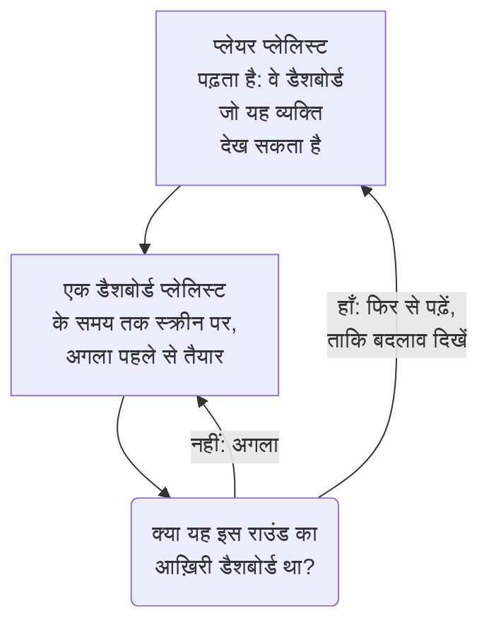

# डैशबोर्ड प्लेलिस्ट

प्लेलिस्ट डैशबोर्ड के एक समूह को एक के बाद एक ऐसी स्क्रीन पर दिखाती है जिसे कोई नहीं छूता, जैसे NOC की दीवार या किसी टीम का टीवी: हर डैशबोर्ड उतनी देर जितनी आप चुनें, बार-बार, जब तक कोई उसे रोक न दे। प्लेलिस्ट एक बार बनाएँ, स्क्रीन पर उसका प्लेयर खोलें, और उसे चलने दें।

:::cards
- [प्लेलिस्ट कैसे चलती है](#प्लेलिस्ट-कैसे-चलती-है): क्रम, बारी, और हर डैशबोर्ड क्या दिखाता है।
- [प्लेलिस्ट बनाना](#प्लेलिस्ट-बनाना): एक नाम, क्रम में उसके डैशबोर्ड, और हर एक कितनी देर दिखता है।
- [स्क्रीन पर चलाना](#स्क्रीन-पर-चलाना): प्लेयर की पट्टी, उसके बटन और उसकी कुंजियाँ।
- [कौन क्या देखता है](#कौन-क्या-देखता-है): अनुमतियाँ, और वे डैशबोर्ड जिन्हें कोई व्यक्ति नहीं पढ़ सकता।
:::

## प्लेलिस्ट कैसे चलती है

प्लेयर प्लेलिस्ट का पहला डैशबोर्ड दिखाता है, फिर उसका समय पूरा होने पर अगला, और आख़िरी के बाद फिर से पहले से शुरू करता है। हर डैशबोर्ड वैसे ही खुलता है जैसे उसके संपादकों ने उसे सहेजा था: अपनी डिफ़ॉल्ट समय सीमा, अपने ऑटो-रिफ़्रेश और अपने वेरिएबल के साथ, प्लेयर के पते में चाहे जो लिखा हो। जब एक डैशबोर्ड स्क्रीन पर होता है, प्लेयर अगले को नज़र से बाहर पहले ही बना लेता है, इसलिए दो डैशबोर्ड के बीच स्क्रीन कभी खाली नहीं होती।

प्लेलिस्ट अपने डैशबोर्ड का नाम लेती है और उनकी कभी कॉपी नहीं बनाती: कोई संपादक किसी डैशबोर्ड में जो बदलाव सहेजता है, वह अगली बार उस डैशबोर्ड की बारी आने पर स्क्रीन पर होता है। प्लेयर हर राउंड से पहले प्लेलिस्ट फिर से पढ़ता है, इसलिए जोड़ा गया, खिसकाया गया या हटाया गया डैशबोर्ड स्क्रीन को फिर से लोड किए बिना एक राउंड के भीतर दिखने लगता है; अगर यह पढ़ना विफल हो, तो स्क्रीन अपने पास का राउंड फिर से चलाती है।

## प्लेलिस्ट बनाना

:::steps
### प्लेलिस्ट खोलें
**उत्पाद → डैशबोर्ड** खोलें, फिर साइड मेनू में **प्लेलिस्ट** खोलें। सूची दिखाती है कि हर प्लेलिस्ट में कितने डैशबोर्ड हैं और हर एक कितनी देर दिखता है, और हर पंक्ति में **चलाएँ** होता है।

### नाम दें
**प्लेलिस्ट बनाएँ** पर क्लिक करें, और उसे एक **नाम** दें जो बताए कि वह कहाँ चलती है, जैसे "NOC वॉल"।

### उसके डैशबोर्ड जोड़ें
**डैशबोर्ड** में, उसी क्रम में जिसमें स्क्रीन उन्हें दिखाती है, **डैशबोर्ड जोड़ें** से हर एक चुनें। किसी डैशबोर्ड की पंक्ति के बटन उसे ऊपर या नीचे ले जाते हैं, या हटा देते हैं। संग्रहित डैशबोर्ड विकल्पों में नहीं आते।

### चुनें कि हर एक कितनी देर दिखे
**हर डैशबोर्ड इतनी देर दिखाएँ** एक मिनट से शुरू होता है; 15 सेकंड से एक घंटे तक का समय चुनें। **प्लेलिस्ट बनाएँ** पर क्लिक करें।
:::

प्लेलिस्ट का पेज उसके डैशबोर्ड क्रम में, हर एक के दिखने का समय, और **प्लेयर लिंक** दिखाता है। **प्लेलिस्ट संपादित करें** नाम, डैशबोर्ड, उनका क्रम और समय बदलता है। पेज के नीचे **डैशबोर्ड प्लेलिस्ट हटाएँ** प्लेलिस्ट को हटाता है, उसके डैशबोर्ड को कभी नहीं।

API और Terraform के ज़रिए, प्लेलिस्ट एक `name` है, उसके `dashboards` एक सूची के रूप में, जैसे `[{"dashboardId": "<id>"}]`, उसी क्रम में जिसमें वे दिखाए जाते हैं, ज़्यादा से ज़्यादा 100, और `intervalInSeconds`, 10 से 86400 (एक दिन) तक सेकंड की कोई भी पूर्ण संख्या। इन सीमाओं से बाहर का मान अस्वीकार कर दिया जाता है, यह बताते हुए कि क्या गलत है।

## स्क्रीन पर चलाना

प्लेलिस्ट की पंक्ति में या उसके पेज पर **चलाएँ** पर क्लिक करें। प्लेयर OneUptime के बाकी हिस्से के ऊपर ब्राउज़र विंडो भर देता है; **फ़ुल स्क्रीन** पूरी स्क्रीन भर देता है। किसी स्क्रीन को अपने-आप शुरू करने के लिए, उस पर **प्लेयर लिंक** खोलें और उसे बुकमार्क करें: लिंक प्लेयर को तुरंत खोल देता है।

प्लेयर की पट्टी स्क्रीन पर मौजूद डैशबोर्ड, प्लेलिस्ट, राउंड कहाँ तक पहुँचा है ("5 में से 2") और आगे आने वाला डैशबोर्ड बताती है। जब तक किसी डैशबोर्ड की बारी चलती है, पट्टी के नीचे एक रेखा भरती जाती है। पट्टी के बटन पिछले डैशबोर्ड पर जाते हैं, रोकते या चलाते हैं, और अगले पर जाते हैं; कंप्यूटर पर ये कुंजियाँ भी यही करती हैं:

| कुंजियाँ | यह क्या करती है |
| --- | --- |
| `Space` | **रोकें या चलाएँ**। रुकने पर डैशबोर्ड स्क्रीन पर बना रहता है और पट्टी **रोका गया** दिखाती है। |
| `Right Arrow` | **अगला डैशबोर्ड**। |
| `Left Arrow` | **पिछला डैशबोर्ड**। |
| `F` | **फ़ुल स्क्रीन**, या उससे वापस बाहर। |
| `Esc` | **प्लेयर से बाहर निकलें**, प्लेलिस्ट के पेज पर वापस। फ़ुल स्क्रीन में पहला `Esc` केवल फ़ुल स्क्रीन से बाहर निकालता है। |
| `?` | **कीबोर्ड शॉर्टकट दिखाएँ**। |

आप जिस डैशबोर्ड पर जाते हैं, अगला हो या पिछला, उसे पूरी बारी मिलती है। दाएँ से बाएँ पढ़े जाने वाले पेज पर, जैसे फ़ारसी में, तीर आपस में बदल जाते हैं: `Left Arrow` अगले डैशबोर्ड पर जाता है। चलते समय, जहाँ ब्राउज़र अनुमति देता है, प्लेयर स्क्रीन को स्लीप में जाने से रोकता है।

## कौन क्या देखता है

प्लेलिस्ट की अपनी अनुमतियाँ होती हैं, जो डैशबोर्ड की अनुमतियों की तरह किसी टीम के ज़रिए मिलती हैं:

| इसके लिए | यह चाहिए |
| --- | --- |
| प्लेलिस्ट देखना और चलाना | `ReadDashboardPlaylist`, या कोई प्रोजेक्ट भूमिका: Project Owner, Project Admin, Project Member, Viewer, या कोई Settings भूमिका |
| प्लेलिस्ट बनाना | `CreateDashboardPlaylist`, Project Owner या Project Admin |
| प्लेलिस्ट बदलना: उसका नाम, डैशबोर्ड और समय | `EditDashboardPlaylist`, Project Owner या Project Admin |
| प्लेलिस्ट हटाना | `DeleteDashboardPlaylist`, Project Owner या Project Admin |

प्लेलिस्ट किसी को कभी ऐसा डैशबोर्ड नहीं दिखाती जिसे वह पढ़ नहीं सकता। प्लेयर केवल वे डैशबोर्ड चलाता है जिन्हें स्क्रीन पर साइन इन किया हुआ व्यक्ति पढ़ सकता है और जो संग्रहित नहीं हैं, और बाकी को छोड़ देता है: हटाया गया डैशबोर्ड, संग्रहित डैशबोर्ड, या ऐसा डैशबोर्ड जिससे उसकी अनुमतियाँ उसे दूर रखती हैं। प्लेलिस्ट का पेज बताता है कि वह हर एक को क्यों छोड़ता है। प्लेलिस्ट सहेजने पर उसमें वे डैशबोर्ड बने रहते हैं जिन्हें संपादक खुद नहीं देख सकता, इसलिए किसी और का रखा कुछ भी खोता नहीं।

| जब प्लेयर पाता है | यह दिखाता है |
| --- | --- |
| ऐसे डैशबोर्ड जिन्हें वह दिखा सकता है | हर एक बारी-बारी से। |
| कोई ऐसा डैशबोर्ड नहीं जिसे वह दिखा सके | **अभी दिखाने के लिए कुछ नहीं**, और वह हर मिनट फिर से देखता है। |
| प्लेलिस्ट हटाई गई, या वह व्यक्ति उसे पढ़ नहीं सकता | **प्लेलिस्ट नहीं मिली**। |
| पढ़ना विफल रहा | **यह प्लेलिस्ट लोड नहीं हो सकी**, और वह हर मिनट फिर से कोशिश करता है, या **फिर से प्रयास करें** पर। |

> [!NOTE]
> प्लेयर OneUptime में साइन इन किए हुए व्यक्ति के लिए है। किसी स्क्रीन पर प्लेलिस्ट चलाने के लिए, उस स्क्रीन पर ऐसे खाते से साइन इन करें जो प्लेलिस्ट और उसके डैशबोर्ड पढ़ सकता हो, जैसे Viewer भूमिका वाला कोई टीम सदस्य।

## अगले कदम

:::cards
- [डैशबोर्ड बनाना](/docs/dashboards/authoring): वे डैशबोर्ड बनाएँ जिन्हें प्लेलिस्ट दिखाती है।
- [डैशबोर्ड वेरिएबल और फ़िल्टर](/docs/dashboards/variables): वह सहेजा गया चयन जिसके साथ हर डैशबोर्ड खुलता है।
- [साझाकरण और सार्वजनिक डैशबोर्ड](/docs/dashboards/sharing): साइन इन न करने वाले लोगों को एक डैशबोर्ड दिखाएँ।
- [डैशबोर्ड कॉन्फ़िगरेशन और अनुमतियाँ](/docs/dashboards/configuration): मालिक, लेबल, और कौन डैशबोर्ड पढ़ सकता है।
:::
