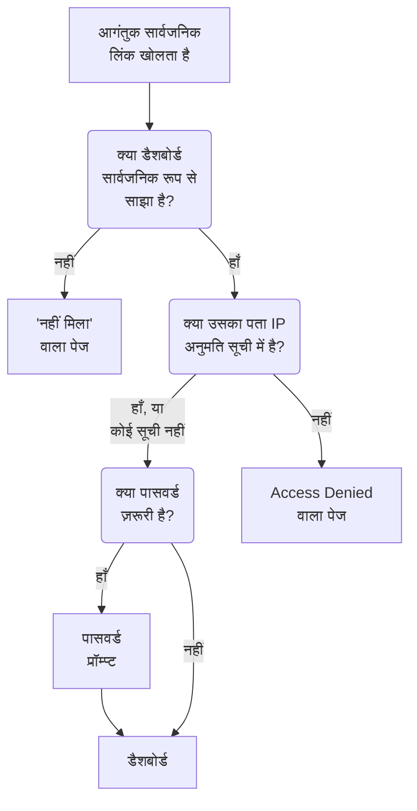

# साझाकरण और सार्वजनिक डैशबोर्ड

डिफ़ॉल्ट रूप से, डैशबोर्ड आपके प्रोजेक्ट तक निजी होता है: सिर्फ़ वे लोग उसे देख सकते हैं जो आपके प्रोजेक्ट में साइन इन करते हैं। आप उसे सार्वजनिक लिंक से साझा भी कर सकते हैं, उस लिंक को पासवर्ड से सुरक्षित कर सकते हैं, उसे कुछ IP पतों तक सीमित कर सकते हैं, और उसे अपने डोमेन पर होस्ट कर सकते हैं। यह पेज इन चारों को कवर करता है।

:::cards
- [डैशबोर्ड कौन देख सकता है](#डैशबोर्ड-कौन-देख-सकता-है): तीन में से एक विकल्प, हर एक के लिए ज़रूरी प्लान के साथ।
- [पासवर्ड के साथ साझा करना](#पासवर्ड-के-साथ-साझा-करना): लिंक, और फिर पासवर्ड, उन लोगों के साथ साझा करें जिन्हें इसे देखना चाहिए।
- [IP अनुमति सूची](#ip-अनुमति-सूची): सार्वजनिक लिंक सिर्फ़ अपने ऑफ़िस या VPN के लिए खोलें।
- [कस्टम डोमेन](#कस्टम-डोमेन): डैशबोर्ड को अपने डोमेन पर, एक निःशुल्क प्रमाणपत्र के साथ परोसें।
:::

## आगंतुक किन चरणों से गुज़रता है

डैशबोर्ड का सार्वजनिक लिंक खोलने वाला आगंतुक बारी-बारी से इनमें से हर जाँच से गुज़रता है। OneUptime में साइन इन करने वाले प्रोजेक्ट सदस्य डैशबोर्ड को प्रोडक्ट के अंदर देखते हैं, आप यहाँ चाहे जो चुनें।



## डैशबोर्ड कौन देख सकता है

डैशबोर्ड खोलें और **⋯ → साझा करें** चुनें, या डैशबोर्ड के साइड मेनू में **साझाकरण** खोलें। **यह डैशबोर्ड कौन देख सकता है** कार्ड एक ही विकल्प है:

- **केवल इस प्रोजेक्ट के लोग** (डिफ़ॉल्ट): सदस्य OneUptime में साइन इन करने पर डैशबोर्ड देखते हैं। इसका कोई सार्वजनिक लिंक नहीं होता: इसका सार्वजनिक पता वही "नहीं मिला" वाला पेज दिखाता है जो ऐसे पते का होता है जिस पर कोई डैशबोर्ड नहीं, और डैशबोर्ड के बारे में कुछ भी नहीं, उसका नाम तक नहीं।
- **लिंक वाला कोई भी व्यक्ति**: डैशबोर्ड सार्वजनिक है। जिसके पास उसका लिंक है वह साइन इन किए बिना उसे देख सकता है।
- **लिंक और पासवर्ड वाला कोई भी व्यक्ति**: आगंतुक लिंक खोलते हैं, फिर वह एक पासवर्ड डालते हैं जो आप उनके साथ साझा करते हैं। किसी को खाते की ज़रूरत नहीं।

कोई विकल्प चुनने पर पुष्टि माँगी जाती है, यह बताते हुए कि आगंतुकों के लिए क्या बदलता है, फिर वह तुरंत लागू हो जाता है। डैशबोर्ड का कोई पासवर्ड न होने पर **लिंक और पासवर्ड वाला कोई भी व्यक्ति** चुनना उसी डायलॉग में पासवर्ड माँगता है; जब तक वही विकल्प चुना है, **पासवर्ड बदलें** उसे बदल देता है। जब तक डैशबोर्ड सार्वजनिक है, वे पते विकल्प के नीचे रहते हैं जिन पर आगंतुक उसे खोलते हैं: पहले उसके कस्टम डोमेन, फिर उसका सार्वजनिक लिंक, हर एक के साथ **लिंक कॉपी करें**। जो कस्टम डोमेन अभी लाइव नहीं है, उस पर **अभी लाइव नहीं** लिखा होता है, कारण के साथ।

प्रोजेक्ट के भीतर, कौन क्या देखता है यह मालिक और लेबल तय करते हैं — देखें [डैशबोर्ड कॉन्फ़िगरेशन और अनुमतियाँ](/docs/dashboards/configuration)। जो व्यक्ति डैशबोर्ड देख सकता है पर संपादित नहीं कर सकता, वह विकल्प देखता है और सार्वजनिक लिंक कॉपी कर सकता है, पर उसे बदल नहीं सकता।

OneUptime Cloud पर, डैशबोर्ड साझा करने के लिए **Growth** प्लान चाहिए: निचले प्लान पर दोनों सार्वजनिक विकल्प अपना ज़रूरी प्लान दिखाते हैं और चुने नहीं जा सकते। डैशबोर्ड को फिर से निजी बनाना (**केवल इस प्रोजेक्ट के लोग**) हर प्लान पर काम करता है, इसलिए ट्रायल खत्म होने पर, या निचले प्लान पर जाने के बाद, सार्वजनिक रह गया डैशबोर्ड हमेशा साझा होना बंद कर सकता है; डायलॉग बताता है कि उसे फिर से साझा करने के लिए **Growth** चाहिए। **लिंक वाला कोई भी व्यक्ति** और **लिंक और पासवर्ड वाला कोई भी व्यक्ति** के बीच बदलना, और पासवर्ड बदलना, हर प्लान पर काम करता है। API या Terraform से बनाया गया डैशबोर्ड भी उन्हीं प्लान से बँधा है: सार्वजनिक बनाया जाए तो उसे **Growth** चाहिए, और IP अनुमति सूची के साथ बनाया जाए तो **Scale**।

यह विकल्प तीन कॉलम में सहेजा जाता है, जिन्हें API और Terraform पहले की तरह पढ़ते और लिखते हैं: `isPublicDashboard`, `enableMasterPassword` और `masterPassword`। सिर्फ़ सार्वजनिक डैशबोर्ड का सार्वजनिक लिंक होता है, और जब भी `enableMasterPassword` चालू हो, उसके आगंतुकों से पासवर्ड माँगा जाता है। `enableMasterPassword` चालू पर बिना पासवर्ड सेट वाला सार्वजनिक डैशबोर्ड अपने सार्वजनिक लिंक से किसी को अंदर नहीं आने देता: **साझाकरण** पेज उसे **लिंक और पासवर्ड वाला कोई भी व्यक्ति** के रूप में दिखाता है, बताता है कि अभी कोई लिंक नहीं खोल सकता, और **पासवर्ड सेट करें** देता है। **केवल इस प्रोजेक्ट के लोग** चुनने पर `enableMasterPassword` भी बंद हो जाता है और पासवर्ड रखा रहता है, ताकि पासवर्ड के साथ फिर से साझा करने पर उसे दोबारा इस्तेमाल किया जा सके।

## सार्वजनिक डैशबोर्ड

एक सार्वजनिक डैशबोर्ड:

- हमेशा पढ़ने के लिए खुलता है। आगंतुक उसे संपादित नहीं कर सकते, और उसके संपादन नियंत्रण कभी नहीं देखते।
- आपके जोड़े गए वेरिएबल शामिल करता है। आगंतुक वही पिकर इस्तेमाल करते हैं जो आपकी टीम करती है, और समय सीमा बदल सकते हैं, ज़ूम कर सकते हैं, ऑटो-रीफ़्रेश चालू कर सकते हैं और फ़ुल स्क्रीन पर जा सकते हैं। यह डैशबोर्ड की डिफ़ॉल्ट समय सीमा और ऑटो-रीफ़्रेश पर खुलता है, और हर आगंतुक का ब्राउज़र उसके अपने चुनाव याद रखता है।
- आगंतुकों को आपकी टीम की तरह ही किसी कॉलम शीर्षक पर क्लिक करके [उसकी सूचियाँ और तालिकाएँ क्रमबद्ध करने](/docs/dashboards/widgets#सूचियों-और-तालिकाओं-को-क्रमबद्ध-करना) देता है। हर आगंतुक का ब्राउज़र उसका अपना क्रम याद रखता है, और OneUptime पूरी सूची खुद क्रमबद्ध करता है, हमेशा विजेट के अपने किसी कॉलम से ही।
- वह ब्रांडिंग इस्तेमाल करता है जो आप डैशबोर्ड के **ब्रांडिंग** पेज पर सेट करते हैं: पृष्ठ शीर्षक, विवरण, लोगो, थीम, Favicon।
- हर आगंतुक को अपने टूलबार में सूरज या चाँद के बटन से हल्के और गहरे डैशबोर्ड के बीच बदलने देता है; [थीम](#थीम) बताता है कैसे।

डैशबोर्ड साझा करने को एक वेबपेज प्रकाशित करने जैसा समझें। उस पर हर विजेट लिंक वाले किसी भी व्यक्ति के लिए पढ़ने योग्य हो जाता है। साझा करने से पहले देखें कि कैनवास पर क्या है।

हर विजेट सिर्फ़ वही प्रकाशित करता है जो वह बनाता है, और सिर्फ़ उन संसाधनों के लिए जिनकी ओर उसे लगाया गया था। उदाहरण के लिए, SLO विजेट उस SLO की मुख्य संख्याएँ प्रकाशित करता है, पर उसकी परिभाषा कभी नहीं — देखें [SLO](/docs/dashboards/widgets#slo)। बाहरी **Data Source** विजेट अपवाद हैं: उन्हें रेंडर करने के बजाय सार्वजनिक डैशबोर्ड से पूरी तरह हटा दिया जाता है, क्योंकि उनका कॉन्फ़िगरेशन खुद क्वेरी है। कुछ और विजेट साइन-इन सेशन के बिना नहीं दिखाए जा सकते, और अपनी जगह पर यह बताते हैं: [सार्वजनिक डैशबोर्ड पर](/docs/dashboards/widgets#सार्वजनिक-डैशबोर्ड-पर) उनकी सूची देता है।

## पासवर्ड के साथ साझा करना

**लिंक और पासवर्ड वाला कोई भी व्यक्ति** चुनें और डायलॉग में पासवर्ड डालें। डैशबोर्ड दिखने से पहले आगंतुक एक पासवर्ड प्रॉम्प्ट देखते हैं। प्रॉम्प्ट डैशबोर्ड का नाम, पृष्ठ शीर्षक और Favicon, डैशबोर्ड की थीम में, दिखाता है, और कुछ नहीं: उसका विवरण, लोगो और विजेट पासवर्ड डालने के बाद दिखते हैं। पासवर्ड हैश के रूप में सहेजा जाता है — कोई उसे वापस नहीं पढ़ सकता। नया पासवर्ड तुरंत काम करता है; जिन्होंने पुराना पासवर्ड डाला था वे अधिकतम 7 दिनों तक डैशबोर्ड देखते रह सकते हैं।

पासवर्ड का उपयोग तब करें जब:

- आप किसी पार्टनर या ग्राहक के साथ साझा करना चाहते हैं, पर नहीं चाहते कि URL लीक होने पर काम आए।
- डैशबोर्ड "अर्ध-सार्वजनिक" हो — इतना खुला कि आप हर दर्शक को टीम सदस्य के रूप में आमंत्रित न करना चाहें, पर इतना खुला नहीं कि उसे खुले इंटरनेट पर रख दें।

ज़्यादा सख्त नियंत्रण (हर दर्शक के लिए अलग खाते, किसने क्या देखा इसका ऑडिट रिकॉर्ड) के लिए, डैशबोर्ड को **केवल इस प्रोजेक्ट के लोग** पर रखें और दर्शकों को रीड-ओनली टीम सदस्यों के रूप में आमंत्रित करें।

## IP अनुमति सूची

**साझाकरण** पेज पर **और सेटिंग्स** के तहत, **IP अनुमति सूची** सेक्शन (`ipWhitelist` कॉलम) सार्वजनिक लिंक को आपकी सूचीबद्ध IP पतों या IPv4 रेंज तक सीमित करता है, हर पंक्ति में एक, उदाहरण के लिए `203.0.113.7` या `10.0.0.0/8`। यह पासवर्ड के साथ या उसके बिना लागू होता है; साइन इन करने वाले प्रोजेक्ट सदस्य प्रभावित नहीं होते। हर पते की अनुमति देने के लिए इसे खाली छोड़ें। यह विकल्प से अलग, अपने आप सहेजा जाता है, और OneUptime Cloud पर इसे बदलने के लिए **Scale** प्लान चाहिए; इसे खाली करना हर प्लान पर काम करता है। जब तक कोई सूची लागू है, **और सेटिंग्स** का मुड़ा हुआ हेडर **IP अनुमति सूची** को उसमें मौजूद प्रविष्टियों की संख्या के साथ दिखाता है। सेल्फ़-होस्टेड इंस्टॉलेशन पर इसे बदलना Enterprise Edition का हिस्सा है: Community Edition पर पहले से सेट सूची लागू रहती है और उसे केवल हटाया जा सकता है।

इसका उपयोग तब करें जब:

- डैशबोर्ड सिर्फ़ आपके ऑफ़िस या VPN से पहुँचने योग्य होना चाहिए।
- कोई वेंडर पोर्टल सिर्फ़ उनके जाने-पहचाने IP से पहुँचने योग्य होना चाहिए।
- आप पासवर्ड के ऊपर अतिरिक्त सुरक्षा चाहते हैं।

किसी भी दूसरे IP से आने वाले अनुरोध एक **Access Denied** पेज के साथ अस्वीकार किए जाते हैं, जो डैशबोर्ड के बारे में कुछ नहीं दिखाता: न उसका नाम, न उसकी ब्रांडिंग, न उसका पासवर्ड प्रॉम्प्ट। जो पंक्ति न IP पता है न IPv4 रेंज, उसे सहेजते समय अस्वीकार किया जाता है, क्योंकि सर्वर उसे छोड़ देता।

## कस्टम डोमेन

शुरुआत में, सार्वजनिक डैशबोर्ड अपने सार्वजनिक लिंक पर, OneUptime के अपने पते पर परोसा जाता है। उसे `dashboard.acme.com` जैसे अपने सबडोमेन पर होस्ट करने के लिए, डैशबोर्ड के साइड मेनू में **ब्रांडिंग → कस्टम डोमेन** खोलें। यह बिल्कुल स्थिति पृष्ठ के **कस्टम डोमेन** पेज की तरह काम करता है।

कार्ड का शीर्षक **कस्टम डोमेन** है और यह बताता है कि क्या करना है: हर डोमेन का CNAME रिकॉर्ड आपके इंस्टॉलेशन के डैशबोर्ड CNAME रिकॉर्ड की ओर इंगित करें, और OneUptime डोमेन का SSL प्रमाणपत्र जारी करता है और आपके लिए उसे नवीनीकृत करता है। तालिका में दो कॉलम हैं, **डोमेन** और **स्थिति**।

डैशबोर्ड को अपने डोमेन पर लाने में तीन चरण लगते हैं, और सिर्फ़ पहले दो आपके हैं:

1. **डोमेन जोड़ें**: एक सबडोमेन और आपके सत्यापित डोमेन में से एक।
2. **उसका CNAME रिकॉर्ड जोड़ें** अपने DNS प्रदाता के पास। डोमेन जोड़ते ही **DNS सेटअप** डायलॉग रिकॉर्ड के साथ खुल जाता है।
3. **निःशुल्क SSL प्रमाणपत्र अपने आप जारी होता है** जैसे ही रिकॉर्ड मिल जाता है। दबाने के लिए कोई बटन नहीं है।

सत्यापित होने के बाद, डैशबोर्ड आपके कस्टम डोमेन और मूल URL दोनों पर पहुँचने योग्य होता है।

### डोमेन जोड़ना

**डैशबोर्ड डोमेन बनाएँ** पर क्लिक करें। डायलॉग एक ही पेज का है:

- **सबडोमेन**: सिर्फ़ लेबल, प्लेसहोल्डर `dashboard (leave blank for root)` के साथ। सिर्फ़ `dashboard` डालें, पूरा होस्टनेम नहीं। रूट/एपेक्स डोमेन इस्तेमाल करने के लिए इसे खाली छोड़ें या `@` डालें।
- **डोमेन**: **प्रोजेक्ट सेटिंग्स → उन्नत → डोमेन** के तहत सत्यापित डोमेन, जहाँ आप TXT रिकॉर्ड से साबित करते हैं कि डोमेन आपका है। जिस डोमेन को आपने सत्यापित नहीं किया, वह सूची में नहीं आता, क्योंकि उसे अस्वीकार कर दिया जाता। फ़ील्ड के बगल में **डोमेन जोड़ें** लिंक वह पेज नए टैब में खोलता है।
- **और फ़ील्ड**: मुड़ा हुआ। मुड़े रहने तक, इसका हेडर बताता है कि डोमेन कौन-सा प्रमाणपत्र इस्तेमाल करेगा: "हम इस डोमेन के लिए निःशुल्क SSL प्रमाणपत्र जारी करते हैं और उसे अपने आप नवीनीकृत करते हैं।" इसे सिर्फ़ अपना प्रमाणपत्र इस्तेमाल करने के लिए खोलें (नीचे देखें)।

**डैशबोर्ड डोमेन बनाएँ** पर क्लिक करें। डायलॉग बंद हो जाता है और नए डोमेन का **DNS सेटअप** खुलता है। डोमेन का पूरा नाम जोड़ते समय तय हो जाता है, इसलिए **संपादित करें** सिर्फ़ उसका प्रमाणपत्र बदलता है। कोई दूसरा सबडोमेन इस्तेमाल करने के लिए, वह डोमेन जोड़ें और पुराना हटा दें।

### DNS सेटअप और अभी जाँचें

**DNS सेटअप** डायलॉग वह रिकॉर्ड दिखाता है जो आपको अपने DNS प्रदाता के पास जोड़ना है, हर पंक्ति में एक फ़ील्ड, हर एक के साथ कॉपी बटन: **प्रकार** `CNAME`, **नाम** आपका जोड़ा पूरा डोमेन, और **मान** आपके इंस्टॉलेशन का डैशबोर्ड CNAME रिकॉर्ड। बिना सबडोमेन वाले रूट डोमेन के लिए, डायलॉग एक नोट जोड़ता है: कई DNS प्रदाता वहाँ CNAME रिकॉर्ड की अनुमति नहीं देते, इसलिए उसकी जगह अपने प्रदाता का ALIAS, ANAME या CNAME फ़्लैटनिंग रिकॉर्ड उसी मान के साथ इस्तेमाल करें।

OneUptime हर असत्यापित डोमेन को हर 15 मिनट पर जाँचता है, और जब जाँच को रिकॉर्ड मिल जाता है, तो वह उसी जाँच में डोमेन का निःशुल्क Let's Encrypt प्रमाणपत्र ऑर्डर करता है, आप वापस आएँ या न आएँ। तुरंत जाँचने के लिए, **अभी जाँचें** पर क्लिक करें:

- **रिकॉर्ड अभी नहीं मिला।** डायलॉग खुला रहता है और बताता है कि उसने कौन-सा रिकॉर्ड खोजा। नए DNS रिकॉर्ड को दिखने में कुछ समय लग सकता है। बाद में फिर से **अभी जाँचें** पर क्लिक करें, या इसे हर 15 मिनट वाली जाँच पर छोड़ दें।
- **रिकॉर्ड मिल गया।** डायलॉग कहता है "आपका CNAME रिकॉर्ड सत्यापित हो गया है।" और यह कि प्रमाणपत्र के साथ आगे क्या होता है। निःशुल्क प्रमाणपत्र उसी पल ऑर्डर होता है, और आमतौर पर 15 मिनट के भीतर चालू हो जाता है।

जब तक कोई डोमेन सत्यापित न हो और उसका प्रमाणपत्र अपनी जगह न हो, उसकी पंक्ति में एक **DNS सेटअप** कार्रवाई होती है जो वही डायलॉग खोलती है। ऐसे सत्यापित डोमेन पर जिसका प्रमाणपत्र ऑर्डर बार-बार विफल होता है, या जिसका प्रमाणपत्र समाप्त हो चुका है, वहाँ **अभी जाँचें** फिर से ऑर्डर करता है और दिखाता है कि पिछला ऑर्डर क्यों विफल हुआ। यह हर डोमेन के लिए हर 15 मिनट में अधिकतम एक बार ऑर्डर करता है; इसके बीच, OneUptime खुद ही पुनः प्रयास करता रहता है, लगातार हर विफलता के बाद थोड़ा और इंतज़ार करते हुए। नवीनीकरण अपने आप होता है, प्रमाणपत्र समाप्त होने से काफ़ी पहले, और विफल DNS जाँच कभी ऐसा प्रमाणपत्र नहीं हटाती जो अब भी वैध हो।

### स्थिति कॉलम पढ़ना

**स्थिति** कॉलम बताता है कि हर डोमेन HTTPS की राह पर कहाँ है, आठ में से किसी एक अवस्था में, वही जो स्थिति पृष्ठों पर होती हैं। जब कोई ऑर्डर विफल हुआ हो, तो कारण नीचे की पंक्ति में होता है।

| स्थिति कॉलम क्या कहता है | इसका क्या अर्थ है |
| --- | --- |
| DNS की प्रतीक्षा: CNAME रिकॉर्ड जोड़ें। | CNAME रिकॉर्ड अभी नहीं मिला। रिकॉर्ड के लिए **DNS सेटअप** खोलें, उसे अपने DNS प्रदाता के पास जोड़ें, फिर **अभी जाँचें** पर क्लिक करें या हर 15 मिनट वाली जाँच का इंतज़ार करें। |
| निःशुल्क प्रमाणपत्र जारी किया जा रहा है, आमतौर पर 15 मिनट के भीतर। | रिकॉर्ड सत्यापित है, और प्रमाणपत्र ऑर्डर या लिखा जा रहा है। कुछ करने की ज़रूरत नहीं। |
| अभी तक निःशुल्क प्रमाणपत्र जारी नहीं हो सका। हम प्रयास करते रहेंगे। | रिकॉर्ड सत्यापित है, पर उसके प्रमाणपत्र का ऑर्डर विफल हुआ, नीचे की पंक्ति में दिए कारण से। कारण ठीक करें, फिर **DNS सेटअप** खोलें और अभी फिर से ऑर्डर करने के लिए **अभी जाँचें** पर क्लिक करें। |
| प्रमाणपत्र की अवधि समाप्त हो गई है। हम इसे नवीनीकृत करने का प्रयास करते रहेंगे। | डोमेन का प्रमाणपत्र समाप्त हो गया क्योंकि उसके नवीनीकरण विफल रहे। **DNS सेटअप** खोलें और उसे अभी नवीनीकृत करने और कारण देखने के लिए **अभी जाँचें** पर क्लिक करें। |
| प्रमाणपत्र जारी किया गया, अपने आप नवीनीकृत होता है। | हो गया। डोमेन HTTPS पर अपना प्रमाणपत्र परोसता है, और OneUptime उसे नवीनीकृत करता है। |
| प्रमाणपत्र जारी किया गया, लेकिन इसका नवीनीकरण विफल रहा। हम प्रयास करते रहेंगे। | डोमेन अब भी एक वैध प्रमाणपत्र परोसता है, पर उसका पिछला नवीनीकरण विफल रहा, नीचे की पंक्ति में दिए कारण से। OneUptime प्रमाणपत्र समाप्त होने से काफ़ी पहले फिर प्रयास करता है। |
| आपके अपलोड किए गए प्रमाणपत्र का उपयोग करता है। | रिकॉर्ड सत्यापित है, और डोमेन आपके अपलोड किए प्रमाणपत्र के साथ परोसा जाता है। |
| सत्यापित। यह इंस्टॉलेशन निःशुल्क प्रमाणपत्र जारी नहीं करता: इस डोमेन का HTTPS अपने खुद के प्रॉक्सी से दें, या एक प्रमाणपत्र अपलोड करें। | Let's Encrypt खाता कुंजी के बिना किसी सेल्फ़-होस्टेड इंस्टॉलेशन पर, रिकॉर्ड सत्यापित है और डोमेन लाइव है। उसका HTTPS आपके अपने प्रॉक्सी के ज़िम्मे है, जब तक कि आप कोई प्रमाणपत्र अपलोड न करें। |

अगर कोई ऑर्डर विफल होता है, तो आम कारण हैं आपके डोमेन पर ऐसा CAA रिकॉर्ड जो `letsencrypt.org` की अनुमति नहीं देता, और सेल्फ़-होस्टेड इंस्टॉलेशन पर ऐसा सर्वर जिस तक Let's Encrypt पोर्ट 80 पर नहीं पहुँच सकता।

### अपना प्रमाणपत्र, और फिर से जारी करना

इसके बजाय अपना प्रमाणपत्र इस्तेमाल करने के लिए, डोमेन जोड़ते समय **और फ़ील्ड** खोलें, **कस्टम प्रमाणपत्र अपलोड करें** चालू करें, और **प्रमाणपत्र** और उसकी **प्रमाणपत्र निजी कुंजी** पेस्ट करें। OneUptime उसे Let's Encrypt प्रमाणपत्र ऑर्डर करने के बजाय 15 मिनट के भीतर परोसता है, और यह डोमेन के पहले के किसी भी Let's Encrypt प्रमाणपत्र की जगह ले लेता है। अपलोड किए प्रमाणपत्र का नवीनीकरण आपकी ज़िम्मेदारी है: डोमेन संपादित करें और नया पेस्ट करें। अगर डोमेन के पास पहले निःशुल्क प्रमाणपत्र था, तो आपका प्रमाणपत्र इस्तेमाल होते समय भी OneUptime उसे नवीनीकृत करता रहता है, इसलिए वापस बदलना तुरंत होता है।

किसी डोमेन के लिए निःशुल्क प्रमाणपत्र ऑर्डर हो जाने के बाद, पंक्ति **Reissue SSL** दिखाती है, जो स्वचालित नवीनीकरण से पहले नया प्रमाणपत्र चाहने पर Let's Encrypt से बिल्कुल नया प्रमाणपत्र माँगता है। हर डोमेन हर 24 घंटे में एक बार फिर से जारी किया जा सकता है।

सेल्फ़-होस्टेड इंस्टॉलेशन पर, डैशबोर्ड कस्टम डोमेन `DASHBOARD_CNAME_RECORD` एनवायरनमेंट वेरिएबल (Helm चार्ट में `dashboard.cnameRecord`) से चालू होते हैं, जो वह लक्ष्य है जिसकी ओर आपके CNAME रिकॉर्ड इंगित करते हैं। इसके बिना, कार्ड और **DNS सेटअप** डायलॉग रिकॉर्ड दिखाने के बजाय "Custom Domains not enabled for this OneUptime installation" कहते हैं, और OneUptime डैशबोर्ड के लिए न डोमेन सत्यापित करता है न प्रमाणपत्र ऑर्डर करता है। जिस इंस्टॉलेशन में Let's Encrypt खाता कुंजी (`LETS_ENCRYPT_ACCOUNT_KEY`, Helm चार्ट में `letsEncrypt.accountKey`) नहीं है, वह कोई प्रमाणपत्र ऑर्डर नहीं करता: डैशबोर्ड डोमेन उसका रिकॉर्ड सत्यापित होते ही लाइव हो जाता है, और आपके अपने प्रॉक्सी के HTTPS या आपके अपलोड किए प्रमाणपत्र के साथ परोसा जाता है।

### कौन जाँच और फिर से जारी कर सकता है

**अभी जाँचें**, किसी डोमेन का प्रमाणपत्र ऑर्डर करना और **Reissue SSL** डोमेन को बदलते हैं, इसलिए इनके लिए उसे संपादित करने की अनुमति चाहिए: **Edit Dashboard Domain**, या ऐसी भूमिका जिसमें वह शामिल हो (Project Owner, Project Admin, Project Member, Settings Admin या Settings Member)।

जो व्यक्ति डोमेन को सिर्फ़ पढ़ सकता है, जैसे कोई Viewer या Settings Viewer, वह फिर भी **स्थिति** कॉलम और **DNS सेटअप** में जोड़ने वाला रिकॉर्ड देखता है। उसके लिए **अभी जाँचें** और **Reissue SSL** लॉक रहते हैं, और बताते हैं कि कौन-सी अनुमति चाहिए। दोनों ही स्थितियों में OneUptime खुद ही हर डोमेन की जाँच करता और उसका प्रमाणपत्र ऑर्डर करता रहता है।

API कुंजियों पर भी यही लागू होता है। जो कुंजी सिर्फ़ डैशबोर्ड डोमेन पढ़ सकती है, वह `/dashboard-domain` पर `verify-cname`, `order-ssl` या `reissue-ssl` कॉल नहीं कर सकती। ज़रूरत हो तो उसे **Read Dashboard Domain** और **Edit Dashboard Domain** दें।

एक डोमेन एक समय में प्रोजेक्ट के एक ही डैशबोर्ड का होता है। अगर आप एक ही सामग्री कई दर्शकों को परोसते हैं, तो एक डैशबोर्ड से एक से ज़्यादा कस्टम डोमेन जोड़ सकते हैं: आपके अपने ब्रांड वाला ग्राहक-केंद्रित डैशबोर्ड, सह-ब्रांडेड पार्टनर डैशबोर्ड, या अपने URL वाला सार्वजनिक हेल्थ पेज।

## ब्रांडिंग

डैशबोर्ड के **ब्रांडिंग** पेज पर, आप कॉन्फ़िगर कर सकते हैं:

- **पृष्ठ शीर्षक** — जो ब्राउज़र टैब में और पेज के ऊपर दिखता है।
- **पृष्ठ विवरण** — सर्च इंजन और सोशल प्रीव्यू द्वारा इस्तेमाल किया जाने वाला विवरण।
- **लोगो** — सार्वजनिक डैशबोर्ड के हेडर में दिखने वाली छवि।
- **थीम** — हल्की, गहरी, या जैसा हर आगंतुक का डिवाइस सेट है; [थीम](#थीम) देखें।
- **Favicon** — ब्राउज़र टैब में छोटा आइकन।

लोगो और Favicon डैशबोर्ड के अपने प्रोजेक्ट में अपलोड की गई फ़ाइलें हैं, और जब भी इनमें से कोई सहेजा जाता है, यह जाँचा जाता है — डैशबोर्ड, API, Terraform या किसी वर्कफ़्लो से। किसी दूसरे प्रोजेक्ट में अपलोड की गई फ़ाइल उन्हीं शब्दों के साथ अस्वीकार की जाती है जो अब मौजूद न रही फ़ाइल को मिलते हैं: "The logo's file could not be found. Upload the logo again." या "The favicon's file could not be found. Upload the favicon again." सार्वजनिक डैशबोर्ड सिर्फ़ अपने प्रोजेक्ट की छवियाँ दिखाता है।

पृष्ठ शीर्षक और विवरण आपकी टीम के लिए डैशबोर्ड के टूलबार के शीर्ष पर भी, उसके नाम और विवरण की जगह दिखते हैं। लोगो, थीम और Favicon सिर्फ़ सार्वजनिक डैशबोर्ड पर लागू होते हैं।

आगंतुक ब्रांडिंग तभी देखते हैं जब उन्हें डैशबोर्ड देखने की अनुमति हो। पासवर्ड डालने से पहले, पासवर्ड के साथ साझा किया गया डैशबोर्ड सिर्फ़ अपना पृष्ठ शीर्षक, Favicon और थीम दिखाता है, और सर्च इंजन व लिंक प्रीव्यू उसका पृष्ठ शीर्षक देखते हैं पर पृष्ठ विवरण नहीं। IP अनुमति सूची वाला डैशबोर्ड अपनी ब्रांडिंग सिर्फ़ सूची के पतों को दिखाता है, और सर्च इंजन व लिंक प्रीव्यू उसका कुछ भी नहीं देखते।

### थीम

**थीम** कार्ड, लोगो के ठीक नीचे, तय करता है कि सार्वजनिक डैशबोर्ड अपने आगंतुकों को कैसा दिखे। इसके तीन विकल्पों में से एक चुनें और वह तुरंत सहेजा जाता है; कोई **संपादित करें** बटन नहीं है।

| विकल्प | आगंतुक क्या देखते हैं |
| ------ | ----------------- |
| **हल्की** | हल्का डैशबोर्ड, चाहे उनका डिवाइस कैसे भी सेट हो। यह सेटिंग आने से पहले बने डैशबोर्ड **हल्की** पर हैं, इसलिए वे वैसे ही दिखते हैं जैसे हमेशा दिखते थे। |
| **गहरी** | गहरा डैशबोर्ड, चाहे उनका डिवाइस कैसे भी सेट हो। |
| **हर आगंतुक के डिवाइस के अनुसार** | हल्का या गहरा, जैसा उनका डिवाइस सेट है, और डैशबोर्ड खुला रहने तक डिवाइस के साथ बदलता रहता है। |

आप जो भी चुनें, डैशबोर्ड के टूलबार में सूरज या चाँद का बटन हर आगंतुक को हल्के या गहरे डैशबोर्ड पर जाने, या आपकी सेट की हुई थीम पर लौटने देता है, और उनका ब्राउज़र उस पते के हर सार्वजनिक डैशबोर्ड के लिए यह चुनाव याद रखता है। गहरे डैशबोर्ड पर लोगो एक हल्की पृष्ठभूमि पर रहता है, इसलिए सफ़ेद पृष्ठ के लिए बना लोगो भी साफ़ दिखता है।

अब से बनाया गया डैशबोर्ड **हर आगंतुक के डिवाइस के अनुसार** से शुरू होता है। API और Terraform में फ़ील्ड `theme` है, जिसका मान `Light`, `Dark` या `System` (**हर आगंतुक के डिवाइस के अनुसार**) में से एक होता है, ठीक इसी तरह लिखा हुआ; कोई भी दूसरा मान अस्वीकार कर दिया जाता है। जो Terraform कॉन्फ़िगरेशन कोई `theme` सेट नहीं करता, उसे `Light` मिलता है, इसलिए इस सेटिंग से पहले लिखा गया कॉन्फ़िगरेशन अपने प्रबंधित डैशबोर्ड पर कभी कोई बदलाव प्लान नहीं करता।

थीम डैशबोर्ड के HTML में होती है, इसलिए डैशबोर्ड शुरू से ही उसी में बनता है: गहरा डैशबोर्ड लोड होते समय सफ़ेद नहीं चमकता, और उसका पासवर्ड प्रॉम्प्ट भी उसी में बनता है। हर विजेट उसका पालन करता है; HTML विजेट का अपना कोड गहरी थीम को स्टाइल कर सकता है, जैसा [HTML](/docs/dashboards/widgets#html) बताता है। **Access Denied** और "नहीं मिला" वाले पेज किसी डैशबोर्ड का कुछ भी नहीं दिखाते, इसलिए वे आगंतुक का पालन करते हैं: उनका अपना चुनाव, नहीं तो उनका डिवाइस।

## एम्बेड करना

आप किसी सार्वजनिक डैशबोर्ड को iframe से अपनी साइट में एम्बेड कर सकते हैं, उसके सार्वजनिक लिंक पर या उसके किसी कस्टम डोमेन पर:

```html title="embed.html"
<iframe
  src="https://dashboard.acme.com"
  width="100%"
  height="800"
  frameborder="0"
></iframe>
```

अगर डैशबोर्ड पासवर्ड के साथ साझा किया गया है, तो आगंतुक iframe के अंदर पासवर्ड प्रॉम्प्ट देखेंगे।

एम्बेड किए गए डैशबोर्ड को अपनी साइट जैसा रूप देने के लिए, उसके पते में `?theme=light` या `?theme=dark` जोड़ें, जैसे `https://dashboard.acme.com/?theme=dark`: तब उस पते को खोलने वाले हर व्यक्ति के लिए डैशबोर्ड उसी थीम में बनता है, चाहे उसकी अपनी थीम और आगंतुक का चुनाव कुछ भी हो, और उसके टूलबार में थीम का बटन नहीं होता। `?theme=system` हर आगंतुक के डिवाइस का पालन करता है। पासवर्ड प्रॉम्प्ट से गुज़रने पर भी थीम बनी रहती है।

## लिंक भेजना

सार्वजनिक लिंक डैशबोर्ड को उसके सहेजे गए डिफ़ॉल्ट पर खोलता है। किसी खास मान पर खुलने वाला लिंक भेजने के लिए, उसमें वेरिएबल को `?var-<name>=<value>` के रूप में जोड़ें, जैसा कि आगंतुक के मान चुनने पर एड्रेस बार करता है; कई मान कॉमा से अलग किए जाते हैं। इसे अपनी समय सीमा या ऑटो-रीफ़्रेश पर खोलने के लिए, उसी तरह `range` और `refresh` जोड़ें: `?range=1d&refresh=1m` पिछले एक दिन पर खुलता है और हर मिनट रीफ़्रेश होता है, जैसा किसी दीवार की स्क्रीन को चाहिए। `range` में `5m`, `15m`, `30m`, `1h`, `2h`, `3h`, `1d`, `2d`, `7d`, `14d`, `1mo` या `3mo` चलता है, और `refresh` में `off`, `5s`, `10s`, `30s`, `1m`, `5m` या `15m`। ये डैशबोर्ड के डिफ़ॉल्ट और आगंतुक के अपने चुनावों से ऊपर रहते हैं, और आगंतुक फिर भी इन्हें बदल सकते हैं। डैशबोर्ड को किसी थीम में खोलने के लिए, `theme=light`, `theme=dark` या `theme=system` जोड़ें, जैसा [एम्बेड करना](#एम्बेड-करना) बताता है।

## अगले कदम

:::cards
- [डैशबोर्ड कॉन्फ़िगरेशन और अनुमतियाँ](/docs/dashboards/configuration): मालिक, लेबल और साझाकरण कौन बदल सकता है।
- [डैशबोर्ड वेरिएबल और फ़िल्टर](/docs/dashboards/variables): आगंतुकों द्वारा इस्तेमाल किए जाने वाले पिकर, और चयन बनाए रखने वाले लिंक।
- [डैशबोर्ड विजेट](/docs/dashboards/widgets): हर विजेट सार्वजनिक डैशबोर्ड पर क्या प्रकाशित करता है।
- [स्थिति पृष्ठ अवलोकन](/docs/status-pages/index): ग्राहकों को बताएँ कि आपकी सेवा चालू है या नहीं।
:::
