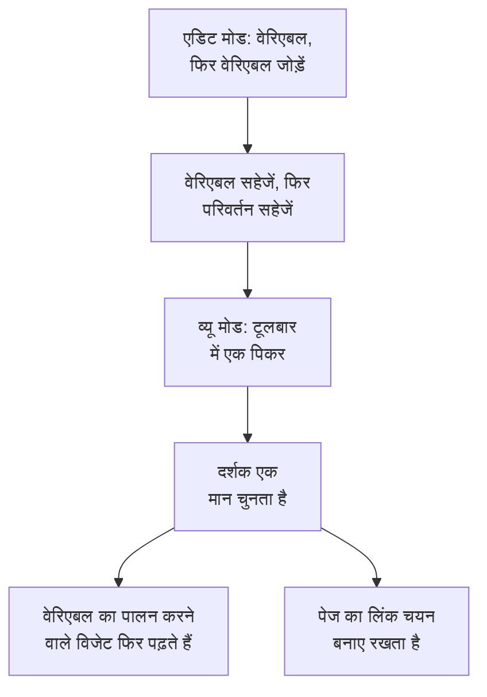

# डैशबोर्ड वेरिएबल और फ़िल्टर

वेरिएबल डैशबोर्ड के टूलबार में एक पिकर है। एक `service` वेरिएबल जोड़ें, और वही चार्ट `checkout`, `payments` या `search` दिखाते हैं: तीन लगभग एक जैसे डैशबोर्ड बनाने के बजाय दर्शक टूलबार से चुनते हैं।

:::cards
- [वेरिएबल जोड़ना](#वेरिएबल-जोड़ना): उसे नाम दें, चुनें कि उसके मान कहाँ से आते हैं, और सहेजें।
- [वेरिएबल के स्रोत](#वेरिएबल-के-स्रोत): Telemetry Attribute, Project Labels, Custom List और Text Input।
- [विजेट वेरिएबल का उपयोग कैसे करते हैं](#विजेट-वेरिएबल-का-उपयोग-कैसे-करते-हैं): कौन-से विजेट किन वेरिएबल का पालन करते हैं।
- [चयन बनाए रखने वाले लिंक](#चयन-बनाए-रखने-वाले-लिंक): ऐसा लिंक भेजें जो उसी सेवा पर खुले।
:::

## वेरिएबल कैसे काम करता है

आप डैशबोर्ड संपादित करते समय वेरिएबल परिभाषित करते हैं, और वे उसके साथ सहेजे जाते हैं। व्यू मोड में, हर वेरिएबल टूलबार में एक पिकर होता है। जब कोई दर्शक मान चुनता है, तो वेरिएबल का पालन करने वाला हर विजेट अपना डेटा फिर से पढ़ता है, और पेज का लिंक उस चयन को बनाए रखता है।



## वेरिएबल जोड़ना

:::steps
### वेरिएबल डायलॉग खोलें

डैशबोर्ड खोलें, **⋯ → डैशबोर्ड संपादित करें** चुनें, और टूलबार में **वेरिएबल** पर क्लिक करें। **डैशबोर्ड वेरिएबल्स** डायलॉग डैशबोर्ड के वेरिएबल की सूची देता है; टूलबार का बटन उन्हें गिनता है।

### एक जोड़ें

**वेरिएबल जोड़ें** पर क्लिक करें। नया वेरिएबल एक टेलीमेट्री विशेषता पढ़ता है; ज़रूरत हो तो दूसरा **स्रोत** चुनें।

### उसे भरें

उसे एक **नाम** दें, जिसे विजेट और लिंक इस्तेमाल करते हैं, जैसे `service`: अक्षर, अंक और अंडरस्कोर, जो किसी अक्षर या अंडरस्कोर से शुरू हो, और डैशबोर्ड के बाकी नामों से अलग हो। चाहें तो टूलबार के लिए एक **लेबल** जोड़ें, शुरुआत के लिए एक **डिफ़ॉल्ट**, और दर्शकों को कई मान चुनने देने के लिए **मल्टी-सिलेक्ट की अनुमति दें** पर टिक करें।

### उसे सहेजें

**वेरिएबल सहेजें** पर क्लिक करें, फिर टूलबार में **परिवर्तन सहेजें** पर। डैशबोर्ड के व्यू मोड में लौटते ही वेरिएबल का पिकर टूलबार में दिखता है।
:::

बाद में किसी वेरिएबल को बदलने या हटाने के लिए, डायलॉग फिर से खोलें: उसके फ़ील्ड बदलें, या उसके बगल के डिब्बे पर क्लिक करें।

## वेरिएबल के स्रोत

**स्रोत** तय करता है कि वेरिएबल के मान कहाँ से आते हैं, और कौन-से विजेट उसका पालन करते हैं।

| स्रोत | उसके मान कहाँ से आते हैं | मल्टी-सेलेक्ट |
| --- | --- | --- |
| Telemetry Attribute | आपके मेट्रिक्स में किसी एक विशेषता कुंजी के मान, जैसे `service.name` | हाँ |
| Project Labels | वे प्रोजेक्ट लेबल जिनकी आप अनुमति देते हैं, 1 से 1,000 तक | हाँ |
| Custom List | आपके टाइप किए मान, कॉमा से अलग किए हुए, जैसे `prod, staging` | हाँ |
| Text Input | दर्शक जो भी टाइप करे | नहीं |

### Telemetry Attribute

**विशेषता कुंजी** सेट करें, जैसे `service.name`, `host.name` या `k8s.namespace.name`; फ़ील्ड उन कुंजियों का सुझाव देता है जो आपकी टेलीमेट्री में हैं। पिकर उस कुंजी के 100 तक मान दिखाता है, जो पिछले एक दिन के आपके मेट्रिक्स से पढ़े जाते हैं, इसलिए कोई नई सेवा डैशबोर्ड संपादित किए बिना उसमें दिखने लगती है।

यह सबसे आम स्रोत है, क्योंकि इसे अपनी कोई सूची नहीं चाहिए: मान वही हैं जो आप पहले से भेज रहे हैं।

### Project Labels

डैशबोर्ड ड्रॉपडाउन के रूप में पेश करने के लिए मौजूदा प्रोजेक्ट लेबल चुनें। उदाहरण के लिए, `UNIT` नाम का एक वेरिएबल बनाएँ, उसका स्रोत **प्रोजेक्ट लेबल** रखें, और लेबल `0660` और `0661` चुनें।

डैशबोर्ड चुने गए लेबल की ID और दिखने वाले नाम सहेजता है। फ़िल्टरिंग ID का उपयोग करती है, इसलिए किसी प्रोजेक्ट लेबल का नाम बदलने से उसका बाइंडिंग नहीं टूटता। दिखने वाले नाम डैशबोर्ड के साथ सहेजे जाते हैं; नाम बदले गए लेबल का दिखने वाला नाम अपडेट करने के लिए उसे वेरिएबल एडिटर में फिर से चुनें। सार्वजनिक डैशबोर्ड भी यही सहेजे गए विकल्प दिखाते हैं।

किसी **मॉनिटर सूची** विजेट में **फ़िल्टर → लेबल वेरिएबल** खोलें और `UNIT` चुनें। अब `0660` चुनने पर वे मॉनिटर दिखते हैं जिन पर वह लेबल है। दूसरे विजेट तब तक प्रभावित नहीं होते जब तक वे स्पष्ट रूप से वेरिएबल को सपोर्ट और बाइंड न करें: **SLO सूची** में भी वही **लेबल वेरिएबल** सेटिंग है।

विजेट के तय फ़िल्टर लागू रहते हैं। उदाहरण के लिए, एक तय लेबल `network` और `0660` पर सेट `UNIT` के साथ, मॉनिटर पर दोनों लेबल होने चाहिए। कई चुनी गई यूनिट उनमें से किसी से भी मेल खाती हैं। **सभी** चुनने पर सिर्फ़ वेरिएबल की शर्त हटती है, और लेबल, स्थिति और मॉनिटर प्रकार के तय फ़िल्टर बने रहते हैं।

कोई गायब वेरिएबल, या उसके कॉन्फ़िगर किए गए विकल्पों के बाहर का चयन, एक त्रुटि दिखाता है। मेल खाने वाले मॉनिटर के बिना चुना गया लेबल खाली सूची दिखाता है। जब विजेट बाइंडिंग की ज़रूरत न रहे, तो उसे स्पष्ट रूप से हटा दें।

### Custom List और Text Input

Custom List आपके टाइप किए मान पेश करती है, कॉमा से अलग किए हुए। Text Input दर्शक को कोई भी मान टाइप करने देता है, जैसे कोई IP पता या अनुरोध ID। इनमें से कोई भी अपने आप किसी विजेट को फ़िल्टर नहीं करता: उनके मान वहाँ जाते हैं जहाँ आप `{{name}}` लिखते हैं (नीचे देखें)।

किसी पुराने डैशबोर्ड का Query वेरिएबल रखा जाता है, और टूलबार में एक टेक्स्ट बॉक्स दिखाता है: OneUptime अब उसके मान किसी क्वेरी से लोड नहीं करता।

## मल्टी-सेलेक्ट और डिफ़ॉल्ट

**मल्टी-सिलेक्ट की अनुमति दें** पर टिक होने पर, दर्शक एक या अधिक मान चुनते हैं, और विजेट उनमें से कोई भी दिखाते हैं। खाली चयन का अर्थ है **सभी**, और मल्टी-सेलेक्ट वेरिएबल हमेशा **सभी** पर शुरू होता है, इसलिए उसका **डिफ़ॉल्ट** धूसर रहता है।

सिंगल-सेलेक्ट वेरिएबल अपने **डिफ़ॉल्ट** पर शुरू होता है, या डिफ़ॉल्ट न होने पर **सभी** पर। **सभी** वेरिएबल का फ़िल्टर हटा देता है, इसलिए विजेट सब कुछ दिखाते हैं।

डैशबोर्ड छोड़े बिना "checkout और payments को साथ-साथ" तुलना करने के लिए मल्टी-सेलेक्ट का उपयोग करें। वहाँ इससे बचें जहाँ संख्याएँ अलग-अलग मानों में जोड़ी नहीं जा सकतीं, जैसे औसतों का औसत।

## विजेट वेरिएबल का उपयोग कैसे करते हैं

हर स्रोत विजेट तक अपने तरीके से पहुँचता है:

- **टेलीमेट्री एट्रिब्यूट** वेरिएबल विजेट पर कुछ भी सेट किए बिना उन्हें फ़िल्टर करते हैं: हर मेट्रिक चार्ट, मान, गेज और तालिका; **लॉग चार्ट**, **लॉग स्ट्रीम**, **ट्रेस चार्ट** और **ट्रेस टेबल**; और वे इन्फ्रास्ट्रक्चर सूचियाँ जिनके संसाधनों पर वह विशेषता होती है, जैसे होस्ट सूचियों पर `host.name` और Kubernetes सूचियों पर `k8s.namespace.name`। उस विशेषता के बिना किसी मेट्रिक का चार्ट, कोई मान चुने रहने तक, डेटा नहीं दिखाता: उसे फिर देखने के लिए **सभी** चुनें। **ट्रेस सूची** और घटना व अलर्ट सूचियाँ इनका पालन नहीं करतीं।
- **प्रोजेक्ट लेबल** वेरिएबल उस **मॉनिटर सूची** या **SLO सूची** को फ़िल्टर करते हैं जिसका **लेबल वेरिएबल** उनका नाम लेता है।
- **कोई भी वेरिएबल** टेक्स्ट में `{{name}}` के रूप में लिखा जा सकता है: किसी [HTML विजेट](/docs/dashboards/widgets#html) में, किसी [बाहरी डेटा स्रोत](/docs/dashboards/data-sources) की क्वेरी में, और किसी **मॉनिटर सूची** या **SLO सूची** के शीर्षक में। `{{UNIT}} NETWORK` जैसा शीर्षक `0660 NETWORK`, `0660, 0661 NETWORK` या `All NETWORK` दिखाता है। शीर्षक सिर्फ़ दिखने वाला टेक्स्ट तय करता है; मॉनिटर क्वेरी को फ़िल्टर करने के लिए **लेबल वेरिएबल** कॉन्फ़िगर करें।

[SLO विजेट](/docs/dashboards/widgets#slo) `sloName` कुंजी पर किसी Telemetry Attribute वेरिएबल का पालन कर सकता है, ताकि दर्शक चुनें कि वह कौन-सा SLO दिखाए।

## चयन बनाए रखने वाले लिंक

पेज का लिंक हर वेरिएबल का चयन `?var-<name>=<value>` के रूप में साथ रखता है, कई मान कॉमा से अलग, इसलिए आपका कॉपी किया लिंक उसी चयन के साथ खुलता है, स्पष्ट **सभी** समेत। इस तरह का लिंक payments सेवा पर खुलता है:

```text title="A dashboard link with a variable"
https://oneuptime.com/dashboard/<project-id>/dashboards/<dashboard-id>?var-service=payments
```

लिंक आपकी चुनी हुई समय सीमा और ऑटो-रीफ़्रेश भी `range` और `refresh` के रूप में साथ रखता है, ताकि जिन्हें आप भेजते हैं वे वही देखें जो आप देखते हैं। [लिंक भेजना](/docs/dashboards/sharing#लिंक-भेजना) उनके मान बताता है।

## एक उदाहरण: हर सेवा के लिए एक डैशबोर्ड

किसी सेवा के डैशबोर्ड में आमतौर पर होते हैं:

1. एक `service` वेरिएबल, स्रोत Telemetry Attribute, विशेषता कुंजी `service.name`, और डिफ़ॉल्ट आपकी सबसे व्यस्त सेवा। मल्टी-सेलेक्ट बंद रखें, ताकि चार्ट एक समय में एक सेवा दिखाएँ।
2. एक `namespace` वेरिएबल, स्रोत Telemetry Attribute, विशेषता कुंजी `k8s.namespace.name`, नेमस्पेस की तुलना के लिए मल्टी-सेलेक्ट चालू।
3. एक `environment` वेरिएबल, स्रोत Custom List, मान `prod, staging`, जिसे किसी डेटा स्रोत क्वेरी में `{{environment}}` के रूप में इस्तेमाल किया जाता है।
4. उन विशेषताओं को पढ़ने वाले विजेट: सेवा के मेट्रिक्स के चार्ट और मान, एक लॉग स्ट्रीम, और एक Kubernetes पॉड सूची।

नतीजा: हर सेवा के लिए एक डैशबोर्ड, ऊपर तीन पिकर के साथ।

## अगले कदम

:::cards
- [डैशबोर्ड विजेट](/docs/dashboards/widgets): कौन-से विजेट किन वेरिएबल का पालन करते हैं।
- [बाहरी डेटा स्रोत](/docs/dashboards/data-sources): किसी PromQL या SQL क्वेरी में वेरिएबल डालें।
- [साझाकरण और सार्वजनिक डैशबोर्ड](/docs/dashboards/sharing): सार्वजनिक डैशबोर्ड पर वेरिएबल।
- [डैशबोर्ड बनाना](/docs/dashboards/authoring): एडिट मोड, सहेजना और समय सीमा।
:::
