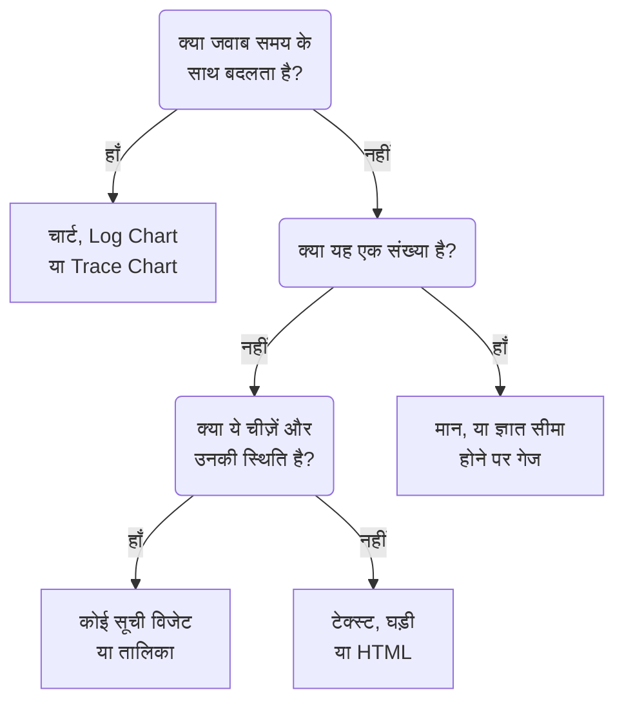

# डैशबोर्ड विजेट

विजेट डैशबोर्ड पर एक टाइल है। यह पेज **विजेट जोड़ें** कैटलॉग के हर विजेट की सूची देता है, वह क्या दिखाता है और कौन-सी सेटिंग्स मायने रखती हैं, कैटलॉग के अपने समूहों के अनुसार। विजेट को ग्रिड पर रखने और सहेजने के लिए, देखें [डैशबोर्ड बनाना](/docs/dashboards/authoring)।

:::cards
- [मुझे कौन-सा विजेट इस्तेमाल करना चाहिए?](#मुझे-कौन-सा-विजेट-इस्तेमाल-करना-चाहिए): उस सवाल के आधार पर चुनें जिसका जवाब टाइल देती है।
- [चार्ट और संख्याएँ](#चार्ट-और-संख्याएँ): मेट्रिक क्वेरी से चार्ट, मान, गेज और तालिका।
- [लॉग, ट्रेस और सुरक्षा](#लॉग-ट्रेस-और-सुरक्षा): वॉल्यूम चार्ट, लाइव स्ट्रीम और सूचियाँ।
- [सूचियों और तालिकाओं को क्रमबद्ध करना](#सूचियों-और-तालिकाओं-को-क्रमबद्ध-करना): किसी कॉलम से क्रमबद्ध करें, और वह क्रम तय करें जो सभी देखते हैं।
- [जब कोई विजेट दिखाया न जा सके](#जब-कोई-विजेट-दिखाया-न-जा-सके): टूटा हुआ विजेट क्या दिखाता है, और उसे कैसे ठीक करें।
:::

## मुझे कौन-सा विजेट इस्तेमाल करना चाहिए?

उस सवाल से शुरू करें जिसका जवाब टाइल को देना है:

| सवाल | विजेट |
| --- | --- |
| समय के साथ कोई मेट्रिक कैसे बदला? | **चार्ट** |
| समय के साथ कितने लॉग, किस गंभीरता के? | **लॉग चार्ट** |
| समय के साथ अनुरोध कितने तेज़ हैं, और कितने विफल होते हैं? | **ट्रेस चार्ट** |
| अभी कोई एक संख्या क्या है? | **मान**, या ज्ञात सीमा होने पर **गेज** |
| कौन-से होस्ट, सेवाएँ या एंडपॉइंट सबसे अलग दिखते हैं? | **तालिका** या **ट्रेस टेबल** |
| अभी क्या हो रहा है? | **लॉग स्ट्रीम**, **ट्रेस सूची**, **घटना सूची** या **अलर्ट सूची** |
| क्या हमारी सभी साइटें चालू हैं? | **मॉनिटर सूची** |
| क्या हम वादा की गई विश्वसनीयता बनाए रख रहे हैं? | **SLO** या **SLO सूची** |
| हमारे क्लस्टर और होस्ट किस स्थिति में हैं? | इन्फ्रास्ट्रक्चर समूह का कोई विजेट |
| हमारा नेटवर्क दुनिया में कहाँ है, और क्या बंद है? | **नेटवर्क मैप** |
| कोई शीर्षक, नोट, किसी दूसरे दफ़्तर का समय? | **टेक्स्ट** या **घड़ी** |
| OneUptime के बाहर रखा गया डेटा? | बाहरी डेटा स्रोत समूह का कोई विजेट |
| कुछ ऐसा जो कोई विजेट नहीं करता? | **HTML**, जब आप पक्का कर लें कि कोई दूसरा विजेट यह नहीं करता |



ज़्यादातर डैशबोर्ड कुछ विजेट मिलाकर बनते हैं: ऊपर एक चार्ट, उसके बगल में एक-दो मान, एक टेक्स्ट शीर्षक, और नीचे एक-दो सूचियाँ।

## चार्ट और संख्याएँ

ये चार विजेट एक मेट्रिक क्वेरी पढ़ते हैं, जो उसी तरह बनती है जैसे मेट्रिक एक्सप्लोरर में: एक मेट्रिक और एक एग्रीगेशन चुनें, विशेषता फ़िल्टर जोड़ें, और हर मान के लिए एक सीरीज़ पाने के लिए किसी विशेषता से समूह बनाएँ।

### चार्ट

डैशबोर्ड की समय सीमा में एक या अधिक मेट्रिक क्वेरी की टाइम सीरीज़। **Chart Type** इसे लाइन, बार, एरिया, स्टैक्ड एरिया या पाई चार्ट के रूप में बनाता है। **Additional Queries** उन्हीं अक्षों पर और मेट्रिक्स जोड़ता है, और **Formulas** उन्हें `+`, `-`, `*`, `/`, `%`, `^` और कोष्ठकों से जोड़ता है, जैसे `(1 - a) * 100` में। हर क्वेरी की डिस्प्ले सेटिंग्स एक लेजेंड और इकाई, एक रंग, चेतावनी और गंभीर रेखाएँ, और सिर्फ़ बढ़ने वाले काउंटर के लिए प्रति सेकंड दर जोड़ती हैं।

इसका उपयोग तब करें जब रेखा का आकार कहानी कहता हो: लेटेंसी, त्रुटियाँ, थ्रूपुट या कतार की गहराई।

### मान

स्पार्कलाइन के साथ एक बड़ी संख्या: पूरी समय सीमा में क्वेरी का मान, योग या गिनती के लिए जोड़कर, अधिकतम के लिए सबसे ऊँचा, न्यूनतम के लिए सबसे नीचा, और बाकी मामलों में औसत। एक तीर सीमा के दूसरे आधे हिस्से की तुलना पहले से करता है (दोनों आधे एक ही तरह से निकाले जाते हैं), जिसका रंग **Trend Direction** से तय होता है: ऊँचा मान बेहतर है या बदतर, या मेट्रिक के नाम से पढ़ा गया। दोनों आधों के मान देखने के लिए तीर पर पॉइंटर रखें, और किसी भी बिंदु का मान और समय पढ़ने के लिए स्पार्कलाइन पर। मान **Warning Threshold** तक पहुँचने पर पृष्ठभूमि पीली और **Critical Threshold** तक पहुँचने पर लाल हो जाती है।

इसका उपयोग तब करें जब एक संख्या सवाल का जवाब दे: त्रुटि दर, P95 लेटेंसी, या आज संभाले गए अनुरोध।

### गेज

न्यूनतम और अधिकतम के बीच एक डायल, जो आपके सेट न करने पर 0 और 100 होते हैं, **Warning Threshold** से पीले क्षेत्र और **Critical Threshold** से लाल क्षेत्र के साथ।

इसका उपयोग तब करें जब मान किसी ज्ञात सीमा में रहता हो: प्रतिशत में CPU या डिस्क उपयोग, या किसी कतार की क्षमता।

### तालिका

मेट्रिक मान पंक्तियों के रूप में। **Group By Attributes** हर मान के लिए एक पंक्ति देता है, जैसे हर `host.name` के लिए एक; इसके बिना, हर पंक्ति एक समय खंड होती है। **Metrics & Columns** कॉलम तय करता है: मेट्रिक्स, और उन पर बने फ़ॉर्मूले, जैसे प्रतिशत में उपलब्धता। जब आप समूह बनाते हैं, **Reduce across time** हर पंक्ति की सीरीज़ को एक मान में बदल देता है: अंतिम मान, औसत, योग, न्यूनतम या अधिकतम।

किसी कॉलम में **सीमाओं के अनुसार रंग दें** चालू करें ताकि उसके मान रंगीन हों: जो मान **चेतावनी सीमा** तक पहुंचता है वह त्रिकोण के साथ एम्बर हो जाता है, और जो **गंभीर सीमा** तक पहुंचता है वह वृत्त के साथ लाल और बोल्ड हो जाता है। प्रतिशत वाला कॉलम 80 और 90 से शुरू होता है। जिस कॉलम में कम मान ही समस्या हों, जैसे खाली डिस्क स्थान, उसके लिए **दिशा** में **जितना कम, उतना बुरा** चुनें।

सीमाएं वही संख्या पढ़ती हैं जो तालिका दिखाती है, इसलिए 1 के अंश के रूप में भेजा गया उपयोग मेट्रिक, जैसे `system.cpu.utilization`, प्रतिशत के रूप में दिखता है और उसी रूप में तुलना होती है। **सीमा के रंग** में, **रंगीन पृष्ठभूमि** संख्या को रंगने के बजाय पूरी सेल भर देता है।

रुझान के बजाय विभाजन देखने के लिए इसका उपयोग करें: सबसे ज़्यादा शोर करने वाले होस्ट, हर सेवा की त्रुटियाँ, हर एंडपॉइंट के अनुरोध।

## टेक्स्ट, घड़ी और HTML

इन विजेट को किसी डेटा स्रोत की ज़रूरत नहीं होती।

### टेक्स्ट

किसी शीर्षक, नोट या आपकी रनबुक के लिंक के लिए टेक्स्ट की एक पंक्ति या एक ब्लॉक। शीर्षक, लिंक, सूचियाँ, कोड और तालिकाएँ बनाने के लिए **Markdown** चालू करें; नहीं तो टेक्स्ट वैसा ही दिखता है जैसा लिखा गया, चाहें तो बोल्ड, इटैलिक या अंडरलाइन में।

### घड़ी

किसी भी टाइम ज़ोन का मौजूदा समय, अंकों में या एनालॉग डायल के रूप में, "सिडनी ऑफ़िस" जैसे लेबल के साथ। टाइम ज़ोन न देने पर यह हर दर्शक का अपना समय दिखाती है। हर दफ़्तर के लिए एक जोड़ें, ताकि दिखे कि कौन जाग रहा है।

### HTML

आपका अपना HTML, CSS और JavaScript, एक विजेट के रूप में बनाया गया। इसकी सेटिंग्स हैं HTML बॉडी, एक वैकल्पिक स्टाइलशीट, एक वैकल्पिक स्क्रिप्ट और तीन अनुमति स्विच।

इसका उपयोग तब करें जब आपको ऐसा कुछ चाहिए जो कोई बिल्ट-इन विजेट नहीं देता: किसी तीसरे पक्ष का एम्बेड किया गया बैज, किसी आंतरिक API से खींची गई तालिका, कस्टम लेजेंड, या आपके अपने टूल के स्टाइल किए गए लिंक का एक सेट।

#### यह क्या कर सकता है और क्या नहीं

विजेट अपने अलग, पृथक ओरिजिन पर एक सैंडबॉक्स फ़्रेम में रेंडर होता है। उस फ़्रेम के अंदर आपका कोड लगभग कुछ भी कर सकता है: DOM बनाना, टाइमर चलाना, किसी भी URL से डेटा लाना, canvas पर ड्रॉ करना।

यह जो नहीं कर सकता, वह है अपने आसपास के OneUptime पेज तक पहुँचना। इसे डैशबोर्ड के DOM, कुकीज़, लोकल स्टोरेज या API सेशन तक पहुँच नहीं होती, और यह ब्राउज़र टैब को कहीं और नहीं ले जा सकता। यह बात डैशबोर्ड के निजी होने पर भी लागू होती है और सार्वजनिक रूप से साझा होने पर भी।

कुछ भी पेस्ट करने से पहले जानने लायक दो बातें:

- विजेट से किया गया `fetch` एक अपारदर्शी ओरिजिन से किया गया क्रॉस-ओरिजिन अनुरोध है, इसलिए जिस सर्वर को आप कॉल करते हैं उसे CORS से इसकी अनुमति देनी होगी। यहाँ से OneUptime API को कॉल करना समर्थित नहीं है।
- विजेट पारदर्शी शुरू होता है। अगर आप चाहते हैं कि यह कार्ड भर दे, तो अपनी CSS में `body` पर पृष्ठभूमि सेट करें। गहरी थीम में इसका टेक्स्ट हल्का शुरू होता है, और इसके `<html>` एलिमेंट पर `dark` क्लास होती है: सिर्फ़ गहरी थीम को स्टाइल करने के लिए CSS नियम `html.dark` से शुरू करें।

#### डैशबोर्ड वेरिएबल का उपयोग

HTML, CSS या JavaScript में कहीं भी `{{variableName}}` लिखें, और विजेट के रेंडर होने से पहले यह उस वेरिएबल के मौजूदा मान से बदल जाता है। नया मान चुनने पर विजेट फिर से रेंडर होता है। किसी ऐसे वेरिएबल का नाम लेने वाला प्लेसहोल्डर जो मौजूद नहीं है, जैसा है वैसा ही छोड़ दिया जाता है।

स्क्रिप्ट को वही मान, साथ में डैशबोर्ड की समय सीमा भी, `window.ONEUPTIME` पर मिलते हैं:

```javascript title="window.ONEUPTIME"
window.ONEUPTIME.variables.environment; // current value, or "" if unset
window.ONEUPTIME.startDate; // ISO 8601 string, start of the dashboard's time range
window.ONEUPTIME.endDate; // ISO 8601 string, end of it
```

डैशबोर्ड के हर रीफ़्रेश पर विजेट फिर से लोड होता है, इसलिए अपना डेटा खुद लाने वाला विजेट भी रीफ़्रेश अंतराल के साथ चलता रहता है।

#### अनुमतियाँ

**Run JavaScript** (डिफ़ॉल्ट रूप से चालू) आपकी स्क्रिप्ट चलाता है। सिर्फ़ मार्कअप और स्टाइल रेंडर करने के लिए इसे बंद करें — तब स्क्रिप्ट को सिर्फ़ ब्लॉक नहीं किया जाता, बल्कि विजेट से पूरी तरह बाहर रखा जाता है।

**Open links in a new tab** (डिफ़ॉल्ट रूप से चालू) लिंक और `window.open` को ब्राउज़र टैब खोलने देता है। लिंक हमेशा नए टैब में खुलते हैं; विजेट कभी भी खुद डैशबोर्ड को कहीं और नहीं ले जा सकता।

**Allow forms to submit** (डिफ़ॉल्ट रूप से बंद) विजेट के अंदर किसी `<form>` को सबमिट होने देता है।

जो भी डैशबोर्ड संपादित कर सकता है, वह तय करता है कि यह विजेट क्या चलाता है, और डैशबोर्ड देखने वाला हर व्यक्ति उसे चलाता है — सार्वजनिक डैशबोर्ड पर इसमें अनाम आगंतुक भी शामिल हैं। HTML विजेट वाले डैशबोर्ड के संपादन अधिकार को वैसे ही देखें जैसे आप अपने भेजे गए किसी भी दूसरे कोड तक पहुँच को देखते हैं।

## लॉग, ट्रेस और सुरक्षा

| विजेट | यह क्या दिखाता है | ज़रूरी सेटिंग्स |
| --- | --- | --- |
| **लॉग चार्ट** | समय के साथ लॉग की मात्रा, हर गंभीरता के लिए एक सीरीज़, बार, लाइन या एरिया के रूप में। | गंभीरताएँ, बॉडी में मौजूद टेक्स्ट, विशेषता फ़िल्टर। |
| **लॉग स्ट्रीम** | किसी फ़िल्टर से मेल खाने वाली नवीनतम लॉग पंक्तियाँ। | गंभीरता, बॉडी में मौजूद टेक्स्ट, `@service.name:checkout` जैसे विशेषता फ़िल्टर, कितनी पंक्तियाँ। |
| **ट्रेस चार्ट** | समय के साथ अनुरोधों की संख्या, त्रुटियों की संख्या या प्रतिक्रिया समय (औसत, न्यूनतम, अधिकतम, P50 से P99)। | मेट्रिक, कौन-से स्पैन गिनने हैं, और सीरीज़ को बाँटने के लिए एक विशेषता। |
| **ट्रेस सूची** | नवीनतम ट्रेस, उनकी अवधि और स्थिति के साथ। | स्थिति, कितनी पंक्तियाँ। |
| **ट्रेस टेबल** | अनुरोधों की संख्या के आधार पर शीर्ष स्पैन नाम, स्थितियाँ या विशेषता मान, माध्यिका, औसत, न्यूनतम और अधिकतम प्रतिक्रिया समय के साथ। | पंक्तियों का समूह किस आधार पर बनाना है, और कौन-से स्पैन गिनने हैं। |
| **सुरक्षा इवेंट** | नवीनतम सुरक्षा घटनाएँ, गंभीरता, घटना वर्ग और होस्ट के साथ। | गंभीरताएँ, घटना वर्ग, संदेश में मौजूद टेक्स्ट। |
| **सुरक्षा इवेंट फ़्लो** | सुरक्षा घटनाओं का प्रवाह, उनके स्रोत से, उनके घटना वर्ग से होते हुए, उनकी गंभीरता तक। | गंभीरताएँ, कितनी घटनाएँ। |

ट्रेस विजेट सिर्फ़ रूट स्पैन गिनते हैं, जैसा ट्रेस एक्सप्लोरर करता है, जब तक आप उनकी सेटिंग्स में चाइल्ड स्पैन शामिल न करें। एक आम पैटर्न है ऊपर लेटेंसी चार्ट और उसके नीचे धीमे ट्रेस की सूची।

## घटनाएँ, अलर्ट और मॉनिटर

| विजेट | यह क्या दिखाता है | फ़िल्टर |
| --- | --- | --- |
| **घटना सूची** | घटनाएँ, उनकी अवस्था और गंभीरता के साथ। | अनसुलझी, स्वीकार की गई या सुलझी हुई; गंभीरता, अवस्था, मॉनिटर और लेबल। |
| **अलर्ट सूची** | अलर्ट, उनकी अवस्था और गंभीरता के साथ। | अनसुलझे, स्वीकार किए गए या सुलझे हुए; गंभीरता, अवस्था, मॉनिटर और लेबल। |
| **मॉनिटर सूची** | मॉनिटर, उनकी मौजूदा स्थिति के साथ। | चालू हैं या नहीं, स्थिति, मॉनिटर प्रकार और लेबल, या एक **लेबल वेरिएबल** जिसे दर्शक टूलबार में चुनते हैं। |

ज़्यादातर सूची विजेट की तरह, ये तीनों तालिका के बजाय स्थिति के अनुसार रंगे सेल का एक हनीकॉम्ब बना सकते हैं: इसे **व्यू मोड** में चुनें। डैशबोर्ड की समय सीमा चाहे जो हो, ये मौजूदा अवस्था दिखाते हैं।

## सर्विस लेवल ऑब्जेक्टिव

### SLO

एक सर्विस लेवल ऑब्जेक्टिव, जो एक अकेली संख्या या समय के साथ एक रेखा के रूप में बनता है।

**सेटिंग्स**: कौन-सा SLO, या किसी डैशबोर्ड वेरिएबल में चुना गया SLO; उसकी तीन संख्याओं में से कौन-सी (SLI, Error Budget Remaining या Burn Rate); Tile या चार्ट डिस्प्ले; और एक वैकल्पिक शीर्षक।

- **Tile** मौजूदा संख्या दिखाता है, और जहाँ हो वहाँ एक दूसरी पंक्ति भी — SLI के नीचे लक्ष्य, एरर बजट के नीचे बचे हुए मिनट। एक स्थिति पिल पूरे हिस्से को रंग देती है।
- **चार्ट** वही संख्या डैशबोर्ड की समय सीमा में बनाता है, SLI सीरीज़ पर लक्ष्य को डैश वाली रेखा से दिखाते हुए। इतिहास हर कुछ मिनट पर मूल्यांकन वर्कर लिखता है, इसलिए एक बिल्कुल नया SLO तब तक खाली चार्ट दिखाता है जब तक उसका पहली बार मूल्यांकन न हो जाए।

इसका उपयोग तब करें जब डैशबोर्ड "अभी क्या हो रहा है" के बजाय "क्या हम अपना वादा निभा रहे हैं?" का जवाब दे रहा हो।

SLO विजेट [सार्वजनिक डैशबोर्ड](/docs/dashboards/sharing) पर काम करता है। जो प्रकाशित होता है वह SLO की मुख्य संख्याएँ हैं — उसका नाम, लक्ष्य, मौजूदा SLI, बचा हुआ एरर बजट, बर्न रेट और स्थिति — चाहे विजेट उनमें से कोई भी बना रहा हो। उसकी परिभाषा निजी रहती है: वह जिन मॉनिटर पर नज़र रखता है, उसके लेबल, विवरण, क्वेरी और मूल्यांकन शेड्यूल कभी किसी सार्वजनिक दर्शक को नहीं भेजे जाते। Tile विजेट सिर्फ़ वे मौजूदा संख्याएँ प्रकाशित करता है; चार्ट विजेट उस एक सीरीज़ का इतिहास भी प्रकाशित करता है जिसे वह बनाता है, और कुछ नहीं।

### SLO List

हर SLO, उसकी स्थिति, SLI, एरर बजट और बर्न रेट के साथ, सबसे कम बचे बजट वाले पहले। इसे स्थिति या लेबल से, या दर्शकों द्वारा टूलबार में चुने गए **लेबल वेरिएबल** से फ़िल्टर करें। [SLO मेट्रिक्स और डैशबोर्ड](/docs/slo/metrics) दोनों SLO विजेट को काम करते हुए दिखाता है।

## इन्फ्रास्ट्रक्चर

इनमें से हर विजेट उन संसाधनों की सूची देता है जिनकी रिपोर्ट कोई एजेंट या कलेक्टर OneUptime को करता है। इनके फ़िल्टर में क्लस्टर, होस्ट या नेमस्पेस से इन्हें सीमित करें, और इन्हें सूची या हनीकॉम्ब के रूप में दिखाएँ।

| समूह | विजेट | डेटा कौन भरता है |
| --- | --- | --- |
| **होस्ट** | **होस्ट**, उनकी कनेक्शन स्थिति, OS, CPU और मेमोरी के साथ | `host.name` भेजने वाला कोई भी OpenTelemetry कलेक्टर |
| **Kubernetes** | **पॉड्स**, **नोड**, **नेमस्पेस**, **डिप्लॉयमेंट**, **StatefulSets**, **DaemonSets**, **जॉब**, **CronJobs** | [Kubernetes एजेंट](/docs/monitor/kubernetes-agent) |
| **Docker** | **होस्ट**, **कंटेनर**, **इमेज**, **नेटवर्क**, **वॉल्यूम** | Docker एजेंट |
| **Docker Swarm** | **नोड**, **सेवाएं** | Docker Swarm एजेंट |
| **Podman** | **होस्ट**, **कंटेनर**, **इमेज**, **नेटवर्क**, **वॉल्यूम** | Podman एजेंट |
| **Proxmox** | **नोड**, **गेस्ट** | Proxmox एजेंट |
| **VMware** | **होस्ट**, **वर्चुअल मशीनें** | VMware एजेंट, या आपका कनेक्ट किया गया vCenter |
| **Ceph** | **OSD**, स्थिति के अनुसार रंगी दीवार के रूप में, और **पूल** | Ceph एजेंट |
| **स्टोरेज ऐरे** | **वॉल्यूम**, और स्थिति के अनुसार रंगी दीवार के रूप में **हार्डवेयर** | Storage Array एजेंट |

इनका उपयोग ऐसे एक पेज के लिए करें जो आपके इन्फ्रास्ट्रक्चर की स्थिति को उस पर चल रहे वर्कलोड की टेलीमेट्री के साथ मिलाता हो।

### Network Map

आपकी नेटवर्क साइटें विश्व मानचित्र पर बनी हुई, हर एक अपने अक्षांश और देशांतर पर टिकी हुई और उस पर इकट्ठा हुई मॉनिटर स्थिति के अनुसार रंगी हुई। पास-पास की साइटें एक मार्कर साझा करती हैं जिसके अंदर गिनती छपी होती है; ठीक एक साइट दिखाने वाला मार्कर क्लिक करने पर उस साइट को खोलता है।

मानचित्र खुद को उन साइटों के अनुसार फ़्रेम करता है जो उसने बनाईं — एक देश के भीतर का नेटवर्क फ़्रेम को उसी देश से भर देता है, और महाद्वीपों में फैला नेटवर्क पूरी दुनिया पर खुलता है। ज़ूम या पैन के कोई नियंत्रण नहीं हैं: डैशबोर्ड की टाइल एक तस्वीर है, और पदानुक्रम में घूमने की जगह Network के तहत Network Map पेज है।

मानचित्र के ऊपर यह छपा होता है कि कितनी साइटें बंद हैं, क्योंकि दो सौ हरी बिंदियों के बीच दो पिक्सेल की एक लाल बिंदी डैशबोर्ड की दूरी से कोई नहीं पढ़ पाता। उसके नीचे, एक कवरेज पंक्ति बताती है कि मानचित्र क्या नहीं दिखा रहा: बिना निर्देशांक वाली साइटें, और क्या पंक्ति सीमा पूरी हो गई।

**सेटिंग्स**: शीर्षक, मानचित्र या सूची दृश्य, बनाई जाने वाली साइटों की अधिकतम संख्या, साइट के नाम छापने हैं या नहीं, और साइट प्रकार व स्थिति के अनुसार फ़िल्टर। जब मानचित्र इतना भर जाता है कि नाम पढ़े न जा सकें, तो साइट के नाम अपने आप हट जाते हैं; टूलटिप फिर भी हर मार्कर का नाम बताती है।

कोई साइट तभी दिखती है जब उसके निर्देशांक हों। उसे टिकाने के लिए साइट पर अक्षांश और देशांतर जोड़ें (या उन्हें CSV से आयात करें)।

## बाहरी डेटा स्रोत

बाहरी डेटा स्रोत समूह किसी ऐसे सिस्टम से **चार्ट**, **मान**, **गेज** या **तालिका** बनाता है जो OneUptime का नहीं है: Prometheus, PostgreSQL, MySQL, SQL Server, ClickHouse, Loki, Elasticsearch या कोई भी REST API। आप सिस्टम को एक बार कनेक्ट करते हैं, फिर हर विजेट की क्वेरी उस सिस्टम की अपनी भाषा में लिखते हैं। [बाहरी डेटा स्रोत](/docs/dashboards/data-sources) बताता है कि कैसे।

## सूचियों और तालिकाओं को क्रमबद्ध करना

किसी सूची या तालिका को किसी कॉलम से क्रमबद्ध करने के लिए उस कॉलम के शीर्षक पर क्लिक करें: पहला क्लिक नीचे की तालिका के अनुसार क्रमबद्ध करता है, अगला क्लिक उल्टे क्रम में, और उसके बाद वाला क्लिक विजेट को उसके अपने क्रम में लौटा देता है। जिस कॉलम से विजेट पहले से क्रमबद्ध है, उस पर क्लिक करने से क्रम उलट जाता है। जिस कॉलम से पंक्तियाँ क्रमबद्ध हैं, उस पर एक तीर दिखता है।

| कॉलम | पहला क्लिक | अगला क्लिक |
| --- | --- | --- |
| कोई स्थिति या गंभीरता | सबसे खराब पहले | सबसे अच्छे पहले |
| कोई समय | नवीनतम पहले | सबसे पुराना पहले |
| कोई संख्या | सबसे अधिक पहले | सबसे कम पहले |
| टेक्स्ट | A से Z | Z से A |

सबसे खराब क्या है, यह आपके प्रोजेक्ट के अपने क्रम से तय होता है: मॉनिटर की स्थिति उसकी प्राथमिकता से, किसी घटना या अलर्ट की गंभीरता और स्थिति उस क्रम से जिसमें आप उन्हें रखते हैं, और जो संसाधन बंद, तैयार नहीं या पावर-ऑफ़ है वह स्वस्थ संसाधन से पहले आता है। किसी पॉड का चरण Failed, फिर Unknown, फिर Pending, फिर Running और Succeeded के क्रम में आता है। किसी SLO का SLI और त्रुटि बजट, और किसी Proxmox गेस्ट का VMID, सबसे कम पहले क्रमबद्ध होते हैं।

पूरी सूची क्रमबद्ध होती है, सिर्फ़ स्क्रीन पर दिख रही पंक्तियाँ नहीं: 25 पंक्तियाँ दिखाने वाली सूची, सबसे खराब पहले क्रमबद्ध होने पर, सभी में से 25 सबसे खराब दिखाती है। बराबर वाली पंक्तियाँ विजेट का अपना क्रम बनाए रखती हैं। जिस कॉलम से पूरी सूची क्रमबद्ध नहीं की जा सकती, जैसे किसी सुरक्षा इवेंट का संदेश, वह क्रमबद्ध नहीं होता।

### आपका अपना क्रम

आपका क्रम सिर्फ़ आपका है: आपका ब्राउज़र उसे उस डैशबोर्ड पर उस विजेट के लिए याद रखता है, इसलिए रीफ़्रेश करने या किसी दीवार की स्क्रीन के रीबूट होने के बाद भी वह बना रहता है, और कोई और उसे नहीं देखता। जो क्लिक विजेट को उसके अपने क्रम में लौटाता है, वह आपका क्रम भुला देता है, और उसके बाद विजेट अपने क्रम पर चलता है, भले ही कोई संपादक बाद में उसे बदल दे।

### वह क्रम जो सभी देखते हैं

कोई विजेट सभी के लिए किस क्रम में खुले, यह तय करने के लिए उसे संपादित करें और **क्रमबद्ध करें** में क्रम चुनें, या उसके **Live Preview** में किसी कॉलम शीर्षक पर क्लिक करें, फिर **परिवर्तन सहेजें** पर क्लिक करें। नया क्रम आपको तुरंत दिखता है; जिस दर्शक ने विजेट को अपने तरीके से क्रमबद्ध किया है, उसका क्रम बना रहता है।

डैशबोर्ड टेम्पलेट होस्ट, नोड, पॉड, Swarm सेवाओं और नेटवर्क डिवाइस की अपनी सूचियाँ सबसे खराब पहले के क्रम में खोलते हैं।

API और Terraform के ज़रिए, क्रम विजेट का `arguments.sort` होता है: एक कॉलम और एक दिशा, जैसे `status:desc`। सूची वाला विजेट ऐसा कॉलम अस्वीकार कर देता है जो उसके पास नहीं है, और त्रुटि में वे क्रम गिनाए जाते हैं जो उसके पास हैं।

## सार्वजनिक डैशबोर्ड पर

एक [सार्वजनिक डैशबोर्ड](/docs/dashboards/sharing) अपने आगंतुकों के लिए ज़्यादातर विजेट बनाता है, और हर विजेट सिर्फ़ वही दिखाता है जो दिखाने के लिए उसे सेट किया गया था। कुछ विजेट साइन-इन सेशन के बिना नहीं दिखाए जा सकते:

- **लॉग चार्ट**, **ट्रेस चार्ट**, **ट्रेस टेबल**, **सुरक्षा इवेंट** और **सुरक्षा इवेंट फ़्लो** अपनी जगह पर बताते हैं कि वे सार्वजनिक डैशबोर्ड पर उपलब्ध नहीं हैं।
- बाहरी डेटा स्रोत विजेट सार्वजनिक डैशबोर्ड से पूरी तरह बाहर रखे जाते हैं, क्योंकि उनकी सेटिंग्स खुद क्वेरी हैं।

## जब कोई विजेट दिखाया न जा सके

जो विजेट बनाया नहीं जा सकता, वह अपनी जगह पर **यह विजेट नहीं दिखाया जा सका** दिखाता है, और बाकी डैशबोर्ड काम करता रहता है। ऐसा तब होता है जब OneUptime के पास उस प्रकार का कोई विजेट नहीं होता (जो हटा दिया गया, API से डैशबोर्ड लिखते समय गलत लिखा गया, या किसी नए संस्करण ने जोड़ा), या जब विजेट बनाते समय विफल हो जाता है, जैसे कि उसकी सहेजी गई सेटिंग्स अधूरी होने पर।

अगर आप डैशबोर्ड संपादित कर सकते हैं, तो उस विजेट पर **विजेट संपादित करें** पर क्लिक करें। डैशबोर्ड उस विजेट की सेटिंग्स खुली रखते हुए एडिट मोड में चला जाता है: उन्हें ठीक करें, या **विजेट हटाएं** पर क्लिक करें, फिर **परिवर्तन सहेजें** पर। बनाते समय विफल हुआ विजेट **फिर से प्रयास करें** भी देता है, और अगले ऑटो-रीफ़्रेश पर या आपके समय सीमा बदलने पर फिर से बनता है।

सार्वजनिक डैशबोर्ड के आगंतुकों को सिर्फ़ यह बताया जाता है कि विजेट नहीं दिखाया जा सका।

## अगले कदम

:::cards
- [डैशबोर्ड वेरिएबल और फ़िल्टर](/docs/dashboards/variables): दर्शकों को विजेट किसी सेवा, होस्ट या ग्राहक की ओर मोड़ने दें।
- [बाहरी डेटा स्रोत](/docs/dashboards/data-sources): अपने डेटा के बगल में Prometheus, SQL, Loki और बहुत कुछ के चार्ट बनाएँ।
- [डैशबोर्ड बनाना](/docs/dashboards/authoring): विजेट जोड़ें, व्यवस्थित करें और सहेजें।
- [साझाकरण और सार्वजनिक डैशबोर्ड](/docs/dashboards/sharing): डैशबोर्ड को अपनी टीम के बाहर साझा करें।
:::
