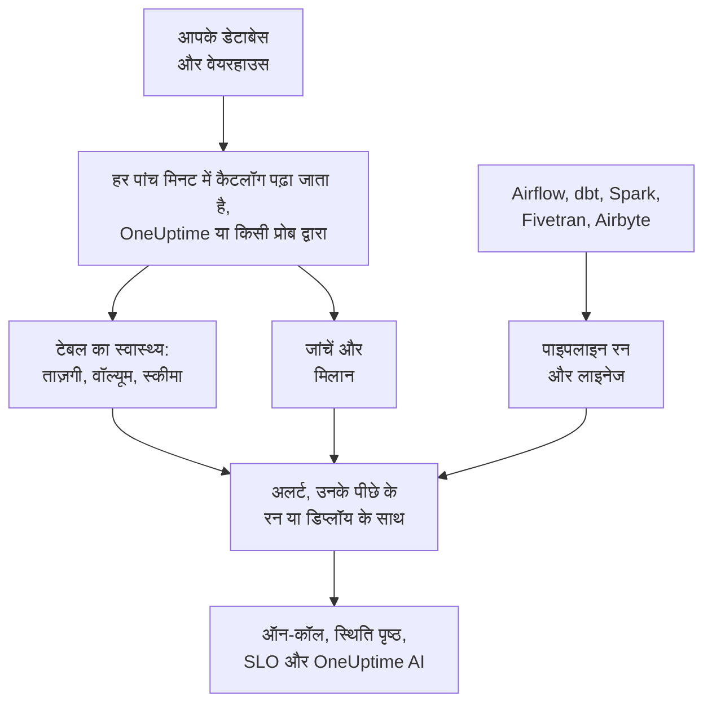

# डेटा ऑब्ज़र्वेबिलिटी

डेटा ऑब्ज़र्वेबिलिटी उन टेबल पर नज़र रखता है जिन पर आपकी कंपनी निर्भर है, PostgreSQL, MySQL, SQL Server, Oracle, MongoDB, Redshift, Snowflake, BigQuery, ClickHouse, Databricks और Athena में, और जब उनका डेटा देर से आए, गायब हो, गलत हो या टूट जाए, तो इसका उपयोग करने वालों को पता चलने से पहले आपको बताता है। यह हर टेबल की लय खुद सीखता है, हर डेटाबेस का कैटलॉग पढ़ता है और कभी कोई पंक्ति नहीं पढ़ता, और डेटा की हर गड़बड़ी को उसके पीछे के पाइपलाइन रन, डिप्लॉय या अपस्ट्रीम टेबल से जोड़ता है।

यह चार सवालों के जवाब देता है:

:::cards
- [क्या डेटा ताज़ा है?](/docs/data-observability/table-health): हर टेबल का आख़िरी बदलाव, पंक्तियां, आकार और कॉलम, जो हर पांच मिनट में पढ़े जाते हैं, और जब कोई टेबल देर से हो, सिकुड़े या उसकी बनावट बदले तो अलर्ट।
- [क्या डेटा सही है?](/docs/data-observability/checks): टेबल में रखी चीज़ों पर जांचें, किसी टेबल और उसकी कॉपी के बीच मिलान, और dbt के टेस्ट, जिनके विफल होने पर अलर्ट आता है।
- [डेटा कहां से आता है, और आगे कहां जाता है?](/docs/data-observability/lineage-and-pipelines): आपकी पाइपलाइन, dbt, Fivetran, Airbyte, व्यू और डेटाबेस के अपने क्वेरी इतिहास से लाइनेज, ताकि एक गड़बड़ी एक ही समस्या खोले।
- [क्या इसका उपयोग करने वाले इस पर भरोसा कर सकते हैं?](/docs/data-observability/data-products): ताज़गी SLA वाले डेटा प्रोडक्ट, स्थिति पृष्ठों पर और SLO के रूप में ट्रैक किए गए, "data as of" बैज के साथ।
:::

## यह कैसे काम करता है

1. **डेटाबेस कनेक्ट करें**, केवल पढ़ने वाले लॉगिन के साथ। जिस डेटाबेस को डेटा सुरक्षा पहले से जानता है, उस पर बिना कुछ किए नज़र रखी जाती है, और आपके Google Cloud कनेक्शन को मिले हर BigQuery डेटासेट पर भी। निजी नेटवर्क के डेटाबेस को वहां आपके चलाए प्रोब से पढ़ा जाता है।
2. **हर पांच मिनट में** OneUptime हर डेटाबेस का कैटलॉग और आंकड़े पढ़ता है: हर टेबल और व्यू, उसके कॉलम, पंक्तियां और आकार, और उसमें आख़िरी बदलाव कब हुआ। कोई टेबल स्कैन नहीं होती और कोई पंक्ति नहीं पढ़ी जाती।
3. **हर टेबल की लय सीखी जाती है**: वह आम तौर पर कितनी बार बदलती है। जो टेबल अपनी लय से चूक जाए, वह देर से है; जिसकी पंक्तियां घटें, या जिसके कॉलम बदलें, वह यह बताती है।
4. **सुझाए गए अलर्ट** इनमें से हर एक को ऐसे मॉनिटर में बदलते हैं जिसे रखना आप खुद चुनते हैं, और आपकी जोड़ी गई जांचें पढ़ती हैं कि टेबल में क्या है।
5. **लाइनेज** बताता है कि कौन-सी टेबल किसे डेटा देती है, ताकि जिस टेबल का स्रोत पहले टूटा, उस पर आया अलर्ट उसी स्रोत का परिणाम माना जाए: एक समस्या, दस नहीं।

## यह किस तरह अलग है

- **यह OneUptime के बाकी हिस्सों का ही हिस्सा है।** डेटा अलर्ट एक सामान्य अलर्ट है: यह ऑन-कॉल के ज़रिए पेज करता है, घटनाएं खोलता है, स्थिति पृष्ठों पर दिखता है और SLO में गिना जाता है। आपके ट्रेस जिन सेवाओं को किसी टेबल में लिखते हुए दिखाते हैं, वे और उनके डिप्लॉय हर टेबल अलर्ट के बगल में होते हैं।
- **हर टेबल के लिए कुछ कॉन्फ़िगर नहीं करना।** लय, शेड्यूल और रन के सामान्य समय इस बात से सीखे जाते हैं कि हर टेबल और पाइपलाइन क्या करती है, और किसी डेटाबेस के लिए सुझाया गया मॉनिटर उसकी हर टेबल को कवर करता है, बाद में बनी टेबल को भी।
- **हर कारण के लिए एक समस्या।** जिस अलर्ट की अपस्ट्रीम टेबल, पाइपलाइन या डेटाबेस पर पहले से कोई अलर्ट खुला है, वह उस अलर्ट से उसके परिणाम के रूप में जुड़ जाता है, पहले से स्वीकार किया हुआ, ताकि टूटा हुआ लोड सिर्फ़ एक बार पेज करे।
- **OneUptime AI आपके डेटा को जानता है।** डेटा अलर्ट की जांच-पड़ताल टेबल में लिखने वालों, उसके रन और अपस्ट्रीम टेबल से शुरू होती है; AI से पूछें, Slack और Microsoft Teams में पूछा जा सकता है कि कोई टेबल ताज़ा है या नहीं, और AI एजेंट भी यह पूछ सकते हैं; और एक वाक्य से जांच लिखी जा सकती है। देखें [OneUptime AI और API](/docs/data-observability/ai-and-api)।

## शुरू करने से पहले

- **ऐसी भूमिका जो इसे सेट कर सके।** प्रोजेक्ट स्वामी, प्रोजेक्ट एडमिन और टेलीमेट्री एडमिन डेटाबेस कनेक्ट करते हैं। जो भी डेटा एसेट संपादित कर सकता है, वह जांचें, मिलान और डेटा प्रोडक्ट जोड़ता है; दर्शक भूमिका वाले देखते हैं कि इसे क्या मिला। देखें [अनुमति संदर्भ](/docs/permissions/reference)।
- **हर डेटाबेस पर केवल पढ़ने वाला लॉगिन।** [डेटाबेस कनेक्ट करें](/docs/data-observability/connect) बताता है कि हर इंजन को कम से कम क्या चाहिए।

## जल्दी शुरू करें

:::steps
### डेटाबेस कनेक्ट करें

**डेटा अवलोकनीयता** खोलें, **डेटाबेस** पर जाएं और **Connect a Database** चुनें। इंजन चुनें, और केवल पढ़ने वाली कनेक्शन स्ट्रिंग दें, या उस एनवायरनमेंट वेरिएबल का नाम जिससे आपका प्रोब उसे पढ़ता है। [डेटाबेस कनेक्ट करें](/docs/data-observability/connect) हर इंजन का लॉगिन दिखाता है।

### इसकी टेबल देखें

पांच मिनट के अंदर इसकी टेबल **टेबल** के अंदर दिखने लगती हैं, हर एक अपनी पंक्तियों, आकार और आख़िरी बदलाव के समय के साथ। किसी टेबल की ताज़गी तब पता चलती है जब वह दो बार बदल चुकी हो: जब तक वह अपनी लय में रहे तब तक **Fresh**, और लय चूकते ही **Late**।

### सुझाए गए अलर्ट जोड़ें

**डेटाबेस** पर, डेटाबेस के लिए **Recommended Alerts** चुनें, और जो चाहिए वे जोड़ें: देर से चल रही टेबल, ऐसी टेबल जिसकी पंक्तियां तेज़ी से गिरें या असामान्य रूप से कम हों, ऐसी टेबल जिसके कॉलम बदलें, और ऐसा डेटाबेस जो रिपोर्ट करना बंद कर दे। हर एक सामान्य मॉनिटर है: ऑन-कॉल, मालिक, मेंटेनेंस विंडो और स्थिति पृष्ठ किसी भी दूसरे मॉनिटर की तरह काम करते हैं।
:::

## अगले कदम

:::cards
- [डेटाबेस कनेक्ट करें](/docs/data-observability/connect): हर इंजन का न्यूनतम अधिकारों वाला लॉगिन, और निजी नेटवर्क के लिए प्रोब।
- [टेबल का स्वास्थ्य](/docs/data-observability/table-health): ताज़गी, वॉल्यूम, स्कीमा बदलाव, अप्रयुक्त टेबल और हर टेबल के लिखे मेट्रिक।
- [जांचें और मिलान](/docs/data-observability/checks): किसी टेबल के मानों पर नियम, किसी टेबल की उसकी कॉपी से तुलना, और dbt के टेस्ट।
- [लाइनेज और पाइपलाइन](/docs/data-observability/lineage-and-pipelines): OpenLineage, dbt, Fivetran और Airbyte, और हर कारण के लिए एक समस्या।
- [डेटा प्रोडक्ट](/docs/data-observability/data-products): डेटा का उपयोग करने वालों के लिए ताज़गी SLA, स्थिति पृष्ठों पर और SLO के रूप में।
- [OneUptime AI और API](/docs/data-observability/ai-and-api): जांच-पड़ताल, एक वाक्य से जांच, AI एजेंटों के लिए ताज़गी, और हर एंडपॉइंट।
:::
