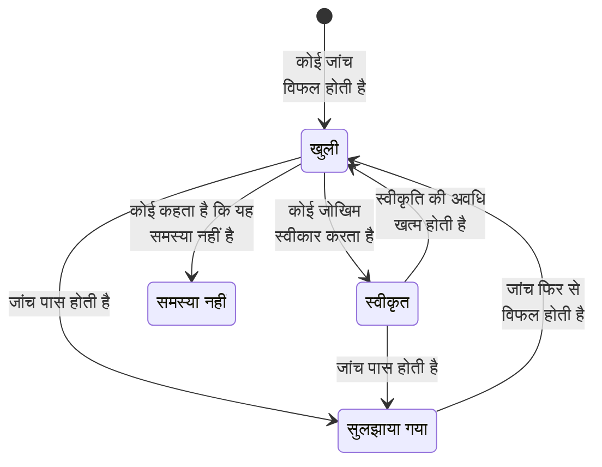

# डेटा सुरक्षा जांच और समस्याएं

डेटा सुरक्षा हर स्टोर पर नौ समूहों में 32 जांचें चलाता है। एक जांच किसी एक स्टोर के बारे में जो कुछ ज्ञात है उसे पढ़ती है - वह कैसे कॉन्फ़िगर है, उसमें क्या मिला, कौन उस तक पहुंच सकता है, वह कहां है - और पास होती है, विफल होती है या तय नहीं कर पाती। विफल जांच उस स्टोर पर एक समस्या खोलती है, और जांच पास होते ही समस्या अपने आप बंद हो जाती है। यह पेज हर जांच सूचीबद्ध करता है, बताता है कि किसी समस्या की गंभीरता और जोखिम स्कोर कैसे निकाले जाते हैं, और यह भी कि समस्या के जीवनकाल में उसके साथ क्या होता है।

:::cards
- [जांच कैसे तय करती है](#जांच-कैसे-तय-करती-है): पास, विफल या तय नहीं कर सकती, और विफलता कितनी बुरी है।
- [हर जांच](#हर-जांच): सभी 32, हर एक क्या जांचती है और उसे कैसे ठीक करें।
- [जोखिम स्कोर](#जोखिम-स्कोर): एक गंभीरता के अंदर समस्याएं किस क्रम में रखी जाती हैं।
- [समस्या के साथ क्या होता है](#समस्या-के-साथ-क्या-होता-है): खुली, सुलझाई गई, स्वीकृत, समस्या नहीं।
- [यहीं से ठीक करें](#यहीं-से-ठीक-करें): एक क्लिक में सार्वजनिक बकेट ब्लॉक करें, या स्नैपशॉट की शेयरिंग रोकें।
:::

## जांच कैसे तय करती है

हर जांच किसी स्टोर के बारे में तथ्य पढ़ती है और चार में से एक जवाब देती है:

| जवाब | इसका मतलब | समस्या के साथ क्या होता है |
| --- | --- | --- |
| पास | जांच को कुछ गलत नहीं मिलता। | खुली या स्वीकृत समस्या सुलझा दी जाती है। |
| विफल | जांच को गड़बड़ी मिलती है, और वह एक वाक्य में बताती है कि उसने क्या देखा: यही समस्या का साक्ष्य है। | एक समस्या खुलती है, या खुली हुई समस्या अपडेट की जाती है। |
| तय नहीं कर सकती | कोई तथ्य पढ़ा नहीं जा सका: ऐसी अनुमति जो भूमिका के पास नहीं है, कोई कॉल जो विफल हुई। | कुछ नहीं बदलता: खुली समस्या खुली रहती है, क्योंकि जब OneUptime देख नहीं सका, तो कोई यह नहीं मान सकता कि गड़बड़ी ठीक हो गई है। |
| लागू नहीं होती | स्टोर के प्रकार में ऐसी कोई सेटिंग नहीं है। | खुली समस्या सुलझा दी जाती है। |

### गंभीरता डेटा के हिसाब से चलती है

एक ही गड़बड़ी ज़्यादा संवेदनशील डेटा पर ज़्यादा मायने रखती है। हर जांच संवेदनशीलता के हर स्तर के लिए एक गंभीरता देती है, और समस्या अपने स्टोर वाली गंभीरता लेती है: कार्ड नंबरों वाला सार्वजनिक बकेट गंभीर है, वेबसाइट की तस्वीरों वाला सार्वजनिक बकेट सिर्फ़ निम्न। डैश का मतलब है कोई समस्या नहीं। किसी स्टोर की संवेदनशीलता उसके निष्कर्षों से आती है (देखें [संवेदनशील डेटा प्रकार](/docs/data-security/data-types#संवेदनशीलता)), इसलिए सामग्री के नमूने गंभीरता को सही बनाते हैं।

कुछ जांचें इसके बजाय गंभीरता इस आधार पर तय करती हैं कि उन्होंने क्या देखा। **इसमें सीक्रेट संग्रहीत हैं** किसी भी स्टोर पर उच्च है, और ऐसे स्टोर पर गंभीर जो सार्वजनिक है या अन्य खातों के साथ शेयर किया गया है।

## हर जांच

गंभीरता प्रतिबंधित, गोपनीय, आंतरिक और सार्वजनिक डेटा के लिए, इसी क्रम में दी गई है। हर समस्या का पेज अपने स्टोर के लिए पूरा समाधान दिखाता है - कंसोल के चरण, CLI कमांड और, जहां उपयुक्त हो, Terraform - स्टोर के नाम और क्षेत्र भरे हुए।

### एक्सपोज़र

| जांच | किस पर चलती है | यह क्या जांचती है | गंभीरता | कैसे ठीक करें |
| --- | --- | --- | --- | --- |
| इंटरनेट पर कोई भी इसे पढ़ सकता है (`public-read`) | ऑब्जेक्ट स्टोरेज, वेयरहाउस, सर्च | स्टोर की नीति, ACL या IAM बाइंडिंग किसी को भी बिना साइन इन किए उसका डेटा पढ़ने देती हैं। | गंभीर / गंभीर / उच्च / निम्न | अनाम या सभी प्रमाणित प्रिंसिपल को दी गई हर अनुमति हटाएं। जिन फ़ाइलों का सार्वजनिक होना ज़रूरी है, वे **जानबूझकर सार्वजनिक** चिह्नित ऐसे स्टोर में रहनी चाहिए जिसमें और कुछ न हो। |
| इंटरनेट पर कोई भी इसे बदल सकता है (`public-write`) | ऑब्जेक्ट स्टोरेज, वेयरहाउस, सर्च | स्टोर की नीति, ACL या IAM बाइंडिंग किसी को भी उसका डेटा लिखने या हटाने देती हैं। | गंभीर / गंभीर / गंभीर / उच्च | अनाम या सभी प्रमाणित प्रिंसिपल को दी गई लिखने या हटाने की हर अनुमति हटाएं। |
| सार्वजनिक एक्सेस ब्लॉक नहीं है (`public-access-not-blocked`) | AWS S3 Bucket | बकेट या उसके खाते के लिए S3 Block Public Access पूरी तरह चालू नहीं है, इसलिए नीति में एक बदलाव उसे सार्वजनिक बना सकता है। | उच्च / मध्यम / निम्न / — | बकेट के लिए Block Public Access की चारों सेटिंग्स चालू करें। |
| डेटाबेस इंटरनेट से कनेक्शन स्वीकार करता है (`internet-reachable`) | डेटाबेस, वेयरहाउस, सर्च, कैश | डेटाबेस का सार्वजनिक एंडपॉइंट है या सार्वजनिक नेटवर्क एक्सेस चालू है। | उच्च / उच्च / मध्यम / निम्न | सार्वजनिक एंडपॉइंट बंद करें, और डेटाबेस तक किसी निजी नेटवर्क या बैस्टियन के ज़रिए पहुंचें। |
| इसका फ़ायरवॉल हर पते को अंदर आने देता है (`open-to-all-addresses`) | डेटाबेस, वेयरहाउस, सर्च, कैश | कोई फ़ायरवॉल नियम या अधिकृत नेटवर्क 0.0.0.0/0 या पूरी पता रेंज को अनुमति देता है। | गंभीर / गंभीर / उच्च / मध्यम | सब कुछ अनुमत करने वाले नियम को उन पतों या नेटवर्क से बदलें जिन्हें एक्सेस चाहिए। |
| इसका स्नैपशॉट कोई भी बहाल कर सकता है (`snapshot-public`) | डेटाबेस, स्नैपशॉट | डेटाबेस स्नैपशॉट सार्वजनिक रूप से शेयर है, इसलिए कोई भी क्लाउड खाता उसकी पूरी कॉपी बहाल कर सकता है। | गंभीर / गंभीर / गंभीर / उच्च | स्नैपशॉट को निजी बनाएं। |
| इसका स्नैपशॉट अन्य खातों के साथ शेयर है (`snapshot-shared-externally`) | डेटाबेस, स्नैपशॉट | डेटाबेस स्नैपशॉट आपके कनेक्ट किए गए खातों के बाहर के खातों के साथ शेयर है। | उच्च / उच्च / मध्यम / निम्न | उन खातों के साथ स्नैपशॉट की शेयरिंग बंद करें जिनके पास यह नहीं होना चाहिए। |
| आपके संगठन के बाहर के खाते इस तक पहुंच सकते हैं (`shared-with-external-accounts`) | टेलीमेट्री को छोड़कर हर स्टोर | स्टोर की नीति ऐसे खातों, टेनेंट या प्रोजेक्ट को एक्सेस देती है जो OneUptime से कनेक्ट नहीं हैं। | उच्च / उच्च / मध्यम / निम्न | बाहर के हर प्रिंसिपल की समीक्षा करें, और उन्हें हटाएं जिन्हें एक्सेस की ज़रूरत नहीं है। |

### एन्क्रिप्शन

| जांच | किस पर चलती है | यह क्या जांचती है | गंभीरता | कैसे ठीक करें |
| --- | --- | --- | --- | --- |
| इसका डेटा स्टोरेज में एन्क्रिप्ट नहीं है (`not-encrypted-at-rest`) | टेलीमेट्री को छोड़कर हर स्टोर | स्टोरेज एन्क्रिप्शन बंद है। | उच्च / मध्यम / निम्न / — | स्टोरेज में एन्क्रिप्शन (encryption at rest) चालू करें। RDS इंस्टेंस को उसी जगह एन्क्रिप्ट नहीं किया जा सकता: उसके स्नैपशॉट की एन्क्रिप्टेड कॉपी बहाल करें। |
| प्रतिबंधित डेटा आपकी अपनी कुंजी के तहत नहीं है (`no-customer-managed-key`) | टेलीमेट्री को छोड़कर हर स्टोर | स्टोर में प्रतिबंधित डेटा है, पर वह ग्राहक-प्रबंधित कुंजी के बजाय प्रदाता की डिफ़ॉल्ट कुंजी से एन्क्रिप्ट है। | मध्यम / — / — / — | स्टोर को अपनी कुंजी सेवा में आपके द्वारा प्रबंधित कुंजी से एन्क्रिप्ट करें। |
| बिना एन्क्रिप्शन वाले कनेक्शन की अनुमति है (`encryption-in-transit-not-enforced`) | टेलीमेट्री को छोड़कर हर स्टोर | स्टोर ऐसे कनेक्शन स्वीकार करता है जो TLS का उपयोग नहीं करते। | उच्च / मध्यम / निम्न / — | हर कनेक्शन के लिए TLS ज़रूरी करें। S3 पर, हर वह अनुरोध अस्वीकार करें जिसमें `aws:SecureTransport` false है। |
| यह 1.2 से पुराना TLS स्वीकार करता है (`weak-tls`) | टेलीमेट्री को छोड़कर हर स्टोर | न्यूनतम TLS संस्करण 1.0 या 1.1 है। | मध्यम / मध्यम / निम्न / — | न्यूनतम TLS संस्करण 1.2 या बाद का सेट करें। |

### रिकवरी

| जांच | किस पर चलती है | यह क्या जांचती है | गंभीरता | कैसे ठीक करें |
| --- | --- | --- | --- | --- |
| इसका कोई बैकअप नहीं है, या बैकअप 7 दिन से कम रखे जाते हैं (`no-backups`) | डेटाबेस, वेयरहाउस | ऑटोमेटेड बैकअप बंद हैं, या 7 दिन से कम समय के लिए रखे जाते हैं। | उच्च / मध्यम / निम्न / — | ऑटोमेटेड बैकअप चालू करें, और उन्हें कम से कम 7 दिन रखें। |
| पॉइंट-इन-टाइम रिकवरी बंद है (`no-point-in-time-recovery`) | AWS DynamoDB Table, Azure Cosmos DB Account | टेबल या डेटाबेस को किसी गलती से पहले के पल पर बहाल नहीं किया जा सकता। | मध्यम / निम्न / — / — | पॉइंट-इन-टाइम रिकवरी चालू करें। |
| इसे एक ही कदम में हटाया जा सकता है (`deletion-protection-off`) | डेटाबेस, वेयरहाउस | डिलीशन प्रोटेक्शन बंद है। | मध्यम / निम्न / — / — | डिलीशन प्रोटेक्शन चालू करें। |
| हटाई गई या ओवरराइट की गई फ़ाइलें वापस नहीं पाई जा सकतीं (`deleted-data-not-recoverable`) | ऑब्जेक्ट स्टोरेज | वर्ज़निंग और सॉफ़्ट डिलीट दोनों बंद हैं। | मध्यम / निम्न / — / — | वर्ज़निंग या सॉफ़्ट डिलीट चालू करें। |

### दृश्यता

| जांच | किस पर चलती है | यह क्या जांचती है | गंभीरता | कैसे ठीक करें |
| --- | --- | --- | --- | --- |
| किसी को पता नहीं चलेगा कि इसे किसने पढ़ा (`access-not-logged`) | टेलीमेट्री को छोड़कर हर स्टोर | स्टोर को पढ़ा जाना लॉग नहीं होता: न एक्सेस लॉग, न डेटा-एक्सेस ऑडिट लॉग। | उच्च / मध्यम / निम्न / — | पढ़ने के लिए एक्सेस या ऑडिट लॉगिंग चालू करें: S3 सर्वर एक्सेस लॉग या CloudTrail डेटा इवेंट, Azure StorageRead डायग्नोस्टिक लॉग, Cloud Storage Data Access ऑडिट लॉग। |

### एक्सेस

| जांच | किस पर चलती है | यह क्या जांचती है | गंभीरता | कैसे ठीक करें |
| --- | --- | --- | --- | --- |
| खाता कुंजी वाला कोई भी सब कुछ पढ़ सकता है (`shared-key-access`) | Azure Storage Account | स्टोरेज खाता शेयर्ड कुंजी एक्सेस की अनुमति देता है, जो Microsoft Entra ID को बायपास करता है और हर व्यक्ति का अलग ऑडिट ट्रेल नहीं छोड़ता। | मध्यम / निम्न / — / — | एप्लिकेशन को Microsoft Entra ID पर ले जाएं, फिर स्टोरेज खाता कुंजी एक्सेस बंद करें। |
| ऑब्जेक्ट अपने खुद के एक्सेस नियम रख सकते हैं (`object-acls-enabled`) | AWS S3 Bucket, Google Cloud Storage Bucket | ऑब्जेक्ट ACL चालू हैं, इसलिए बकेट के निजी दिखते हुए भी कोई एक ऑब्जेक्ट सार्वजनिक बनाया जा सकता है। | निम्न / निम्न / — / — | S3 पर, Object Ownership को Bucket owner enforced पर सेट करें। Cloud Storage पर, uniform bucket-level access चालू करें। |
| 25 से ज़्यादा पहचानें प्रतिबंधित डेटा पढ़ सकती हैं (`many-readers`) | टेलीमेट्री को छोड़कर हर स्टोर | ज़्यादातर टीमें जितनी पहचानों की समीक्षा कर सकती हैं, उससे ज़्यादा के पास स्टोर को पढ़ने का एक्सेस है। | मध्यम / — / — / — | स्टोर का **कौन पहुंच सकता है** पेज खोलें, और वह एक्सेस हटाएं जो इस्तेमाल नहीं होता या ज़रूरत से ज़्यादा व्यापक है। |

### डेटा स्वच्छता

| जांच | किस पर चलती है | यह क्या जांचती है | गंभीरता | कैसे ठीक करें |
| --- | --- | --- | --- | --- |
| इसमें सीक्रेट संग्रहीत हैं (`secrets-stored`) | टेलीमेट्री को छोड़कर हर स्टोर | स्टोर के डेटा में पासवर्ड, API कुंजियां, टोकन या प्राइवेट कुंजियां मिलीं। | उच्च / उच्च / उच्च / उच्च | मिले हर सीक्रेट को लीक हुआ मानकर रोटेट करें। सीक्रेट को किसी सीक्रेट मैनेजर में ले जाएं और स्टोर से हटाएं। |
| कार्ड सुरक्षा कोड संग्रहीत हैं (`card-security-codes-stored`) | टेलीमेट्री को छोड़कर हर स्टोर | CVV या CVC कोड मिले। PCI DSS भुगतान अधिकृत होने के बाद इन्हें रखना मना करता है, चाहे वे एन्क्रिप्टेड हों या नहीं। | गंभीर / गंभीर / गंभीर / गंभीर | इन्हें लिखने वाला कोड रोकें, संग्रहीत कोड हटाएं, और जांचें कि बैकअप में कोई न बचा हो। |
| कार्ड नंबर पढ़ने योग्य रूप में संग्रहीत हैं (`card-numbers-readable`) | टेलीमेट्री को छोड़कर हर स्टोर | पूरे कार्ड नंबर पढ़ने योग्य रूप में मिले। PCI DSS के अनुसार वे जहां भी संग्रहीत हों, अपठनीय होने चाहिए। | उच्च / उच्च / उच्च / उच्च | अपने भुगतान प्रदाता के साथ कार्ड नंबर टोकनाइज़ करें, या उन्हें फ़ील्ड स्तर पर एन्क्रिप्ट करें, और पढ़ने योग्य कॉपियां हटाएं। |
| पासवर्ड सादे टेक्स्ट में संग्रहीत हैं (`plaintext-passwords`) | टेलीमेट्री को छोड़कर हर स्टोर | पासवर्ड फ़ील्ड में ऐसे मान हैं जो पासवर्ड हैश (bcrypt, argon2, scrypt या PBKDF2) नहीं हैं। | गंभीर / गंभीर / गंभीर / गंभीर | पासवर्ड को bcrypt, scrypt या argon2 से हैश करें, संग्रहीत पासवर्ड माइग्रेट करें, और हर खाते का पासवर्ड रीसेट करवाएं। |
| प्रोडक्शन डेटा किसी नॉन-प्रोडक्शन स्टोर में कॉपी किया गया (`production-data-in-non-production`) | टेलीमेट्री को छोड़कर हर स्टोर | किसी प्रोडक्शन स्टोर में मिले मान यहां भी मिले, किसी डेवलपमेंट, टेस्ट या स्टेजिंग स्टोर में। | उच्च / मध्यम / — / — | कॉपी को मास्क किए गए या सिंथेटिक डेटा से बदलें, और नॉन-प्रोडक्शन स्टोर से असली डेटा हटाएं। |
| ऐसा संवेदनशील डेटा जिसका 90 दिन से किसी ने उपयोग नहीं किया (`stale-sensitive-data`) | टेलीमेट्री को छोड़कर हर स्टोर | स्टोर में संवेदनशील डेटा है और 90 दिन से उसमें न कुछ पढ़ा गया, न लिखा गया। | मध्यम / निम्न / — / — | पुष्टि करें कि डेटा की अब ज़रूरत नहीं है, फिर उसे रखने की अवधि की अंतिम तारीख के साथ आर्काइव करें, या हटा दें। |
| इस संवेदनशील स्टोर का कोई मालिक नहीं है (`no-owner`) | हर स्टोर | स्टोर में संवेदनशील डेटा है और उसका कोई मालिक नहीं है। | मध्यम / निम्न / — / — | स्टोर के **मालिक** पेज पर एक मालिक जोड़ें, या ऐसा स्वामी नियम जो उसके टैग से मेल खाए। |

### टेलीमेट्री

| जांच | किस पर चलती है | यह क्या जांचती है | गंभीरता | कैसे ठीक करें |
| --- | --- | --- | --- | --- |
| संवेदनशील डेटा आपकी टेलीमेट्री तक पहुंच रहा है (`sensitive-data-in-telemetry`) | टेलीमेट्री | लॉग, ट्रेस, अपवाद, रीप्ले या AI बातचीत में ऐसा संवेदनशील डेटा है जिसे कोई सफ़ाई नियम मास्क नहीं करता। | उच्च / मध्यम / निम्न / — | इन्जेस्ट के समय डेटा मास्क करने के लिए हर निष्कर्ष पर **साफ़ करें** दबाएं, फिर उसे लिखने वाला कोड ठीक करें। |
| सीक्रेट आपकी टेलीमेट्री तक पहुंच रहे हैं (`secrets-in-telemetry`) | टेलीमेट्री | लॉग, ट्रेस, अपवाद या AI बातचीत में पासवर्ड, API कुंजियां या टोकन दिखते हैं। | गंभीर / गंभीर / गंभीर / गंभीर | पहले सीक्रेट रोटेट करें, फिर **साफ़ करें** दबाएं और उसे लिखने वाला कोड ठीक करें। |

### डेटा रेजिडेंसी

| जांच | किस पर चलती है | यह क्या जांचती है | गंभीरता | कैसे ठीक करें |
| --- | --- | --- | --- | --- |
| डेटा उन क्षेत्रों के बाहर संग्रहीत है जहां उसे रहने की अनुमति है (`residency-violation`) | टेलीमेट्री को छोड़कर हर स्टोर | स्टोर का क्षेत्र, या कोई क्षेत्र जहां उसका डेटा रेप्लिकेट होता है, किसी डेटा रेजिडेंसी नियम को तोड़ता है। | उच्च / उच्च / मध्यम / — | डेटा को किसी अनुमत क्षेत्र में ले जाएं, या उसे दूसरे क्षेत्र में कॉपी करना बंद करें। अगर ट्रांसफ़र वैध है, तो समस्या स्वीकार करें और वजह दर्ज करें। |

### AI

| जांच | किस पर चलती है | यह क्या जांचती है | गंभीरता | कैसे ठीक करें |
| --- | --- | --- | --- | --- |
| संवेदनशील डेटा किसी AI प्रदाता को भेजा जा रहा है (`sensitive-data-to-ai`) | AI बातचीत | OneUptime में दर्ज AI बातचीत संवेदनशील डेटा को किसी मॉडल प्रदाता तक ले जाती है। | गंभीर / उच्च / निम्न / — | प्रॉम्प्ट भेजे जाने से पहले संवेदनशील मान हटाएं (redact करें), या ये कॉल अपने होस्ट किए मॉडल पर भेजें। |
| AI के लिए उपयोग होने वाले स्टोर में प्रतिबंधित डेटा है (`sensitive-data-in-ai-store`) | टेलीमेट्री को छोड़कर हर स्टोर | AI ट्रेनिंग या रिट्रीवल डेटा के रूप में टैग किए गए स्टोर में प्रतिबंधित डेटा है। | उच्च / मध्यम / — / — | किसी मॉडल को ट्रेन या ग्राउंड करने में उपयोग होने से पहले प्रतिबंधित डेटा हटाएं या मास्क करें। |

## जोखिम स्कोर

गंभीरता बताती है कि समस्या कितनी बुरी है। 0 से 100 तक का जोखिम स्कोर एक ही गंभीरता वाली समस्याओं को उन बातों के आधार पर क्रम में रखता है जो उसी गड़बड़ी को और बदतर बनाती हैं:

```text
risk = severity + 10 × exposure + 6 × volume + 5 × activity + 4 × production, at most 100
```

| कारक | अंक |
| --- | --- |
| गंभीरता | गंभीर के लिए 75, उच्च के लिए 50, मध्यम के लिए 25, निम्न के लिए 0 |
| एक्सपोज़र | सार्वजनिक के लिए 10, अन्य खाते के लिए 8, इंटरनेट से पहुंच योग्य के लिए 6, अज्ञात के लिए 3, निजी के लिए 0 |
| वॉल्यूम | 6 तक, स्टोर के अनुमानित संवेदनशील रिकॉर्ड के हिसाब से, लॉग स्केल पर: 10 रिकॉर्ड के लिए 1, 1,000 के लिए 3, दस लाख के लिए 5, एक करोड़ या ज़्यादा के लिए 6 |
| गतिविधि | 5, जब सुरक्षा संचालन ने पिछले हफ़्ते स्टोर पर डिटेक्शन देखे हों |
| प्रोडक्शन | प्रोडक्शन में चल रहे स्टोर के लिए 4 |

अतिरिक्त कारक ज़्यादा से ज़्यादा 25 अंक जोड़ते हैं, इसलिए कोई समस्या कभी अपने से निचली गंभीरता वाली समस्या से कम स्कोर नहीं पाती। प्रतिबंधित डेटा के दस लाख रिकॉर्ड वाला सार्वजनिक प्रोडक्शन बकेट गंभीर समस्या के लिए 75 + 10 + 5 + 4 = 94 स्कोर पाता है। हर समस्या उन कारकों को उनके अंकों के साथ सूचीबद्ध करती है जिन्होंने उसके स्कोर में जोड़ा, और स्टोर अपनी सबसे बुरी खुली समस्या का स्कोर दिखाता है।

किसी स्टोर का एनवायरनमेंट - प्रोडक्शन, Staging, Development, Test या अज्ञात - उसके टैग (`env`, `environment`, `stage`, `tier` और इसी तरह के) से आता है या, टैग न हो तो, उसके नाम के शब्दों से, जैसे `prod`, `staging`, `dev` या `qa`। जब दोनों से पता न चले, तो इसे स्टोर पर सेट करें।

## समस्या के साथ क्या होता है



OneUptime जांचें चलने के साथ समस्याएं खोलता, अपडेट करता और सुलझाता है। किसी समस्या पर व्यक्ति जो करता है, वह यह तय करना है कि आगे क्या होगा:

| स्थिति | यह वहां कैसे पहुंचती है | आगे क्या होता है |
| --- | --- | --- |
| **खुली** | उसकी जांच अभी स्टोर पर विफल हो रही है। | जांच पास होने तक यह अवलोकन पर, स्टोर के सारांश में और अनुपालन में गिनी जाती है। |
| **सुलझाया गया** | उसकी जांच बाद के किसी रन में पास हुई, अब लागू नहीं होती या बंद कर दी गई, या उसका स्टोर संग्रहीत हो गया। कोई व्यक्ति **हल किया गया चिह्नित करें** भी चुन सकता है: तब स्टोर की तुरंत फिर से जांच होती है। | जांच फिर से विफल होने पर यह फिर खुलती है, और समस्या गिनती रखती है कि यह कितनी बार फिर खुली। |
| **स्वीकृत** | किसी व्यक्ति ने **जोखिम स्वीकार करें** चुना, एक **कारण** और **स्वीकृति की अंतिम तिथि** में एक तारीख के साथ, जो ज़्यादा से ज़्यादा एक साल आगे हो। | यह उस तारीख तक बंद रहती है, फिर जांच अब भी विफल हो तो फिर खुलती है। अगर वजह तब भी लागू हो, तो इसे फिर से स्वीकार करें। |
| **समस्या नहीं** | किसी व्यक्ति ने **समस्या नहीं** चुना: निष्कर्ष गलत था। | यह बंद रहती है, भले ही जांच विफल होती रहे। **फिर से खोलें** इसे वापस खुली स्थिति में ले आता है। |

Security Member, Security Admin, Project Admin और Project Owner किसी समस्या की स्थिति बदल सकते हैं, और **असाइन करें** से उसे किसी व्यक्ति या टीम को सौंप सकते हैं। हर बदलाव समस्या की **टाइमलाइन** में लिखा जाता है: यह कब खुली, गंभीरता का हर बदलाव, स्थिति का हर बदलाव और उसे किसने किया, मांगी गई दोबारा जांचें, और इंटीग्रेशन ने क्या किया।

जो समस्या फिर से खुलती है, वह अपना इतिहास रखती है। स्वीकार किए गए जोखिम हर दिन फिर से देखे जाते हैं, इसलिए कुछ भी स्कैन न होने पर भी स्वीकृति समय पर खत्म होती है।

## यहीं से ठीक करें

सार्वजनिक बकेट या शेयर किए गए स्नैपशॉट के बारे में खुली समस्या उसके पेज से ठीक की जा सकती है। कंसोल के चरणों के ऊपर, **यहीं से ठीक करें** वह बदलाव पेश करता है जो इसे ठीक करता है:

| समस्या | उसका स्टोर | बटन | यह क्या बदलता है |
| --- | --- | --- | --- |
| `public-read`, `public-write` या `public-access-not-blocked` | S3 बकेट, Azure स्टोरेज खाता या Cloud Storage बकेट | **सार्वजनिक एक्सेस ब्लॉक करें** | बकेट की Block Public Access की चारों सेटिंग्स चालू करता है, स्टोरेज खाते का अनाम blob एक्सेस बंद करता है, या बकेट की सार्वजनिक एक्सेस रोकथाम (public access prevention) लागू करता है |
| `snapshot-public` या `snapshot-shared-externally` | RDS स्नैपशॉट, RDS डेटाबेस, या Aurora या DocumentDB क्लस्टर | **शेयरिंग रद्द करें** | स्नैपशॉट की, या डेटाबेस के हर शेयर किए गए मैन्युअल स्नैपशॉट की, सबके साथ और आपके कनेक्ट किए खातों के बाहर के खातों के साथ शेयरिंग बंद करता है |

यह पहले पूछता है, और बताता है कि क्या बदलेगा और क्या काम करना बंद कर देगा। यह सिर्फ़ यह बदलता है कि स्टोर कैसे शेयर है, उसका डेटा कभी नहीं, और जो पहले से बंद है उसमें कुछ नहीं बदलता। **जानबूझकर सार्वजनिक** चिह्नित स्टोर कभी ब्लॉक नहीं किया जाता।

यह स्टोर के क्लाउड कनेक्शन के ज़रिए काम करता है, इसलिए कनेक्शन पर **डेटा सुरक्षा प्रतिक्रिया** चालू होनी चाहिए और उसकी सेटअप कमांड फिर से चलाई गई होनी चाहिए (देखें [डेटा सुरक्षा सेट करें](/docs/data-security/setup#डेटा-सुरक्षा-को-एक्सपोज़र-बंद-करने-दें))। तब तक पैनल बताता है कि क्या चालू करना है। इसके ठीक बाद स्टोर की फिर से जांच होती है, और जांच पास होते ही समस्या अपने आप सुलझ जाती है। समस्या की **टाइमलाइन** और स्टोर की **टाइमलाइन** बताती हैं कि क्या किया गया, और किसने किया।

## जांच सेटिंग्स

**डेटा सुरक्षा → सेटिंग्स → जाँचें** हर जांच को समूह के हिसाब से सूचीबद्ध करता है, इसके साथ कि वह क्या ढूंढती है और हर संवेदनशीलता के लिए विफलता को कौन-सी गंभीरता मिलती है। हर जांच को प्रोजेक्ट के लिए ट्यून किया जा सकता है, और हर बदलाव तुरंत सहेजा जाता है:

- **इसका स्विच** जांच को बंद करता है, जब वह आपके काम करने के तरीके के अनुकूल न हो। उसकी खुली और स्वीकृत समस्याएं सुलझा दी जाती हैं, और बताती हैं कि जांच अब नहीं चलती।
- **इसकी गंभीरता** शुरुआत में **संवेदनशीलता के अनुसार** होती है, या कोई एक गंभीरता हो सकती है जो जांच की हर विफलता को मिलती है, उसके स्टोर में चाहे जो हो।

किसी जांच को सिर्फ़ एक स्टोर पर शांत करने के लिए, उस स्टोर की समस्या पर जोखिम स्वीकार करें, या समस्या को समस्या नहीं चिह्नित करें। ऐसे निष्कर्ष के लिए जो गलत है, न कि ऐसी गड़बड़ी के लिए जो मायने नहीं रखती, इसके बजाय निष्कर्ष को संवेदनशील नहीं चिह्नित करें (देखें [संवेदनशील डेटा प्रकार](/docs/data-security/data-types#संवेदनशील-नहीं-और-कभी-संवेदनशील-नहीं))।

किसी स्टोर पर **अभी जांचें** उसका कॉन्फ़िगरेशन फिर से पढ़ता है और उसकी जांचें चलाता है। **अभी स्कैन करें** उसकी सामग्री का नमूना लेता है, और स्कैन खत्म होने पर उसकी जांचें चलती हैं।

## अगले कदम

:::cards
- [डेटा सुरक्षा इंटीग्रेशन](/docs/data-security/integrations): समस्या खुलने पर सुरक्षा केस, अलर्ट और मालिकों को ईमेल।
- [डेटा प्रवाह, एक्सेस और डेटा रेजिडेंसी](/docs/data-security/flows-access-residency): वे एक्सेस, कॉपियां और क्षेत्र जिन्हें कई जांचें पढ़ती हैं।
- [डेटा सुरक्षा अनुपालन](/docs/data-security/compliance): फ्रेमवर्क की वे आवश्यकताएं जिनके लिए हर जांच साक्ष्य है।
:::
