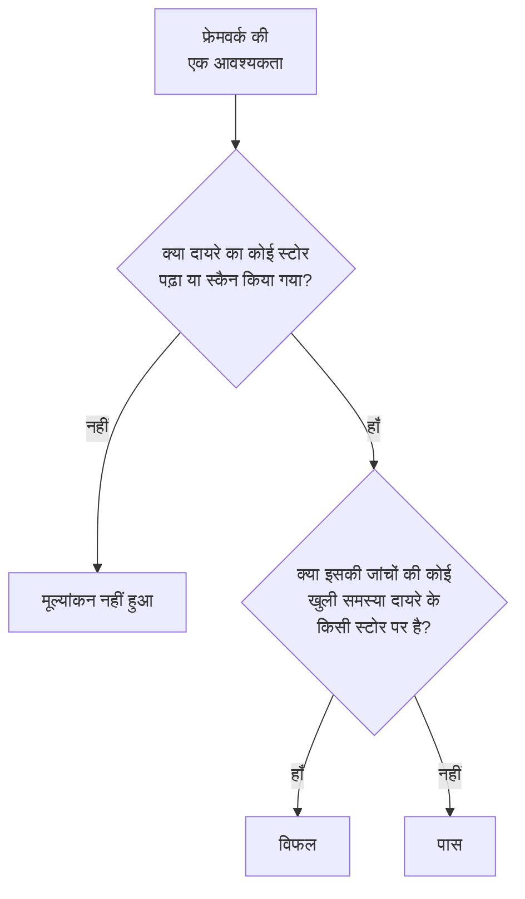

# डेटा सुरक्षा अनुपालन

डेटा सुरक्षा अपने स्कैन में मिली चीज़ों से नौ फ्रेमवर्क को स्कोर करती है। हर फ्रेमवर्क उन स्टोर को कवर करता है जिनके बारे में उसके नियम हैं - GDPR व्यक्तिगत डेटा रखने वाले स्टोर, PCI DSS वे स्टोर जहाँ कार्ड डेटा मिला, SOC 2 हर स्टोर - और उसकी हर आवश्यकता उन जांचों से पूरी या विफल होती है जो उसके लिए साक्ष्य हैं। **डेटा सुरक्षा → अनुपालन** हर फ्रेमवर्क का स्कोर, वह कितने स्टोर कवर करता है, और हर आवश्यकता दिखाता है, इसके साथ कि कितनी खुली समस्याएं उसे विफल करती हैं। स्कोर ऑडिट के लिए साक्ष्य है, प्रमाणपत्र नहीं: यह बताता है कि OneUptime जिन स्टोर को पढ़ता है, उनमें से वह क्या देख सकता है।

:::cards
- [फ्रेमवर्क](#फ्रेमवर्क): नौ फ्रेमवर्क, और हर एक कौन-से स्टोर कवर करता है।
- [फ्रेमवर्क को कैसे स्कोर किया जाता है](#फ्रेमवर्क-को-कैसे-स्कोर-किया-जाता-है): पास होने वाली, विफल होने वाली और मूल्यांकन न की गई आवश्यकताएं।
- [आवश्यकताएं और उनकी जांचें](#आवश्यकताएं-और-उनकी-जांचें): हर आवश्यकता, और वे जांचें जो उसके लिए साक्ष्य हैं।
- [प्रोसेसिंग का रिकॉर्ड](#प्रोसेसिंग-का-रिकॉर्ड): GDPR अनुच्छेद 30, आपके स्टोर से लिखा गया।
:::

## फ्रेमवर्क

| फ्रेमवर्क | पूरा नाम | दायरे में आने वाले स्टोर |
| --- | --- | --- |
| GDPR | EU सामान्य डेटा संरक्षण विनियमन | वे स्टोर जिनमें व्यक्तिगत डेटा है। |
| CCPA | कैलिफ़ोर्निया उपभोक्ता गोपनीयता अधिनियम, CPRA द्वारा संशोधित | वे स्टोर जिनमें व्यक्तिगत जानकारी है। |
| HIPAA | HIPAA सुरक्षा नियम | वे स्टोर जिनमें स्वास्थ्य डेटा है। |
| PCI DSS | PCI DSS v4.0 | वे स्टोर जहाँ कार्ड नंबर मिले। |
| SOC 2 | SOC 2 ट्रस्ट सर्विसेज़ मानदंड | हर डेटा स्टोर। |
| ISO 27001 | ISO/IEC 27001:2022 | हर डेटा स्टोर। |
| NIST CSF | NIST साइबर सुरक्षा फ्रेमवर्क 2.0 | हर डेटा स्टोर। |
| LGPD | ब्राज़ील का सामान्य डेटा संरक्षण कानून | वे स्टोर जिनमें ब्राज़ील के लोगों का व्यक्तिगत डेटा है। |
| DPDP | भारत का डिजिटल व्यक्तिगत डेटा संरक्षण अधिनियम, 2023 | वे स्टोर जिनमें भारत के लोगों का व्यक्तिगत डेटा है। |

## फ्रेमवर्क कौन-से स्टोर कवर करता है

स्टोर का दायरा उसमें मिले डेटा से तय होता है, इसलिए जैसे-जैसे स्कैन ज़्यादा पाते हैं, यह बदलता है:

- **SOC 2, ISO 27001 और NIST CSF** सुरक्षा फ्रेमवर्क हैं: ये हर स्टोर को कवर करते हैं, उसमें चाहे जो हो।
- **GDPR, CCPA, HIPAA और PCI DSS** उन स्टोर को कवर करते हैं जिनमें ऐसा डेटा प्रकार है जिसकी वे सुरक्षा करते हैं। व्यक्तिगत डेटा GDPR और CCPA को लाता है, स्वास्थ्य डेटा HIPAA को भी, और कार्ड नंबर, कार्ड सुरक्षा कोड और कार्ड की समाप्ति तिथियाँ PCI DSS को। जिस स्टोर में सिर्फ़ सीक्रेट या व्यावसायिक दस्तावेज़ हैं, वह इनमें से किसी में नहीं है।
- **LGPD और DPDP** देशों के अपने कानून हैं: ये ब्राज़ील या भारत के लोगों का व्यक्तिगत डेटा रखने वाले स्टोर को कवर करते हैं, जिसे उस देश के डेटा प्रकारों से पढ़ा जाता है, जैसे ब्राज़ील का CPF या भारत का Aadhaar नंबर।

[संवेदनशील डेटा प्रकार](/docs/data-security/data-types#बिल्ट-इन-डेटा-प्रकार) हर डेटा प्रकार को उसके देश के साथ सूचीबद्ध करता है।

## फ्रेमवर्क को कैसे स्कोर किया जाता है

- **आवश्यकता पास होती है** जब उससे जुड़ी जांचों की कोई खुली समस्या फ्रेमवर्क के दायरे के किसी स्टोर पर न हो, और **विफल होती है** जब हो।
- **उसका मूल्यांकन नहीं होता** जब तक दायरे के किसी स्टोर का कॉन्फ़िगरेशन पढ़ा या उसकी सामग्री स्कैन न की गई हो।
- **दो आवश्यकताएं खुद डेटा सुरक्षा से पूरी होती हैं**: GDPR अनुच्छेद 30, प्रोसेसिंग गतिविधियों के रिकॉर्ड, और ISO 27001 A.5.12, जानकारी का वर्गीकरण। दायरे का हर स्टोर पढ़ा या स्कैन हो जाने पर ये पास होती हैं, और जब तक कोई स्टोर बाकी है, विफल रहती हैं।
- **स्कोर** फ्रेमवर्क की मूल्यांकित आवश्यकताओं में से पास होने वाली आवश्यकताओं का हिस्सा है, पूरे प्रतिशत के रूप में। जिस फ्रेमवर्क में किसी चीज़ का मूल्यांकन नहीं हुआ, उसका कोई स्कोर नहीं होता।

सिर्फ़ खुली समस्याएं गिनी जाती हैं। जिस समस्या का जोखिम स्वीकार किया गया है, या जो समस्या नहीं है, वह अपनी आवश्यकताओं को विफल नहीं करती, इसलिए स्वीकार किया गया जोखिम एक ऐसा निर्णय है जिसे आपका ऑडिट समस्या पर देख सकता है: किसने उसे स्वीकार किया, क्यों, और कब तक।

## आवश्यकताएं और उनकी जांचें

### GDPR

| आवश्यकता | यह क्या माँगती है | जांचें |
| --- | --- | --- |
| अनुच्छेद 5(1)(c) | डेटा न्यूनीकरण | `production-data-in-non-production`, `stale-sensitive-data`, `sensitive-data-in-telemetry`, `sensitive-data-to-ai`, `sensitive-data-in-ai-store` |
| अनुच्छेद 5(1)(e) | भंडारण की सीमा | `stale-sensitive-data` |
| अनुच्छेद 25 | डिज़ाइन से और डिफ़ॉल्ट रूप से डेटा संरक्षण | `production-data-in-non-production`, `stale-sensitive-data`, `sensitive-data-in-telemetry`, `sensitive-data-to-ai`, `sensitive-data-in-ai-store` |
| अनुच्छेद 28 | प्रोसेसर | `sensitive-data-to-ai` |
| अनुच्छेद 30 | प्रोसेसिंग गतिविधियों के रिकॉर्ड | खुद डेटा सुरक्षा से पूरी होती है |
| अनुच्छेद 32 | प्रोसेसिंग की सुरक्षा | `public-read`, `public-write`, `public-access-not-blocked`, `internet-reachable`, `open-to-all-addresses`, `snapshot-public`, `snapshot-shared-externally`, `shared-with-external-accounts`, `not-encrypted-at-rest`, `no-customer-managed-key`, `encryption-in-transit-not-enforced`, `weak-tls`, `no-backups`, `no-point-in-time-recovery`, `deletion-protection-off`, `deleted-data-not-recoverable`, `access-not-logged`, `shared-key-access`, `object-acls-enabled`, `many-readers`, `secrets-stored`, `plaintext-passwords`, `secrets-in-telemetry` |
| अनुच्छेद 44-49 | तीसरे देशों को ट्रांसफ़र | `residency-violation` |

### CCPA

| आवश्यकता | यह क्या माँगती है | जांचें |
| --- | --- | --- |
| 1798.100(c) | सिर्फ़ उतना संग्रह जितना ज़रूरी है | `production-data-in-non-production`, `stale-sensitive-data`, `sensitive-data-in-telemetry`, `sensitive-data-to-ai`, `sensitive-data-in-ai-store` |
| 1798.150 | उचित सुरक्षा प्रक्रियाएं | `public-read`, `public-write`, `public-access-not-blocked`, `internet-reachable`, `open-to-all-addresses`, `snapshot-public`, `snapshot-shared-externally`, `shared-with-external-accounts`, `shared-key-access`, `object-acls-enabled`, `many-readers` |

### HIPAA

| आवश्यकता | यह क्या माँगती है | जांचें |
| --- | --- | --- |
| 164.308(a)(7) | आकस्मिक योजना | `no-backups`, `no-point-in-time-recovery`, `deletion-protection-off`, `deleted-data-not-recoverable` |
| 164.312(a)(1) | एक्सेस नियंत्रण | `public-read`, `public-write`, `public-access-not-blocked`, `internet-reachable`, `open-to-all-addresses`, `snapshot-public`, `snapshot-shared-externally`, `shared-with-external-accounts`, `shared-key-access`, `object-acls-enabled`, `many-readers` |
| 164.312(a)(2)(iv) | एन्क्रिप्शन और डिक्रिप्शन | `not-encrypted-at-rest`, `no-customer-managed-key` |
| 164.312(b) | ऑडिट नियंत्रण | `access-not-logged` |
| 164.312(e)(1) | ट्रांसमिशन सुरक्षा | `encryption-in-transit-not-enforced`, `weak-tls` |

### PCI DSS

| आवश्यकता | यह क्या माँगती है | जांचें |
| --- | --- | --- |
| 3.3.1 | ऑथराइज़ेशन के बाद संवेदनशील प्रमाणीकरण डेटा नहीं रखा जाता | `card-security-codes-stored` |
| 3.4.1 | दिखाए जाने पर कार्ड नंबर मास्क किए जाते हैं | `card-numbers-readable`, `sensitive-data-in-telemetry` |
| 3.5.1 | कार्ड नंबर जहाँ भी संग्रहीत हों, अपठनीय होते हैं | `not-encrypted-at-rest`, `no-customer-managed-key`, `card-numbers-readable` |
| 4.2.1 | मज़बूत क्रिप्टोग्राफ़ी ट्रांज़िट में कार्ड डेटा की सुरक्षा करती है | `encryption-in-transit-not-enforced`, `weak-tls` |
| 7.2 | एक्सेस ज़रूरत के हिसाब से तय और असाइन किया जाता है | `public-read`, `public-write`, `public-access-not-blocked`, `internet-reachable`, `open-to-all-addresses`, `snapshot-public`, `snapshot-shared-externally`, `shared-with-external-accounts`, `shared-key-access`, `object-acls-enabled`, `many-readers` |
| 8.3.2 | संग्रहीत होने पर प्रमाणीकरण फ़ैक्टर अपठनीय होते हैं | `plaintext-passwords` |
| 10.2 | ऑडिट लॉग कार्ड डेटा तक एक्सेस दर्ज करते हैं | `access-not-logged` |

### SOC 2

| आवश्यकता | यह क्या माँगती है | जांचें |
| --- | --- | --- |
| A1.2 | बैकअप और रिकवरी | `no-backups`, `no-point-in-time-recovery`, `deletion-protection-off`, `deleted-data-not-recoverable` |
| CC6.1 | लॉजिकल एक्सेस सुरक्षा | `public-read`, `public-write`, `public-access-not-blocked`, `internet-reachable`, `open-to-all-addresses`, `snapshot-public`, `snapshot-shared-externally`, `shared-with-external-accounts`, `not-encrypted-at-rest`, `no-customer-managed-key`, `shared-key-access`, `object-acls-enabled`, `many-readers`, `secrets-stored`, `plaintext-passwords`, `secrets-in-telemetry` |
| CC6.7 | जानकारी का ट्रांसमिशन | `encryption-in-transit-not-enforced`, `weak-tls` |
| CC7.2 | सिस्टम घटकों की निगरानी | `access-not-logged` |

### ISO 27001

| आवश्यकता | यह क्या माँगती है | जांचें |
| --- | --- | --- |
| A.5.9 | जानकारी और उससे जुड़े अन्य एसेट की इन्वेंटरी | `no-owner` |
| A.5.12 | जानकारी का वर्गीकरण | खुद डेटा सुरक्षा से पूरी होती है |
| A.5.15 | एक्सेस नियंत्रण | `public-read`, `public-write`, `public-access-not-blocked`, `internet-reachable`, `open-to-all-addresses`, `snapshot-public`, `snapshot-shared-externally`, `shared-with-external-accounts`, `shared-key-access`, `object-acls-enabled`, `many-readers` |
| A.5.34 | PII की गोपनीयता और संरक्षण | `production-data-in-non-production`, `stale-sensitive-data`, `sensitive-data-in-telemetry`, `sensitive-data-to-ai`, `sensitive-data-in-ai-store` |
| A.8.11 | डेटा मास्किंग | `production-data-in-non-production`, `stale-sensitive-data`, `sensitive-data-in-telemetry`, `sensitive-data-to-ai`, `sensitive-data-in-ai-store` |
| A.8.12 | डेटा लीकेज की रोकथाम | `secrets-stored`, `secrets-in-telemetry` |
| A.8.13 | जानकारी का बैकअप | `no-backups`, `no-point-in-time-recovery`, `deletion-protection-off`, `deleted-data-not-recoverable` |
| A.8.15 | लॉगिंग | `access-not-logged` |
| A.8.24 | क्रिप्टोग्राफ़ी का उपयोग | `not-encrypted-at-rest`, `no-customer-managed-key`, `encryption-in-transit-not-enforced`, `weak-tls`, `plaintext-passwords` |

### NIST CSF

| आवश्यकता | यह क्या माँगती है | जांचें |
| --- | --- | --- |
| ID.AM-07 | डेटा और मेटाडेटा की इन्वेंटरी रखी जाती है | `no-owner` |
| PR.AA-05 | एक्सेस अनुमतियाँ प्रबंधित की जाती हैं | `public-read`, `public-write`, `public-access-not-blocked`, `internet-reachable`, `open-to-all-addresses`, `snapshot-public`, `snapshot-shared-externally`, `shared-with-external-accounts`, `shared-key-access`, `object-acls-enabled`, `many-readers` |
| PR.DS-01 | संग्रहीत डेटा सुरक्षित रहता है | `not-encrypted-at-rest`, `no-customer-managed-key`, `secrets-stored`, `secrets-in-telemetry` |
| PR.DS-02 | ट्रांज़िट में डेटा सुरक्षित रहता है | `encryption-in-transit-not-enforced`, `weak-tls` |
| PR.DS-11 | डेटा के बैकअप रखे और परखे जाते हैं | `no-backups`, `no-point-in-time-recovery`, `deletion-protection-off`, `deleted-data-not-recoverable` |
| DE.CM-09 | डेटा और उसके उपयोग की निगरानी होती है | `access-not-logged` |

### LGPD

| आवश्यकता | यह क्या माँगती है | जांचें |
| --- | --- | --- |
| अनुच्छेद 6 | ज़रूरत और उद्देश्य की सीमा | `production-data-in-non-production`, `stale-sensitive-data`, `sensitive-data-in-telemetry`, `sensitive-data-to-ai`, `sensitive-data-in-ai-store` |
| अनुच्छेद 33 | डेटा का अंतरराष्ट्रीय ट्रांसफ़र | `residency-violation` |
| अनुच्छेद 46 | सुरक्षा उपाय | `public-read`, `public-write`, `public-access-not-blocked`, `internet-reachable`, `open-to-all-addresses`, `snapshot-public`, `snapshot-shared-externally`, `shared-with-external-accounts`, `not-encrypted-at-rest`, `no-customer-managed-key`, `shared-key-access`, `object-acls-enabled`, `many-readers` |

### DPDP

| आवश्यकता | यह क्या माँगती है | जांचें |
| --- | --- | --- |
| धारा 8(5) | उचित सुरक्षा उपाय | `public-read`, `public-write`, `public-access-not-blocked`, `internet-reachable`, `open-to-all-addresses`, `snapshot-public`, `snapshot-shared-externally`, `shared-with-external-accounts`, `not-encrypted-at-rest`, `no-customer-managed-key`, `shared-key-access`, `object-acls-enabled`, `many-readers` |
| धारा 8(7) | उद्देश्य पूरा होने पर मिटाना | `production-data-in-non-production`, `stale-sensitive-data`, `sensitive-data-in-telemetry`, `sensitive-data-to-ai`, `sensitive-data-in-ai-store` |
| धारा 16 | भारत के बाहर ट्रांसफ़र | `residency-violation` |

## प्रोसेसिंग का रिकॉर्ड

GDPR अनुच्छेद 30 आपसे अपनी प्रोसेसिंग गतिविधियों का रिकॉर्ड रखने को कहता है। डेटा सुरक्षा उसका वह हिस्सा लिखती है जो इस बारे में है कि व्यक्तिगत डेटा कहाँ रखा जाता है: व्यक्तिगत डेटा रखने वाले हर स्टोर के लिए एक पंक्ति।

| कॉलम | यह कहाँ से आता है |
| --- | --- |
| स्टोर, प्रकार, प्रदाता और क्षेत्र | Discovery |
| एनवायरनमेंट | स्टोर के टैग या नाम, या जो आप सेट करते हैं |
| संवेदनशीलता, श्रेणियां और डेटा प्रकार | स्कैन में जो मिला, या वह संवेदनशीलता जो आप सेट करते हैं |
| मालिक | स्टोर के मालिक, लोग और उसकी टीमों के सदस्य |
| उद्देश्य | स्टोर के **उद्देश्य** में आप जो लिखते हैं: उसमें व्यक्तिगत डेटा क्यों है |
| रखने की अवधि | स्टोर की **रखने की अवधि** में आप जो लिखते हैं: उसमें डेटा कितने समय तक रखा जाता है |
| फ्रेमवर्क | वे फ्रेमवर्क जिन्हें उसके डेटा प्रकार दायरे में लाते हैं |

**उद्देश्य** और **रखने की अवधि** को हर स्टोर की **सेटिंग्स** में भरें: ये वे दो चीज़ें हैं जिन्हें कोई स्कैन नहीं जान सकता। रिकॉर्ड और स्कोर डेटा सुरक्षा के API से भी मिलते हैं, `/data-security/record-of-processing` और `/data-security/compliance` पर, हर उस व्यक्ति को जो डेटा स्टोर पढ़ सकता है (देखें [डेटा सुरक्षा इंटीग्रेशन](/docs/data-security/integrations#api-terraform-और-mcp))।

## अगले कदम

:::cards
- [डेटा सुरक्षा जांचें और समस्याएं](/docs/data-security/checks-and-issues): हर आवश्यकता के पीछे की जांचें, और उन्हें कैसे ठीक करें।
- [डेटा प्रवाह, एक्सेस और रेजिडेंसी](/docs/data-security/flows-access-residency): GDPR, LGPD और DPDP ट्रांसफ़र के लिए डेटा रेजिडेंसी नियम।
- [संवेदनशील डेटा प्रकार](/docs/data-security/data-types): वे डेटा प्रकार जो किसी स्टोर को फ्रेमवर्क के दायरे में लाते हैं।
:::
