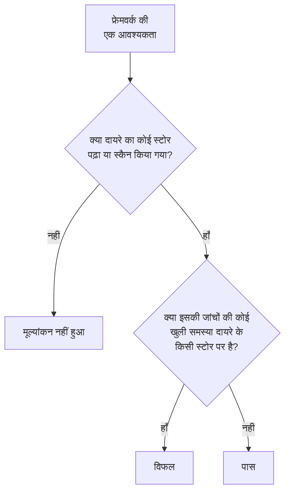

# डेटा सुरक्षा अनुपालन

डेटा सुरक्षा अपने स्कैन में मिली चीज़ों से नौ फ्रेमवर्क को स्कोर करती है। हर फ्रेमवर्क उन स्टोर को कवर करता है जिनके बारे में उसके नियम हैं - GDPR व्यक्तिगत डेटा रखने वाले स्टोर, PCI DSS वे स्टोर जहाँ कार्ड डेटा मिला, SOC 2 हर स्टोर - और उसकी हर आवश्यकता उन जांचों से पूरी या विफल होती है जो उसके लिए साक्ष्य हैं। **डेटा सुरक्षा → अनुपालन** हर फ्रेमवर्क का स्कोर, वह कितने स्टोर कवर करता है, और हर आवश्यकता दिखाता है, इसके साथ कि कितनी खुली समस्याएं उसे विफल करती हैं। डेटा स्टोर रखने वाले हर संसाधन का - Kubernetes क्लस्टर, Docker या Podman होस्ट, डेटाबेस, सेवा या क्लाउड संसाधन - अपना ऐसा ही पेज है, जहाँ उस पर लागू न होने वाली चीज़ें बंद की जा सकती हैं। स्कोर ऑडिट के लिए साक्ष्य है, प्रमाणपत्र नहीं: यह बताता है कि OneUptime जिन स्टोर को पढ़ता है, उनमें से वह क्या देख सकता है।

:::cards
- [फ्रेमवर्क](#फ्रेमवर्क): नौ फ्रेमवर्क, और हर एक कौन-से स्टोर कवर करता है।
- [फ्रेमवर्क को कैसे स्कोर किया जाता है](#फ्रेमवर्क-को-कैसे-स्कोर-किया-जाता-है): पास होने वाली, विफल होने वाली और मूल्यांकन न की गई आवश्यकताएं।
- [संसाधन के पेज पर](#संसाधन-के-पेज-पर): किसी एक क्लस्टर, होस्ट, डेटाबेस, सेवा या क्लाउड संसाधन का अनुपालन, और उसके लिए क्या बंद है।
- [आवश्यकताएं और उनकी जांचें](#आवश्यकताएं-और-उनकी-जांचें): हर आवश्यकता, और वे जांचें जो उसके लिए साक्ष्य हैं।
- [प्रोसेसिंग का रिकॉर्ड](#प्रोसेसिंग-का-रिकॉर्ड): GDPR अनुच्छेद 30, आपके स्टोर से लिखा गया, OneUptime AI के उन ड्राफ़्ट के साथ जिनकी पुष्टि आप करते हैं।
- [प्रभाव आकलन](#प्रभाव-आकलन): हर उस स्टोर के लिए डेटा संरक्षण प्रभाव आकलन जिसे इसकी ज़रूरत है।
- [ऑडिट साक्ष्य](#ऑडिट-साक्ष्य): हर आवश्यकता के तहत ऑडिटर क्या पढ़ता है, आपके रिकॉर्ड और समस्याओं के इतिहास के साथ एक्सपोर्ट किया गया।
:::

## फ्रेमवर्क

| फ्रेमवर्क | पूरा नाम | दायरे में आने वाले स्टोर |
| --- | --- | --- |
| GDPR | EU सामान्य डेटा संरक्षण विनियमन | वे स्टोर जिनमें व्यक्तिगत डेटा है। |
| CCPA | कैलिफ़ोर्निया उपभोक्ता गोपनीयता अधिनियम, CPRA द्वारा संशोधित | वे स्टोर जिनमें व्यक्तिगत जानकारी है। |
| HIPAA | HIPAA सुरक्षा नियम | वे स्टोर जिनमें स्वास्थ्य डेटा है। |
| PCI DSS | PCI DSS v4.0 | वे स्टोर जहाँ कार्ड नंबर मिले। |
| SOC 2 | SOC 2 ट्रस्ट सर्विसेज़ मानदंड | हर डेटा स्टोर। |
| ISO 27001 | ISO/IEC 27001:2022 | हर डेटा स्टोर। |
| NIST CSF | NIST साइबर सुरक्षा फ्रेमवर्क 2.0 | हर डेटा स्टोर। |
| LGPD | ब्राज़ील का सामान्य डेटा संरक्षण कानून | वे स्टोर जिनमें ब्राज़ील के लोगों का व्यक्तिगत डेटा है। |
| DPDP | भारत का डिजिटल व्यक्तिगत डेटा संरक्षण अधिनियम, 2023 | वे स्टोर जिनमें भारत के लोगों का व्यक्तिगत डेटा है। |

## फ्रेमवर्क कौन-से स्टोर कवर करता है

स्टोर का दायरा उसमें मिले डेटा से तय होता है, इसलिए जैसे-जैसे स्कैन ज़्यादा पाते हैं, यह बदलता है:

- **SOC 2, ISO 27001 और NIST CSF** सुरक्षा फ्रेमवर्क हैं: ये हर स्टोर को कवर करते हैं, उसमें चाहे जो हो।
- **GDPR, CCPA, HIPAA और PCI DSS** उन स्टोर को कवर करते हैं जिनमें ऐसा डेटा प्रकार है जिसकी वे सुरक्षा करते हैं। व्यक्तिगत डेटा GDPR और CCPA को लाता है, स्वास्थ्य डेटा HIPAA को भी, और कार्ड नंबर, कार्ड सुरक्षा कोड और कार्ड की समाप्ति तिथियाँ PCI DSS को। जिस स्टोर में सिर्फ़ सीक्रेट या व्यावसायिक दस्तावेज़ हैं, वह इनमें से किसी में नहीं है।
- **LGPD और DPDP** देशों के अपने कानून हैं: ये ब्राज़ील या भारत के लोगों का व्यक्तिगत डेटा रखने वाले स्टोर को कवर करते हैं, जिसे उस देश के डेटा प्रकारों से पढ़ा जाता है, जैसे ब्राज़ील का CPF या भारत का Aadhaar नंबर।

[संवेदनशील डेटा प्रकार](/docs/data-security/data-types#बिल्ट-इन-डेटा-प्रकार) हर डेटा प्रकार को उसके देश के साथ सूचीबद्ध करता है।

## फ्रेमवर्क को कैसे स्कोर किया जाता है

- **आवश्यकता पास होती है** जब उससे जुड़ी जांचों की कोई खुली समस्या फ्रेमवर्क के दायरे के किसी स्टोर पर न हो, और **विफल होती है** जब हो।
- **उसका मूल्यांकन नहीं होता** जब तक दायरे के किसी स्टोर का कॉन्फ़िगरेशन पढ़ा या उसकी सामग्री स्कैन न की गई हो।
- **दो आवश्यकताएं खुद डेटा सुरक्षा से पूरी होती हैं**: GDPR अनुच्छेद 30, प्रोसेसिंग गतिविधियों के रिकॉर्ड, और ISO 27001 A.5.12, जानकारी का वर्गीकरण। दायरे का हर स्टोर पढ़ा या स्कैन हो जाने पर ये पास होती हैं, और जब तक कोई स्टोर बाकी है, विफल रहती हैं।
- **वह बंद होती है** जब दायरे का हर स्टोर किसी ऐसे संसाधन का हो जिसने वह आवश्यकता बंद कर दी है (देखें [संसाधन के पेज पर](#संसाधन-के-पेज-पर))।
- **स्कोर** फ्रेमवर्क की मूल्यांकित आवश्यकताओं में से पास होने वाली आवश्यकताओं का हिस्सा है, पूरे प्रतिशत के रूप में: बंद की गई आवश्यकता न पास में गिनी जाती है, न विफल में। जिस फ्रेमवर्क में किसी चीज़ का मूल्यांकन नहीं हुआ, उसका कोई स्कोर नहीं होता।

सिर्फ़ खुली समस्याएं गिनी जाती हैं। जिस समस्या का जोखिम स्वीकार किया गया है, या जो समस्या नहीं है, वह अपनी आवश्यकताओं को विफल नहीं करती, इसलिए स्वीकार किया गया जोखिम एक ऐसा निर्णय है जिसे आपका ऑडिट समस्या पर देख सकता है: किसने उसे स्वीकार किया, क्यों, और कब तक।

## संसाधन के पेज पर

जब किसी संसाधन में ऐसा डेटा स्टोर होता है जिसे डेटा सुरक्षा जानती है, तो उसके मेनू में एक **सुरक्षा** सेक्शन होता है, जो आपके खोलने तक सिमटा रहता है - ऐसे प्रोजेक्ट में जो डेटा सुरक्षा इस्तेमाल करता है, और उस व्यक्ति के लिए जो डेटा स्टोर पढ़ सकता है:

| संसाधन | उसके डेटा स्टोर |
| --- | --- |
| Kubernetes क्लस्टर | उस पर चल रहे डेटाबेस |
| Docker या Podman होस्ट | उस पर चल रहे डेटाबेस |
| डेटाबेस | खुद वह डेटाबेस |
| सेवा | उसकी टेलीमेट्री: वह जो लॉग, ट्रेस और अपवाद भेजती है |
| क्लाउड संसाधन | वह बकेट, डेटाबेस या वेयरहाउस जो वह खुद है |

- **डेटा सुरक्षा** उन स्टोर को, सबसे ज़्यादा जोखिम वाले पहले, और उन पर खुली समस्याओं को सूचीबद्ध करता है। हर एक डेटा सुरक्षा में खुलता है, जहाँ उस पर काम होता है।
- **अनुपालन** सिर्फ़ उन्हीं स्टोर के लिए फ्रेमवर्क को स्कोर करता है। जिन फ्रेमवर्क को उनका डेटा दायरे में लाता है, वे पहले आते हैं; बंद किए गए फ्रेमवर्क, और वे जिनके लिए इनमें से किसी स्टोर में डेटा नहीं है, नीचे सिमटे रहते हैं।

हर फ्रेमवर्क का एक स्विच होता है, **यहाँ लागू**, और उसकी हर आवश्यकता का भी। इनमें से किसी को बंद करने पर संसाधन के स्टोर उस फ्रेमवर्क से, या उस आवश्यकता से, बाहर हो जाते हैं - संसाधन के पेज पर भी और **डेटा सुरक्षा → अनुपालन** पर भी, जो बताता है कि कितने स्टोर उनके संसाधनों पर बंद किए गए हैं। इसे फिर से चालू करने पर वे वापस आ जाते हैं। हर स्विच तुरंत सहेजा जाता है, और हर बदलाव प्रोजेक्ट के [ऑडिट लॉग](/docs/configuration/audit-logs) में दर्ज होता है।

इनमें से किसी को बंद करने पर उसके नीचे यह सवाल आता है: **यह यहाँ लागू क्यों नहीं होता?** कारण वैकल्पिक है: एक छोटा कारण लिखें और **कारण सहेजें** चुनें, या इसे छोड़ने के लिए **अभी नहीं** चुनें। इसके बाद वहाँ दिखता है कि इसे किसने और कब बंद किया, और इसका कारण भी, साथ में बाद में कारण लिखने या बदलने के लिए **कारण जोड़ें** या **कारण संपादित करें**। स्विच की तरह, कारण भी ऑडिट लॉग में दर्ज होता है।

**डेटा सुरक्षा → अनुपालन** हर संसाधन के लिए यही बताता है। चुना गया फ्रेमवर्क **पूरे फ्रेमवर्क के लिए बंद** के नीचे उन संसाधनों की सूची देता है जिन्होंने उसे पूरा बंद किया है, और हर आवश्यकता अपनी स्थिति के नीचे उन संसाधनों के नाम बताती है जिन्होंने वह आवश्यकता बंद की है: हर एक अपने अनुपालन पेज से लिंक किया हुआ, साथ में यह कि उसे किसने, कब और क्यों बंद किया। इसका **CSV निर्यात करें** उन्हें `Turned Off On` कॉलम में देता है, और **JSON निर्यात करें** एक `turnedOff` सूची में।

एक स्टोर किसी एक संसाधन के स्विच का पालन करता है। Kubernetes क्लस्टर पर, या Docker या Podman होस्ट पर चल रहा डेटाबेस उसी क्लस्टर या होस्ट के स्विच का पालन करता है: क्लस्टर के लिए कोई फ्रेमवर्क बंद करें, और वह उस पर चल रहे हर डेटाबेस के लिए बंद हो जाता है। डेटाबेस का अपना अनुपालन पेज यही बताता है और वहाँ का लिंक देता है, और उसके स्विच लॉक रहते हैं।

सुरक्षा सदस्य, सुरक्षा एडमिन, प्रोजेक्ट एडमिन और प्रोजेक्ट स्वामी फ्रेमवर्क और आवश्यकताओं को चालू और बंद कर सकते हैं, जैसे वे किसी जांच को ट्यून कर सकते हैं। सुरक्षा दर्शक देखते हैं कि क्या बंद है, और क्यों।

## आवश्यकताएं और उनकी जांचें

### GDPR

| आवश्यकता | यह क्या माँगती है | जांचें |
| --- | --- | --- |
| अनुच्छेद 5(1)(c) | डेटा न्यूनीकरण | `production-data-in-non-production`, `stale-sensitive-data`, `new-personal-data-column`, `sensitive-data-in-telemetry`, `sensitive-data-to-ai`, `sensitive-data-in-ai-store` |
| अनुच्छेद 5(1)(e) | भंडारण की सीमा | `stale-sensitive-data` |
| अनुच्छेद 25 | डिज़ाइन से और डिफ़ॉल्ट रूप से डेटा संरक्षण | `production-data-in-non-production`, `stale-sensitive-data`, `new-personal-data-column`, `sensitive-data-in-telemetry`, `sensitive-data-to-ai`, `sensitive-data-in-ai-store` |
| अनुच्छेद 28 | प्रोसेसर | `sensitive-data-to-ai` |
| अनुच्छेद 30 | प्रोसेसिंग गतिविधियों के रिकॉर्ड | खुद डेटा सुरक्षा से पूरी होती है |
| अनुच्छेद 32 | प्रोसेसिंग की सुरक्षा | `public-read`, `public-write`, `public-access-not-blocked`, `internet-reachable`, `open-to-all-addresses`, `snapshot-public`, `snapshot-shared-externally`, `shared-with-external-accounts`, `not-encrypted-at-rest`, `no-customer-managed-key`, `encryption-in-transit-not-enforced`, `weak-tls`, `no-backups`, `no-point-in-time-recovery`, `deletion-protection-off`, `deleted-data-not-recoverable`, `access-not-logged`, `shared-key-access`, `object-acls-enabled`, `many-readers`, `unused-access`, `secrets-stored`, `plaintext-passwords`, `secrets-in-telemetry` |
| अनुच्छेद 44-49 | तीसरे देशों को ट्रांसफ़र | `residency-violation` |

### CCPA

| आवश्यकता | यह क्या माँगती है | जांचें |
| --- | --- | --- |
| 1798.100(c) | सिर्फ़ उतना संग्रह जितना ज़रूरी है | `production-data-in-non-production`, `stale-sensitive-data`, `new-personal-data-column`, `sensitive-data-in-telemetry`, `sensitive-data-to-ai`, `sensitive-data-in-ai-store` |
| 1798.150 | उचित सुरक्षा प्रक्रियाएं | `public-read`, `public-write`, `public-access-not-blocked`, `internet-reachable`, `open-to-all-addresses`, `snapshot-public`, `snapshot-shared-externally`, `shared-with-external-accounts`, `shared-key-access`, `object-acls-enabled`, `many-readers` |

### HIPAA

| आवश्यकता | यह क्या माँगती है | जांचें |
| --- | --- | --- |
| 164.308(a)(4) | सूचना एक्सेस प्रबंधन | `unused-access` |
| 164.308(a)(7) | आकस्मिक योजना | `no-backups`, `no-point-in-time-recovery`, `deletion-protection-off`, `deleted-data-not-recoverable` |
| 164.312(a)(1) | एक्सेस नियंत्रण | `public-read`, `public-write`, `public-access-not-blocked`, `internet-reachable`, `open-to-all-addresses`, `snapshot-public`, `snapshot-shared-externally`, `shared-with-external-accounts`, `shared-key-access`, `object-acls-enabled`, `many-readers` |
| 164.312(a)(2)(iv) | एन्क्रिप्शन और डिक्रिप्शन | `not-encrypted-at-rest`, `no-customer-managed-key` |
| 164.312(b) | ऑडिट नियंत्रण | `access-not-logged` |
| 164.312(e)(1) | ट्रांसमिशन सुरक्षा | `encryption-in-transit-not-enforced`, `weak-tls` |

### PCI DSS

| आवश्यकता | यह क्या माँगती है | जांचें |
| --- | --- | --- |
| 3.3.1 | ऑथराइज़ेशन के बाद संवेदनशील प्रमाणीकरण डेटा नहीं रखा जाता | `card-security-codes-stored` |
| 3.4.1 | दिखाए जाने पर कार्ड नंबर मास्क किए जाते हैं | `card-numbers-readable`, `sensitive-data-in-telemetry` |
| 3.5.1 | कार्ड नंबर जहाँ भी संग्रहीत हों, अपठनीय होते हैं | `not-encrypted-at-rest`, `no-customer-managed-key`, `card-numbers-readable` |
| 4.2.1 | मज़बूत क्रिप्टोग्राफ़ी ट्रांज़िट में कार्ड डेटा की सुरक्षा करती है | `encryption-in-transit-not-enforced`, `weak-tls` |
| 7.2 | एक्सेस ज़रूरत के हिसाब से तय और असाइन किया जाता है | `public-read`, `public-write`, `public-access-not-blocked`, `internet-reachable`, `open-to-all-addresses`, `snapshot-public`, `snapshot-shared-externally`, `shared-with-external-accounts`, `shared-key-access`, `object-acls-enabled`, `many-readers` |
| 7.2.4 | खातों और उनके एक्सेस की समीक्षा होती है | `unused-access` |
| 8.3.2 | संग्रहीत होने पर प्रमाणीकरण फ़ैक्टर अपठनीय होते हैं | `plaintext-passwords` |
| 10.2 | ऑडिट लॉग कार्ड डेटा तक एक्सेस दर्ज करते हैं | `access-not-logged` |

### SOC 2

| आवश्यकता | यह क्या माँगती है | जांचें |
| --- | --- | --- |
| A1.2 | बैकअप और रिकवरी | `no-backups`, `no-point-in-time-recovery`, `deletion-protection-off`, `deleted-data-not-recoverable` |
| CC6.1 | लॉजिकल एक्सेस सुरक्षा | `public-read`, `public-write`, `public-access-not-blocked`, `internet-reachable`, `open-to-all-addresses`, `snapshot-public`, `snapshot-shared-externally`, `shared-with-external-accounts`, `not-encrypted-at-rest`, `no-customer-managed-key`, `shared-key-access`, `object-acls-enabled`, `many-readers`, `secrets-stored`, `plaintext-passwords`, `secrets-in-telemetry` |
| CC6.2 | ज़रूरत न रहने पर एक्सेस हटाया जाता है | `unused-access` |
| CC6.7 | जानकारी का ट्रांसमिशन | `encryption-in-transit-not-enforced`, `weak-tls` |
| CC7.2 | सिस्टम घटकों की निगरानी | `access-not-logged` |

### ISO 27001

| आवश्यकता | यह क्या माँगती है | जांचें |
| --- | --- | --- |
| A.5.9 | जानकारी और उससे जुड़े अन्य एसेट की इन्वेंटरी | `no-owner` |
| A.5.12 | जानकारी का वर्गीकरण | खुद डेटा सुरक्षा से पूरी होती है |
| A.5.15 | एक्सेस नियंत्रण | `public-read`, `public-write`, `public-access-not-blocked`, `internet-reachable`, `open-to-all-addresses`, `snapshot-public`, `snapshot-shared-externally`, `shared-with-external-accounts`, `shared-key-access`, `object-acls-enabled`, `many-readers` |
| A.5.18 | एक्सेस अधिकार | `unused-access` |
| A.5.34 | PII की गोपनीयता और संरक्षण | `production-data-in-non-production`, `stale-sensitive-data`, `new-personal-data-column`, `sensitive-data-in-telemetry`, `sensitive-data-to-ai`, `sensitive-data-in-ai-store` |
| A.8.11 | डेटा मास्किंग | `production-data-in-non-production`, `stale-sensitive-data`, `new-personal-data-column`, `sensitive-data-in-telemetry`, `sensitive-data-to-ai`, `sensitive-data-in-ai-store` |
| A.8.12 | डेटा लीकेज की रोकथाम | `secrets-stored`, `secrets-in-telemetry` |
| A.8.13 | जानकारी का बैकअप | `no-backups`, `no-point-in-time-recovery`, `deletion-protection-off`, `deleted-data-not-recoverable` |
| A.8.15 | लॉगिंग | `access-not-logged` |
| A.8.24 | क्रिप्टोग्राफ़ी का उपयोग | `not-encrypted-at-rest`, `no-customer-managed-key`, `encryption-in-transit-not-enforced`, `weak-tls`, `plaintext-passwords` |

### NIST CSF

| आवश्यकता | यह क्या माँगती है | जांचें |
| --- | --- | --- |
| ID.AM-07 | डेटा और मेटाडेटा की इन्वेंटरी रखी जाती है | `no-owner` |
| PR.AA-05 | एक्सेस अनुमतियाँ प्रबंधित की जाती हैं | `public-read`, `public-write`, `public-access-not-blocked`, `internet-reachable`, `open-to-all-addresses`, `snapshot-public`, `snapshot-shared-externally`, `shared-with-external-accounts`, `shared-key-access`, `object-acls-enabled`, `many-readers`, `unused-access` |
| PR.DS-01 | संग्रहीत डेटा सुरक्षित रहता है | `not-encrypted-at-rest`, `no-customer-managed-key`, `secrets-stored`, `secrets-in-telemetry` |
| PR.DS-02 | ट्रांज़िट में डेटा सुरक्षित रहता है | `encryption-in-transit-not-enforced`, `weak-tls` |
| PR.DS-11 | डेटा के बैकअप रखे और परखे जाते हैं | `no-backups`, `no-point-in-time-recovery`, `deletion-protection-off`, `deleted-data-not-recoverable` |
| DE.CM-09 | डेटा और उसके उपयोग की निगरानी होती है | `access-not-logged` |

### LGPD

| आवश्यकता | यह क्या माँगती है | जांचें |
| --- | --- | --- |
| अनुच्छेद 6 | ज़रूरत और उद्देश्य की सीमा | `production-data-in-non-production`, `stale-sensitive-data`, `new-personal-data-column`, `sensitive-data-in-telemetry`, `sensitive-data-to-ai`, `sensitive-data-in-ai-store` |
| अनुच्छेद 33 | डेटा का अंतरराष्ट्रीय ट्रांसफ़र | `residency-violation` |
| अनुच्छेद 46 | सुरक्षा उपाय | `public-read`, `public-write`, `public-access-not-blocked`, `internet-reachable`, `open-to-all-addresses`, `snapshot-public`, `snapshot-shared-externally`, `shared-with-external-accounts`, `not-encrypted-at-rest`, `no-customer-managed-key`, `shared-key-access`, `object-acls-enabled`, `many-readers` |

### DPDP

| आवश्यकता | यह क्या माँगती है | जांचें |
| --- | --- | --- |
| धारा 8(5) | उचित सुरक्षा उपाय | `public-read`, `public-write`, `public-access-not-blocked`, `internet-reachable`, `open-to-all-addresses`, `snapshot-public`, `snapshot-shared-externally`, `shared-with-external-accounts`, `not-encrypted-at-rest`, `no-customer-managed-key`, `shared-key-access`, `object-acls-enabled`, `many-readers` |
| धारा 8(7) | उद्देश्य पूरा होने पर मिटाना | `production-data-in-non-production`, `stale-sensitive-data`, `new-personal-data-column`, `sensitive-data-in-telemetry`, `sensitive-data-to-ai`, `sensitive-data-in-ai-store` |
| धारा 16 | भारत के बाहर ट्रांसफ़र | `residency-violation` |

## प्रोसेसिंग का रिकॉर्ड

GDPR अनुच्छेद 30 आपसे अपनी प्रोसेसिंग गतिविधियों का रिकॉर्ड रखने को कहता है। डेटा सुरक्षा उसका वह हिस्सा लिखती है जो इस बारे में है कि व्यक्तिगत डेटा कहाँ रखा जाता है: व्यक्तिगत डेटा रखने वाले हर स्टोर के लिए एक पंक्ति। यह **डेटा सुरक्षा → अनुपालन** के अंत में **प्रोसेसिंग का रिकॉर्ड** कार्ड है, जिसमें **CSV निर्यात करें** और **JSON निर्यात करें** हैं।

| कॉलम | यह कहाँ से आता है |
| --- | --- |
| स्टोर, प्रकार, प्रदाता और क्षेत्र | Discovery |
| एनवायरनमेंट | स्टोर के टैग या नाम, या जो आप सेट करते हैं |
| संवेदनशीलता, श्रेणियां और डेटा प्रकार | स्कैन में जो मिला, या वह संवेदनशीलता जो आप सेट करते हैं |
| मालिक | स्टोर के मालिक, लोग और उसकी टीमों के सदस्य |
| उद्देश्य | स्टोर के **उद्देश्य** में आप जो लिखते हैं या जिसकी पुष्टि करते हैं: उसमें व्यक्तिगत डेटा क्यों है। OneUptime आपकी सुरक्षा के लिए जो स्टोर रखता है, उनमें इसे OneUptime भरता है |
| रखने की अवधि | स्टोर की **रखने की अवधि** में आप जो लिखते हैं या जिसकी पुष्टि करते हैं: उसमें डेटा कितने समय तक रखा जाता है। OneUptime आपकी सुरक्षा के लिए जो स्टोर रखता है, उनमें इसे OneUptime भरता है, और किसी सेवा की टेलीमेट्री के लिए आपके प्रोजेक्ट की टेलीमेट्री प्रतिधारण अवधि से |
| कौन पढ़ सकता है | OneUptime आपकी सुरक्षा के लिए जो स्टोर रखता है, उसे कौन पढ़ सकता है |
| फ्रेमवर्क | वे फ्रेमवर्क जिन्हें उसके डेटा प्रकार दायरे में लाते हैं |
| किसने घोषित किया | OneUptime, उन स्टोर के लिए जो वह आपकी सुरक्षा के लिए रखता है |
| कानूनी आधार | आप जो लिखते हैं या जिसकी पुष्टि करते हैं: GDPR अनुच्छेद 6 के तहत स्टोर का वैध आधार, इनमें से एक: सहमति, अनुबंध, कानूनी दायित्व, महत्वपूर्ण हित, सार्वजनिक कार्य और वैध हित। OneUptime आपकी सुरक्षा के लिए जो स्टोर रखता है, उनके लिए वैध हित |
| किन लोगों का डेटा | आप जो लिखते हैं या जिसकी पुष्टि करते हैं: स्टोर का डेटा किन लोगों के बारे में है, जैसे ग्राहक, उपयोगकर्ता, कर्मचारी या मरीज़ |
| प्राप्तकर्ता | स्टोर के डेटा प्रवाह से निकाले जाते हैं: वे बाहरी होस्ट और AI प्रदाता जिन्हें इसका डेटा भेजा जाता है, और वे स्टोर जिनमें इसकी कॉपी है |
| ट्रांसफ़र | स्टोर के क्षेत्र, जिन क्षेत्रों में उसका क्लाउड उसे कॉपी करता है और उसकी कॉपियों के क्षेत्रों से, उन देशों की तुलना में निकाले जाते हैं जिनमें उसके लोग हैं: उन देशों से बाहर का हर ट्रांसफ़र, या यह ज्ञात क्यों नहीं है |
| प्रभाव आकलन | स्टोर को डेटा संरक्षण प्रभाव आकलन की ज़रूरत है या नहीं, और वह किस स्थिति में है: ज़रूरी नहीं, ज़रूरी, ड्राफ़्ट तैयार या संपादित |
| समीक्षा की प्रतीक्षा में | वे फ़ील्ड जिनका ड्राफ़्ट किसी व्यक्ति की प्रतीक्षा में है। जब तक कोई पुष्टि न करे, ड्राफ़्ट न रिकॉर्ड में होता है, न उसके एक्सपोर्ट में |

डेटा सुरक्षा को मिले स्टोर के लिए, कोई स्कैन यह नहीं जान सकता कि उसमें व्यक्तिगत डेटा क्यों है, कितने समय तक, किस आधार पर या किन लोगों का: इन्हें उसकी **सेटिंग्स** में लिखें, या OneUptime AI के ड्राफ़्ट की पुष्टि करें। रिकॉर्ड और स्कोर डेटा सुरक्षा के API से भी मिलते हैं, `/data-security/record-of-processing`, `/data-security/compliance` और, किसी एक संसाधन के लिए, `/data-security/resource-compliance` पर, हर उस व्यक्ति को जो डेटा स्टोर पढ़ सकता है (देखें [डेटा सुरक्षा इंटीग्रेशन](/docs/data-security/integrations#api-terraform-और-mcp))।

### OneUptime AI के ड्राफ़्ट

OneUptime AI किसी स्टोर के **उद्देश्य**, **रखने की अवधि**, **कानूनी आधार** और **किन लोगों का डेटा** का ड्राफ़्ट उससे बनाता है जो डेटा सुरक्षा उसके बारे में जानती है: मिले डेटा प्रकार, उसका नाम, टैग और विवरण, उसका उपयोग करने वाली सेवाएं और उनकी टीमों के अनुसार वे किस लिए हैं, उसका डेटा कहाँ जाता है और कहाँ रखा जाता है। यह आपके डेटा का कोई मान कभी नहीं देखता (देखें [डेटा सुरक्षा में OneUptime AI](/docs/data-security/ai))।

- **ड्राफ़्ट पर "ड्राफ़्ट" का निशान होता है** और वह कारण बताता है, और जिन तथ्यों पर वह टिका है वे एक क्लिक दूर होते हैं। जब तक आप **पुष्टि करें** न दबाएं, या **संपादित करें** से उसे अपने शब्दों में न लिखें, वह रिकॉर्ड में नहीं होता।
- **आपके शब्दों की जगह कभी ड्राफ़्ट नहीं आता।** आपके लिखे फ़ील्ड का फिर कभी ड्राफ़्ट नहीं बनता। आपकी पुष्टि वाला ड्राफ़्ट तभी फिर से बनता है जब वह तथ्य बदलता है जिस पर वह टिका है, और तब वह लागू नहीं होता, प्रस्तावित होता है: उस पर **बदलाव प्रस्तावित** का निशान होता है, साथ में यह कि क्या बदला, और **नया ड्राफ़्ट इस्तेमाल करें** और **मौजूदा रखें**।
- **प्रोसेसिंग का रिकॉर्ड** कार्ड पर **ड्राफ़्ट की समीक्षा करें** आपको एक-एक करके उन स्टोर से गुज़ारता है जिनके ड्राफ़्ट आपकी प्रतीक्षा में हैं। किसी स्टोर की **सेटिंग्स** में यही फ़ील्ड हैं, और खाली फ़ील्ड के लिए **OneUptime AI से ड्राफ़्ट करें**।
- **अपने आप**, OneUptime AI सबसे जोखिम भरे स्टोर के खाली फ़ील्ड दिन में एक बार ड्राफ़्ट करता है, जब तक **डेटा सुरक्षा → एआई** में **नई समस्याओं पर काम करें** चालू है, जैसा आपके AI नियम अनुमति दें।

किसी सेवा की टेलीमेट्री की रखने की अवधि, प्राप्तकर्ता और ट्रांसफ़र साधारण कोड से निकाले जाते हैं, कभी ड्राफ़्ट नहीं किए जाते। ड्राफ़्ट शुरुआत भर हैं, कानूनी सलाह नहीं: इन्हें उस व्यक्ति से जंचवाएं जो आपके अनुपालन के लिए ज़िम्मेदार है।

### OneUptime आपकी सुरक्षा के लिए जो स्टोर रखता है

चार स्टोर आपके नेटवर्क की सुरक्षा के लिए जानबूझकर IP पते और उपयोगकर्ता नाम रखते हैं: **सुरक्षा इवेंट**, **Network Flows**, **सुरक्षा पता वॉल्ट** और **सुरक्षा उपयोगकर्ता वॉल्ट**। रिकॉर्ड इनमें से हर उस स्टोर को दिखाता है जो आपके प्रोजेक्ट में है। OneUptime इन्हें खोजने के बजाय घोषित करता है: इनमें क्या है यह डिज़ाइन से पता है, इसलिए कोई स्कैन इन्हें नहीं पढ़ता, कोई जांच इन पर लागू नहीं होती, और इन पतों और नामों को रखना कभी समस्या नहीं बनता, क्योंकि ये इसी के लिए हैं। **डेटा स्टोर** पर इन पर **OneUptime द्वारा घोषित** लिखा होता है, और **अवलोकन** और फ्रेमवर्क के स्कोर इन्हें छोड़ देते हैं।

| स्टोर | इसमें क्या है | रखने की अवधि | इसे कौन पढ़ सकता है |
| --- | --- | --- | --- |
| सुरक्षा इवेंट | कार्रवाई करने वाले और जिस पर कार्रवाई हुई उसके IP पते, यूज़रनेम और ईमेल पते | आपके प्रोजेक्ट की [टेलीमेट्री प्रतिधारण अवधि](/docs/telemetry/data-retention), जिसे हर बार रिकॉर्ड पढ़ने पर पढ़ा जाता है, इसलिए बदलाव तुरंत लागू होता है | प्रोजेक्ट स्वामी, प्रोजेक्ट एडमिन, सुरक्षा एडमिन, सुरक्षा सदस्य, सुरक्षा दर्शक और Read Security Event वाला कोई भी व्यक्ति |
| Network Flows | आपस में संचार करने वालों के IP पते | किसी फ़्लो के आने के 30 दिन बाद | जो भी नेटवर्क डिवाइस पढ़ सकता है |
| सुरक्षा पता वॉल्ट | हैश करने वाले IP पता नियम ने [सुरक्षा इवेंट](/docs/telemetry/security-events) द्वारा पढ़े जाने वाले लॉग और ट्रेस में जो हर टोकन छोड़ा, उसके पीछे का IP पता | किसी पते के आख़िरी बार दिखने के 30 दिन बाद | केवल OneUptime के अंदर सुरक्षा इवेंट के स्कैन: कोई व्यक्ति, पेज, एक्सपोर्ट, API या AI टूल नहीं |
| सुरक्षा उपयोगकर्ता वॉल्ट | हैश करने वाले नियम ने जहाँ [सुरक्षा इवेंट](/docs/telemetry/security-events) लॉग और ट्रेस में कोई उपयोगकर्ता पढ़ता है वहाँ जो हर टोकन छोड़ा, उसके पीछे का उपयोगकर्ता | किसी उपयोगकर्ता के आख़िरी बार दिखने के 30 दिन बाद | केवल OneUptime के अंदर सुरक्षा इवेंट के स्कैन: कोई व्यक्ति, पेज, एक्सपोर्ट, API या AI टूल नहीं |

हर एक का उद्देश्य "नेटवर्क और सूचना सुरक्षा (GDPR प्रस्तावना 49)" है। अपना उद्देश्य या रखने की अवधि लिखने के लिए, स्टोर की **सेटिंग्स** में **रिकॉर्ड संपादित करें** का उपयोग करें: खाली छोड़ा गया फ़ील्ड OneUptime वाला रखता है।

कोई स्टोर तब तक दिखता है जब तक आपका प्रोजेक्ट उसका डेटा रखता है: पता वॉल्ट तब तक, जब तक कोई सक्षम IP पता नियम उन लॉग या ट्रेस को हैश करता है जिन्हें सुरक्षा इवेंट पढ़ता है, उपयोगकर्ता वॉल्ट तब तक, जब तक किसी और पैटर्न का कोई सक्षम नियम ऐसा करता है, और दोनों उसके बाद 31 दिन तक (देखें [संवेदनशील डेटा स्क्रब करें](/docs/telemetry/drop-filters-and-scrub-rules#संवेदनशील-डेटा-स्क्रब-करें))। डेटा चला जाने पर स्टोर संग्रहीत हो जाता है, और डेटा लौटने पर वह आपके उद्देश्य और रखने की अवधि के साथ वापस आ जाता है।

## प्रभाव आकलन

GDPR अनुच्छेद 35 ऐसी प्रोसेसिंग से पहले डेटा संरक्षण प्रभाव आकलन मांगता है जिसमें उच्च जोखिम की संभावना हो। डेटा सुरक्षा बताती है कि किन स्टोर को इसकी ज़रूरत है: ऐसा स्टोर जिसमें विशेष श्रेणी का डेटा है, जैसे स्वास्थ्य डेटा, कई लोगों का डेटा (लगभग 100,000 या उससे ज़्यादा रिकॉर्ड), या ऐसा डेटा जो अपने लोगों के देशों से बाहर जाता है।

किसी स्टोर का **प्रभाव आकलन**, उसके मेनू में **सेटिंग्स** के नीचे, बताता है कि स्टोर को इसकी ज़रूरत क्यों है, या यह कि ज़रूरत नहीं है। **आकलन ड्राफ़्ट करें** OneUptime AI से वे चार हिस्से मांगता है जो अनुच्छेद 35(7) मांगता है, स्टोर के रिकॉर्ड, उसकी खुली और हाल ही में ठीक की गई समस्याओं, उसके एक्सपोज़र, उस तक कितने पहुंच सकते हैं और उसके एन्क्रिप्शन से:

| हिस्सा | अनुच्छेद |
| --- | --- |
| प्रोसेसिंग और उसके उद्देश्य | अनुच्छेद 35(7)(a) |
| आवश्यकता और आनुपातिकता | अनुच्छेद 35(7)(b) |
| जिन लोगों का डेटा है, उनके लिए जोखिम | अनुच्छेद 35(7)(c) |
| जोखिमों से निपटने के उपाय | अनुच्छेद 35(7)(d) |

हर हिस्सा बताता है कि उसे किसने और कब लिखा, और ड्राफ़्ट किया गया हिस्सा उन तथ्यों के साथ आता है जिन पर वह टिका है। **संपादित करें** किसी हिस्से को आपका बना देता है, और उसका फिर कभी ड्राफ़्ट नहीं बनता; **फिर से ड्राफ़्ट करें** केवल वे हिस्से ड्राफ़्ट करता है जिन्हें किसी ने संपादित नहीं किया। जो हिस्सा ऐसे तथ्यों पर लिखा गया जो तब से बदल गए हैं, वह यह बताता है। **PDF निर्यात करें** और **Markdown निर्यात करें** आकलन डाउनलोड करते हैं।

## ऑडिट साक्ष्य

**ऑडिट साक्ष्य**, उस फ्रेमवर्क पर जिसे आप **डेटा सुरक्षा → अनुपालन** पर चुनते हैं, वह है जो ऑडिटर उसकी हर आवश्यकता के तहत पढ़ता है, पिछले 30, 90, 180 या 365 दिनों के लिए:

- उसके दायरे के स्टोर, और उसकी जांचों की स्थिति;
- अवधि में खुली और ठीक हुई उसकी जांचों की समस्याएं, और वे कितनी जल्दी ठीक हुईं;
- उसके तहत स्वीकार किए गए जोखिम, उनके कारणों और समाप्ति के साथ;
- वे संसाधन जिन्होंने उसे बंद किया, और क्यों।

**साक्ष्य ड्राफ़्ट करें** OneUptime AI से हर आवश्यकता के तहत एक अनुच्छेद मांगता है, जो इन्हीं तथ्यों तक सीमित रहता है; **संपादित करें** किसी अनुच्छेद को आपका बना देता है, और उसका फिर कभी ड्राफ़्ट नहीं बनता। जिस आवश्यकता का कोई अनुच्छेद नहीं है, वह अपने साक्ष्य जैसे हैं वैसे ही दिखाती है। **PDF निर्यात करें** और **Markdown निर्यात करें** साक्ष्य को दो परिशिष्टों के साथ डाउनलोड करते हैं: दायरे के स्टोर का प्रोसेसिंग का रिकॉर्ड, और समस्याओं का वह इतिहास जिसका यह हवाला देता है।

## अगले कदम

:::cards
- [डेटा सुरक्षा जांचें और समस्याएं](/docs/data-security/checks-and-issues): हर आवश्यकता के पीछे की जांचें, और उन्हें कैसे ठीक करें।
- [डेटा प्रवाह, एक्सेस और रेजिडेंसी](/docs/data-security/flows-access-residency): GDPR, LGPD और DPDP ट्रांसफ़र के लिए डेटा रेजिडेंसी नियम।
- [संवेदनशील डेटा प्रकार](/docs/data-security/data-types): वे डेटा प्रकार जो किसी स्टोर को फ्रेमवर्क के दायरे में लाते हैं।
:::
