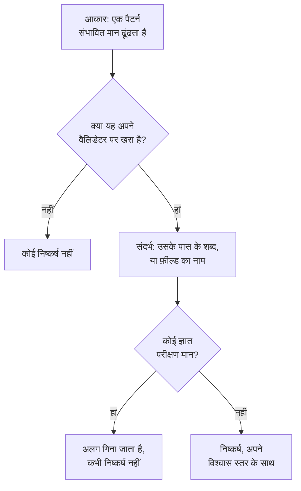

# संवेदनशील डेटा प्रकार

डेटा सुरक्षा 143 तरह के संवेदनशील डेटा को पहचानता है: कार्ड नंबर, बैंक खाते, 43 देशों की राष्ट्रीय ID, स्वास्थ्य पहचानकर्ता, API कुंजियां और टोकन, और व्यक्तिगत डेटा की विशेष श्रेणियां। हर एक की एक श्रेणी और एक संवेदनशीलता होती है, और जब वह किसी एक देश का हो, तो वह देश भी। यह पेज बताता है कि कोई मान कैसे मिलता है, और हर डेटा प्रकार सूचीबद्ध करता है, ताकि आप समझ सकें कि कोई चीज़ क्यों मिली और तय कर सकें कि उसके बारे में क्या करना है।

:::cards
- [कोई मान कैसे मिलता है](#कोई-मान-कैसे-मिलता-है): आकार, वैलिडेटर, संदर्भ, परीक्षण मान, विश्वास स्तर।
- [फ़ील्ड और कॉलम](#फ़ील्ड-और-कॉलम): पूरे कॉलम या एट्रिब्यूट को कैसे परखा जाता है।
- [हर डेटा प्रकार](#बिल्ट-इन-डेटा-प्रकार): सभी 143, श्रेणी के हिसाब से।
- [आपके अपने डेटा प्रकार](#आपके-अपने-डेटा-प्रकार): कर्मचारी ID, पॉलिसी नंबर, और "इसका परीक्षण करें" बॉक्स।
:::

## कोई मान कैसे मिलता है

हर स्कैन - एक लॉग लाइन, एक CSV सेल, एक डेटाबेस पंक्ति, किसी ऑब्जेक्ट के पहले बाइट - वही चरण चलाता है:

1. **आकार।** हर डेटा प्रकार के पैटर्न होते हैं जो संभावित मान ढूंढते हैं: सोलह अंक, `AKIA` और सोलह अक्षर, एक शब्द, एक `@` और एक डोमेन। पैटर्न कभी किसी लंबे टोकन के अंदर मेल नहीं खाता, इसलिए अंकों के किसी लंबे क्रम के अंदर कार्ड नंबर नहीं मिलता।
2. **वैलिडेटर।** संभावित मान को अपने प्रकार के नियमों पर खरा उतरना होता है: चेकसम (कार्ड के लिए Luhn, IBAN के लिए mod 97, Aadhaar नंबर के लिए Verhoeff, ज़्यादातर राष्ट्रीय ID का चेक डिजिट), असली तारीख, ज्ञात प्रीफ़िक्स, सीक्रेट के लिए पर्याप्त रैंडमनेस। जो संभावित मान विफल होता है, वह बिल्कुल भी निष्कर्ष नहीं है। `000000000` और `123456789` जैसे प्लेसहोल्डर हर संख्यात्मक प्रकार में विफल होते हैं।
3. **संदर्भ।** संभावित मान के पास के वे शब्द - डिफ़ॉल्ट रूप से उससे पहले 64 वर्ण तक और बाद में 32 तक - जो बताते हैं कि वह क्या है, उसका विश्वास स्तर एक स्तर बढ़ाते हैं, और ऐसा ही वह फ़ील्ड करता है जिसका नाम उस प्रकार की ओर इशारा करता है। जो शब्द बताते हैं कि वह कुछ और है, जैसे ऑर्डर या ट्रैकिंग नंबर, उसे एक स्तर घटाते हैं। बिना चेकसम और आम आकार वाली संख्या, जैसे पासपोर्ट नंबर या बैंक खाता, सिर्फ़ तब गिनी जाती है जब उसके पास उसका नाम लेने वाले शब्द हों।
4. **ज्ञात परीक्षण मान।** प्रकाशित परीक्षण कार्ड नंबर (जैसे Stripe का `4242 4242 4242 4242`), उदाहरण IBAN, `example.com` और दूसरे आरक्षित डोमेन के पते, दस्तावेज़ीकरण वाले IP पते, सरकारी दस्तावेज़ों में छपी नमूना ID, `sk_test_` जैसी टेस्ट-मोड कुंजियां और प्लेसहोल्डर कुंजियां अलग गिनी जाती हैं। वे कभी निष्कर्ष नहीं बनतीं, इसलिए इनसे भरा स्टोर डेटा लीक नहीं, बल्कि टेस्ट एनवायरनमेंट जैसा दिखता है।
5. **विश्वास स्तर।** जो बचता है वह निष्कर्ष है, उतना पक्का जितना उसका साक्ष्य अनुमति देता है।

| विश्वास स्तर | इसका मतलब |
| --- | --- |
| **उच्च** | मान अपने वैलिडेटर पर खरा उतरा, और उसके आसपास के शब्द या जिस फ़ील्ड में वह है, बताते हैं कि वह क्या है - या, फ़ील्ड के लिए, उसके ज़्यादातर मान उसी प्रकार के हैं। |
| **मध्यम** | मान अपने वैलिडेटर पर खरा उतरा पर आसपास पुष्टि करने को कुछ नहीं था, या फ़ील्ड का नाम बताता है कि उसमें क्या है और कुछ मान इससे मेल खाते हैं। |
| **निम्न** | आकार मेल खाता है, पर किसी चीज़ से पुष्टि नहीं होती। |

सिर्फ़ उच्च और मध्यम निष्कर्ष गिने जाते हैं: वे स्टोर को संवेदनशील बनाते हैं और समस्या खोल सकते हैं। निम्न निष्कर्ष स्टोर पर मुड़े हुए सूचीबद्ध होते हैं, ताकि कोई व्यक्ति उन्हें परखे।

जब दो डेटा प्रकार एक ही वर्णों पर दावा करते हैं, तो ज़्यादा पक्का निष्कर्ष जीतता है: पहले ऊंचा विश्वास स्तर, फिर वह डिटेक्टर जिसके अपने नियम ज़्यादा साबित करते हैं, फिर लंबा मिलान।

लंबा मान 64 KB की ऐसी विंडो में पढ़ा जाता है जो 4 KB तक एक-दूसरे पर चढ़ी होती हैं, इसलिए कोई मान कहीं भी हो, पूरा मिलता है, और एक मान का ज़्यादा से ज़्यादा 4 MB पढ़ा जाता है।

## फ़ील्ड और कॉलम

कॉलम, JSON फ़ील्ड या लॉग एट्रिब्यूट को पूरे रूप में परखा जाता है। उसका नाम किसी डेटा प्रकार का संकेत देता है, और उसके नमूने के मान उसे साबित करते हैं। उसके कितने मानों में वह प्रकार है, यह हिस्सा तय करता है कि निष्कर्ष कितना पक्का है:

| वे मान जिनमें यह प्रकार है | विश्वास स्तर |
| --- | --- |
| 60% या ज़्यादा | उच्च |
| 25% या ज़्यादा | फ़ील्ड का नाम उस प्रकार की ओर इशारा करे तो उच्च, वरना मध्यम |
| इससे कम | फ़ील्ड का नाम उस प्रकार की ओर इशारा करे तो मध्यम, वरना निम्न: किसी और चीज़ के कॉलम में कुछ ईमेल |

जिस फ़ील्ड के मानों की औसत लंबाई 80 वर्णों से ज़्यादा है, वह मुक्त टेक्स्ट है - नोट, संदेश, विवरण - और उससे एक ही प्रकार रखने की उम्मीद नहीं की जाती। उसके निष्कर्ष वही विश्वास स्तर रखते हैं जो हर मिलान ने अपने दम पर पाया, और बताते हैं कि वे मुक्त टेक्स्ट में मिले। किसी फ़ील्ड के 1,000 तक मान वर्गीकृत किए जाते हैं, और हर मान के 16 KB तक।

फ़ील्ड का नाम शब्दों में बांटा जाता है - `customerEmail`, `customer_email` और `customer-email` सभी "customer email" हैं - और किसी प्रकार का नाम-संकेत तब मेल खाता है जब उसके शब्द उसी क्रम में, एक-दूसरे के बगल में आते हैं: "date of birth" `customer_date_of_birth` से मेल खाता है, `birth_city` से नहीं। बिंदु वाले पाथ का सिर्फ़ आखिरी हिस्सा फ़ील्ड का अपना नाम है, और जब आखिरी हिस्सा `number`, `id` या `value` जैसा कोई सामान्य शब्द हो, तो उससे पहले वाला हिस्सा भी: `customer.address.city` सड़क का पता नहीं है, और `card.number` फिर भी कार्ड नंबर है।

कुछ डेटा प्रकार उनके मानों से नहीं पहचाने जा सकते: कोई पैटर्न किसी व्यक्ति के नाम को किसी सड़क से, या किसी धर्म को किसी दूसरे शब्द से अलग नहीं कर सकता। ये सिर्फ़ फ़ील्ड के नाम से मिलते हैं, जब फ़ील्ड में मान हों: व्यक्ति का नाम, यूज़रनेम, लिंग, राष्ट्रीयता, स्वास्थ्य जानकारी, नस्लीय या जातीय मूल, धार्मिक आस्था, यौन अभिविन्यास, राजनीतिक राय, ट्रेड यूनियन सदस्यता, बायोमेट्रिक डेटा, आनुवंशिक डेटा और आपराधिक रिकॉर्ड। तब नाम, यूज़रनेम, लिंग या राष्ट्रीयता उच्च होती है जब 60% या ज़्यादा मान वैसे दिखते हैं, वरना मध्यम।

जिस फ़ील्ड का नाम बताता है कि उसमें पासवर्ड है - `password`, `passwordHash`, `pwd`, पर `password_changed_at` नहीं - उसमें हैश होना चाहिए: bcrypt, argon2, scrypt, PBKDF2 या कोई और स्कीम जो स्टोर में इस्तेमाल होने की संभावना हो। खाली मान, `********` जैसे प्लेसहोल्डर और एन्क्रिप्टेड मान अलग रखे जाते हैं। जब बाकी में हैश न होने वाले मान हैश वालों से ज़्यादा हों, तो फ़ील्ड में खुद पासवर्ड हैं, जिन्हें कोई पैटर्न नहीं देख सकता, और स्टोर [पासवर्ड सादे टेक्स्ट में संग्रहीत हैं](/docs/data-security/checks-and-issues#डेटा-स्वच्छता) जांच में विफल होता है।

## संवेदनशीलता

| संवेदनशीलता | इसका मतलब |
| --- | --- |
| **प्रतिबंधित** | लीक होने पर नुकसान होता है: सीक्रेट, कार्ड नंबर, स्वास्थ्य रिकॉर्ड, सरकारी ID। |
| **गोपनीय** | व्यक्तिगत डेटा, और गोपनीय चिह्नित दस्तावेज़। |
| **आंतरिक** | कारोबार का अपना डेटा, जो बाहरी लोगों के लिए नहीं है। |
| **सार्वजनिक** | कुछ भी संवेदनशील नहीं मिला। |

कोई स्टोर उतना ही संवेदनशील होता है जितना उसमें कम से कम मध्यम विश्वास स्तर से मिला सबसे संवेदनशील डेटा प्रकार। परीक्षण मान और संवेदनशील नहीं चिह्नित निष्कर्ष कुछ नहीं गिने जाते, और जिस स्टोर में कुछ नहीं मिला वह सार्वजनिक है। किसी स्टोर को उसके निष्कर्षों से ज़्यादा या कम संवेदनशील मानने के लिए, स्टोर की **सेटिंग्स** में उसकी संवेदनशीलता खुद सेट करें: फिर जांचें उसी का उपयोग करती हैं।

## श्रेणियां

| श्रेणी | इसमें क्या आता है | व्यक्तिगत डेटा |
| --- | --- | --- |
| सीक्रेट और क्रेडेंशियल | पासवर्ड, API कुंजियां, टोकन और प्राइवेट कुंजियां, जो दूसरे सिस्टम खोलती हैं। | नहीं |
| वित्तीय | कार्ड नंबर, बैंक खाते, IBAN और क्रिप्टो वॉलेट। | हां |
| स्वास्थ्य | मेडिकल रिकॉर्ड नंबर, स्वास्थ्य पहचानकर्ता, निदान और प्रिस्क्रिप्शन। | हां |
| सरकारी ID | राष्ट्रीय पहचान, कर, पासपोर्ट और सामाजिक सुरक्षा नंबर। | हां |
| विशेष श्रेणी | GDPR का अनुच्छेद 9 जिसे सबसे ज़्यादा सुरक्षा देता है: जातीयता, धर्म, यौन अभिविन्यास, राजनीति, यूनियन सदस्यता, बायोमेट्रिक और आनुवंशिक डेटा। | हां |
| संपर्क और पहचान | कोई कौन है और उस तक कैसे पहुंचें: ईमेल, फ़ोन, पता, जन्मतिथि, IP पता। | हां |
| कारोबारी गोपनीय | गोपनीय, सिर्फ़ आंतरिक उपयोग या विशेषाधिकार प्राप्त चिह्नित दस्तावेज़। | नहीं |

व्यक्तिगत डेटा किसी व्यक्ति के बारे में डेटा है, उसी अर्थ में जैसा GDPR, CCPA, LGPD और DPDP मानते हैं। जिस स्टोर में सिर्फ़ सीक्रेट और कारोबारी दस्तावेज़ हैं, वह किसी निजता फ्रेमवर्क के दायरे से बाहर है, पर सुरक्षा फ्रेमवर्क के दायरे से कभी नहीं (देखें [डेटा सुरक्षा अनुपालन](/docs/data-security/compliance))।

## बिल्ट-इन डेटा प्रकार

जो डेटा प्रकार किसी एक देश का है, वह उस देश का नाम ISO 3166-1 कोड के रूप में देता है: डेटा रेजिडेंसी नियम और देश से बंधे फ्रेमवर्क इसे पढ़ते हैं (देखें [डेटा रेजिडेंसी](/docs/data-security/flows-access-residency#डेटा-रेजिडेंसी-नियम))। ID वह नाम है जिससे API और निष्कर्ष उस प्रकार को बताते हैं।

### संपर्क और पहचान

| डेटा प्रकार | ID | यह क्या है | संवेदनशीलता | देश |
| --- | --- | --- | --- | --- |
| ईमेल पता | `email-address` | किसी व्यक्ति का ईमेल पता। | गोपनीय | — |
| फ़ोन नंबर | `phone-number` | अंतरराष्ट्रीय या राष्ट्रीय फ़ॉर्मेट में फ़ोन नंबर। | गोपनीय | — |
| व्यक्ति का नाम | `person-name` | किसी व्यक्ति का पहला, अंतिम या पूरा नाम, जो फ़ील्ड के नाम से मिलता है। | गोपनीय | — |
| सड़क का पता | `postal-address` | सड़क का पता: एक नंबर, सड़क का नाम और सड़क का प्रकार। | गोपनीय | — |
| पोस्टल कोड | `postal-code` | एक पोस्टल कोड। अकेले भी यह सीमित कर देता है कि कोई कहां रहता है। | आंतरिक | — |
| जन्मतिथि | `date-of-birth` | ऐसी तारीख जिसके पास के शब्द बताते हैं कि यह किसी की जन्मतिथि है। | गोपनीय | — |
| IP पता | `ip-address` | सार्वजनिक IPv4 या IPv6 पता, जिसे GDPR व्यक्तिगत डेटा मानता है। | गोपनीय | — |
| MAC पता | `mac-address` | नेटवर्क कार्ड का हार्डवेयर पता, जो किसी डिवाइस की पहचान करता है। | गोपनीय | — |
| विज्ञापन ID | `advertising-id` | मोबाइल विज्ञापन ID (IDFA, GAID, AAID), जो एक डिवाइस को ट्रैक करती है। | गोपनीय | — |
| सटीक स्थान | `geolocation` | इतना सटीक अक्षांश और देशांतर कि किसी इमारत का पता चल जाए। | गोपनीय | — |
| यूज़रनेम | `username` | किसी व्यक्ति का साइन-इन या खाते का नाम, जो फ़ील्ड के नाम से मिलता है। | गोपनीय | — |
| लिंग | `gender` | किसी व्यक्ति का जेंडर या लिंग, जो फ़ील्ड के नाम से मिलता है। | गोपनीय | — |
| राष्ट्रीयता | `nationality` | किसी व्यक्ति की राष्ट्रीयता या नागरिकता, जो फ़ील्ड के नाम से मिलती है। | गोपनीय | — |
| वाहन पहचान संख्या | `vehicle-identification-number` | मान्य चेक डिजिट वाला 17 वर्णों का VIN। | गोपनीय | — |

### सरकारी ID

| डेटा प्रकार | ID | यह क्या है | संवेदनशीलता | देश |
| --- | --- | --- | --- | --- |
| US सोशल सिक्योरिटी नंबर | `us-ssn` | US सोशल सिक्योरिटी नंबर। | प्रतिबंधित | US |
| US करदाता ID (ITIN) | `us-itin` | US व्यक्तिगत करदाता पहचान नंबर (Individual Taxpayer Identification Number)। | प्रतिबंधित | US |
| US नियोक्ता ID (EIN) | `us-ein` | US नियोक्ता पहचान नंबर (Employer Identification Number), जब पास के शब्द ऐसा बताएं। | गोपनीय | US |
| US पासपोर्ट नंबर | `us-passport` | US पासपोर्ट नंबर, जब पास के शब्द ऐसा बताएं। | प्रतिबंधित | US |
| US ड्राइविंग लाइसेंस नंबर | `us-drivers-license` | US ड्राइविंग लाइसेंस नंबर, जब पास के शब्द ऐसा बताएं। | प्रतिबंधित | US |
| UK नेशनल इंश्योरेंस नंबर | `uk-nino` | UK नेशनल इंश्योरेंस नंबर। | प्रतिबंधित | GB |
| UK पासपोर्ट नंबर | `uk-passport` | UK पासपोर्ट नंबर, जब पास के शब्द ऐसा बताएं। | प्रतिबंधित | GB |
| UK ड्राइविंग लाइसेंस नंबर | `uk-driving-licence` | 16 वर्णों का UK ड्राइविंग लाइसेंस नंबर। | प्रतिबंधित | GB |
| कनाडा सोशल इंश्योरेंस नंबर | `ca-sin` | मान्य चेक डिजिट वाला कनाडा का सोशल इंश्योरेंस नंबर। | प्रतिबंधित | CA |
| मेक्सिको CURP | `mx-curp` | मेक्सिको का Clave Única de Registro de Población। | प्रतिबंधित | MX |
| मेक्सिको RFC | `mx-rfc` | मेक्सिको की Registro Federal de Contribuyentes कर ID। | प्रतिबंधित | MX |
| ब्राज़ील CPF | `br-cpf` | ब्राज़ील का Cadastro de Pessoas Físicas नंबर। | प्रतिबंधित | BR |
| ब्राज़ील CNPJ | `br-cnpj` | ब्राज़ील का कंपनी पंजीकरण नंबर (CNPJ)। | गोपनीय | BR |
| अर्जेंटीना CUIT / CUIL | `ar-cuit` | अर्जेंटीना का कर या श्रम पहचान कोड। | प्रतिबंधित | AR |
| चिली RUT | `cl-rut` | मान्य चेक डिजिट वाला चिली का Rol Único Tributario। | प्रतिबंधित | CL |
| स्पेन DNI | `es-dni` | अपने चेक अक्षर के साथ स्पेन का राष्ट्रीय पहचान दस्तावेज़ नंबर। | प्रतिबंधित | ES |
| स्पेन NIE | `es-nie` | अपने चेक अक्षर के साथ स्पेन में विदेशियों का पहचान नंबर। | प्रतिबंधित | ES |
| पुर्तगाल NIF | `pt-nif` | पुर्तगाल का कर पहचान नंबर। | प्रतिबंधित | PT |
| फ़्रांस सोशल सिक्योरिटी नंबर (NIR) | `fr-nir` | अपनी दो अंकों की कुंजी के साथ फ़्रांस का INSEE नंबर। | प्रतिबंधित | FR |
| जर्मनी कर ID | `de-tax-id` | जर्मनी का Steuerliche Identifikationsnummer। | प्रतिबंधित | DE |
| इटली codice fiscale | `it-codice-fiscale` | मान्य चेक वर्ण वाला इटली का फ़िस्कल कोड। | प्रतिबंधित | IT |
| नीदरलैंड BSN | `nl-bsn` | नीदरलैंड का नागरिक सेवा नंबर, जो eleven test पास करता है। | प्रतिबंधित | NL |
| बेल्जियम राष्ट्रीय नंबर | `be-national-number` | बेल्जियम का राष्ट्रीय रजिस्टर नंबर। | प्रतिबंधित | BE |
| पोलैंड PESEL | `pl-pesel` | पोलैंड का राष्ट्रीय पहचान नंबर। | प्रतिबंधित | PL |
| स्वीडन व्यक्तिगत पहचान नंबर | `se-personnummer` | मान्य चेक डिजिट वाला स्वीडन का personnummer। | प्रतिबंधित | SE |
| नॉर्वे राष्ट्रीय पहचान नंबर | `no-fodselsnummer` | दोनों चेक डिजिट वाला नॉर्वे का fødselsnummer। | प्रतिबंधित | NO |
| डेनमार्क CPR नंबर | `dk-cpr` | डेनमार्क का नागरिक पंजीकरण नंबर, जब पास के शब्द ऐसा बताएं। | प्रतिबंधित | DK |
| फ़िनलैंड व्यक्तिगत पहचान कोड | `fi-hetu` | अपने चेक वर्ण के साथ फ़िनलैंड का henkilötunnus। | प्रतिबंधित | FI |
| आयरलैंड PPS नंबर | `ie-ppsn` | आयरलैंड का Personal Public Service Number। | प्रतिबंधित | IE |
| स्विट्ज़रलैंड AHV नंबर | `ch-ahv` | स्विट्ज़रलैंड का सोशल सिक्योरिटी नंबर (AHV / AVS)। | प्रतिबंधित | CH |
| रोमानिया CNP | `ro-cnp` | रोमानिया का व्यक्तिगत संख्यात्मक कोड। | प्रतिबंधित | RO |
| बुल्गारिया EGN | `bg-egn` | बुल्गारिया का एकीकृत नागरिक नंबर। | प्रतिबंधित | BG |
| क्रोएशिया OIB | `hr-oib` | क्रोएशिया का व्यक्तिगत पहचान नंबर। | प्रतिबंधित | HR |
| ग्रीस AMKA | `gr-amka` | ग्रीस का सोशल सिक्योरिटी नंबर। | प्रतिबंधित | GR |
| तुर्की पहचान नंबर | `tr-tckn` | तुर्की का T.C. Kimlik नंबर। | प्रतिबंधित | TR |
| इज़राइल पहचान नंबर | `il-teudat-zehut` | इज़राइल का Teudat Zehut नंबर। | प्रतिबंधित | IL |
| दक्षिण अफ़्रीका ID नंबर | `za-id` | मान्य तारीख और चेक डिजिट वाला दक्षिण अफ़्रीका का पहचान नंबर। | प्रतिबंधित | ZA |
| UAE Emirates ID | `ae-emirates-id` | संयुक्त अरब अमीरात का पहचान पत्र नंबर। | प्रतिबंधित | AE |
| सऊदी अरब राष्ट्रीय ID | `sa-national-id` | सऊदी अरब की राष्ट्रीय ID या iqama नंबर। | प्रतिबंधित | SA |
| भारत Aadhaar नंबर | `in-aadhaar` | 12 अंकों का Aadhaar नंबर, जो Verhoeff जांच पास करता है। | प्रतिबंधित | IN |
| भारत PAN | `in-pan` | भारत का स्थायी खाता संख्या (Permanent Account Number)। | प्रतिबंधित | IN |
| चीन निवासी पहचान नंबर | `cn-resident-id` | 18 वर्णों का चीन का निवासी पहचान पत्र नंबर। | प्रतिबंधित | CN |
| जापान My Number | `jp-my-number` | मान्य चेक डिजिट वाला जापान का व्यक्तिगत नंबर। | प्रतिबंधित | JP |
| दक्षिण कोरिया निवासी पंजीकरण नंबर | `kr-rrn` | कोरिया का निवासी पंजीकरण नंबर। | प्रतिबंधित | KR |
| सिंगापुर NRIC / FIN | `sg-nric` | सिंगापुर का पहचान पत्र नंबर या विदेशी पहचान नंबर। | प्रतिबंधित | SG |
| हांगकांग पहचान पत्र नंबर | `hk-hkid` | अपने चेक डिजिट के साथ हांगकांग का पहचान पत्र नंबर। | प्रतिबंधित | HK |
| ताइवान राष्ट्रीय ID | `tw-national-id` | ताइवान का राष्ट्रीय पहचान नंबर। | प्रतिबंधित | TW |
| थाईलैंड राष्ट्रीय ID | `th-national-id` | थाईलैंड का नागरिक पहचान नंबर। | प्रतिबंधित | TH |
| मलेशिया MyKad नंबर | `my-mykad` | मलेशिया का पहचान पत्र नंबर। | प्रतिबंधित | MY |
| इंडोनेशिया NIK | `id-nik` | इंडोनेशिया का जनसंख्या पहचान नंबर। | प्रतिबंधित | ID |
| ऑस्ट्रेलिया टैक्स फ़ाइल नंबर | `au-tfn` | मान्य चेक वाला ऑस्ट्रेलिया का टैक्स फ़ाइल नंबर। | प्रतिबंधित | AU |
| न्यूज़ीलैंड IRD नंबर | `nz-ird` | मान्य चेक डिजिट वाला न्यूज़ीलैंड का Inland Revenue नंबर। | प्रतिबंधित | NZ |
| रूस SNILS | `ru-snils` | अपने चेक नंबर के साथ रूस का बीमा खाता नंबर। | प्रतिबंधित | RU |
| रूस INN | `ru-inn` | रूस का करदाता पहचान नंबर। | प्रतिबंधित | RU |
| पासपोर्ट नंबर | `passport-number` | किसी भी देश का पासपोर्ट नंबर, जब पास के शब्द ऐसा बताएं। | प्रतिबंधित | — |

### वित्तीय

| डेटा प्रकार | ID | यह क्या है | संवेदनशीलता | देश |
| --- | --- | --- | --- | --- |
| कार्ड नंबर | `credit-card-number` | पेमेंट कार्ड नंबर, जो Luhn जांच पास करता है और किसी कार्ड ब्रांड का है। | प्रतिबंधित | — |
| कार्ड सुरक्षा कोड | `card-verification-code` | CVV या CVC, जिसे भुगतान अधिकृत होने के बाद रखना PCI DSS मना करता है। | प्रतिबंधित | — |
| कार्ड की समाप्ति तिथि | `card-expiration-date` | कार्ड की समाप्ति तिथि, जब पास के शब्द ऐसा बताएं। | गोपनीय | — |
| IBAN | `iban` | अंतरराष्ट्रीय बैंक खाता नंबर, जो mod-97 जांच पास करता है। | प्रतिबंधित | — |
| बैंक खाता नंबर | `bank-account-number` | बैंक खाता नंबर, जब पास के शब्द ऐसा बताएं। | प्रतिबंधित | — |
| SWIFT / BIC कोड | `swift-bic` | किसी बैंक का SWIFT या BIC कोड, जब पास के शब्द ऐसा बताएं। | आंतरिक | — |
| US बैंक राउटिंग नंबर | `us-bank-routing-number` | मान्य चेकसम वाला ABA राउटिंग नंबर, जब पास के शब्द ऐसा बताएं। | आंतरिक | US |
| UK सॉर्ट कोड | `uk-sort-code` | UK बैंक सॉर्ट कोड, जब पास के शब्द ऐसा बताएं। | आंतरिक | GB |
| भारत IFSC | `in-ifsc` | भारतीय वित्तीय प्रणाली कोड (Indian Financial System Code), जो किसी बैंक शाखा को बताता है। | आंतरिक | IN |
| ऑस्ट्रेलिया BSB | `au-bsb` | ऑस्ट्रेलिया का bank-state-branch नंबर, जब पास के शब्द ऐसा बताएं। | आंतरिक | AU |
| Bitcoin पता | `bitcoin-address` | मान्य चेकसम वाला Bitcoin पता। | गोपनीय | — |
| Ethereum पता | `ethereum-address` | Ethereum पता, जब पास के शब्द ऐसा बताएं। | गोपनीय | — |

### स्वास्थ्य

| डेटा प्रकार | ID | यह क्या है | संवेदनशीलता | देश |
| --- | --- | --- | --- | --- |
| UK NHS नंबर | `uk-nhs-number` | मान्य चेक डिजिट वाला UK National Health Service नंबर। | प्रतिबंधित | GB |
| US Medicare लाभार्थी ID | `us-medicare-mbi` | US Medicare Beneficiary Identifier। | प्रतिबंधित | US |
| ऑस्ट्रेलिया Medicare नंबर | `au-medicare-number` | मान्य चेक डिजिट वाला ऑस्ट्रेलिया का Medicare कार्ड नंबर। | प्रतिबंधित | AU |
| जर्मनी स्वास्थ्य बीमा नंबर | `de-health-insurance-number` | मान्य चेक डिजिट वाला जर्मनी का Krankenversichertennummer। | प्रतिबंधित | DE |
| मेडिकल रिकॉर्ड नंबर | `medical-record-number` | मरीज़ का मेडिकल रिकॉर्ड नंबर, जब पास के शब्द ऐसा बताएं। | प्रतिबंधित | — |
| हेल्थ प्लान सदस्य ID | `health-plan-id` | स्वास्थ्य बीमा का सदस्य या पॉलिसी नंबर, जब पास के शब्द ऐसा बताएं। | प्रतिबंधित | — |
| निदान कोड (ICD-10) | `diagnosis-code` | ICD-10 निदान कोड, जब पास के शब्द ऐसा बताएं। | प्रतिबंधित | — |
| दवा कोड (NDC) | `drug-code` | US National Drug Code, जब पास के शब्द ऐसा बताएं। | गोपनीय | — |
| US DEA नंबर | `us-dea-number` | दवा लिखने वाले का मान्य चेक डिजिट वाला Drug Enforcement Administration नंबर। | गोपनीय | US |
| US प्रदाता ID (NPI) | `us-npi` | National Provider Identifier। यह किसी देखभाल प्रदाता को बताता है, मरीज़ को नहीं। | आंतरिक | US |
| स्वास्थ्य जानकारी | `health-information` | निदान, बीमारियां, दवाएं और स्वास्थ्य से जुड़ी दूसरी जानकारी, जो फ़ील्ड के नाम से मिलती है। | प्रतिबंधित | — |

### सीक्रेट और क्रेडेंशियल

| डेटा प्रकार | ID | यह क्या है | संवेदनशीलता | देश |
| --- | --- | --- | --- | --- |
| AWS एक्सेस कुंजी ID | `aws-access-key-id` | AWS एक्सेस कुंजी का सार्वजनिक आधा हिस्सा। अपने सीक्रेट के साथ यह AWS अनुरोधों पर हस्ताक्षर करता है। | प्रतिबंधित | — |
| AWS सीक्रेट एक्सेस कुंजी | `aws-secret-access-key` | AWS एक्सेस कुंजी का सीक्रेट आधा हिस्सा, जब पास के शब्द ऐसा बताएं। | प्रतिबंधित | — |
| Google API कुंजी | `google-api-key` | Google Cloud या Maps API कुंजी। | प्रतिबंधित | — |
| Google सेवा खाता कुंजी | `google-service-account-key` | अपनी प्राइवेट कुंजी के साथ Google Cloud सेवा खाता कुंजी फ़ाइल। | प्रतिबंधित | — |
| Google OAuth क्लाइंट सीक्रेट | `google-oauth-client-secret` | Google OAuth क्लाइंट सीक्रेट। | प्रतिबंधित | — |
| Azure स्टोरेज खाता कुंजी | `azure-storage-account-key` | Azure स्टोरेज खाता कुंजी, या ऐसी कुंजी वाली कनेक्शन स्ट्रिंग। | प्रतिबंधित | — |
| Azure SAS टोकन | `azure-sas-token` | Azure shared access signature, जो बिना साइन-इन के एक्सेस देता है। | प्रतिबंधित | — |
| Azure क्लाइंट सीक्रेट | `azure-client-secret` | Microsoft Entra ID एप्लिकेशन का क्लाइंट सीक्रेट। | प्रतिबंधित | — |
| GitHub टोकन | `github-token` | GitHub personal access, OAuth, app या fine-grained टोकन। | प्रतिबंधित | — |
| GitLab टोकन | `gitlab-token` | GitLab personal access टोकन। | प्रतिबंधित | — |
| Slack टोकन | `slack-token` | Slack bot, user या app टोकन। | प्रतिबंधित | — |
| Slack वेबहुक URL | `slack-webhook-url` | Slack इनकमिंग वेबहुक, जिससे कोई भी किसी चैनल पर पोस्ट कर सकता है। | प्रतिबंधित | — |
| Stripe सीक्रेट कुंजी | `stripe-secret-key` | Stripe की लाइव सीक्रेट कुंजी या restricted कुंजी, जो पैसे ट्रांसफ़र कर सकती है। | प्रतिबंधित | — |
| Twilio API कुंजी | `twilio-api-key` | सीक्रेट के साथ Twilio API कुंजी SID। | प्रतिबंधित | — |
| SendGrid API कुंजी | `sendgrid-api-key` | SendGrid API कुंजी। | प्रतिबंधित | — |
| Mailgun API कुंजी | `mailgun-api-key` | Mailgun API कुंजी। | प्रतिबंधित | — |
| Mailchimp API कुंजी | `mailchimp-api-key` | Mailchimp API कुंजी। | प्रतिबंधित | — |
| OpenAI API कुंजी | `openai-api-key` | OpenAI API कुंजी, जो खाते का क्रेडिट खर्च करती है। | प्रतिबंधित | — |
| Anthropic API कुंजी | `anthropic-api-key` | Anthropic API कुंजी। | प्रतिबंधित | — |
| Hugging Face टोकन | `huggingface-token` | Hugging Face टोकन। | प्रतिबंधित | — |
| npm टोकन | `npm-token` | npm एक्सेस टोकन, जो पैकेज प्रकाशित कर सकता है। | प्रतिबंधित | — |
| PyPI टोकन | `pypi-token` | PyPI अपलोड टोकन। | प्रतिबंधित | — |
| Docker Hub टोकन | `docker-hub-token` | Docker Hub personal access टोकन। | प्रतिबंधित | — |
| Shopify टोकन | `shopify-token` | Shopify एक्सेस या ऐप टोकन। | प्रतिबंधित | — |
| Square टोकन | `square-token` | Square एक्सेस टोकन या सीक्रेट। | प्रतिबंधित | — |
| Braintree एक्सेस टोकन | `braintree-access-token` | Braintree प्रोडक्शन एक्सेस टोकन। | प्रतिबंधित | — |
| DigitalOcean टोकन | `digitalocean-token` | DigitalOcean personal access टोकन। | प्रतिबंधित | — |
| New Relic API कुंजी | `new-relic-api-key` | New Relic यूज़र API कुंजी। | प्रतिबंधित | — |
| Datadog API कुंजी | `datadog-api-key` | Datadog API या एप्लिकेशन कुंजी, जब पास के शब्द ऐसा बताएं। | प्रतिबंधित | — |
| HashiCorp Vault टोकन | `vault-token` | HashiCorp Vault सर्विस टोकन। | प्रतिबंधित | — |
| Terraform Cloud टोकन | `terraform-cloud-token` | Terraform Cloud या Enterprise API टोकन। | प्रतिबंधित | — |
| Atlassian API टोकन | `atlassian-api-token` | Atlassian API टोकन। | प्रतिबंधित | — |
| Linear API कुंजी | `linear-api-key` | Linear API कुंजी। | प्रतिबंधित | — |
| JSON वेब टोकन | `json-web-token` | हस्ताक्षरित JWT, अक्सर सेशन या एक्सेस टोकन। | प्रतिबंधित | — |
| प्राइवेट कुंजी | `private-key` | PEM, OpenSSH या PGP प्राइवेट कुंजी ब्लॉक। | प्रतिबंधित | — |
| URL में पासवर्ड | `password-in-url` | ऐसा URL जिसमें यूज़र नाम और पासवर्ड हो, जैसे डेटाबेस कनेक्शन स्ट्रिंग। | प्रतिबंधित | — |
| कनेक्शन स्ट्रिंग में पासवर्ड | `connection-string-password` | कनेक्शन स्ट्रिंग में Password= या Pwd= का मान। | प्रतिबंधित | — |
| Authorization हेडर | `authorization-header` | HTTP Authorization हेडर से कॉपी किया गया Basic या Bearer क्रेडेंशियल। | प्रतिबंधित | — |
| पासवर्ड या सीक्रेट | `generic-secret` | पासवर्ड, सीक्रेट, API कुंजी या टोकन को दिया गया मान, जो असली होने लायक रैंडम दिखता है। | प्रतिबंधित | — |
| Bitcoin प्राइवेट कुंजी | `bitcoin-private-key` | wallet import format में, मान्य चेकसम वाली Bitcoin प्राइवेट कुंजी। | प्रतिबंधित | — |

### विशेष श्रेणी

| डेटा प्रकार | ID | यह क्या है | संवेदनशीलता | देश |
| --- | --- | --- | --- | --- |
| नस्लीय या जातीय मूल | `racial-or-ethnic-origin` | नस्ल या जातीयता, जो फ़ील्ड के नाम से मिलती है। | प्रतिबंधित | — |
| धार्मिक आस्था | `religious-belief` | धर्म या आस्था, जो फ़ील्ड के नाम से मिलती है। | प्रतिबंधित | — |
| यौन अभिविन्यास | `sexual-orientation` | यौन अभिविन्यास, जो फ़ील्ड के नाम से मिलता है। | प्रतिबंधित | — |
| राजनीतिक राय | `political-opinion` | राजनीतिक राय या पार्टी सदस्यता, जो फ़ील्ड के नाम से मिलती है। | प्रतिबंधित | — |
| ट्रेड यूनियन सदस्यता | `trade-union-membership` | ट्रेड यूनियन सदस्यता, जो फ़ील्ड के नाम से मिलती है। | प्रतिबंधित | — |
| बायोमेट्रिक डेटा | `biometric-data` | फ़िंगरप्रिंट, फ़ेस टेम्पलेट, वॉइस प्रिंट और दूसरा बायोमेट्रिक डेटा, जो फ़ील्ड के नाम से मिलता है। | प्रतिबंधित | — |
| आनुवंशिक डेटा | `genetic-data` | DNA और जीनोम डेटा, जो फ़ील्ड के नाम से मिलता है। | प्रतिबंधित | — |
| आपराधिक रिकॉर्ड | `criminal-record` | आपराधिक दोषसिद्धि और अपराध (GDPR अनुच्छेद 10), जो फ़ील्ड के नाम से मिलते हैं। | प्रतिबंधित | — |

### कारोबारी गोपनीय

| डेटा प्रकार | ID | यह क्या है | संवेदनशीलता | देश |
| --- | --- | --- | --- | --- |
| कानूनी विशेषाधिकार प्राप्त दस्तावेज़ | `privileged-document` | वकील-मुवक्किल विशेषाधिकार प्राप्त या कानूनी रूप से विशेषाधिकार प्राप्त चिह्नित दस्तावेज़। | प्रतिबंधित | — |
| गोपनीय चिह्नित दस्तावेज़ | `confidential-document` | गोपनीय, अत्यंत गोपनीय या व्यापार रहस्य चिह्नित दस्तावेज़। | गोपनीय | — |
| आंतरिक चिह्नित दस्तावेज़ | `internal-document` | सिर्फ़ आंतरिक उपयोग के लिए या वितरण के लिए नहीं, ऐसा चिह्नित दस्तावेज़। | आंतरिक | — |

## आपके अपने डेटा प्रकार

ऐसी चीज़ के लिए डेटा प्रकार जोड़ें जो सिर्फ़ आपकी कंपनी के पास है: कर्मचारी ID, पॉलिसी नंबर, प्रोजेक्ट कोड। **डेटा सुरक्षा → सेटिंग्स → डेटा प्रकार** पर जाएं और उसे **आपके डेटा प्रकार** के नीचे जोड़ें। अगले स्कैन से उसे बिल्कुल बिल्ट-इन प्रकारों की तरह स्कैन किया जाता है, बकेट, डेटाबेस और टेलीमेट्री में।

:::steps
### बताएं कि यह क्या है

इसे एक **नाम** दें, जैसे कर्मचारी ID, एक **श्रेणी** और एक **संवेदनशीलता**: इसे रखने वाला स्टोर कितना संवेदनशील है। **विवरण** बताता है कि यह क्या है, उस व्यक्ति के लिए जो इसका कोई निष्कर्ष पढ़ता है।

### बताएं कि यह कैसे मिलता है

एक **पैटर्न** डालें: एक मान के लिए JavaScript रेगुलर एक्सप्रेशन, जैसे `EMP-\d{6}`। वे **फ़ील्ड नाम** जोड़ें जिनमें यह रहता है, जैसे `employee id`, और वे **कीवर्ड** जो किसी मान के पास होने पर पुष्टि करते हैं कि वह यही प्रकार है। सिर्फ़ फ़ील्ड नामों से प्रकार ढूंढने के लिए पैटर्न खाली छोड़ें।

### इसका परीक्षण करें

नमूना टेक्स्ट **इसका परीक्षण करें** में पेस्ट करें, ताकि दिखे कि आपका डेटा प्रकार उसमें क्या ढूंढता है। यह आपके ब्राउज़र में, टेक्स्ट पर स्कैनर का अपना कोड चलाता है: टेक्स्ट कभी OneUptime को नहीं भेजा जाता, और उसके सिर्फ़ पहले 64 KB का परीक्षण होता है।
:::

**और फ़ील्ड** में, **केस अनदेखा करें** पैटर्न को अक्षरों के बड़े-छोटे होने की परवाह किए बिना मिलाता है, **कीवर्ड आवश्यक** किसी मान को सिर्फ़ तब गिनता है जब उसके पास कोई कीवर्ड हो या फ़ील्ड का नाम बताए कि वह यही प्रकार है, और **चेकसम** मान से एक जांच पास करने को कहता है: **कोई नहीं**, **Luhn** (कार्ड नंबरों का चेक डिजिट), **Mod97** (IBAN के चेक डिजिट) या **Verhoeff** (Aadhaar नंबर का चेक डिजिट)।

पैटर्न सहेजते समय जांचा जाता है: उसे कंपाइल होना चाहिए, किसी खाली टेक्स्ट से मेल नहीं खाना चाहिए, और टेक्स्ट की लंबाई के अनुपात में समय में चलना चाहिए। उसे ऐसा मैचर चलाता है जो कभी बैकट्रैक नहीं करता, इसलिए कोई पैटर्न, चाहे जैसे लिखा हो, किसी स्कैन को रोक नहीं सकता। एक प्रकार में ज़्यादा से ज़्यादा 50 कीवर्ड और 50 फ़ील्ड नाम हो सकते हैं।

आपके प्रकार का मान, जब वह चेकसम पास करता है, तो अकेले मध्यम और पास में कीवर्ड होने पर उच्च होता है, और जब कोई चेकसम नहीं होता, तो अकेले निम्न और कीवर्ड के साथ मध्यम। किसी कॉलम में, हर प्रकार की तरह, मेल खाने वाले मानों का हिस्सा तय करता है।

## संवेदनशील नहीं, और कभी संवेदनशील नहीं

स्कैन को कोई ऐसी चीज़ मिल सकती है जो वैसी नहीं है जैसी दिखती है: ऑर्डर नंबरों का एक कॉलम जो Luhn जांच पास करता है, हर लॉग लाइन में आपका अपना सपोर्ट पता। OneUptime को यह बताएं, और वह इन्हें गिनना बंद कर देता है:

- **निष्कर्ष को संवेदनशील नहीं चिह्नित करें।** स्टोर के **अंदर क्या है** पेज पर, निष्कर्ष पर **संवेदनशील नहीं के रूप में चिह्नित करें** चुनें और वजह बताएं। वह अब स्टोर की संवेदनशीलता या उसकी जांचों में नहीं गिना जाता, और स्टोर की तुरंत फिर से जांच होती है। निष्कर्ष स्टोर पर चिह्नित होकर, आपकी वजह के साथ बना रहता है, ताकि अगला व्यक्ति देख सके कि क्या तय हुआ था।
- **मान को कभी संवेदनशील नहीं में जोड़ें**, डेटा सुरक्षा की सेटिंग्स में, ऐसे मान के लिए जो कहीं भी कभी निष्कर्ष नहीं है, जैसे `support@yourcompany.com`। मानों की तुलना स्कैनर के उन्हें सामान्य करने के बाद, बड़े-छोटे अक्षरों को अनदेखा करते हुए होती है।
- **कोई बिल्ट-इन डेटा प्रकार बंद करें।** **डेटा सुरक्षा → सेटिंग्स → डेटा प्रकार** पर **बिल्ट-इन डेटा प्रकार** के नीचे, हर डेटा प्रकार का एक स्विच है, जो पलटते ही सहेज जाता है। प्रोजेक्ट का कोई स्कैन बंद प्रकार को नहीं ढूंढता।

## अगले कदम

:::cards
- [डेटा सुरक्षा जांच और समस्याएं](/docs/data-security/checks-and-issues): किसी स्टोर की संवेदनशीलता उसकी समस्याओं में क्या बदलती है।
- [टेलीमेट्री में संवेदनशील डेटा](/docs/data-security/telemetry): आपके लॉग, ट्रेस और प्रॉम्प्ट में मिले डेटा प्रकार।
- [डेटा सुरक्षा अनुपालन](/docs/data-security/compliance): हर डेटा प्रकार कौन-से फ्रेमवर्क दायरे में लाता है।
:::
