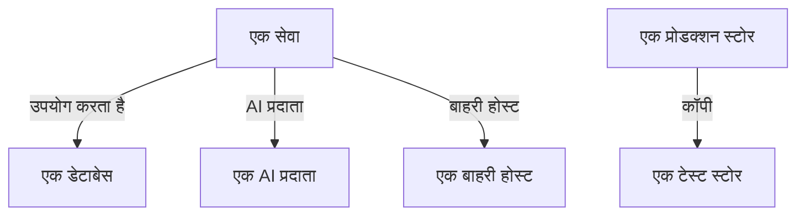

# डेटा प्रवाह, एक्सेस और रेजिडेंसी

स्टोर में क्या है, यह जानना आधा काम है। डेटा सुरक्षा यह भी पता लगाती है कि वह डेटा कहाँ जाता है - कौन-सी सेवाएं स्टोर का उपयोग करती हैं, डेटा किन AI प्रदाताओं और बाहरी होस्ट तक पहुँचता है, और उसकी कॉपी कहाँ बनाई गई - हर स्टोर तक कौन पहुंच सकता है, और क्या वह उन्हीं क्षेत्रों में रहता है जिनमें वह रह सकता है। यह सब उन साक्ष्यों से आता है जो OneUptime के पास पहले से हैं: आपके ट्रेस, आपके क्लाउड की अपनी एक्सेस सेटिंग्स, और स्कैन में मिली चीज़ों के फ़िंगरप्रिंट।

:::cards
- [डेटा प्रवाह](#डेटा-प्रवाह): सेवाएं, AI प्रदाता, बाहरी होस्ट और कॉपियाँ।
- [स्टोर तक कौन पहुंच सकता है](#स्टोर-तक-कौन-पहुंच-सकता-है): आपका क्लाउड जो भी एक्सेस अनुमति बताता है, और स्टोर का एक्सपोज़र कितना है।
- [डेटा रेजिडेंसी नियम](#डेटा-रेजिडेंसी-नियम): वे क्षेत्र जिनमें हर तरह का डेटा रह सकता है।
:::

## डेटा प्रवाह

| प्रवाह | इसका क्या मतलब है | यह कहाँ से आता है |
| --- | --- | --- |
| **उपयोग करता है** | कोई सेवा किसी स्टोर से बात करती है। | सेवा मैप, जिसे OneUptime हर दस मिनट में आपकी सेवाओं के क्लाइंट स्पैन से बनाता है। उस पर हर डेटाबेस नाम, पते या एंडपॉइंट से अपने स्टोर से जोड़ा जाता है, इसलिए जिस डेटाबेस को कोई दूसरा स्रोत सूचीबद्ध नहीं करता, वह अपने आप में एक स्टोर बन जाता है। |
| **AI प्रदाता** | कोई सेवा किसी AI प्रदाता को डेटा भेजती है। | पिछले 7 दिनों के सेवा के ट्रेस में AI कॉल, जो उस प्रदाता का नाम बताती हैं जिस तक वे पहुँचती हैं। |
| **बाहरी होस्ट** | कोई सेवा आपके सिस्टम के बाहर के किसी होस्ट को कॉल करती है। | सेवा मैप की रिमोट सेवाएं, उस पते के हिसाब से जिस पर उन्हें कॉल किया जाता है। |
| **कॉपी करें** | एक स्टोर में दूसरे स्टोर के मान हैं। | हर स्कैन में मिले मानों के फ़िंगरप्रिंट: दो स्टोर डेटा साझा करते हैं जब किसी एक डेटा प्रकार के उनके फ़िंगरप्रिंट आधे या उससे ज़्यादा मेल खाते हैं। |

प्रवाह अपने स्रोत में मौजूद डेटा प्रकार और उनकी संवेदनशीलता साथ ले जाता है। प्रवाह तब पुष्ट होता है जब किसी स्कैन ने साबित किया हो कि डेटा वहाँ है, सिर्फ़ यह नहीं कि उस तक कोई रास्ता है: कॉपी हमेशा पुष्ट होती है, और AI प्रदाता प्रवाह तब, जब सेवा की AI बातचीत में गोपनीय या प्रतिबंधित डेटा हो। जो प्रवाह 30 दिनों तक फिर से नहीं दिखता, उसे हटा दिया जाता है।

दो जांचें प्रवाह पढ़ती हैं। [प्रोडक्शन डेटा गैर-प्रोडक्शन स्टोर में कॉपी किया गया](/docs/data-security/checks-and-issues#डेटा-स्वच्छता) कॉपी के गंतव्य पर विफल होती है। जब दोनों में से सिर्फ़ एक प्रोडक्शन में हो, तो कॉपी प्रोडक्शन स्टोर से चलती है, और नहीं तो उस स्टोर से जिसे OneUptime ने पहले पाया। [संवेदनशील डेटा किसी AI प्रदाता को भेजा जा रहा है](/docs/data-security/checks-and-issues#ai) किसी सेवा की AI बातचीत पर विफल होती है जब उसमें संवेदनशील डेटा हो, और उन प्रदाताओं के नाम बताती है जिन तक वह पहुँची।

### फ़िंगरप्रिंट निजी कैसे रहते हैं

कॉपी किसी भी स्टोर के मानों के बिना पाई जाती है। स्कैन जो भी डेटा प्रकार उच्च विश्वास के साथ पाता है, उसके लिए वह पढ़े गए मानों का MinHash के रूप में एक स्केच बनाता है: 128 स्लॉट, हर एक मानों पर एक हैश फ़ंक्शन का सबसे छोटा मान, जिसके सिर्फ़ निचले 16 बिट रखे जाते हैं। दो स्केच लगभग उतने ही स्लॉट पर मेल खाते हैं जितना उनके मानों के दो सेट एक-दूसरे से मेल खाते हैं, इसलिए स्केच की तुलना से अनुमान लगता है कि एक स्टोर का कितना हिस्सा दूसरे में है।

- **मानों को प्रोजेक्ट की अपनी कुंजी से हैश किया जाता है** (HMAC-SHA256), इसलिए कुंजी के बिना कोई भी किसी ज्ञात मान को स्केच पर परख नहीं सकता, और दो प्रोजेक्ट के स्केच की कभी तुलना नहीं की जा सकती।
- **हर न्यूनतम के सिर्फ़ 16 बिट स्कैन से बाहर जाते हैं।** स्केच से कोई मान, और किसी मान का हैश भी, वापस नहीं पढ़ा जा सकता।
- **स्केच किसी डेटा प्रकार के बारे में होता है, किसी फ़ील्ड के बारे में नहीं।** स्टोर में उच्च विश्वास के साथ मिले हर डेटा प्रकार के लिए उसका एक स्केच होता है, और इससे ज़्यादा कुछ नहीं।

## स्टोर तक कौन पहुंच सकता है

कॉन्फ़िगरेशन रीडिंग हर क्लाउड की अपनी एक्सेस सेटिंग्स - बकेट नीतियाँ और ACL, Azure भूमिका असाइनमेंट, Google Cloud IAM बाइंडिंग, स्नैपशॉट शेयर - को इस बात की एक सूची में बदल देती है कि स्टोर तक कौन पहुंच सकता है, जो उसके **कौन पहुंच सकता है** पेज पर होती है:

| कॉलम | यह क्या बताता है |
| --- | --- |
| **प्रिंसिपल** | किसके या किस चीज़ के पास एक्सेस है, जैसा क्लाउड उसे नाम देता है: `*`, कोई खाता id, कोई ARN, कोई ईमेल, कोई सेवा खाता। |
| **प्रिंसिपल का प्रकार** | सार्वजनिक, खाता, भूमिका, उपयोगकर्ता, समूह, Service Principal, सेवा खाता या सेवा। |
| **एक्सेस स्तर** | पढ़ना, लिखना या एडमिन। |
| **इसके ज़रिए दिया गया** | एक्सेस किस चीज़ से मिलता है: बकेट नीति, ACL, भूमिका असाइनमेंट, IAM बाइंडिंग या स्नैपशॉट शेयर। |
| **बाहरी** | प्रिंसिपल OneUptime से कनेक्ट किए गए खातों, सब्सक्रिप्शन और प्रोजेक्ट के बाहर है। |
| **Public** | प्रिंसिपल इंटरनेट पर कोई भी है। |

हर कॉन्फ़िगरेशन रीडिंग के साथ सूची फिर से पढ़ी जाती है, और जिस एक्सेस अनुमति को क्लाउड अब नहीं बताता, उसे हटा दिया जाता है। [25 से ज़्यादा पहचानें प्रतिबंधित डेटा पढ़ सकती हैं](/docs/data-security/checks-and-issues#एक्सेस) इस सूची में पढ़ने वालों को गिनती है। जो सेवाएं किसी स्टोर का उपयोग करती हैं, वे उसके **उपयोग करता है** प्रवाह हैं।

जो कुछ यह पढ़ती है, उससे हर स्टोर को एक एक्सपोज़र मिलता है:

| एक्सपोज़र | इसका क्या मतलब है |
| --- | --- |
| **Public** | इंटरनेट पर कोई भी इसे पढ़ सकता है। |
| **अन्य खाते** | आपके कनेक्ट किए गए खातों के बाहर के खाते इस तक पहुंच सकते हैं। |
| **इंटरनेट से पहुंच योग्य** | इसका नेटवर्क एंडपॉइंट इंटरनेट से कनेक्शन स्वीकार करता है। |
| **निजी** | सिर्फ़ आपके अपने खाते और नेटवर्क इस तक पहुँचते हैं। |
| **अज्ञात** | OneUptime यह बताने के लिए इसका पर्याप्त कॉन्फ़िगरेशन नहीं पढ़ सका। |

सार्वजनिक, साझा से ऊपर गिना जाता है, और साझा, पहुंच योग्य से ऊपर: किसी दूसरे खाते के साथ भी साझा किया गया सार्वजनिक बकेट सार्वजनिक ही गिना जाता है। एक्सपोज़र किसी समस्या के [जोखिम स्कोर](/docs/data-security/checks-and-issues#जोखिम-स्कोर) में जुड़ता है।

## डेटा रेजिडेंसी नियम

डेटा रेजिडेंसी नियम बताता है कि किसी तरह का डेटा कहाँ रह सकता है। इसे **डेटा सुरक्षा → सेटिंग्स → डेटा रेजिडेंसी नियम** में जोड़ें:

| फ़ील्ड | यह क्या करता है |
| --- | --- |
| **नाम** | नियम क्या है, जैसे EU का व्यक्तिगत डेटा EU में ही रहता है। |
| **अनुमत क्षेत्र** | वे क्षेत्र जिनमें वह डेटा संग्रहीत और कॉपी किया जा सकता है, उसी तरह लिखे जैसे आपका क्लाउड उन्हें नाम देता है। बिना किसी क्षेत्र वाला नियम कुछ नहीं जांचता। |
| **डेटा श्रेणियां** | डेटा की वे श्रेणियां जिन्हें यह कवर करता है। खाली होने पर यह हर तरह का व्यक्तिगत डेटा कवर करता है। |
| **इन देशों के लोगों का डेटा** | सिर्फ़ इन देशों के लोगों का डेटा, ISO 3166-1 कोड के रूप में, जैसे `DE` या `IN`। खाली होने पर यह कहीं के भी लोगों का डेटा कवर करता है। |
| **विवरण** | नियम किसलिए है, जैसे हमारे EU ग्राहकों का डेटा सिर्फ़ EU में संग्रहीत होता है। |
| **सक्षम** | क्या स्टोर को इस नियम के मुकाबले जांचा जाता है। |

कोई स्टोर नियम तब तोड़ता है जब उसमें ऐसा डेटा हो जिसे नियम कवर करता है, और उसका अपना क्षेत्र, या कोई ऐसा क्षेत्र जिसमें उसका डेटा कॉपी होता है, किसी भी अनुमत क्षेत्र से मेल न खाए। कॉपियाँ वे क्षेत्र हैं जिनमें स्टोर का डेटा रेप्लिकेट होता है: S3 रेप्लिकेशन, स्टोरेज खाते की जियो-रिडंडेंट कॉपी, डेटाबेस की रेप्लिका। तब स्टोर पर [डेटा उन क्षेत्रों के बाहर संग्रहीत है जिनमें वह रह सकता है](/docs/data-security/checks-and-issues#डेटा-रेजिडेंसी) विफल होती है, उस क्षेत्र और उस नियम के साथ जिसे उसने तोड़ा।

### क्षेत्र और वाइल्डकार्ड

अनुमत क्षेत्र में `*` किन्हीं भी अक्षरों की जगह लेता है, बड़े और छोटे अक्षर एक जैसे माने जाते हैं, और पैटर्न को पूरे क्षेत्र से मेल खाना चाहिए:

| अनुमत क्षेत्र | मेल खाता है | मेल नहीं खाता |
| --- | --- | --- |
| `eu-*` (AWS) | `eu-west-1`, `eu-central-1` | `us-east-1`, `us-eu-1` |
| `europe-*` (Google Cloud) | `europe-west1`, `europe-north1` | `us-central1` |
| `westeurope` (Azure) | `westeurope` | `northeurope` |

आप जिन क्लाउड का उपयोग करते हैं, उनमें से हर एक के लिए एक पैटर्न सूचीबद्ध करें: `eu-*`, `europe-*`, `westeurope` और `northeurope` मिलकर तीनों पर डेटा को यूरोप में रखते हैं।

### स्टोर में किसका डेटा है

OneUptime डेटा से ही पढ़ता है कि किसी स्टोर में किसका डेटा है। जो डेटा प्रकार किसी एक देश का होता है, वह बताता है कि उसके लोग उस देश में हैं: जर्मन टैक्स ID `DE` बताता है, भारतीय Aadhaar नंबर `IN`, UK का NHS नंबर `GB`। स्टोर उन देशों को अपने डेटा विषय देशों के रूप में सूचीबद्ध करता है, और कुछ देशों के लोगों तक सीमित नियम सिर्फ़ उन स्टोर को कवर करता है जिनमें उनका डेटा है। [संवेदनशील डेटा प्रकार](/docs/data-security/data-types#बिल्ट-इन-डेटा-प्रकार) हर उस डेटा प्रकार का देश बताता है जिसका कोई देश है।

## अगले कदम

:::cards
- [डेटा सुरक्षा जांचें और समस्याएं](/docs/data-security/checks-and-issues): हर वह जांच जिसे ये प्रवाह, एक्सेस अनुमतियाँ और नियम जानकारी देते हैं।
- [डेटा सुरक्षा अनुपालन](/docs/data-security/compliance): रेजिडेंसी और एक्सेस GDPR, LGPD और DPDP में कैसे गिने जाते हैं।
- [टोपोलॉजी](/docs/telemetry/topology): वह सेवा मैप जिससे प्रवाह आते हैं।
:::
