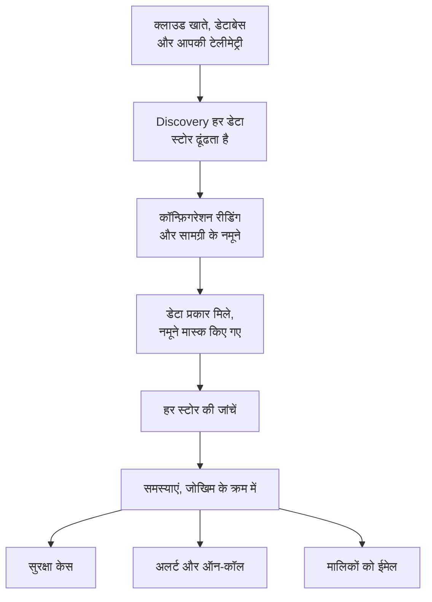

# डेटा सुरक्षा

डेटा सुरक्षा आपकी कंपनी का रखा संवेदनशील डेटा ढूंढता है - क्लाउड बकेट, डेटाबेस और वेयरहाउस में, और उस टेलीमेट्री में जो आप OneUptime को भेजते हैं - और बताता है कि उसे रखने के तरीके में क्या गलत है। यह स्टोर खुद ढूंढता है, पढ़ता है कि हर एक कैसे सेट है, उसमें रखी चीज़ों के नमूने लेता है, और हर गड़बड़ी के लिए एक समस्या खोलता है, जोखिम के हिसाब से क्रम में।

यह चार सवालों के जवाब देता है:

:::cards
- [हमारा संवेदनशील डेटा कहां है?](/docs/data-security/data-types): 143 डेटा प्रकार, कार्ड नंबर और राष्ट्रीय ID से लेकर API कुंजियों तक, जो बकेट, टेबल और टेलीमेट्री में मिलते हैं।
- [क्या यह एक्सपोज़्ड है?](/docs/data-security/checks-and-issues): हर स्टोर की 32 जांचें: सार्वजनिक एक्सेस, एन्क्रिप्शन, बैकअप, लॉगिंग, सीक्रेट और कॉपियां।
- [कौन इस तक पहुंच सकता है, और यह कहां जाता है?](/docs/data-security/flows-access-residency): हर स्टोर को कौन पढ़ सकता है, कौन-सी सेवाएं उसका उपयोग करती हैं, और उसका डेटा किन AI प्रदाताओं और होस्ट तक पहुंचता है।
- [क्या यह हमारे नियमों पर खरा उतरता है?](/docs/data-security/compliance): डेटा रेजिडेंसी नियम, और स्कैन में मिली चीज़ों से स्कोर किए गए नौ फ्रेमवर्क।
:::

## यह कैसे काम करता है

1. **Discovery** उन स्टोर को ढूंढता है जिन्हें OneUptime पहले से जानता है: आपकी क्लाउड इन्वेंटरी, वे डेटाबेस जिनकी निगरानी Database उत्पाद करता है, वे डेटाबेस जिनसे आपकी सेवाएं सर्विस मैप पर बात करती हैं, और हर सेवा की टेलीमेट्री। आप कोई स्टोर हाथ से तभी जोड़ते हैं जब कोई स्रोत उसे सूचीबद्ध नहीं करता।
2. **कॉन्फ़िगरेशन रीडिंग** हर क्लाउड से पूछती है कि हर स्टोर कैसे सेट है: कौन उस तक पहुंच सकता है, और वह कैसे एन्क्रिप्ट होता है, उसका बैकअप कैसे होता है और उसके लॉग कैसे बनते हैं। यह सेटिंग्स पढ़ती है, डेटा कभी नहीं।
3. **सामग्री के नमूने** किसी स्टोर में रखी चीज़ों का थोड़ा-सा हिस्सा पढ़ते हैं, जहां आप अनुमति दें: किसी बकेट में हर तरह के कुछ ऑब्जेक्ट, हर टेबल की कुछ पंक्तियां, हर सेवा की टेलीमेट्री के सबसे नए रिकॉर्ड।
4. **वर्गीकरण** नमूनों में संवेदनशील मान ढूंढता है, और गिनतियां और मास्क किए गए नमूने रखता है, कोई मान कभी नहीं।
5. **जाँचें** तय करती हैं कि हर स्टोर में क्या गलत है, और उसमें रखे डेटा के लिए यह कितना बुरा है। हर विफल जांच एक समस्या खोलती है, जो जांच पास होते ही अपने आप बंद हो जाती है।

## यह किस तरह अलग है

- **आपकी टेलीमेट्री एक डेटा स्टोर है।** हर सेवा के लॉग, ट्रेस, अपवाद, सेशन रीप्ले और AI बातचीत हर घंटे किसी बकेट की तरह जांचे जाते हैं। किसी लॉग लाइन में ईमेल पता एक निष्कर्ष है, और **साफ़ करें** उसके बाद से उसे इन्जेस्ट के समय मास्क करता है। देखें [टेलीमेट्री में संवेदनशील डेटा](/docs/data-security/telemetry)।
- **डेटा प्रवाह असली ट्रैफ़िक से आते हैं।** सर्विस मैप बताता है कि कौन-सी सेवा किस डेटाबेस का उपयोग करती है, AI कॉल उस प्रदाता का नाम बताती हैं जिस तक वे पहुंचती हैं, और प्रोडक्शन डेटा की कॉपियां फ़िंगरप्रिंट की तुलना करके मिलती हैं। देखें [डेटा प्रवाह, एक्सेस और डेटा रेजिडेंसी](/docs/data-security/flows-access-residency)।
- **साक्ष्य हमेशा मास्क किया जाता है।** एक निष्कर्ष गिनतियां और ज़्यादा से ज़्यादा तीन मास्क किए गए नमूने रखता है, जैसे `j***@e******.com`, जो स्कैनर से कुछ भी बाहर जाने से पहले उसके अंदर ही मास्क किए जाते हैं। नमूने बंद करें, और यह सिर्फ़ गिनतियां रखता है।
- **स्कैनर ओपन सोर्स है।** हर डेटा प्रकार का पैटर्न, चेकसम, संदर्भ शब्द और परीक्षण मान OneUptime के सोर्स कोड में हैं, इसलिए आप ठीक-ठीक पढ़ सकते हैं कि निष्कर्ष किस आधार पर बनता है। यही कोड OneUptime के वर्कर पर, किसी प्रोब पर, और **इसका परीक्षण करें** बॉक्स में चलता है।
- **यह OneUptime के बाकी हिस्सों के साथ काम करता है।** गंभीर समस्या स्टोर पर एक सुरक्षा केस खोलती है, ताकि [सुरक्षा संचालन](/docs/telemetry/security-cases) उस पर किसी भी दूसरे खतरे की तरह काम करे। यह ऐसा अलर्ट बना सकता है जो ऑन-कॉल व्यक्ति को पेज करता है, और यह स्टोर के मालिकों को ईमेल करता है। देखें [डेटा सुरक्षा इंटीग्रेशन](/docs/data-security/integrations)।
- **OneUptime AI इसे ठीक करने में मदद करता है।** **AI से समझाएं** स्टोर के मालिक को बताता है कि क्या गलत है और अपने क्लाउड पर इसे कैसे ठीक करें, और **AI से ठीक करें** आपके इन्फ्रास्ट्रक्चर कोड में एक pull request खोलता है।

## शुरू करने से पहले

- **ऐसी भूमिका जो इसे सेट कर सके।** Project Owner, Project Admin और Security Admin डेटा सुरक्षा की सेटिंग्स बदलते हैं। Security Member समस्याओं पर काम करते हैं और स्टोर स्कैन करते हैं, और Security Viewer पढ़ते हैं कि इसे क्या मिला। दूसरी भूमिकाओं को इसमें से कुछ नहीं दिखता, जब तक उनकी टीम को इसकी अनुमतियां न दी जाएं: किन बकेट में कार्ड नंबर हैं, यह ठीक वही है जो कोई हमलावर जानना चाहता है। देखें [भूमिकाएं](/docs/permissions/reference#भूमिकाएँ)।
- **पढ़ने के लिए एक क्लाउड खाता, या एक डेटाबेस।** डेटा सुरक्षा किसी क्लाउड खाते को [क्लाउड कनेक्शन](/docs/telemetry/cloud-accounts) से पढ़ता है, और आपके चलाए डेटाबेस को केवल पढ़ने वाली कनेक्शन स्ट्रिंग से। टेलीमेट्री के लिए कुछ नहीं चाहिए: वह हर घंटे स्कैन होती है।

## जल्दी शुरू करें

:::steps
### क्लाउड खाता कनेक्ट करें

**क्लाउड → कनेक्ट करें** पर जाएं और अपना क्लाउड चुनें। अगर खाता पहले से कनेक्ट है, तो इसके बजाय उसके कनेक्शन पर **संपादित करें** चुनें। [क्लाउड खाता कनेक्ट करें](/docs/telemetry/cloud-accounts) हर क्लाउड के चरण बताता है।

### डेटा सुरक्षा का स्तर चुनें

**और फ़ील्ड** में, **डेटा सुरक्षा** को **केवल कॉन्फ़िगरेशन** पर सेट करें ताकि हर स्टोर का सेटअप जांचा जाए, या **कॉन्फ़िगरेशन और सामग्री के नमूने** पर ताकि उनके अंदर का संवेदनशील डेटा भी मिले। फ़ॉर्म जो कमांड दिखाता है, वह आपकी पसंद के साथ बदलती है: उसे अपने क्लाउड के शेल में चलाएं, जैसा फ़ॉर्म कहता है। [डेटा सुरक्षा सेट करें](/docs/data-security/setup) बताता है कि हर स्तर ठीक-ठीक क्या देता है, और [क्लाउड खाता कनेक्ट करें](/docs/telemetry/cloud-accounts#डेटा-सुरक्षा) हर स्तर की कमांड दिखाता है।

### समस्याओं की समीक्षा करें

**डेटा सुरक्षा** खोलें। जैसे-जैसे Discovery स्टोर ढूंढता है, हर 15 मिनट में, वे **डेटा स्टोर** के अंदर दिखते हैं, और किसी कनेक्शन का कॉन्फ़िगरेशन घंटे भर के अंदर पढ़ा जाता है। कोई रीडिंग या स्कैन पूरा होते ही **समस्याएं** के अंदर समस्याएं खुलती हैं, हर एक अपने जोखिम स्कोर के साथ, और **अवलोकन** सबसे जोखिम वाली पांच दिखाता है। हर समस्या बताती है कि क्या गलत है, यह क्यों मायने रखता है और इसे कैसे ठीक करें, आपके क्लाउड की कमांड के साथ।
:::

## डेटा स्टोर किसे माना जाता है

| कहां | स्टोर | सामग्री के नमूने |
| --- | --- | --- |
| AWS | AWS S3 Bucket, AWS RDS Instance, AWS Aurora Cluster, AWS RDS Snapshot, AWS DynamoDB Table, AWS Redshift Cluster, AWS DocumentDB Cluster, AWS OpenSearch Domain, AWS ElastiCache Cluster, AWS EFS File System | AWS S3 Bucket |
| Azure | Azure Storage Account, Azure SQL Database, Azure Cosmos DB Account, Azure PostgreSQL Server, Azure MySQL Server | Azure Storage Account |
| Google Cloud | Google Cloud Storage Bucket, Google Cloud SQL Instance, Google BigQuery Dataset, Google Firestore Database, Google Spanner Instance, Google Bigtable Instance | Google Cloud Storage Bucket, Google BigQuery Dataset |
| आपके चलाए डेटाबेस | PostgreSQL, MySQL, MongoDB, SQL Server, Oracle, Redis, Elasticsearch | PostgreSQL, MySQL |
| OneUptime | लॉग, ट्रेस, अपवाद, सेशन रीप्ले, AI बातचीत | लॉग, ट्रेस, अपवाद, सेशन रीप्ले, AI बातचीत |

हर स्टोर पर वे जांचें चलती हैं जो उसके प्रकार पर लागू होती हैं। जिस स्टोर की सामग्री का नमूना नहीं लिया जा सकता, उसकी भी जांच होती है: सार्वजनिक बकेट या बिना एन्क्रिप्शन वाला डेटाबेस अपने आप में समस्या है, उसमें चाहे जो रखा हो।

जब किसी स्टोर का स्रोत उसे सूचीबद्ध करना बंद कर देता है, तो वह अपने इतिहास के साथ संग्रहीत हो जाता है, और उसकी खुली समस्याएं सुलझा दी जाती हैं: डेटा सुरक्षा के मेनू के अंत में **संग्रहीत स्टोर** उसे रखता है। अगर उसका स्रोत उसे फिर से सूचीबद्ध करता है तो वह अपने आप लौट आता है, और जिस समस्या की जांच अब भी विफल होती है, वह फिर से खुलती है।

किसी स्टोर की **टाइमलाइन** बताती है कि उसके साथ क्या हुआ, और किसने किया: वह कब मिला या जोड़ा गया, उसकी सेटिंग्स और मालिकों में हर बदलाव, वह कब संग्रहीत हुआ या लौटा, और किसी समस्या या प्लेबुक से बंद किया गया हर एक्सपोज़र।

## यह कितनी बार चलता है

| क्या | कब |
| --- | --- |
| नए स्टोर ढूंढना | हर 15 मिनट में |
| किसी क्लाउड कनेक्शन का कॉन्फ़िगरेशन पढ़ना | दिन में एक बार, और CloudTrail के किसी AWS स्टोर के एक्सेस, एन्क्रिप्शन, बैकअप या शेयरिंग में बदलाव दर्ज करने के घंटे भर के अंदर |
| किसी स्टोर की सामग्री का नमूना लेना | हर 24 घंटे में, या जितनी बार **स्कैन अंतराल (घंटे)** कहे |
| हर सेवा की टेलीमेट्री का नमूना लेना | हर घंटे, उसका पिछला एक घंटा |
| हर स्टोर को फिर से जांचना | हर रीडिंग और स्कैन के बाद, किसी जांच पर असर डालने वाली कोई भी चीज़ बदलने के बाद, और दिन में एक बार |

किसी स्टोर पर **अभी स्कैन करें** उसकी सामग्री का तुरंत नमूना लेता है, और **अभी जांचें** उसका कॉन्फ़िगरेशन फिर से पढ़ता है।

## अगले कदम

:::cards
- [डेटा सुरक्षा सेट करें](/docs/data-security/setup): तीन स्तर, हर एक से मिलने वाली अनुमतियां, और अपने डेटाबेस स्कैन करना।
- [संवेदनशील डेटा प्रकार](/docs/data-security/data-types): कोई मान कैसे मिलता है, और हर वह डेटा प्रकार जिसे डेटा सुरक्षा जानता है।
- [डेटा सुरक्षा जांच और समस्याएं](/docs/data-security/checks-and-issues): हर जांच, जोखिम स्कोर, और किसी समस्या के साथ क्या होता है।
- [डेटा सुरक्षा इंटीग्रेशन](/docs/data-security/integrations): सुरक्षा केस, अलर्ट, मालिक, वर्कफ़्लो और OneUptime AI।
:::
