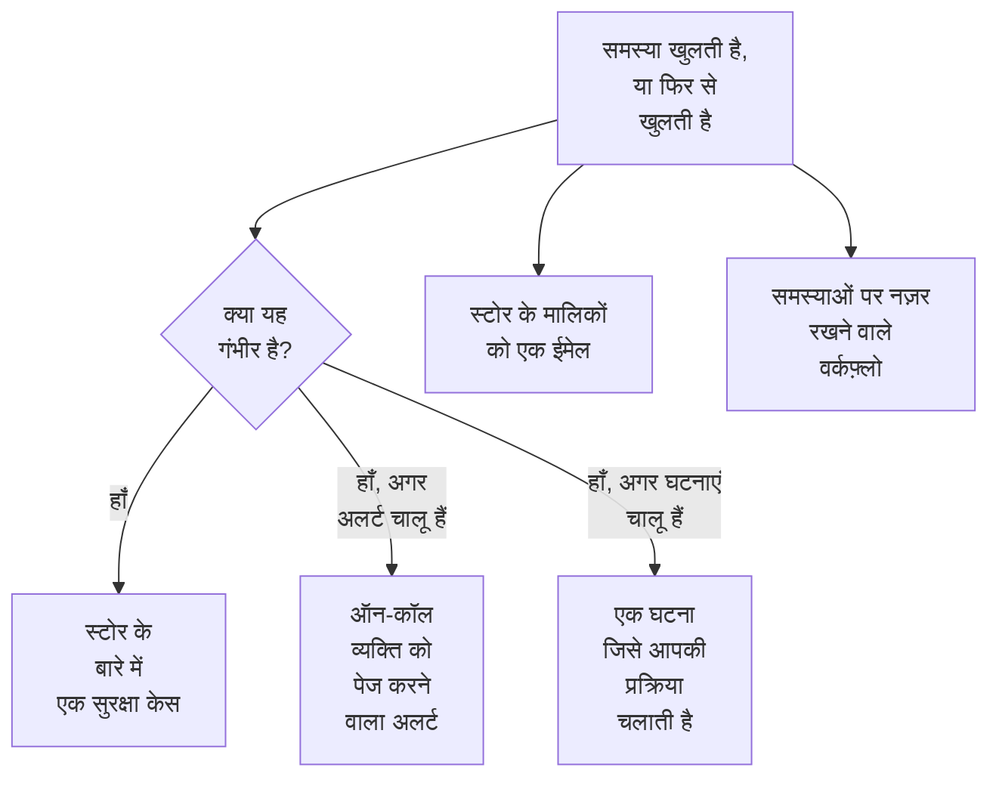

# डेटा सुरक्षा इंटीग्रेशन

डेटा सुरक्षा अपना कोई पेजर या सुरक्षा कतार नहीं चलाती। यह जो पाती है, उसे OneUptime के उन हिस्सों को सौंप देती है जो पहले से यह काम करते हैं: गंभीर समस्या एक सुरक्षा केस बन जाती है, वह ऑन-कॉल व्यक्ति को पेज कर सकती है या घटना घोषित कर सकती है, और हर नई समस्या स्टोर के मालिकों को ईमेल की जाती है। वर्कफ़्लो, OneUptime AI, API, Terraform और MCP सर्वर उस सब तक पहुँचते हैं जो यह रखती है।

:::cards
- [सुरक्षा संचालन](#सुरक्षा-संचालन): गंभीर समस्या वाले हर स्टोर के लिए एक सुरक्षा केस।
- [अलर्ट और ऑन-कॉल](#अलर्ट-और-ऑन-कॉल): गंभीर समस्या खुलने पर जो भी ऑन-कॉल हो, उसे पेज करें।
- [घटनाएं](#घटनाएं): ऐसे उल्लंघन के लिए घटना घोषित करें जिसे आपकी घटना प्रक्रिया को चलाना चाहिए।
- [मालिक](#मालिक): हर स्टोर का मालिक कौन है, हाथ से या नियमों से सेट किया गया, और उन्हें मिलने वाला ईमेल।
- [OneUptime AI](#oneuptime-ai): किसी समस्या को समझाएं, उसे ठीक करने वाला pull request खोलें, या "AI से पूछें" में अपने डेटा के बारे में पूछें।
- [एक्सपोज़र बंद करें](#एक्सपोज़र-बंद-करें): किसी समस्या या प्लेबुक से सार्वजनिक एक्सेस ब्लॉक करें या शेयरिंग रोकें।
:::

## यह कैसे काम करता है

इनमें से हर एक तब चलता है जब कोई मूल्यांकन समस्या खोलता है, या उसे फिर से खोलता है। हर एक बस पूरी कोशिश करता है: समस्या पहले से खुली है और अपनी टाइमलाइन पर है, इसलिए विफल होने वाला इंटीग्रेशन लॉग करके छोड़ दिया जाता है, और दूसरे केस या दूसरे पेज के लिए कभी दोबारा नहीं आज़माया जाता। हर एक ने क्या किया, यह समस्या की **टाइमलाइन** में लिखा जाता है, और समस्या का पेज उस केस, अलर्ट और घटना से लिंक करता है जो उसने शुरू की।

| सेटिंग | डिफ़ॉल्ट | यह क्या करती है |
| --- | --- | --- |
| **सुरक्षा केस खोलें** | चालू | गंभीर समस्या एक सुरक्षा केस खोलती है, स्टोर के हिसाब से समूहित। |
| **अलर्ट बनाएं** | बंद | गंभीर समस्या एक अलर्ट बनाती है, जो ऑन-कॉल व्यक्ति को पेज करता है। |
| **अलर्ट गंभीरता** | खाली | उन अलर्ट की गंभीरता। खाली होने पर प्रोजेक्ट की सबसे गंभीर गंभीरता। |
| **घटनाएं घोषित करें** | बंद | गंभीर समस्या एक घटना घोषित करती है, जिसे आपकी घटना प्रक्रिया चलाती है। |
| **घटना गंभीरता** | खाली | उन घटनाओं की गंभीरता। खाली होने पर प्रोजेक्ट की सबसे गंभीर गंभीरता। |
| **स्वामियों को सूचित करें** | चालू | हर नई समस्या उसके स्टोर के मालिकों को ईमेल की जाती है। |

## सुरक्षा संचालन

सुरक्षा संचालन में हर स्टोर अपने आप में एक एंटिटी है, जिसका प्रकार **डेटा स्टोर** है। **सुरक्षा केस खोलें** चालू होने पर, गंभीर समस्या स्टोर के बारे में एक डिटेक्शन के रूप में सुरक्षा संचालन को भेजी जाती है:

- उसका स्रोत **डेटा सुरक्षा** है, और उसके नियम का नाम जांच पर रखा जाता है, जैसे `Data Security: public-read`;
- वह गंभीर है, इसलिए उससे खुलने वाला केस प्रोजेक्ट की गंभीर प्राथमिकता पर होता है;
- वह स्टोर के हिसाब से समूहित होता है: उसी स्टोर पर दूसरी गंभीर समस्या नया केस खोलने के बजाय उसके बारे में खुले केस में जुड़ जाती है।

वहाँ से केस पर किसी भी दूसरे केस की तरह काम होता है: उसे असाइन किया जाता है, उस पर नोट लिखे जाते हैं, उसे बंद किया जाता है, और प्रोजेक्ट की प्लेबुक उस पर प्रतिक्रिया देती हैं। स्टोर के डिटेक्शन [एंटिटी जोखिम](/docs/telemetry/security-entity-risk) पर उसके जोखिम में गिने जाते हैं, जैसे किसी भी एंटिटी के गिने जाते हैं। देखें [सुरक्षा केस और प्लेबुक](/docs/telemetry/security-cases)।

## अलर्ट और ऑन-कॉल

**अलर्ट बनाएं** चालू होने पर, गंभीर समस्या एक अलर्ट बनाती है, जिसके नाम में "Data Security:" और फिर समस्या का शीर्षक और स्टोर होता है। अलर्ट किसी भी दूसरे अलर्ट की तरह अपने नियमों से ऑन-कॉल व्यक्ति को पेज करता है (देखें [अलर्ट](/docs/alerts/index) और [ऑन-कॉल](/docs/on-call/index))। किसी समस्या का एक समय में ज़्यादा से ज़्यादा एक खुला अलर्ट होता है, चाहे उसका कितनी भी बार मूल्यांकन हो। **अलर्ट गंभीरता** अलर्ट की गंभीरता तय करती है; खाली छोड़ने पर यह प्रोजेक्ट की सबसे गंभीर गंभीरता होती है।

अलर्ट अपनी समस्या के साथ खत्म होता है: जैसे ही समस्या खुली नहीं रहती - उसकी जांच पास हो जाती है, या कोई व्यक्ति उसे हल किया गया चिह्नित करता है, उसका जोखिम स्वीकार करता है या कहता है कि यह समस्या नहीं है - अलर्ट सुलझा दिया जाता है, और समस्या की **टाइमलाइन** यह बताती है। फिर से खुलने वाली समस्या नया अलर्ट बनाती है।

अलर्ट डिफ़ॉल्ट रूप से बंद हैं, क्योंकि ज़्यादातर टीमें डेटा सुरक्षा का निष्कर्ष सबसे पहले सुरक्षा केस में चाहती हैं। जब कार्ड नंबरों वाले सार्वजनिक बकेट पर किसी को जगाना ज़रूरी हो, तब इन्हें चालू करें।

## घटनाएं

**घटनाएं घोषित करें** चालू होने पर, गंभीर समस्या एक घटना घोषित करती है, जिसका नाम उसके अलर्ट जैसा होता है, ऐसे उल्लंघन के लिए जिसे आपकी घटना प्रक्रिया को चलाना चाहिए: ऑन-कॉल, वर्कस्पेस चैनल, स्टेटस पेज और पोस्टमॉर्टम (देखें [घटनाएं](/docs/incidents/index))। किसी समस्या की एक समय में ज़्यादा से ज़्यादा एक खुली घटना होती है। **घटना गंभीरता** घटना की गंभीरता तय करती है; खाली छोड़ने पर यह प्रोजेक्ट की सबसे गंभीर गंभीरता होती है।

डेटा सुरक्षा कभी किसी घटना को नहीं सुलझाती, उसकी समस्या सुलझ जाने के बाद भी नहीं: घटना के साथ स्टेटस पेज और पोस्टमॉर्टम हो सकते हैं, इसलिए जो उसे चलाता है वही उसे बंद करता है। सुरक्षा केस घटना तक पहुँचने का दूसरा रास्ता है: केस पर **घटना घोषित करें** उससे लिंक की हुई एक घटना खोलता है (देखें [घटना घोषित करें](/docs/telemetry/security-cases#घटना-घोषित-करें))।

## मालिक

स्टोर के मालिक लोग और टीमें होते हैं, जो स्टोर के **मालिक** पेज पर होते हैं। समस्या उन्हीं के लिए होती है: उन्हें ईमेल मिलता है, और **इस संवेदनशील स्टोर का कोई मालिक नहीं है** उस संवेदनशील स्टोर पर विफल होती है जिसका कोई मालिक नहीं है।

**स्वामियों को सूचित करें** चालू होने पर, किसी स्टोर पर समस्याएं खोलने वाला हर मूल्यांकन उसके मालिकों को एक ईमेल भेजता है - वे लोग जो उसके मालिक हैं, और उन टीमों के सदस्य जो उसकी मालिक हैं, 50 तक - जिसके शीर्षक में होता है कि स्टोर पर कितनी नई समस्याएं हैं, जैसे "Data Security: 2 new issues on orders-db"। इसमें हर नई समस्या की गंभीरता और शीर्षक और स्टोर की संवेदनशीलता होती है, और स्टोर का लिंक होता है। इसमें कभी कोई नमूना नहीं होता।

### स्वामी नियम और लेबल नियम

नियम आपके लिए मालिक और लेबल सेट करते हैं, जैसे-जैसे स्टोर मिलते हैं:

| नियम | कहाँ | यह क्या करता है |
| --- | --- | --- |
| **स्वामी नियम** | **डेटा सुरक्षा → नियम → स्वामी नियम** | मेल खाने वाले हर स्टोर में स्वामी उपयोगकर्ता और टीमें जोड़ता है |
| **लेबल नियम** | **डेटा सुरक्षा → नियम → लेबल नियम** | मेल खाने वाले हर स्टोर में लेबल जोड़ता है |

नियम किसी स्टोर से उसके लेबल से, उसके नाम या विवरण के पैटर्न से, या **क्लाउड टैग पैटर्न** से मेल खाता है: एक पैटर्न जिसे स्टोर के हर क्लाउड टैग से मिलाया जाता है, जो `key=value` के रूप में लिखा होता है। `^team=payments$` हर उस स्टोर से मेल खाता है जिस पर `team=payments` टैग है, और `^env=` हर उस स्टोर से जिस पर `env` टैग है। नए स्टोर को मिलते ही प्रोजेक्ट के नियम लग जाते हैं, और स्वामी नियम का **स्वामियों को सूचित करें** बताता है कि वह जिन मालिकों को जोड़ता है, उन्हें सूचना दी जाती है या नहीं। [लेबल और स्वामी नियम](/docs/configuration/label-and-owner-rules) बताता है कि हर नियम कैसे मेल खाता है और नियम कब चलते हैं।

## वर्कफ़्लो

**डेटा स्टोर** और **डेटा सुरक्षा समस्या** वर्कफ़्लो ट्रिगर हैं, हर एक **बनने पर**, **अपडेट होने पर**, **बनने या अपडेट होने पर** और **हटाए जाने पर** के साथ। इन्हें **ट्रिगर जोड़ें** पैनल में, **OneUptime संसाधन** के नीचे चुनें।

- **डेटा सुरक्षा समस्या → बनने पर** तब चलता है जब कोई समस्या पहली बार खुलती है। किसी **यदि / अन्यथा** ब्लॉक में उसकी गंभीरता पढ़ें, और गंभीर समस्याओं को किसी चैनल पर पोस्ट करें या अपने ट्रैकर में टिकट खोलें।
- **डेटा सुरक्षा समस्या → अपडेट होने पर**, जिसमें **देखने के लिए फ़ील्ड** उसकी स्थिति पर सेट हो, तब चलता है जब कोई समस्या सुलझती है, स्वीकार की जाती है या फिर से खुलती है।
- **डेटा स्टोर → बनने पर** तब चलता है जब Discovery कोई स्टोर ढूँढता है, उदाहरण के लिए किसी टीम को हर नए बकेट के बारे में बताने के लिए।

हर ट्रिगर कौन-से फ़ील्ड आगे भेजता है, यह [वर्कफ़्लो ट्रिगर](/docs/workflows/triggers) में देखें।

## OneUptime AI

समस्या पर दो कार्रवाइयाँ OneUptime AI से मदद माँगती हैं। दोनों OneUptime AI को समस्या का शीर्षक और गंभीरता, स्टोर का नाम, प्रकार, क्षेत्र और क्लाउड id, उसकी संवेदनशीलता और डेटा प्रकार, साक्ष्य, जांच क्यों मायने रखती है और स्टोर के क्लाउड के लिए सुधार भेजती हैं - किसी निष्कर्ष के नमूने कभी नहीं। दोनों प्रोजेक्ट के OneUptime AI स्विच और सीमाओं के तहत चलती हैं।

- **AI से समझाएं** स्टोर के मालिक के लिए लिखता है कि क्या गलत है, क्या हो सकता है और उनके क्लाउड पर इसे ठीक करने के सटीक चरण क्या हैं। यह व्याख्या समस्या की **टाइमलाइन** पर रखी जाती है। जो भी डेटा सुरक्षा पढ़ सकता है, वह इसे माँग सकता है।
- **AI से ठीक करें** OneUptime AI से कहता है कि वह आपके इंफ्रास्ट्रक्चर कोड में - Terraform, CloudFormation, Bicep या ऐसे ही किसी में - सबसे छोटे ऐसे बदलाव से समस्या ठीक करे जिससे जांच पास हो जाए, और एक pull request खोले। इसके लिए स्टोर का इंफ्रास्ट्रक्चर कोड रखने वाली रिपॉजिटरी **कोड** के नीचे कनेक्ट होनी चाहिए: प्रोजेक्ट में कई हों तो उसे **रिपॉजिटरी** में चुनें। pull request **कोड** के नीचे दिखता है (देखें [कोड](/docs/ai/ai-agent))। Security Member और उससे ऊपर की भूमिकाएं इसे माँग सकती हैं।

### AI से पूछें

**AI से पूछें** डेटा सुरक्षा भी पढ़ता है। डेटा सुरक्षा के किसी भी पेज पर पूछें कि किन स्टोर में कार्ड नंबर हैं, पहले क्या ठीक करना है, या कोई भूमिका लीक हो जाए तो वह किन स्टोर तक पहुंच सकती है; किसी स्टोर या समस्या के पेज पर यह पहले वह रिकॉर्ड पढ़ता है। यह तीन पढ़ने वाले टूल से जवाब देता है, जो आपकी अपनी अनुमतियों से चलते हैं:

| टूल | यह क्या पढ़ता है |
| --- | --- |
| `query_data_stores` | स्टोर, सबसे जोखिम वाले पहले, संवेदनशीलता, डेटा प्रकार, एक्सपोज़र, प्रदाता या नाम के हिसाब से - या एक स्टोर, इसके साथ कि क्या कहाँ मिला, उस तक कौन पहुंच सकता है और उसकी खुली समस्याएं |
| `query_data_security_issues` | समस्याएं, सबसे जोखिम वाली पहले, स्थिति, गंभीरता, स्टोर या जांच के हिसाब से - या एक समस्या, उसके साक्ष्य और उसके क्लाउड के लिए सुधार के साथ |
| `query_data_store_access` | किसी स्टोर तक कौन पहुंच सकता है, या हर वह स्टोर जिस तक एक प्रिंसिपल पहुंच सकता है |

ये डेटा प्रकार, स्थान और गिनतियाँ पढ़ते हैं, किसी निष्कर्ष के नमूने कभी नहीं, चाहे वे मास्क किए गए हों या नहीं। AI से पूछें डेटा सुरक्षा में कुछ नहीं बदलता।

## एक्सपोज़र बंद करें

दो बदलाव किसी क्लाउड स्टोर का एक्सपोज़र बंद करते हैं, हर एक स्टोर के ऐसे क्लाउड कनेक्शन के ज़रिए जिसमें **डेटा सुरक्षा प्रतिक्रिया** चालू हो (देखें [डेटा सुरक्षा सेट अप करें](/docs/data-security/setup#डेटा-सुरक्षा-को-एक्सपोज़र-बंद-करने-दें)):

- **सार्वजनिक एक्सेस ब्लॉक करें**, किसी S3 बकेट, Azure स्टोरेज खाते या Cloud Storage बकेट पर।
- **शेयरिंग रद्द करें**, किसी RDS स्नैपशॉट पर, या किसी RDS डेटाबेस, Aurora क्लस्टर या DocumentDB क्लस्टर के साझा किए गए मैनुअल स्नैपशॉट पर।

कोई व्यक्ति इनमें से एक को उस खुली समस्या से चलाता है जिसे यह ठीक करता है, **यहीं से ठीक करें** के साथ (देखें [डेटा सुरक्षा जांचें और समस्याएं](/docs/data-security/checks-and-issues#यहीं-से-ठीक-करें))। सुरक्षा संचालन की प्लेबुक इन्हें **नियंत्रण** श्रेणी के चरणों के रूप में चलाती है, **डेटा स्टोर का सार्वजनिक एक्सेस ब्लॉक करें** और **डेटा स्टोर की शेयरिंग रद्द करें**: हर उस डेटा स्टोर पर जिसके बारे में केस है, ज़्यादा से ज़्यादा 10, और हर एक ऐसा चरण है जो **स्वीकृति आवश्यक** चालू के साथ शुरू होता है। **जानबूझकर सार्वजनिक** चिह्नित स्टोर कभी ब्लॉक नहीं किया जाता। दोनों ही तरीकों में स्टोर की फ़ीड बताती है कि क्या किया गया, और स्टोर को तुरंत फिर से जांचा जाता है, इसलिए बदलाव लागू होते ही समस्या सुलझ जाती है।

## API, Terraform और MCP

डेटा सुरक्षा जो कुछ भी रखती है, वह OneUptime API का एक रिकॉर्ड है, जिसे डैशबोर्ड जैसी ही अनुमतियों से पढ़ा जाता है (देखें [API संदर्भ](/docs/api-reference/api-reference)):

| रिकॉर्ड | API पथ |
| --- | --- |
| डेटा स्टोर, उनकी टाइमलाइन, उनके निष्कर्ष और उन तक कौन पहुंच सकता है | `/data-store`, `/data-store-feed`, `/data-store-finding`, `/data-store-access` |
| समस्याएं, उनकी टाइमलाइन और डेटा प्रवाह | `/data-security-issue`, `/data-security-issue-feed`, `/data-security-flow` |
| स्कैन | `/data-security-scan` |
| कस्टम डेटा प्रकार, जांच सेटिंग्स और डेटा रेजिडेंसी नियम | `/data-security-custom-data-type`, `/data-security-check-setting`, `/data-security-residency-rule` |
| प्रोजेक्ट की सेटिंग्स | `/data-security-setting` |
| मालिक, स्वामी नियम और लेबल नियम | `/data-store-owner-user`, `/data-store-owner-team`, `/data-store-owner-rule`, `/data-store-label-rule` |

कुछ जवाब संग्रहीत होने के बजाय अनुरोध पर निकाले जाते हैं। हर एक `POST` है:

| पथ | यह क्या करता है |
| --- | --- |
| `/data-security/overview` | अवलोकन के आंकड़े: संवेदनशीलता और श्रेणी के हिसाब से स्टोर, गंभीरता के हिसाब से खुली समस्याएं, सबसे जोखिम वाली समस्याएं और उनके पिछले 30 दिन |
| `/data-security/compliance` | हर फ्रेमवर्क का स्कोर और आवश्यकताएं |
| `/data-security/record-of-processing` | GDPR का प्रोसेसिंग रिकॉर्ड, व्यक्तिगत डेटा रखने वाले हर स्टोर के लिए एक पंक्ति |
| `/data-store/<id>/scan-now` | **अभी स्कैन करें**: स्टोर की सामग्री के अभी नमूने लेता है |
| `/data-store/<id>/check-now` | **अभी जांचें**: स्टोर का कॉन्फ़िगरेशन फिर से पढ़ता है और उसकी जांचें चलाता है |
| `/data-store-finding/<id>/scrub` | टेलीमेट्री निष्कर्ष पर **साफ़ करें** |
| `/data-security-issue/<id>/explain` | समस्या पर **AI से समझाएं** |
| `/data-security-issue/<id>/fix-with-ai` | समस्या पर **AI से ठीक करें** |
| `/data-store/<id>/response-actions` | स्टोर पर अभी कौन-सी प्रतिक्रिया कार्रवाइयाँ की जा सकती हैं, और कौन-सी क्यों नहीं |
| `/data-store/<id>/respond` | स्टोर पर **सार्वजनिक एक्सेस ब्लॉक करें** या **शेयरिंग रद्द करें**, उस समस्या के साथ जिससे इसे चलाया गया |

[Terraform प्रोवाइडर](/docs/terraform/index) में आपके बनाए हर तरह के रिकॉर्ड के लिए एक रिसोर्स है - आपके खुद जोड़े गए डेटा स्टोर, कस्टम डेटा प्रकार, जांच सेटिंग्स, डेटा रेजिडेंसी नियम, स्वामी और लेबल नियम - जिसका नाम रिकॉर्ड पर रखा गया है, जैसे `oneuptime_residency_rule`।

[MCP सर्वर](/docs/ai/mcp-server) में इन रिकॉर्ड के लिए बनाने, पाने, सूचीबद्ध करने, अपडेट करने, हटाने और गिनने के टूल हैं: Data Store, Data Store Finding, Data Store Access Entry, Data Flow, Data Security Issue, Data Security Scan, Custom Data Type, Check Setting, Residency Rule और Data Security Setting। तब कोई AI असिस्टेंट आपकी अनुमतियों से पूछ सकता है कि किन स्टोर में कार्ड नंबर हैं, या किसी बकेट पर क्या खुला है।

## अगले कदम

:::cards
- [सुरक्षा केस और प्लेबुक (SOAR)](/docs/telemetry/security-cases): डेटा सुरक्षा जो केस खोलती है, उन पर काम करें।
- [लेबल और स्वामी नियम](/docs/configuration/label-and-owner-rules): नियम कैसे मेल खाते हैं, और कब चलते हैं।
- [वर्कफ़्लो ट्रिगर](/docs/workflows/triggers): कोई समस्या खुलने या स्टोर मिलने पर वर्कफ़्लो चलाएँ।
- [डेटा सुरक्षा जांचें और समस्याएं](/docs/data-security/checks-and-issues): हर समस्या का क्या मतलब है, और उसे कैसे ठीक करें।
:::
