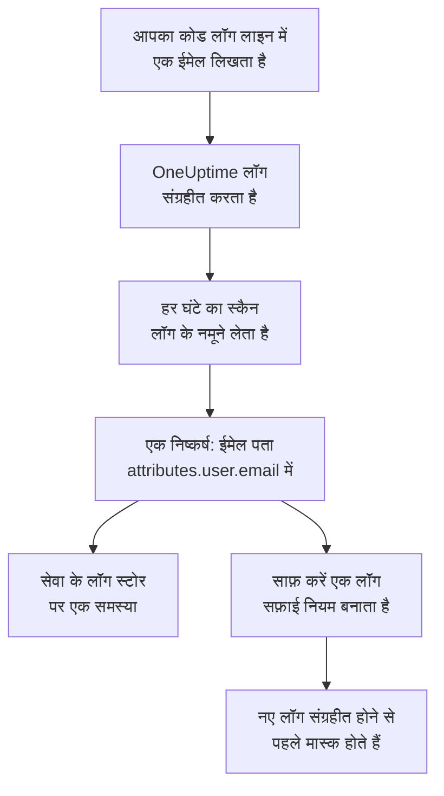

# टेलीमेट्री में संवेदनशील डेटा

टेलीमेट्री में वह सब होता है जो आपका कोड लिखता है: लॉग लाइन में कोई ईमेल पता, स्पैन विशेषता में कोई कार्ड नंबर, स्टैक ट्रेस में कोई टोकन, प्रॉम्प्ट में किसी ग्राहक का सवाल। डेटा सुरक्षा हर सेवा के लॉग, ट्रेस, अपवाद और AI बातचीत को, और हर RUM एप्लिकेशन के सेशन को, अपने आप में अलग डेटा स्टोर मानती है। यह हर घंटे उनके नमूने लेती है, उनमें संवेदनशील डेटा वैसे ही ढूँढती है जैसे किसी बकेट में, और **साफ़ करें** किसी निष्कर्ष को ऐसे सफ़ाई नियम में बदल देता है जो उसके बाद से वह डेटा इन्जेस्ट के समय मास्क करता है।

कुछ भी सेट अप नहीं करना है: हर सेवा की टेलीमेट्री हर घंटे स्कैन होती है, जब तक प्रोजेक्ट की सेटिंग्स में **टेलीमेट्री स्कैन करें** बंद न हो।

:::cards
- [क्या पढ़ा जाता है](#क्या-पढ़ा-जाता-है): हर सिग्नल की विशेषताएँ, बॉडी, संदेश और प्रॉम्प्ट।
- [स्कैन नमूने कैसे लेता है](#स्कैन-नमूने-कैसे-लेता-है): हर सेवा के सबसे नए रिकॉर्ड, हर घंटे।
- [साफ़ करें](#साफ़-करें): एक क्लिक से किसी निष्कर्ष को इन्जेस्ट के समय मास्क करें।
- [किसे साफ़ किया गया माना जाता है](#किसे-साफ़-किया-गया-माना-जाता-है): जब कोई सफ़ाई नियम किसी निष्कर्ष को पहले से कवर करता है।
:::

## यह कैसे काम करता है

जिस निष्कर्ष को कोई सफ़ाई नियम कवर करता है, उसे साफ़ किया गया चिह्नित किया जाता है: उस डेटा का जो हिस्सा बचा है, वह अपनी रिटेंशन अवधि खत्म होने का इंतज़ार करता पुराना डेटा है, अब भी बहता हुआ लीक नहीं। टेलीमेट्री की दो जांचें सिर्फ़ वही गिनती हैं जिसे कोई नियम कवर नहीं करता, इसलिए हर निष्कर्ष साफ़ होते ही उनकी समस्या सुलझ जाती है (देखें [टेलीमेट्री जांचें](/docs/data-security/checks-and-issues#टेलीमेट्री))।

## क्या पढ़ा जाता है

| स्टोर | क्या पढ़ा जाता है | निष्कर्ष कहाँ इशारा करता है |
| --- | --- | --- |
| लॉग | हर विशेषता, और बॉडी | `attributes.<key>`, `body` |
| ट्रेस | हर स्पैन विशेषता, और हर स्पैन इवेंट की विशेषताएँ | `attributes.<key>`, `events.<event>.<key>` |
| अपवाद | संदेश, स्टैक ट्रेस और विशेषताएँ | `message`, `stackTrace`, `attributes.<key>` |
| AI बातचीत | हर AI कॉल के प्रॉम्प्ट और जवाब, उन कुंजियों के नीचे जिनमें GenAI कन्वेंशन उन्हें रखते हैं, और हर दूसरी विशेषता | वह कुंजी जिसमें वे हैं, जैसे `gen_ai.input.messages` या `gen_ai.prompt[].content` |
| सेशन रीप्ले | RUM एप्लिकेशन के स्पैन और लॉग की विशेषताएँ, उसके सेशन की विशेषताएँ, वे ट्रेट जो `identify()` ने उसके उपयोगकर्ताओं को दिए और वह उपयोगकर्ता संदर्भ जो उसे बताया गया | `spans.attributes.<key>`, `logs.attributes.<key>`, `sessions.attributes.<key>`, `sessions.identifiedUserTraits.<key>`, `sessions.identifiedUserLabel` |

क्रमांकित कुंजियाँ एक ही स्थान में समेट दी जाती हैं: `gen_ai.prompt.3.content` को `gen_ai.prompt[].content` माना जाता है, इसलिए किसी चैट के बीस संदेश बीस नहीं, एक निष्कर्ष होते हैं। OneUptime जो विशेषताएँ खुद जोड़ता है, जो `oneuptime.` से शुरू होती हैं, वे नहीं पढ़ी जातीं।

### रीप्ले की रिकॉर्डिंग कभी क्यों नहीं पढ़ी जाती

सेशन रीप्ले की रिकॉर्डिंग में उन पेजों का टेक्स्ट होता है जो लोगों ने देखे। उसे देखने के लिए एक अलग अनुमति चाहिए, और उससे पढ़ा गया निष्कर्ष मास्क किया गया पेज टेक्स्ट हर उस व्यक्ति को दिखाता जो डेटा सुरक्षा पढ़ सकता है। इसलिए रीप्ले सिर्फ़ उसकी विशेषताओं से पढ़ा जाता है: रिकॉर्डिंग के साथ के स्पैन, लॉग और सेशन विवरण। रिकॉर्डर ब्राउज़र में जो रिकॉर्ड करता है, उसे पहले ही मास्क कर देता है, और लॉग सफ़ाई नियम रिकॉर्डिंग पर भी चलते हैं (देखें [सेशन रीप्ले](/docs/telemetry/session-replay))।

### AI बातचीत

AI कॉल के प्रॉम्प्ट में व्यक्ति के सबसे नए संदेश से पहले की पूरी चैट होती है, इसलिए AI कॉल के हर मान के 16,384 अक्षरों तक पढ़े जाते हैं। जब AI बातचीत में संवेदनशील डेटा होता है, तो दो बातें और होती हैं: जिस AI प्रदाता को कॉल गईं, वह उस डेटा का एक प्रवाह है, और स्टोर पर [संवेदनशील डेटा किसी AI प्रदाता को भेजा जा रहा है](/docs/data-security/checks-and-issues#ai) विफल होती है।

किसी [कंपनी AI टूल](/docs/telemetry/ai-company-tools) की बातचीत छोड़ दी जाती है। उसे सिर्फ़ Project Owner और Project Admin पढ़ सकते हैं, और निष्कर्ष वहाँ पहुँचता है जहाँ डेटा सुरक्षा पढ़ने वाला हर व्यक्ति उसे पढ़ता है, इसलिए उन सेवाओं के स्पैन कभी नहीं पढ़े जाते, और उनकी AI बातचीत को नहीं पढ़ी गई बताया जाता है।

## स्कैन नमूने कैसे लेता है

हर घंटे, हर सिग्नल के पिछले घंटे के सबसे नए रिकॉर्ड पढ़े जाते हैं, और किसी भी दूसरे स्टोर की तरह फ़ील्ड-दर-फ़ील्ड वर्गीकृत किए जाते हैं (देखें [फ़ील्ड और कॉलम](/docs/data-security/data-types#फ़ील्ड-और-कॉलम)):

| सीमा | मान |
| --- | --- |
| हर सेवा और सिग्नल के रिकॉर्ड | **टेलीमेट्री नमूना आकार**, डिफ़ॉल्ट रूप से 500, कभी 1,000 से ज़्यादा नहीं |
| हर सिग्नल पर पढ़ी जाने वाली सेवाएं या RUM एप्लिकेशन | सबसे व्यस्त 200 |
| एक रीडिंग में रिकॉर्ड | 5,000, सेवाओं के बीच बँटे हुए; AI कॉल के लिए 500 |
| लॉग बॉडी, अपवाद संदेश या स्टैक ट्रेस के अक्षर | 8,192 |
| किसी विशेषता के मान के अक्षर | 4,096 |
| AI कॉल के किसी मान के अक्षर | 16,384 |
| एक रिकॉर्ड की विशेषताएँ | 128; AI कॉल के लिए 64 |
| एक स्पैन के इवेंट, और एक इवेंट की विशेषताएँ | 16 और 32 |
| एक स्टोर के स्थान | 500 |

हर मान डेटाबेस में ही छोटा कर दिया जाता है, ताकि कोई लंबा मान उससे बाहर न जाए, और हर रीडिंग 30 सेकंड बाद रुक जाती है। जो रीडिंग विफल होती है, वह उन स्टोर पर एक चेतावनी बनती है जिनके लिए वह थी; स्कैन अगली रीडिंग के साथ जारी रहता है।

किसी चीज़ को छोड़ने के लिए, उसे स्टोर के **स्कैन अपवर्जन** में जोड़ें: पूरे नाम वाला कोई स्थान (`attributes.http.url`), किसी स्थान के नीचे का सब कुछ (`attributes.http`), या सिर्फ़ नाम से दी गई विशेषता कुंजी (`http.url`)।

## साफ़ करें

किसी निष्कर्ष पर **साफ़ करें** वह सफ़ाई नियम बनाता है जो उसके बाद से उस स्थान पर उस डेटा प्रकार को छिपाता है, या उस सक्षम नियम की ओर इशारा करता है जो पहले से ऐसा करता है:

:::steps
### निष्कर्ष खोलें

टेलीमेट्री स्टोर खोलें - उदाहरण के लिए, किसी सेवा के **लॉग** - और फिर निष्कर्ष।

### साफ़ करें दबाएँ

**साफ़ करें** पर क्लिक करें। OneUptime रिकॉर्ड के उस हिस्से पर जिसमें निष्कर्ष है, लॉग और RUM एप्लिकेशन के लॉग के लिए एक लॉग सफ़ाई नियम बनाता है, और स्पैन, अपवाद और AI कॉल के लिए एक ट्रेस सफ़ाई नियम।

### कोड भी ठीक करें

नियम नए डेटा को संग्रहीत होने से पहले मास्क करता है। पहले से संग्रहीत डेटा अपनी रिटेंशन अवधि खत्म होने तक रहता है, इसलिए उसे लिखने वाला कोड ठीक करें: निष्कर्ष सेवा और विशेषता का नाम बताता है।
:::

नियम का नाम इस पर रखा जाता है कि वह क्या छिपाता है, जैसे "Data Security: Email address in attributes.user.email", और वह आपके दूसरे सफ़ाई नियमों के साथ सूचीबद्ध होता है (देखें [ड्रॉप फ़िल्टर और सफ़ाई नियम](/docs/telemetry/drop-filters-and-scrub-rules#संवेदनशील-डेटा-स्क्रब-करें))। यह इनमें से एक होता है:

| निष्कर्ष | साफ़ करें से बनने वाला नियम |
| --- | --- |
| ईमेल पता, कार्ड नंबर, अमेरिकी सोशल सिक्योरिटी नंबर, फ़ोन नंबर या IP पता | उस प्रकार का बिल्ट-इन पैटर्न। कार्ड नंबर, सोशल सिक्योरिटी नंबर और फ़ोन नंबर मास्क किए जाते हैं, बाकी रिडैक्ट किए जाते हैं। |
| ऐसी कुंजी के नीचे का मान जो संवेदनशील लगती है, जैसे `password` या `token` | एक **Sensitive Attribute Keys** नियम, जो ऐसी हर विशेषता का पूरा मान रिडैक्ट करता है |
| कोई भी दूसरा डेटा प्रकार जिसे पैटर्न ढूँढ सकता है | डेटा प्रकार के अपने पैटर्न से बना एक **कस्टम Regex** नियम, जो उसके आकार वाला हर मान रिडैक्ट करता है |

कुछ निष्कर्ष किसी नियम से साफ़ नहीं किए जा सकते, और **साफ़ करें** बताता है कि क्यों:

- सिर्फ़ फ़ील्ड नामों से मिलने वाला डेटा प्रकार, जैसे किसी व्यक्ति का नाम: कोई पैटर्न उसे नहीं ढूँढ सकता। विशेषता का नाम बदलकर ऐसी कुंजी रखें जिसे संवेदनशील-कुंजी नियम छिपाता है, या उसे भेजना बंद करें।
- ऐसा डेटा प्रकार जिसे दूसरे मानों से सिर्फ़ उसके आसपास के शब्दों से अलग पहचाना जाता है, जैसे राउटिंग नंबर: नियम उस डेटा प्रकार से कहीं ज़्यादा छिपा देगा।
- दस्तावेज़ की मार्किंग: शब्द छिपाने से दस्तावेज़ नहीं छिपता।
- आपका अपना कोई डेटा प्रकार: उसके पैटर्न के साथ एक कस्टम सफ़ाई नियम खुद जोड़ें।
- किसी सेशन के अपने विवरण (`sessions.*`): सेशन रीप्ले इन्जेस्ट कोई सफ़ाई नियम नहीं चलाता।

**साफ़ करें** नियम आपकी ओर से, आपकी अपनी अनुमतियों के तहत बनाता है: Project Owner और Project Admin इसे दबा सकते हैं, और वह टीम भी जो लॉग सफ़ाई नियम बना सकती है, और स्पैन, अपवाद और AI कॉल के लिए ट्रेस सफ़ाई नियम भी।

## किसे साफ़ किया गया माना जाता है

कोई निष्कर्ष तभी साफ़ किया गया चिह्नित होता है जब इन्जेस्ट उस पर कोई सक्षम नियम चलाए और वह नियम उसका डेटा प्रकार ढूँढ ले:

- **सही रिकॉर्ड।** लॉग नियम लॉग और RUM एप्लिकेशन के लॉग कवर करते हैं। ट्रेस नियम स्पैन, अपवाद और AI कॉल कवर करते हैं: अपवाद अपने स्पैन के exception इवेंट की कॉपी होता है, इसलिए इवेंट साफ़ करने वाले नियम उसे भी साफ़ करते हैं।
- **सही हिस्सा।** नियम के **स्क्रब करने के लिए फ़ील्ड** में रिकॉर्ड का वह हिस्सा शामिल हो जिसमें निष्कर्ष है, या नियम उन्हें उनके डिफ़ॉल्ट पर छोड़ दे।
- **ऐसा पैटर्न जो प्रकार ढूँढे।** बिल्ट-इन **पैटर्न प्रकार** अपना ही डेटा प्रकार ढूँढता है: **ईमेल पता** ईमेल पते ढूँढता है, **क्रेडिट कार्ड नंबर** कार्ड नंबर, **SSN (सोशल सिक्योरिटी नंबर)** अमेरिकी सोशल सिक्योरिटी नंबर, **फ़ोन नंबर** फ़ोन नंबर और **आईपी पता** IP पते। **Sensitive Attribute Keys** संवेदनशील लगने वाली कुंजी के नीचे का हर मान कवर करता है, मान चाहे जो भी हो।
- **आपके अपने कस्टम पैटर्न कभी नहीं गिने जाते।** **कस्टम Regex** किसी निष्कर्ष को तभी कवर करता है जब वह ठीक वही पैटर्न हो जो **साफ़ करें** उसके प्रकार के लिए बनाता है। निष्कर्ष सिर्फ़ मास्क किए गए नमूने रखता है, जिन पर कोई पैटर्न आज़माया नहीं जा सकता, इसलिए OneUptime साबित नहीं कर सकता कि आपका पैटर्न डेटा छिपाता है, और गलती से साफ़ बताया गया निष्कर्ष ऐसा लीक है जिसे कोई नहीं देखता।

जो नियम बंद है, या कुछ भी साफ़ नहीं करता, वह कभी नहीं गिना जाता। कवरेज हर स्कैन के बाद फिर से निकाला जाता है, इसलिए आप हाथ से जो नियम जोड़ते या हटाते हैं, वह एक घंटे के भीतर बदल देता है कि क्या साफ़ किया गया चिह्नित है।

## अगले कदम

:::cards
- [ड्रॉप फ़िल्टर और सफ़ाई नियम](/docs/telemetry/drop-filters-and-scrub-rules): सफ़ाई नियम का हर विकल्प, और वे नियम जो आप खुद लिखते हैं।
- [डेटा सुरक्षा जांचें और समस्याएं](/docs/data-security/checks-and-issues): टेलीमेट्री की दो जांचें और AI जांचें।
- [डेटा प्रवाह, एक्सेस और रेजिडेंसी](/docs/data-security/flows-access-residency): वे AI प्रदाता और होस्ट जिन्हें आपकी सेवाएं डेटा भेजती हैं।
:::
