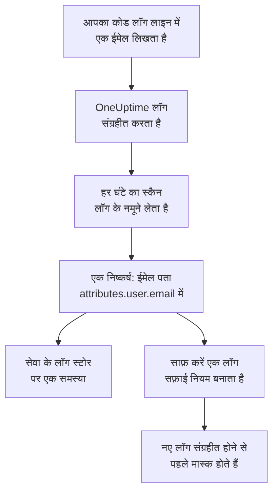

# टेलीमेट्री में संवेदनशील डेटा

टेलीमेट्री में वह सब होता है जो आपका कोड लिखता है: लॉग लाइन में कोई ईमेल पता, स्पैन विशेषता में कोई कार्ड नंबर, स्टैक ट्रेस में कोई टोकन, प्रॉम्प्ट में किसी ग्राहक का सवाल, किसी मेट्रिक के लेबल में किसी उपयोगकर्ता का IP पता। डेटा सुरक्षा हर सेवा के लॉग, ट्रेस, मेट्रिक्स, अपवाद और AI बातचीत को, और हर RUM एप्लिकेशन के सेशन को, अपने आप में अलग डेटा स्टोर मानती है। यह हर घंटे उनके नमूने लेती है, उनमें संवेदनशील डेटा वैसे ही ढूँढती है जैसे किसी बकेट में, और **साफ़ करें** किसी निष्कर्ष को ऐसे नियम में बदल देता है जो उसके बाद से, जिस सेवा में डेटा मिला उसी में, वह डेटा इन्जेस्ट के समय छिपाता है।

कुछ भी सेट अप नहीं करना है: हर सेवा की टेलीमेट्री हर घंटे स्कैन होती है, जब तक प्रोजेक्ट की सेटिंग्स में **टेलीमेट्री स्कैन करें** बंद न हो। किसी एक सेवा के लॉग, ट्रेस या कोई दूसरा सिग्नल छोड़ने के लिए, उस स्टोर की **सेटिंग्स** में **सामग्री स्कैन करें** बंद करें: अगले स्कैन से उसका कुछ भी नहीं पढ़ा जाता।

:::cards
- [क्या पढ़ा जाता है](#क्या-पढ़ा-जाता-है): हर सिग्नल की विशेषताएँ, बॉडी, संदेश और प्रॉम्प्ट।
- [स्कैन नमूने कैसे लेता है](#स्कैन-नमूने-कैसे-लेता-है): हर सेवा के सबसे नए रिकॉर्ड, हर घंटे।
- [साफ़ करें](#साफ़-करें): किसी निष्कर्ष को, जिस सेवा में वह मिला उसी में, इन्जेस्ट के समय छिपाएँ।
- [यह मेट्रिक ड्रॉप करें](#यह-मेट्रिक-ड्रॉप-करें): उन मेट्रिक्स को संग्रहीत करना बंद करें जिनके नाम में संवेदनशील डेटा है।
- [किसे साफ़ किया गया माना जाता है](#किसे-साफ़-किया-गया-माना-जाता-है): जब कोई सफ़ाई नियम किसी निष्कर्ष को पहले से कवर करता है।
:::

## यह कैसे काम करता है

जिस निष्कर्ष को कोई सफ़ाई नियम कवर करता है, उसे साफ़ किया गया चिह्नित किया जाता है: उस डेटा का जो हिस्सा बचा है, वह अपनी रिटेंशन अवधि खत्म होने का इंतज़ार करता पुराना डेटा है, अब भी बहता हुआ लीक नहीं। टेलीमेट्री की दो जांचें सिर्फ़ वही गिनती हैं जिसे कोई नियम कवर नहीं करता, इसलिए हर निष्कर्ष साफ़ होते ही उनकी समस्या सुलझ जाती है (देखें [टेलीमेट्री जांचें](/docs/data-security/checks-and-issues#टेलीमेट्री))।

## क्या पढ़ा जाता है

| स्टोर | क्या पढ़ा जाता है | निष्कर्ष कहाँ इशारा करता है |
| --- | --- | --- |
| लॉग | हर विशेषता, और बॉडी | `attributes.<key>`, `body` |
| ट्रेस | हर स्पैन विशेषता, और हर स्पैन इवेंट की विशेषताएँ | `attributes.<key>`, `events.<event>.<key>` |
| अपवाद | संदेश, स्टैक ट्रेस और विशेषताएँ | `message`, `stackTrace`, `attributes.<key>` |
| AI बातचीत | हर AI कॉल के प्रॉम्प्ट और जवाब, उन कुंजियों के नीचे जिनमें GenAI कन्वेंशन उन्हें रखते हैं, और हर दूसरी विशेषता | वह कुंजी जिसमें वे हैं, जैसे `gen_ai.input.messages` या `gen_ai.prompt[].content` |
| सेशन रीप्ले | RUM एप्लिकेशन के स्पैन और लॉग की विशेषताएँ, उसके सेशन की विशेषताएँ, वे ट्रेट जो `identify()` ने उसके उपयोगकर्ताओं को दिए और वह उपयोगकर्ता संदर्भ जो उसे बताया गया | `spans.attributes.<key>`, `logs.attributes.<key>`, `sessions.attributes.<key>`, `sessions.identifiedUserTraits.<key>`, `sessions.identifiedUserLabel` |
| मेट्रिक्स | किसी डेटा पॉइंट की हर विशेषता, उसके रिसोर्स की विशेषताएँ भी, और मेट्रिक्स के नाम | `attributes.<key>`, `attributes.resource.<key>`, `name` |

क्रमांकित कुंजियाँ एक ही स्थान में समेट दी जाती हैं: `gen_ai.prompt.3.content` को `gen_ai.prompt[].content` माना जाता है, इसलिए किसी चैट के बीस संदेश बीस नहीं, एक निष्कर्ष होते हैं। OneUptime जो विशेषताएँ खुद जोड़ता है, जो `oneuptime.` से शुरू होती हैं, वे नहीं पढ़ी जातीं।

### मेट्रिक्स

किसी मेट्रिक की विशेषताएँ उसकी सीरीज़ के लेबल हैं। वे किसी सीरीज़ के हर डेटा पॉइंट पर एक जैसी होती हैं, इसलिए जो मेट्रिक एक मिनट में एक हज़ार पॉइंट लिखता है, उसमें शायद तीन ही मान हों, और जो लेबल किसी उपयोगकर्ता का ईमेल लीक करता है, वह एक पॉइंट नहीं, एक सीरीज़ जोड़ता है। इसलिए किसी मेट्रिक के नमूने उसकी सीरीज़ के हिसाब से लिए जाते हैं, उसके पॉइंट के हिसाब से नहीं:

- **हर सीरीज़ का एक पॉइंट।** हर मेट्रिक को उस सबसे नए मिनट पर पढ़ा जाता है जो उसने पिछले घंटे में लिखा: उस मिनट की अधिकतम 100 सीरीज़ में से हर एक का एक डेटा पॉइंट, चाहे मेट्रिक कितनी भी बार भेजा जाए, ताकि कोई व्यस्त सीरीज़ किसी शांत सीरीज़ को कभी बाहर न करे। कोई मान एक बार ही वर्गीकृत होता है, चाहे कितनी भी सीरीज़ उसे दोहराएं, इसलिए एक निष्कर्ष अपनी जगह पर अलग-अलग मानों को गिनता है।
- **नए मेट्रिक पहले, फिर बाकी बारी-बारी से।** किसी सेवा ने कौन-से मेट्रिक लिखे, और हर एक ने पिछले एक दिन में पहली बार कब लिखा, यह उस प्रति-मिनट रोलअप से पता चलता है जो मेट्रिक्स टेबल रखती है, कभी उसके पॉइंट से नहीं। हर स्कैन किसी सेवा के सबसे व्यस्त मेट्रिक पढ़ता है, जिनकी कई सीरीज़ होने की संभावना सबसे ज़्यादा है। फिर वे मेट्रिक आते हैं जिन्हें उसने पिछले 2 घंटों में लिखना शुरू किया, क्योंकि नया लीक आमतौर पर नए कोड से आता है, और फिर उसके बाकी मेट्रिक में से अगले, एक तय क्रम में, वहां से जहां पिछला स्कैन रुका था। नए मेट्रिक इन बारियों में से अधिकतम आधी लेते हैं, ताकि बाकी मेट्रिक की बारी हमेशा बनी रहे।
- **हर मेट्रिक एक तय समय के भीतर।** एक स्कैन हर सेवा को अपनी रीड में से 10 देता है, और प्रोजेक्ट में 10 से ज़्यादा सेवाएँ हों तो कम। कोई सेवा कम मेट्रिक होने के कारण जो रीड इस्तेमाल नहीं करती, वे एक-एक करके उन सेवाओं को जाती हैं जिनके मेट्रिक अब भी अपनी बारी का इंतज़ार कर रहे हैं, ताकि कोई रीड बेकार न जाए और किसी सेवा को उसके हिस्से से कम न मिले। सेवा के 5 सबसे व्यस्त मेट्रिक उसकी 5 रीड लेते हैं, और बाकी रीड उसके दूसरे मेट्रिक बारी-बारी से पढ़ती हैं: M मेट्रिक वाली जिस सेवा को बारी-बारी से r रीड मिलती हैं, उसके हर मेट्रिक को कम से कम हर M ÷ r घंटे में एक बार पढ़ा जाता है, ऊपर की ओर पूर्णांकित। 300 मेट्रिक वाली सेवा को सिर्फ़ अपनी 5 मिलें तो यह 60 घंटे है, और जब 300 मेट्रिक वाली दो और सेवाएँ उसका प्रोजेक्ट साझा करती हैं तो 11 घंटे, क्योंकि तब हर एक को 28 या 29 मिलती हैं। जब तक वह हर घंटे नए मेट्रिक शुरू करती रहती है, यह अधिकतम उसका दोगुना होता है।
- **हर मेट्रिक की अपनी रेंज।** मेट्रिक एक साथ पढ़े जाते हैं, हर एक टेबल की प्राइमरी कुंजी की अपनी रेंज से। जिस मेट्रिक के सबसे नए मिनट में 16,384 से ज़्यादा पॉइंट हों, जैसे वह जिस पर हर उपयोगकर्ता के ईमेल का लेबल लगा हो, उसे अलग से पढ़ा जाता है, और रीडिंग उसके पहले पॉइंट पर रुक जाती है, इसलिए उसकी लागत किसी दूसरे मेट्रिक से ज़्यादा नहीं होती।

निष्कर्ष विशेषता का नाम बताता है, जैसे `attributes.user.email`, या किसी मेट्रिक के नाम में मौजूद डेटा के लिए `name`। उसके रिकॉर्ड वे डेटा पॉइंट हैं जिनमें वह मिला: हर रिकॉर्ड अपना मेट्रिक और विशेषता का मान, मास्क किया हुआ, दिखाता है, और **मेट्रिक्स** में उस मेट्रिक पर, उस विशेषता के अनुसार समूहित, खुलता है। जहां किसी मेट्रिक के नाम में संवेदनशील डेटा हो, वहां नाम भी मास्क किया जाता है, और रिकॉर्ड इसके बजाय सेवा के मेट्रिक्स खोलता है।

### रीप्ले की रिकॉर्डिंग कभी क्यों नहीं पढ़ी जाती

सेशन रीप्ले की रिकॉर्डिंग में उन पेजों का टेक्स्ट होता है जो लोगों ने देखे। उसे देखने के लिए एक अलग अनुमति चाहिए, और उससे पढ़ा गया निष्कर्ष मास्क किया गया पेज टेक्स्ट हर उस व्यक्ति को दिखाता जो डेटा सुरक्षा पढ़ सकता है। इसलिए रीप्ले सिर्फ़ उसकी विशेषताओं से पढ़ा जाता है: रिकॉर्डिंग के साथ के स्पैन, लॉग और सेशन विवरण। रिकॉर्डर ब्राउज़र में जो रिकॉर्ड करता है, उसे पहले ही मास्क कर देता है, और लॉग सफ़ाई नियम रिकॉर्डिंग पर भी चलते हैं (देखें [सेशन रीप्ले](/docs/telemetry/session-replay))।

### AI बातचीत

AI कॉल के प्रॉम्प्ट में व्यक्ति के सबसे नए संदेश से पहले की पूरी चैट होती है, इसलिए AI कॉल के हर मान के 16,384 अक्षरों तक पढ़े जाते हैं। जब AI बातचीत में संवेदनशील डेटा होता है, तो दो बातें और होती हैं: जिस AI प्रदाता को कॉल गईं, वह उस डेटा का एक प्रवाह है, और स्टोर पर [संवेदनशील डेटा किसी AI प्रदाता को भेजा जा रहा है](/docs/data-security/checks-and-issues#ai) विफल होती है।

किसी [कंपनी AI टूल](/docs/telemetry/ai-company-tools) की बातचीत छोड़ दी जाती है। उसे सिर्फ़ प्रोजेक्ट स्वामी और प्रोजेक्ट एडमिन पढ़ सकते हैं, और निष्कर्ष वहाँ पहुँचता है जहाँ डेटा सुरक्षा पढ़ने वाला हर व्यक्ति उसे पढ़ता है, इसलिए उन सेवाओं के स्पैन कभी नहीं पढ़े जाते, और उनकी AI बातचीत को नहीं पढ़ी गई बताया जाता है।

## स्कैन नमूने कैसे लेता है

हर घंटे, हर सिग्नल के पिछले घंटे के सबसे नए रिकॉर्ड पढ़े जाते हैं, और किसी भी दूसरे स्टोर की तरह फ़ील्ड-दर-फ़ील्ड वर्गीकृत किए जाते हैं (देखें [फ़ील्ड और कॉलम](/docs/data-security/data-types#फ़ील्ड-और-कॉलम)):

| सीमा | मान |
| --- | --- |
| हर सेवा और सिग्नल के रिकॉर्ड | **टेलीमेट्री नमूना आकार**, डिफ़ॉल्ट रूप से 500, कभी 1,000 से ज़्यादा नहीं |
| हर सिग्नल पर पढ़ी जाने वाली सेवाएं या RUM एप्लिकेशन | सबसे व्यस्त 200 |
| एक रीडिंग में रिकॉर्ड | 5,000, सेवाओं के बीच बँटे हुए; AI कॉल के लिए 500 |
| लॉग बॉडी, अपवाद संदेश या स्टैक ट्रेस के अक्षर | 8,192 |
| किसी विशेषता के मान के अक्षर | 4,096 |
| AI कॉल के किसी मान के अक्षर | 16,384 |
| एक रिकॉर्ड की विशेषताएँ | 128; AI कॉल के लिए 64 |
| एक स्पैन के इवेंट, और एक इवेंट की विशेषताएँ | 16 और 32 |
| एक स्टोर के स्थान | 500 |
| एक स्कैन में पढ़े जाने वाले मेट्रिक | 100, सेवाओं के बीच बँटे हुए, हर सेवा का कम से कम एक; हर सेवा के 10, आधे उसके सबसे व्यस्त और आधे उसके नए और दूसरे, बारी-बारी से, और जो रीड कोई सेवा इस्तेमाल नहीं करती वे बारी-बारी से दूसरों को जाती हैं |
| नया मेट्रिक | वह मेट्रिक जिसका पिछले 24 घंटों का पहला पॉइंट पिछले 2 घंटों में आया |
| एक मेट्रिक की सीरीज़ | उसके सबसे नए मिनट की हर सीरीज़ का एक डेटा पॉइंट, अधिकतम 100 |

हर मान डेटाबेस में ही छोटा कर दिया जाता है, ताकि कोई लंबा मान उससे बाहर न जाए, और हर रीडिंग 30 सेकंड बाद रुक जाती है। जो रीडिंग विफल होती है, वह उन स्टोर पर एक चेतावनी बनती है जिनके लिए वह थी; स्कैन अगली रीडिंग के साथ जारी रहता है।

किसी चीज़ को छोड़ने के लिए, उसे स्टोर के **स्कैन अपवर्जन** में जोड़ें: पूरे नाम वाला कोई स्थान (`attributes.http.url`), किसी स्थान के नीचे का सब कुछ (`attributes.http`), या सिर्फ़ नाम से दी गई विशेषता कुंजी (`http.url`)।

## साफ़ करें

किसी निष्कर्ष पर **साफ़ करें** वह नियम बनाता है जो उसके बाद से उस स्थान पर उस डेटा प्रकार को छिपाता है, या उस सक्षम नियम की ओर इशारा करता है जो पहले से ऐसा करता है:

:::steps
### निष्कर्ष खोलें

समस्या खोलें - **यह कहां मिला** उसके पीछे का हर निष्कर्ष दिखाता है - या **डेटा सुरक्षा > आपकी टेलीमेट्री में**, जहां **रिकॉर्ड दिखाएं** वे रिकॉर्ड सूची के बगल में खोलता है जिनमें कोई निष्कर्ष मिला।

### साफ़ करें दबाएँ

**साफ़ करें** पर क्लिक करें। कुछ भी बनने से पहले एक डायलॉग बताता है कि नियम क्या करेगा: वह किसके रिकॉर्ड बदलेगा, जो मिलेगा उसका क्या करेगा, और जिन मानों को वह छिपाएगा उन्हें क्या पढ़ता है। नियम बनाने के लिए उसमें **साफ़ करें** पर क्लिक करें। OneUptime रिकॉर्ड के उस हिस्से पर जिसमें निष्कर्ष है, लॉग और RUM एप्लिकेशन के लॉग के लिए एक लॉग सफ़ाई नियम बनाता है, स्पैन, अपवाद और AI कॉल के लिए एक ट्रेस सफ़ाई नियम, और किसी मेट्रिक की विशेषता के लिए एक मेट्रिक पाइपलाइन नियम।

### कोड भी ठीक करें

नियम नए डेटा को संग्रहीत होने से पहले छिपाता है। पहले से संग्रहीत डेटा अपनी रिटेंशन अवधि खत्म होने तक रहता है, इसलिए उसे लिखने वाला कोड ठीक करें: निष्कर्ष सेवा और विशेषता का नाम बताता है।
:::

नियम का नाम इस पर रखा जाता है कि वह क्या छिपाता है, जैसे "Data Security: Email address in log attributes of checkout", और वह आपके दूसरे सफ़ाई नियमों के साथ सूचीबद्ध होता है (देखें [ड्रॉप फ़िल्टर और सफ़ाई नियम](/docs/telemetry/drop-filters-and-scrub-rules#संवेदनशील-डेटा-स्क्रब-करें))। यह इनमें से एक होता है:

| निष्कर्ष | साफ़ करें से बनने वाला नियम |
| --- | --- |
| ईमेल पता, कार्ड नंबर, अमेरिकी सोशल सिक्योरिटी नंबर, फ़ोन नंबर या IP पता | उस प्रकार का बिल्ट-इन पैटर्न। कार्ड नंबर, सोशल सिक्योरिटी नंबर और फ़ोन नंबर मास्क किए जाते हैं, बाकी रिडैक्ट किए जाते हैं। |
| ऐसी कुंजी के नीचे का मान जो संवेदनशील लगती है, जैसे `password` या `token` | एक **संवेदनशील विशेषता कुंजियाँ** नियम, जो ऐसी हर विशेषता का पूरा मान रिडैक्ट करता है |
| कोई भी दूसरा डेटा प्रकार जिसे पैटर्न ढूँढ सकता है | डेटा प्रकार के अपने पैटर्न से बना एक **कस्टम Regex** नियम, जो उसके आकार वाला हर मान रिडैक्ट करता है |
| किसी मेट्रिक की विशेषता में कोई भी डेटा प्रकार | सेवा के लिए एक **विशेषता छिपाएं** मेट्रिक पाइपलाइन नियम, जो विशेषता के उन मानों को `[REDACTED]` से बदलता है जो डेटा प्रकार के आकार के हैं, या जहां कोई पैटर्न डेटा प्रकार नहीं ढूँढता, वहां विशेषता के हर मान को |

लॉग या ट्रेस का नियम उस सेवा के लिए होता है जिसमें निष्कर्ष मिला: वह उसी सेवा के लॉग या स्पैन साफ़ करता है, और दूसरी सेवाओं के जैसे हैं वैसे ही रहते हैं, इसलिए उन्हें पढ़ने वाला कुछ भी नहीं बदलता। सफ़ाई नियमों की सूची का **दायरा** कॉलम बताता है कि कोई नियम किस सेवा के लिए है। किसी RUM ऐप्लिकेशन के सेशन रीप्ले में मिला निष्कर्ष प्रोजेक्ट की हर सेवा और ऐप के लिए नियम बनाता है, क्योंकि लॉग के नियम रीप्ले भी साफ़ करते हैं, और डायलॉग यह बताता है। अगर सेवा अब मौजूद नहीं है, तो **साफ़ करें** यह बताता है और कोई नियम नहीं बनाता।

डायलॉग उन मॉनिटर, विजेट वाले डैशबोर्ड, सहेजे गए व्यू, रिकॉर्डिंग नियमों और SLO के नाम, हर एक को लिंक के रूप में, बताता है जो उन मानों को पढ़ते हैं जिन्हें नियम छिपाएगा, और यह भी कि उनके साथ क्या होगा: छिपे मान पर लगा फ़िल्टर मेल खाना बंद कर देता है, और उसके अनुसार बने समूह असली मान नहीं दिखाते। वह यह भी बताता है कि उन रिकॉर्ड को पढ़ने वाले [सुरक्षा इवेंट](/docs/telemetry/security-events) क्या खोएँगे: IP पते छिपे होने पर उनके इवेंट ब्लॉक करने वाला पता नहीं बता सकते। जो आप नहीं देख सकते, उसकी गिनती होती है, नाम कभी नहीं बताया जाता। डायलॉग नियम को कभी नहीं रोकता: वह बताता है, और फ़ैसला आप करते हैं। सफ़ाई नियमों के फ़ॉर्म भी नियम सहेजने या चालू करने से पहले यही दिखाते हैं।

कुछ निष्कर्ष किसी नियम से साफ़ नहीं किए जा सकते, और **साफ़ करें** बताता है कि क्यों। किसी मेट्रिक की विशेषता हमेशा साफ़ की जा सकती है, क्योंकि उसका नियम विशेषता का हर मान छिपा सकता है:

- सिर्फ़ फ़ील्ड नामों से मिलने वाला डेटा प्रकार, जैसे किसी व्यक्ति का नाम: कोई पैटर्न उसे नहीं ढूँढ सकता। विशेषता का नाम बदलकर ऐसी कुंजी रखें जिसे संवेदनशील-कुंजी नियम छिपाता है, या उसे भेजना बंद करें।
- ऐसा डेटा प्रकार जिसे दूसरे मानों से सिर्फ़ उसके आसपास के शब्दों से अलग पहचाना जाता है, जैसे राउटिंग नंबर: नियम उस डेटा प्रकार से कहीं ज़्यादा छिपा देगा।
- दस्तावेज़ की मार्किंग: शब्द छिपाने से दस्तावेज़ नहीं छिपता।
- आपका अपना कोई डेटा प्रकार: उसके पैटर्न के साथ एक कस्टम सफ़ाई नियम खुद जोड़ें।
- किसी सेशन के अपने विवरण (`sessions.*`): सेशन रीप्ले इन्जेस्ट कोई सफ़ाई नियम नहीं चलाता।
- किसी मेट्रिक का नाम (`name`): उसे वह कोड तय करता है जो मेट्रिक बनाता है, और पाइपलाइन नियम किसी मेट्रिक का नाम सिर्फ़ पूरा का पूरा बदल सकता है। मेट्रिक का नाम बदलें, और उसके नाम में जो बदलता है, उसे इसके बजाय एक विशेषता के रूप में भेजें। तब तक, **यह मेट्रिक ड्रॉप करें** उन मेट्रिक्स को संग्रहीत करना बंद कर सकता है।

**साफ़ करें** नियम आपकी ओर से, आपकी अपनी अनुमतियों के तहत बनाता है: प्रोजेक्ट स्वामी और प्रोजेक्ट एडमिन इसे दबा सकते हैं, और वह टीम भी जो लॉग सफ़ाई नियम बना सकती है, स्पैन, अपवाद और AI कॉल के लिए ट्रेस सफ़ाई नियम, और मेट्रिक्स के लिए मेट्रिक पाइपलाइन नियम भी।

## यह मेट्रिक ड्रॉप करें

कोई नियम किसी मेट्रिक के नाम से डेटा नहीं हटा सकता, इसलिए जब तक मेट्रिक का नाम रखने वाला कोड ठीक नहीं होता, डेटा आता रहता है। किसी मेट्रिक के नाम में मिले निष्कर्ष पर **यह मेट्रिक ड्रॉप करें** उन मेट्रिक्स को संग्रहीत करना बंद कर देता है जिनके नाम में वह डेटा है, उनके डेटा की कीमत पर, इसलिए यह तभी होता है जब आप इसे कहते हैं:

- **एक सेवा के मेट्रिक्स।** यह निष्कर्ष की सेवा के लिए एक **ड्रॉप करें** मेट्रिक पाइपलाइन नियम बनाता है: जिस मेट्रिक के नाम में वह डेटा प्रकार है, उसका हर नया डेटा पॉइंट संग्रहीत होने से पहले ड्रॉप कर दिया जाता है। इसका फ़िल्टर वही पैटर्न है जो **साफ़ करें** उस प्रकार के लिए इस्तेमाल करता है, इसलिए जिस प्रकार को कोई पैटर्न नहीं ढूंढ सकता, जैसे किसी व्यक्ति का नाम, उसे ड्रॉप नहीं किया जा सकता, और डायलॉग कारण बताता है।
- **करने से पहले बताया जाता है।** डायलॉग बताता है कि वे डेटा पॉइंट हमेशा के लिए खो जाते हैं, पिछले एक दिन में लिखे गए सेवा के कितने मेट्रिक्स का नाम ऐसा है, उन्हें क्या पढ़ता है और इसलिए उसे नया डेटा नहीं मिलता, कि जो पहले से संग्रहीत है वह उसकी रिटेंशन अवधि खत्म होने तक रहता है, और इसे कैसे पलटें। जब तक आप यह नहीं चुनते कि आप समझते हैं, कुछ भी ड्रॉप नहीं होता।
- **उन्हें क्या पढ़ता है, और उसका क्या होता है।** डायलॉग हर मॉनिटर, उन मेट्रिक्स को पढ़ने वाले विजेट के साथ हर डैशबोर्ड, सेवा का हर मेट्रिक SLO और उन्हें पढ़ने वाला हर मेट्रिक रिकॉर्डिंग नियम, हर एक को लिंक के रूप में, नाम से बताता है। मॉनिटर अब उनके मानों पर अलर्ट नहीं दे सकते, विजेट कोई नया डेटा नहीं दिखाते, SLO उनसे नए इवेंट नहीं गिनते, और रिकॉर्डिंग नियमों के आउटपुट मेट्रिक में वे अब शामिल नहीं होते। हर रिकॉर्डिंग नियम के नीचे, यह यह भी बताता है कि उस नियम के आउटपुट मेट्रिक को क्या पढ़ता है, और फिर उनके आउटपुट मेट्रिक को क्या पढ़ता है, श्रृंखला में तीन आउटपुट मेट्रिक तक। किसी विजेट का लिंक उसके डैशबोर्ड को उसी विजेट पर खोलता है। जो आप नहीं देख सकते, उसे गिना जाता है, पर उसका नाम कभी नहीं बताया जाता।
- **आपकी ओर से, रिकॉर्ड के साथ।** नियम मेट्रिक पाइपलाइन नियम बनाने की आपकी अपनी अनुमति से बनाया जाता है: प्रोजेक्ट स्वामी और प्रोजेक्ट एडमिन इसे बना सकते हैं, और वह टीम भी जो मेट्रिक पाइपलाइन नियम बना सकती है। ऑडिट लॉग दर्ज करता है कि इसे किसने बनाया।
- **नियम हटाकर पलटा जा सकता है।** नियम का नाम उस पर रखा जाता है जिसे वह ड्रॉप करता है, जैसे "Data Security: drop metrics named with Email address", और यह आपके दूसरे मेट्रिक पाइपलाइन नियमों के साथ **मेट्रिक्स → सेटिंग्स → पाइपलाइन नियम** में दिखता है। इसे हटाएं या बंद करें, और तब से वे मेट्रिक्स फिर से संग्रहीत होते हैं। इस बीच जो ड्रॉप हुआ, वह वापस नहीं आता।

इसके बाद निष्कर्ष पर **छोड़े गए** का चिह्न लगता है, और वह साफ़ किया गया माना जाता है: उस डेटा का कुछ भी और संग्रहीत नहीं होता।

## किसे साफ़ किया गया माना जाता है

कोई निष्कर्ष तभी साफ़ किया गया चिह्नित होता है जब इन्जेस्ट उस पर कोई सक्षम नियम चलाए और वह नियम उसका डेटा प्रकार ढूँढ ले:

- **सही रिकॉर्ड।** लॉग नियम लॉग और RUM एप्लिकेशन के लॉग कवर करते हैं। ट्रेस नियम स्पैन, अपवाद और AI कॉल कवर करते हैं: अपवाद अपने स्पैन के exception इवेंट की कॉपी होता है, इसलिए इवेंट साफ़ करने वाले नियम उसे भी साफ़ करते हैं।
- **सही हिस्सा।** नियम के **स्क्रब करने के लिए फ़ील्ड** में रिकॉर्ड का वह हिस्सा शामिल हो जिसमें निष्कर्ष है, या नियम उन्हें उनके डिफ़ॉल्ट पर छोड़ दे।
- **सही सेवा।** एक सेवा के लिए बना लॉग या ट्रेस का नियम केवल उसी सेवा के निष्कर्षों को कवर करता है। बिना सेवा वाला नियम हर सेवा के निष्कर्षों को कवर करता है।
- **ऐसा पैटर्न जो प्रकार ढूँढे।** बिल्ट-इन **पैटर्न प्रकार** अपना ही डेटा प्रकार ढूँढता है: **ईमेल पता** ईमेल पते ढूँढता है, **क्रेडिट कार्ड नंबर** कार्ड नंबर, **SSN (सोशल सिक्योरिटी नंबर)** अमेरिकी सोशल सिक्योरिटी नंबर, **फ़ोन नंबर** फ़ोन नंबर और **आईपी पता** IP पते। **संवेदनशील विशेषता कुंजियाँ** संवेदनशील लगने वाली कुंजी के नीचे का हर मान कवर करता है, मान चाहे जो भी हो।
- **आपके अपने कस्टम पैटर्न कभी नहीं गिने जाते।** **कस्टम Regex** किसी निष्कर्ष को तभी कवर करता है जब वह ठीक वही पैटर्न हो जो **साफ़ करें** उसके प्रकार के लिए बनाता है। निष्कर्ष सिर्फ़ मास्क किए गए नमूने रखता है, जिन पर कोई पैटर्न आज़माया नहीं जा सकता, इसलिए OneUptime साबित नहीं कर सकता कि आपका पैटर्न डेटा छिपाता है, और गलती से साफ़ बताया गया निष्कर्ष ऐसा लीक है जिसे कोई नहीं देखता।
- **किसी मेट्रिक की विशेषता।** उस विशेषता की कुंजी का **विशेषता छिपाएं** या **विशेषता हटाएं** मेट्रिक पाइपलाइन नियम, निष्कर्ष की सेवा के लिए हो या पूरे प्रोजेक्ट के लिए, उसे तब कवर करता है जब उसमें कोई फ़िल्टर न हो, या ठीक वही फ़िल्टर हो जो **साफ़ करें** बनाता है। आपका लिखा फ़िल्टर इसी कारण से कभी नहीं गिना जाता।
- **किसी मेट्रिक का नाम।** निष्कर्ष की सेवा या पूरे प्रोजेक्ट के लिए एक **ड्रॉप करें** मेट्रिक पाइपलाइन नियम उसे तब कवर करता है जब उसमें ठीक वही फ़िल्टर हो जो **यह मेट्रिक ड्रॉप करें** बनाता है, या कोई फ़िल्टर न हो, जिस स्थिति में वह सेवा का कोई भी मेट्रिक संग्रहीत नहीं करता। बिना फ़िल्टर वाला ऐसा नियम उन मेट्रिक्स के हर निष्कर्ष को कवर करता है।

जो नियम बंद है, या कुछ भी साफ़ नहीं करता, वह कभी नहीं गिना जाता। कवरेज हर स्कैन के बाद फिर से निकाला जाता है, इसलिए आप हाथ से जो नियम जोड़ते या हटाते हैं, वह एक घंटे के भीतर बदल देता है कि क्या साफ़ किया गया चिह्नित है।

## अगले कदम

:::cards
- [ड्रॉप फ़िल्टर और सफ़ाई नियम](/docs/telemetry/drop-filters-and-scrub-rules): सफ़ाई नियम का हर विकल्प, और वे नियम जो आप खुद लिखते हैं।
- [डेटा सुरक्षा जांचें और समस्याएं](/docs/data-security/checks-and-issues): टेलीमेट्री की दो जांचें और AI जांचें।
- [डेटा प्रवाह, एक्सेस और रेजिडेंसी](/docs/data-security/flows-access-residency): वे AI प्रदाता और होस्ट जिन्हें आपकी सेवाएं डेटा भेजती हैं।
:::
