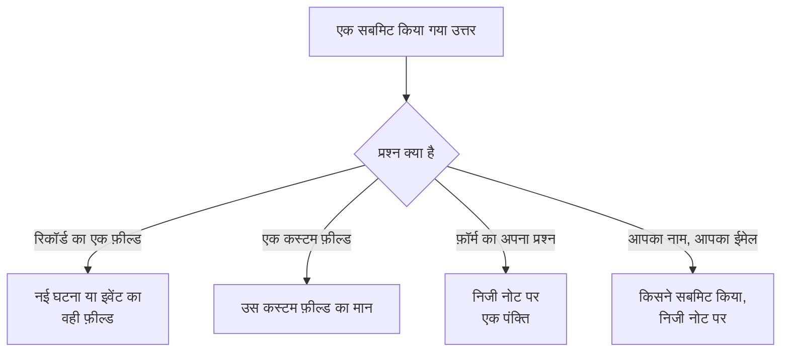

# फ़ॉर्म बनाना

फ़ॉर्म का **बनाएँ** पेज वह जगह है जहाँ आप तय करते हैं कि वह क्या पूछता है, और उसका पेज कैसा दिखता है। प्रश्न बाईं ओर हैं, उसी क्रम में जिसमें सार्वजनिक पेज उन्हें दिखाता है; दाईं ओर **प्रश्न जोड़ें** वह सब कुछ सूचीबद्ध करता है जो आप जोड़ सकते हैं। प्रश्नों के ऊपर, सिमटी हुई, फ़ॉर्म की [ब्रांडिंग](#ब्रांडिंग) है: उसका लोगो और फ़ेविकॉन। उत्तरों के नामित सेट, जिनसे लोग फ़ॉर्म शुरू कर सकते हैं — जिनमें से हर एक अपने मामले के लिए किसी प्रश्न को आवश्यक, वैकल्पिक या छिपा भी बना सकता है — उसके **टेम्पलेट** पेज पर हैं: [टेम्पलेट](#टेम्पलेट) देखें।

:::cards
- [बिल्डर](#बिल्डर): प्रश्न जोड़ें, संपादित करें, खिसकाएं और सहेजें।
- [आप क्या जोड़ सकते हैं](#आप-क्या-जोड़-सकते-हैं): आपके अपने प्रश्न, रिकॉर्ड के फ़ील्ड, कस्टम फ़ील्ड और सबमिट करने वाला।
- [छिपे प्रश्न](#छिपे-प्रश्न): इनका उत्तर टेम्पलेट देता है, सबमिट करने वाला व्यक्ति कभी नहीं।
- [टेम्पलेट](#टेम्पलेट): आपकी टीम जो भी मामले अक्सर रिपोर्ट करती है, उन सबके लिए एक फ़ॉर्म और एक लिंक।
:::

## हर उत्तर कहाँ जाता है

हर उत्तर सबमिशन के साथ भी, फ़ॉर्म के **सबमिशन** पेज पर, रखा जाता है। जो फ़ील्ड फ़ॉर्म नहीं पूछता, या जो खाली छोड़ा जाता है, वह फ़ॉर्म की [सबमिट करने पर सेटिंग्स](/docs/forms/on-submit) से भरा जाता है।

## बिल्डर

:::steps
### एक प्रश्न जोड़ें

**प्रश्न जोड़ें** में चुनें कि क्या जोड़ना है। नया प्रश्न चुने हुए प्रश्न के बाद, या अंत में, डाला जाता है और चुना हुआ रहता है।

### उसे वहीं संपादित करें

किसी कार्ड को संपादित करने के लिए उसे चुनें: उसका प्रश्न, सहायता टेक्स्ट, उत्तर का प्रकार और विकल्प, वह आवश्यक है या छिपा, और उसे डुप्लिकेट करने या हटाने के बटन। **हो गया** उसे बंद करता है।

### उसे उसकी जगह पर रखें

किसी कार्ड को खिसकाने के लिए उसे उसके हैंडल से ड्रैग करें, या चुने हुए कार्ड पर **ऊपर ले जाएँ** और **नीचे ले जाएँ** का उपयोग करें — फ़ोन पर, या कीबोर्ड से।

### फ़ॉर्म सहेजें

**परिवर्तन सहेजें** हर बदलाव एक साथ सहेजता है। जब तक आप सहेजते नहीं, बिल्डर **सहेजे नहीं गए बदलाव** दिखाता है और **परिवर्तन रद्द करें** देता है, और पेज छोड़ने से पहले ब्राउज़र पूछता है।
:::

- **फ़ॉर्म का हेडर** उसका नाम और विवरण वैसे ही दिखाता है जैसे सार्वजनिक पेज दिखाएगा। **नाम और विवरण संपादित करें** उन्हें बदलता है।
- **प्रश्न** कार्ड हैं। हर कार्ड प्रश्न को वैसे दिखाता है जैसे लोग उसे देखेंगे, एक बैज के साथ जो बताता है कि वह किससे जुड़ा है — **घटना · गंभीरता**, **कस्टम फ़ील्ड · Region**, **सबमिट करने वाला · ईमेल**, या फ़ॉर्म के अपने प्रश्न के लिए उसका उत्तर प्रकार। लाल तारांकन आवश्यक प्रश्न को चिह्नित करता है, और **छिपा हुआ** बैज किसी [छिपे](#छिपे-प्रश्न) प्रश्न को।
- **सीमाएँ।** एक फ़ॉर्म में अधिकतम 50 प्रश्न हो सकते हैं। जो लोग फ़ॉर्म पढ़ सकते हैं पर संपादित नहीं कर सकते, वे बिल्डर को केवल-पढ़ने के रूप में देखते हैं।

## ब्रांडिंग

प्रश्नों के ऊपर सिमटी हुई **ब्रांडिंग** तय करती है कि फ़ॉर्म का पेज कैसा दिखता है: पेज के ऊपर, फ़ॉर्म के नाम के ऊपर आपका लोगो, और फ़ॉर्म खुला रहने तक ब्राउज़र टैब में आपका फ़ेविकॉन। जब तक आप अपने अपलोड नहीं करते, फ़ॉर्म OneUptime का लोगो और फ़ेविकॉन दिखाता है।

सिमटी हुई अवस्था में यह सेक्शन **लोगो** और **Favicon** सूचीबद्ध करता है — फ़ॉर्म के अपने होते ही वे सेट के रूप में दिखते हैं — और बताता है कि OneUptime वाले कौन-से अब भी लागू हैं। दोनों को वैसे देखने के लिए जैसे पेज उन्हें दिखाता है, इसे खोलें: लोगो जैसे वह पेज के ऊपर रहता है, और फ़ेविकॉन ब्राउज़र टैब में फ़ॉर्म के नाम के बगल में, जो टैब का शीर्षक है।

**ब्रांडिंग संपादित करें** उन्हें एक ही डायलॉग में बदलता है:

| फ़ील्ड | यह क्या है |
| --- | --- |
| **लोगो** | फ़ॉर्म के पेज के ऊपर, उसके नाम के ऊपर, OneUptime लोगो की जगह दिखाया जाता है। 512 KB या उससे छोटी PNG, JPEG, GIF, WebP या SVG इमेज। OneUptime लोगो पर लौटने के लिए इसे हटा दें। |
| **Logo Alt Text** | लोगो क्या कहता है, जिसे स्क्रीन रीडर पढ़कर सुनाते हैं: आम तौर पर आपके संगठन का नाम। लोगो होने पर पूछा जाता है। इसे खाली छोड़ दें तो स्क्रीन रीडर लोगो को छोड़ देते हैं — फ़ॉर्म का नाम वैसे भी उसके बाद आता है। लोगो हटाने से यह भी साफ़ हो जाता है। |
| **Favicon** | फ़ॉर्म खुला रहने तक ब्राउज़र टैब में दिखने वाला आइकन, OneUptime फ़ेविकॉन की जगह। 128 KB या उससे छोटी PNG, JPEG, GIF, WebP, SVG या ICO इमेज; वर्गाकार PNG, SVG या ICO सबसे अच्छा काम करता है। OneUptime फ़ेविकॉन पर लौटने के लिए इसे हटा दें। |

लोगो उस OneUptime लोगो की ऊँचाई बनाए रखता है जिसकी जगह वह लेता है, और चौड़ा लोगो पेज की चौड़ाई में फ़िट किया जाता है। हर इमेज सहेजते समय जाँची जाती है — चाहे डैशबोर्ड से हो, API से, Terraform से या किसी वर्कफ़्लो से: वह फ़ॉर्म के अपने प्रोजेक्ट में अपलोड की गई होनी चाहिए, ऊपर दिए प्रकारों में से एक होनी चाहिए, और अपनी सीमा से बड़ी नहीं होनी चाहिए। जो लोगो इनमें से कोई इमेज नहीं है, वह "The logo must be a PNG, JPEG, GIF, WebP or SVG image." के साथ अस्वीकार किया जाता है, बहुत बड़ा लोगो "The logo must be 512 KB or smaller." के साथ, और जिसका अपलोड अब नहीं है — या जो किसी दूसरे प्रोजेक्ट में अपलोड किया गया था — वह "The logo's file could not be found. Upload the logo again." के साथ। फ़ेविकॉन भी इसी तरह अस्वीकार किया जाता है, "The favicon must be a PNG, JPEG, GIF, WebP, SVG or ICO image.", "The favicon must be 128 KB or smaller." और "The favicon's file could not be found. Upload the favicon again." के साथ।

**पूर्वावलोकन** लोगो को वैसे ही दिखाता है जैसे पेज। जो लोग फ़ॉर्म पढ़ सकते हैं पर संपादित नहीं कर सकते, वे उसकी ब्रांडिंग **ब्रांडिंग संपादित करें** के बिना देखते हैं। लोगो और फ़ेविकॉन फ़ॉर्म के पेज तक केवल फ़ॉर्म के अंदर ही पहुँचते हैं — [साझा करना और सुरक्षा](/docs/forms/sharing-and-security#फ़ॉर्म-को-क्या-सुरक्षित-रखता-है) देखें।

## आप क्या जोड़ सकते हैं

**प्रश्न जोड़ें** चार समूह सूचीबद्ध करता है: फ़ॉर्म के अपने **प्रश्न**, फ़ॉर्म जो बनाता है उसके **घटना फ़ील्ड** या **अनुसूचित रखरखाव फ़ील्ड**, **कस्टम फ़ील्ड**, और **सबमिट करने वाला**।

### फ़ॉर्म के अपने प्रश्न

| उत्तर का प्रकार | सबमिट करने वाला क्या देता है |
| --- | --- |
| **छोटा उत्तर** | टेक्स्ट की एक पंक्ति। |
| **अनुच्छेद** | टेक्स्ट की कई पंक्तियाँ। |
| **रिच टेक्स्ट** | फ़ॉर्मैटिंग और लिंक वाला टेक्स्ट। |
| **संख्या** | एक संख्या। |
| **ड्रॉपडाउन** | सूची में से एक विकल्प। |
| **बहु-चयन** | सूची में से कितने भी विकल्प। |
| **चेकबॉक्स** | टिक करने के लिए एक बॉक्स, जैसे किसी पुष्टि के लिए। |
| **तारीख** | एक दिन। |
| **तारीख और समय** | एक दिन और एक समय। |

ड्रॉपडाउन या मल्टी-सेलेक्ट उन **विकल्प** को सूचीबद्ध करता है जो आप उसे देते हैं, हर एक वैकल्पिक रंग के साथ (किसी विकल्प के बगल वाला बटन नामित रंगों का एक सेट खोलता है, और सटीक कोड के लिए **कस्टम रंग**), एक से 100 तक। किसी प्रश्न को **ड्रॉपडाउन** और **बहु-चयन** के बीच बदलने से उसके विकल्प बने रहते हैं; जो प्रश्न इनमें से एक बनता है, वह ऐसे दो विकल्पों से शुरू होता है जिनका नाम आप बदल सकते हैं, और जो इनमें से एक नहीं रहता, वह उन्हें छोड़ देता है। **डुप्लिकेट करें** फ़ॉर्म के अपने प्रश्न की प्रति ठीक उसके नीचे बनाता है।

इन प्रश्नों के उत्तर सबमिशन के साथ रखे जाते हैं और फ़ॉर्म जो बनाता है उसके निजी नोट पर सूचीबद्ध होते हैं — वे उसका कोई फ़ील्ड नहीं भरते। कोई फ़ील्ड भरने के लिए, अगले दो समूहों से वही फ़ील्ड जोड़ें।

### फ़ॉर्म जो बनाता है उसके फ़ील्ड

किसी घटना, या अनुसूचित रखरखाव इवेंट के वे फ़ील्ड जिनका उत्तर सबमिट करने वाला दे सकता है। उत्तर फ़ील्ड का मान बन जाता है।

| घटना का फ़ील्ड | उत्तर किस रूप में |
| --- | --- |
| **शीर्षक** | एक पंक्ति, 500 अक्षरों तक। |
| **विवरण** | रिच टेक्स्ट, 20,000 अक्षरों तक। |
| **गंभीरता** | आपकी घटना गंभीरताओं में से एक। |
| **मॉनिटर** | आपके दिए मॉनिटरों में से कोई भी — घटना के प्रभावित मॉनिटर। |
| **लेबल** | आपके दिए लेबलों में से कोई भी। |
| **प्रभाव शुरू होने का समय** | एक तारीख और समय: समस्या कब शुरू हुई, जैसा सबमिट करने वाले को याद है। |

| अनुसूचित रखरखाव का फ़ील्ड | उत्तर किस रूप में |
| --- | --- |
| **शीर्षक** | एक पंक्ति, 100 अक्षरों तक। |
| **विवरण** | रिच टेक्स्ट, 20,000 अक्षरों तक। |
| **शुरू होता है** | एक तारीख और समय। हमेशा पूछा जाता है और हमेशा आवश्यक है। |
| **समाप्त होता है** | **शुरू होता है** के बाद की एक तारीख और समय। हमेशा पूछा जाता है और आवश्यक है। |
| **मॉनिटर** | आपके दिए मॉनिटरों में से कोई भी। |
| **स्थिति पृष्ठ** | आपके दिए स्थिति पृष्ठों में से कोई भी। |
| **लेबल** | आपके दिए लेबलों में से कोई भी। |

हर फ़ील्ड एक बार पूछा जा सकता है; सूची उन फ़ील्ड को **जोड़ा गया** के रूप में चिह्नित करती है जो फ़ॉर्म पर पहले से हैं। जो फ़ील्ड फ़ॉर्म नहीं पूछता — या जो खाली छोड़ा जाता है — वह फ़ॉर्म की [सबमिट करने पर सेटिंग्स](/docs/forms/on-submit) से भरा जाता है।

**दिए गए विकल्प।** सार्वजनिक पेज को अजनबियों के सामने आपका पूरा प्रोजेक्ट सूचीबद्ध नहीं करना चाहिए, इसलिए जिस फ़ील्ड का उत्तर रिकॉर्ड चुनकर दिया जाता है, वह केवल वही रिकॉर्ड देता है जो आप चुनते हैं। **मॉनिटर**, **लेबल** और **स्थिति पृष्ठ** ठीक वही विकल्प सूचीबद्ध करते हैं जो आप देते हैं, और जब तक आप कम से कम एक नहीं देते, पूछे नहीं जाते। **गंभीरता** हर घटना गंभीरता देता है, जब तक आप उसे सीमित नहीं करते, क्योंकि गंभीरताएं गुप्त नहीं हैं। दिए गए विकल्पों के बाहर के उत्तर अस्वीकार किए जाते हैं।

### कस्टम फ़ील्ड

आपके घटना कस्टम फ़ील्ड — या रखरखाव फ़ॉर्म के लिए, अनुसूचित रखरखाव कस्टम फ़ील्ड — हर एक ऐसा प्रश्न जिसका उत्तर फ़ील्ड का मान बन जाता है। प्रश्न अपना प्रकार और विकल्प कस्टम फ़ील्ड से लेता है, और उसके नाम को प्रश्न और उसके विवरण को सहायता टेक्स्ट के रूप में लेकर शुरू होता है, जिन्हें आप बदल सकते हैं।

फ़ॉर्म केवल वही कस्टम फ़ील्ड पूछता है जो आप उसमें जोड़ते हैं, **बनाते समय दिखाएँ** चाहे जो कहे: फ़ॉर्म जो भी फ़ील्ड पूछता है, उसका नाम, विवरण और विकल्प लिंक वाले किसी भी व्यक्ति को दिखते हैं। जब कोई कस्टम फ़ील्ड हटाया जाता है, तो उसका प्रश्न फ़ॉर्म पर रहता है पर अब पूछा नहीं जाता, और उसका कार्ड यह बताता है — प्रश्न हटा दें। उसी नाम से फिर से बनाया गया फ़ील्ड एक नया फ़ील्ड है: उसे फिर से जोड़ें।

जो कस्टम फ़ील्ड अपना मान किसी मॉनिटर कस्टम फ़ील्ड से कॉपी करता है, उसका कार्ड यह बताता है: जब घटना या इवेंट के मॉनिटर उसके किसी मान पर सहमत होते हैं, तो वह मान सबमिट करने वाले के उत्तर की जगह ले लेता है।

### सबमिट करने वाला

**आपका नाम** और **आपका ईमेल** पूछते हैं कि कौन सबमिट कर रहा है। ये सबमिशन के साथ रखे जाते हैं और निजी नोट पर लिखे जाते हैं, ताकि आपकी टीम आगे संपर्क कर सके, और घटना या इवेंट पर खुद कभी नहीं दिखाए जाते। OneUptime सबमिट करने वाले को कभी ईमेल नहीं भेजता। गुमनाम सबमिशन लेने के लिए इन्हें छोड़ दें, या वैकल्पिक बना दें।

ईमेल एक सामान्य पता होना चाहिए, जैसे `ada@example.com` — कोणीय कोष्ठकों में पते के साथ कोई नाम नहीं, और पतों की सूची नहीं। नाम और ईमेल, हर एक 100 अक्षरों तक।

## नए फ़ॉर्म के प्रश्न

नया फ़ॉर्म उन प्रश्नों से शुरू होता है जो उसे लगभग हमेशा पूछने चाहिए, ताकि वह बनते ही काम करे: **शीर्षक**, आवश्यक; **विवरण**; रखरखाव फ़ॉर्म के लिए **शुरू होता है** और **समाप्त होता है**; और **आपका नाम** और **आपका ईमेल**, आवश्यक। इनके शब्द आपके डैशबोर्ड की भाषा में होते हैं। इन्हें जैसे चाहें बदलें, छिपाएं या हटाएं — रखरखाव इवेंट की शुरुआत और अंत को छोड़कर, जिनके बिना कोई इवेंट शेड्यूल नहीं हो सकता। जब आपके अपने प्रश्न सब कुछ कह देते हैं, तो ऐसा बॉक्स छोड़ने के बजाय जिसमें किसी को कुछ नहीं लिखना चाहिए, **विवरण** छिपा दें: [छिपे प्रश्न](#छिपे-प्रश्न) देखें।

## आवश्यक प्रश्न

**आवश्यक** का अर्थ है कि उत्तर के बिना फ़ॉर्म सबमिट नहीं किया जा सकता। केवल स्पेस, टैब या लाइन ब्रेक वाला उत्तर, उत्तर नहीं गिना जाता, और आवश्यक **चेकबॉक्स** पर टिक लगाना ज़रूरी है। फ़ॉर्म सबमिट होने पर सर्वर हर आवश्यक प्रश्न को फिर से जाँचता है, इसलिए पेज के बिना किया गया अनुरोध भी उन्हीं से बंधा होता है।

जो प्रश्न आवश्यक नहीं है, उसे खाली छोड़ा जा सकता है: तब उसका फ़ील्ड सबमिट करने पर सेटिंग्स से भरा जाता है, जैसे फ़ॉर्म ने उसे पूछा ही न हो।

## छिपे प्रश्न

किसी कार्ड पर **छिपा हुआ** चालू करें, और प्रश्न फ़ॉर्म पर दिखना बंद हो जाता है। यह किसी से पूछा नहीं जाता, इसलिए यह कभी आवश्यक नहीं होता, और कोई सबमिशन इसका उत्तर नहीं दे सकता — अनुरोध में इसे पढ़ा तक नहीं जाता। केवल वह [टेम्पलेट](#टेम्पलेट) इसका उत्तर देता है जिससे सबमिशन शुरू होता है, और जब सबमिट करने वाला किसी टेम्पलेट से शुरू नहीं करता, या ऐसे टेम्पलेट से शुरू करता है जो इसे खाली छोड़ता है, तो इसका कोई उत्तर नहीं रहता। कोई टेम्पलेट अपने मामले के लिए छिपा प्रश्न फिर भी पूछ सकता है: [टेम्पलेट हर प्रश्न कैसे पूछता है](#टेम्पलेट-हर-प्रश्न-कैसे-पूछता-है) देखें।

किसी प्रश्न को तब छिपाएं जब उसका उत्तर तय करना आपकी टीम का काम हो, सबमिट करने वाले का नहीं:

- **घटना का विवरण**, जब आपके जोड़े गए प्रश्न सब कुछ कह देते हैं। छिपा होने पर यह लोगों को वहाँ लिखने के लिए नहीं बुलाता; हर टेम्पलेट को वह मानक टेक्स्ट दें जो आप उसके मामले के लिए भेजते हैं, या घटनाओं को उसके बिना शुरू होने दें।
- **ऐसा कस्टम फ़ील्ड जिसे आपके वर्कफ़्लो या नियम पढ़ते हैं**, जैसे कोई सूचना प्रकार, जिसे हर टेम्पलेट सेट करता है।
- **फ़ॉर्म का अपना कोई प्रश्न** जिसका उत्तर केवल आपकी टीम को निजी नोट पर चाहिए।

छिपा प्रश्न अपनी जगह, अपना लेबल और अपनी सेटिंग्स बनाए रखता है, इसलिए आप उसे कभी भी फिर से दिखा सकते हैं। ऐसा फ़ील्ड जिसके बिना फ़ॉर्म का लक्ष्य बन ही नहीं सकता — रखरखाव इवेंट का **शुरू होता है** और **समाप्त होता है** — छिपाया नहीं जा सकता। छिपे प्रश्न का उत्तर ठीक वैसे ही जाँचा और संग्रहीत किया जाता है जैसे लिखा गया उत्तर, और सबमिशन के साथ रखा जाता है।

## टेम्पलेट

फ़ॉर्म का **टेम्पलेट** पेज उत्तरों के नामित सेट रखता है जिनसे लोग फ़ॉर्म शुरू कर सकते हैं — हर उस मामले के लिए एक जिसे आपकी टीम अक्सर रिपोर्ट करती है, जैसे **एप्लिकेशन आउटेज**, **नियोजित रखरखाव** या **सेवा पुनर्स्थापित की गई** — ताकि एक फ़ॉर्म, और एक लिंक, उन सबके काम आए।

:::steps
### एक टेम्पलेट जोड़ें

**टेम्पलेट जोड़ें** पर क्लिक करें। एडिटर के दो हिस्से हैं। **प्रश्न** फ़ॉर्म का हर प्रश्न सूचीबद्ध करता है, इस बात के साथ कि यह टेम्पलेट उसे कैसे पूछता है — [टेम्पलेट हर प्रश्न कैसे पूछता है](#टेम्पलेट-हर-प्रश्न-कैसे-पूछता-है) देखें। **उत्तर** उन्हें फिर से सूचीबद्ध करता है, छिपे प्रश्नों सहित और उनमें से कोई भी आवश्यक नहीं: टेम्पलेट को जो उत्तर देना चाहिए वह भरें, और बाकी सबमिट करने वाले व्यक्ति पर छोड़ दें। ऐसे प्रश्न का उत्तर जिसे टेम्पलेट नहीं पूछता, उसके नीचे यह बताता है — उसका उपयोग जैसा है वैसा ही होता है।

### डिफ़ॉल्ट चुनें

**डिफ़ॉल्ट** इसे वह टेम्पलेट बनाता है जिसके साथ फ़ॉर्म खुलता है। केवल एक टेम्पलेट डिफ़ॉल्ट हो सकता है, और जिस फ़ॉर्म का इकलौता टेम्पलेट उसका डिफ़ॉल्ट है, वह बस एक पहले से भरा हुआ फ़ॉर्म है।

### उसका लिंक साझा करें

**लिंक कॉपी करें** टेम्पलेट का अपना लिंक कॉपी करता है, जो फ़ॉर्म को उस टेम्पलेट से भरा हुआ खोलता है। [साझा करना और सुरक्षा](/docs/forms/sharing-and-security#हर-टेम्पलेट-के-लिए-एक-लिंक) देखें।
:::

हर टेम्पलेट सूचीबद्ध करता है कि वह क्या भरता है और कौन-से प्रश्न अपने तरीके से पूछता है, जैसे **अनुसूचित रखरखाव की तारीख · छिपा हुआ**, और उसमें **संपादित करें**, **डुप्लिकेट करें** — ठीक उसके बाद एक प्रति, जिसका नाम **एप्लिकेशन आउटेज 2** जैसा होता है — फ़ॉर्म जिस क्रम में उन्हें सूचीबद्ध करता है उसके लिए **ऊपर ले जाएँ** और **नीचे ले जाएँ**, और **हटाएं** होते हैं।

सार्वजनिक पेज पर, टेम्पलेट वाला फ़ॉर्म उन्हें अपने प्रश्नों के ऊपर, **टेम्पलेट से शुरू करें** के नीचे सूचीबद्ध करता है। कोई टेम्पलेट चुनने से फ़ॉर्म भर जाता है और प्रश्न वैसे पूछे जाते हैं जैसे वह टेम्पलेट उन्हें पूछता है; सबमिट करने वाला सबमिट करने से पहले अब भी कोई भी उत्तर बदल सकता है, और कोई दूसरा चुनने से फ़ॉर्म उस टेम्पलेट से फिर से शुरू होता है। पेज उस टेम्पलेट के साथ खुलता है जिसका नाम उसका लिंक बताता है, नहीं तो डिफ़ॉल्ट के साथ, नहीं तो किसी के साथ नहीं। **पूर्वावलोकन** भी टेम्पलेट सूचीबद्ध करता है और डिफ़ॉल्ट पर खुलता है।

> [!IMPORTANT]
> लिंक खोलने वाला हर व्यक्ति हर टेम्पलेट का नाम और उन प्रश्नों के उसके उत्तर देखता है जिन्हें वह पूछता है — पेज खुद को इसी तरह भरता है। जिन प्रश्नों को टेम्पलेट नहीं पूछता, उनके उसके उत्तर कभी सर्वर से बाहर नहीं जाते, इसलिए कोई भी आंतरिक जानकारी किसी छिपे प्रश्न में रखें।

टेम्पलेट सहेजते समय हर टेम्पलेट का हर उत्तर उसके प्रश्न से जाँचा जाता है — ऐसा विकल्प जो प्रश्न देता है, ऐसा रिकॉर्ड जो फ़ॉर्म देता है, ऐसा टेक्स्ट जो फ़िट हो — और टेम्पलेट अपने तरीके से जो भी प्रश्न पूछता है, वह भी, और सहेजना ऐसे संदेश के साथ अस्वीकार किया जाता है जो टेम्पलेट और समस्या का नाम बताता है, चाहे वह डैशबोर्ड से आए, API से या Terraform से। टेम्पलेट का नाम 100 अक्षरों तक का और फ़ॉर्म के अंदर अद्वितीय होता है, और एक फ़ॉर्म में अधिकतम 50 टेम्पलेट होते हैं। जब आप बाद में प्रश्न बदलते हैं, तो किसी हटाए गए प्रश्न का, या ऐसे प्रश्न का जिसमें वह अब फ़िट नहीं होता, टेम्पलेट का उत्तर बस उपयोग नहीं होता, और उस टेम्पलेट का अगला सहेजना उसे हटा देता है। इसकी वजह से दूसरे टेम्पलेट सहेजना कभी अस्वीकार नहीं होता: टेम्पलेट में जो पहले से था, वह फिर से नहीं जाँचा जाता।

### टेम्पलेट हर प्रश्न कैसे पूछता है

अलग-अलग मामलों को अलग-अलग प्रश्न चाहिए: आउटेज को प्रभावित एप्लिकेशन चाहिए, रखरखाव विंडो नहीं; नियोजित रखरखाव को विंडो चाहिए। हर मामले के लिए फ़ॉर्म बनाने के बजाय, हर टेम्पलेट को फ़ॉर्म के प्रश्न अपने तरीके से पूछने दें। टेम्पलेट के **प्रश्न** में, हर प्रश्न के लिए इनमें से एक होता है:

| सेटिंग | जब कोई टेम्पलेट से शुरू करता है |
| --- | --- |
| **फ़ॉर्म डिफ़ॉल्ट** | प्रश्न वैसे पूछा जाता है जैसे फ़ॉर्म उसे पूछता है — आवश्यक, वैकल्पिक या छिपा, जैसा बिल्डर में उसका कार्ड कहता है। पिकर बताता है कि कौन-सा, जैसे **फ़ॉर्म डिफ़ॉल्ट (छिपा हुआ)**, और जब आप कार्ड बदलते हैं तो उसके साथ बदलता है। |
| **आवश्यक** | प्रश्न पूछा जाता है, और उत्तर के बिना फ़ॉर्म सबमिट नहीं किया जा सकता। |
| **वैकल्पिक** | प्रश्न पूछा जाता है, और उसे खाली छोड़ा जा सकता है। |
| **छिपा हुआ** | प्रश्न पूछा नहीं जाता। अगर टेम्पलेट का अपना उत्तर है, तो वही उत्तर होता है, जैसे उस प्रश्न के लिए जिसे फ़ॉर्म छिपाता है। |

इस तरह एक घटना फ़ॉर्म दोनों मामलों के काम आ सकता है:

| प्रश्न | एप्लिकेशन आउटेज | नियोजित रखरखाव |
| --- | --- | --- |
| एप्लिकेशन का नाम | आवश्यक | आवश्यक |
| प्रभावित सुविधाएं | आवश्यक | वैकल्पिक |
| अनुसूचित रखरखाव की तारीख | छिपा हुआ | आवश्यक |

हर प्रश्न **फ़ॉर्म डिफ़ॉल्ट** पर शुरू होता है, और बाद में फ़ॉर्म में जोड़ा गया हर प्रश्न भी, हर टेम्पलेट में। रखरखाव इवेंट का **शुरू होता है** और **समाप्त होता है** हमेशा पूछे जाते हैं और हमेशा आवश्यक होते हैं: कोई टेम्पलेट उन्हें नहीं बदल सकता। कोई टेम्पलेट बाकी हर प्रश्न छिपाकर उनके उत्तर खुद दे सकता है: तब उसका लिंक एक बटन का फ़ॉर्म होता है, **जमा करें** — **सेवा पुनर्स्थापित की गई** जैसे मामले के लिए उपयोगी।

पेज उस टेम्पलेट का अनुसरण करता है जिसे सबमिट करने वाला चुनता है: कोई दूसरा चुनने पर फ़ॉर्म उस टेम्पलेट के प्रश्नों के साथ फिर से बनता है, और **पूर्वावलोकन** भी यही करता है। सर्वर हर सबमिशन को उन प्रश्नों से बाँधता है जिन्हें उसका बताया गया टेम्पलेट पूछता है, उसे चाहे जिसने भेजा हो: टेम्पलेट जिस प्रश्न को आवश्यक बनाता है उसका उत्तर देना ज़रूरी है, और जिसे वह छिपाता है उसे अनुरोध से पढ़ा नहीं जाता — टेम्पलेट का अपना उत्तर उपयोग होता है। जो सबमिशन किसी टेम्पलेट का नाम नहीं बताता, या ऐसे टेम्पलेट का जो बाद में हटा दिया गया, वह फ़ॉर्म की अपनी सेटिंग्स से बंधा होता है। फ़ॉर्म जिस प्रश्न को छिपाता है, वह सार्वजनिक पेज को तभी दिखाया जाता है जब कोई टेम्पलेट उसे पूछता है।

## जब बिल्डर किसी प्रश्न को चिह्नित करता है

जिस कार्ड में कुछ गलत है, वह एम्बर रंग में बताता है कि क्या:

| कार्ड कहता है | क्या गलत है |
| --- | --- |
| **यह कस्टम फ़ील्ड हटा दिया गया था, इसलिए प्रश्न नहीं पूछा जाता। प्रश्न हटाएँ।** | सार्वजनिक पेज प्रश्न को छोड़ देता है। |
| **देने के लिए कम से कम एक चुनें, नहीं तो प्रश्न नहीं पूछा जाएगा।** | रिकॉर्ड चुनकर उत्तर दिया जाने वाला फ़ील्ड कुछ नहीं देता: वे मॉनिटर, लेबल या स्थिति पृष्ठ चुनें जो वह देता है। |
| **कम से कम एक विकल्प जोड़ें।** | ड्रॉपडाउन या मल्टी-सेलेक्ट में चुनने के लिए कुछ नहीं है। |
| **प्रश्न लिखें।** | प्रश्न में कोई टेक्स्ट नहीं है। |

जब तक किसी प्रश्न में आखिरी तीन में से कोई एक है, फ़ॉर्म सहेजा नहीं जा सकता: **परिवर्तन सहेजें** बताता है कि कौन-सा प्रश्न और क्या गलत है, और पूर्वावलोकन ऐसे प्रश्न को छोड़ देता है। सहेजते समय प्रश्नों को समग्र रूप से भी जाँचा जाता है, और सहेजना समस्या का नाम बताने वाले संदेश के साथ अस्वीकार किया जाता है जब, उदाहरण के लिए, दो प्रश्न एक ही फ़ील्ड पूछते हैं, या कोई रखरखाव फ़ॉर्म नहीं पूछता कि रखरखाव कब शुरू और खत्म होता है — चाहे प्रश्न बिल्डर से आएं, API से, Terraform से या किसी वर्कफ़्लो से।

## पूर्वावलोकन

**पूर्वावलोकन** फ़ॉर्म को ठीक वैसे खोलता है जैसे लोग उसे उसके लिंक पर देखते हैं — वही लोगो, प्रश्न, इनपुट, विकल्प और जाँच, उसके टेम्पलेट की सूची, और केवल वे प्रश्न जो चुना गया टेम्पलेट पूछता है — और आपको उसे भरने देता है। वहाँ आप जो भी दर्ज करते हैं, वह सबमिट नहीं होता: **सबमिट करें** केवल आपके उत्तर जाँचता है, और **फिर से भरें** फिर से शुरू करता है। पूर्वावलोकन प्रश्नों को वैसे दिखाता है जैसे वे बिल्डर में हैं, सहेजे गए हों या नहीं, और बताता है कि कब वह किसी चिह्नित प्रश्न को छोड़ता है।

## सबमिट करने वाला क्या देखता है

सार्वजनिक पेज फ़ॉर्म का लोगो दिखाता है — जब तक आप अपना अपलोड नहीं करते, OneUptime लोगो — फिर फ़ॉर्म का नाम और विवरण, उसके टेम्पलेट अगर हों, वह जो प्रश्न पूछता है — जैसे चुना गया टेम्पलेट उन्हें पूछता है, या कोई टेम्पलेट न चुना हो तो वे जिन्हें वह नहीं छिपाता — और **जमा करें**, और ब्राउज़र टैब फ़ॉर्म का नाम और उसका फ़ेविकॉन दिखाता है। जब OneUptime में सबमिट करने वाले की भाषा होती है, तो पेज उसी भाषा में होता है — वह भाषा जो उन्होंने उस ब्राउज़र पर OneUptime में आखिरी बार चुनी थी, नहीं तो वह जो उनका ब्राउज़र मांगता है — और नहीं तो अंग्रेज़ी में। आपके प्रश्न, विकल्प और सहायता टेक्स्ट वैसे ही दिखाए जाते हैं जैसे आपने उन्हें लिखा।

सबमिट करने के बाद, पेज "धन्यवाद — आपका जवाब भेज दिया गया है।" कहता है और जो बना उसकी संख्या देता है — "आपका संदर्भ नंबर INC-42 है।" — और उसके बाद फ़ॉर्म का धन्यवाद संदेश, अगर आपने **साझा करें** पेज पर कोई लिखा है। **एक और जवाब भेजें** एक खाली फ़ॉर्म खोलता है। सबमिट करने वाले को न कोई ईमेल मिलता है और न घटना या इवेंट तक लौटने का कोई तरीका।

## आकार की सीमाएँ

| उत्तर | सीमा |
| --- | --- |
| घटना का **शीर्षक** | 500 अक्षर, दोनों सिरों के स्पेस को छोड़कर। |
| रखरखाव इवेंट का **शीर्षक** | 100 अक्षर। |
| **विवरण** | 20,000 अक्षर। |
| कोई भी दूसरा टेक्स्ट उत्तर | 10,000 अक्षर। |
| मल्टी-सेलेक्ट उत्तर | 100 विकल्प। |
| **आपका नाम**, **आपका ईमेल** | हर एक 100 अक्षर। |

जो सबमिशन कोई सीमा तोड़ता है, कोई आवश्यक उत्तर छोड़ देता है या ऐसा उत्तर देता है जो उसके प्रश्न में फ़िट नहीं होता, वह यह बताने वाले संदेश के साथ अस्वीकार किया जाता है कि कौन-सा, और कुछ नहीं बनता। जिन प्रश्नों को फ़ॉर्म नहीं पूछता, उनके उत्तर अनदेखे किए जाते हैं।

## अगले कदम

:::cards
- [सबमिशन क्या बनाता है](/docs/forms/on-submit): उत्तर और सबमिट करने पर सेटिंग्स कैसे घटना या रखरखाव इवेंट बनते हैं।
- [साझा करना और सुरक्षा](/docs/forms/sharing-and-security): लिंक साझा करना, हर टेम्पलेट के लिए एक लिंक, और उन्हें क्या सुरक्षित रखता है।
- [घटना सेटिंग्स और स्वचालन](/docs/incidents/settings): घटना कस्टम फ़ील्ड और टेम्पलेट।
:::
