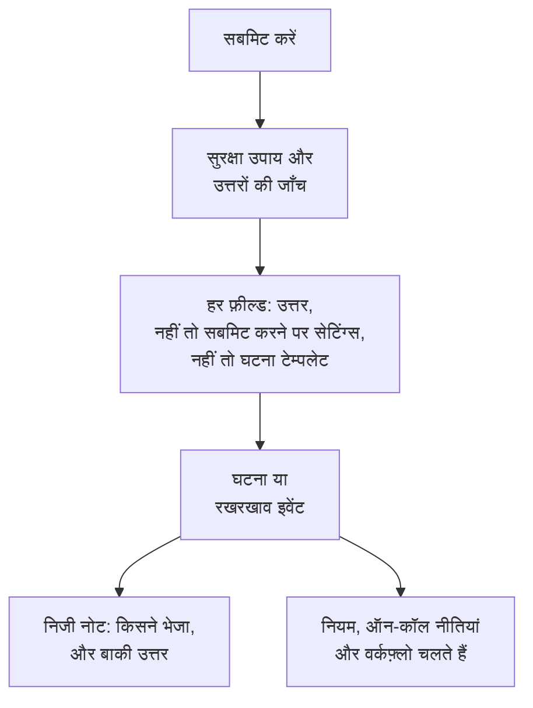

# सबमिशन क्या बनाता है

फ़ॉर्म से हर सबमिशन आपके प्रोजेक्ट में एक रिकॉर्ड बनाता है: एक **घटना** या एक **अनुसूचित रखरखाव इवेंट**। फ़ॉर्म का **सबमिट करने पर** पेज दिखाता है कि कौन-सा, और नए रिकॉर्ड का हर फ़ील्ड कैसे भरा जाता है — किसी उत्तर से, किसी डिफ़ॉल्ट से, हमेशा लागू होने वाली किसी सेटिंग से, या घटना टेम्पलेट से। **सेटिंग्स संपादित करें** डिफ़ॉल्ट और हमेशा लागू होने वाली चीज़ें बदलता है।

:::cards
- [सबमिशन घटना कैसे बनता है](#सबमिशन-घटना-कैसे-बनता-है): नई घटना का हर फ़ील्ड, और उसका मान कहाँ से आता है।
- [सबमिशन अनुसूचित रखरखाव इवेंट कैसे बनता है](#सबमिशन-अनुसूचित-रखरखाव-इवेंट-कैसे-बनता-है): रखरखाव अनुरोध के लिए भी वही।
- [सबमिट करने पर सेटिंग्स](#सबमिट-करने-पर-सेटिंग्स): डिफ़ॉल्ट, हमेशा जुड़ने वाली चीज़ें, मालिक और प्रकाशन।
- [निजी नोट](#निजी-नोट): इसे किसने भेजा, और वे उत्तर जो किसी फ़ील्ड में नहीं जाते।
:::

## सबमिट करने पर क्या होता है

जो सबमिशन किसी जाँच में विफल होता है, वह कुछ नहीं बनाता। [फ़ॉर्म को क्या सुरक्षित रखता है](/docs/forms/sharing-and-security#फ़ॉर्म-को-क्या-सुरक्षित-रखता-है) देखें।

## हर सबमिशन क्या बनाता है

**हर सबमिशन क्या बनाता है** कार्ड में वह चुनाव रहता है जो आपने फ़ॉर्म बनाते समय किया था:

- **घटना** — हर सबमिशन एक घटना घोषित करता है, इसलिए आपकी ऑन-कॉल टीम को तुरंत बताया जाता है। समस्या की रिपोर्ट के लिए इसका उपयोग करें।
- **अनुसूचित रखरखाव** — हर सबमिशन एक रखरखाव इवेंट शेड्यूल करता है। बदलाव और रखरखाव के अनुरोधों के लिए इसका उपयोग करें।

दूसरा चुनने पर आपसे पुष्टि मांगी जाती है, क्योंकि उसके साथ फ़ॉर्म बदल जाता है:

- शीर्षक, विवरण, मॉनिटर और लेबल जुड़े रहते हैं: दोनों तरह के रिकॉर्ड में ये होते हैं।
- बाकी हर जुड़ा हुआ प्रश्न — गंभीरता, स्थिति पृष्ठ का चुनाव, पुराने प्रकार का कस्टम फ़ील्ड — उन्हीं शब्दों के साथ फ़ॉर्म का अपना प्रश्न बन जाता है, जिसका उत्तर निजी नोट पर सूचीबद्ध होता है।
- सबमिट करने पर सेटिंग्स फिर से शुरू होती हैं, क्योंकि घटना और इवेंट की सेटिंग्स अलग होती हैं।
- अब रखरखाव इवेंट बनाने वाला फ़ॉर्म पूछता है कि रखरखाव कब शुरू और खत्म होता है।

प्रश्न बदलाव के साथ ही तुरंत सहेज लिए जाते हैं। उन्हें **बनाएँ** पेज पर जाँचें।

## सबमिशन घटना कैसे बनता है

कार्ड नई घटना का हर फ़ील्ड सूचीबद्ध करता है, और यह कि उसका मान कहाँ से आता है:

| फ़ील्ड | कहाँ से आता है |
| --- | --- |
| **शीर्षक** | **शीर्षक** प्रश्न का उत्तर। जब फ़ॉर्म इसे नहीं पूछता, या इसे खाली छोड़ा जाता है: **डिफ़ॉल्ट शीर्षक**, नहीं तो फ़ॉर्म का नाम। |
| **विवरण** | **विवरण** प्रश्न का उत्तर। जब यह पूछा नहीं जाता या खाली छोड़ा जाता है, तो घटना टेम्पलेट का विवरण, अगर फ़ॉर्म में टेम्पलेट है। |
| **गंभीरता** | सबमिट करने वाले का चुनाव, जब फ़ॉर्म इसे पूछता है। नहीं तो फ़ॉर्म की **गंभीरता** सेटिंग, नहीं तो घटना टेम्पलेट की गंभीरता। |
| **मॉनिटर** | सबमिट करने वाले के चुने मॉनिटर, और उनके साथ वे भी जिन्हें सेटिंग्स हमेशा जोड़ती हैं। दोनों न हों, तो घटना टेम्पलेट के। |
| **लेबल** | सबमिट करने वाले के चुने लेबल, और उनके साथ वे भी जिन्हें सेटिंग्स हमेशा जोड़ती हैं। दोनों न हों, तो घटना टेम्पलेट के। |
| **प्रभाव शुरू होने का समय** | **प्रभाव शुरू होने का समय** का उत्तर, जब फ़ॉर्म इसे पूछता है। |
| **घटना टेम्पलेट** | फ़ॉर्म की **घटना टेम्पलेट** सेटिंग। उत्तर और सेटिंग्स जो कुछ भी सेट नहीं करते, यह उसे भरती है। |
| **ऑन-कॉल नीतियां** | सेटिंग्स में बताई गई नीतियां, जो फ़ॉर्म की घोषित हर घटना के लिए चलाई जाती हैं। कोई न हो, तो घटना टेम्पलेट की। |
| **मालिक** | सेटिंग्स में बताए गए लोग और टीमें, और उनके साथ टेम्पलेट के मालिक भी। उन्हें हर घटना के बारे में बताया जाता है। |
| **कस्टम फ़ील्ड** | हर कस्टम फ़ील्ड प्रश्न का उत्तर — सिवाय तब के, जब फ़ील्ड अपना मान किसी मॉनिटर कस्टम फ़ील्ड से कॉपी करता है और घटना के मॉनिटरों में वह मान है; बाकी टेम्पलेट भरता है। |
| **स्थिति पृष्ठ** | जब तक आपकी टीम का कोई इसे प्रकाशित नहीं करता, घटना स्थिति पृष्ठों पर कभी नहीं दिखती, और सब्सक्राइबर को नहीं बताया जाता। |
| **अन्य उत्तर** | घटना पर एक निजी नोट में सूचीबद्ध, इस बात के साथ कि इसे किसने सबमिट किया। |

> [!IMPORTANT]
> **गंभीरता नहीं, तो घटना नहीं।** घटना को गंभीरता चाहिए। जब फ़ॉर्म कोई गंभीरता नहीं पूछता और उसकी सेटिंग्स कोई नहीं बतातीं — या जो बताई थी वह हटा दी गई — और उसका टेम्पलेट भी कोई सेट नहीं करता, तो **गंभीरता** पंक्ति आपको चेतावनी देती है, और हर सबमिशन "इस फ़ॉर्म से घटना नहीं बनाई जा सकती क्योंकि इसमें कोई गंभीरता सेट नहीं है। कृपया उस टीम को बताएं जिसने इसे साझा किया है।" के साथ अस्वीकार किया जाता है। **सेटिंग्स संपादित करें** में कोई गंभीरता चुनें, या ऐसा टेम्पलेट जो कोई गंभीरता सेट करता हो।

### घटना टेम्पलेट

सेटिंग्स में कोई **घटना टेम्पलेट** चुनें, और फ़ॉर्म जो भी घटना घोषित करता है, वह उसी से घोषित होती है, उसी तरह जैसे सर्वर कहीं भी टेम्पलेट लागू करता है — [टेम्पलेट कैसे लागू होता है](/docs/incidents/settings#टेम्पलेट-कैसे-लागू-होता-है) देखें। उत्तर और फ़ॉर्म की सेटिंग्स पहले आते हैं, और बाकी सब कुछ टेम्पलेट भरता है: प्रारंभिक स्थिति, विवरण, गंभीरता, प्रभावित संसाधन, ऑन-कॉल नीतियां, मालिक, लेबल, कस्टम फ़ील्ड मान और मॉनिटर स्थिति में बदलाव।

> [!WARNING]
> **मॉनिटरों का ध्यान रखें।** फ़ॉर्म के ज़रिए किसी मॉनिटर पर घटना घोषित करना मॉनिटर पर ठीक वैसा ही असर डालता है जैसे उस पर हाथ से घटना घोषित करना: घटना सुलझने तक मॉनिटर की सक्रिय मॉनिटरिंग रुक जाती है, और टेम्पलेट का **मॉनिटर स्थिति बदलकर करें** मॉनिटर की स्थिति तुरंत बदल देता है — हर उस स्थिति पृष्ठ पर जो मॉनिटर को सूचीबद्ध करता है, तब भी जब घटना खुद छिपी हो। फ़ॉर्म के साथ, लिंक वाला कोई भी व्यक्ति यह कर सकता है। फ़ॉर्म से मॉनिटर तभी जोड़ें जब हर सबमिशन को उन्हें रोकना चाहिए।

### घटना कैसी दिखती है

फ़ॉर्म से घोषित घटना एक सामान्य घटना है, कुछ अपनी सेटिंग्स के साथ:

- **स्थिति पृष्ठों से छिपी।** **स्थिति पृष्ठ पर दृश्यमान** बंद है, और **स्थिति पृष्ठ ग्राहकों को सूचित करें** भी। जब तक कोई प्रतिक्रियाकर्ता इसे प्रकाशित नहीं करता, घटना के बारे में कुछ भी किसी स्थिति पृष्ठ या सब्सक्राइबर तक नहीं पहुँचता — ऊपर बताए गए टेम्पलेट के मॉनिटर स्थिति बदलाव को छोड़कर।
- **किसी ने घोषित नहीं की।** सबमिट करने वाला OneUptime उपयोगकर्ता नहीं है, इसलिए किसी उपयोगकर्ता को घटना घोषित करने वाले के रूप में दर्ज नहीं किया जाता।
- **इसके मालिकों को बताया जाता है।** सेटिंग्स और टेम्पलेट जिन मालिकों के नाम बताते हैं, उन्हें घटना के Slack और Microsoft Teams चैनल बनते ही जोड़ा जाता है, और सूचित किया जाता है — घटना की **घटना बनाई गई** सूचना तब तक रुकी रहती है जब तक वे उसके मालिक नहीं बन जाते, इसलिए वह प्रोजेक्ट के मालिकों के बजाय उन्हें जाती है।
- **एक निजी नोट सबमिशन दर्ज करता है** — [निजी नोट](#निजी-नोट) देखें।

नई घटना के लिए जो कुछ भी चलता है, वह इनके लिए भी चलता है: गोपनीयता, मालिक, लेबल, ऑन-कॉल और रनबुक नियम, ऑन-कॉल नीतियां, और **On Create Incident** वर्कफ़्लो। ऑन-कॉल नियम फ़ॉर्म की घटनाओं से भी दूसरी घटनाओं की तरह मेल खाते हैं — उनके शीर्षक और विवरण पर भी, जो सबमिट करने वाले ने लिखे थे।

:::steps
#### पढ़ें कि सबमिट करने वाले ने क्या लिखा

घटना प्रकाशित होने के बाद शीर्षक और विवरण स्थिति पृष्ठों पर दिखते हैं।

#### घटना प्रकाशित करें

घटना के **सेटिंग्स** पेज से **स्थिति पृष्ठ पर दृश्यमान** चालू करें।

#### अगर सब्सक्राइबर को पता होना चाहिए, तो उन्हें बताएं

क्योंकि घटना **स्थिति पृष्ठ ग्राहकों को सूचित करें** बंद रहते हुए घोषित की गई थी, उसे प्रकाशित करने से "घटना बनाई गई" सूचना नहीं जाती। सब्सक्राइबर को बताने के लिए, **स्थिति पृष्ठ ग्राहकों को सूचित करें** पर टिक लगाकर एक सार्वजनिक नोट पोस्ट करें — [सार्वजनिक नोट पोस्ट करना](/docs/incidents/notes-owners-and-feed#सार्वजनिक-नोट-पोस्ट-करना) देखें।
:::

## सबमिशन अनुसूचित रखरखाव इवेंट कैसे बनता है

| फ़ील्ड | कहाँ से आता है |
| --- | --- |
| **शीर्षक** | **शीर्षक** प्रश्न का उत्तर। जब फ़ॉर्म इसे नहीं पूछता, या इसे खाली छोड़ा जाता है: **डिफ़ॉल्ट शीर्षक**, नहीं तो फ़ॉर्म का नाम। |
| **विवरण** | **विवरण** प्रश्न का उत्तर। |
| **शुरू होता है**, **समाप्त होता है** | **शुरू होता है** और **समाप्त होता है** के उत्तर, जिन्हें हर रखरखाव फ़ॉर्म पूछता है और आवश्यक रखता है। अंत शुरुआत के बाद होना चाहिए। |
| **मॉनिटर** | सबमिट करने वाले के चुने मॉनिटर, और उनके साथ वे भी जिन्हें सेटिंग्स हमेशा जोड़ती हैं। |
| **स्थिति पृष्ठ** | सबमिट करने वाले के चुने स्थिति पृष्ठ, और उनके साथ वे भी जिन्हें सेटिंग्स बताती हैं। |
| **लेबल** | सबमिट करने वाले के चुने लेबल, और उनके साथ वे भी जिन्हें सेटिंग्स हमेशा जोड़ती हैं। |
| **मालिक** | सेटिंग्स में बताए गए लोग और टीमें। फ़ॉर्म जो भी इवेंट शेड्यूल करता है, उसके मालिक वही होते हैं। |
| **स्थिति पृष्ठों पर दिखाएँ** | **नहीं**, जब तक सेटिंग्स इसे चालू नहीं करतीं। |
| **सब्सक्राइबर्स को सूचित करें** | **नहीं**, जब तक सेटिंग्स इसे चालू नहीं करतीं। |
| **कस्टम फ़ील्ड** | हर कस्टम फ़ील्ड प्रश्न का उत्तर — सिवाय तब के, जब फ़ील्ड अपना मान किसी मॉनिटर कस्टम फ़ील्ड से कॉपी करता है और इवेंट के मॉनिटरों में वह मान है। |
| **अन्य उत्तर** | इवेंट पर एक निजी नोट में सूचीबद्ध, इस बात के साथ कि इसे किसने सबमिट किया। |

इवेंट आपके प्रोजेक्ट की **Scheduled** स्थिति में शुरू होता है और किसी भी दूसरे इवेंट की तरह आगे बढ़ता है: शुरू होने पर वह चालू हो जाता है और खत्म होने पर खत्म हो जाता है।

सबमिशन किसी का अनुरोध है, और अनुरोध प्रकाशित होने से पहले उसकी समीक्षा होती है। इसलिए, जब तक आप इसे नहीं बदलते, इवेंट अपने स्थिति पृष्ठों से तब तक दूर रहता है जब तक आपकी टीम का कोई उसे दिखा नहीं देता, और उसके सब्सक्राइबर को नहीं बताया जाता कि वह कब बना, कब शुरू हुआ या कब खत्म हुआ। सेटिंग्स के **प्रकाशन** चरण में **स्थिति पृष्ठों पर दिखाएँ** और **सब्सक्राइबर्स को सूचित करें** फ़ॉर्म द्वारा शेड्यूल किए जाने वाले हर इवेंट के लिए इसे बदलते हैं — इन्हें तभी चालू करें जब आप लिंक वाले हर व्यक्ति पर भरोसा करते हों।

## सबमिट करने पर सेटिंग्स

**सेटिंग्स संपादित करें** सेटिंग्स को चरणों में खोलता है: **अगला** आगे ले जाता है, और **परिवर्तन सहेजें** आखिरी चरण पर है। हर चरण पहले से भरा होता है, इसलिए फ़ॉर्म के बगल वाली चरणों की सूची उनमें से कोई भी खोल देती है, आखिरी भी: किसी सेटिंग को उसके चरण पर बदलें, फिर आखिरी चरण खोलें और सहेजें।

| चरण | घटना फ़ॉर्म | रखरखाव फ़ॉर्म |
| --- | --- | --- |
| **डिफ़ॉल्ट** | **डिफ़ॉल्ट शीर्षक**, **गंभीरता**, **घटना टेम्पलेट** | **डिफ़ॉल्ट शीर्षक** |
| **हमेशा जोड़ें** | **मॉनिटर**, **लेबल**, **ऑन-कॉल नीतियां** | **मॉनिटर**, **स्थिति पृष्ठ**, **लेबल** |
| **मालिक** | **मालिक** | **मालिक** |
| **प्रकाशन** | — | **स्थिति पृष्ठों पर दिखाएँ**, **सब्सक्राइबर्स को सूचित करें** |

**मालिक** लोगों और टीमों के लिए एक ही पिकर है: **स्वामी जोड़ें** दोनों की एक खोज सूची खोलता है, और हर चुनाव एक चिप के रूप में दिखता है जिसे आप हटा सकते हैं। सेटिंग्स जो कुछ भी बताती हैं, वह फ़ॉर्म के प्रोजेक्ट का होना चाहिए, और मालिकों को उसका सदस्य होना चाहिए। चुने जाने के बाद हटाया गया रिकॉर्ड सबमिशन बनते समय छोड़ दिया जाता है, और बाकी फिर भी लागू होता है।

## निजी नोट

हर सबमिशन, जो उसने बनाया उस पर, एक निजी नोट छोड़ता है:

> Submitted through the form **Report a Problem** by Ada Lovelace (<ada@example.com>).
>
> **Which office are you in?**\
> Berlin

यह फ़ॉर्म और सबमिट करने वाले का नाम बताता है — जब फ़ॉर्म ने नहीं पूछा कि वे कौन हैं, तो "Submitted anonymously through the form **Report a Problem**." — फिर, जब सबमिशन फ़ॉर्म के किसी टेम्पलेट से शुरू हुआ हो, तो बताता है कि किससे: "Started from the template **Application Outage**." — और फिर फ़ॉर्म के अपने प्रश्नों के उत्तर, हर एक अपने प्रश्न के नीचे, फ़ॉर्म के क्रम में सूचीबद्ध करता है। जुड़े हुए प्रश्नों के उत्तर पहले से रिकॉर्ड पर हैं: उसका शीर्षक, उसकी गंभीरता, उसके कस्टम फ़ील्ड। निजी होने के कारण यह नोट कभी किसी स्थिति पृष्ठ तक नहीं पहुँचता, लेकिन किसी भी दूसरे नोट की तरह रिकॉर्ड के Slack और Microsoft Teams चैनलों में पोस्ट होता है।

पता एक लिंक है जो ठीक उसी पते पर लिखता है — डैशबोर्ड में, Slack में और मालिकों के ईमेल में।

## छिपे प्रश्न और टेम्पलेट

[छिपे प्रश्न](/docs/forms/building#छिपे-प्रश्न) का उत्तर उस [टेम्पलेट](/docs/forms/building#टेम्पलेट) से आता है जिससे सबमिशन शुरू हुआ — अनुरोध से कभी नहीं — और उसका उत्तर ठीक वहीं जाता है जहाँ लिखा गया उत्तर जाता: छिपा **विवरण** घटना का विवरण बनता है, छिपा कस्टम फ़ील्ड उसका मान, और फ़ॉर्म का अपना छिपा प्रश्न निजी नोट पर एक पंक्ति। जो सबमिशन किसी टेम्पलेट से शुरू नहीं हुआ, वह छिपे प्रश्नों को बिना उत्तर छोड़ता है, और उनके फ़ील्ड सबमिट करने पर सेटिंग्स से भरे जाते हैं, जैसे खाली छोड़े गए किसी भी प्रश्न के लिए। जब किसी ने फ़ॉर्म खोल रखा हो और उसी बीच टेम्पलेट हटा दिया जाए, तो इससे उनका सबमिशन नहीं रुकता: वह वैसे ही बनता है जैसे उन्होंने उत्तर दिए, टेम्पलेट के छिपे उत्तरों के बिना।

टेम्पलेट फ़ॉर्म के प्रश्न [अपने तरीके से](/docs/forms/building#टेम्पलेट-हर-प्रश्न-कैसे-पूछता-है) पूछ सकता है, और सर्वर सबमिशन को उन प्रश्नों से वैसे बाँधता है जैसे उसका बताया गया टेम्पलेट उन्हें पूछता है। टेम्पलेट जिस प्रश्न को छिपाता है, उसका उत्तर टेम्पलेट से आता है, जैसे छिपे प्रश्न का, तब भी जब फ़ॉर्म उसे पूछता है; टेम्पलेट जिसे पूछता है, उसे अनुरोध से पढ़ा जाता है, तब भी जब फ़ॉर्म उसे छिपाता है; और टेम्पलेट जिसे आवश्यक बनाता है, उसका उत्तर देना ज़रूरी है, नहीं तो सबमिशन अस्वीकार हो जाता है और कुछ नहीं बनता।

टेम्पलेट ने पेज पर जो उत्तर भरे, वे सबमिट होते ही सबमिट करने वाले के होते हैं: पेज जो प्रश्न पूछता है, उनके लिए अनुरोध जो उत्तर भेजता है, सर्वर वही लेता है, टेम्पलेट ने चाहे जो कहा हो।

## सबमिट करने वाले का लिखा टेक्स्ट

सबमिशन सीधे ऐसी जगहों पर जाता है जहाँ टेक्स्ट अपने आप कुछ कर सकता है — Slack और Microsoft Teams चैनल, हर प्रतिक्रियाकर्ता का ब्राउज़र, मालिकों के ईमेल — और कोई उसे पहले नहीं पढ़ता। इसलिए रिकॉर्ड बनने से पहले:

| सबमिट करने वाला क्या लिखता है | क्या संग्रहीत होता है |
| --- | --- |
| शीर्षक, विवरण या किसी भी टेक्स्ट उत्तर में कोई मेंशन, जैसे \<!channel\>, \<!here\> या \<@U0123ABC\> | **मेंशन किसी को सूचित नहीं करते।** Slack जिसे भी मेंशन के रूप में पढ़ता है, उसके खुलने वाले ब्रैकेट के बाद एक अदृश्य अक्षर जुड़ जाता है। यह हर जगह वैसा ही पढ़ा जाता है, लेकिन कोई चैट टूल उस पर कार्रवाई नहीं करता। |
| विवरण या किसी **रिच टेक्स्ट** उत्तर में कोई इमेज | **इमेज लिंक बन जाती हैं।** हर इमेज उसी पते का लिंक बन जाती है, इसलिए जब तक कोई प्रतिक्रियाकर्ता उस पर क्लिक नहीं करता, सबमिट करने वाले की चुनी किसी जगह से कुछ लोड नहीं होता। |
| ऐसा कोड ब्लॉक जिसकी भाषा `mermaid` है, किसी भी वर्तनी में | **डायग्राम कोड बन जाते हैं।** इसे सादे कोड के रूप में संग्रहीत किया जाता है, इसलिए यह डायग्राम बनाने के बजाय अपना टेक्स्ट दिखाता है। |
| शीर्षक में इमेज सिंटैक्स या डायग्राम कोड ब्लॉक | **शीर्षक सादा टेक्स्ट है।** इन्हें भी अदृश्य अक्षर मिलता है, इसलिए शीर्षक जहाँ भी पहुँचे — कोई एपिसोड, चैट संदेश, नोट टेम्पलेट — वह कुछ लोड नहीं करता और कुछ नहीं बनाता। अदृश्य अक्षर शीर्षक की सीमा में गिने जाते हैं। |

बाकी सब कुछ — लिंक, बाकी Markdown, ड्रॉपडाउन के चुनाव, संख्याएं, तारीखें, टिक किया गया चेकबॉक्स — वैसे ही संग्रहीत होता है जैसे सबमिट करने वाले ने दिया, और सबमिशन सबमिट करने वाले का नाम और ईमेल वैसे ही रखता है जैसे लिखा गया।

## अगले कदम

:::cards
- [फ़ॉर्म बनाना](/docs/forms/building): इन फ़ील्ड को भरने वाले प्रश्न, छिपे प्रश्न और टेम्पलेट।
- [घटना सेटिंग्स और स्वचालन](/docs/incidents/settings): घटना टेम्पलेट और कस्टम फ़ील्ड।
- [घटना नोट्स, स्वामी और फ़ीड](/docs/incidents/notes-owners-and-feed): निजी नोट, सार्वजनिक नोट और मालिक।
- [साझा करना और सुरक्षा](/docs/forms/sharing-and-security): कौन सबमिट कर सकता है, और कितनी बार।
:::
