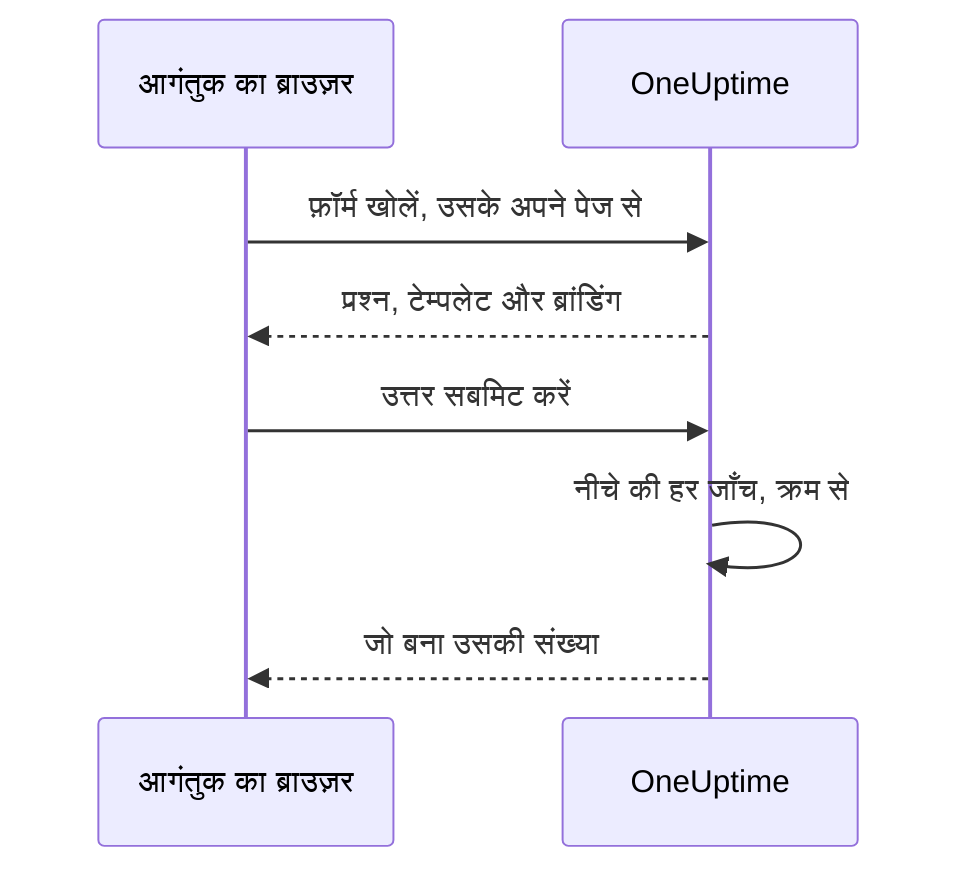

# साझा करना और सुरक्षा

फ़ॉर्म उसके लिंक वाले किसी भी व्यक्ति के लिए खुला है, और हर सबमिशन आपकी ऑन-कॉल टीम को पेज कर सकता है या आपके कैलेंडर पर रखरखाव विंडो डाल सकता है। यह पेज फ़ॉर्म के **साझा करें** पेज के बारे में है — लिंक, फ़ॉर्म बंद करना, सबमिट करने के बाद का संदेश और IP अनुमति सूची — और उन सभी दूसरी जाँचों के बारे में भी, जिनसे कोई अनुरोध रास्ते में गुज़रता है।

:::cards
- [लिंक साझा करना](#लिंक-साझा-करना): इसे कॉपी करें, खोलें, और जब यह बहुत दूर तक फैल जाए तो रीसेट करें।
- [हर टेम्पलेट के लिए एक लिंक](#हर-टेम्पलेट-के-लिए-एक-लिंक): हर मामले के लिए एक बुकमार्क, और उन सबके पीछे एक ही फ़ॉर्म।
- [फ़ॉर्म को क्या सुरक्षित रखता है](#फ़ॉर्म-को-क्या-सुरक्षित-रखता-है): हर वह जाँच जिससे अनुरोध गुज़रता है, क्रम से।
- [समस्या निवारण](#समस्या-निवारण): फ़ॉर्म के पेज पर हर संदेश का क्या अर्थ है, और क्या करें।
:::

## साझा करें पेज

| कार्ड | इसमें क्या है |
| --- | --- |
| **स्थिति** | **सबमिशन स्वीकार करना** — फ़ॉर्म का लिंक काम करता है या नहीं। |
| **साझा करने का लिंक** | लिंक, **लिंक कॉपी करें**, **फ़ॉर्म खोलें** और **लिंक रीसेट करें** के साथ। |
| **सबमिट करने के बाद** | **धन्यवाद संदेश**, जिसे लोग सबमिट करने के बाद, फ़ॉर्म ने जो बनाया उसकी संख्या के नीचे देखते हैं। |
| **एक्सेस** | **IP अनुमति सूची**। |

## लिंक साझा करना

**साझा करने का लिंक** कार्ड फ़ॉर्म का लिंक दिखाता है, जैसे `https://oneuptime.com/accounts/form/<share-key>`:

- **लिंक कॉपी करें** इसे कॉपी करता है।
- **फ़ॉर्म खोलें** फ़ॉर्म को नए टैब में वैसे खोलता है जैसे लोग उसे देखते हैं।
- **लिंक रीसेट करें** आपकी पुष्टि के बाद फ़ॉर्म को नया लिंक देता है। पुराना लिंक तुरंत काम करना बंद कर देता है और "उपलब्ध नहीं" वाला संदेश दिखाता है, इसलिए जिनके साथ भी आपने इसे साझा किया था, उन सबको नया लिंक चाहिए। इसका उपयोग तब करें जब कोई लिंक जितना फैलना चाहिए उससे ज़्यादा फैल गया हो।

लिंक वाला कोई भी व्यक्ति फ़ॉर्म खोलकर उसे सबमिट कर सकता है, OneUptime खाते के बिना और साइन इन किए बिना। साइन इन होने से कुछ नहीं बदलता: OneUptime को पता चलता है कि किसने सबमिट किया, केवल फ़ॉर्म में लिखे नाम और ईमेल से। इसलिए लिंक को अपनी ऑन-कॉल टीम के फ़ोन नंबर की तरह मानें। इसे वहाँ साझा करें जहाँ इसका उपयोग करने वाले लोग इसे पाएंगे — कोई इंट्रानेट पेज, सपोर्ट रनबुक, चैट का पिन किया गया संदेश — और किसी सार्वजनिक वेबसाइट पर नहीं, जब तक आप किसी से भी सबमिशन नहीं चाहते।

लिंक में अपनी एक रैंडम कुंजी होती है, फ़ॉर्म की ID नहीं। सेल्फ़-होस्टेड इंस्टॉलेशन पर यह आपके अपने OneUptime होस्ट से दिया जाता है, और केवल उसी पते पर काम करता है जिसे `HTTP_PROTOCOL` और `HOST` कॉन्फ़िगर करते हैं: सर्वर के किसी दूसरे नाम पर, या उसके IP पते पर खोलने पर, फ़ॉर्म के अनुरोध किसी दूसरी वेबसाइट से आए मानकर अस्वीकार कर दिए जाते हैं।

पुराने घटना फ़ॉर्म के लिंक, `/accounts/incident-form/<share-key>`, उसी फ़ॉर्म को उसके नए पते पर खोलते हैं।

### हर टेम्पलेट के लिए एक लिंक

फ़ॉर्म के हर [टेम्पलेट](/docs/forms/building#टेम्पलेट) का अपना लिंक होता है: फ़ॉर्म का लिंक, `?template=` और टेम्पलेट की id के साथ, जैसे `https://oneuptime.com/accounts/form/<share-key>?template=<template-id>`। फ़ॉर्म के **टेम्पलेट** पेज पर **लिंक कॉपी करें** इसे कॉपी करता है। यह फ़ॉर्म को उस टेम्पलेट से भरा हुआ खोलता है, ताकि कोई टीम हर मामले के लिए एक लिंक बुकमार्क कर सके, जबकि आप एक ही फ़ॉर्म रखें। जब सबमिट करने वाला कोई दूसरा टेम्पलेट चुनता है, तो उसके ब्राउज़र का पता भी साथ बदलता है, इसलिए वह जो लिंक कॉपी करता है, वह फ़ॉर्म वैसा ही होता है जैसा वह उसे देखता है।

टेम्पलेट का लिंक फ़ॉर्म का ही लिंक है: यह तब तक काम करता है जब तक फ़ॉर्म का **सबमिशन स्वीकार करना** चालू है, और **लिंक रीसेट करें** इसे बाकी लिंक के साथ खत्म कर देता है। जो लिंक किसी हटाए गए टेम्पलेट का नाम बताता है, वह फ़ॉर्म को ऐसे खोलता है जैसे उसने किसी का नाम न बताया हो — डिफ़ॉल्ट टेम्पलेट के साथ, अगर कोई है।

### फ़ॉर्म बंद करना

फ़ॉर्म हटाए बिना सबमिशन लेना बंद करने के लिए, **सबमिशन स्वीकार करना** बंद करें। तब लिंक "यह फ़ॉर्म उपलब्ध नहीं है। हो सकता है इसे बंद कर दिया गया हो, या लिंक पुराना हो गया हो।" दिखाता है, और **साझा करने का लिंक** कार्ड आपको याद दिलाता है कि फ़ॉर्म बंद है। इसे फिर से चालू करें, और वही लिंक फिर से काम करने लगता है।

### धन्यवाद संदेश

सबमिशन के बाद, पेज "धन्यवाद — आपका जवाब भेज दिया गया है।" कहता है और जो बना उसकी संख्या देता है, फिर Markdown में आपका **धन्यवाद संदेश**। इसका उपयोग यह बताने के लिए करें कि आगे क्या होगा, और कुछ ज़रूरी हो तो कहाँ जाएं। इसके बिना, पेज केवल मानक संदेश दिखाता है।

फ़ॉर्म के विवरण या धन्यवाद संदेश में कोई इमेज, जब तक फ़ॉर्म का **सबमिशन स्वीकार करना** चालू है, लिंक खोलने वाले हर व्यक्ति को दिखाई जाती है। फ़ॉर्म बंद कर दें, या इमेज निकाल दें, तो इमेज फिर से निजी हो जाती है, जब तक कोई दूसरी चीज़ जिसे सब देखते हैं, उसे अब भी शामिल न करती हो।

## फ़ॉर्म को क्या सुरक्षित रखता है

हर अनुरोध इन जाँचों से, इसी क्रम में, गुज़रता है:

1. अनुरोध फ़ॉर्म के अपने पेज से आना चाहिए, किसी दूसरी वेबसाइट से नहीं — [दूसरी वेबसाइटों से अनुरोध](#दूसरी-वेबसाइटों-से-अनुरोध) देखें।
2. यह रेट लिमिट के अंदर होना चाहिए।
3. फ़ॉर्म मौजूद होना चाहिए, उसका **सबमिशन स्वीकार करना** चालू होना चाहिए, और वह ऐसे प्रोजेक्ट का होना चाहिए जिसके प्लान में फ़ॉर्म शामिल हों।
4. जब फ़ॉर्म में **IP अनुमति सूची** हो, तो यह उस पर मौजूद किसी पते से आना चाहिए।
5. जब इंस्टेंस पर कैप्चा चालू हो, तो सबमिशन को कैप्चा पास करना चाहिए।
6. हर उत्तर आकार की सीमाओं के अंदर होना चाहिए और अपने प्रश्न में फ़िट होना चाहिए — [फ़ॉर्म बनाना](/docs/forms/building#आकार-की-सीमाएँ) देखें।
7. उत्तर और सेटिंग्स मिलकर जो बनाते हैं, वह बनाया जा सकने वाला होना चाहिए: घटना को गंभीरता चाहिए, इवेंट को अपनी शुरुआत के बाद का अंत।
8. सबमिशन फ़ॉर्म के प्रति घंटा कोटे के अंदर होना चाहिए — [रेट लिमिट](#रेट-लिमिट) देखें।

फ़ॉर्म का लोगो और फ़ेविकॉन फ़ॉर्म का हिस्सा हैं: उन्हें उस जवाब के अंदर, base64 में, भेजा जाता है जो फ़ॉर्म खोलता है, केवल पहली चार जाँचें पास होने के बाद, और कभी अपने किसी अलग पते से नहीं। फ़ॉर्म के बिना कोई उन्हें प्राप्त नहीं कर सकता, और किसी फ़ॉर्म के ज़रिए कोई भी फ़ाइल उसकी id से प्राप्त नहीं की जा सकती; फ़ाइलें खुद निजी रहती हैं। फ़ॉर्म केवल अपने प्रोजेक्ट में अपलोड की गई इमेज दिखाता है: किसी दूसरे प्रोजेक्ट की फ़ाइल फ़ॉर्म सहेजते समय अस्वीकार कर दी जाती है, और कभी उसके पेज पर नहीं भेजी जाती।

### IP अनुमति सूची

किसी फ़ॉर्म को अपने नेटवर्क तक सीमित करने के लिए:

:::steps
1. फ़ॉर्म का **साझा करें** पेज खोलें।
2. **एक्सेस** कार्ड पर, **IP अनुमति सूची संपादित करें** पर क्लिक करें।
3. हर पंक्ति में एक नेटवर्क दर्ज करें, और सहेजें। तब कार्ड उन्हें **IP अनुमति सूची** के नीचे सूचीबद्ध करता है।
:::

हर पंक्ति इनमें से एक होती है:

| प्रविष्टि | उदाहरण | टिप्पणी |
| --- | --- | --- |
| एक IPv4 पता | `203.0.113.7` | |
| एक IPv6 पता | `2001:db8::7` | यह जैसे भी लिखा हो, मेल खाता है, बड़े अक्षरों में या पूरे शून्यों के साथ। |
| CIDR नोटेशन में एक IPv4 रेंज | `10.0.0.0/8` | IPv6 रेंज समर्थित नहीं हैं — हर IPv6 पते को अलग पंक्ति में लिखें। |

IPv4 पता IPv4 की तरह ही लिखा जाना चाहिए: IPv6 के तरीके से लिखा गया, जैसे `::ffff:203.0.113.7`, अस्वीकार किया जाता है। सूची जब भी सहेजी जाती है, जाँची जाती है — डैशबोर्ड, API, Terraform या किसी वर्कफ़्लो से — और जो पंक्ति कभी मेल नहीं खा सकती, वह उसका नाम बताने वाले संदेश के साथ अस्वीकार की जाती है। हर नेटवर्क को अनुमति देने के लिए सूची खाली छोड़ दें। उसमें एक प्रविष्टि होते ही, जिस अनुरोध का पता तय नहीं किया जा सकता, वह अस्वीकार किया जाता है।

OneUptime Cloud पर IP अनुमति सूची सेट करने के लिए **Scale** प्लान चाहिए - जब API से कोई फ़ॉर्म सूची के साथ बनाया जाता है, तब भी और जब उसे संपादित किया जाता है, तब भी - जैसे किसी [सार्वजनिक डैशबोर्ड](/docs/dashboards/sharing) की IP अनुमति सूची के लिए। इसे खाली करना हर प्लान पर काम करता है।

### दूसरी वेबसाइटों से अनुरोध

ब्राउज़र सर्वर को बताता है कि किस पेज ने अनुरोध भेजा। जब किसी दूसरी वेबसाइट का पेज किसी आगंतुक के ब्राउज़र से कोई फ़ॉर्म खुलवाता या सबमिट करवाता है, तो अनुरोध "This form can only be used from its own page." के साथ अस्वीकार किया जाता है — किसी भी रेट लिमिट के उसे गिनने से पहले, और लिंक चाहे जो हो, इसलिए जवाब यह कुछ नहीं बताता कि कौन-से फ़ॉर्म मौजूद हैं।

अनुरोध तब अस्वीकार किया जाता है जब उसका `Sec-Fetch-Site` हेडर मौजूद हो और `same-origin` या `none` के अलावा कुछ भी कहे, या जब उसका `Origin` हेडर मौजूद हो और आपका OneUptime पता न हो — `HTTP_PROTOCOL` और `HOST`, और पोर्ट भी, जब `HOST` में पोर्ट हो। सबमिशन JSON (`application/json`) के रूप में भी भेजा जाना चाहिए; किसी वेब पेज के फ़ॉर्म फ़ील्ड के रूप में, या सादे टेक्स्ट के रूप में भेजा गया सबमिशन "The request must be a JSON object holding the form's answers in "data"." के साथ अस्वीकार किया जाता है। फ़ॉर्म पढ़ने के लिए वह हेडर भी चाहिए जो फ़ॉर्म का पेज अपने हर अनुरोध में जोड़ता है, `X-OneUptime-Form: 1`: कोई पेज बिना स्क्रिप्ट के ब्राउज़र से हेडर नहीं जुड़वा सकता, और किसी दूसरी वेबसाइट की स्क्रिप्ट जो इसे जोड़ती है, अपने `Origin` से पकड़ी जाती है।

### रेट लिमिट

फ़ॉर्म खोलना और उसे सबमिट करना हर नेटवर्क पते के हिसाब से सीमित है, और सबमिट करना हर फ़ॉर्म के हिसाब से भी सीमित है:

- **फ़ॉर्म खोलना** — एक पते से हर फ़ॉर्म के लिए, और हर पते के लिए सभी फ़ॉर्म मिलाकर, इतनी गुंजाइश के साथ कि पूरा दफ़्तर एक साथ लिंक खोल सके। किसी भी सीमा के पार, पेज "बहुत अधिक अनुरोध। कृपया बाद में फिर से कोशिश करें।" दिखाता है। अगर रेट लिमिटर तक पहुँचा नहीं जा सकता, तो फ़ॉर्म फिर भी खुलते हैं।
- **सबमिट करना, हर पते के हिसाब से** — एक पते से हर फ़ॉर्म के लिए, और हर पते के लिए सभी फ़ॉर्म मिलाकर। किसी भी सीमा के पार, सबमिट करने वाला "आपके नेटवर्क से बहुत अधिक सबमिशन हुए हैं। कृपया कुछ मिनट प्रतीक्षा करें और फिर से कोशिश करें।" देखता है। एक पते के पीछे हर कोई — दफ़्तर का नेटवर्क, VPN गेटवे — ये सीमाएँ साझा करता है, और हर सबमिशन गिना जाता है, वह भी जो बाद में किसी गलत उत्तर के कारण अस्वीकार हो जाता है।
- **सबमिट करना, हर फ़ॉर्म के हिसाब से** — एक फ़ॉर्म एक घंटे में कितने रिकॉर्ड बना सकता है, सभी पतों से मिलाकर, ताकि कई पतों से एक साथ आने वाले सबमिशन भी आपको घंटे में सीमित बार ही पेज कर सकें। केवल वही सबमिशन गिना जाता है जो बाकी हर जाँच पास कर चुका हो, ठीक उसका रिकॉर्ड बनने से पहले। इसके पार, विंडो खत्म होने तक हर किसी को "इस फ़ॉर्म को अभी बहुत अधिक सबमिशन मिल रहे हैं। कृपया बाद में फिर से कोशिश करें।" दिखता है। **लिंक रीसेट करें** नए लिंक को नए कोटे के साथ शुरू करता है।

हर सीमा `429` से जवाब देती है, सेकंड में `Retry-After` हेडर के साथ, और पेज सबमिट करने वाले को बताता है कि फिर से कब कोशिश करनी है। विंडो निश्चित होती हैं, खिसकने वाली नहीं। अगर रेट लिमिटर तक पहुँचा नहीं जा सकता, तो सबमिशन बिना गिने आगे जाने देने के बजाय अस्वीकार किए जाते हैं: API `503` से जवाब देता है, और सबमिट करने वाला "अभी सबमिशन स्वीकार नहीं किए जा सकते। कृपया कुछ मिनट बाद फिर से कोशिश करें।" देखता है।

सेल्फ़-होस्टेड इंस्टॉलेशन पर, OneUptime ऐप के ये एनवायरनमेंट वेरिएबल सीमाएँ बदलते हैं:

| वेरिएबल | डिफ़ॉल्ट | यह क्या सेट करता है |
| --- | --- | --- |
| `FORM_RATE_LIMIT_WINDOW_SECONDS` | `60` | फ़ॉर्म खोलने की विंडो, सेकंड में। |
| `FORM_RATE_LIMIT_PER_FORM_AND_IP_PER_WINDOW` | `120` | एक पता एक विंडो में एक फ़ॉर्म कितनी बार खोल सकता है। |
| `FORM_RATE_LIMIT_PER_IP_PER_WINDOW` | `600` | एक पता एक विंडो में, सभी फ़ॉर्म मिलाकर, कितनी बार फ़ॉर्म खोल सकता है। |
| `FORM_SUBMIT_RATE_LIMIT_WINDOW_SECONDS` | `900` | हर पते वाली सबमिशन सीमाओं की विंडो, सेकंड में। |
| `FORM_SUBMIT_RATE_LIMIT_PER_FORM_AND_IP_PER_WINDOW` | `10` | हर विंडो में एक पते से एक फ़ॉर्म पर सबमिशन। |
| `FORM_SUBMIT_RATE_LIMIT_PER_IP_PER_WINDOW` | `30` | हर विंडो में एक पते से सबमिशन, सभी फ़ॉर्म मिलाकर। |
| `FORM_SUBMIT_RATE_LIMIT_PER_FORM_WINDOW_SECONDS` | `3600` | हर फ़ॉर्म वाली सीमा की विंडो, सेकंड में। |
| `FORM_SUBMIT_RATE_LIMIT_PER_FORM_PER_WINDOW` | `60` | एक फ़ॉर्म हर विंडो में कितने रिकॉर्ड बना सकता है, सभी पतों से मिलाकर। |

हर वेरिएबल अपना पुराना नाम भी पढ़ता है, जिसमें `FORM_` की जगह आगे `INCIDENT_FORM_` होता है — जैसे `INCIDENT_FORM_SUBMIT_RATE_LIMIT_PER_FORM_PER_WINDOW` — ताकि जिस इंस्टॉलेशन ने घटना फ़ॉर्म की सीमाएँ ट्यून की थीं, वह अपनी सीमाएँ बनाए रखे; दोनों सेट हों तो नया नाम लागू होता है। न `config.env` और न Helm चार्ट की वैल्यू इन्हें आगे भेजती हैं: इन्हें `app` कंटेनर के एनवायरनमेंट में खुद जोड़ें — Helm चार्ट में `app.extraEnv` से, या पूरे चार्ट के `extraEnv` से, या Docker Compose के लिए `docker-compose.override.yml` में। `TRUSTED_PROXY_HOPS` तय करता है कि हर पते वाली सीमाएँ किस पते को गिनती हैं।

### कैप्चा

जब आपके OneUptime इंस्टेंस पर hCaptcha चालू होता है, तो फ़ॉर्म एक कैप्चा दिखाता है, और जो सबमिशन उसे पास नहीं करता, वह अस्वीकार किया जाता है। हर फ़ॉर्म के लिए अलग कोई सेटिंग नहीं है। सेल्फ़-होस्टेड इंस्टॉलेशन `CAPTCHA_ENABLED`, `CAPTCHA_SITE_KEY` और `CAPTCHA_SECRET_KEY` से कैप्चा चालू करता है — वही सेटिंग्स जो साइन-अप की सुरक्षा करती हैं। इसके बिना, रेट लिमिट और IP अनुमति सूची यह भार उठाती हैं।

## समस्या निवारण

:::details लिंक कहता है कि फ़ॉर्म उपलब्ध नहीं है
"यह फ़ॉर्म उपलब्ध नहीं है। हो सकता है इसे बंद कर दिया गया हो, या लिंक पुराना हो गया हो।" पेज कारण चाहे जो हो, यही जवाब देता है, इसलिए वह किसी अजनबी को कभी नहीं बताता कि कोई फ़ॉर्म मौजूद है या नहीं:

- **साझा करें** पेज पर **सबमिशन स्वीकार करना** बंद है।
- लिंक को **लिंक रीसेट करें** से बदल दिया गया। नया लिंक साझा करें।
- फ़ॉर्म हटा दिया गया।
- OneUptime Cloud पर, प्रोजेक्ट **Growth** प्लान से नीचे है, या उसकी सदस्यता का भुगतान नहीं हुआ है।
- कॉपी करते समय लिंक अधूरा रह गया।
:::

:::details फ़ॉर्म केवल अनुमत नेटवर्क से खोला जा सकता है
"यह फ़ॉर्म केवल अनुमत नेटवर्क से ही खोला जा सकता है।" सबमिट करने वाले का पता फ़ॉर्म की **IP अनुमति सूची** पर नहीं है: उनका नेटवर्क जोड़ें, या सूची खाली करें। किसी प्रॉक्सी या लोड बैलेंसर के पीछे वाले सेल्फ़-होस्टेड इंस्टॉलेशन पर, `TRUSTED_PROXY_HOPS` जाँचें — जब यह बहुत कम होता है, तो OneUptime सबमिट करने वाले के पते के बजाय आपके प्रॉक्सी का पता देखता है। जब फ़ॉर्म आपके OneUptime के अपने पते के अलावा किसी दूसरे पते पर खोला गया हो, तब भी पेज यही कहता है: लिंक ठीक वैसे ही खोलें जैसे **साझा करने का लिंक** कार्ड उसे दिखाता है।
:::

:::details बहुत अधिक सबमिशन
"आपके नेटवर्क से बहुत अधिक सबमिशन हुए हैं। कृपया कुछ मिनट प्रतीक्षा करें और फिर से कोशिश करें।" एक पते के पीछे हर कोई हर पते वाली सीमाएँ साझा करता है, जो किसी बड़े आउटेज के दौरान मायने रखता है, जब बहुत से लोग एक साथ रिपोर्ट करते हैं। पेज बताता है कि फिर से कब कोशिश करनी है। "इस फ़ॉर्म को अभी बहुत अधिक सबमिशन मिल रहे हैं। कृपया बाद में फिर से कोशिश करें।" इसके बजाय हर फ़ॉर्म वाला कोटा है: इसका सबमिट करने वाले के नेटवर्क से कोई लेना-देना नहीं है, और विंडो खत्म होने पर रिपोर्ट फिर से ली जाती हैं। अगर सबमिशन असली नहीं हैं क्योंकि लिंक जितना फैलना चाहिए उससे ज़्यादा फैल गया, तो **लिंक रीसेट करें** पुराना लिंक तुरंत बंद कर देता है।
:::

:::details अभी सबमिशन स्वीकार नहीं किए जा सकते
"अभी सबमिशन स्वीकार नहीं किए जा सकते। कृपया कुछ मिनट बाद फिर से कोशिश करें।" रेट लिमिटर तक नहीं पहुँचा जा सका, इसलिए सबमिशन बिना गिने आगे जाने देने के बजाय अस्वीकार किए जाते हैं। फ़ॉर्म खोलना फिर भी काम करता है। सेल्फ़-होस्टेड इंस्टॉलेशन पर, जाँचें कि Valkey, वह कैश जिसमें रेट लिमिटर गिनती करता है, चल रहा है और OneUptime ऐप से उस तक पहुँचा जा सकता है।
:::

:::details इस फ़ॉर्म से घटना नहीं बनाई जा सकती क्योंकि इसमें कोई गंभीरता सेट नहीं है
फ़ॉर्म कोई गंभीरता नहीं पूछता, उसकी सेटिंग्स कोई नहीं बतातीं — या जो बताई थी वह हटा दी गई — और उसका घटना टेम्पलेट भी कोई सेट नहीं करता। फ़ॉर्म के **सबमिट करने पर** पेज पर कोई गंभीरता चुनें। [गंभीरता नहीं, तो घटना नहीं](/docs/forms/on-submit#सबमिशन-घटना-कैसे-बनता-है) देखें।
:::

:::details कोई सबमिशन अस्वीकार हो जाता है
संदेश बताता है कि क्या गलत है: कोई आवश्यक उत्तर गायब है या केवल स्पेस है, कोई उत्तर बहुत लंबा है या अपने प्रश्न में फ़िट नहीं होता, ईमेल पता एक सामान्य पता नहीं है, या कोई रखरखाव विंडो शुरू होने से पहले खत्म होती है। "कैप्चा सत्यापन विफल रहा। कृपया फिर से कोशिश करें।" का अर्थ है कि कैप्चा पास नहीं हुआ, या उसकी अवधि खत्म हो गई: उसे फिर से हल करें। जिस सेल्फ़-होस्टेड इंस्टॉलेशन पर हर सबमिशन कैप्चा में विफल होता है, वहाँ जाँचें कि `CAPTCHA_SITE_KEY` और `CAPTCHA_SECRET_KEY` दोनों सेट हैं।
:::

:::details कोई प्रश्न फ़ॉर्म पर नहीं है
बिल्डर उन प्रश्नों को चिह्नित करता है जिन्हें वह सार्वजनिक फ़ॉर्म से छोड़ देता है — उदाहरण के लिए, कोई हटाया गया कस्टम फ़ील्ड — और **पूर्वावलोकन** बताता है कि कब वह किसी को छोड़ता है। [जब बिल्डर किसी प्रश्न को चिह्नित करता है](/docs/forms/building#जब-बिल्डर-किसी-प्रश्न-को-चिह्नित-करता-है) देखें। **छिपा हुआ** बैज वाला प्रश्न जानबूझकर छोड़ा जाता है: केवल टेम्पलेट उसका उत्तर देते हैं। [छिपे प्रश्न](/docs/forms/building#छिपे-प्रश्न) देखें। कोई प्रश्न एक टेम्पलेट के लिए फ़ॉर्म पर और दूसरे के लिए उससे बाहर भी हो सकता है: हर टेम्पलेट किसी प्रश्न को छिपा सकता है, या ऐसा प्रश्न पूछ सकता है जिसे फ़ॉर्म छिपाता है। टेम्पलेट का **संपादित करें** खोलें और उसके **प्रश्न** जाँचें। [टेम्पलेट हर प्रश्न कैसे पूछता है](/docs/forms/building#टेम्पलेट-हर-प्रश्न-कैसे-पूछता-है) देखें।
:::

:::details कोई टेम्पलेट किसी प्रश्न को नहीं भरता
टेम्पलेट का उत्तर तभी उपयोग होता है जब वह अब भी अपने प्रश्न में फ़िट हो: ऐसा विकल्प जो प्रश्न अब भी देता है, ऐसा रिकॉर्ड जो फ़ॉर्म अब भी देता है, ऐसा टेक्स्ट जो बहुत लंबा नहीं है। टेम्पलेट संपादित करें, प्रश्न का उत्तर फिर से दें, और उसे सहेजें। [टेम्पलेट](/docs/forms/building#टेम्पलेट) देखें।
:::

:::details घटना या इवेंट स्थिति पृष्ठ पर नहीं है
ऐसा जानबूझकर है: फ़ॉर्म से आने वाली घटनाएं छिपी हुई घोषित होती हैं, और रखरखाव इवेंट छिपे रहते हैं जब तक फ़ॉर्म की **प्रकाशन** सेटिंग्स कुछ और न कहें। [सबमिशन क्या बनाता है](/docs/forms/on-submit) देखें।
:::

:::details किसी को पेज नहीं किया गया
फ़ॉर्म की घटना वे ऑन-कॉल नीतियां चलाती है जिनके नाम उसकी सेटिंग्स और उसका टेम्पलेट बताते हैं, और जो भी आपके ऑन-कॉल नियम जोड़ते हैं, किसी भी दूसरी घटना की तरह। इनमें से कोई न हो, तो किसी को पेज नहीं किया जाता। फ़ॉर्म के **सबमिट करने पर** पेज पर कोई ऑन-कॉल नीति जोड़ें, या ऐसा ऑन-कॉल नियम लिखें जो उसकी घटनाओं से मेल खाए — उदाहरण के लिए, किसी ऐसे लेबल से जिसे फ़ॉर्म हमेशा जोड़ता है।
:::

## अगले कदम

:::cards
- [फ़ॉर्म का अवलोकन](/docs/forms/index): फ़ॉर्म किस लिए हैं, अनुमतियाँ और API।
- [फ़ॉर्म बनाना](/docs/forms/building): प्रश्न, छिपे प्रश्न और टेम्पलेट।
- [सबमिशन क्या बनाता है](/docs/forms/on-submit): हर सबमिशन जो घटना या इवेंट बनाता है।
:::
