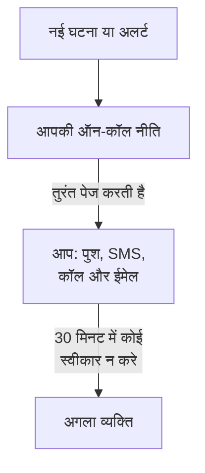

# फ़ोन, SMS या पुश से पेज पाएँ

इस गाइड के अंत तक, आपके प्रोजेक्ट की हर नई घटना और अलर्ट पर आपको अपने फ़ोन पर पुश सूचना, SMS या फ़ोन कॉल से पेज किया जाता है। अगर 30 मिनट के भीतर कोई स्वीकार नहीं करता, तो अगले व्यक्ति को पेज किया जाता है। आपका स्वीकार किया हुआ एक परीक्षण पेज दिखाता है कि यह काम करता है। यह गाइड **कुछ बिगड़ने पर सही व्यक्ति को बुलाना** गाइडेड सेटअप के क्रम में चलती है, और इसमें लगभग 10 मिनट लगते हैं।

## आपको क्या चाहिए

- एक प्रोजेक्ट जिसके आप मालिक हों: SMS और कॉल उसका मालिक चालू करता है, और ऑन-कॉल नीति उसका मालिक या कोई एडमिन बनाता है।
- आपका मोबाइल फ़ोन।
- जिन टीम सदस्यों को आप पेज करना चाहते हैं, वे प्रोजेक्ट के सदस्य हों: [लोगों को आमंत्रित करना](/docs/permissions/inviting-people) दिखाता है कि कैसे।

:::tabs
@tab OneUptime Cloud
पुश सूचनाएँ हर प्लान पर मुफ़्त हैं। SMS और कॉल का भुगतान प्रोजेक्ट के बैलेंस से होता है, जो 0.00 USD से शुरू होता है, और फ़ोन नंबर जोड़ने पर एक SMS जाता है, इसलिए पहले बैलेंस 1.00 USD से ऊपर होना चाहिए। बैलेंस जोड़ने पर प्रोजेक्ट के कार्ड से शुल्क लिया जाता है। Free प्लान में एक व्यक्ति और एक एस्केलेशन नियम होता है: सिर्फ़ आपको पेज किया जाता है, और पेज किसी और तक पहुँचने के बजाय दोहराया जाता है।
@tab स्व-होस्टेड
आपके सर्वर को ईमेल, SMS और कॉल भेजने में सक्षम होना चाहिए। उसका मास्टर एडमिन इन्हें `/admin/setup` पर सेट करता है, हर एक के परीक्षण के साथ, जैसा [स्व-होस्टिंग गाइड](/docs/installation/self-hosting-guide) दिखाती है। पुश सूचनाएँ OneUptime के पुश रिले के ज़रिए ऐप तक पहुँचती हैं, और इसके लिए कुछ भी सेट नहीं करना पड़ता।
:::

## चरण

:::steps
### गाइडेड सेटअप खोलें

अपने प्रोजेक्ट के **मुख्य पृष्ठ** पर, **OneUptime में आपका स्वागत है 👋** चेकलिस्ट में **एक ऑन-कॉल नीति सेट करें** पर क्लिक करें। नए प्रोजेक्ट का मुख्य पृष्ठ पहले पूछता है **आप सबसे पहले क्या करना चाहते हैं?**: **कुछ बिगड़ने पर सही व्यक्ति को बुलाना** चुनें और **जारी रखें** पर क्लिक करें। अगर यह चरण नहीं दिखता या पहले ही पूरा हो चुका है, तो `Ctrl+K` दबाएँ (Mac पर `Cmd+K`), `get paged` टाइप करें और **कुछ बिगड़ने पर सही व्यक्ति को बुलाना** चुनें।

### अपने फ़ोन पर ऐप इंस्टॉल करें

App Store या Google Play से OneUptime On-Call इंस्टॉल करें और साइन इन करें: यह आपके फ़ोन को पुश सूचनाओं के लिए पंजीकृत करता है। सेटअप में वापस आकर **फिर से जाँचें** पर क्लिक करें: **हम आप तक कैसे पहुँचें?** के नीचे **मोबाइल ऐप या ब्राउज़र** में अब आपका फ़ोन दिखता है।

### SMS और कॉल चालू करें

नए प्रोजेक्ट में SMS और फ़ोन कॉल बंद रहते हैं। अगर आप प्रोजेक्ट के मालिक हैं, तो **SMS और फ़ोन कॉल चालू करें** पर क्लिक करें; बाकी सभी को बताया जाता है कि यह कौन कर सकता है। OneUptime Cloud पर, अगर बैलेंस 1.00 USD या उससे कम है, तो **बैलेंस जोड़ें** पर क्लिक करें, **राशि (USD)** में 20 से 1,000 USD दर्ज करें और **रिचार्ज** पर क्लिक करें।

### अपना फ़ोन नंबर जोड़ें

**आपका फ़ोन नंबर** में अपना मोबाइल नंबर देश कोड के साथ टाइप करें, जैसे `+15551234567`, और **मुझे SMS से कोड भेजें** पर क्लिक करें। SMS में आया कोड दर्ज करें और **सत्यापित करें** पर क्लिक करें: पेज के लिए इसी नंबर पर कॉल भी आती है। **जारी रखें** पर क्लिक करें। सिर्फ़ ऐप और ईमेल से पेज पाने के लिए, नंबर छोड़ दें और सीधे **जारी रखें** पर क्लिक करें।

### चुनें कि और किसे पेज किया जाए

**और कौन ऑन-कॉल है?** के नीचे, **पहले पेज किए जाते हैं** में आप पहले से शामिल हैं। अपने साथ दूसरों को पेज करने के लिए **टीम सदस्य जोड़ें** पर क्लिक करें, फिर **सहेजें और आगे बढ़ें** पर क्लिक करें। जिस प्रोजेक्ट में अभी कोई ऑन-कॉल नीति नहीं है, उसमें यह `Default on-call policy` बनाता है, जो हर नई घटना और अलर्ट पर उन्हें पेज करती है। जिस प्रोजेक्ट में पहले से कोई नीति है, वहाँ उसे **ऑन-कॉल नीति** में चुनें, और लोगों को इसके बजाय **पहले एस्केलेशन नियम में जोड़ें** के नीचे जोड़ें। अगर अभी किसी तक पहुँचा नहीं जा सकता, तो चरण **क्या पेज उन तक पहुँचता है?** पर रुका रहता है: उनके लिए **सेटअप रिमाइंडर भेजें** पर क्लिक करें, फिर **जारी रखें** पर।

### तय करें कि कोई जवाब न दे तो क्या हो

**अगर कोई जवाब न दे तो?** के नीचे, **किसी और को पेज करें** चुना रहने दें, **इसके बाद पेज किए जाते हैं** में चुनें कि किसे, और **इंतज़ार के मिनट** को `30` पर रहने दें या बदलें। **सहेजें और आगे बढ़ें** पर क्लिक करें। Free प्लान पर, चरण इसके बजाय **उन्हीं लोगों को फिर से पेज करें** का विकल्प देता है, जिसमें **फिर से पेज करने की संख्या** `2` होती है।

### परीक्षण पेज भेजें

**परीक्षण पेज भेजें** के नीचे, **इस नीति का परीक्षण करें** पर क्लिक करें। एक **गंभीरता** चुनें और **परीक्षण पेज भेजें** पर क्लिक करें। नीति के पहले एस्केलेशन नियम को वैसे ही पेज किया जाता है जैसे कोई असली घटना उसे पेज करती, और हर संदेश में TEST लिखा होता है। कोई घटना नहीं बनती, और किसी स्थिति पृष्ठ या सब्सक्राइबर को नहीं बताया जाता।

### परीक्षण पेज स्वीकार करें

SMS या ईमेल में दिया लिंक खोलें और वहीं पेज स्वीकार करें, या फ़ोन कॉल के दौरान 1 दबाएँ। ऐप दिखाता है कि पेज पहुँच गया, लेकिन परीक्षण को स्वीकार नहीं कर सकता। फिर डायलॉग में **हो गया** पर क्लिक करें, और **जारी रखें** पर।
:::

## जाँचें कि यह काम कर गया

- परीक्षण वाला चरण बताता है कि पेज किसने स्वीकार किया, कैसे और कितनी जल्दी।
- सेटअप **पेजिंग सेट हो गई है** पर ख़त्म होता है, जिसे सहेजे गए रिकॉर्ड से पढ़ा जाता है: **किसे पेज किया जाता है**, **अगर कोई जवाब न दे** और **परीक्षण हो चुका**। नीति में ही कोई समस्या, जैसे कोई व्यक्ति जिस तक वह नहीं पहुँच पाती, **ध्यान देने की ज़रूरत** के नीचे दिखती है।
- **मुख्य पृष्ठ** पर, चेकलिस्ट **एक ऑन-कॉल नीति सेट करें** को पूरा दिखाती है। अगर यह आख़िरी चरण था, तो चेकलिस्ट हट जाती है।

अगर नीति आगे किसी और को पेज करती है, तो आप एस्केलेशन भी देख सकते हैं: सारांश में **ऑन-कॉल नीति खोलें** पर क्लिक करें, फिर **इस नीति का परीक्षण करें** पर। **हर एस्केलेशन स्तर से गुजरें** चालू करें, उसे भेजें, और पहला पेज स्वीकार न करें: अगले व्यक्ति को ज़्यादा से ज़्यादा 2 मिनट बाद पेज किया जाता है।

## क्या गड़बड़ हो सकती है

:::details "मुझे SMS से कोड भेजें" बटन नहीं दिखता
SMS बंद है, या भेजा नहीं जा सकता, और चरण इसका कारण बताता है। **SMS और फ़ोन कॉल चालू करें** सिर्फ़ प्रोजेक्ट के मालिक को, या बिलिंग प्रबंधित करने वाले व्यक्ति को दिखता है। OneUptime Cloud पर, बैलेंस 1.00 USD या उससे कम होने पर यह फ़ील्ड छिप जाता है। जो स्व-होस्टेड सर्वर SMS नहीं भेज सकता, उस पर उसके मास्टर एडमिन को **SMS और कॉल सेट करें** दिखता है, जो Twilio जोड़ने के लिए Admin Dashboard खोलता है, जैसा [Twilio इंटीग्रेशन](/docs/self-hosted/twilio-integration) दिखाता है।
:::

:::details "बैलेंस जोड़ें" कहता है कि कोई भुगतान विधि नहीं मिली
बैलेंस जोड़ने पर प्रोजेक्ट के कार्ड से शुल्क लिया जाता है। **प्रोजेक्ट सेटिंग्स → बिलिंग और चालान → बिलिंग** में **भुगतान विधि जोड़ें** से एक कार्ड जोड़ें, फिर दोबारा बैलेंस जोड़ें। तब तक ऐप और ईमेल आपको पेज करते रहते हैं।
:::

:::details स्व-होस्टेड: नंबर अस्वीकार हो जाता है क्योंकि कोई Twilio खाता सेट नहीं है
सिर्फ़ मास्टर एडमिन को पहले से चेतावनी मिलती है कि सर्वर SMS नहीं भेज सकता। उनसे `/admin/setup` पर SMS और कॉल सेट करने को कहें। इस बीच, **जारी रखें** पर क्लिक करें: ऐप और ईमेल आपको अब भी पेज करते हैं।
:::

:::details कोड या परीक्षण पेज कभी नहीं पहुँचता
सबसे पहले नंबर का देश कोड जाँचें। परीक्षण पेज के बाद, **हो गया** से डायलॉग बंद करें और **मुझे नहीं मिला** पर क्लिक करें: यह बताता है कि क्या जाँचना है, और **मेरे सूचना के तरीके खोलें** आप तक पहुँचने का हर तरीका दिखाता है। स्व-होस्टेड सर्वर पर, `/admin/setup` से एक परीक्षण SMS भेजें, और सर्वर पर `npm run doctor` चलाएँ।
:::

## आगे क्या करें

:::cards
- [ऑन-कॉल अनुसूची](/docs/on-call/schedules): बारी-बारी से ऑन-कॉल रहें, ताकि हर पेज उसी को जाए जो ऑन-कॉल है। Cloud पर, Growth प्लान से।
- [एस्केलेशन नियम](/docs/on-call/escalation-rules): नीति में स्तर, टीमें और शेड्यूल जोड़ें।
- [मुझसे कैसे संपर्क करें](/docs/notifications/on-call-rules): चुनें कि कौन-सी विधि आप तक पहले पहुँचे, और कब।
- [एक स्थिति पृष्ठ प्रकाशित करें](/docs/guides/status-page): अपने ग्राहकों को बताएँ कि क्या हो रहा है, अपने ही डोमेन पर।
:::
