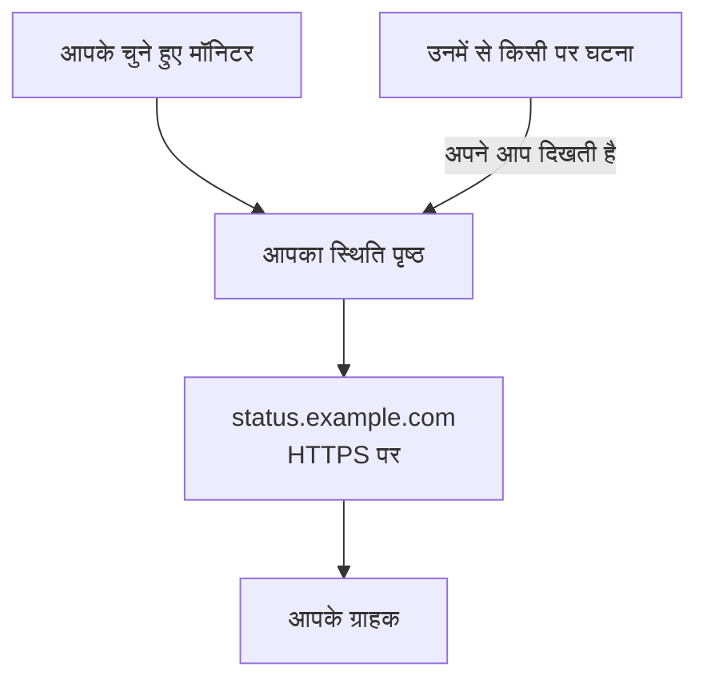

# एक स्थिति पृष्ठ प्रकाशित करें

इस गाइड के अंत तक, आपके ग्राहक आपके अपने पते पर HTTPS के साथ एक स्थिति पृष्ठ खोलते हैं, जैसे `status.example.com`। यह आपके चुने हुए मॉनिटर उनकी स्थिति और अपटाइम के साथ दिखाता है, और उनमें से किसी पर हुई घटना अपने आप वहाँ दिखती है। यह गाइड **एक स्थिति पृष्ठ प्रकाशित करें** गाइडेड सेटअप के क्रम में चलती है, फिर पृष्ठ के **कस्टम डोमेन** में आपका डोमेन जोड़ती है: लगभग 15 मिनट, और साथ में आपके DNS प्रदाता को लगने वाला समय।

## आपको क्या चाहिए

- कम से कम एक मॉनिटर: स्थिति पृष्ठ मॉनिटर दिखाता है। अगर अभी कोई मॉनिटर नहीं है, तो गाइडेड सेटअप पहले **मॉनिटर सेट अप करें** का विकल्प देता है।
- प्रोजेक्ट मालिक या एडमिन की भूमिका: पृष्ठ के लिए स्थिति पृष्ठ बनाने की अनुमति चाहिए, और आपके डोमेन के लिए प्रोजेक्ट के डोमेन जोड़ने और सत्यापित करने की अनुमति।
- एक डोमेन जो आपके नियंत्रण में हो, और आपके DNS प्रदाता पर उसके DNS रिकॉर्ड तक पहुँच।

:::tabs
@tab OneUptime Cloud
कस्टम डोमेन और उसका निःशुल्क SSL प्रमाणपत्र हर प्लान में मिलते हैं। Free प्लान पर हर प्रोजेक्ट में एक स्थिति पृष्ठ होता है: अगर आपके पास पहले से एक है, तो उसका **कस्टम डोमेन** खोलें और उस चरण से शुरू करें जो आपका डोमेन जोड़ता है। नया स्थिति पृष्ठ सार्वजनिक होता है; उसे निजी बनाने के लिए Growth प्लान चाहिए।
@tab स्व-होस्टेड
आपके सर्वर को अपना एक होस्टनाम चाहिए, जिसका A रिकॉर्ड उसकी ओर इशारा करता हो, जैसे `oneuptime.example.com`, और जो पोर्ट 80 और 443 पर जवाब देता हो। उसे `config.env` में `STATUS_PAGE_CNAME_RECORD` के रूप में सेट करें (Helm चार्ट में `statusPage.cnameRecord`), वहाँ दिए उदाहरण मान की जगह। निःशुल्क प्रमाणपत्रों के लिए `LETS_ENCRYPT_ACCOUNT_KEY` (`letsEncrypt.accountKey`) भी चाहिए: openssl से बनाई गई और base64 में एन्कोड की गई एक निजी कुंजी। इन्हें बदलने के बाद OneUptime को रीस्टार्ट करें। **कस्टम डोमेन जोड़ें** पहले सर्वर की जाँच करता है, और बताता है कि अभी क्या बाकी है।
:::

## चरण

:::steps
### गाइडेड सेटअप खोलें

अपने प्रोजेक्ट के **मुख्य पृष्ठ** पर, **OneUptime में आपका स्वागत है 👋** चेकलिस्ट में **एक स्थिति पृष्ठ प्रकाशित करें** पर क्लिक करें। नए प्रोजेक्ट का मुख्य पृष्ठ पहले पूछता है **आप सबसे पहले क्या करना चाहते हैं?**: **स्थिति पृष्ठ से अपने ग्राहकों को बताना** चुनें और **जारी रखें** पर क्लिक करें। अगर यह चरण नहीं दिखता या पहले ही पूरा हो चुका है, तो `Ctrl+K` दबाएँ (Mac पर `Cmd+K`), `status page` टाइप करें और **एक स्थिति पृष्ठ प्रकाशित करें** चुनें।

### इसे नाम दें और चुनें कि यह क्या दिखाए

**इसे नाम दें और चुनें कि यह क्या दिखाए** के नीचे, सुझाया गया **स्थिति पृष्ठ का नाम** रहने दें या अपना नाम टाइप करें। **यह क्या दिखाता है** के नीचे, वे मॉनिटर चुनें जो आपके ग्राहकों को दिखने चाहिए, या **सभी चुनें** पर क्लिक करें। **स्थिति पृष्ठ बनाएँ** पर क्लिक करें। इसी पल से पृष्ठ अपने लिंक पर सार्वजनिक है, और सिर्फ़ आपके चुने हुए मॉनिटर दिखाता है।

### देखें कि आपके ग्राहकों को क्या दिखता है

**आपके ग्राहकों को यह दिखता है** में, **सार्वजनिक लिंक** के नीचे दिया पता खोलें: आपके मॉनिटर अपनी स्थिति के साथ दिखते हैं। सेटअप में वापस आकर **ठीक लग रहा है** पर क्लिक करें।

### कस्टम डोमेन खोलें

सेटअप एक सारांश पर ख़त्म होता है। **इसे अपना बनाएँ (वैकल्पिक)** के नीचे, **आपका अपना डोमेन** पर क्लिक करें। स्थिति पृष्ठ का **कस्टम डोमेन** खुलता है।

### अपना डोमेन जोड़ें

**कस्टम डोमेन जोड़ें** पर क्लिक करें। **डोमेन** में वह पता टाइप करें जिसे आपके ग्राहक खोलेंगे, जैसे `status.example.com`, और **जारी रखें** पर क्लिक करें। **DNS सेटअप** जोड़ने वाले रिकॉर्ड के साथ खुलता है।

### DNS रिकॉर्ड जोड़ें

अपने DNS प्रदाता पर, **DNS सेटअप** में दिया हर रिकॉर्ड उसके **प्रकार**, **नाम** और **मान** के साथ जोड़ें: एक CNAME रिकॉर्ड जो पते को OneUptime की ओर इंगित करता है और, जब प्रोजेक्ट पहली बार यह डोमेन उपयोग करता है, तो एक TXT रिकॉर्ड जो दिखाता है कि डोमेन प्रोजेक्ट का है। अगर आपका प्रदाता हर नाम के साथ डोमेन अपने आप जोड़ देता है, तो सिर्फ़ उससे पहले का हिस्सा टाइप करें, जैसे `status`, और खुद डोमेन के लिए `@`।

### रिकॉर्ड जाँचें

**DNS सेटअप** खुला रखें और **अभी जाँचें** पर क्लिक करें। हर रिकॉर्ड के नीचे यह बताता है कि उसने क्या खोजा और जवाब में क्या मिला। TXT रिकॉर्ड पहले आता है: जब तक वह नहीं मिलता, डोमेन नहीं जुड़ता, इसलिए उसके मिलने तक **अभी जाँचें** पर दोबारा क्लिक करें। CNAME रिकॉर्ड मिलते ही डायलॉग **आपका CNAME रिकॉर्ड सत्यापित हो गया है।** कहता है, और एक निःशुल्क SSL प्रमाणपत्र जारी होता है, आमतौर पर 15 मिनट के भीतर।
:::

## जाँचें कि यह काम कर गया

- `https://status.example.com` की जगह अपना पता खोलें: आपका स्थिति पृष्ठ बिना किसी प्रमाणपत्र चेतावनी के खुलता है।
- **कस्टम डोमेन** पर, डोमेन की **स्थिति** कहती है **प्रमाणपत्र जारी किया गया, अपने आप नवीनीकृत होता है।** पृष्ठ खुलने लगने के बाद भी कुछ देर तक यह **निःशुल्क प्रमाणपत्र जारी किया जा रहा है, आमतौर पर 15 मिनट के भीतर।** दिखा सकती है।
- **मुख्य पृष्ठ** पर, चेकलिस्ट **एक स्थिति पृष्ठ प्रकाशित करें** को पूरा दिखाती है: यह तब पूरा होता है जब कोई स्थिति पृष्ठ एक मॉनिटर दिखाता है। अगर यह आख़िरी चरण था, तो चेकलिस्ट हट जाती है।

और कुछ करने की ज़रूरत नहीं: OneUptime प्रमाणपत्र अपने आप नवीनीकृत करता है। डोमेन सूची में आते ही OneUptime हर 15 मिनट में उसका CNAME रिकॉर्ड जाँचता है, और रिकॉर्ड लाइव होते ही उसे सत्यापित करता है, भले ही आप **DNS सेटअप** बंद कर दें।

## क्या गड़बड़ हो सकती है

:::details DNS सेटअप बंद करने के बाद डोमेन सूची में नहीं है
**DNS सेटअप** उसका TXT रिकॉर्ड मिलने से पहले बंद कर दिया गया, इसलिए डोमेन कभी जुड़ा ही नहीं। **कस्टम डोमेन जोड़ें** पर क्लिक करें, वही पता टाइप करें, **जारी रखें** पर क्लिक करें, फिर **अभी जाँचें** पर तब तक क्लिक करें जब तक डायलॉग दोनों रिकॉर्ड न ढूँढ ले।
:::

:::details डोमेन "DNS की प्रतीक्षा" पर ही रहता है
डोमेन की पंक्ति से **DNS सेटअप** खोलें और **अभी जाँचें** पर क्लिक करें: यह बताता है कि उसे क्या मिला। जाँचें कि रिकॉर्ड का नाम पूरा पता है, जैसे `status.example.com`, और उसका मान वही है जो **DNS सेटअप** दिखाता है। अगर नाम किसी IP पते के साथ जवाब देता है, तो उस पर A रिकॉर्ड है, या आपका DNS प्रदाता उसे प्रॉक्सी करता है: A रिकॉर्ड की जगह CNAME रिकॉर्ड रखें, या नाम को DNS only पर सेट करें। रूट डोमेन के लिए, जैसे `example.com`, अपने प्रदाता का ALIAS, ANAME या CNAME flattening रिकॉर्ड इस्तेमाल करें।
:::

:::details स्थिति कहती है कि निःशुल्क प्रमाणपत्र जारी नहीं हो सका
आपके डोमेन पर ऐसा CAA रिकॉर्ड जो `letsencrypt.org` को बाहर रखता है, प्रमाणपत्र को रोक देता है। स्व-होस्टेड सर्वर पर, Let's Encrypt को पोर्ट 80 पर सर्वर तक पहुँचना चाहिए। कारण ठीक करें: OneUptime अपने आप कोशिश करता रहता है, और **DNS सेटअप** में **अभी जाँचें** फिर से ऑर्डर करता है, हर डोमेन के लिए ज़्यादा से ज़्यादा हर 15 मिनट में एक बार।
:::

:::details स्व-होस्टेड: सर्वर कस्टम डोमेन के लिए तैयार नहीं है
**कस्टम डोमेन जोड़ें** कहता है **यह सर्वर अभी कस्टम डोमेन के लिए तैयार नहीं है**, और हर बाकी चीज़ के लिए एक पंक्ति में बताता है कि क्या बदलना है: [आपको क्या चाहिए](#आपको-क्या-चाहिए) में दी गई सेटिंग्स। `LETS_ENCRYPT_ACCOUNT_KEY` के बिना, सत्यापित डोमेन कहता है **सत्यापित। आपके खुद के प्रॉक्सी के HTTPS का उपयोग करता है।**: उसका HTTPS अपने खुद के प्रॉक्सी से परोसें। [स्थिति पृष्ठ ब्रांडिंग और डोमेन](/docs/status-pages/branding-and-domains#शुरू-करने-से-पहले) में पूरा ब्योरा है।
:::

## आगे क्या करें

:::cards
- [स्थिति पृष्ठ ब्रांडिंग और डोमेन](/docs/status-pages/branding-and-domains): आपका लोगो, रंग, हेडर लिंक और फ़ुटर।
- [सब्सक्राइबर और घोषणाएँ](/docs/status-pages/subscribers): ग्राहकों को सब्सक्राइब करने दें, और घोषणाएँ पोस्ट करें।
- [अनुसूचित रखरखाव](/docs/scheduled-maintenance/index): नियोजित काम के बारे में ग्राहकों को उसके शुरू होने से पहले बताएँ।
- [फ़ोन, SMS या पुश से पेज पाएँ](/docs/guides/paging): जब उनमें से कोई मॉनिटर डाउन हो, तो पेज पाएँ।
:::
