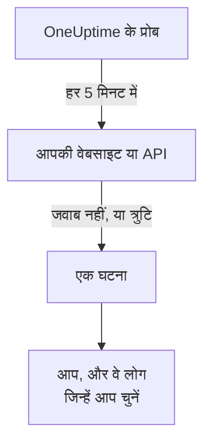

# जानें कि आपकी वेबसाइट या API कब डाउन होती है

इस गाइड के अंत तक, OneUptime हर 5 मिनट में आपकी वेबसाइट या API की जाँच करता है, जब वह जवाब देना बंद कर दे या त्रुटि के साथ जवाब दे तो एक घटना खोलता है, और आपको बताता है। आपका स्वीकार किया हुआ एक परीक्षण पेज दिखाता है कि संदेश आप तक पहुँचता है। यह गाइड **जानना कि मेरी वेबसाइट या API कब डाउन है** गाइडेड सेटअप के क्रम में चलती है, और इसमें लगभग 5 मिनट लगते हैं।

## आपको क्या चाहिए

- एक OneUptime प्रोजेक्ट जिसमें आप मॉनिटर बना सकें: मालिक, एडमिन या सदस्य बना सकता है। खाता और प्रोजेक्ट बनाने के लिए, [त्वरित शुरुआत](/docs/introduction/quickstart#एक-प्रोजेक्ट-बनाएँ) के पहले हिस्से का पालन करें।
- जाँचा जाने वाला पता, जैसे `https://example.com`। API के लिए, ऐसा एंडपॉइंट चुनें जो बिना किसी कुंजी के सादे `GET` का जवाब देता हो, जैसे स्वास्थ्य जाँच: `401` जैसा जवाब डाउन गिना जाता है।

:::tabs
@tab OneUptime Cloud
कई क्षेत्रों के प्रोब पते की जाँच करते हैं, इसलिए वह इंटरनेट से पहुँच में होना चाहिए। Free प्लान में 10 सक्रिय मॉनिटर होते हैं।
@tab स्व-होस्टेड
पते की जाँच आपके सर्वर के अपने प्रोब से होती है, इसलिए वह वहाँ से पहुँच में होना चाहिए। ईमेल पाने के लिए, सर्वर को ईमेल भेजने में सक्षम होना चाहिए: उसका मास्टर एडमिन इसे `/admin/setup` पर सेट करता है, जैसा [स्व-होस्टिंग गाइड](/docs/installation/self-hosting-guide) दिखाती है। मास्टर एडमिन को उसकी बनाई चीज़ों का मालिक नहीं बनाया जाता, इसलिए ईमेल पाने के लिए वह मॉनिटर के **मालिक** पेज पर खुद को जोड़ता है।
:::

## चरण

:::steps
### गाइडेड सेटअप खोलें

नए प्रोजेक्ट का **मुख्य पृष्ठ** पहले पूछता है **आप सबसे पहले क्या करना चाहते हैं?**: **जानना कि मेरी वेबसाइट या API कब डाउन है** चुनें और **जारी रखें** पर क्लिक करें। फिर **OneUptime में आपका स्वागत है 👋** चेकलिस्ट में **अपना पहला मॉनिटर बनाएँ** पर क्लिक करें। अगर चेकलिस्ट में यह नहीं दिखता, तो `Ctrl+K` दबाएँ (Mac पर `Cmd+K`), `website down` टाइप करें और **जानना कि मेरी वेबसाइट या API कब डाउन है** चुनें।

### पता दर्ज करें

**हमें क्या जाँचना चाहिए?** के नीचे, **वेबसाइट या API का पता** में पता टाइप करें। API एंडपॉइंट के लिए, **यह एक API एंडपॉइंट है** चुनें। **जाँच शुरू करें** पर क्लिक करें: प्रोब तुरंत उसकी जाँच करते हैं, और एक वाक्य बताता है कि उन्हें क्या मिला। **जारी रखें** पर क्लिक करें।

### चुनें कि किसे बताया जाए

**किसे बताया जाए?** के नीचे, आपको क्या दिखता है यह प्रोजेक्ट पर निर्भर करता है:

- अगर अभी कोई ऑन-कॉल नीति या ऑन-कॉल नियम नहीं है, तो **किसे पेज किया जाता है** में आप पहले से शामिल हैं। प्रोजेक्ट में पहले से मौजूद लोगों को जोड़ने के लिए **टीम सदस्य जोड़ें** पर क्लिक करें, फिर **सहेजें और आगे बढ़ें** पर क्लिक करें। यह `Default on-call policy` बनाता है, जो प्रोजेक्ट की हर नई घटना और अलर्ट पर उन्हें पेज करती है।
- अगर कोई ऑन-कॉल नीति या नियम है, तो प्रोजेक्ट के अपने नियम तय करते हैं कि किसे पेज किया जाए: **जारी रखें** पर क्लिक करें।
- सदस्य के तौर पर आप पेजिंग सेट नहीं कर सकते, इसलिए आपको बताया जाता है कि मॉनिटर के मालिक के रूप में आपको ईमेल मिलेगा: **जारी रखें** पर क्लिक करें।

### खुद को एक परीक्षण भेजें

**टेस्ट भेजें** के नीचे, **मुझे परीक्षण पेज भेजें** पर क्लिक करें। एक **गंभीरता** चुनें और **परीक्षण पेज भेजें** पर क्लिक करें। परीक्षण आप तक वैसे ही पहुँचता है जैसे कोई असली पेज पहुँचता, और हर संदेश में TEST लिखा होता है। कोई घटना नहीं बनती।

### परीक्षण पेज स्वीकार करें

ईमेल में दिया लिंक खोलें और वहीं पेज स्वीकार करें। प्रोजेक्ट के लिए SMS और कॉल चालू हो जाने पर, सत्यापित फ़ोन नंबर भी काम करता है: SMS में दिया लिंक खोलें, या कॉल के दौरान 1 दबाएँ। फिर डायलॉग में **हो गया** पर क्लिक करें, और **जारी रखें** पर।
:::

## जाँचें कि यह काम कर गया

- सेटअप अपने सारांश पर ख़त्म होता है, जिसे सहेजे गए रिकॉर्ड से पढ़ा जाता है: **जाँचा गया**, **जब यह डाउन हो जाए**, **किसे बताया जाता है** और **परीक्षण हो चुका**।
- **मॉनिटर खोलें** पर क्लिक करें, फिर उसके **जब यह बंद हो** कार्ड पर **श्रृंखला दिखाएँ** पर: यह मॉनिटर से उन लोगों तक की श्रृंखला दिखाता है जिन तक वह पहुँचता है, और जब कुछ भी उसे नहीं रोकेगा, तो **इस श्रृंखला को कुछ नहीं रोकता।** कहता है।
- **मुख्य पृष्ठ** पर, पहली जाँच का नतीजा आते ही चेकलिस्ट **अपना पहला मॉनिटर बनाएँ** को पूरा दिखाती है। अगर यह आख़िरी चरण था, तो चेकलिस्ट हट जाती है।

बाद में कोई और पता सेट करने के लिए, सेटअप फिर से खोलें और **कोई और पता जाँचें** पर क्लिक करें।

## क्या गड़बड़ हो सकती है

:::details पहली जाँच का नतीजा कभी नहीं आता
अगर वाक्य कहता है कि कोई भी स्थान पते की जाँच नहीं कर रहा, तो मॉनिटर के पास कोई प्रोब नहीं है; अगर वह बार-बार कहता है कि जाँच चल रही है, तो उसका प्रोब कनेक्ट नहीं है। हर प्रोब की स्थिति देखने के लिए **मॉनिटर → सेटिंग्स → प्रोब** खोलें। स्व-होस्टेड सर्वर पर, मास्टर एडमिन `/admin/setup` पर सर्वर का प्रोब जाँचता है। फिर मॉनिटर खोलें, उसमें एक कनेक्टेड प्रोब जोड़ें, और सेटअप फिर से खोलें।
:::

:::details साइट चलती है, लेकिन मॉनिटर कहता है कि वह डाउन है
मॉनिटर जवाब न आने को, या 200 से 399 के बाहर के जवाब को, डाउन गिनता है। प्रोब को ब्लॉक करने वाला फ़ायरवॉल जवाब न आने जैसा ही दिखता है: OneUptime Cloud पर, [IP पते](/docs/configuration/ip-addresses) में दिए पतों को अनुमति दें; स्व-होस्टेड सर्वर पर, उस मशीन को अनुमति दें जिस पर प्रोब चलता है। नियम बदलने के लिए, [वेबसाइट मॉनिटर](/docs/monitor/website-monitor) या [API मॉनिटर](/docs/monitor/api-monitor) देखें।
:::

:::details परीक्षण पेज स्वीकार नहीं किया जा सकता
ऐसा कुछ पहुँचा ही नहीं जिससे उसे स्वीकार किया जा सके, और स्व-होस्टेड सर्वर पर इसका आमतौर पर मतलब होता है कि सर्वर अभी ईमेल नहीं भेज सकता: चरण यह बताता है, और उसके मास्टर एडमिन को **ईमेल सेट अप करें** दिखता है। इसे सेट करें, फिर **एक और टेस्ट भेजें** पर क्लिक करें, या **टेस्ट छोड़ें** पर क्लिक करें और बाद में लौटें। परीक्षण के बाद, **हो गया** से डायलॉग बंद करें और **मुझे नहीं मिला** पर क्लिक करें: यह बताता है कि क्या जाँचना है।
:::

## आगे क्या करें

:::cards
- [फ़ोन, SMS या पुश से पेज पाएँ](/docs/guides/paging): अपने फ़ोन पर पेज पाएँ, और कोई जवाब न दे तो अगले व्यक्ति को पेज करें।
- [एक स्थिति पृष्ठ प्रकाशित करें](/docs/guides/status-page): मॉनिटर अपने ग्राहकों को दिखाएँ, अपने ही डोमेन पर।
- [मानदंड और स्थितियाँ](/docs/monitor/criteria-and-statuses): ठीक-ठीक तय करें कि मॉनिटर कब डाउन गिना जाए।
:::
