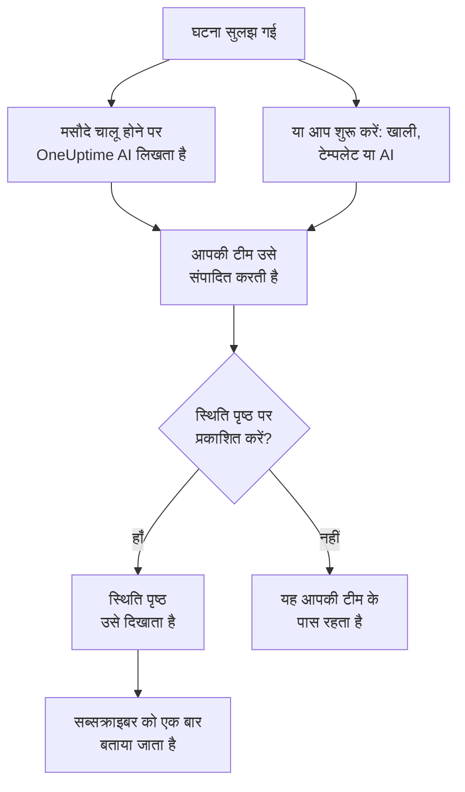

# पोस्टमॉर्टम

पोस्टमॉर्टम किसी घटना के बाद का लेखा-जोखा है: क्या हुआ, क्यों हुआ, आपके उपयोगकर्ताओं पर इसका क्या असर पड़ा और अब क्या बदलेगा। OneUptime में आप इसे घटना पर ही लिखते हैं। यह आपके अपने टेम्पलेट से या OneUptime AI के मसौदे से शुरू हो सकता है, और इसे घटना के अंतिम अपडेट के रूप में आपके स्थिति पृष्ठ पर प्रकाशित किया जा सकता है।

:::cards
- [पोस्टमॉर्टम लिखें](#पोस्टमॉर्टम-लिखें): घटना के पोस्टमॉर्टम पेज पर, पाँच चरणों में।
- [टेम्पलेट या AI मसौदे से शुरू करें](#टेम्पलेट-या-ai-मसौदे-से-शुरू-करें): आपकी रूपरेखा, या ऐसी जिसे OneUptime AI भरता है।
- [इसे अपने स्थिति पृष्ठ पर प्रकाशित करें](#इसे-अपने-स्थिति-पृष्ठ-पर-प्रकाशित-करें): ग्राहकों को दिखाएं, और सब्सक्राइबर को एक बार बताएं।
- [एपिसोड के पोस्टमॉर्टम](#एपिसोड-के-पोस्टमॉर्टम): घटनाओं के एक समूह के लिए एक लेखा-जोखा।
:::

## पोस्टमॉर्टम कैसे बनता है

पोस्टमॉर्टम के तीन हिस्से होते हैं, सभी घटना पर: Markdown में लिखा नोट; उसके संलग्नक, जैसे स्क्रीनशॉट और रिपोर्ट; और यह कि वह आपके स्थिति पृष्ठ पर है या नहीं। ये घटना के **पोस्टमॉर्टम** पेज पर होते हैं, जो उसके साइड मेनू में **जांच** के अंतर्गत है।

## पोस्टमॉर्टम लिखें

:::steps
### पोस्टमॉर्टम खोलें

घटना खोलें, फिर उसके साइड मेनू में **जांच** के अंतर्गत **पोस्टमॉर्टम** पर क्लिक करें। **पोस्टमॉर्टम नोट** कार्ड नोट, संलग्नक और यह दिखाता है कि पोस्टमॉर्टम स्थिति पृष्ठ पर है या नहीं।

### पोस्टमॉर्टम नोट संपादित करें पर क्लिक करें

**पोस्टमॉर्टम नोट संपादित करें** डायलॉग अपने पहले चरण, **पोस्टमॉर्टम**, पर खुलता है।

### नोट लिखें और फ़ाइलें संलग्न करें

**पोस्टमॉर्टम नोट** Markdown में लिखें: क्या हुआ, असर, इसे कैसे सुलझाया गया और आगे के काम। **पोस्टमॉर्टम संलग्नक** में स्क्रीनशॉट, रिपोर्ट या टाइमलाइन जोड़ें।

### तय करें कि प्रकाशित करना है या नहीं

**अगला** पर क्लिक करें। **स्थिति पृष्ठ** चरण पर **स्थिति पृष्ठ पर प्रकाशित करें** शुरू में बंद रहता है, इसलिए पोस्टमॉर्टम आपकी टीम के पास ही रहता है। इसे ग्राहकों को दिखाने के लिए देखें [इसे अपने स्थिति पृष्ठ पर प्रकाशित करें](#इसे-अपने-स्थिति-पृष्ठ-पर-प्रकाशित-करें)।

### पोस्टमॉर्टम सहेजें

**परिवर्तन सहेजें** पर क्लिक करें। कार्ड नोट और संलग्नक दिखाता है।
:::

नोट का हर बदलाव घटना की फ़ीड में दर्ज होता है, और अगर घटना का Slack या Microsoft Teams चैनल है तो उसमें पोस्ट होता है। जब तक पोस्टमॉर्टम प्रकाशित नहीं होता, स्थिति पृष्ठ के किसी सब्सक्राइबर को इसकी खबर नहीं मिलती।

पोस्टमॉर्टम लिखने के लिए Project Owner, Project Admin, Project Member, Incident Admin या Incident Member भूमिका, या Edit Incident अनुमति वाली कस्टम भूमिका चाहिए। जो भी घटना पढ़ सकता है, वह उसका पोस्टमॉर्टम भी पढ़ सकता है।

## टेम्पलेट या AI मसौदे से शुरू करें

कार्ड पर दो बटन आपके लिए नोट भर देते हैं: **Generate with AI**, और प्रोजेक्ट में पोस्टमॉर्टम टेम्पलेट होने पर **टेम्पलेट लागू करें**। दोनों वही एडिटर खोलते हैं जो **पोस्टमॉर्टम नोट संपादित करें** खोलता है, नोट भरा हुआ और पोस्टमॉर्टम का बाकी हिस्सा जैसा था वैसा। **परिवर्तन सहेजें** पर क्लिक करने तक कुछ भी सहेजा नहीं जाता, इसलिए पहले नोट पढ़ें और उसे बदलें।

### टेम्पलेट लागू करें

**टेम्पलेट लागू करें** तब दिखता है जब प्रोजेक्ट में पोस्टमॉर्टम टेम्पलेट हो। आप इन्हें **घटनाएं → सेटिंग्स → पोस्टमॉर्टम टेम्पलेट** में बनाते हैं: देखें [पोस्टमॉर्टम टेम्पलेट](/docs/incidents/settings#पोस्टमॉर्टम-टेम्पलेट)। OneUptime Cloud पर, टेम्पलेट के लिए Growth प्लान चाहिए।

**टेम्पलेट लागू करें** पर क्लिक करें, **पोस्टमॉर्टम टेम्पलेट लागू करें** डायलॉग में **टेम्पलेट चुनें** में एक टेम्पलेट चुनें, और **टेम्पलेट लागू करें** पर क्लिक करें। जिस प्रोजेक्ट में एक ही टेम्पलेट है, उसमें वह पहले से चुना होता है।

### इसे AI से जनरेट करें

**Generate with AI** पर क्लिक करें। **Generate Postmortem with AI** डायलॉग **टेम्पलेट चुनें** में एक रूपरेखा देता है: **Standard Postmortem**, **Detailed Technical Postmortem** या **Brief Postmortem**, फिर आपके अपने पोस्टमॉर्टम टेम्पलेट। **Template Preview** रूपरेखा दिखाता है, और जनरेट करने से पहले आप उसे बदल सकते हैं।

डायलॉग के नीचे **Generate with AI** पर क्लिक करें। OneUptime AI घटना को पढ़ता है (उसका विवरण, मूल कारण और समाधान, उसकी स्थिति टाइमलाइन, उसके सार्वजनिक और निजी नोट, उसके Slack या Microsoft Teams चैनल के संदेश, और [उसकी कॉल](/docs/workspace-connections/video-calls#कॉल-ट्रांसक्रिप्ट) पर कही गई बातें) और आपकी रूपरेखा में पोस्टमॉर्टम लिखता है। फिर एडिटर उसी के साथ खुलता है।

जनरेट करने के लिए **प्रोजेक्ट सेटिंग्स → एआई → AI Features** में प्रोजेक्ट के लिए AI चालू होना चाहिए, और एक LLM प्रदाता चाहिए: देखें [LLM प्रदाता](/docs/ai/llm-provider)। इसके लिए Project Owner या Project Admin भूमिका, या Edit Incident अनुमति वाली कस्टम भूमिका भी चाहिए: दूसरी भूमिकाएँ पोस्टमॉर्टम लिख सकती हैं, पर जनरेट नहीं कर सकतीं।

### घटना सुलझने पर OneUptime AI से मसौदा लिखवाएं

**घटना हल होने पर पोस्टमॉर्टम का मसौदा तैयार करें** चालू होने पर, हर बार घटना सुलझने पर OneUptime AI पोस्टमॉर्टम का मसौदा लिखता है, उसे नोट के रूप में सहेजता है, और आपकी टीम की समीक्षा के लिए उसे घटना की फ़ीड में पोस्ट करता है। यह स्विच **घटनाएं → एआई → सेटिंग्स** पर है, और नए प्रोजेक्ट के लिए चालू रहता है।

- यह कभी पहले से लिखे नोट को नहीं बदलता।
- यह कभी पहले से प्रकाशित पोस्टमॉर्टम में नहीं लिखता, जहाँ मसौदा बिना समीक्षा के स्थिति पृष्ठ पर पहुँच जाता।
- इसके लिए प्रोजेक्ट में AI चालू होना चाहिए, और प्रोजेक्ट के अपनी दैनिक AI सीमा तक पहुँचते ही यह उस दिन के लिए रुक जाता है। देखें [स्वचालित पोस्टमॉर्टम](/docs/ai/ai-sre#स्वचालित-पोस्टमॉर्टम)।
- अगर घटना सुलझते समय उसकी कॉल का ट्रांसक्रिप्ट अभी रास्ते में हो, तो यह OneUptime AI के उसे पढ़ लेने तक इंतज़ार करता है, ताकि मसौदा कॉल पर कही गई बातें पढ़े: Zoom या Google Meet के ट्रांसक्रिप्ट तैयार करते समय छह घंटे तक। देखें [हर कॉल रिकॉर्ड और ट्रांसक्राइब करें](/docs/workspace-connections/video-calls#हर-कॉल-रिकॉर्ड-और-ट्रांसक्राइब-करें)।

## इसे अपने स्थिति पृष्ठ पर प्रकाशित करें

प्रकाशित पोस्टमॉर्टम आपके ग्राहकों के लिए घटना का अंतिम अपडेट है: स्थिति पृष्ठ नोट को घटना की टाइमलाइन में उभारकर दिखाता है, साथ में डाउनलोड के लिए उसके संलग्नक।

:::steps
### स्थिति पृष्ठ चरण खोलें

**पोस्टमॉर्टम नोट संपादित करें** पर क्लिक करें, फिर **स्थिति पृष्ठ** चरण पर पहुँचने के लिए **अगला** पर क्लिक करें।

### स्थिति पृष्ठ पर प्रकाशित करें चालू करें

**स्थिति पृष्ठ पर प्रकाशित करें** चालू करें। दो और फ़ील्ड दिखते हैं: **सब्सक्राइबर्स को सूचित करें**, जो चालू होता है, और **पोस्टमॉर्टम प्रकाशित किया गया**, जो अभी का समय होता है।

### तय करें कि किसे बताया जाए, और यह कब दिखे

सब्सक्राइबर को बताए बिना प्रकाशित करने के लिए **सब्सक्राइबर्स को सूचित करें** बंद करें। पोस्टमॉर्टम के बगल में कोई दूसरा समय दिखाने के लिए **पोस्टमॉर्टम प्रकाशित किया गया** बदलें।

### इसे प्रकाशित करें

**परिवर्तन सहेजें** पर क्लिक करें। कार्ड अब **स्थिति पृष्ठ पर पोस्टमॉर्टम दिखाई दे?**, **सब्सक्राइबर्स को सूचित करें**, **ग्राहक सूचना स्थिति** और **पोस्टमॉर्टम प्रकाशित किया गया** दिखाता है।
:::

ग्राहक इसे देखेंगे और इसके बारे में सुनेंगे या नहीं, यह इन बातों से तय होता है:

- **घटना स्थिति पृष्ठ पर होनी चाहिए।** स्थिति पृष्ठ पोस्टमॉर्टम सिर्फ़ उसी घटना पर दिखाता है जिसे वह दिखाता है: **स्थिति पृष्ठ पर दृश्यमान** चालू, और घटना निजी नहीं।
- **नोट में कुछ लिखा होना चाहिए।** खाली नोट के साथ प्रकाशित पोस्टमॉर्टम नहीं दिखता, और किसी को बताया नहीं जाता।
- **सब्सक्राइबर को एक बार बताया जाता है**, पहली बार जब स्थिति पृष्ठ पोस्टमॉर्टम दिखाता है। इसे फिर से सहेजने, या प्रकाशित रहते हुए संपादित करने से पेज अपडेट होता है और किसी को बताया नहीं जाता। इसे हटाकर फिर से प्रकाशित करने पर उन्हें फिर बताया जाता है। जो पोस्टमॉर्टम उसकी घटना के छिपे रहते प्रकाशित हुआ, वह घटना के दिखाई देने पर भेजा जाता है।
- **सब्सक्राइबर्स को सूचित करें सूचना जाते समय पढ़ा जाता है।** पोस्टमॉर्टम प्रकाशित होने के बाद इसे चालू करने से कुछ नहीं भेजा जाता।

**ग्राहक सूचना स्थिति** दिखाता है कि सूचना गई या नहीं, और विफल होने पर **फिर से प्रयास करें** देता है। हर स्थिति के लिए देखें [पोस्टमॉर्टम](/docs/status-pages/subscribers#पोस्टमॉर्टम), और [फिर से प्रयास और फिर से भेजना](/docs/status-pages/subscribers#फिर-से-प्रयास-और-फिर-से-भेजना)।

**पोस्टमॉर्टम प्रकाशित किया गया** वह समय भी है जब **पोस्टमॉर्टम तक लगा समय** माप के लिए पोस्टमॉर्टम प्रकाशित माना जाता है: देखें [तैयार माप](/docs/incidents/settings#तैयार-माप)।

## एपिसोड के पोस्टमॉर्टम

घटना एपिसोड का भी **जांच** के अंतर्गत एक **पोस्टमॉर्टम** पेज होता है: एपिसोड की हर घटना के लिए एक लेखा-जोखा। इसे लिखने के लिए **पोस्टमॉर्टम संपादित करें** पर क्लिक करें। **टेम्पलेट लागू करें** और **Generate with AI** घटना की तरह ही काम करते हैं, और AI एपिसोड और उसकी सदस्य घटनाओं को पढ़ता है।

एपिसोड का पोस्टमॉर्टम सिर्फ़ नोट होता है: उसके कोई संलग्नक नहीं होते, और कोई स्थिति पृष्ठ उसे नहीं दिखाता। एपिसोड सुलझने पर OneUptime AI अपने आप मसौदा नहीं लिखता। इसे जनरेट करने के लिए Project Owner या Project Admin भूमिका, या Edit Incident Episode अनुमति वाली कस्टम भूमिका चाहिए।

अलर्ट और अनुसूचित रखरखाव इवेंट का कोई पोस्टमॉर्टम नहीं होता।

## API के ज़रिए

पोस्टमॉर्टम घटना के कुछ फ़ील्ड का समूह है, जिन्हें घटना के बाकी हिस्से की तरह `/api/incident` से पढ़ा और लिखा जाता है:

| फ़ील्ड | यह क्या है |
| --- | --- |
| `postmortemNote` | नोट, Markdown में। |
| `showPostmortemOnStatusPage` | पोस्टमॉर्टम आपके स्थिति पृष्ठों पर प्रकाशित है या नहीं। शुरुआत `false` से। |
| `notifySubscribersOnPostmortemPublished` | प्रकाशित होने पर सब्सक्राइबर को बताया जाता है या नहीं। शुरुआत `true` से। |
| `postmortemPostedAt` | वह समय जो स्थिति पृष्ठ इसके बगल में दिखाता है। |

लिखे हुए `postmortemNote` पर `showPostmortemOnStatusPage` को `true` लिखने से पोस्टमॉर्टम प्रकाशित हो जाता है, जैसे डायलॉग करता है।

## समस्या निवारण

:::details कार्ड पर टेम्पलेट लागू करें नहीं है
प्रोजेक्ट में अभी कोई पोस्टमॉर्टम टेम्पलेट नहीं है, या आपकी भूमिका उन्हें पढ़ नहीं सकती। **घटनाएं → सेटिंग्स → पोस्टमॉर्टम टेम्पलेट** में एक बनाएं। OneUptime Cloud पर, टेम्पलेट के लिए Growth प्लान चाहिए।
:::

:::details Generate with AI कहता है कि AI बंद है, या आपके पास अनुमति नहीं है
**प्रोजेक्ट सेटिंग्स → एआई → AI Features** में AI चालू करें। जनरेट करने के लिए Project Owner या Project Admin भूमिका, या Edit Incident अनुमति वाली कस्टम भूमिका चाहिए, उसके लिए भी जो पोस्टमॉर्टम संपादित कर सकता है।
:::

:::details पोस्टमॉर्टम स्थिति पृष्ठ पर नहीं है
तीन बातें जांचें: **स्थिति पृष्ठ पर प्रकाशित करें** चालू है, नोट खाली नहीं है, और घटना स्थिति पृष्ठ पर दिख रही है (**स्थिति पृष्ठ पर दृश्यमान** चालू, और निजी नहीं)।
:::

:::details सब्सक्राइबर को पोस्टमॉर्टम के बारे में नहीं बताया गया
प्रकाशित करते समय **सब्सक्राइबर्स को सूचित करें** बंद था, या घटना छिपी हुई है: तब घटना के दिखाई देते ही यह भेजा जाता है। कार्ड पर **ग्राहक सूचना स्थिति** बताता है कि कौन सी बात थी।
:::

:::details घटना सुलझने पर कोई AI मसौदा नहीं आया
घटना में पहले से नोट था, पोस्टमॉर्टम पहले से प्रकाशित था, या **घटना हल होने पर पोस्टमॉर्टम का मसौदा तैयार करें** बंद है। प्रोजेक्ट के लिए AI चालू होना चाहिए, और प्रोजेक्ट अपनी दैनिक AI सीमा तक नहीं पहुँचा होना चाहिए। जब घटना की कॉल का ट्रांसक्रिप्ट रास्ते में हो, तो मसौदा OneUptime AI के उसे पढ़ लेने के बाद आता है।
:::

## अगले कदम

:::cards
- [घटनाओं का अवलोकन](/docs/incidents/index): घटना के दूसरे पेज, घोषित करने से सुलझाने तक।
- [घटना सेटिंग्स और स्वचालन](/docs/incidents/settings): पोस्टमॉर्टम टेम्पलेट और पोस्टमॉर्टम तक लगे समय का माप।
- [सब्सक्राइबर और घोषणाएँ](/docs/status-pages/subscribers): स्थिति पृष्ठ अपने सब्सक्राइबर को जो कुछ बताता है।
- [AI SRE](/docs/ai/ai-sre): घटना के बाद OneUptime AI अपने आप क्या करता है।
:::
