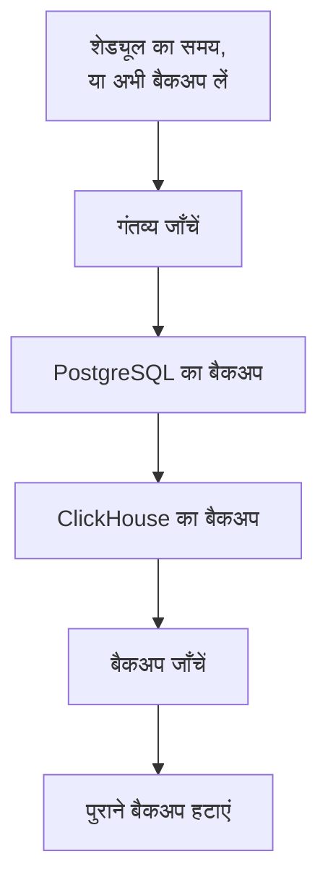

# बैकअप

सेल्फ-होस्टेड OneUptime का शेड्यूल पर अपने स्टोरेज में बैकअप लें, और Admin Dashboard से उसे रीस्टोर करें। बैकअप में PostgreSQL होता है, जिसमें आपके प्रोजेक्ट, मॉनिटर, इंसिडेंट, स्टेटस पेज और उपयोगकर्ता रहते हैं, और ClickHouse होता है, जिसमें आपके लॉग, ट्रेस और मेट्रिक्स रहते हैं। बैकअप उतने दिन रखे जाते हैं जितने आप चुनें, पुराने बैकअप आपके लिए हटा दिए जाते हैं, और किसी भी बैकअप को उसी जगह रीस्टोर किया जा सकता है। बैकअप एंटरप्राइज़ संस्करण का हिस्सा हैं।

:::cards
- [बैकअप सेट अप करें](#बैकअप-सेट-अप-करें): गंतव्य चुनें, उसे टेस्ट करें और शेड्यूल तय करें।
- [गंतव्य](#गंतव्य): हर सुझाया गया गंतव्य क्या माँगता है।
- [बैकअप रीस्टोर करें](#बैकअप-रीस्टोर-करें): क्या बदला जाता है, और मौजूदा डेटा कैसे सुरक्षित रहता है।
- [नए सर्वर पर जाएँ](#नए-सर्वर-पर-जाएँ): एक इंस्टॉलेशन के बैकअप दूसरे पर रीस्टोर करें।
:::

## बैकअप कैसे काम करता है



- **सुसंगत।** PostgreSQL को एक ही ट्रांज़ैक्शन में डंप किया जाता है, इसलिए डंप डेटाबेस का वह रूप है जो एक पल में था, जबकि OneUptime चलता रहता है। ClickHouse हर टेबल का बैकअप उसी रूप में लेता है जैसी वह उसके पार्ट्स पढ़ते समय थी।
- **सीधे गंतव्य तक।** `pg_dump` का आउटपुट लिखे जाते ही स्टोरेज में स्ट्रीम किया जाता है, और ClickHouse अपना बैकअप खुद स्टोरेज में लिखता है। डेटा कितना भी बड़ा हो, सर्वर की डिस्क पर कुछ नहीं लिखा जाता।
- **जाँचा हुआ।** बैकअप गिने जाने से पहले `pg_restore` गंतव्य से डंप को वापस पढ़ता है, और ClickHouse का अपने बैकअप का रिकॉर्ड वहाँ मिलता है। डंप का SHA-256 बैकअप के साथ रखा जाता है, और रीस्टोर कुछ भी बदलने से पहले उसे जाँचता है। जो बैकअप विफल होता है या रद्द किया जाता है, वह अपना लिखा सब हटा देता है, इसलिए गंतव्य पर केवल पूरे बैकअप रहते हैं।
- **एन्क्रिप्टेड।** बैकअप HTTPS पर स्टोरेज तक जाते हैं, जब तक कि आप `http://` एंडपॉइंट दर्ज न करें। Amazon S3, Google Cloud Storage, Azure Blob Storage और Cloudflare R2 जो कुछ भी स्टोर करते हैं, उसे एन्क्रिप्ट करते हैं; दूसरे स्टोरेज पर बकेट का एट-रेस्ट एन्क्रिप्शन चालू करें। गंतव्य के क्रेडेंशियल एन्क्रिप्ट करके रखे जाते हैं, और फिर कभी नहीं दिखाए जाते।
- **एक समय में एक।** पूरे इंस्टॉलेशन पर एक समय में केवल एक बैकअप या रीस्टोर चलता है। बाकी अपनी बारी का इंतज़ार करते हैं।

हर बैकअप गंतव्य के फ़ोल्डर (जब तक आप कोई और न चुनें, `oneuptime/backups/`) में अपना अलग फ़ोल्डर होता है, जिसका नाम उसके शुरू होने के समय (UTC) पर रखा जाता है:

```text
oneuptime/backups/20261024T020000Z-3f2a9c1b/manifest.json
oneuptime/backups/20261024T020000Z-3f2a9c1b/postgres.dump
oneuptime/backups/20261024T020000Z-3f2a9c1b/clickhouse/
```

`manifest.json` सबसे आखिर में लिखी जाती है: यह बताती है कि बैकअप में क्या है, और OneUptime के किस संस्करण ने इसे बनाया।

## शुरू करने से पहले

- **एंटरप्राइज़ संस्करण**, ऐसे लाइसेंस के साथ जिसमें बैकअप शामिल हों। ट्रायल और ग्रेस अवधि के दौरान बैकअप चलते हैं। लाइसेंस के बिना कोई नया बैकअप नहीं बनता, और बैकअप रीस्टोर करना और हटाना अब भी काम करता है। देखें [एंटरप्राइज़ संस्करण](/docs/self-hosted/enterprise)।
- **एक मास्टर एडमिन।** बैकअप Admin Dashboard में सेट अप किए जाते हैं।
- **केवल बैकअप के लिए एक बकेट या कंटेनर**, और ऐसे क्रेडेंशियल जो उसमें पढ़, लिख, सूचीबद्ध कर और हटा सकें।
- **ऐसा गंतव्य जिस तक ClickHouse भी पहुँचे।** ClickHouse अपना बैकअप खुद स्टोरेज में लिखता है, इसलिए उसके नेटवर्क को भी स्टोरेज तक पहुँचना चाहिए, जैसे OneUptime का नेटवर्क पहुँचता है।
- **PostgreSQL रीस्टोर करने के लिए, ऐसा डेटाबेस उपयोगकर्ता जो डेटाबेस बना सके।** रीस्टोर चालू डेटाबेस के बगल में एक नए डेटाबेस में लिखता है। OneUptime के साथ आने वाला PostgreSQL सुपरयूज़र के रूप में जुड़ता है, जिसे यह अनुमति है।

## बैकअप सेट अप करें

:::steps
### बैकअप पेज खोलें

Admin Dashboard में **सेटिंग्स → बैकअप** पर जाएँ और **बैकअप सेट अप करें** पर क्लिक करें।

### चुनें कि बैकअप कहाँ जाएँ

सुझाए गए गंतव्यों में से एक चुनें। हर एक क्या माँगता है, यह [गंतव्य](#गंतव्य) में है।

### कनेक्शन भरें

गंतव्य जो माँगता है, वह भरें। फ़ोल्डर, क्षेत्र और वे सेटिंग्स जिन्हें ज़्यादातर लोग वैसा ही छोड़ देते हैं, **और फ़ील्ड** में हैं, और **सेटअप गाइड** इस पेज पर उस गंतव्य का सेक्शन खोलता है।

### गंतव्य टेस्ट करें

**गंतव्य टेस्ट करें** पर क्लिक करें। OneUptime एक छोटी टेस्ट फ़ाइल लिखता, पढ़ता, सूचीबद्ध करता और हटाता है, जाँचता है कि `pg_dump` आपके PostgreSQL का बैकअप ले सकता है, और ClickHouse से उसकी टेबल्स की परिभाषाओं का एक टेस्ट बैकअप लिखने को कहता है। कुछ भी सहेजा नहीं जाता, और जो जाँच विफल होती है वह बताती है कि क्या बदलना है।

### चुनें कि बैकअप कब चलें

**कितनी बार** और **समय (UTC)** में समय चुनें, और साप्ताहिक बैकअप के लिए **सप्ताह का दिन** भी चुनें। जब तक आप न बदलें, **बैकअप इतने दिन रखें** 30 है। केवल PostgreSQL का बैकअप लेने के लिए **ClickHouse का भी बैकअप लें** बंद करें।

### बैकअप शुरू करें

**बैकअप शुरू करें** पर क्लिक करें। पहला बैकअप अगले शेड्यूल किए गए समय पर चलता है, और **अभी बैकअप लें** तुरंत एक बैकअप शुरू करता है।
:::

इसके बाद पेज दिखाता है कि बैकअप कैसे चल रहे हैं: पिछला बैकअप कब चला, वह कितना बड़ा था और उसमें कितना समय लगा, और अगला कब चलेगा। चल रहा बैकअप वह चरण दिखाता है जिस पर वह है, और **चरण देखें** हर चरण को चलते समय दिखाता है।

## गंतव्य

| गंतव्य | स्टोरेज | साइन इन करता है |
| --- | --- | --- |
| [Amazon S3](#amazon-s3) | Amazon S3 | एक्सेस कुंजी से |
| [Cloudflare R2](#cloudflare-r2) | S3-संगत स्टोरेज | R2 API टोकन से |
| [Backblaze B2](#backblaze-b2) | S3-संगत स्टोरेज | एप्लिकेशन कुंजी से |
| [Wasabi](#wasabi) | S3-संगत स्टोरेज | एक्सेस कुंजी से |
| [MinIO](#minio) | S3-संगत स्टोरेज | एक्सेस कुंजी से |
| [Google Cloud Storage](#google-cloud-storage) | Google Cloud Storage | HMAC कुंजी से |
| [Azure Blob Storage](#azure-blob-storage) | Azure Blob Storage | SAS टोकन या एक्सेस कुंजी से |
| [अन्य S3-संगत स्टोरेज](#अन्य-s3-संगत-स्टोरेज) | S3-संगत स्टोरेज | एक्सेस कुंजी से |

Amazon S3 या किसी अन्य S3-संगत स्टोरेज की कुंजी को फ़ोल्डर पर `s3:PutObject`, `s3:GetObject`, `s3:ListBucket`, `s3:DeleteObject` और `s3:AbortMultipartUpload` चाहिए, और कुछ नहीं:

```json
{
  "Version": "2012-10-17",
  "Statement": [
    {
      "Effect": "Allow",
      "Action": "s3:ListBucket",
      "Resource": "arn:aws:s3:::my-backups"
    },
    {
      "Effect": "Allow",
      "Action": [
        "s3:PutObject",
        "s3:GetObject",
        "s3:DeleteObject",
        "s3:AbortMultipartUpload"
      ],
      "Resource": "arn:aws:s3:::my-backups/oneuptime/backups/*"
    }
  ]
}
```

### Amazon S3

| फ़ील्ड | क्या भरें |
| --- | --- |
| **बकेट** | वह बकेट जिसमें बैकअप लिखे जाते हैं। इसे केवल बैकअप के लिए रखें। |
| **क्षेत्र** | बकेट का क्षेत्र। शुरू में यह `us-east-1` होता है। |
| **एक्सेस कुंजी ID** | ऊपर दी गई अनुमतियों वाली एक्सेस कुंजी। |
| **सीक्रेट एक्सेस कुंजी** | कुंजी का सीक्रेट। |
| **फ़ोल्डर** | **और फ़ील्ड** में। खाली छोड़ने पर बैकअप `oneuptime/backups/` में जाते हैं। |

Amazon S3 अपनी रखी हर फ़ाइल को एन्क्रिप्ट करता है, और OneUptime अपनी लिखी हर फ़ाइल के लिए उससे यह (SSE-S3) माँगता है।

### Cloudflare R2

**एंडपॉइंट** में अपने खाते का S3 API पता `https://<account-id>.r2.cloudflarestorage.com` दर्ज करें, जो R2 में बकेट की सेटिंग्स में मिलता है। फिर **बकेट** दर्ज करें, और उस R2 API टोकन का **एक्सेस कुंजी ID** और **सीक्रेट एक्सेस कुंजी** दर्ज करें जो उसमें ऑब्जेक्ट पढ़ और लिख सके। R2 से बैकअप वापस पढ़ने पर कोई शुल्क नहीं लगता।

### Backblaze B2

**एंडपॉइंट** में बकेट का S3 एंडपॉइंट दर्ज करें, जो Backblaze में उसके Buckets पेज पर दिखता है, जैसे `https://s3.us-west-004.backblazeb2.com`। फिर **बकेट** दर्ज करें, और एप्लिकेशन कुंजी की कुंजी ID और कुंजी को **एक्सेस कुंजी ID** और **सीक्रेट एक्सेस कुंजी** में दर्ज करें। क्षेत्र एंडपॉइंट से पढ़ा जाता है।

### Wasabi

**एंडपॉइंट** में बकेट के क्षेत्र का सर्विस URL दर्ज करें, जैसे `https://s3.us-east-1.wasabisys.com`, फिर **बकेट** और एक एक्सेस कुंजी दर्ज करें। क्षेत्र एंडपॉइंट से पढ़ा जाता है।

### MinIO

**एंडपॉइंट** में अपने MinIO सर्वर का S3 API पता दर्ज करें, जैसे `https://minio.example.com:9000`, फिर **बकेट** और ऐसी एक्सेस कुंजी दर्ज करें जिसकी पॉलिसी उसमें पढ़, लिख, सूचीबद्ध कर और हटा सके। OneUptime और ClickHouse दोनों को इस पते तक पहुँचना चाहिए।

### Google Cloud Storage

**बकेट** दर्ज करें, और ऐसे सर्विस अकाउंट का **HMAC एक्सेस की** और **HMAC सीक्रेट** दर्ज करें जिसके पास बकेट पर Storage Object Admin भूमिका हो। कुंजी Cloud Storage की सेटिंग्स में इंटरऑपरेबिलिटी टैब पर बनाएँ। OneUptime और ClickHouse, Cloud Storage के S3-संगत API के ज़रिए बकेट तक पहुँचते हैं।

### Azure Blob Storage

**स्टोरेज अकाउंट** और **कंटेनर** दर्ज करें, और **इससे साइन इन करें** में चुनें कि साइन इन कैसे हो: कंटेनर पर पढ़ने, जोड़ने, बनाने, लिखने, हटाने और सूचीबद्ध करने की अनुमतियों वाला **SAS टोकन**, या स्टोरेज खाते की **एक्सेस कुंजी**। SAS टोकन को कंटेनर तक सीमित किया जा सकता है, इसलिए यह ज़्यादा सुरक्षित विकल्प है। **क्लाउड** और **फ़ोल्डर**, **और फ़ील्ड** में हैं।

### अन्य S3-संगत स्टोरेज

Ceph, DigitalOcean Spaces, Hetzner Object Storage और S3 API वाले किसी भी स्टोरेज के लिए, उसका S3 पता **एंडपॉइंट** में दर्ज करें, फिर **बकेट** और एक एक्सेस कुंजी दर्ज करें। **और फ़ील्ड** में मौजूद **क्षेत्र** की ज़रूरत तभी है जब स्टोरेज इसे माँगे। खाली छोड़ने पर यह एंडपॉइंट से पढ़ा जाता है, नहीं तो `us-east-1` होता है।

## शेड्यूल और रिटेंशन

| सेटिंग | यह क्या करती है |
| --- | --- |
| **कितनी बार** | **हर घंटे**, **हर 6 घंटे**, **हर 12 घंटे**, **हर दिन** या **हर सप्ताह**। ज़्यादातर इंस्टॉलेशन के लिए हर दिन ठीक रहता है। |
| **समय (UTC)** | वह घंटा जब बैकअप शुरू होते हैं, UTC में, और बगल में आपका अपना समय दिखता है। हर 6 या 12 घंटे की गिनती इसी से होती है: `02:00` पर, हर 6 घंटे वाले बैकअप 02:00, 08:00, 14:00 और 20:00 पर चलते हैं। हर घंटे वाले बैकअप हर घंटे की शुरुआत में चलते हैं। |
| **सप्ताह का दिन** | वह दिन जब साप्ताहिक बैकअप चलते हैं। |
| **बैकअप इतने दिन रखें** | 1 से 3650 दिन तक। जब तक आप न बदलें, 30। |
| **ClickHouse का भी बैकअप लें** | जब तक आप बंद न करें, चालू। PostgreSQL का बैकअप हमेशा लिया जाता है। |

हर बैकअप के बाद, जो बैकअप **बैकअप इतने दिन रखें** से पहले शुरू हुए थे, वे गंतव्य से और सूची से हटा दिए जाते हैं, सिवाय सफल हुए सबसे नए बैकअप के, जो कितना भी पुराना हो, रखा जाता है। इसलिए बैकअप बंद करना, या किसी लाइसेंस का समाप्त होना, आपको कभी बिना रीस्टोर करने लायक बैकअप के नहीं छोड़ता।

स्टेटस कार्ड के मेनू में **शेड्यूल किए गए बैकअप बंद करें** शेड्यूल रोक देता है। **अभी बैकअप लें** अब भी काम करता है, और कोई बैकअप नहीं हटाया जाता। **चालू करें** शेड्यूल फिर से शुरू करता है।

## बैकअप रीस्टोर करें

:::warning रीस्टोर क्या बदलता है
रीस्टोर मौजूदा डेटा को बैकअप के डेटा से बदल देता है। बैकअप बनने के बाद बदला गया सब कुछ खो जाता है, जब तक कि आप पहले मौजूदा डेटा का बैकअप न लें।
:::

:::steps
### बैकअप चुनें

**बैकअप** टेबल में, जिस बैकअप पर वापस जाना है उस पर **रीस्टोर करें** क्लिक करें। OneUptime पहले बैकअप की जाँच करता है: कि उसकी फ़ाइलें गंतव्य पर हैं और बदली नहीं गईं, OneUptime के किस संस्करण ने उसे बनाया, और यह सर्वर उसे रीस्टोर कर सकता है।

### चुनें कि क्या रीस्टोर करना है

**PostgreSQL: प्रोजेक्ट, मॉनिटर, इंसिडेंट, उपयोगकर्ता**, **ClickHouse: लॉग, ट्रेस, मेट्रिक्स** या दोनों पर टिक करें। डायलॉग दिखाता है कि बैकअप में कितने प्रोजेक्ट, उपयोगकर्ता और मॉनिटर हैं, और अभी कितने हैं।

### मौजूदा डेटा सुरक्षित रखें

**पहले मौजूदा डेटा का बैकअप लें** पर टिक लगा होता है: रीस्टोर उस डेटा के बैकअप से शुरू होता है जिसे वह बदलता है, ताकि आप उस पर वापस जा सकें। टिक तभी हटाएँ जब आपके पास कोई दूसरी कॉपी हो, क्योंकि उसके बिना रीस्टोर वापस नहीं लिया जा सकता।

### पुष्टि करें

`restore` टाइप करें और **रीस्टोर करें** पर क्लिक करें।
:::

रीस्टोर चरण दर चरण चलता है, और पेज हर चरण दिखाता है:

| चरण | क्या होता है |
| --- | --- |
| **बैकअप जाँचें** | बैकअप की फ़ाइलें मौजूद हैं, और यह इंस्टॉलेशन उसे रीस्टोर कर सकता है। |
| **मौजूदा डेटा का बैकअप** | मौजूदा डेटा का बैकअप, जब तक आपने टिक न हटाया हो। |
| **PostgreSQL रीस्टोर करें** | बैकअप को चालू डेटाबेस के बगल में एक नए डेटाबेस में रीस्टोर किया जाता है, और जाँचा जाता है। |
| **ClickHouse रीस्टोर करें** | चालू टेलीमेट्री को अलग रख दिया जाता है, और उसकी जगह बैकअप की टेलीमेट्री रीस्टोर की जाती है। |
| **रीस्टोर किए गए डेटा पर स्विच करें** | रीस्टोर किया गया डेटाबेस एक पल में चालू डेटाबेस का नाम ले लेता है। |
| **रीस्टोर किए गए डेटा को अप-टू-डेट करें** | इस संस्करण के डेटाबेस माइग्रेशन रीस्टोर किए गए डेटा पर चलते हैं। |
| **साफ़-सफ़ाई** | जो अलग रखा गया था, उसे हटा दिया जाता है। |

स्विच होने तक OneUptime मौजूदा डेटा पर चलता रहता है, और उससे पहले वह जो कुछ इस्तेमाल करता है, उसमें कुछ नहीं बदलता। स्विच से पहले विफल या रद्द होने वाला रीस्टोर सब कुछ वैसा ही छोड़ देता है, और स्विच के दौरान विफल होने वाला रीस्टोर अलग रखी चीज़ें वापस रख देता है। ClickHouse रीस्टोर होने के दौरान आने वाली टेलीमेट्री स्टोर नहीं होती। PostgreSQL रीस्टोर होने के बाद आप साइन आउट हो सकते हैं: ऐसे खाते से साइन इन करें जो बैकअप में है।

:::details रीस्टोर कहता है कि बैकअप किसी दूसरे ENCRYPTION_SECRET से बनाया गया था
OneUptime जो क्रेडेंशियल स्टोर करता है, जैसे किसी गंतव्य की कुंजी, वे `ENCRYPTION_SECRET` से एन्क्रिप्ट होते हैं। रीस्टोर करने से पहले वह `ENCRYPTION_SECRET` सेट करें जिससे बैकअप बनाया गया था, नहीं तो बाद में वे क्रेडेंशियल पढ़े नहीं जा सकेंगे।
:::

## नए सर्वर पर जाएँ

:::steps
### नए सर्वर पर OneUptime इंस्टॉल करें

एंटरप्राइज़ संस्करण इंस्टॉल करें, उसी संस्करण में जिसने बैकअप बनाए थे या किसी नए संस्करण में।

### वही गंतव्य सेट अप करें

**सेटिंग्स → बैकअप** में वह गंतव्य सेट अप करें जिसमें आपके बैकअप हैं। पेज वहाँ पहले से मौजूद बैकअप ढूँढकर उन्हें सूची में दिखाता है, रीस्टोर के लिए तैयार। स्टेटस कार्ड के मेनू में **बैकअप खोजें** फिर से ढूँढता है।

### सबसे नया बैकअप रीस्टोर करें

ऊपर बताए तरीके से रीस्टोर करें। OneUptime के पुराने संस्करण का बनाया बैकअप इस संस्करण तक अपडेट कर दिया जाता है। नए संस्करण का बनाया बैकअप अपडेट करने के बाद रीस्टोर किया जा सकता है।
:::

## जब बैकअप विफल हो

स्टेटस कार्ड त्रुटि के साथ **पिछला बैकअप विफल रहा** दिखाता है, और **चरण देखें** वह चरण दिखाता है जिस पर बैकअप रुका, और क्यों। हर मास्टर एडमिन को एक ईमेल भी मिलता है, जब तक बैकअप विफल होते रहें तब तक हर 12 घंटे में अधिकतम एक बार। विफल रीस्टोर की सूचना हमेशा ईमेल से दी जाती है।

## समस्या निवारण

:::details ClickHouse गंतव्य तक नहीं पहुँच पाता
ClickHouse खुद स्टोरेज से जुड़ता है। उसके नेटवर्क को गंतव्य के पते तक पहुँचने दें, जैसे OneUptime का नेटवर्क पहुँचता है, फिर गंतव्य दोबारा टेस्ट करें।
:::

:::details pg_dump मौजूद नहीं है या बहुत पुराना है
एंटरप्राइज़ इमेज में `pg_dump` और `pg_restore` 16, 17 और 18 हैं, जो PostgreSQL 18 और उससे पहले के हर संस्करण का बैकअप लेते हैं। किसी दूसरी इमेज पर PostgreSQL क्लाइंट टूल्स इंस्टॉल करें, या `BACKUP_POSTGRES_BIN_DIR` को उस डायरेक्टरी पर सेट करें जिसमें वे हैं। `pg_dump` कम से कम आपके PostgreSQL सर्वर जितना नया होना चाहिए।
:::

:::details PostgreSQL रीस्टोर करने के लिए एक बदलाव ज़रूरी है
रीस्टोर एक डेटाबेस बनाता है, और OneUptime के डेटाबेस उपयोगकर्ता को इसकी अनुमति होनी चाहिए। PostgreSQL पर सुपरयूज़र के रूप में यह चलाएँ, `oneuptime` की जगह अपना `DATABASE_USERNAME` रखकर, फिर दोबारा रीस्टोर करें:

```sql
ALTER USER oneuptime CREATEDB;
```
:::

:::details कोई बैकअप पिछले गंतव्य पर है
गंतव्य बदलने के बाद, पुराने गंतव्य पर बने बैकअप **पिछले गंतव्य पर** के निशान के साथ सूची में बने रहते हैं। उनमें से किसी को रीस्टोर करने के लिए वह गंतव्य फिर से सेट अप करें, या उसे सूची से हटा दें: उसकी फ़ाइलें जहाँ हैं वहीं रहती हैं।
:::

## अगले कदम

:::cards
- [एंटरप्राइज़ संस्करण](/docs/self-hosted/enterprise): लाइसेंस, और एंटरप्राइज़ संस्करण क्या जोड़ता है।
- [अपग्रेड करना](/docs/installation/upgrading): हर अपग्रेड से पहले बैकअप लें।
- [Docker Compose](/docs/installation/docker-compose): एक सर्वर पर OneUptime चलाएँ।
:::
