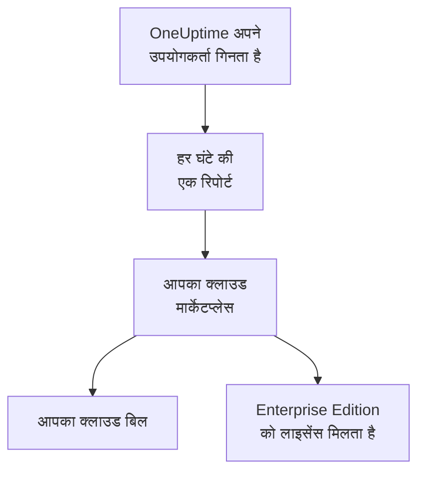

# क्लाउड मार्केटप्लेस

AWS Marketplace, Microsoft Marketplace या Google Cloud Marketplace पर खरीदा गया OneUptime Enterprise अपने ख़ुद के Kubernetes क्लस्टर में चलाएँ। मार्केटप्लेस आपके इंस्टॉलेशन के हर उपयोगकर्ता का बिल घंटे के हिसाब से आपके क्लाउड बिल पर बनाता है, और आपकी सदस्यता ही Enterprise Edition का लाइसेंस है: सक्रिय करने के लिए कोई लाइसेंस कुंजी नहीं है।

:::cards
- [OneUptime इंस्टॉल करें](#oneuptime-इंस्टॉल-करें): Amazon EKS, Azure Kubernetes Service या Google Kubernetes Engine पर।
- [बिलिंग कैसे काम करती है](#बिलिंग-कैसे-काम-करती-है): हर उपयोगकर्ता के लिए हर घंटे USD 0.10, जिसकी रिपोर्ट हर घंटे भेजी जाती है।
- [अपग्रेड करना](#अपग्रेड-करना): नई रिलीज़ आपके क्लस्टर तक कैसे पहुँचती है।
- [समस्या निवारण](#समस्या-निवारण): जब संस्करण लेबल मार्केटप्लेस के बारे में चेतावनी दे।
:::

## यह कैसे काम करता है

OneUptime हर 15 मिनट में अपने उपयोगकर्ताओं को गिनता है, और हर घंटे के लिए उस मार्केटप्लेस को एक ही रिपोर्ट भेजता है जहाँ से आपने उसे खरीदा है, जिसमें उस घंटे में दिखे सबसे ज़्यादा उपयोगकर्ताओं की संख्या होती है। मार्केटप्लेस उस घंटे को आपके क्लाउड बिल में जोड़ देता है। मार्केटप्लेस जो भी रिपोर्ट स्वीकार करता है, वह OneUptime को यह भी बताती है कि आपकी सदस्यता सक्रिय है, और इसी से Enterprise Edition का लाइसेंस बना रहता है।



| | AWS | Microsoft | Google Cloud |
| --- | --- | --- | --- |
| लिस्टिंग | अभी सार्वजनिक नहीं: [हमसे संपर्क करें](https://oneuptime.com/enterprise/demo) | [OneUptime Enterprise](https://marketplace.microsoft.com/en-us/product/oneupitme.oneuptime-enterprise) | अभी सार्वजनिक नहीं: [हमसे संपर्क करें](https://oneuptime.com/enterprise/demo) |
| किस पर चलता है | Amazon EKS | Azure Kubernetes Service (AKS) | Google Kubernetes Engine (GKE) |
| आप इसे किससे इंस्टॉल करते हैं | Helm, लिस्टिंग की रजिस्ट्री से | Azure पोर्टल | Google Cloud कंसोल |
| OneUptime किससे रिपोर्ट करता है | उसके Kubernetes सर्विस अकाउंट का IAM रोल | वह मैनेज्ड आइडेंटिटी जो Azure इंस्टॉलेशन को देता है | वह रिपोर्टिंग सीक्रेट जो Google Cloud Marketplace डिप्लॉयमेंट के लिए बनाता है |
| नई रिलीज़ | आप Helm से अपग्रेड करते हैं | माइनर रिलीज़ आपके लिए इंस्टॉल हो जाती हैं | आप हाथ से अपग्रेड करते हैं |

## शुरू करने से पहले

- **एक Kubernetes क्लस्टर**, मार्केटप्लेस वाले क्लाउड पर, जिसमें कम से कम 3 नोड हों और हर नोड में 4 vCPU और 16 GiB मेमोरी हो, साथ ही एक डिफ़ॉल्ट StorageClass और `LoadBalancer` सेवाओं का समर्थन हो। OneUptime अपना PostgreSQL, ClickHouse और Valkey क्लस्टर में ख़ुद चलाता है; उनका आकार तय करने के लिए [साइज़िंग और क्षमता नियोजन](/docs/installation/sizing) देखें।
- **एक डोमेन नाम**, OneUptime के लिए, जैसे `oneuptime.example.com`, जिसे आप क्लस्टर के लोड बैलेंसर की ओर इंगित कर सकें।
- **आउटबाउंड HTTPS**, क्लस्टर से मार्केटप्लेस तक, ताकि OneUptime अपने उपयोगकर्ताओं की रिपोर्ट भेज सके: AWS पर `metering.marketplace.<region>.amazonaws.com` और `sts.<region>.amazonaws.com`, Azure पर `marketplaceapi.microsoft.com`, और Google Cloud पर `servicecontrol.googleapis.com` और `oauth2.googleapis.com`।

## OneUptime इंस्टॉल करें

### AWS Marketplace

AWS पर OneUptime अपने उपयोगकर्ताओं की रिपोर्ट एक IAM रोल से भेजता है, जिसे EKS उसके Kubernetes सर्विस अकाउंट को देता है (सर्विस अकाउंट के लिए IAM रोल)। AWS Marketplace, EKS से आया उपयोग तभी स्वीकार करता है जब वह इसी तरह हस्ताक्षरित हो।

:::steps
1. AWS Marketplace पर OneUptime Enterprise की सदस्यता लें, फिर **Continue to Configuration** चुनें, वर्ज़न तय करें और **Continue to Launch** चुनें।
2. अगर क्लस्टर के पास अभी कोई IAM OIDC प्रोवाइडर नहीं है, तो उसे एक प्रोवाइडर दें, और नीचे दी गई कमांड से `oneuptime` सर्विस अकाउंट को ऐसे IAM रोल के साथ बनाएँ जिसमें `AWSMarketplaceMeteringFullAccess` पॉलिसी हो। इन्हें लॉन्च पेज के **General launch instructions** के चरण 1 की `eksctl` कमांड की जगह चलाएँ: वह कमांड ऐसा रोल जोड़ती है जिसे आपको पहले खुद बनाना पड़ता।
3. **General launch instructions** के चरण 2 की कमांड से Helm के ज़रिए लिस्टिंग की रजिस्ट्री में लॉग इन करें और चार्ट इंस्टॉल करें। `helm install` कमांड में `serviceAccount.name` को `oneuptime` पर, `host` को अपने डोमेन नाम पर, और अगर OneUptime के आगे कोई सर्टिफ़िकेट है तो `httpProtocol` को `https` पर सेट करें।
4. [OneUptime खोलें](#oneuptime-खोलें)।
:::

```bash
eksctl utils associate-iam-oidc-provider --cluster <cluster> --approve
eksctl create iamserviceaccount --name oneuptime --namespace oneuptime --cluster <cluster> \
  --attach-policy-arn arn:aws:iam::aws:policy/AWSMarketplaceMeteringFullAccess \
  --approve --override-existing-serviceaccounts
```

चरण 3 की वैल्यू एक फ़ाइल में रखें, और हर `helm upgrade` में इसे दें:

```yaml title="values.yaml"
host: oneuptime.example.com
httpProtocol: https
serviceAccount:
  name: oneuptime
```

### Microsoft Marketplace

Azure पर OneUptime एक Kubernetes ऐप्लिकेशन है: AKS इसे क्लस्टर एक्सटेंशन के रूप में इंस्टॉल करता है, और इसे वह मैनेज्ड आइडेंटिटी देता है जिससे यह अपने उपयोगकर्ताओं की रिपोर्ट भेजता है।

:::steps
1. Azure पोर्टल में Microsoft Marketplace पर OneUptime Enterprise खोलें, या अपना AKS क्लस्टर खोलें और **Extensions + applications** > **Add** चुनें, फिर प्लान चुनें और **Create** चुनें।
2. सदस्यता और रिसोर्स ग्रुप चुनें, और यह भी कि किसी मौजूदा AKS क्लस्टर पर इंस्टॉल करना है या नया क्लस्टर बनाना है।
3. **OneUptime** चरण में इंस्टॉलेशन का एक नाम, अपना डोमेन नाम और उसका प्रोटोकॉल दर्ज करें।
4. **Review + create** चुनें, फिर **Create**। इंस्टॉलेशन में कुछ मिनट लगते हैं; यह तब पूरा होता है जब **Extensions + applications** इसकी प्रोविज़निंग स्थिति **Succeeded** दिखाता है।
5. [OneUptime खोलें](#oneuptime-खोलें)।
:::

कस्टम मीटर AKS क्लस्टर पर काम करते हैं, Azure Arc-सक्षम Kubernetes पर नहीं, इसलिए Microsoft Marketplace पर OneUptime Enterprise सिर्फ़ AKS पर इंस्टॉल होता है।

### Google Cloud Marketplace

Google Cloud पर मार्केटप्लेस एक डिप्लॉयर चलाता है, जो OneUptime को आपके चुने हुए नेमस्पेस में इंस्टॉल करता है, और साथ में एक रिपोर्टिंग सीक्रेट भी, जिससे OneUptime अपने उपयोगकर्ताओं की रिपोर्ट भेजता है।

:::steps
1. Google Cloud कंसोल में Google Cloud Marketplace पर OneUptime Enterprise खोलें और **Configure** चुनें।
2. GKE क्लस्टर और नेमस्पेस चुनें, और इंस्टॉलेशन का एक नाम, अपना डोमेन नाम और उसका प्रोटोकॉल दर्ज करें।
3. **Deploy** चुनें। डिप्लॉयमेंट में कुछ मिनट लगते हैं; यह तब पूरा होता है जब ऐप्लिकेशन **Kubernetes Engine** > **Applications** के तहत तैयार दिखता है।
4. [OneUptime खोलें](#oneuptime-खोलें)।
:::

## OneUptime खोलें

OneUptime सबसे पहले अपने डेटाबेस को माइग्रेट करता है, जिसमें नए इंस्टॉलेशन पर कुछ मिनट लगते हैं। फिर अपने डोमेन नाम को उसके लोड बैलेंसर की ओर इंगित करें:

```bash
kubectl get service --namespace <namespace>
```

जिस सेवा का नाम `-nginx` पर ख़त्म होता है, उसका एक `EXTERNAL-IP` होता है: अपने डोमेन नाम के लिए एक DNS रिकॉर्ड बनाएँ जो उसकी ओर इशारा करे। डोमेन नाम खोलें और साइन अप करें। नए इंस्टॉलेशन का पहला खाता उसका मास्टर एडमिन बनता है, जो `/admin` पर एडमिन डैशबोर्ड खोल सकता है।

घंटे भर के भीतर संस्करण लेबल Enterprise Edition दिखाने लगता है, जिसका लाइसेंस आपके मार्केटप्लेस से आता है। मास्टर एडमिन संस्करण लेबल को एडमिन डैशबोर्ड के हेडर में और Dashboard के फ़ुटर में देखते हैं।

## बिलिंग कैसे काम करती है

| क्या | कैसे काम करता है |
| --- | --- |
| कीमत | हर उपयोगकर्ता के लिए हर घंटे USD 0.10, यानी हर उपयोगकर्ता के लिए हर महीने लगभग USD 73। |
| किसे गिना जाता है | इंस्टॉलेशन पर OneUptime लॉगिन रखने वाला हर व्यक्ति। स्टेटस पेज सब्सक्राइबर और निजी स्टेटस पेज में साइन इन करने वाले लोग नहीं गिने जाते। |
| कब | OneUptime हर 15 मिनट में अपने उपयोगकर्ताओं को गिनता है, और हर घंटे की रिपोर्ट एक ही बार भेजता है, जिसमें उस घंटे में दिखे सबसे ज़्यादा उपयोगकर्ताओं की संख्या होती है। जिस घंटे OneUptime नहीं चल रहा था, उसका बिल नहीं बनता। |
| कहाँ | आपके AWS, Azure या Google Cloud बिल पर, मार्केटप्लेस के ज़रिए। |
| शामिल नहीं | ख़ुद क्लस्टर: आपका क्लाउड उसके नोड, डिस्क और लोड बैलेंसर का बिल हमेशा की तरह बनाता है। |

हर इंस्टॉलेशन का बिल अलग से बनता है, इसलिए स्टेजिंग इंस्टॉलेशन का भी बिल बनता है। सालाना कीमत, वॉल्यूम डिस्काउंट या नॉन-प्रोडक्शन इंस्टॉलेशन की कीमत के लिए [sales@oneuptime.com](mailto:sales@oneuptime.com) से एक प्राइवेट ऑफ़र माँगें, जिसे आप मार्केटप्लेस पर स्वीकार करते हैं।

जब कोई रिपोर्ट नेटवर्क की समस्या या मार्केटप्लेस के आउटेज की वजह से नहीं भेजी जा पाती, तो OneUptime उसे अगली बार चलने पर फिर से भेजता है। हर रिपोर्ट में उसके घंटे की एक कुंजी होती है, इसलिए किसी भी घंटे का बिल दो बार नहीं बनता।

## लाइसेंसिंग कैसे काम करती है

आपकी मार्केटप्लेस सदस्यता ही आपका लाइसेंस है। मार्केटप्लेस जो भी रिपोर्ट स्वीकार करता है, वह हर उपयोगकर्ता के लिए हर एंटरप्राइज़ सुविधा को अगले 72 घंटों तक लाइसेंस देती है। OneUptime की लाइसेंस कुंजी भी उसी इंस्टॉलेशन पर काम करती है: इंस्टॉलेशन इन दोनों में से जो बेहतर हो, उसी पर चलता है।

| क्या होता है | संस्करण लेबल क्या दिखाता है |
| --- | --- |
| मार्केटप्लेस हर घंटे की रिपोर्ट स्वीकार करता है | Enterprise Edition, जिसका लाइसेंस आपके मार्केटप्लेस से आता है। |
| 72 घंटे से कोई रिपोर्ट स्वीकार नहीं हुई है | **Enterprise Edition (Marketplace Reports Failing)**: हर एंटरप्राइज़ सुविधा 30 दिन की ग्रेस अवधि तक काम करती रहती है। |
| मार्केटप्लेस बताता है कि इंस्टॉलेशन की सदस्यता नहीं है, या ग्रेस अवधि ख़त्म हो जाती है | **Enterprise Edition (Marketplace Subscription Ended)**: एंटरप्राइज़ सुविधाएँ रुक जाती हैं, जैसे [लाइसेंस समाप्त होने](/docs/self-hosted/enterprise#जब-लाइसेंस-समाप्त-हो-जाए-या-न-हो) पर रुकती हैं। |

मार्केटप्लेस रद्द या निलंबित सदस्यता को, या ऐसे इंस्टॉलेशन को अस्वीकार करता है जो वह नहीं है जिसे आपने खरीदा था। मॉनिटरिंग, अलर्ट, इंसिडेंट, ऑन-कॉल और स्टेटस पेज हर हाल में काम करते रहते हैं, और कुछ भी नहीं हटाया जाता। फिर से सदस्यता लें, और अगली स्वीकार की गई रिपोर्ट बिना रीस्टार्ट के Enterprise Edition को फिर से लाइसेंस दे देती है।

## अपग्रेड करना

| मार्केटप्लेस | नई रिलीज़ आपके क्लस्टर तक कैसे पहुँचती है |
| --- | --- |
| AWS Marketplace | हर रिलीज़ लिस्टिंग का एक नया वर्ज़न है। लिस्टिंग की रजिस्ट्री के चार्ट, नए वर्ज़न और अपनी values फ़ाइल के साथ `helm upgrade` चलाएँ। |
| Microsoft Marketplace | AKS नई माइनर और पैच रिलीज़ आपके लिए इंस्टॉल करता है। नई मेजर रिलीज़ तब तक रुकी रहती है जब तक आप उसे स्वीकार न करें। आप **Extensions + applications** में इंस्टॉलेशन के पेज पर स्वचालित अपग्रेड बंद कर सकते हैं। |
| Google Cloud Marketplace | Google Cloud Marketplace डिप्लॉयमेंट को उसी वर्ज़न पर रखता है जिसे उसने इंस्टॉल किया था, और उसे कभी अपडेट नहीं करता। किसी डिप्लॉयमेंट को नए वर्ज़न पर ले जाने से पहले [सपोर्ट](https://oneuptime.com/support) से संपर्क करें। |

नई रिलीज़ शुरू होने पर OneUptime अपने डेटाबेस को माइग्रेट करता है। नई मेजर रिलीज़ पर जाने से पहले [अपग्रेड नोट्स](/docs/installation/upgrading) पढ़ें।

मार्केटप्लेस के ज़रिए ही अपग्रेड करें। मार्केटप्लेस से हुआ इंस्टॉलेशन ख़ुद को GitHub पर OneUptime की रिलीज़ से नहीं मिलाता: आपका मार्केटप्लेस जो संस्करण देता है, उन्हीं पर अपग्रेड करें।

## सेटिंग्स और स्केलिंग

स्केल बढ़ने से आपका बिल नहीं बदलता: OneUptime का बिल प्रति उपयोगकर्ता बनता है। ज़्यादा रेप्लिका या बड़े नोड सिर्फ़ वह रकम बदलते हैं जिसका बिल आपका क्लाउड क्लस्टर के लिए बनाता है।

| मार्केटप्लेस | आपकी सेटिंग्स कहाँ रहती हैं |
| --- | --- |
| AWS Marketplace | आपकी values फ़ाइल। [Helm चार्ट](https://artifacthub.io/packages/helm/oneuptime/oneuptime) की हर सेटिंग काम करती है, सिवाय साथ आने वाले ऑपरेटरों के। |
| Microsoft Marketplace | इंस्टॉलेशन की कॉन्फ़िगरेशन सेटिंग्स, **Extensions + applications** में उसके पेज पर या `az k8s-extension update --configuration-settings` से। हर सेटिंग एक चार्ट मान है, जैसे `autoscaling.enabled=true`। |
| Google Cloud Marketplace | डिप्लॉयमेंट फ़ॉर्म के फ़ील्ड। बाकी कुछ भी `kubectl` से, डिप्लॉयमेंट के अपने संसाधनों पर बदलें। |

- **OneUptime को स्केल करने के लिए** चार्ट की रेप्लिका और ऑटोस्केलिंग सेटिंग्स (`deployment.replicaCount`, `autoscaling.enabled`, और हर सेवा के अपने ओवरराइड) इस्तेमाल करें, और नोड के लिए अपने क्लस्टर का ऑटोस्केलर।
- **मार्केटप्लेस सेटिंग्स वैसी ही रखें जैसी लिस्टिंग उन्हें सेट करती है**: `enterpriseMarketplace` और, AWS पर, `serviceAccount`। इनके बिना OneUptime रिपोर्ट नहीं भेज सकता, और Enterprise Edition को लाइसेंस नहीं मिलता।
- **KEDA, CloudNativePG और Altinity ClickHouse ऑपरेटर शामिल नहीं हैं**, क्योंकि मार्केटप्लेस सिर्फ़ वही इमेज देता है जो उसकी लिस्टिंग में हैं। हाई अवेलेबिलिटी वाले डेटा स्टोर के लिए `externalPostgres`, `externalRedis` और `externalClickhouse` से OneUptime को मैनेज्ड सेवाओं की ओर इंगित करें।

बिलिंग इस पर निर्भर नहीं करती कि कितनी रेप्लिका चल रही हैं: एक समय में रिपोर्टिंग का सिर्फ़ एक ही रन चलता है, और हर घंटे की एक ही रिपोर्ट होती है।

## समस्या निवारण

:::details संस्करण लेबल Enterprise Edition (Marketplace Reports Failing) दिखाता है
OneUptime मार्केटप्लेस को रिपोर्ट नहीं भेज पा रहा है। इस बारे में वह जो भी लाइन लॉग करता है, वह `OneUptime Enterprise marketplace billing` से शुरू होती है; जिस लाइन में लिखा हो कि उपयोग "cannot be reported", वह बताती है कि क्या कमी है। आम वजहें:

- **AWS:** `oneuptime` सर्विस अकाउंट के पास कोई IAM रोल नहीं है, या रोल में `AWSMarketplaceMeteringFullAccess` पॉलिसी नहीं है (`AWSMarketplaceMeteringRegisterUsage` काफ़ी नहीं है)। पॉलिसी को रोल से जोड़ें, या [AWS Marketplace](#aws-marketplace) में दी गई `eksctl` कमांड से रोल बनाएँ और फिर `kubectl rollout restart deployment --namespace oneuptime` से OneUptime के पॉड रीस्टार्ट करें।
- **Azure:** इंस्टॉलेशन Microsoft Marketplace ऐप्लिकेशन नहीं है, उदाहरण के लिए क्योंकि इसे Helm से इंस्टॉल किया गया था, इसलिए इसके पास रिपोर्ट भेजने के लिए कोई आइडेंटिटी या प्लान नहीं है। इसे Azure पोर्टल से इंस्टॉल करें।
- **Google Cloud:** डिप्लॉयमेंट का रिपोर्टिंग सीक्रेट हटा दिया गया या बदल दिया गया।
- **हर मार्केटप्लेस:** कोई फ़ायरवॉल या प्रॉक्सी [शुरू करने से पहले](#शुरू-करने-से-पहले) में बताए गए आउटबाउंड HTTPS को रोक रहा है।

जब तक आप इसे ठीक करते हैं, उपयोग सहेजा रहता है, और OneUptime के फिर से रिपोर्ट भेज पाने पर उसका बिल बनता है। 30 दिन से पुराने उपयोग का बिल नहीं बनता।
:::

:::details संस्करण लेबल Enterprise Edition (Marketplace Subscription Ended) दिखाता है
मार्केटप्लेस ने इंस्टॉलेशन को अस्वीकार कर दिया है: सदस्यता रद्द या निलंबित हो गई है, या यह इंस्टॉलेशन वह नहीं है जिसे मार्केटप्लेस पर खरीदा गया था। मार्केटप्लेस पर सदस्यता जाँचें और फिर से सदस्यता लें; अगली स्वीकार की गई रिपोर्ट Enterprise Edition को फिर से लाइसेंस दे देती है। यही लेबल तब भी दिखता है जब पूरी ग्रेस अवधि तक रिपोर्ट विफल होती रहीं।
:::

:::details इंस्टॉलेशन के बाद पॉड Pending में ही अटके रहते हैं
OneUptime के डेटाबेस को पर्सिस्टेंट वॉल्यूम चाहिए। क्लस्टर को एक डिफ़ॉल्ट StorageClass दें: Amazon EKS पर Amazon EBS CSI ड्राइवर ऐड-ऑन इंस्टॉल करें।
:::

## अगले कदम

:::cards
- [एंटरप्राइज़ संस्करण](/docs/self-hosted/enterprise): Enterprise Edition क्या जोड़ता है, और लाइसेंस समाप्त होने पर क्या रुकता है।
- [अपग्रेड करना](/docs/installation/upgrading): हर रिलीज़ के अपग्रेड नोट्स।
- [साइज़िंग और क्षमता नियोजन](/docs/installation/sizing): अपनी टेलीमेट्री के लिए डेटा स्टोर का आकार तय करें।
- [वास्तुकला](/docs/self-hosted/architecture): आपके क्लस्टर में क्या चलता है।
- [Kubernetes एजेंट](/docs/telemetry/kubernetes-agent#amazon-eks-ऐड-ऑन-के-रूप-में-इंस्टॉल-करें): AWS Marketplace पर भी मुफ़्त, Amazon EKS ऐड-ऑन के रूप में, उन क्लस्टर के लिए जो OneUptime को डेटा भेजते हैं।
:::
