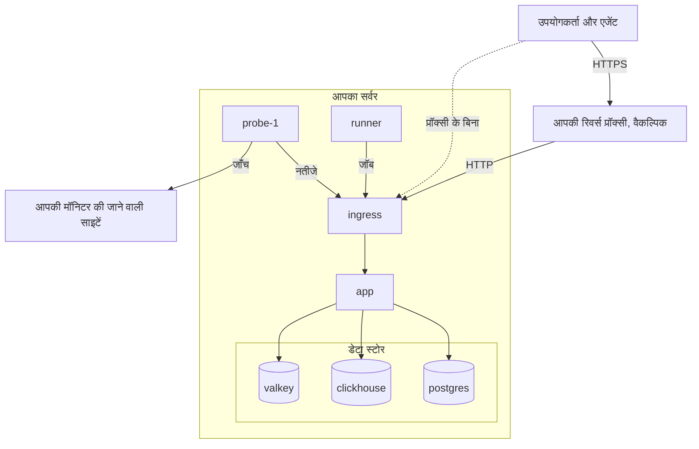

# Docker Compose

Docker Compose से एक ही Linux सर्वर पर पूरा, मुफ़्त OneUptime इंस्टेंस चलाएँ। यह पेज आपको एक नए सर्वर से चलते हुए इंस्टेंस तक ले जाता है, फिर HTTPS, प्रोडक्शन के लिए मज़बूती, बैकअप, अपडेट और हटाने के बारे में बताता है।

:::cards
- [OneUptime इंस्टॉल करें](#oneuptime-इंस्टॉल-करें): नए सर्वर से आपके पहले खाते तक, छह चरणों में।
- [HTTPS सेट अप करें](#https-सेट-अप-करें): OneUptime को सर्टिफ़िकेट लेने दें, या आगे अपनी ख़ुद की प्रॉक्सी लगाएँ।
- [प्रोडक्शन चेकलिस्ट](#प्रोडक्शन-चेकलिस्ट): असली ट्रैफ़िक आने से पहले क्या तय करना है।
- [OneUptime अपडेट करें](#oneuptime-अपडेट-करें): नवीनतम रिलीज़ पर जाएँ।
:::

## यह कैसे काम करता है

Docker Compose, OneUptime के हर हिस्से को आपके सर्वर पर कंटेनर के रूप में चलाता है। सारा ट्रैफ़िक `ingress` कंटेनर से आता है, जो उसे `app` तक भेजता है। ऐप अपना डेटा PostgreSQL, ClickHouse और Valkey में रखता है। साथ आने वाला प्रोब आपके मॉनिटरों की जाँच चलाता है और ingress के ज़रिए नतीजे वापस भेजता है।



| सेवा | इमेज | यह क्या करती है |
| --- | --- | --- |
| `ingress` | `oneuptime/nginx` | पोर्ट 80 और 443 पर सारा ट्रैफ़िक लेती है और उसे ऐप तक भेजती है। जब OneUptime सर्टिफ़िकेट संभालता है, तब HTTPS देती है। |
| `app` | `oneuptime/app` | डैशबोर्ड, API, स्टेटस पेज, टेलीमेट्री इनजेस्ट और बैकग्राउंड वर्कर। |
| `probe-1` | `oneuptime/probe` | एक ग्लोबल प्रोब जो आपके मॉनिटरों की जाँच चलाता है। यह होस्ट का नेटवर्क इस्तेमाल करता है। |
| `runner` | `oneuptime/runner` | इंस्टेंस का Runner, जो AI से कोड फ़िक्स चलाता है। यह होस्ट का नेटवर्क इस्तेमाल करता है। |
| `postgres` | `postgres:15` | कॉन्फ़िगरेशन और स्थिति: मॉनिटर, इंसिडेंट, उपयोगकर्ता। `postgres` वॉल्यूम में रखा जाता है। |
| `clickhouse` | `clickhouse/clickhouse-server:26.7` | टेलीमेट्री: लॉग, मेट्रिक्स, ट्रेस और एक्सेप्शन। `clickhouse` वॉल्यूम में रखी जाती है। |
| `valkey` | `valkey/valkey:9.1-alpine` | कैश और कतारें। यह डिस्क पर कुछ नहीं रखती। |

> [!NOTE]
> `valkey` सेवा [Valkey](https://valkey.io) चलाती है, जो Redis 7.2 का BSD लाइसेंस वाला फ़ोर्क है, और `config.env` की `VALKEY_*` सेटिंग्स से कॉन्फ़िगर होती है। Redis प्रोटोकॉल वाला कोई भी सर्वर काम करता है — चाहें तो `VALKEY_HOST` को किसी मैनेज्ड Redis की ओर करें। 13.0.0 तक इन सेटिंग्स के नाम `REDIS_*` थे; पुराने नाम अब भी पढ़े जाते हैं, कंटेनर अब भी होस्टनेम `redis` पर जवाब देता है, और `npm run update` उन्हें दोबारा नहीं लिखता, इसलिए पुराने `config.env` में बदलाव की ज़रूरत नहीं है।

बड़े पैमाने के प्रोडक्शन के लिए, या जब आपको हाई अवेलेबिलिटी चाहिए, इसके बजाय Kubernetes पर [Helm चार्ट](https://artifacthub.io/packages/helm/oneuptime/oneuptime) इस्तेमाल करें: Docker Compose एक सर्वर पर हर सेवा की एक ही कॉपी चलाता है।

## ज़रूरतें

सर्वर का आकार इस हिसाब से चुनें कि आप उस पर क्या चलाएँगे। मेमोरी और डिस्क टेलीमेट्री (लॉग, मेट्रिक्स, ट्रेस) तय करती है; अपनी मात्रा पता चलने पर [साइज़िंग और क्षमता नियोजन](/docs/installation/sizing) देखें।

| | सुझाया गया | होमलैब के लिए न्यूनतम |
| --- | --- | --- |
| **मेमोरी** | 16 GB | 8 GB |
| **CPU** | 8 कोर | 4 कोर |
| **डिस्क** | 400 GB | 20 GB |
| **सिस्टम** | Ubuntu 22.04, या Debian, Ubuntu या RHEL पर आधारित कोई दूसरा Linux | वही |
| **आर्किटेक्चर** | x86-64 (`amd64`) या ARM (`arm64`) | वही |

होमलैब के लिए न्यूनतम निजी और प्रयोग वाले इस्तेमाल के लिए ठीक है — कुछ लोग OneUptime को Raspberry Pi पर चलाते हैं।

आपको ये भी चाहिए:

- **Docker**, **Docker Compose v2** प्लगइन (`docker compose` कमांड) के साथ।
- **Git**, OneUptime लाने के लिए।
- **Node.js और npm**, जो Docker Compose को लपेटने वाली `npm start` और `npm run update` स्क्रिप्ट चलाते हैं।
- सर्वर पर **ख़ाली पोर्ट 80 और 443**। नीचे की तालिका होस्ट पर OneUptime के इस्तेमाल किए हर पोर्ट की सूची देती है।

| होस्ट पोर्ट | किसके द्वारा इस्तेमाल | सेटिंग | किस काम का |
| --- | --- | --- | --- |
| 80 | `ingress` | `ONEUPTIME_HTTP_PORT` | डैशबोर्ड, API, टेलीमेट्री इनजेस्ट और Let's Encrypt सत्यापन। |
| 443 | `ingress` | `STATUS_PAGE_HTTPS_PORT` | जब OneUptime सर्टिफ़िकेट संभालता है तब आपके इंस्टेंस के लिए HTTPS, और कस्टम डोमेन पर स्टेटस पेज और डैशबोर्ड के लिए। |
| 5400 | `postgres` | `docker-compose.yml` में सेट | `npm run backup` को PostgreSQL तक पहुँचने देता है। इसे इंटरनेट के लिए बंद रखें। |
| 3874 | `probe-1` | `GLOBAL_PROBE_1_PORT` | प्रोब का अपना सर्वर। सर्वर के बाहर किसी को इसकी ज़रूरत नहीं। |
| 3876 | `runner` | `ONEUPTIME_RUNNER_PORT` | Runner का अपना सर्वर। सर्वर के बाहर किसी को इसकी ज़रूरत नहीं। |

इंस्टॉलेशन का एक [वीडियो वॉकथ्रू](https://youtu.be/j1SWmMW2oL4) भी है।

## OneUptime इंस्टॉल करें

:::steps
### release ब्रांच क्लोन करें

`release` ब्रांच में नवीनतम रिलीज़ की फ़ाइलें हैं।

```bash
git clone --depth 1 --single-branch --branch release https://github.com/OneUptime/oneuptime.git
cd oneuptime
```

### config.env बनाएँ

OneUptime की सारी सेटिंग्स `config.env` में हैं। उदाहरण से शुरू करें:

```bash
cp config.example.env config.env
```

### होस्टनेम सेट करें

`config.env` खोलें और `HOST` को उस डोमेन नाम या IP पते पर सेट करें जिससे लोग OneUptime तक पहुँचेंगे, `http://` के बिना। `localhost` सिर्फ़ तब रखें जब आप OneUptime को अपने कंप्यूटर पर आज़मा रहे हों।

```ini title="config.env"
HOST=oneuptime.example.com
```

### रैंडम सीक्रेट बनाएँ

उदाहरण फ़ाइल में प्लेसहोल्डर सीक्रेट हैं जो GitHub पर सार्वजनिक हैं। हर एक को अपने अलग रैंडम मान से बदलें:

```bash
while grep -q "please-change-this-to-random-value" config.env; do
  sed -i "0,/please-change-this-to-random-value/{s/please-change-this-to-random-value/$(openssl rand -hex 32)/}" config.env
done
grep -c "please-change-this" config.env
```

आख़िरी कमांड `0` दिखाती है: कोई प्लेसहोल्डर नहीं बचा। लूप GNU `sed` इस्तेमाल करता है, जो हर Linux सर्वर पर होता है। यह इन सेटिंग्स को भरता है:

| सेटिंग | यह किसकी सुरक्षा करती है |
| --- | --- |
| `ONEUPTIME_SECRET` | OneUptime की अपनी सेवाओं के बीच के कॉल। |
| `ENCRYPTION_SECRET` | OneUptime के रखे सीक्रेट, जैसे इंटीग्रेशन टोकन और SMTP पासवर्ड, और उसके जारी किए साइन-इन टोकन। |
| `DATABASE_PASSWORD`, `CLICKHOUSE_PASSWORD`, `VALKEY_PASSWORD` | तीनों डेटा स्टोर। |
| `REGISTER_PROBE_KEY` | आपके इंस्टेंस में प्रोब रजिस्टर करना। |
| `GLOBAL_PROBE_1_KEY`, `GLOBAL_PROBE_2_KEY` | वे ग्लोबल प्रोब जिन्हें Docker Compose चला सकता है (`probe-1` डिफ़ॉल्ट रूप से चलता है)। |
| `ONEUPTIME_RUNNER_KEY` | साथ आने वाला Runner। |

> [!IMPORTANT]
> सीक्रेट पहली बार शुरू करने से पहले सेट करें, और बाद में उन्हें न बदलें। PostgreSQL अपना पासवर्ड सिर्फ़ डेटाबेस बनाते समय लेता है, और बाद में `ENCRYPTION_SECRET` बदलने से पुराने से एन्क्रिप्ट किया हर मान पढ़ा नहीं जा सकता।

### OneUptime शुरू करें

:::tabs
@tab npm
```bash
npm start
```
@tab Docker CLI
```bash
(export $(grep -v '^#' config.env | xargs) && docker compose up --remove-orphans -d)
```
:::

पहली शुरुआत में कई मिनट लगते हैं: Docker इमेज डाउनलोड करता है और OneUptime अपने डेटाबेस बनाता है। `npm start` हर हिस्से के जवाब देने तक रुकता है और **OneUptime is up!** के साथ ख़त्म होता है।

### पहला खाता बनाएँ

`http://` के बाद अपना `HOST` लगाकर खोलें (उदाहरण के लिए `http://localhost`) और साइन अप करें। नए इंस्टेंस का पहला खाता उसका मास्टर एडमिन बनता है, जो `/admin` पर Admin Dashboard खोल सकता है।

जो कोई भी पेज तक पहुँच सकता है, वह आपके बाद साइन अप कर सकता है। इसे रोकने के लिए Admin Dashboard खोलें, **सेटिंग्स > प्रमाणीकरण** पर जाएँ और **साइन अप करने दें** बंद करें। जिन लोगों को आप किसी प्रोजेक्ट में बुलाते हैं, वे फिर भी अपना खाता बना सकते हैं।
:::

## HTTPS सेट अप करें

जब तक आप HTTPS जोड़ने के दो तरीक़ों में से एक नहीं चुनते, OneUptime सादा HTTP देता है:

| | OneUptime को सर्टिफ़िकेट लेने दें | अपनी ख़ुद की रिवर्स प्रॉक्सी इस्तेमाल करें |
| --- | --- | --- |
| **TLS कहाँ ख़त्म होता है** | OneUptime के `ingress` पर, एक मुफ़्त Let's Encrypt सर्टिफ़िकेट के साथ जिसे वह ख़ुद रिन्यू करता है | आपकी प्रॉक्सी पर: Caddy, Nginx या कोई लोड बैलेंसर |
| **आपको क्या चाहिए** | सर्वर की ओर इशारा करने वाला एक सार्वजनिक डोमेन नाम, और इंटरनेट से पहुँचने योग्य पोर्ट 80 और 443 | एक प्रॉक्सी, और आपके डोमेन का सर्टिफ़िकेट |
| **सेटिंग्स** | `PROVISION_SSL=true`, `HTTP_PROTOCOL=https` | `PROVISION_SSL=false`, `HTTP_PROTOCOL=https`, `TRUSTED_PROXY_HOPS=2` |
| **कस्टम डोमेन पर स्टेटस पेज** | बिना अतिरिक्त सेटअप के काम करते हैं | आपकी प्रॉक्सी को वे डोमेन भी देने होंगे |

अगर आप स्टेटस पेज या डैशबोर्ड कस्टम डोमेन पर रखते हैं, तो TLS OneUptime को संभालने देना ज़्यादा आसान है: ingress उन डोमेन के सर्टिफ़िकेट ख़ुद ऑर्डर करता है और देता है।

### OneUptime को सर्टिफ़िकेट लेने दें

:::steps
#### अपने डोमेन को सर्वर की ओर करें

अपने डोमेन के लिए एक DNS `A` रिकॉर्ड (IPv6 के लिए `AAAA`) बनाएँ, जिसका मान सर्वर का सार्वजनिक IP पता हो।

#### सर्टिफ़िकेट प्रोविज़निंग चालू करें

`config.env` में ये मान सेट करें:

```ini title="config.env"
HOST=oneuptime.example.com
PROVISION_SSL=true
HTTP_PROTOCOL=https
```

`HOST` एक डोमेन नाम होना चाहिए: OneUptime किसी IP पते या `localhost` के लिए सर्टिफ़िकेट नहीं ले सकता।

#### नई सेटिंग्स के साथ फिर से शुरू करें

```bash
npm start
```

#### अपना इंस्टेंस HTTPS पर खोलें

`https://oneuptime.example.com` खोलें। OneUptime शुरू होते समय सर्टिफ़िकेट ऑर्डर करता है और फिर हर घंटे उसे जाँचता है, और 30 दिन से कम बचने पर उसे रिन्यू करता है। पहला सर्टिफ़िकेट आने तक, आम तौर पर कुछ ही मिनटों में, ingress एक अस्थायी सेल्फ़-साइन्ड सर्टिफ़िकेट देता है और आपका ब्राउज़र चेतावनी दिखाता है।
:::

### अपनी ख़ुद की रिवर्स प्रॉक्सी इस्तेमाल करें

ये चरण प्रॉक्सी को उसी सर्वर पर चलाते हैं जिस पर OneUptime है। अगर आपकी प्रॉक्सी किसी दूसरी मशीन पर चलती है, तो पहला चरण छोड़ दें और प्रॉक्सी को इस सर्वर के पोर्ट 80 की ओर करें।

:::steps
#### ingress को पोर्ट 80 और 443 से हटाएँ

प्रॉक्सी को पोर्ट 80 और 443 चाहिए, इसलिए ingress को दूसरे पोर्ट पर ले जाएँ। प्रोब और Runner होस्ट का नेटवर्क इस्तेमाल करते हैं और `http://localhost` के ज़रिए OneUptime तक पहुँचते हैं, इसलिए वे भी साथ में बदलते हैं:

```ini title="config.env"
ONEUPTIME_HTTP_PORT=8080
STATUS_PAGE_HTTPS_PORT=8443
GLOBAL_PROBE_1_ONEUPTIME_URL=http://localhost:8080
ONEUPTIME_RUNNER_ONEUPTIME_URL=http://localhost:8080
```

#### OneUptime को बताएँ कि वह प्रॉक्सी के पीछे है

```ini title="config.env"
HOST=oneuptime.example.com
HTTP_PROTOCOL=https
PROVISION_SSL=false
TRUSTED_PROXY_HOPS=2
```

`HTTP_PROTOCOL=https` से OneUptime के बनाए लिंक HTTPS इस्तेमाल करते हैं। `TRUSTED_PROXY_HOPS=2` आपकी प्रॉक्सी और OneUptime के ingress को गिनता है, ताकि OneUptime IP अनुमति-सूची और रेट लिमिट के लिए विज़िटर का असली पता पढ़े। `X-Forwarded-For` में जोड़ने वाली हर अगली प्रॉक्सी, जैसे CDN या लोड बैलेंसर, के लिए एक और जोड़ें।

#### नए पोर्ट पर OneUptime फिर से शुरू करें

```bash
(export $(grep -v '^#' config.env | xargs) && docker compose up --remove-orphans -d)
bash Tests/Scripts/status-check.sh localhost:8080
```

`npm start` पोर्ट 80 पर `http://localhost` जाँचता है, जहाँ आपकी प्रॉक्सी होगी, इसलिए नया पोर्ट ख़ुद जाँचें। स्क्रिप्ट **OneUptime is up!** के साथ ख़त्म होती है।

#### प्रॉक्सी कॉन्फ़िगर करें

:::tabs
@tab Caddy
```text title="Caddyfile"
oneuptime.example.com {
	reverse_proxy localhost:8080
}
```
Caddy सर्टिफ़िकेट ख़ुद लेता और रिन्यू करता है, HTTP को HTTPS पर रीडायरेक्ट करता है और WebSocket कनेक्शन आगे जाने देता है। फ़ाइल बदलने के बाद Caddy को रीलोड करें, उदाहरण के लिए `sudo systemctl reload caddy` से।
@tab Nginx
```nginx title="/etc/nginx/conf.d/oneuptime.conf"
map $http_upgrade $oneuptime_connection_upgrade {
    default upgrade;
    ""      close;
}

server {
    listen 80;
    server_name oneuptime.example.com;
    return 301 https://$host$request_uri;
}

server {
    listen 443 ssl;
    server_name oneuptime.example.com;

    ssl_certificate     /etc/letsencrypt/live/oneuptime.example.com/fullchain.pem;
    ssl_certificate_key /etc/letsencrypt/live/oneuptime.example.com/privkey.pem;

    # The limits OneUptime's own ingress uses.
    client_max_body_size 50M;
    proxy_read_timeout 300s;
    proxy_send_timeout 300s;

    proxy_http_version 1.1;
    proxy_set_header Host $host;
    proxy_set_header X-Forwarded-For $proxy_add_x_forwarded_for;
    proxy_set_header X-Forwarded-Proto $scheme;
    proxy_set_header Upgrade $http_upgrade;
    proxy_set_header Connection $oneuptime_connection_upgrade;

    location / {
        proxy_pass http://127.0.0.1:8080;
    }

    # MCP clients keep a stream open.
    location /mcp {
        proxy_pass http://127.0.0.1:8080;
        proxy_buffering off;
        proxy_read_timeout 86400s;
        proxy_send_timeout 86400s;
    }
}
```
सर्टिफ़िकेट के पाथ वे जगहें हैं जहाँ Certbot Let's Encrypt सर्टिफ़िकेट रखता है; अगर आपका सर्टिफ़िकेट कहीं और से आया है, तो उसके पाथ इस्तेमाल करें। `sudo nginx -t && sudo systemctl reload nginx` से फ़ाइल जाँचें और Nginx रीलोड करें।
:::

#### प्रॉक्सी के ज़रिए अपना इंस्टेंस खोलें

`https://oneuptime.example.com` खोलें। आपको OneUptime का साइन-इन पेज दिखना चाहिए, जो आपकी प्रॉक्सी के सर्टिफ़िकेट के साथ दिया गया हो।
:::

> [!NOTE]
> अपनी ख़ुद की प्रॉक्सी के पीछे टेलीमेट्री OTLP/HTTP (`/otlp`) से भेजें। gRPC पर OTLP, OneUptime तक तभी पहुँचता है जब उसका अपना ingress TLS ख़त्म करता है (`PROVISION_SSL=true`)।

## प्रोडक्शन चेकलिस्ट

Docker Compose एक सर्वर पर हर सेवा की एक ही कॉपी चलाता है, जो छोटी टीमों और होमलैब के लिए ठीक है। इस पर निर्भर होने से पहले यह सूची देख लें।

| क्षेत्र | क्या करें |
| --- | --- |
| **सीक्रेट** | `config.env` का कोई भी मान अब `please-change-this-to-random-value` प्लेसहोल्डर नहीं है। देखें [रैंडम सीक्रेट बनाएँ](#रैंडम-सीक्रेट-बनाएँ)। |
| **HTTPS** | लोग OneUptime तक HTTPS से पहुँचते हैं और `HTTP_PROTOCOL=https` सेट है। देखें [HTTPS सेट अप करें](#https-सेट-अप-करें)। |
| **साइन-अप** | आपकी टीम के खाते बन जाने के बाद, Admin Dashboard में **सेटिंग्स > प्रमाणीकरण** के तहत **साइन अप करने दें** बंद करें। |
| **फ़ायरवॉल** | इंटरनेट के लिए सिर्फ़ पोर्ट 80 और 443 (और SSH) खुले हैं। बैकअप के लिए PostgreSQL पोर्ट 5400 पर प्रकाशित है: इसे अपने क्लाउड प्रदाता के फ़ायरवॉल से बंद करें, क्योंकि `ufw` नियम उन पोर्ट पर लागू नहीं होते जिन्हें Docker प्रकाशित करता है। |
| **बैकअप** | PostgreSQL का बैकअप हर दिन होता है और कॉपियाँ सर्वर से बाहर जाती हैं। देखें [बैकअप और रीस्टोर](#बैकअप-और-रीस्टोर)। |
| **ईमेल** | Admin Dashboard में **सेटिंग्स > सूचनाएँ > ईमेल** के तहत एक मेल सर्वर सेट है, ताकि OneUptime निमंत्रण और सूचनाएँ भेज सके। देखें [SMTP](/docs/emails/smtp)। |
| **डिस्क** | ख़ाली जगह पर नज़र रखी जाती है। ClickHouse आपकी रखी टेलीमेट्री के साथ बढ़ता है (देखें [साइज़िंग और क्षमता नियोजन](/docs/installation/sizing)); हर कंटेनर का लॉग 1000 MB तक सीमित है। |
| **अपडेट** | OneUptime हफ़्ते में कम से कम एक बार अपडेट होता है। रिलीज़ अक्सर आती हैं। देखें [OneUptime अपडेट करें](#oneuptime-अपडेट-करें)। |
| **हाई अवेलेबिलिटी** | अगर इसकी ज़रूरत है, तो Kubernetes पर [Helm चार्ट](https://artifacthub.io/packages/helm/oneuptime/oneuptime) पर जाएँ। |

## बैकअप और रीस्टोर

PostgreSQL में वह सब है जो आप कॉन्फ़िगर करते हैं: मॉनिटर, इंसिडेंट, स्टेटस पेज, उपयोगकर्ता। `npm run backup` उसका डंप `Backups` फ़ोल्डर की एक फ़ाइल में लिखता है।

:::steps
### बैकअप स्क्रिप्ट को डेटाबेस पासवर्ड दें

`config.env` में `DATABASE_BACKUP_PASSWORD` को `DATABASE_PASSWORD` के मान पर सेट करें। स्क्रिप्ट `config.env` को सादे टेक्स्ट की तरह पढ़ती है, इसलिए साथ आने वाला `${DATABASE_PASSWORD}` कभी भरा नहीं जाता।

### बैकअप चलाएँ

```bash
npm run backup
```

यह आपका sudo पासवर्ड माँगता है और `Backups/db-<day of the month>.backup` लिखता है, इसलिए रोज़ के बैकअप एक महीने पहले वालों की जगह ले लेते हैं। इसे दिन में कम से कम एक बार चलाएँ।

### बैकअप को सर्वर से बाहर कॉपी करें

डेटाबेस वाली डिस्क पर रखा बैकअप उस डिस्क के ख़राब होने पर नहीं बचता।
:::

ClickHouse आपकी टेलीमेट्री को Docker वॉल्यूम `oneuptime_clickhouse` में रखता है, और कोई स्क्रिप्ट उसका बैकअप नहीं लेती। अगर वह टेलीमेट्री रखनी है, तो [clickhouse-backup](https://github.com/Altinity/clickhouse-backup) जैसे ClickHouse टूल से वॉल्यूम का बैकअप लें, या OneUptime रुके रहने पर उसे कॉपी करें।

PostgreSQL रीस्टोर करने के लिए, `config.env` में `DATABASE_RESTORE_*` मान सेट करें: `DATABASE_RESTORE_PASSWORD` को `DATABASE_PASSWORD` के मान पर, जैसे बैकअप के लिए, और `DATABASE_RESTORE_FILENAME` को रीस्टोर किए जाने वाले बैकअप पर, जैसे `db-31.backup`। फिर `bash restore.sh` चलाएँ। जिस डेटाबेस में यह रीस्टोर करता है, वह पहले से मौजूद होना चाहिए; चल रहे इंस्टॉलेशन में वह होता है।

> [!CAUTION]
> `restore.sh` बैकअप के हर ऑब्जेक्ट को फिर से बनाने से पहले लक्ष्य डेटाबेस से हटा देता है। यह शुरू करने से पहले पूछता है; जो डेटाबेस नाम यह दिखाए, उसे जाँच लें।

## OneUptime अपडेट करें

पहले बैकअप लें, फिर चलाएँ:

```bash
git checkout release
git pull
npm run update
```

`npm run update` आपका sudo पासवर्ड माँगता है, `config.example.env` की नई सेटिंग्स आपके `config.env` में जोड़ता है (आपके अपने मान बने रहते हैं), नई इमेज लाता है और OneUptime को फिर से शुरू करता है। `npm start` की तरह, यह **OneUptime is up!** के साथ ख़त्म होता है।

नए मेजर वर्ज़न पर जाने (उदाहरण के लिए 13 से 14) में ज़्यादा काम लग सकता है: शुरू करने से पहले [OneUptime अपग्रेड करना](/docs/installation/upgrading) पढ़ें।

`config.env` में `APP_TAG=release` हमेशा Community Edition की नवीनतम रिलीज़ लाता है। किसी एक वर्ज़न पर रहने के लिए `APP_TAG` को उसके नंबर पर सेट करें, जैसे `14.0.22`। Enterprise Edition के लिए टैग `enterprise-release` और `enterprise-14.0.22` हैं।

## OneUptime अनइंस्टॉल करें

OneUptime रोकें और उसके कंटेनर और नेटवर्क हटाएँ:

```bash
npm run down
```

आपका डेटा `oneuptime_postgres` और `oneuptime_clickhouse` वॉल्यूम में बना रहता है, और `oneuptime` फ़ोल्डर में `config.env` और आपके बैकअप रहते हैं। डेटा भी मिटाने के लिए:

```bash
(export $(grep -v '^#' config.env | xargs) && docker compose down --volumes --remove-orphans)
```

फिर `oneuptime` फ़ोल्डर मिटा दें।

> [!CAUTION]
> `--volumes` हर मॉनिटर, इंसिडेंट, उपयोगकर्ता और सारी टेलीमेट्री हमेशा के लिए मिटा देता है। अगर इनमें से किसी की ज़रूरत पड़ सकती है, तो पहले बैकअप लें।

## समस्या निवारण

:::details npm start चलाने पर Docker "permission denied" कहता है
आपका उपयोगकर्ता Docker डेमन तक नहीं पहुँच पाता। उसे `docker` समूह में जोड़ें, फिर साइन आउट करके दोबारा साइन इन करें:

```bash
sudo usermod -aG docker $USER
```
:::

:::details पोर्ट 80 या 443 के इस्तेमाल में होने से ingress शुरू नहीं हो पाता
सर्वर पर कोई दूसरा प्रोग्राम, अक्सर कोई वेब सर्वर, पोर्ट पकड़े हुए है। उसे रोकें, या ingress को दूसरे पोर्ट पर ले जाएँ और उस प्रोग्राम को OneUptime के आगे लगाएँ, जैसा [अपनी ख़ुद की रिवर्स प्रॉक्सी इस्तेमाल करें](#अपनी-ख़ुद-की-रिवर्स-प्रॉक्सी-इस्तेमाल-करें) में बताया गया है।
:::

:::details npm start "Maximum retries reached" के साथ ख़त्म होता है
`npm start` के आख़िर की जाँच OneUptime के जवाब देने से पहले हार मान गई। पहली शुरुआत में, जब इमेज डाउनलोड होती हैं और डेटाबेस बनते हैं, जाँच के इंतज़ार से ज़्यादा समय लग सकता है। देखें कि क्या चल रहा है और लॉग पढ़ें:

```bash
npm run ps
npm run logs
```

हर कंटेनर चलने लगे तो `npm run status-check` से जाँच फिर से चलाएँ। अगर आपने ingress को पोर्ट 80 से हटाया है, तो इसके बजाय उसका नया पोर्ट जाँचें: `bash Tests/Scripts/status-check.sh localhost:8080`।
:::

:::details कुछ पेज लोड होते हैं, लेकिन लाइव अपडेट या अपलोड विफल होते हैं
OneUptime को `HOST` वाले पते पर खोलें। ingress अनुरोधों को होस्टनेम के हिसाब से भेजता है: पूरा ऐप्लिकेशन सिर्फ़ `HOST` और `localhost` से मिलता है, और कोई भी दूसरा नाम, जैसे सर्वर का IP पता, स्टेटस पेज का डोमेन माना जाता है। `HOST` को उस नाम पर सेट करें जो लोग इस्तेमाल करते हैं, फिर `npm start` चलाएँ।
:::

:::details PROVISION_SSL सेट करने के बाद ब्राउज़र सर्टिफ़िकेट के बारे में चेतावनी देता है
जब तक Let's Encrypt सर्टिफ़िकेट जारी नहीं करता, ingress एक अस्थायी सेल्फ़-साइन्ड सर्टिफ़िकेट देता है। अगर चेतावनी कुछ मिनट से ज़्यादा रहे, तो जाँचें कि:

- `HOST` एक डोमेन नाम है, IP पता या `localhost` नहीं।
- डोमेन का DNS रिकॉर्ड इस सर्वर की ओर इशारा करता है।
- पोर्ट 80 इंटरनेट से पहुँच योग्य है, ताकि Let's Encrypt डोमेन सत्यापित कर सके।

जब कोई ऑर्डर विफल होता है, तो ऐप `CoreSSL:EnsurePrimaryHostCertificate` से शुरू होने वाली एक त्रुटि लॉग करता है, जिसके बाद वजह होती है:

```bash
(export $(grep -v '^#' config.env | xargs) && docker compose logs app) | grep -A 5 CoreSSL
```
:::

:::details ingress का पोर्ट बदलने के बाद साथ आने वाला प्रोब डिस्कनेक्टेड दिखाता है
Admin Dashboard प्रोब को **सेटिंग्स > निगरानी > वैश्विक प्रोब** के तहत दिखाता है। यह OneUptime तक `GLOBAL_PROBE_1_ONEUPTIME_URL` पर पहुँचता है, जो डिफ़ॉल्ट रूप से `http://localhost` (पोर्ट 80) है। इसे ingress के नए पोर्ट पर सेट करें, उदाहरण के लिए `http://localhost:8080`, `ONEUPTIME_RUNNER_ONEUPTIME_URL` भी इसी तरह सेट करें, और OneUptime को फिर से शुरू करें।
:::

## अगले कदम

:::cards
- [OneUptime अपग्रेड करना](/docs/installation/upgrading): हर मेजर वर्ज़न आपसे क्या माँगता है।
- [साइज़िंग और क्षमता नियोजन](/docs/installation/sizing): अपनी टेलीमेट्री के लिए मेमोरी और डिस्क की योजना बनाएँ।
- [सेल्फ़-होस्टेड आर्किटेक्चर](/docs/self-hosted/architecture): कंपोनेंट आपस में कैसे जुड़ते हैं।
- [एंटरप्राइज़ संस्करण](/docs/self-hosted/enterprise): Enterprise इमेज क्या जोड़ती है, और उसका लाइसेंस।
:::
