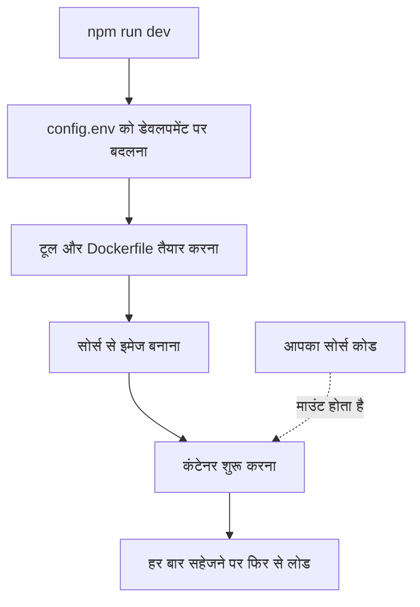

# स्थानीय विकास

OneUptime पर काम करने के लिए उसे अपने कंप्यूटर पर सोर्स कोड से चलाएँ। डेवलपमेंट स्टैक आपके चेकआउट से हर सेवा बनाता है, आपका सोर्स कोड कंटेनरों में माउंट करता है और फ़ाइल सहेजते ही उन्हें फिर से लोड करता है।

इसके बजाय कोई जारी किया गया संस्करण चलाने के लिए [Docker Compose](/docs/installation/docker-compose) का उपयोग करें।

## डेवलपमेंट स्टैक कैसे काम करता है

`npm run dev` आपके चेकआउट को तैयार करता है, फिर `Scripts/Dev/docker-compose.dev.yml` में परिभाषित स्टैक शुरू करता है:



| चरण | क्या होता है |
| --- | --- |
| डेवलपमेंट पर बदलना | `config.env` में `ENVIRONMENT=development` सेट करता है। |
| तैयारी | आपका sudo पासवर्ड माँगता है, जो टूल नहीं हैं उन्हें इंस्टॉल करता है (Git, curl, Node.js, Docker, gomplate, ts-node), आपकी मौजूदा ब्रांच पर `git pull` चलाता है, `config.example.env` की नई सेटिंग्स `config.env` में जोड़ता है और हर `Dockerfile.tpl` से एक `Dockerfile` बनाता है। |
| बिल्ड | हर सेवा के लिए सोर्स से एक इमेज बनाता है। पहला बिल्ड कुछ समय लेता है। |
| चलाना | आपके सोर्स कोड को माउंट करके कंटेनर शुरू करता है। |
| फिर से लोड | सर्वर की कोई फ़ाइल बदलने पर App अपना API फिर से शुरू करता है और आपके संपादन के साथ डैशबोर्ड फिर से बनाता है। |

जब रिपॉज़िटरी में `ee/` फ़ोल्डर होता है, तो App उससे Enterprise Edition लोड करता है। इसके बजाय Community Edition चलाने के लिए `config.env` में `ONEUPTIME_EDITION=community` सेट करें।

## शुरू करने से पहले

| आपको चाहिए | टिप्पणी |
| --- | --- |
| **Docker** | macOS और Windows पर Docker Desktop, या Linux पर Docker Compose v2 प्लगइन के साथ Docker Engine। |
| **Node.js 26 या नया, और npm** | वह संस्करण जो रिपॉज़िटरी का `package.json` माँगता है, और जिसे CI इस्तेमाल करता है। |
| **Git** | रिपॉज़िटरी क्लोन करने के लिए। |
| **sudo एक्सेस** | `npm run dev` कुछ भी इंस्टॉल करने से पहले आपका पासवर्ड माँगता है। |
| **खाली पोर्ट 80 और 443** | स्टैक `http://localhost` (पोर्ट 80) पर OneUptime देता है, और पोर्ट 443 पर HTTPS देता है। |

## डेवलपमेंट स्टैक शुरू करें

:::steps
### रिपॉज़िटरी क्लोन करें

```bash
git clone https://github.com/OneUptime/oneuptime.git
cd oneuptime
```

### config.env बनाएँ

```bash
cp config.example.env config.env
```

उदाहरण के मान डेवलपमेंट के लिए जैसे हैं वैसे ही काम करते हैं। आप उन्हें बदल सकते हैं, पर ज़रूरी नहीं है।

### स्टैक शुरू करें

```bash
npm run dev
```

यह आपका sudo पासवर्ड माँगता है, फिर इमेज बनाता है और कंटेनरों को बैकग्राउंड में शुरू करता है। App का शुरू होना `docker logs -f oneuptime-app-1` से देखें।

### OneUptime खोलें

`http://localhost` खोलें और साइन अप करें। पहला खाता मास्टर एडमिन बन जाता है, जो `http://localhost/admin` पर Admin Dashboard खोल सकता है।
:::

## कोड पर काम करें

`packages/` के अंदर की फ़ाइलें संपादित करें और सहेजें: कंटेनर बदलाव को ले लेते हैं।

पुल रिक्वेस्ट खोलने से पहले अपना बदलाव अपने कंप्यूटर पर, कंटेनरों के बाहर जाँचें। इसके लिए डिपेंडेंसी एक बार इंस्टॉल करें: रिपॉज़िटरी के रूट में `npm install` चलाएँ (ESLint और माइग्रेशन टूल के लिए), फिर `npm run install-modules` चलाएँ, जो हर पैकेज के `node_modules` हटाकर फिर से इंस्टॉल करता है और कुछ समय लेता है।

:::steps
### जो बदला उसे कंपाइल करें

हर बदले हुए पैकेज में कंपाइलर चलाएँ, उदाहरण के लिए App में:

```bash
cd packages/App
npm run compile
```

### सिर्फ़ अपनी फ़ाइलों को लिंट करें

रिपॉज़िटरी के रूट से वे फ़ाइलें दें जो आपने बदलीं:

```bash
npx eslint --fix packages/App/path/to/File.ts
```

`npm run lint` और `npm run fix-lint` से बचें: ये पूरी रिपॉज़िटरी को लिंट करते हैं।

### आपके बदलाव को कवर करने वाले टेस्ट चलाएँ

पैकेज में पूरी सूट के बजाय सिर्फ़ ज़रूरी टेस्ट फ़ाइलें चलाएँ:

```bash
cd packages/App
npx jest Tests/path/to/YourChange.test.ts
```
:::

### डेटाबेस माइग्रेशन

| डेटाबेस | माइग्रेशन कैसे जोड़ें |
| --- | --- |
| PostgreSQL | मॉडल बदलें, फिर माइग्रेशन हाथ से लिखने के बजाय `npm run generate-postgres-migration` चलाएँ। नई फ़ाइल को `packages/Common/Server/Infrastructure/Postgres/SchemaMigrations/Index.ts` में रजिस्टर करें: वहाँ सूचीबद्ध होने तक यह नहीं चलती। `npm run check-postgres-schema-drift` अब भी गायब हर स्टेटमेंट दिखाता है। |
| ClickHouse | मौजूदा माइग्रेशन की तरह `packages/App/FeatureSet/Workers/DataMigrations` में माइग्रेशन हाथ से लिखें। |

## संदर्भ

### कमांड

इन्हें रिपॉज़िटरी के रूट से चलाएँ।

| काम | कमांड |
| --- | --- |
| स्टैक शुरू करना, या `config.env` के बदलाव लागू करना | `npm run dev` |
| डिपेंडेंसी बदलने के बाद इमेज फिर से बनाना | `npm run build`, फिर `npm run dev` |
| इमेज शुरू से फिर से बनाना | `npm run force-build-dev`, फिर `npm run dev` |
| चल रहे कंटेनरों की सूची देखना | `docker ps` |
| किसी एक सेवा के लॉग देखते रहना | `docker logs -f oneuptime-app-1` |
| स्टैक रोकना और उसके कंटेनर हटाना | `npm run down` |

`npm run down` आपका डेटा रखता है: PostgreSQL और ClickHouse के वॉल्यूम बने रहते हैं।

### पोर्ट

डेवलपमेंट स्टैक डेटा स्टोर प्रकाशित करता है, ताकि आप अपने टूल से उनसे जुड़ सकें। पासवर्ड `config.env` में हैं।

| सेवा | पता | साइन इन |
| --- | --- | --- |
| OneUptime | `http://localhost` | आपका बनाया हुआ खाता |
| PostgreSQL | `localhost:5400` | उपयोगकर्ता `postgres`, डेटाबेस `oneuptimedb`, पासवर्ड `DATABASE_PASSWORD` |
| ClickHouse | `localhost:8189` (HTTP), `localhost:9034` (नेटिव) | उपयोगकर्ता `default`, डेटाबेस `oneuptime`, पासवर्ड `CLICKHOUSE_PASSWORD` |
| Valkey | `localhost:6310` | पासवर्ड `VALKEY_PASSWORD` |

## समस्या निवारण

:::details npm run dev git pull पर रुक जाता है
`npm run dev` बिल्ड से पहले आपकी मौजूदा ब्रांच पर `git pull` चलाता है। जिस ब्रांच का अपस्ट्रीम नहीं है, या जब pull आपके बिना कमिट किए बदलावों को मिटा देगा, तब Git मना कर देता है। ब्रांच का अपस्ट्रीम सेट करें (उदाहरण के लिए उसे `git push -u origin <branch>` से पुश करके), या अपना काम कमिट करें, फिर `npm run dev` दोबारा चलाएँ।
:::

:::details npm run dev कोई टूल इंस्टॉल करते समय रुक जाता है
वह टूल खुद इंस्टॉल करें, उदाहरण के लिए gomplate या ts-node, और `npm run dev` दोबारा चलाएँ: यह पहले से इंस्टॉल हर टूल को छोड़ देता है।
:::

:::details डिपेंडेंसी बदलने के बाद कोई सेवा विफल हो जाती है
इमेज में अब भी पुरानी डिपेंडेंसी हैं। उन्हें `npm run build` से फिर से बनाएँ, फिर `npm run dev` से स्टैक दोबारा शुरू करें। अगर इतना काफ़ी न हो, तो `npm run force-build-dev` से शुरू से बनाएँ।
:::

:::details पोर्ट 80 या 443 पहले से उपयोग में है
आपके कंप्यूटर का कोई दूसरा प्रोग्राम, अक्सर कोई स्थानीय वेब सर्वर, उस पोर्ट को पकड़े हुए है। उसे रोकें, फिर `npm run dev` दोबारा चलाएँ।
:::

## अगले कदम

:::cards
- [स्व-होस्टेड आर्किटेक्चर](/docs/self-hosted/architecture): अभी शुरू की गई सेवाएँ आपस में कैसे जुड़ती हैं।
- [Docker Compose](/docs/installation/docker-compose): किसी सर्वर पर जारी किया गया संस्करण चलाएँ।
- [API संदर्भ](/docs/api-reference/api-reference): अपने स्थानीय इंस्टेंस का API कॉल करें।
:::
