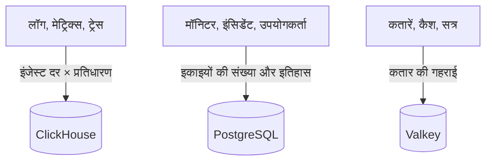

# साइज़िंग और क्षमता नियोजन

[Helm चार्ट](https://artifacthub.io/packages/helm/oneuptime/oneuptime) के साथ Kubernetes पर स्व-होस्टेड OneUptime के लिए CPU, मेमोरी और डिस्क की योजना बनाएँ। तीनों डेटा स्टोर (**ClickHouse**, **PostgreSQL** और **Valkey**) और एप्लिकेशन का आकार अलग-अलग तय करें, नीचे दिए किसी स्तर से शुरू करें, और असली आँकड़े मिलने पर बदलाव करें।

> [!IMPORTANT]
> चार्ट के डिफ़ॉल्ट मान प्रोडक्शन के लिए आकार नहीं हैं। डिफ़ॉल्ट रूप से चलने वाली सेवाएँ **कोई CPU या मेमोरी अनुरोध या सीमा सेट नहीं करतीं**, और PostgreSQL तथा ClickHouse को **25 Gi** के छोटे वॉल्यूम मिलते हैं, ताकि चार्ट किसी भी क्लस्टर पर इंस्टॉल हो सके। ट्रायल से आगे के किसी भी उपयोग के लिए, इस पेज के आँकड़ों से संसाधन और स्टोरेज खुद सेट करें।

क्या आप इसके बजाय एक सर्वर पर Docker Compose इंस्टॉलेशन चला रहे हैं? उसका आकार तय करना आसान है: [ज़रूरतें](/docs/installation/docker-compose#ज़रूरतें) देखें (16 GB मेमोरी, 8 कोर और 400 GB डिस्क की सिफ़ारिश की जाती है)।

:::cards
- [हर डेटा स्टोर को क्या बढ़ाता है](#हर-डेटा-स्टोर-को-क्या-बढ़ाता-है): तीन स्टोर, जो तीन अलग चीज़ों के साथ बढ़ते हैं।
- [शुरुआती स्तर](#शुरुआती-स्तर): छोटे, मध्यम और बड़े शुरुआती बिंदु।
- [हाई अवेलेबिलिटी](#हाई-अवेलेबिलिटी): हर डेटा स्टोर के लिए रेप्लिका और फ़ेलओवर।
- [प्रतिधारण](#प्रतिधारण-और-स्टोरेज-पर-इसका-असर): वह सेटिंग जो आपकी डिस्क को कई गुना करती है।
:::

## अपने इंस्टॉलेशन का आकार तय करें

:::steps
1. पता करें कि आप कितना टेलीमेट्री डेटा भेजते हैं: रोज़ कितने GB लॉग, मेट्रिक्स और ट्रेस। हो सके तो इसे किसी छोटे इंस्टॉलेशन पर मापें।
2. तय करें कि इसे कितने दिन रखना है। प्रतिधारण ClickHouse की डिस्क को कई गुना करता है ([प्रतिधारण](#प्रतिधारण-और-स्टोरेज-पर-इसका-असर) देखें)।
3. [स्टोरेज फ़ॉर्मूला](#स्टोरेज-फ़ॉर्मूला) से ClickHouse की डिस्क निकालें, फिर उनके अपने सेक्शन से PostgreSQL और Valkey की।
4. अपने आँकड़ों के सबसे पास वाला [शुरुआती स्तर](#शुरुआती-स्तर) चुनें, और उसका CPU, मेमोरी और स्टोरेज अपनी Helm values में सेट करें।
5. जिन डेटा स्टोर को ज़रूरत हो उनके लिए [हाई अवेलेबिलिटी](#हाई-अवेलेबिलिटी) चालू करें, फिर असली उपयोग देखें और बदलाव करें।
:::

## हर डेटा स्टोर को क्या बढ़ाता है

प्रोडक्शन में OneUptime को तीन डेटा स्टोर चाहिए। हर एक अलग चीज़ के साथ बढ़ता है, इसलिए उनका आकार अलग-अलग तय करें।



| डेटा स्टोर | यह क्या रखता है | इसका आकार क्या तय करता है |
| --- | --- | --- |
| **ClickHouse** | सारा टेलीमेट्री डेटा – लॉग, मेट्रिक्स, ट्रेस, एक्सेप्शन, प्रोफ़ाइल | टेलीमेट्री की **इंजेस्ट दर × प्रतिधारण**। यह आपके स्टोरेज का लगभग 95% और सबसे बड़ी लागत है। |
| **PostgreSQL** | कॉन्फ़िगरेशन और स्थिति – मॉनिटर, इंसिडेंट, अलर्ट, उपयोगकर्ता, टीमें, प्रोजेक्ट, वर्कफ़्लो, स्टेटस पेज, डैशबोर्ड | **इकाइयों की संख्या और इतिहास**, टेलीमेट्री की मात्रा नहीं। धीरे बढ़ता है। |
| **Valkey** | कैश, काम की कतारें और सत्र | **कतार की गहराई और सक्रिय सत्र**। मेमोरी पर निर्भर और सीमित। यह सत्य का स्रोत नहीं है। |

OneUptime को चलने के लिए कभी ऑब्जेक्ट स्टोरेज (S3, MinIO) की ज़रूरत नहीं होती, और यह पुराने टेलीमेट्री डेटा को ऑब्जेक्ट स्टोरेज में नहीं ले जाता। ऑब्जेक्ट स्टोरेज तभी चाहिए जब आप ऑब्जेक्ट स्टोरेज में बैकअप चुनें: CloudNativePG के लिए Barman Cloud प्लगइन, या ClickHouse के लिए [clickhouse-backup](https://github.com/Altinity/clickhouse-backup)। चार्ट का अपना CloudNativePG बैकअप (`postgresOperator.cnpg.backup`) वॉल्यूम स्नैपशॉट लेता है और उसे ऑब्जेक्ट स्टोरेज की ज़रूरत नहीं होती। CloudNativePG पुराने स्नैपशॉट कभी नहीं हटाता: उन्हें खुद साफ़ करें, वरना वे बढ़ते रहेंगे।

## ClickHouse – सबसे बड़ा कारक

आपका लगभग सारा स्टोरेज और मेमोरी का बड़ा हिस्सा ClickHouse को जाता है, क्योंकि हर लॉग लाइन, मेट्रिक पॉइंट, ट्रेस स्पैन और एक्सेप्शन वहीं रहता है।

### स्टोरेज फ़ॉर्मूला

```text
ClickHouse disk ≈ (daily raw telemetry GB ÷ compression) × retention days × replicas × 1.3 (headroom)
```

कंप्रेशन सिग्नल पर निर्भर करता है:

| सिग्नल | सामान्य कंप्रेशन | इसे क्या बदलता है |
| --- | --- | --- |
| लॉग | लगभग 5:1 | लॉग अच्छी तरह कंप्रेस होते हैं। |
| मेट्रिक्स | लगभग 2:1 | लेबल की ऊँची **कार्डिनैलिटी** कच्ची मात्रा से तेज़ी से डिस्क और मेमोरी दोनों बढ़ाती है। लेबल की कार्डिनैलिटी कम रखें। |
| ट्रेस | दोनों के बीच | आपके भेजे गए स्पैन एट्रिब्यूट। |

### उदाहरण से गणना

**10 क्लस्टर** का एक समूह, जिसमें हर क्लस्टर में लगभग 10 नोड और INFO स्तर पर लॉग लिखने वाले 100 पॉड हों, मोटे तौर पर **हर क्लस्टर पर 30 दिनों में 50–150 GB कच्चे लॉग** बनाता है (हर क्लस्टर पर रोज़ लगभग 1.7–5 GB)। पूरे समूह के लिए, मेट्रिक्स और ट्रेस जोड़कर और कंप्रेशन के बाद, मोटे तौर पर **रोज़ 5–15 GB कंप्रेस्ड टेलीमेट्री** का बजट रखें।

| प्रतिधारण | एक रेप्लिका | 2 रेप्लिका + 30% गुंजाइश |
| --- | --- | --- |
| 30 दिन | ~150–450 GB | **~0.4–1.2 TB** |
| 90 दिन | ~0.45–1.35 TB | **~1.2–3.5 TB** |

स्टोरेज **प्रतिधारण के अनुपात में** बढ़ता है: 90 दिन की अवधि की लागत 30 दिन की अवधि से लगभग तीन गुना होती है।

### मेमोरी और डिस्क का प्रकार

- **NVMe या SSD इस्तेमाल करें।** टेलीमेट्री में लिखना ज़्यादा होता है और एग्रीगेशन रीड बीच-बीच में तेज़ी से आते हैं; घूमने वाली डिस्क पर ClickHouse संघर्ष करता है।
- **ClickHouse को भरपूर मेमोरी दें।** एग्रीगेशन क्वेरी बहुत मेमोरी लेती हैं। सामान्य नियम के तौर पर, मेमोरी को अपने *हॉट* (हाल में क्वेरी किए गए) कंप्रेस्ड डेटा के 25–50% पर रखें, और किसी भी असली प्रोडक्शन समूह के लिए व्यावहारिक न्यूनतम 16 GB रखें।
- **मेट्रिक कार्डिनैलिटी पर नज़र रखें।** यह ClickHouse की मेमोरी और डिस्क दोनों पर सबसे बड़ा अकेला असर डालती है। जहाँ आप मेट्रिक्स इकट्ठा करते हैं वहाँ कम कार्डिनैलिटी वाले लेबल नियम लागू करें, और सक्रिय सीरीज़ की संख्या पर नज़र रखें।

## PostgreSQL – कॉन्फ़िगरेशन और स्थिति

PostgreSQL आपका कॉन्फ़िगरेशन और कामकाजी स्थिति रखता है, टेलीमेट्री नहीं, इसलिए यह धीरे बढ़ता है और ClickHouse के मुक़ाबले छोटा रहता है। बड़े इंस्टॉलेशन भी आम तौर पर कुछ दर्जन GB में रहते हैं। डिफ़ॉल्ट **25 Gi** वॉल्यूम छोटे इंस्टॉलेशन के लिए ठीक है; बड़े इंस्टॉलेशन के लिए इंसिडेंट और अलर्ट के इतिहास की गुंजाइश के साथ 50–100 GB की योजना बनाएँ।

ऐप, वर्कर और प्रोब की बहुत सी रेप्लिका होने पर डेटाबेस कनेक्शन स्टोरेज से पहले ख़त्म हो सकते हैं। हर पॉड डिफ़ॉल्ट रूप से 50 तक कनेक्शन खोलता है, और साथ आने वाला PostgreSQL 500 की अनुमति देता है। ठीक इसी के लिए चार्ट में वैकल्पिक कनेक्शन पूलर **PgBouncer** (`pgbouncer.enabled`) शामिल है: बहुत सी रेप्लिका वाले इंस्टॉलेशन के लिए इसे चालू करें।

## Valkey – कैश, कतारें और सत्र

कैश लेयर [Valkey](https://valkey.io) चलाती है, जो Redis 7.2 का BSD-लाइसेंस वाला फ़ोर्क है, और इसे कैश, काम की कतार और सत्र स्टोर के रूप में इस्तेमाल करती है। Redis प्रोटोकॉल वाला कोई भी सर्वर इसकी जगह ले सकता है, और नीचे दिया आकार दोनों पर लागू होता है। यह **मेमोरी पर निर्भर** है, और पर्सिस्टेंस **डिफ़ॉल्ट रूप से बंद** है: यह सत्य का स्रोत नहीं है और इसे फिर से बनाया जा सकता है। इसका आकार कतार की गहराई और एक साथ चल रहे सत्रों के हिसाब से तय करें; ज़्यादातर इंस्टॉलेशन के लिए 2–8 GB मेमोरी काफ़ी है। इसकी इविक्शन नीति `noeviction` है, इसलिए लगातार लोड में कतारें जमा होने पर इसकी मेमोरी पर नज़र रखें।

## एप्लिकेशन की कंप्यूट

डेटा स्टोर के अलावा, स्टेटलेस वर्कलोड का आकार भी तय करें। जब तक आप सेट न करें, हर वर्कलोड **बिना किसी संसाधन अनुरोध या सीमा के** चलता है, और एक रेप्लिका के साथ, सिवाय टेलीमेट्री राइटर के, जिसकी दो होती हैं।

| वर्कलोड | values कुंजी | किसके साथ बढ़ता है |
| --- | --- | --- |
| ऐप: डैशबोर्ड, API और इंजेस्ट | `app` | उपयोगकर्ता, API कॉल और आने वाला टेलीमेट्री डेटा |
| वर्कर, जब ऐप से अलग हों | `worker` | टेलीमेट्री और बैकग्राउंड जॉब की प्रोसेसिंग |
| प्रोब | `probes` | सक्रिय मॉनिटर की संख्या |
| इनग्रेस गेटवे | `nginx` | अनुरोधों की मात्रा |
| टेलीमेट्री राइटर, जब चालू हो | `telemetryWriter` | लोड के साथ नहीं: यह हर टेलीमेट्री इंसर्ट को ClickHouse में एक साथ भेजता है, इसलिए इसका आकार इस बात से तय होता है कि ClickHouse कितना संभाल सकता है |

चार्ट में **KEDA** शामिल है, ताकि ऐप, वर्कर, प्रोब और Runner अपनी कतार के बकाया के हिसाब से स्केल कर सकें। `keda.enabled` को हर सेवा के अपने `keda.enabled` (उदाहरण के लिए `app.keda.enabled`) के साथ चालू करें। जिस क्लस्टर पर अभी KEDA नहीं है, वहाँ पहले इंस्टॉलेशन में एक अतिरिक्त चरण लगता है: चार्ट की [KEDA गाइड](https://github.com/OneUptime/oneuptime/blob/master/HelmChart/Docs/Keda.md) देखें। जिन सेवाओं को KEDA नहीं संभालता, वे इसके बजाय CPU या मेमोरी पर आधारित ऑटोस्केलर (`autoscaling`) इस्तेमाल कर सकती हैं।

## शुरुआती स्तर

अपने वातावरण के सबसे पास वाले स्तर को शुरुआती बिंदु के रूप में चुनें, फिर असली उपयोग (`kubectl top pods`, ClickHouse और PostgreSQL की डिस्क की बढ़त) देखें और बदलाव करें।

- **छोटा / PoC** – 1–3 क्लस्टर, ≤30 नोड, रोज़ ≤5 GB कच्चा टेलीमेट्री डेटा, 30 दिन का प्रतिधारण।
- **मध्यम / प्रोडक्शन समूह** – ~10 क्लस्टर, ~100 नोड, रोज़ 10–30 GB कच्चा टेलीमेट्री डेटा, 30–90 दिन का प्रतिधारण।
- **बड़ा / कई समूह** – 50+ क्लस्टर, 500+ नोड, रोज़ 100+ GB कच्चा टेलीमेट्री डेटा, 90 दिन का प्रतिधारण।

| | छोटा / PoC | मध्यम / प्रोडक्शन समूह | बड़ा / कई समूह |
| --- | --- | --- | --- |
| **ClickHouse** | 4 vCPU / 16 GB / 200 GB NVMe | 8 vCPU / 32 GB / 1–3 TB NVMe | 16+ vCPU / 64–128 GB / 5–15 TB NVMe, **शार्डेड** |
| **PostgreSQL** | 2 vCPU / 4 GB / 50 GB SSD | 4 vCPU / 8 GB / 100 GB SSD | 8 vCPU / 16–32 GB / 250 GB SSD (+ PgBouncer) |
| **Valkey** | 1 vCPU / 2 GB | 2 vCPU / 4 GB | 4 vCPU / 8–16 GB |
| **माना गया प्रतिधारण** | 30 दिन | 30–90 दिन | 90 दिन |

ये स्तर OneUptime बैकएंड का आकार तय करते हैं। हर मॉनिटर किए गए क्लस्टर पर इंस्टॉल होने वाले एजेंट के बारे में [Kubernetes एजेंट](/docs/telemetry/kubernetes-agent) पेज पर बताया गया है, जो यह भी दिखाता है कि उसके भेजे जाने वाले डेटा की मात्रा कैसे घटाएँ।

## हाई अवेलेबिलिटी

चार्ट के बिल्ट-इन डेटा स्टोर डिफ़ॉल्ट रूप से **एकल इंस्टेंस** के रूप में चलते हैं। प्रोडक्शन में हाई अवेलेबिलिटी के लिए:

| डेटा स्टोर | हाई अवेलेबिलिटी के लिए |
| --- | --- |
| **PostgreSQL** | साथ आने वाला [CloudNativePG](https://cloudnative-pg.io) ऑपरेटर (`postgresOperator.cnpg.enabled`) **3 इंस्टेंस** (`postgresOperator.cnpg.instances`) के साथ चालू करें: एक प्राइमरी और दो हॉट स्टैंडबाय, स्वचालित फ़ेलओवर के साथ। |
| **ClickHouse** | साथ आने वाला [Altinity](https://github.com/Altinity/clickhouse-operator) ऑपरेटर (`clickhouseOperator.altinity.enabled`) **हर शार्ड पर 2 या ज़्यादा रेप्लिका** (`clickhouseOperator.altinity.cluster.replicasCount`) के साथ चालू करें। इसका साथ आने वाला ClickHouse Keeper कोरम के लिए **3 नोड** पर चलता है। जब किसी एक नोड की डिस्क या मेमोरी सीमा बन जाए, तब शार्ड (`shardsCount`) जोड़ें। |
| **Valkey** | चार्ट इसकी रेप्लिका नहीं बनाता। OneUptime को स्वचालित फ़ेलओवर वाले किसी बाहरी मैनेज्ड Redis या Valkey (`externalValkey`) की ओर इंगित करें। OneUptime एक ही होस्ट और पोर्ट से जुड़ता है, इसलिए सेवा का प्राइमरी एंडपॉइंट इस्तेमाल करें, क्लस्टर-मोड वाला नहीं। |

> [!WARNING]
> किसी मौजूदा इंस्टॉलेशन के लिए दोनों में से कोई भी ऑपरेटर चालू करने पर एक नया, खाली डेटाबेस शुरू होता है: दोनों में से कोई भी उस एकल-इंस्टेंस डेटाबेस का डेटा कॉपी नहीं करता जिसे वह बदलता है। अपना डेटा वैसे माइग्रेट करें जैसा चार्ट की गाइड बताती हैं – [PostgreSQL](https://github.com/OneUptime/oneuptime/blob/master/HelmChart/Docs/MigratePostgresStandaloneToOperator.md) के लिए और [ClickHouse](https://github.com/OneUptime/oneuptime/blob/master/HelmChart/Docs/MigrateClickhouseStandaloneToOperator.md) के लिए।

## प्रतिधारण और स्टोरेज पर इसका असर

टेलीमेट्री प्रतिधारण **दिनों में गिना जाने वाला ClickHouse TTL** है। हर संस्करण में प्रोजेक्ट का डिफ़ॉल्ट होता है, **प्रोजेक्ट सेटिंग्स > टेलीमेट्री और APM > डेटा प्रतिधारण** (**डिफ़ॉल्ट प्रतिधारण (दिन)**) में; कुछ सेट न होने पर यह 15 दिन होता है। [Enterprise Edition](/docs/self-hosted/enterprise) ओवरराइड जोड़ता है: सिग्नल के हिसाब से (लॉग, ट्रेस, मेट्रिक्स, प्रोफ़ाइल), लॉग की गंभीरता और ट्रेस की स्थिति के हिसाब से, और हर सेवा या संसाधन के हिसाब से।

लॉग और मेट्रिक्स एक-एक दिन करके हटाए जाते हैं, उनका प्रतिधारण ख़त्म होने के बाद की पहली आधी रात (ClickHouse सर्वर का समय) को; इससे ClickHouse को उनकी समय-सीमा ख़त्म होने तक हर दिन का डेटा हर कुछ घंटों में दोबारा नहीं लिखना पड़ता। आधी रात से ठीक पहले, प्रतिधारण अवधि से एक दिन तक ज़्यादा डेटा अब भी डिस्क पर होता है: लॉग और मेट्रिक्स का आकार **प्रतिधारण के दिन + 1** के लिए तय करें।

क्योंकि प्रतिधारण ClickHouse के स्टोरेज को कई गुना करता है, डिस्क का आकार तय करने से पहले इसे तय करें। OneUptime पुराने टेलीमेट्री डेटा को **न तो** आर्काइव करता है और न ही ऑब्जेक्ट स्टोरेज में ले जाता है। कई सालों के अनुपालन प्रतिधारण के लिए, प्रतिधारण अवधि बढ़ाएँ और उसके अनुसार ClickHouse के स्टोरेज का आकार तय करें, या अपनी पसंद के किसी बाहरी आर्काइव में एक्सपोर्ट करें।

## तय करने से पहले मापें

टेलीमेट्री की मात्रा एप्लिकेशन लॉग की विस्तार-मात्रा, नेमस्पेस की संख्या, स्क्रेप अंतराल और कहीं DEBUG लॉगिंग चालू है या नहीं, इसके हिसाब से बहुत बदलती है। ऊपर के स्तरों को शुरुआती बिंदु मानें: **अपने वातावरण से कम से कम चार हफ़्ते तक डेटा इकट्ठा करें**, हर सिग्नल के लिए रोज़ के असली GB मापें, फिर असली डेटा के आधार पर प्रतिधारण और स्टोरेज का आकार तय करें।

## अगले कदम

:::cards
- [Docker Compose](/docs/installation/docker-compose): एक सर्वर पर इंस्टॉलेशन की ज़रूरतें।
- [स्व-होस्टेड आर्किटेक्चर](/docs/self-hosted/architecture): घटक आपस में कैसे जुड़ते हैं।
- [Kubernetes एजेंट](/docs/telemetry/kubernetes-agent): वह कलेक्टर जो क्लस्टर का टेलीमेट्री डेटा भेजता है।
- [Enterprise Edition](/docs/self-hosted/enterprise): प्रतिधारण के ओवरराइड और Enterprise की बाकी सुविधाएँ।
:::
