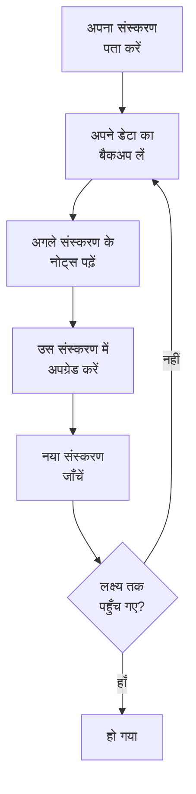

# अपग्रेड करना

सेल्फ़-होस्टेड OneUptime — Docker Compose, या Helm के साथ Kubernetes — को किसी नए रिलीज़ में अपग्रेड करें। नीचे दी गई प्रक्रिया का पालन करें, और आप जो संस्करण चला रहे हैं उससे लेकर जिस संस्करण पर जा रहे हैं, उनके बीच के हर मेजर संस्करण के नोट्स पढ़ें।

:::cards
- [अपग्रेड कैसे करें](#अपग्रेड-कैसे-करें): Docker Compose और Kubernetes के लिए प्रक्रिया।
- [हर संस्करण के नोट्स](#अपने-संस्करण-के-नोट्स-खोजें): हर मेजर संस्करण आपसे क्या माँगता है, एक नज़र में।
- [Community और Enterprise Edition इमेज](#community-और-enterprise-edition-इमेज): 14 से कौन-सी इमेज चलानी है।
- [OneUptime 13 → 14 से अपग्रेड करना](#oneuptime-13-14-से-अपग्रेड-करना): सबसे नया मेजर संस्करण।
:::

## अपग्रेड कैसे करें

तीन नियम अपग्रेड को सुरक्षित रखते हैं:

- **एक बार में एक मेजर संस्करण अपग्रेड करें** (उदाहरण के लिए 6 → 7 → 8)। किसी मेजर संस्करण को न छोड़ें।
- **माइनर और पैच रिलीज़ अपनी इच्छा से छोड़ें** (उदाहरण के लिए 8.1 → 8.4), बशर्ते आप उनके रिलीज़ नोट्स का पालन करें।
- **हर अपग्रेड से पहले बैकअप लें**, और जाँच लें कि आप बैकअप को रीस्टोर कर सकते हैं।



:::steps
### अपना वर्तमान संस्करण पता करें

मास्टर एडमिन के रूप में, एडमिन डैशबोर्ड के हेडर में संस्करण लेबल खोलें: **This installation** वह संस्करण दिखाता है जो आप चला रहे हैं। इंस्टेंस इसे `/version` पर भी बताता है:

```bash
curl http://localhost/version
```

`http://localhost` को अपने इंस्टेंस के पते से बदलें। जवाब JSON होता है, जैसे `{"version":"14.0.22","commit":"..."}`।

### अपने डेटा का बैकअप लें

PostgreSQL का बैकअप लें, और अगर आपको ClickHouse की टेलीमेट्री चाहिए तो ClickHouse का भी। Docker Compose पर, [बैकअप और रीस्टोर](/docs/installation/docker-compose#बैकअप-और-रीस्टोर) देखें। Kubernetes पर, अपने वॉल्यूम स्नैपशॉट या चार्ट के CloudNativePG बैकअप का उपयोग करें।

### अगले मेजर संस्करण के नोट्स पढ़ें

वे [नीचे दी गई तालिका](#अपने-संस्करण-के-नोट्स-खोजें) में हैं, और अपग्रेड करने से पहले वह करें जो वे माँगते हैं: कुछ कदम, जैसे Helm मानों का नाम बदलना, पहले होने चाहिए।

### अपग्रेड चलाएँ

:::tabs
@tab Docker Compose
```bash
git checkout release
git pull
npm run update
```
`npm run update` आपकी मौजूदा सेटिंग्स बदले बिना आपकी `config.env` में नई सेटिंग्स जोड़ता है, नई इमेज पुल करता है और OneUptime को रीस्टार्ट करता है।
@tab Kubernetes
```bash
helm repo update
helm upgrade my-oneuptime oneuptime/oneuptime -f values.yaml
```
अपने रिलीज़ नाम और values फ़ाइल का उपयोग करें। नए पॉड के ट्रैफ़िक सँभालने से पहले, चार्ट डेटाबेस माइग्रेशन अपने एक अलग Job में चलाता है।
:::

### नया संस्करण जाँचें

Docker Compose पर, `npm run update` **OneUptime is up!** के साथ समाप्त होता है। Kubernetes पर, तब तक प्रतीक्षा करें जब तक हर पॉड `Running` और तैयार न हो जाए:

```bash
kubectl get pods -n <namespace>
```

फिर पहले कदम की तरह अपना संस्करण दोबारा जाँचें। अगर आप अभी अपने लक्ष्य संस्करण तक नहीं पहुँचे हैं, तो [अपने डेटा का बैकअप लें](#अपने-डेटा-का-बैकअप-लें) पर वापस जाएँ और अगला मेजर संस्करण लें।
:::

### अपने संस्करण के नोट्स खोजें

| अपग्रेड | आपको क्या करना होगा |
| --- | --- |
| [13 → 14](#oneuptime-13-14-से-अपग्रेड-करना) | एक संस्करण चुनें। `IS_ENTERPRISE_EDITION=true` सेट करने वाले Docker Compose इंस्टॉल `APP_TAG=enterprise-release` पर जाते हैं। Enterprise Edition पर लाइसेंस सक्रिय करें। IPv6 Ping, Port और SSL मॉनिटर दोबारा सहेजें। |
| [12 → 13](#oneuptime-12-13-से-अपग्रेड-करना) | आमतौर पर कुछ नहीं: Redis की जगह Valkey आता है, और पुराने सेटिंग नाम काम करते रहते हैं। Docker Compose हाथ से चला रहे हैं? `--remove-orphans` जोड़ें। अपना कैश इस्तेमाल कर रहे हैं? [अगर आप अपना कैश चलाते हैं](#अगर-आप-अपना-कैश-चलाते-हैं) पढ़ें। |
| [11 → 12](#oneuptime-11-12-से-अपग्रेड-करना) | Runbook Agent को Runner के रूप में दोबारा डिप्लॉय करें। Docker Compose पर `ONEUPTIME_RUNNER_KEY` सेट करें। Helm पर `aiAgent:` का नाम बदलकर `runner:` करें। वे Runner अनुमतियाँ फिर से दें जो API कुंजियों के पास सीधे थीं। |
| [10 → 11](#oneuptime-10-11-से-अपग्रेड-करना) | SCIM और टीम अनुपालन सेटिंग्स के लिए Enterprise Edition चाहिए। अपना टेलीमेट्री इतिहास रखने के लिए, अपग्रेड से पहले पुरानी ClickHouse तालिकाओं का नाम बदलें। |
| [9 → 10](#oneuptime-9-10-से-अपग्रेड-करना) | कुछ नहीं। |
| [8 → 9](#oneuptime-8-9-से-अपग्रेड-करना) | Helm पर, अपने values से `oneuptimeIngress` ओवरराइड हटाएँ। |
| [7 → 8](#oneuptime-7-8-से-अपग्रेड-करना) | Helm पर, Postgres, Redis और ClickHouse के लिए नई values संरचना पर जाएँ। पहले बैकअप लें। |

## Community और Enterprise Edition इमेज

OneUptime अब ऐप को दो इमेज के रूप में देता है। **Community Edition** Apache License 2.0 के तहत ओपन सोर्स है और इसमें SAML और OIDC सिंगल साइन-ऑन, ग्लोबल SSO और "Require SSO for login" शामिल हैं। **Enterprise Edition** रिपॉजिटरी की `ee/` डायरेक्टरी से एंटरप्राइज़ मॉड्यूल जोड़ता है: SCIM, टीम अनुपालन, ऑडिट लॉग और एडमिन डैशबोर्ड में एंटरप्राइज़ Health डैशबोर्ड। इस बदलाव से पहले दोनों संस्करण एक ही कोड चलाते थे, और `IS_ENTERPRISE_EDITION` तय करता था कि कौन-सी सुविधाएँ चालू हों। अब इमेज तय करती है, और Community इमेज में `ee/` डायरेक्टरी नहीं होती।

[एंटरप्राइज़ संस्करण](/docs/self-hosted/enterprise) पृष्ठ पर पूरी सुविधा तुलना, लाइसेंसिंग विवरण और संस्करण बदलने पर क्या होता है, यह सब दिया गया है।

### अपग्रेड से पहले क्या करें

- **SCIM के बिना Community Edition:** कुछ नहीं। हमेशा की तरह अपग्रेड करें।
- **`image.type: enterprise-edition` के साथ Helm:** कुछ नहीं। चार्ट पहले से `enterprise-` इमेज पुल करता है, जिनमें अब एंटरप्राइज़ मॉड्यूल शामिल हैं।
- **`IS_ENTERPRISE_EDITION=true` के साथ Docker Compose:** अपग्रेड करते समय `config.env` में `APP_TAG=enterprise-release` (या `enterprise-<version>`) सेट करके Enterprise इमेज पर जाएँ। `APP_TAG=release` Community इमेज है, और `IS_ENTERPRISE_EDITION=true` अब कुछ भी चालू नहीं करता। जब तक `IS_ENTERPRISE_EDITION=true` है, `npm run update` यह बदलाव आपके लिए करता है (`release` बन जाता है `enterprise-release`, पिन किया गया `13.0.7` बन जाता है `enterprise-13.0.7`) और बताता है कि उसने क्या बदला। जब Community इमेज पर `IS_ENTERPRISE_EDITION=true` सेट होता है, तो ऐप अब चुपचाप SCIM प्रोविजनिंग और ऑडिट लॉगिंग रोकने के बजाय **शुरू होने से इनकार करता है**। त्रुटि बताती है कि क्या सेट करना है: Enterprise Edition बनाए रखने के लिए `APP_TAG=enterprise-<version>`, या Community Edition चलाने के लिए `IS_ENTERPRISE_EDITION=false`।
- **पहले से कॉन्फ़िगर SCIM वाली Community इमेज:** इस अपग्रेड के साथ SCIM प्रोविजनिंग रुक जाती है, डिप्रोविजनिंग सहित। इसे बनाए रखने के लिए Enterprise इमेज पर जाएँ। नहीं तो, अपग्रेड से पहले [Enterprise से Community पर जाना](/docs/self-hosted/enterprise#enterprise-से-community-पर-जाना) पढ़ें। उसमें बताया गया है कि क्या रुकता है और पहले किसे हटाना है। Community Edition चलाने के लिए, `IS_ENTERPRISE_EDITION=false` भी सेट करें। सिंगल साइन-ऑन प्रभावित नहीं होता: Community इमेज भी इसे देती है।

आपका कॉन्फ़िगरेशन कभी नहीं हटाया जाता, और किसी भी दिशा में संस्करण बदलने के लिए किसी माइग्रेशन की ज़रूरत नहीं होती।

### अपग्रेड के बाद लाइसेंसिंग

Enterprise Edition अब अपना लाइसेंस जाँचता है:

- **लाइसेंस कुंजी वाला इंस्टॉल** काम करता रहता है। यह शुरू होने पर और दिन में एक बार OneUptime से लाइसेंस जाँचता है। अगर लाइसेंस की अवधि समाप्त हो जाती है, तो 30 दिन की ग्रेस अवधि तक सब कुछ काम करता रहता है, और उसके बाद वही होता है जो बिना लाइसेंस वाले इंस्टॉल के साथ होता है।
- **बिना लाइसेंस वाला इंस्टॉल**, उदाहरण के लिए वह जिसने केवल `IS_ENTERPRISE_EDITION=true` के भरोसे Enterprise Edition चलाया, इस रिलीज़ के पहले स्टार्ट से 14 दिन का ट्रायल पाता है। **अगर आप SCIM या ऑडिट लॉगिंग का उपयोग करते हैं, तो ट्रायल समाप्त होने से पहले लाइसेंस सक्रिय करें।** ट्रायल के बाद, SCIM प्रोविजनिंग रुक जाती है और ऑडिट लॉगिंग रिकॉर्ड करना बंद कर देती है। एंटरप्राइज़ कॉन्फ़िगरेशन भी केवल-पढ़ने योग्य हो जाता है और एंटरप्राइज़ Health डैशबोर्ड लॉक हो जाते हैं। सिंगल साइन-ऑन प्रभावित नहीं होता। जैसे ही आप लाइसेंस सक्रिय करते हैं, सब कुछ बिना रीस्टार्ट के फिर से शुरू हो जाता है। ट्रायल मूल्यांकन के लिए है: Enterprise Edition के प्रोडक्शन उपयोग के लिए OneUptime Enterprise सब्सक्रिप्शन ज़रूरी है। [जब लाइसेंस समाप्त हो जाए या न हो](/docs/self-hosted/enterprise#जब-लाइसेंस-समाप्त-हो-जाए-या-न-हो) देखें।
- **एयर-गैप्ड इंस्टॉल** कुंजी के बजाय हस्ताक्षरित लाइसेंस टोकन से सक्रिय कर सकते हैं। [ऑफ़लाइन सक्रियण](/docs/self-hosted/enterprise#ऑफ़लाइन-सक्रियण-एयर-गैप्ड-इंस्टॉल) देखें।

### OneUptime Cloud ग्राहक

आपके लिए कुछ नहीं बदलता। OneUptime Cloud, Enterprise Edition चलाता है, और आपका प्लान अब भी तय करता है कि आपको कौन-सी सुविधाएँ मिलती हैं: Scale प्लान और उससे ऊपर SSO, OIDC, SCIM और टीम अनुपालन, और Enterprise प्लान पर ऑडिट लॉग। Scale प्लान वाले प्रोजेक्ट अब वे SSO, OIDC, SCIM और टीम अनुपालन सेटिंग्स देखते हैं जहाँ पहले अपग्रेड का संकेत दिखता था।

### API और एंडपॉइंट में बदलाव

- `GET /api/global-config/license` लाइसेंस कुंजी, लाइसेंस टोकन, इंस्टेंस सूची, इंस्टेंस ID और संस्करण विवरण केवल मास्टर एडमिन को लौटाता है। दूसरे कॉलर को संस्करण और लाइसेंस स्थिति मिलती है।
- सेल्फ़-होस्टेड इंस्टॉल अब `/api/enterprise-license/` के अंतर्गत लाइसेंस-सर्वर एंडपॉइंट नहीं देते। केवल oneuptime.com उनका उपयोग करता है।
- SCIM एंडपॉइंट Enterprise Edition पर अपने ठीक वही पथ रखते हैं, इसलिए पहचान प्रदाता का कॉन्फ़िगरेशन नहीं बदलता। Community Edition पर वे `404` लौटाते हैं। Enterprise Edition पर, जब तक लाइसेंस समाप्त रहता है (ट्रायल या ग्रेस अवधि के बाद), वे अनुरोध अस्वीकार करते हैं, और लाइसेंस सक्रिय होते ही फिर से जवाब देते हैं।
- SSO और OIDC एंडपॉइंट (SAML साइन-इन और ACS URL, OIDC रीडायरेक्ट URI, और ग्लोबल SSO एंडपॉइंट) अपने ठीक वही पथ रखते हैं और हर लाइसेंस स्थिति में दोनों संस्करण उन्हें देते हैं।

## OneUptime 13 → 14 से अपग्रेड करना

OneUptime 14 ऐप को दो संस्करणों में बाँटता है, और आप जो इमेज पुल करते हैं वही तय करती है कि आप कौन-सा चलाते हैं। **Community Edition** (Apache-2.0, `release` और `<version>` टैग) में SAML SSO, OpenID Connect, ग्लोबल SSO और "Require SSO for login" शामिल हैं। इसमें रिपॉजिटरी की `ee/` डायरेक्टरी नहीं होती, इसलिए SCIM प्रोविजनिंग, टीम अनुपालन सेटिंग्स, ऑडिट लॉग, एडमिन के **Health** डैशबोर्ड और एडमिन का **Query Console** उस इमेज में बिल्कुल नहीं हैं। **Enterprise Edition** (`enterprise-release` और `enterprise-<version>` टैग) में ये सब होते हैं, और यह चलते समय Enterprise लाइसेंस जाँचता है, जो OneUptime 13 ने कभी नहीं किया। सिंगल साइन-ऑन उस लाइसेंस पर निर्भर नहीं करता।

ऊपर दिया गया [Community और Enterprise Edition इमेज](#community-और-enterprise-edition-इमेज) इस बदलाव का संदर्भ है: हर संस्करण में क्या है, हर डिप्लॉयमेंट तरीके पर क्या सेट करना है, और लाइसेंस क्या करता है। यह खंड स्वयं अपग्रेड है। 13 से अपग्रेड करें — अगर आप अभी 12 पर हैं, तो पहले 12 → 13 करें।

किसी भी संस्करण पर कुछ नहीं हटाया जाता। सिंगल साइन-ऑन दोनों पर एक जैसा काम करता है: आपका SSO और OIDC कॉन्फ़िगरेशन और आपकी "Require SSO for login" सेटिंग्स जैसी हैं वैसी ही बनी रहती हैं। आपका SCIM कॉन्फ़िगरेशन और अब तक दर्ज किए गए ऑडिट लॉग डेटाबेस में रहते हैं। Community Edition बस उन्हें नहीं देता, और किसी भी दिशा में संस्करण बदलने के लिए किसी माइग्रेशन की ज़रूरत नहीं होती।

### आपको क्या करना होगा

1. **तय करें कि यह इंस्टॉल कौन-सा संस्करण चलाएगा।** अगर आप SCIM प्रोविजनिंग, टीम अनुपालन सेटिंग्स या ऑडिट लॉग का उपयोग करते हैं, या आपको एडमिन के **Health** डैशबोर्ड चाहिए, तो वह Enterprise Edition है। अन्यथा यहाँ किसी फ़ैसले की ज़रूरत नहीं: Community Edition वही है जो आपके पास पहले से है, और इसमें SAML SSO और OpenID Connect शामिल हैं।
2. **Helm पर, अपनी values फ़ाइल में संस्करण सेट करें:** `image.type: enterprise-edition` (डिफ़ॉल्ट `community-edition` है)। `image.tag` को न छेड़ें — चार्ट `enterprise-` प्रीफ़िक्स ख़ुद जोड़ता है, इसलिए `image.tag: release` `oneuptime/app:enterprise-release` पुल करता है। यह मान नया नहीं है। अगर आप पहले से `enterprise-edition` चला रहे हैं, तो कुछ भी बदलने की ज़रूरत नहीं: आप जो टैग पहले से पुल करते हैं उसमें अब `ee/` शामिल है।
3. **Docker Compose पर, `config.env` में `APP_TAG=enterprise-release` सेट करें** (या किसी रिलीज़ को पिन करने के लिए `enterprise-<version>`)। `APP_TAG=release` Community इमेज है। यही एक चीज़ है जो 13 वाले इंस्टॉल को रोकती है: 13 पर Compose का Enterprise इंस्टॉल `APP_TAG=release` और साथ में `IS_ENTERPRISE_EDITION=true` होता था, और यह संयोजन अब SCIM प्रोविजनिंग और ऑडिट लॉगिंग चुपचाप रुके हुए Community Edition के रूप में चालू होने के बजाय **शुरू होने से इनकार करता है**। जब तक `IS_ENTERPRISE_EDITION=true` है, `npm run update` आपके लिए `APP_TAG` को फिर से लिखता है (`release` बन जाता है `enterprise-release`, पिन किया गया `13.0.8` बन जाता है `enterprise-13.0.8`) और बताता है कि उसने क्या बदला। अगर आप इसके बजाय इमेज हाथ से पुल करते हैं, तो पहले `APP_TAG` ख़ुद सेट करें।
4. **Enterprise Edition पर, लाइसेंस सक्रिय करें।** बिना लाइसेंस वाले इंस्टॉल को 14 दिन का ट्रायल मिलता है, जो Enterprise Edition के उसके पहले स्टार्ट से गिना जाता है — अपग्रेड के लिए यह वह दिन है जब आप अपग्रेड करते हैं, न कि वह दिन जब आपने पहली बार OneUptime इंस्टॉल किया था। मास्टर एडमिन इसे एडमिन डैशबोर्ड के हेडर में संस्करण लेबल से सक्रिय करता है; एयर-गैप्ड इंस्टॉल इसके बजाय हस्ताक्षरित टोकन से सक्रिय करते हैं। [लाइसेंसिंग](/docs/self-hosted/enterprise#लाइसेंसिंग) देखें।
5. **अगर यह इंस्टॉल Community Edition चलाएगा और आपका पहचान प्रदाता SCIM के ज़रिए उपयोगकर्ताओं को डिप्रोविजन करता है, तो अपग्रेड से पहले देख लें कि किसके पास एक्सेस है।** SCIM डिप्रोविजनिंग रुक जाती है, इसलिए जिन लोगों को आप अपने पहचान प्रदाता में हटाते हैं उनके OneUptime खाते बने रहते हैं, और जब तक "Require SSO for login" उन पर लागू नहीं होता, ऐसे खाते के मेलबॉक्स तक अब भी पहुँच रखने वाला कोई भी व्यक्ति "पासवर्ड भूल गए" से पासवर्ड सेट करके साइन इन कर सकता है। पहले उन उपयोगकर्ताओं को हटाएँ: [Enterprise से Community पर जाना](/docs/self-hosted/enterprise#enterprise-से-community-पर-जाना)।
6. **अगर आप Ping, Port या SSL मॉनिटर से IPv6 पतों की निगरानी करते हैं, तो अपग्रेड के बाद उन मॉनिटर को दोबारा सहेजें।** 14 से पहले सहेजे गए गंतव्य कटे हुए रूप में संग्रहीत हो सकते हैं — [IPv6 Ping, Port और SSL मॉनिटर](#ipv6-ping-port-और-ssl-मॉनिटर) देखें।

### संस्करण: क्या बदला, और क्या नहीं

| | 13 तक | 14 से |
| --- | --- | --- |
| एंटरप्राइज़ कोड | हर इमेज में; `IS_ENTERPRISE_EDITION=true` इसे चालू करता था | `ee/` में, और केवल `enterprise-` इमेज में |
| Helm चयनकर्ता | `image.type` | `image.type` — अपरिवर्तित, लेकिन इमेज अब अलग हैं |
| Compose चयनकर्ता | `IS_ENTERPRISE_EDITION=true` | `APP_TAG=enterprise-release` |
| Enterprise लाइसेंस | चलते समय कभी नहीं जाँचा जाता था | स्टार्टअप पर और दिन में एक बार जाँचा जाता है |
| SSO और OIDC एंडपॉइंट | दोनों संस्करणों में वही पथ | दोनों संस्करणों में वही पथ, लाइसेंस की स्थिति चाहे जो हो |
| SCIM एंडपॉइंट | दोनों संस्करणों में वही पथ | Enterprise पर वही पथ; Community पर `404` |
| आपका एंटरप्राइज़ कॉन्फ़िगरेशन | संग्रहीत, लागू | दोनों स्थितियों में संग्रहीत, Enterprise पर लागू |

एक माइग्रेशन चलता है: एक-पंक्ति वाली `GlobalConfig` तालिका पर एक nullable `enterpriseEditionFirstSeenAt` कॉलम, जो तुरंत हो जाता है। कोई ClickHouse माइग्रेशन नहीं है, कुछ भी ड्रॉप नहीं होता, और किसी भी दिशा में संस्करण बदलने के लिए किसी माइग्रेशन की ज़रूरत नहीं होती।

### Enterprise Edition पर लाइसेंस की समयरेखा

- **बिना लाइसेंस वाला इंस्टॉल** 14 दिन का ट्रायल चलाता है, जो Enterprise Edition के पहले स्टार्ट से गिना जाता है। इस दौरान हर एंटरप्राइज़ सुविधा काम करती है, और ट्रायल समाप्त होने से पहले संस्करण लेबल चेतावनी देता है। ट्रायल मूल्यांकन के लिए है: Enterprise Edition के प्रोडक्शन उपयोग के लिए OneUptime Enterprise License के तहत सब्सक्रिप्शन ज़रूरी है।
- **जिस लाइसेंस की अवधि समाप्त हो जाती है** उसे समाप्ति तिथि से 30 दिन की ग्रेस अवधि मिलती है, जिसके दौरान हर एंटरप्राइज़ सुविधा काम करती है और संस्करण लेबल चेतावनी देता है।
- **ट्रायल के बाद, या उस ग्रेस अवधि के बाद**, जब तक लाइसेंस सक्रिय नहीं होता: आपके पहचान प्रदाता के SCIM अनुरोध अस्वीकार किए जाते हैं और ऑडिट लॉगिंग रिकॉर्ड करना बंद कर देती है। एंटरप्राइज़ कॉन्फ़िगरेशन केवल-पढ़ने योग्य हो जाता है — आप अब भी इसे देख और हटा सकते हैं और SCIM बेयरर टोकन रीसेट कर सकते हैं, जो किसी घटना के दौरान ज़रूरी होता है — और एडमिन के Health डैशबोर्ड और Query Console लॉक हो जाते हैं।
- **कुछ भी नहीं हटाया जाता, और मुख्य मॉनिटरिंग कभी प्रभावित नहीं होती।** मॉनिटर, अलर्ट, घटनाएँ, ऑन-कॉल, स्थिति पृष्ठ और टेलीमेट्री लाइसेंस के दायरे से बाहर हैं, और साइन-इन भी: SSO और OIDC साइन-इन, "Require SSO for login" और हर उपयोगकर्ता के लिए पासवर्ड साइन-इन, मास्टर एडमिन सहित, हर लाइसेंस स्थिति में एक जैसा काम करते हैं। लाइसेंस सक्रिय करने से SCIM प्रोविजनिंग और ऑडिट लॉगिंग आपके पास पहले से मौजूद कॉन्फ़िगरेशन के साथ, बिना रीस्टार्ट के, वापस आ जाती है।
- **आपके पास पहले से मौजूद लाइसेंस कुंजी स्वीकार की जाती है**, एक "unverified" लाइसेंस के रूप में: इसकी समाप्ति तिथि और सीट सीमा वही होती है जो लाइसेंस सर्वर इस इंस्टॉल को पहले ही बता चुका है, और उस समाप्ति के बाद इसे भी 30 दिन की वही ग्रेस अवधि मिलती है। अब से जारी किए जाने वाले लाइसेंस हस्ताक्षरित होते हैं और ऐप ख़ुद उनका सत्यापन करता है। इस अपग्रेड के लिए आपको नई कुंजी की ज़रूरत नहीं है।
- **ऐसी कुंजी जिसकी समाप्ति इस इंस्टॉल ने कभी दर्ज नहीं की** रुकने के बजाय ट्रायल के दौरान काम करती रहती है। लाइसेंस सर्वर कुंजी और समाप्ति तिथि अलग-अलग लिखता है, इसलिए किसी इंस्टॉल के पास ऐसी कुंजी हो सकती है जिसकी समाप्ति उसे कभी बताई ही नहीं गई। ऐसे इंस्टॉल के साथ ठीक बिना लाइसेंस वाले इंस्टॉल जैसा व्यवहार किया जाता है: Enterprise Edition के पहले स्टार्ट से गिने गए 14 दिन के ट्रायल के दौरान हर एंटरप्राइज़ सुविधा काम करती है, और ट्रायल के बाद वही चीज़ें रुकती हैं जो ऊपर बताई गई हैं। जब तक लाइसेंस इस स्थिति में है, सीट सीमा लागू नहीं की जाती, क्योंकि इस इंस्टॉल के पास मौजूद लाइसेंस रिकॉर्ड पहले से ही अधूरा है। मास्टर एडमिन का संस्करण लेबल से लाइसेंस फिर से सक्रिय करना, या दैनिक लाइसेंस सिंक का oneuptime.com से समाप्ति तिथि लाना, बिना रीस्टार्ट के इसे ठीक कर देता है।

पूरी स्थिति तालिका के लिए [जब लाइसेंस समाप्त हो जाए या न हो](/docs/self-hosted/enterprise#जब-लाइसेंस-समाप्त-हो-जाए-या-न-हो) देखें।

### Docker Compose: इमेज टैग चुनें

```bash
git checkout release # Please make sure you're on release branch.
git pull
npm run update
```

- **जब तक `IS_ENTERPRISE_EDITION=true` है, `npm run update` `APP_TAG` को बदल देता है**, उसी रिलीज़ की Enterprise इमेज पर, और बताता है कि उसने क्या बदला। यह आपकी टिप्पणियाँ और कोटेशन बनाए रखता है, जो `APP_TAG` पहले से `enterprise-` टैग है उसे नहीं छेड़ता, और दूसरी बार चलाने पर कुछ नहीं बदलता।
- **इमेज हाथ से पुल करने पर यह कदम छूट जाता है**, और तब ऐप स्टार्टअप पर एक त्रुटि के साथ बाहर निकल जाता है जो ठीक-ठीक बताती है कि क्या सेट करना है: Enterprise Edition बनाए रखने के लिए `APP_TAG=enterprise-<version>`, या Community Edition चलाने के लिए `IS_ENTERPRISE_EDITION=false`।
- **जानबूझकर Community Edition पर जाने के लिए**, `APP_TAG=release` और `IS_ENTERPRISE_EDITION=false` सेट करें। अगर आपका पहचान प्रदाता SCIM के ज़रिए उपयोगकर्ताओं को डिप्रोविजन करता है, तो पहले ऊपर का बिंदु 5 पढ़ें।
- इस रिलीज़ के लिए `config.env` में और कुछ नहीं बदलना है।

### Helm: इमेज प्रकार चुनें

```bash
helm repo update
helm upgrade my-oneuptime oneuptime/oneuptime -f values.yaml
```

- **जो इंस्टॉल पहले से `image.type: enterprise-edition` पर है, उसे values में कोई बदलाव नहीं चाहिए।** चार्ट लंबे समय से टैग में प्रीफ़िक्स जोड़ता आया है; नया यह है कि `enterprise-` इमेज में `ee/` शामिल है। इस रिलीज़ से, ऊपर दी गई समयरेखा के अनुसार, उस पर लाइसेंस लागू होता है।
- **`image.tag: release` डिफ़ॉल्ट है**, इसलिए फ़्लोटिंग टैग पर छोड़ा गया चार्ट अपने अगले अपग्रेड पर values में कोई भी बदलाव किए बिना 14 पर चला जाता है। अगर उस इंस्टॉल में `community-edition` पर SCIM कॉन्फ़िगर है, तो उसी अपग्रेड में `image.type: enterprise-edition` सेट करें।
- **`IS_ENTERPRISE_EDITION` अब भी चार्ट द्वारा दिया जाता है**, `image.type` से निकाला जाता है ताकि दोनों कभी असहमत न हों। यह किसी चीज़ को नियंत्रित नहीं करता। Community इमेज पर `extraEnv` के ज़रिए इसे `true` करने से केवल ऐप शुरू होने से इनकार करता है। चार्ट के ज़रिए `ONEUPTIME_EDITION` कभी सेट न करें।
- **चार्ट के प्रोब फिर से `probes.<key>.allowPrivateNetworkMonitors` का पालन करते हैं** ([#3879](https://github.com/OneUptime/oneuptime/issues/3879))। जब तक आप इसे सेट नहीं करते, कुछ नहीं बदलता — इसका डिफ़ॉल्ट अब भी `false` है — और यह इंस्टेंस के हर प्रोजेक्ट के मॉनिटर पर लागू होता है, क्योंकि चार्ट के प्रोब ग्लोबल प्रोब होते हैं। आप चाहे जो सेट करें, लूपबैक, लिंक-लोकल और `169.254.169.254` ब्लॉक रहते हैं।

### 14 में अन्य बदलाव

ये अपग्रेड के बाद OneUptime के व्यवहार को बदलते हैं, और ज़्यादातर के लिए कुछ करने की ज़रूरत नहीं है। अगर आप एकल अनुमतियों से बनी कस्टम भूमिकाओं या API कुंजियों, घटना, अलर्ट या रखरखाव की कस्टम स्थितियों, Terraform या API, SSO, या Slack और Microsoft Teams ऐप का उपयोग करते हैं, तो इन्हें पढ़ें।

:::details 14 में अन्य बदलाव पढ़ें
- **OTLP इनजेस्ट किसी बैच की पुष्टि तभी करता है जब कतार उसे स्वीकार कर ले।** 13 पहले `200` का जवाब देता था और बाद में कतार में डालता था, इसलिए जिस बैच को कतार अस्वीकार करती थी वह चुपचाप खो जाता था। 14 इसके बजाय `Telemetry queue unavailable. Please retry.` के साथ `503` का जवाब देता है, और gRPC एंडपॉइंट `UNAVAILABLE` लौटाता है; दोनों दोबारा कोशिश योग्य हैं, और एक्सपोर्टर दोबारा कोशिश करते हैं। यह लॉग, मेट्रिक्स, ट्रेस और प्रोफ़ाइल पर लागू होता है। कुछ करने की ज़रूरत नहीं है, लेकिन जहाँ पहले डेटा ग़ायब हो जाता था वहाँ अब एक्सपोर्टर की ओर से दोबारा कोशिशें और कतार का बैकप्रेशर दिखाई देता है — अगर आप इनजेस्ट क्षमता का आकार तय करते हैं तो यह जानने योग्य है।
- **एडमिन डैशबोर्ड के Health डैशबोर्ड और Query Console के लिए Enterprise Edition चाहिए**, साथ ही PostgreSQL और Valkey के हेल्थ अलर्ट के लिए भी। 13 पर ये केवल `IS_ENTERPRISE_EDITION=true` से मिल जाते थे, इसलिए जिन Community इंस्टॉल ने इनका उपयोग किया, उनके लिए यह एक दिखने वाला नुकसान है। ClickHouse क्षमता मॉनिटरिंग और प्रूनिंग, माइग्रेशन स्थिति, ग्लोबल प्रोब और सपोर्ट बंडल दोनों संस्करणों में हैं।
- **प्रोब के प्रॉक्सी के ज़रिए किसी IP पते तक पहुँचने वाले HTTPS मॉनिटर फिर से काम करते हैं।** प्रोब पहले IP को TLS सर्वर नाम के रूप में भेजता था, जो मान्य सर्वर नाम नहीं है और जिसे Node सीधे अस्वीकार कर देता है, इसलिए `PROBE_ALLOW_PRIVATE_NETWORK_MONITORS` वाले ग्लोबल प्रोब से `https://<private IP>` पर चलने वाला मॉनिटर अपने हैंडशेक में विफल हो जाता था। प्रोब अब IP लक्ष्य के लिए सर्वर नाम छोड़ देता है और प्रमाणपत्र को स्वयं IP के विरुद्ध जाँचता है। होस्टनेम लक्ष्य अपरिवर्तित हैं।
- **`oneuptime` CLI अपना असली संस्करण बताता है**, `--version` के लिए किसी प्लेसहोल्डर के बजाय।
- **नया अलर्ट या एपिसोड उसी स्थिति में शुरू होता है जो उसका क्रिएट बताता है।** API, Terraform (`current_alert_state_id`, `current_incident_state_id`) और वर्कफ़्लो उस स्थिति को बता सकते हैं जिसमें कोई अलर्ट, अलर्ट एपिसोड या घटना एपिसोड शुरू होता है, जैसा कि डैशबोर्ड का **प्रारंभिक स्थिति** फ़ील्ड करता है। पहले, वह स्थिति प्रोजेक्ट की निर्माण स्थिति से बदल दी जाती थी; जिस Terraform कॉन्फ़िगरेशन ने इसे सेट किया, उसे योजना से अलग मान वापस मिलता था। जो क्रिएट कोई स्थिति नहीं बताता वह अब भी निर्माण स्थिति में शुरू होता है, और किसी दूसरे प्रोजेक्ट की स्थिति अस्वीकार कर दी जाती है। [नया रिकॉर्ड किस स्थिति में शुरू होता है](/docs/api-reference/api-reference) देखें।
- **जो रिकॉर्ड पहले से स्वीकार किया हुआ या सुलझाया हुआ बनाया जाता है, वह किसी को पेज नहीं करता।** किसी बाद की स्थिति में बनाई गई घटना, अलर्ट या एपिसोड — **प्रारंभिक स्थिति**, किसी टेम्पलेट की प्रारंभिक स्थिति, API, Terraform या वर्कफ़्लो के ज़रिए — अब अपनी ऑन-कॉल नीतियाँ नहीं चलाता; इसके बजाय उसकी फ़ीड यह बताती है। सुलझाया हुआ बनाया गया रिकॉर्ड अब किसी एपिसोड में समूहित भी नहीं होता, उसका सुधार नहीं किया जाता, OneUptime AI उसकी जाँच नहीं करता, और उसे Slack या Microsoft Teams चैनल नहीं मिलता, और सुलझाई हुई बनाई गई घटना अपने मॉनिटर की स्थिति और मॉनिटरिंग को नहीं छेड़ती और कोई SLA शुरू नहीं करती। स्वीकार किया हुआ बनाया गया रिकॉर्ड अपना SLA पहले से प्रतिक्रिया दिए हुए के रूप में शुरू करता है। निर्माण स्थिति में बनाए गए रिकॉर्ड, जैसे मॉनिटर द्वारा खोला गया हर रिकॉर्ड, अपरिवर्तित हैं। [पहले से स्वीकार या सुलझाई हुई घोषित](/docs/incidents/declaring-incidents#पहले-से-स्वीकार-या-सुलझी-हुई-घोषित) देखें।
- **आपकी सुलझाई गई स्थिति के बाद की स्थिति हर जगह सुलझाई हुई गिनी जाती है।** कोई घटना, अलर्ट या एपिसोड जो ऐसी स्थिति में है जिसे आपने सुलझाई गई स्थिति के बाद रखा है — मान लीजिए **सुलझाया गया** के नीचे एक **Closed** स्थिति — पहले कुछ जगहों पर सुलझाया हुआ और कुछ जगहों पर खुला गिना जाता था। अब ये सभी एक ही नियम पूछते हैं: प्रोजेक्ट की सुलझाई गई स्थिति, और उसके बाद की हर स्थिति, सुलझाई हुई है। ऐसी स्थिति वाले रिकॉर्ड **सक्रिय घटनाएं** और **सक्रिय अलर्ट** सूचियों और उनकी साइड-मेनू गिनतियों, डैशबोर्ड पर घटना और अलर्ट सूचियों, सक्रिय एपिसोड और मोबाइल ऐप की खुले रिकॉर्ड की सूचियों से हट जाते हैं; Slack और Microsoft Teams सारांश उन्हें सुलझाया हुआ गिनते हैं, और स्थिति पृष्ठ की टाइमलाइन ऐसी पंक्ति को सुलझाई हुई दिखाती है। कोई मॉनिटर या SLO बर्न-रेट नियम जिसकी घटना या अलर्ट ऐसी स्थिति में है, अगली बार ट्रिगर होने पर नया खोलता है, जहाँ पहले वह पुराने को अब भी खुला मान लेता था। किसी घटना को सीधे ऐसी स्थिति में ले जाना उसे वैसे ही सुलझाता है जैसे **सुलझाया गया** करता है, और उसे **सुलझाया गया** से आगे ले जाना अब किसी एपिसोड को फिर से नहीं खोलता या घटना के लिए नया SLA शुरू नहीं करता। जिन प्रोजेक्ट की सभी कस्टम स्थितियाँ सुलझाई गई स्थिति से ऊपर हैं, उन्हें कोई बदलाव नहीं दिखता। [सक्रिय घटनाओं की सूची](/docs/incidents/states-and-severities#सक्रिय-घटनाओं-की-सूची) देखें।
- **आपकी स्वीकार की गई स्थिति के बाद की स्थिति हर जगह स्वीकार की हुई गिनी जाती है।** कोई घटना, अलर्ट या एपिसोड जो ऐसी स्थिति में है जिसे आपने अपनी स्वीकार की गई और सुलझाई गई स्थितियों के बीच रखा है — मान लीजिए **स्वीकार किया गया** के नीचे एक **Investigating** स्थिति — पहले से ही ऑन-कॉल पेजिंग रोक देता था, लेकिन मोबाइल ऐप और Microsoft Teams अब भी उसके लिए **Acknowledge** देते थे, और उस स्थिति में किसी अलर्ट या एपिसोड को स्वीकार करना (Teams, Slack या किसी ऑन-कॉल पेज से) उसे वापस **स्वीकार किया गया** में ले जाता था। अब ये सभी एक ही नियम पूछते हैं: प्रोजेक्ट की स्वीकार की गई स्थिति, उसके बाद की हर स्थिति, और सुलझाई गई स्थिति स्वीकार की हुई गिनी जाती है। ऐसे रिकॉर्ड के लिए अब कहीं भी **Acknowledge** नहीं दिया जाता, और उसे स्वीकार करना उसे वापस ले जाने के बजाय अस्वीकार किया जाता है ("... is already acknowledged."); उसके लिए अपना पेज स्वीकार करने वाला रिस्पॉन्डर बस पेज पूरा करता है। किसी रिकॉर्ड को सीधे ऐसी स्थिति में ले जाना अब घटना के SLA को प्रतिक्रिया दिया हुआ चिह्नित करता है — जहाँ पहले वह घटना सुलझने तक बिना प्रतिक्रिया के रहता था, जिससे प्रतिक्रिया लक्ष्य टूट सकता था — और ओवरव्यू पर स्वीकार करने के समय, **Time to Acknowledge** मेट्रिक, माप और Slack और Microsoft Teams सारांशों में MTTA में उसकी स्वीकृति के रूप में गिना जाता है। बिना स्वीकार किए सुलझाया गया रिकॉर्ड अब सुलझाए जाने के समय स्वीकार किया हुआ गिना जाता है, जैसा ओवरव्यू पहले से दिखाता था। **स्वीकार किया गया** सूची फ़िल्टर भी ऐसी स्थितियों वाले रिकॉर्ड दिखाते हैं, और **Time in State** मेट्रिक की `isAcknowledgedState` विशेषता उनके लिए `true` होती है। जिन प्रोजेक्ट की सभी कस्टम स्थितियाँ स्वीकार की गई स्थिति से ऊपर हैं, उन्हें कोई बदलाव नहीं दिखता। [स्वीकार करने से क्या होता है](/docs/incidents/states-and-severities#स्वीकार-करने-से-क्या-होता-है) देखें।
- **एपिसोड अपनी स्थितियों में उसी नियम से चलते हैं जिसका पालन घटनाएँ और अलर्ट करते हैं।** किसी घटना या अलर्ट एपिसोड को उसकी स्थितियों की सूची में ऊपर वापस ले जाया जा सकता था — मान लीजिए किसी सुलझाए गए एपिसोड को वापस **स्वीकार किया गया** में — डैशबोर्ड की स्थिति टाइमलाइन, Slack, Microsoft Teams, API या Terraform से, और यह बदलाव उसकी घटनाओं या अलर्ट तक पहुँच जाता था। अब एपिसोड की मौजूदा स्थिति से क्रम में पहले वाली स्थिति में ले जाना उसी त्रुटि के साथ अस्वीकार किया जाता है जो किसी घटना को मिलती है ("Episode cannot transition to Acknowledged state from Resolved state because Acknowledged is before Resolved in the order of incident states."), और कुछ नहीं बदलता। किसी ग्रुपिंग नियम का **हाल ही में हल हुए एपिसोड फिर से खोलें** अब भी किसी एपिसोड को फिर से खोलता है, OneUptime के अपने बदलाव के रूप में। गलती से सेट की गई स्थिति को ठीक करने के लिए, घटना की तरह, एपिसोड की स्थिति टाइमलाइन से उसकी पंक्ति हटाएँ; एपिसोड अपनी बची हुई सबसे नई पंक्ति की स्थिति में वापस चला जाता है, और जिस पंक्ति ने उसे सुलझाया था उसे हटाने से उसका सुलझाने का समय साफ़ हो जाता है। एपिसोड अपनी हर घटना या अलर्ट को केवल वहीं ले जाता है जहाँ उनकी अपनी स्थिति जाती: जो पहले से उस स्थिति में या उससे आगे है, उसे जहाँ है वहीं छोड़ दिया जाता है।
- **किसी रिकॉर्ड की मौजूदा स्थिति लिखना भी उसी नियम का पालन करता है।** API या Terraform (`currentIncidentStateId`, `currentAlertStateId`, `currentScheduledMaintenanceStateId`) के ज़रिए किसी घटना, अलर्ट, एपिसोड या अनुसूचित रखरखाव इवेंट की मौजूदा स्थिति अपडेट करना, जब वह रिकॉर्ड को उसकी सूची में ऊपर वापस ले जाता है, तो कुछ भी सहेजे जाने से पहले उसी त्रुटि के साथ अस्वीकार किया जाता है। पहले, लिखना रिकॉर्ड पर पहुँच जाता था और फिर स्थिति टाइमलाइन उसे अस्वीकार करती थी, जिससे रिकॉर्ड ऐसी स्थिति में रह जाता था जो उसकी टाइमलाइन में कभी नहीं थी। किसी घटना एपिसोड की स्थिति लिखना अब उसे एपिसोड की स्थिति टाइमलाइन पर दर्ज करता है और उसकी घटनाओं को आगे ले जाता है, जैसा अलर्ट एपिसोड की स्थिति लिखना पहले से करता था। जो Terraform योजना पहले की स्थिति सेट करती है वह apply पर विफल होती है; स्थितियाँ उनके क्रम में सेट करें, या स्थिति टाइमलाइन की पंक्ति से स्थिति बदलें।
- **Slack और Microsoft Teams में Change State केवल वही स्थितियाँ देता है जिनमें रिकॉर्ड आगे जा सकता है।** जो रिकॉर्ड अपनी पहुँच की आख़िरी स्थिति में है, उसे ऐसे फ़ॉर्म के बजाय जिसका हर विकल्प अस्वीकार हो जाता, "There is no later state to move this incident to." जवाब मिलता है। डैशबोर्ड हेडर में **Change state to** मेनू भी यही नियम पूछता है।
- **सूची में ऊपर वापस ले जाए गए अनुसूचित रखरखाव इवेंट की त्रुटि अब दूसरों की तरह पढ़ी जाती है:** "Scheduled Maintenance cannot transition to Scheduled state from Ongoing state because Scheduled is before Ongoing in the order of scheduled maintenance states." (पहले इसमें `ScheduledMaintenance` और `scheduledMaintenance states` लिखा होता था)। जो स्क्रिप्ट पुराने टेक्स्ट से मिलान करती थी, उसे नया टेक्स्ट चाहिए। [क्रम एक वास्तविक बाधा है](/docs/incidents/states-and-severities#क्रम-एक-असली-बाधा-है-दिखावे-की-पसंद-नहीं) देखें।
- **घटना सुलझाने पर केवल वही मॉनिटर लौटाए जाते हैं जिन्हें वह थामे हुए है।** OneUptime अब दर्ज करता है कि कोई घटना अपने मॉनिटर की स्थिति थामे हुए है या नहीं। जो घटना एक बार सुलझ चुकी है और फिर से खोली गई है, वह दोबारा सुलझाए जाने पर अब अपने मॉनिटर को ऑपरेशनल पर नहीं लौटाती, इसलिए इस बीच उन्हें जो स्थिति मिली — उनके प्रोब, रखरखाव से या हाथ से सेट की गई — वह बनी रहती है; जब तक घटना खुली है, उसके मॉनिटर, या उन्हें दी गई स्थिति, संपादित करने से वह उन्हें फिर से थाम लेती है। अपग्रेड से पहले की घटनाएँ अपने अगले सुलझाने पर अपने मॉनिटर लौटा देती हैं, जैसा वे हमेशा करती थीं। [सुलझाने से क्या होता है](/docs/incidents/states-and-severities#सुलझाने-से-क्या-होता-है) देखें।
- **किसी घटना या अलर्ट का एपिसोड केवल एपिसोड के सदस्यों द्वारा सेट होता है।** `incidentEpisodeId` और `alertEpisodeId` (और `incidentEpisode` और `alertEpisode` संबंध) केवल-पढ़ने योग्य हैं। API, Terraform (`incident_episode_id`, `alert_episode_id`), MCP टूल और वर्कफ़्लो इन्हें रिकॉर्ड को एपिसोड में जोड़े बिना लिख सकते थे: तब एपिसोड के ओवरव्यू में ऐसी घटना या अलर्ट दिखता था जो उसके **सदस्य** पृष्ठ पर नहीं था, और एपिसोड सेट करके बनाया गया रिकॉर्ड कभी समूहित नहीं होता था। इनमें से कोई एक भेजने वाला क्रिएट या अपडेट अब अस्वीकार किया जाता है, एक संदेश के साथ जो एपिसोड के सदस्यों की ओर इशारा करता है: रिकॉर्ड को `POST /api/incident-episode-member` (या `/api/alert-episode-member`) से जोड़ें और उसे निकालने के लिए उस सदस्य को हटाएँ, और एपिसोड संदर्भ उसके अनुसार बदल जाता है। इसे पढ़ना अपरिवर्तित है। जो Terraform कॉन्फ़िगरेशन `incident_episode_id` या `alert_episode_id` सेट करता है, उसे प्रोवाइडर अपग्रेड करने के बाद इसे हटाना होगा, क्योंकि प्रोवाइडर अब इन्हें केवल पढ़ता है; `oneuptime_incident_episode_member` और `oneuptime_alert_episode_member` संसाधन सदस्यता सँभालते हैं। [घटना या अलर्ट किस एपिसोड में है](/docs/api-reference/api-reference) देखें।
- **नए इनकमिंग कॉल एस्केलेशन नियम 30 नहीं, 20 सेकंड तक घंटी बजाते हैं।** कई फ़ोन बिना उत्तर वाली कॉल को 30 सेकंड के भीतर वॉइसमेल पर भेज देते हैं, और उत्तर देने वाला वॉइसमेल कॉल को अगले नियम पर ले जाने के बजाय वहीं समाप्त कर देता है। डैशबोर्ड का **घंटी बजने का समय (सेकंड में)**, API (`escalateAfterSeconds`) और Terraform प्रोवाइडर (`escalate_after_seconds`) अब नया नियम 20 पर शुरू करते हैं। जो नियम पहले से मौजूद हैं, उनका घंटी का समय बना रहता है: अपग्रेड केवल कॉलम का डिफ़ॉल्ट बदलता है। जो Terraform कॉन्फ़िगरेशन `escalate_after_seconds` छोड़ देता है, वह प्रोवाइडर अपग्रेड करने के बाद अपने प्रबंधित नियमों के लिए `30 -> 20` की योजना बनाएगा; 30 रखने के लिए `escalate_after_seconds = 30` सेट करें। [इनकमिंग कॉल नीति](/docs/on-call/incoming-call-policy) देखें।
- **Slack और Microsoft Teams सारांश घड़ियाँ बदलने पर भी दिन का अपना समय बनाए रखते हैं।** अब सारांश का एक समय क्षेत्र होता है, और उसका शेड्यूल उसी घड़ी पर पढ़ा जाता है। अब तक इसे UTC में पढ़ा जाता था, इसलिए बर्लिन में 09:00 के लिए सेट किया गया सारांश घड़ियाँ पीछे होने के बाद वहाँ 08:00 पर जाता था। अपग्रेड हर मौजूदा सारांश को उसके निर्माता की प्रोफ़ाइल का समय क्षेत्र देता है, वही घड़ी जो डैशबोर्ड उन्हें दिखाता था, या UTC जब उसका ऐसा कोई निर्माता नहीं है जिसका समय क्षेत्र हो (उसे किसी API कुंजी ने बनाया था), जो वही है जिसमें उसे अब तक पढ़ा जाता था। अपग्रेड के दौरान कोई अगला भेजना नहीं खिसकता; अपने अगले भेजने से, जो सारांश एक घंटा खिसक गया था वह अपने पहले सारांश के दिन के समय पर लौट आता है, और 29 से 31 तारीख़ का मासिक सारांश अब 28 तारीख़ पर नहीं खिसकता। API और Terraform (`timezone`) IANA समय क्षेत्र नाम लेते हैं; बिना समय क्षेत्र के बनाया गया सारांश अपने निर्माता की प्रोफ़ाइल का समय क्षेत्र लेता है, या API कुंजी द्वारा बनाए जाने पर UTC, और जो नाम समय क्षेत्र नहीं है वह अस्वीकार कर दिया जाता है। [सारांश](/docs/workspace-connections/slack#सारांश) देखें।
- **किसी घटना या अलर्ट की "अपडेट" फ़ीड प्रविष्टि केवल वही दर्ज करती है जो बदला।** केवल शीर्षक बदलने के बाद **घटना विवरण** कार्ड सहेजना, या किसी API क्लाइंट, वर्कफ़्लो या स्क्रिप्ट का किसी घटना या अलर्ट को जैसा है वैसा वापस लिखना, पहले एक प्रविष्टि जोड़ देता था जो उसमें मौजूद शीर्षक, विवरण, मूल कारण, सुधार नोट्स और लेबल दोहराती थी — घटना या अलर्ट के Slack और Microsoft Teams चैनलों पर भी पोस्ट की जाती थी — और लेबल या **रिमाइंडर भेजें** स्विच वाला हर लिखना रिमाइंडर अंतराल को फिर से शुरू कर देता था, तब भी जब कुछ नहीं बदला होता, इसलिए बार-बार संपादित होने वाली घटना अपने रिमाइंडर टालती रहती थी। अब बदले हुए हर मान के लिए एक पंक्ति लिखी जाती है, और कुछ न बदलने वाले सहेजने के लिए कुछ नहीं; रिमाइंडर नियम फिर से मिलाया जाता है, और अंतराल फिर से शुरू होता है, केवल तब जब गंभीरता या लेबल बदलें या **रिमाइंडर भेजें** बदला जाए। जो टेक्स्ट एक जैसा पढ़ा जाता है वह एक जैसा गिना जाता है (लाइन एंडिंग और उसके आसपास की स्पेस को छोड़कर), और लेबल किसी भी क्रम में एक ही सेट के रूप में। अलर्ट अब अपने पृष्ठ पर बदला गया मूल कारण भी दर्ज करते हैं, जिसे वे तब तक छोड़ देते थे जब तक उसके साथ शीर्षक न बदले, और साफ़ किया गया विवरण, मूल कारण या सुधार नोट्स भी। हर लेबल हटाना "All labels removed." के रूप में दर्ज होता है। [फ़ीड क्या दर्ज करती है](/docs/incidents/notes-owners-and-feed#फ़ीड-क्या-दर्ज-करती-है) देखें।
- **किसी अनुसूचित रखरखाव इवेंट या मॉनिटर की "अपडेट" फ़ीड प्रविष्टि भी केवल वही दर्ज करती है जो बदला।** कुछ बदले बिना किसी इवेंट का **Maintenance Details** या **प्रभावित संसाधन** कार्ड या किसी मॉनिटर का विवरण सहेजना, या किसी API क्लाइंट, वर्कफ़्लो, Terraform या स्क्रिप्ट का किसी इवेंट या मॉनिटर को जैसा है वैसा वापस लिखना, पहले एक प्रविष्टि जोड़ देता था जो उसमें मौजूद शीर्षक (मॉनिटर का नाम), समय-सीमा, विवरण, रिमाइंडर, स्थिति पृष्ठ, प्रभावित संसाधन और लेबल दोहराती थी — उसके Slack और Microsoft Teams चैनलों पर भी पोस्ट की जाती थी — और इवेंट के लेबल या उसके **रिमाइंडर भेजें** स्विच वाला हर लिखना उसका रिमाइंडर अंतराल फिर से शुरू कर देता था। अब बदले हुए हर मान के लिए एक पंक्ति लिखी जाती है, और कुछ न बदलने वाले सहेजने के लिए कुछ नहीं; किसी इवेंट का रिमाइंडर नियम फिर से तभी मिलाया जाता है जब उसके लेबल बदलें या **रिमाइंडर भेजें** बदला जाए। कोई समय एक जैसा गिना जाता है जब वह एक ही क्षण बताता है, चाहे वह जैसे भी लिखा हो, और रिमाइंडर, स्थिति पृष्ठ, प्रभावित संसाधन और लेबल किसी भी क्रम में एक ही सेट के रूप में। किसी इवेंट का विवरण, रिमाइंडर, स्थिति पृष्ठ या लेबल, या किसी मॉनिटर का विवरण या लेबल साफ़ करना अब दर्ज होता है, और मॉनिटर का नाम, विवरण और लेबल नाम Markdown के रूप में पढ़े जाने के बजाय वैसे ही दिखते हैं जैसे टाइप किए गए। **निर्धारित** से सीधे आपकी अपनी ऐसी स्थिति में ले जाया गया इवेंट, जो **जारी** और **समाप्त** के बीच रखी गई है, अब वैसे ही शुरू होता है जैसे **जारी** होता है: उसके मॉनिटर उसकी **मॉनिटर स्थिति बदलकर करें** पर चले जाते हैं, जहाँ अब तक वे जैसे थे वैसे ही छोड़ दिए जाते थे। [अनुसूचित रखरखाव इवेंट](/docs/status-pages/subscribers#अनुसूचित-रखरखाव-इवेंट) देखें।
- **"जारी" से पहले आपकी अपनी स्थिति में रखा गया रखरखाव इवेंट अपने समय पर शुरू होता है, और आने वाले इवेंट के रूप में सूचीबद्ध होता है।** एक अनुसूचित रखरखाव इवेंट जिसे **निर्धारित** से आगे आपकी अपनी ऐसी स्थिति में ले जाया गया जो **जारी** से ऊपर रखी गई है — मान लीजिए एक "Confirmed" चरण — अपने **शुरू होता है** समय पर कभी शुरू नहीं होता था: जब तक कोई उसे हाथ से आगे नहीं बढ़ाता, उसके मॉनिटर रखरखाव में नहीं डाले जाते थे और उसके स्वामियों और सब्सक्राइबर को नहीं बताया जाता था। यह अपने स्थिति पृष्ठों के आने वाले इवेंट और उनकी RSS और Atom फ़ीड से, Microsoft Teams ऐप के अनुसूचित रखरखाव से भी हट जाता था, और इवेंट से पहले उसके सब्सक्राइबर के रिमाइंडर छोड़ दिए जाते थे। अब यह अपने समय पर वैसे ही शुरू होता है जैसे **निर्धारित** में छोड़ा गया इवेंट, और तब तक आने वाले इवेंट के रूप में सूचीबद्ध होता है और उसके रिमाइंडर भेजे जाते हैं। ऐसी स्थिति में जो इवेंट पहले से अपनी शुरुआत पार कर चुका है, वह अपग्रेड के एक मिनट के भीतर शुरू किया जाता है — और जब उसका **समाप्त होता है** भी बीत चुका हो तो एक मिनट बाद समाप्त किया जाता है — और उसके स्वामियों और सब्सक्राइबर को किसी भी शुरुआत और समाप्ति की तरह बताया जाता है, इसलिए अपग्रेड से पहले, ऐसे किसी भी पीछे छूटे इवेंट को आगे बढ़ाएँ या हटाएँ। **निर्धारित** से पहले रखी गई आपकी अपनी स्थिति — कोई ड्राफ़्ट या अनुमोदन चरण — पहले की तरह किसी व्यक्ति पर छोड़ी जाती है। इसके साथ चार छोटे बदलाव आते हैं। किसी इवेंट की स्थिति का हर बदलाव उसके द्वारा कवर की गई नेटवर्क साइटों की स्थिति तुरंत तय करता है, तब भी जब वह इसलिए पीछे जाता है कि जिस स्थिति में वह है उसकी प्रविष्टि उसकी **स्थिति टाइमलाइन** से हटा दी गई, जहाँ अब तक पीछे जाना पाँच मिनट वाले स्वीप का इंतज़ार करता था। कोई इवेंट **पूर्ण** में और उसके बाद रखी गई आपकी हर अपनी स्थिति ("Archived") में पूर्ण होता है: रिमाइंडर नियम बदलने के बाद उसके स्वामियों के रिमाइंडर उसके लिए फिर से योजनाबद्ध नहीं किए जाते, Microsoft Teams नोट में बदलने के लिए प्रतिक्रियाएँ खोजते समय उसे बंद मानता है, और उसकी फ़ीड और स्थिति पृष्ठ टाइमलाइन उसे पूरा हुआ चिह्नित करती हैं। इवेंट का **माप** कार्ड **समाप्त** के बाद रखी गई आपकी अपनी स्थिति वाले इवेंट को समाप्त मानता है, जैसा उसका हेडर करता है, और "समाप्त स्थिति में प्रवेश" और "पूर्ण स्थिति में प्रवेश" वे बदलाव हैं जो ऐसी स्थिति में ले जाते हैं जहाँ इवेंट समाप्त या पूर्ण है, इसलिए **जारी** से सीधे पूर्ण किया गया इवेंट वहाँ अपनी समाप्ति दर्ज करता है। और चार बिल्ट-इन फ़्लैग में से एक से अधिक वाली स्थिति अब इवेंट के हेडर पर वैसे ही पढ़ी जाती है जैसे सर्वर पर। जिन प्रोजेक्ट की अपनी कोई स्थिति नहीं है, उन्हें केवल नेटवर्क साइट और माप वाले बदलाव दिखते हैं। [अनुसूचित रखरखाव इवेंट](/docs/status-pages/subscribers#अनुसूचित-रखरखाव-इवेंट) देखें।
- **"जारी" के बाद आपकी अपनी स्थिति में रखा गया रखरखाव इवेंट हर जगह प्रगति में गिना जाता है।** एक अनुसूचित रखरखाव इवेंट जिसे **जारी** से आगे आपकी अपनी ऐसी स्थिति में ले जाया गया जो **समाप्त** से ऊपर रखी गई है — मान लीजिए एक "Verifying" चरण — अपने मॉनिटर को रखरखाव में रखता था, लेकिन और कुछ भी उसे प्रगति में नहीं मानता था: उसके स्थिति पृष्ठों का ओवरव्यू उसे पूरी तरह छोड़ देता था, उसके द्वारा कवर की गई नेटवर्क साइटें और टेलीमेट्री सीरीज़ अब शांत नहीं की जाती थीं, उसके मॉनिटर पर SLO बर्न-रेट अलर्ट ट्रिगर होते थे, **अनुसूचित रखरखाव** और **मुख्य पृष्ठ** के अंतर्गत **जारी** सूचियाँ, उनके मेनू बैज और **चल रहा रखरखाव** टाइल उसे छोड़ देते थे, Microsoft Teams ऐप उसे सूचीबद्ध नहीं करता था, और कुछ भी उसे उसके **समाप्त होता है** पर समाप्त नहीं करता था: वह उसी स्थिति में, अपने मॉनिटर को रखरखाव में रखे हुए, तब तक रहता था जब तक कोई उसे आगे नहीं बढ़ाता। अब ये सभी एक ही नियम पूछते हैं: कोई इवेंट जारी स्थिति में और **जारी** और **समाप्त** के बीच रखी गई आपकी हर अपनी स्थिति में प्रगति में होता है। ऐसा इवेंट जारी इवेंट की तरह अपने **समाप्त होता है** पर समाप्त किया जाता है, और अगर **जब इवेंट समाप्त होता है** चालू है तो अपने सब्सक्राइबर को बताता है, इसलिए अपनी समाप्ति के बाद भी "Verifying" में छूटा इवेंट अपग्रेड के एक मिनट के भीतर समाप्त कर दिया जाता है। **समाप्त** के बाद रखी गई आपकी अपनी स्थिति ("Reviewing") समाप्त है: किसी इवेंट को **जारी** या "Verifying" से उसमें ले जाना अब उसे वैसे ही समाप्त करता है जैसे **समाप्त** करता है, जहाँ अब तक उसके मॉनिटर हमेशा के लिए रखरखाव में रहते थे, और इवेंट का हेडर अब उसके लिए **समाप्त के रूप में चिह्नित करें** नहीं देता। **जारी** से पहले रखी गई स्थिति अब भी शुरुआत का इंतज़ार करती है। किसी इवेंट को हाथ से आपकी ऐसी अपनी स्थिति में ले जाना जो उसे शुरू या समाप्त करती है, **स्थिति पृष्ठ ग्राहकों को सूचित करें** को वैसे ही शुरू करता है जैसे **जारी के रूप में चिह्नित करें** या **समाप्त के रूप में चिह्नित करें** करते। स्थिति पृष्ठ का अनुसूचित इवेंट पृष्ठ और उसकी RSS और Atom फ़ीड भी प्रगति में ऐसे इवेंट को सूचीबद्ध करते हैं जो पृष्ठ की इतिहास विंडो से पहले शुरू हुआ था। जिन प्रोजेक्ट की सभी अपनी स्थितियाँ **जारी** से पहले हैं, उन्हें कोई बदलाव नहीं दिखता। इसके साथ तीन छोटे सुधार आते हैं: किसी इवेंट का **शुरू होता है** खिसकाने से उसका पहला रिमाइंडर भी साथ खिसकता है जब उसका रिमाइंडर नियम शुरुआत का इंतज़ार करता है; मॉनिटर के अलावा उसका आख़िरी प्रभावित संसाधन हटाना उसकी फ़ीड में "No other affected resources." के रूप में दर्ज होता है; और बिना समय क्षेत्र के लिखे गए **शुरू होता है** या **समाप्त होता है** की तुलना UTC के रूप में की जाती है, जैसे वह संग्रहीत होता है, इसलिए UTC में न चलने वाला सर्वर अब ऐसा बदलाव दर्ज नहीं करता जो हुआ ही नहीं। [अनुसूचित रखरखाव इवेंट](/docs/status-pages/subscribers#अनुसूचित-रखरखाव-इवेंट) देखें।
- **किसी सीक्रेट को जैसा है वैसा वापस सहेजने से कुछ नहीं बदलता।** मॉनिटर सीक्रेट, वर्कफ़्लो वेरिएबल, रनबुक सीक्रेट या क्रेडेंशियल, किसी LLM प्रदाता की API कुंजी, OIDC क्लाइंट सीक्रेट और वे अन्य मान जिन्हें OneUptime एन्क्रिप्ट करके संग्रहीत करता है, हर सहेजने पर नए सिरे से एन्क्रिप्ट किए जाते हैं, इसलिए जो सहेजना इनमें से किसी को बिना बदले वापस भेजता था वह बदलाव जैसा दिखता था: वह रिकॉर्ड के **On Update** वर्कफ़्लो चलाता था, रिकॉर्ड को खुले डैशबोर्ड पर भेजता था और ऑडिट लॉग प्रविष्टि जोड़ता था। जैसा है वैसा वापस लिखा गया मान अब अपरिवर्तित गिना जाता है; नया मान अब भी ये तीनों काम करता है, और अब भी एन्क्रिप्ट करके संग्रहीत होता है।
- **OneUptime Cloud पर, API कुंजियाँ अपने प्लान से नीचे काम करना बंद कर देती हैं, और SCIM केवल लोगों को हटाता है।** किसी प्रोजेक्ट की API कुंजियों को **Growth** चाहिए और उसके SCIM कनेक्शन — प्रोजेक्ट के और उसके स्थिति पृष्ठों के — को **Scale** चाहिए। अब तक वे ट्रायल समाप्त होने या प्रोजेक्ट के निचले प्लान पर जाने के बाद भी काम करती रहती थीं। अब प्रोजेक्ट की किसी API कुंजी से किया गया हर अनुरोध — REST API, Terraform, CLI, API कुंजी से जुड़े MCP क्लाइंट — `402` और प्लान का नाम बताने वाले संदेश के साथ अस्वीकार किया जाता है, और लोगों या समूहों को जोड़ने या बदलने वाला हर SCIM अनुरोध SCIM त्रुटि फ़ॉर्मैट में `402` के साथ अस्वीकार किया जाता है। SCIM हर प्लान पर लोगों को अब भी निष्क्रिय करता है, हटाता है और निकालता है, इसलिए जाने वाला हर व्यक्ति अब भी अपना एक्सेस खो देता है। कुछ भी नहीं हटाया जाता: जैसे ही प्रोजेक्ट वापस उस प्लान पर आता है, वे एक मिनट के भीतर जैसी हैं वैसी पूरी तरह फिर से काम करने लगती हैं। जब प्लान का बदलाव उन्हें रोकता है तो प्रोजेक्ट के स्वामियों को ईमेल मिलता है, और जो प्रोजेक्ट पहले से इन प्लान से नीचे थे उनके स्वामियों को इस अपग्रेड के बाद एक ईमेल मिलता है जिसमें बताया जाता है कि क्या रुका और उसे फिर से कैसे चालू करें। **प्रोजेक्ट सेटिंग्स** > **बिलिंग** बताता है कि निचला प्लान कितनों को रोकता या सीमित करता है। साइन इन करने वाले लोग, साइन इन करके जुड़े MCP क्लाइंट, टेलीमेट्री इनजेस्शन कुंजियाँ, प्रोब कुंजियाँ और एजेंट कुंजियाँ प्रभावित नहीं होतीं, और सेल्फ़-होस्टेड इंस्टॉल (कोई प्लान नहीं) को कोई बदलाव नहीं दिखता। [अपने प्लान से नीचे API कुंजियाँ और SCIM](/docs/api-reference/api-reference) देखें।
- **टेक्स्ट के रूप में लिखा गया स्विच वही स्विच है जो संग्रहीत होता है, और कुछ न बदलने वाला सहेजना कुछ शुरू नहीं करता।** API, Terraform और वर्कफ़्लो किसी चालू/बंद फ़ील्ड को टेक्स्ट या संख्या के रूप में भेज सकते हैं: चालू के लिए `"true"`, `"yes"`, `"on"`, `"1"` या `1`, बंद के लिए `"false"`, `"no"`, `"off"`, `"0"` या `0`। डेटाबेस हमेशा इन्हें चालू या बंद के रूप में संग्रहीत करता था, लेकिन OneUptime ख़ुद टेक्स्ट पढ़ता था: `"isVisibleOnStatusPage": "true"` के साथ भेजा गया अनुसूचित रखरखाव इवेंट अपने स्थिति पृष्ठ पर दिखता था लेकिन उसकी इमेज निजी रह जाती थीं, इसलिए वे वहाँ लोड नहीं होती थीं, और `"isArchived": "false"` के साथ भेजा गया मॉनिटर अनआर्काइव रहता था लेकिन उस पर यह मुहर लग जाती थी कि उसे किसने और कब आर्काइव किया। अब ऐसा हर मान वही चालू या बंद है जो डेटाबेस संग्रहीत करता है, हर उस जगह जहाँ OneUptime उसे पढ़ता है। जो मान डेटाबेस संग्रहीत नहीं कर सकता, जैसे `"maybe"`, `""` या `2`, सर्वर त्रुटि के बजाय `400` और फ़ील्ड का नाम बताने वाले संदेश (`isEnabled must be true or false.`) के साथ अस्वीकार किया जाता है; इसमें SLO बर्न-रेट नियम के अलर्ट और घटना विकल्पों के लिए `""` शामिल है, जिसे पहले उनके डिफ़ॉल्ट के रूप में पढ़ा जाता था। किसी रिकॉर्ड को उन्हीं मानों के साथ वापस लिखना जो उसके पास पहले से हैं — बंद स्विच बंद के रूप में भेजा गया, 0 की गिनती 0 के रूप में, वही लेबल किसी दूसरे क्रम में — अब उसके **On Update** वर्कफ़्लो शुरू नहीं करता, लाइव अपडेट नहीं भेजता या ऑडिट लॉग प्रविष्टि नहीं जोड़ता, और किसी वास्तविक बदलाव की प्रविष्टि केवल बदले हुए फ़ील्ड सूचीबद्ध करती है। वर्कफ़्लो का **Listen on** अब केवल वे फ़ील्ड सुनता है जिन्हें कोई अपडेट बदलता है, और उनके हर बदलाव को सुनता है: किसी स्विच पर सुनने वाला वर्कफ़्लो तब भी चलता है जब स्विच बंद किया जाता है, जिसे वह पहले चूक जाता था। [स्विच](/docs/api-reference/api-reference) देखें।
- **Runner प्रोजेक्ट सेटिंग्स से रनबुक में चले गए।** Runner अब **रनबुक → Runbook एजेंट** (`…/runbooks/runners`) के अंतर्गत हैं और Runner क्रेडेंशियल **रनबुक → Runbook एजेंट → क्रेडेंशियल** (`…/runbooks/runner-credentials`) के अंतर्गत, उन रनबुक के बगल में जिनके कदम वे चलाते हैं। पुराने `…/settings/runners` और `…/settings/runner-credentials` URL रीडायरेक्ट होते हैं, इसलिए बुकमार्क काम करते रहते हैं। और कुछ नहीं बदलता: Runner अपनी ID, कुंजियाँ, क्षमताएँ और अनुमतियाँ बनाए रखते हैं, और वे अब भी AI कोड सुधार और AI उपचार कमांड चलाते हैं। इस रिलीज़ से पुरानी Runner इमेज अपने लॉग संदेशों में अब भी "Project Settings > Runners" लिखती है; उसे रनबुक → Runbook एजेंट समझें।
- **लाइव अपडेट उस साइन-इन के साथ समाप्त होते हैं जिसने उन्हें खोला, और वही माँगते हैं जो हर अनुरोध माँगता है।** किसी खुले पृष्ठ के लाइव अपडेट — हेडर में काउंटर, लाइव लॉग, AI चैट — अब तब रुक जाते हैं जब उसका साइन-इन रुकता है: साइन आउट करना, पासवर्ड बदलना, ब्लॉक होना, या 15 मिनट वाले एक्सेस टोकन की अवधि ख़त्म होना। टोकन ख़त्म होने से एक मिनट पहले पृष्ठ अपना साइन-इन नवीनीकृत करता है और अपने आप फिर से जुड़ जाता है, इसलिए उसके लाइव अपडेट चलते रहते हैं; जिस साइन-इन का नवीनीकरण नहीं हो सकता वह व्यक्ति को पहले की तरह साइन-इन पृष्ठ पर ले जाता है। जिस प्रोजेक्ट के लिए SSO ज़रूरी है, या जिस इंस्टेंस के लिए ज़रूरी है, वह लाइव अपडेट केवल SSO से साइन इन किए गए पृष्ठों को देता है, और बिना SSO वाले पृष्ठ को SSO से साइन इन करने भेजता है, जैसा उसके अनुरोध पहले से करते थे — इसमें वे पृष्ठ भी शामिल हैं जो आवश्यकता चालू होने के समय पहले से खुले हैं। किसी की अनुमतियों में बदलाव, ब्लॉक, या मास्टर एडमिन न रहना उनके खुले पृष्ठों तक तुरंत पहुँचता है, हर ऐप सर्वर पर, न कि केवल उस पर जिसने बदलाव किया: हर ऐप सर्वर Valkey से एक और कनेक्शन रखता है, जो `oneuptime:realtime:access-changes` चैनल की सदस्यता लेता है। जब उस चैनल तक नहीं पहुँचा जा सकता, तो सर्वर अनुमतियों के लिए 30 सेकंड के भीतर, ब्लॉक के लिए एक मिनट के भीतर, और किसी सत्र या नए आवश्यक SSO साइन-इन के लिए एक्सेस टोकन के 15 मिनट के भीतर बराबरी पर आ जाता है। [उपयोगकर्ता, टीमें और अनुमतियाँ](/docs/permissions/index) देखें।
- **किसी प्रोजेक्ट के SSO प्रदाता को बंद करना, या उसे हटाना, उसके दिए गए साइन-इन समाप्त कर देता है।** जहाँ SSO ज़रूरी है, वहाँ जिन लोगों ने ऐसे SAML या OIDC प्रदाता से साइन इन किया जो बंद या हटा दिया गया है, उन्हें अपने अगले अनुरोध पर फिर से SSO से साइन इन करना होगा, उनके खुले पृष्ठ लाइव अपडेट पाना बंद कर देते हैं, और उस साइन-इन से जोड़े गए MCP क्लाइंट को फिर से जोड़ना होगा। प्रदाता को फिर से चालू करने से वे साइन-इन वापस नहीं आते, और अपग्रेड के समय पहले से बंद प्रदाता को अपग्रेड पर बंद किया गया माना जाता है। नया प्रमाणपत्र या क्लाइंट सीक्रेट सभी को साइन इन रखता है। जब तक किसी प्रोजेक्ट के लिए SSO ज़रूरी है, उसका आख़िरी प्रदाता, और वह प्रदाता जो उसके लिए ज़रूरी है, तब तक बंद या हटाया नहीं जा सकता जब तक "Require SSO for Login" बंद नहीं किया जाता; जब पूरे सर्वर के लिए SSO ज़रूरी हो, तो किसी प्रोजेक्ट का आख़िरी प्रदाता तब तक बंद या हटाया नहीं जा सकता जब तक कोई दूसरा चालू न हो। [SSO](/docs/identity/sso#प्रदाता-बंद-करना-या-हटाना) देखें।
- **ग्लोबल और स्थिति पृष्ठ SSO प्रदाता भी अपने साइन-इन इसी तरह समाप्त करते हैं, और "Require SSO for Login" चालू करने के लिए एक प्रदाता चाहिए।** किसी ग्लोबल SAML या OIDC प्रदाता को बंद करना, या उसे हटाना, उसके दिए गए साइन-इन समाप्त कर देता है, जैसा किसी प्रोजेक्ट का प्रदाता करता है, और उसे फिर से चालू करने से वे वापस नहीं आते; अपग्रेड के समय पहले से बंद ग्लोबल प्रदाता को अपग्रेड पर बंद किया गया माना जाता है। किसी ग्लोबल प्रदाता या उसके जुड़े प्रोजेक्ट में ऐसा बदलाव जो किसी ऐसे प्रोजेक्ट को, जिसके लिए SSO ज़रूरी है — ख़ुद या इसलिए कि पूरे सर्वर के लिए ज़रूरी है — साइन इन के लिए बिना प्रदाता के छोड़ दे, प्रोजेक्ट के नाम बताते हुए अस्वीकार किया जाता है। किसी प्रोजेक्ट या पूरे सर्वर के लिए "Require SSO for Login" चालू करना तब तक अस्वीकार किया जाता है जब तक कोई प्रदाता वहाँ लोगों को साइन इन न कराए; संदेश बताता है कि पहले क्या सेट अप करना है। किसी स्थिति पृष्ठ के SSO या OIDC प्रदाता को बंद करना, या उसे हटाना, उसके द्वारा साइन इन कराए गए निजी उपयोगकर्ताओं को साइन आउट कर देता है, और जिस स्थिति पृष्ठ के लिए SSO ज़रूरी है वह अब पासवर्ड से साइन इन हुए सत्र नहीं रखता। जिन निजी उपयोगकर्ताओं को केवल SSO ने ही कभी साइन इन कराया, वे अपग्रेड के बाद एक बार और साइन इन करते हैं। [ग्लोबल SSO](/docs/identity/global-sso#प्रदाता-बंद-करना-या-हटाना) और [स्थिति पृष्ठ](/docs/status-pages/index#sso-और-oidc) देखें।
- **प्रोजेक्ट बनाना भी SSO नियमों का पालन करता है, और लोगों को साइन इन करने देने वाले बदलाव हर ऐप सर्वर तक तुरंत पहुँचते हैं।** जब तक पूरे सर्वर के लिए लॉगिन के लिए SSO ज़रूरी है, प्रोजेक्ट बनाने के लिए एक ऐसा ग्लोबल SSO प्रदाता चाहिए जो चालू हो और लोगों को हर प्रोजेक्ट में साइन इन कराए, क्योंकि नए प्रोजेक्ट का अभी अपना कोई प्रदाता नहीं होता; उसके बिना, प्रोजेक्ट बनाना अस्वीकार किया जाता है, और संदेश किसी सर्वर एडमिन से एक चालू करने को कहता है। मास्टर एडमिन अब भी प्रोजेक्ट बना सकते हैं। "Require SSO for Login" पहले से चालू रखकर बनाए गए प्रोजेक्ट को भी यही चाहिए। किसी प्रदाता या ग्लोबल प्रदाता के जुड़ाव को चालू करना, किसी ग्लोबल प्रदाता की उसके जुड़े प्रोजेक्ट तक की सीमा हटाना, और किसी प्रोजेक्ट या पूरे सर्वर के लिए "Require SSO for Login" बंद करना, अब हर ऐप सर्वर तक तुरंत पहुँचते हैं, जैसा साइन-इन समाप्त करने वाले बदलाव पहले से करते थे, न कि तब जब किसी दूसरे सर्वर का कैश किया गया जवाब एक मिनट बाद ख़त्म होता है। केवल तब, जब एक ही सेटिंग के दो बदलाव ठीक एक ही क्षण में सहेजे जाएँ, कोई ऐप सर्वर बराबरी पर आने में अब भी एक मिनट तक ले सकता है। [SSO](/docs/identity/sso#अपने-प्रोजेक्ट-के-लिए-sso-अनिवार्य-करना) और [ग्लोबल SSO](/docs/identity/global-sso#sso-लागू-करना) देखें।
- **"Require SSO for Login" को फिर से चालू रखकर सहेजना उसी तरह जाँचा जाता है जैसे उसे चालू करना।** जो सहेजना "Require SSO for Login" को चालू भेजता है — किसी प्रोजेक्ट या पूरे सर्वर के लिए — या वह प्रदाता बताता है जो किसी प्रोजेक्ट के लिए ज़रूरी है, अब तब भी जाँचा जाता है जब सेटिंग में वह मान पहले से हो, जैसा API, Terraform और हर सहेजने के साथ हर सेटिंग भेजने वाले दूसरे टूल करते हैं। जब तक कोई प्रदाता वहाँ लोगों को साइन इन न कराए, या किसी प्रोजेक्ट के लिए ज़रूरी प्रदाता बंद हो, ऐसा सहेजना उसी संदेश के साथ अस्वीकार किया जाता है जो इसे चालू करने पर मिलता है, चाहे वह और जो भी बदले: पहले किसी प्रदाता को चालू करें, या सेटिंग बंद करें। इसे बंद करना और ज़रूरी प्रदाता साफ़ करना कभी अस्वीकार नहीं किया जाता। [SSO](/docs/identity/sso#अपने-प्रोजेक्ट-के-लिए-sso-अनिवार्य-करना) देखें।
- **जिस रिकॉर्ड को आप नहीं पढ़ सकते उसे अब बदला या हटाया नहीं जा सकता, और ID से किया गया ऐसा बदलाव जो किसी तक नहीं पहुँचता, यह बताता है।** कोई बदलाव या हटाना — डैशबोर्ड, API, Terraform, MCP टूल या किसी वर्कफ़्लो से — अब केवल उन रिकॉर्ड तक पहुँचता है जिन्हें उसका कॉलर पढ़ सकता है, और किसी दूसरे रिकॉर्ड के ज़रिए पढ़ा जाने वाला रिकॉर्ड केवल ऐसे रिकॉर्ड के ज़रिए जिसे उसका कॉलर पढ़ सकता है। OneUptime के साथ आने वाली भूमिकाएँ पहले की तरह काम करती हैं: जो भी भूमिका किसी प्रकार के रिकॉर्ड को बदल या हटा सकती है, वह उसे पढ़ भी सकती है, अलर्ट भूमिकाएँ अब भी देखती हैं कि उनके अलर्ट किन घटनाओं से जुड़े हैं, Telemetry भूमिकाएँ अब भी मेट्रिक पाइपलाइन नियम और सोर्स मैप पढ़ती हैं, और हर कोई अब भी उन्हें भेजी गई सूचनाओं का लॉग पढ़ता है। बदलाव एकल अनुमतियों से बनी कस्टम भूमिकाओं और API कुंजियों के लिए है:
  - किसी प्रकार के रिकॉर्ड को बदलने या हटाने की अनुमति को उसे पढ़ने की अनुमति चाहिए: घटनाएँ पढ़ने की अनुमति के बिना `EditProjectIncident` कोई घटना नहीं बदलता। जिस भूमिका का पढ़ना कुछ लेबल या स्वामियों तक सीमित है, वह केवल उन्हीं रिकॉर्ड को बदलती और हटाती है, उसकी संपादन या हटाने की अनुमतियाँ चाहे जितनी व्यापक हों, और पढ़ने पर ब्लॉक बदलना और हटाना भी छीन लेता है।
  - किसी दूसरे रिकॉर्ड के ज़रिए पढ़ा जाने वाला रिकॉर्ड — किसी घटना या अलर्ट के नोट्स, किसी स्थिति पृष्ठ की घोषणाएँ और डोमेन, किसी ऑन-कॉल नीति के एस्केलेशन नियम और ऐसे ही — को उस दूसरे रिकॉर्ड को पढ़ने की अनुमति चाहिए: घटनाएँ पढ़ने की अनुमति के बिना `ReadIncidentInternalNote` अब किसी नोट तक नहीं पहुँचता, जहाँ पहले वह हर घटना के नोट्स तक पहुँचता था। घटनाएँ पढ़ने पर लेबल वाला ब्लॉक उन लेबल वाली घटनाओं के नोट्स को बाहर रखता है।
  - ID से किसी एक रिकॉर्ड को बदलना या हटाना (`PUT` या `DELETE /api/<resource>/<id>`, और `update-item` और `delete-item` रूट) तब `404` का जवाब देता है जब रिकॉर्ड मौजूद नहीं है या कॉलर उसे नहीं पढ़ सकता, और `422` तब जब कॉलर उसे पढ़ सकता है लेकिन बदल नहीं सकता। पहले हटाना कुछ भी हटाए बिना `200` का जवाब देता था, और अपडेट दोनों स्थितियों में `422`। Terraform destroy पर `404` को पहले से हटाया हुआ मानता है।

  किसी कस्टम भूमिका या API कुंजी को हर संपादन या हटाने की अनुमति के साथ पढ़ने की अनुमति दें, और किसी नोट या घोषणा की अनुमति के साथ पैरेंट की पढ़ने की अनुमति। Project Admin वाली API कुंजी अब प्रोजेक्ट के SSO और OIDC प्रदाताओं को भी पढ़ती है, जिन्हें वह पहले से बदल सकती थी। [ऐसा रिकॉर्ड बदलना या हटाना जिसे आप नहीं पढ़ सकते](/docs/api-reference/api-reference) और [उपयोगकर्ता, टीमें और अनुमतियाँ](/docs/permissions/index) देखें।
- **किसी दूसरे रिकॉर्ड के ज़रिए पढ़ा जाने वाला रिकॉर्ड केवल ऐसे रिकॉर्ड के अंतर्गत बनाया जाता है जिसे उसका निर्माता पढ़ सकता है।** किसी घटना, अलर्ट, एपिसोड या अनुसूचित रखरखाव इवेंट के नोट्स, स्थिति टाइमलाइन और फ़ीड, किसी स्थिति पृष्ठ की घोषणाएँ, डोमेन, समूह और स्वामी, किसी ऑन-कॉल नीति के एस्केलेशन नियम और किसी दूसरे रिकॉर्ड के ज़रिए पढ़े जाने वाले अन्य रिकॉर्ड — डैशबोर्ड, API, Terraform या MCP टूल से — केवल ऐसे रिकॉर्ड के अंतर्गत बनाए जाते हैं जिसे कॉलर पढ़ सकता है, उसी नियम से जिसका पालन उसका पढ़ना करता है: कॉलर की उसे पढ़ने की अनुमति जिन लेबल या स्वामियों तक पहुँचती है, उसमें से वह घटाकर जो उसे पढ़ने पर लेबल वाला ब्लॉक हटा देता है। जिसे कॉलर नहीं पढ़ सकता, वह ऐसे अस्वीकार किया जाता है जैसे वह मौजूद ही न हो, फ़ील्ड और ID बताने वाले `400` के साथ, और कुछ नहीं लिखा जाता। कोई निजी घटना, अलर्ट या एपिसोड इन्हें केवल अपने स्वामियों से, सीधे या किसी टीम के ज़रिए, और प्रोजेक्ट स्वामियों और एडमिन से लेता है। घोषणा केवल उन स्थिति पृष्ठों पर बनाई जाती है जिन्हें कॉलर पढ़ सकता है, उनमें से हर एक पर, और जिस कॉलर की स्थिति पृष्ठ पढ़ने की अनुमति केवल उनमें से कुछ तक पहुँचती है, वह कम से कम एक बताता है। OneUptime के साथ आने वाली भूमिकाएँ पहले की तरह काम करती हैं, और वह कस्टम भूमिका या API कुंजी भी जो पूरे प्रोजेक्ट में उन रिकॉर्ड को पढ़ती है जिनके अंतर्गत वह बनाती है। बदलाव एकल अनुमतियों से बनी भूमिकाओं के लिए है: घटनाएँ पढ़ने की अनुमति के बिना `CreateIncidentInternalNote` अब कोई नोट नहीं बनाता, जहाँ पहले वह किसी भी घटना में नोट जोड़ सकता था, और कुछ लेबल या **स्वामित्व वाले** दायरे तक सीमित `ReadProjectIncident` के साथ वह केवल उन्हीं घटनाओं में नोट जोड़ता है। मॉनिटर का स्थिति इतिहास भी उसी नियम का पालन करता है: कोई व्यक्ति जो घटना घोषित या संपादित करता है, वह उन मॉनिटर की स्थिति बदलती है जिन्हें वह व्यक्ति पढ़ सकता है और बाकी को जैसे हैं वैसे छोड़ देती है। किसी कस्टम भूमिका या API कुंजी को ऐसी हर क्रिएट अनुमति के साथ उस रिकॉर्ड की पढ़ने की अनुमति दें जिसके अंतर्गत वह बनाती है। [अनुरोध द्वारा बताए गए रिकॉर्ड](/docs/api-reference/api-reference) और [उपयोगकर्ता, टीमें और अनुमतियाँ](/docs/permissions/index) देखें।
- **किसी दूसरे रिकॉर्ड के अंतर्गत ले जाया गया या किसी सूची में और रिकॉर्ड पाने वाला रिकॉर्ड केवल वही रिकॉर्ड पाता है जिन्हें उसे बदलने वाला पढ़ सकता है, और लेबलों या स्वामित्व दायरे तक सीमित बनाने की अनुमति उस रिकॉर्ड पर भी लागू होती है जिसे वह बनाती है।** किसी दूसरे रिकॉर्ड के ज़रिए पढ़े जाने वाले रिकॉर्ड को ले जाने वाला बदलाव — और स्थिति पृष्ठों पर रखी गई घोषणा, किसी दूसरी सेवा में ले जाया गया नियम — उसी नियम का पालन करता है जिसका पालन क्रिएट करता है: पैरेंट के रूप में वह जो भी रिकॉर्ड जोड़ता है वह ऐसा होना चाहिए जिसे कॉलर पढ़ सकता है, नहीं तो बदलाव फ़ील्ड और ID बताने वाले `400` के साथ अस्वीकार किया जाता है, और कुछ नहीं लिखा जाता। कोई क्रिएट या बदलाव जिन रिकॉर्ड को सूचीबद्ध करता है — किसी घटना के मॉनिटर, किसी अलर्ट की सेवाएँ, किसी अनुसूचित रखरखाव इवेंट के स्थिति पृष्ठ — वे उस प्रकार के रिकॉर्ड को पढ़ने की कॉलर की अनुमति के भीतर रहते हैं जब उसके पास ऐसी अनुमति हो, और हर हाल में उसे पढ़ने पर लेबल वाले ब्लॉक के भीतर। कोई बदलाव जो चीज़ जहाँ है वहीं छोड़ देता है, पैरेंट के रूप में या किसी सूची में, उसे फिर से नहीं जाँचा जाता। लेबलों तक सीमित क्रिएट अनुमति केवल ऐसे रिकॉर्ड बनाती है जिन पर उसका कोई लेबल हो — जिस रिकॉर्ड के अपने लेबल नहीं होते, उसके लिए ऐसे रिकॉर्ड के अंतर्गत के रिकॉर्ड जिस पर वह लेबल हो — जब तक उस प्रकार के रिकॉर्ड को बनाने की कोई दूसरी अनुमति पूरे प्रोजेक्ट तक न पहुँचती हो, और क्रिएट अनुमति पर लेबल वाला ब्लॉक उसके किसी लेबल वाले रिकॉर्ड को अस्वीकार करता है; दोनों में से कोई भी लेबल बताने वाले `422` के साथ अस्वीकार किया जाता है। **स्वामित्व वाले** दायरे वाली क्रिएट अनुमति मॉनिटर, स्थिति पृष्ठ या अपने स्वामियों वाला कोई दूसरा रिकॉर्ड केवल किसी व्यक्ति के लिए बनाती है, जो उसका स्वामी बन जाता है, और नोट केवल ऐसी घटना पर जिसका स्वामी वह व्यक्ति या उनकी कोई टीम है। जिन भूमिकाओं और API कुंजियों की अनुमतियाँ पूरे प्रोजेक्ट तक पहुँचती हैं, वे पहले की तरह काम करती हैं; लेबलों तक सीमित भूमिका को उसके बनाए हर रिकॉर्ड पर उनमें से एक लेबल दें। मॉनिटर, घटना, अलर्ट, अनुसूचित रखरखाव इवेंट, स्थिति पृष्ठ या टेम्पलेट बनाते समय चुने गए स्वामी, और ऑन-कॉल नीति बनाते समय चुना गया पहला एस्केलेशन नियम, उनके निर्माता के लिए जोड़े जाते हैं, तब भी जब निर्माता का अपना पढ़ना नए रिकॉर्ड तक नहीं पहुँचता। ऐसा चुनाव जिस तक उसे जोड़ने की उनकी अनुमति नहीं पहुँचती — उदाहरण के लिए, ऐसे लेबलों तक सीमित जो नए रिकॉर्ड पर नहीं हैं — क्रिएट को अस्वीकार कर देता है, और कुछ भी सहेजा नहीं जाता। [अनुरोध द्वारा बताए गए रिकॉर्ड](/docs/api-reference/api-reference) और [उपयोगकर्ता, टीमें और अनुमतियाँ](/docs/permissions/index) देखें।
- **कोई लिखना जिस एक रिकॉर्ड को बताता है, और किसी रिकॉर्ड के लेबल का बदलाव, भी कॉलर की अनुमतियों के भीतर रहते हैं।** कोई क्रिएट या बदलाव अपने ही किसी फ़ील्ड में जिस एक रिकॉर्ड को बताता है — किसी अलर्ट का मॉनिटर, वह मॉनिटर जिसे स्थिति पृष्ठ का कोई संसाधन दिखाता है, किसी लागत बजट की सेवा, वह घटना जिससे कोई रनबुक रन जुड़ा है — वह अपने किसी भी नाम के तहत उसी नियम का पालन करता है जिसका पालन लिखने द्वारा सूचीबद्ध रिकॉर्ड करते हैं: जो रिकॉर्ड उस प्रकार के रिकॉर्ड को पढ़ने की कॉलर की अनुमति से बाहर है, या जिस पर ऐसा लेबल है जिसे उसे पढ़ने पर ब्लॉक हटा देता है, वह फ़ील्ड और ID बताने वाले `400` के साथ अस्वीकार किया जाता है, और कुछ नहीं लिखा जाता। कोई बदलाव इसकी जाँच केवल तब करता है जब वह कोई दूसरा रिकॉर्ड बताता है। OneUptime के ग्लोबल प्रोब और AI एजेंट हर प्रोजेक्ट के लिए खुले रहते हैं। कोई सेवा अपने कॉलर के लिए जो रिकॉर्ड भरती है — वे मॉनिटर, स्थिति पृष्ठ और ऑन-कॉल नीतियाँ जिन्हें कोई घटना टेम्पलेट उससे घोषित घटना में जोड़ता है — उनकी जाँच भी इसी तरह होती है, कुछ भी सहेजे जाने से पहले और घटना को अपना नंबर मिलने से पहले। किसी रिकॉर्ड पर लगे लेबल का बदलाव उसे बदलने की कॉलर की अनुमति के भीतर रखता है: लेबलों तक सीमित होने पर, रिकॉर्ड पर उनमें से एक लेबल बना रहता है, और उसे बदलने पर लेबल वाला ब्लॉक उसे अपने किसी लेबल को देने से इनकार करता है; दोनों में से कोई भी लेबल बताने वाले `422` के साथ अस्वीकार किया जाता है। जिस निर्माता की बनाने की अनुमति केवल उसी तक पहुँचती है जिसका वह स्वामी है, उसे सहेजने के तुरंत बाद, रिकॉर्ड के साथ कुछ और होने से पहले, स्वामी बना दिया जाता है, और जब यह विफल होता है तो रिकॉर्ड फिर से हटा दिया जाता है और क्रिएट `500` के साथ अस्वीकार किया जाता है। मॉनिटर, घटनाओं, अलर्ट, अनुसूचित रखरखाव इवेंट और उनके टेम्पलेट के स्वामी अब उस रिकॉर्ड के ज़रिए पढ़े जाते हैं जिसके वे स्वामी हैं, जैसे किसी स्थिति पृष्ठ और किसी सेवा के स्वामी पढ़े जाते हैं। जिन भूमिकाओं और API कुंजियों की अनुमतियाँ पूरे प्रोजेक्ट तक पहुँचती हैं, वे पहले की तरह काम करती हैं; लेबलों तक सीमित कस्टम भूमिका या API कुंजी को उन रिकॉर्ड का पढ़ना दें जिन्हें वह बताती है। [अनुरोध द्वारा बताए गए रिकॉर्ड](/docs/api-reference/api-reference) और [उपयोगकर्ता, टीमें और अनुमतियाँ](/docs/permissions/index) देखें।
- **कोई सब्सक्रिप्शन, किसी नियम का Run Now, कोई LLM प्रदाता सूची और किसी AI योजना का अनुमोदन जहाँ तक पहुँचते हैं, वह उनकी अनुमति के भीतर रहता है।**
  - स्थिति पृष्ठ सब्सक्रिप्शन केवल अपने स्थिति पृष्ठ के संसाधन बताता है। स्थिति पृष्ठ पर साइन-अप या बदलाव केवल वे संसाधन बताता है जिन्हें पृष्ठ दिखाता है, इसलिए वह नहीं जिसका मॉनिटर आर्काइव है, और टीम, API कुंजी या वर्कफ़्लो द्वारा क्रिएट या बदलाव केवल सब्सक्राइबर के पृष्ठ के संसाधन बताता है; कोई भी दूसरा संसाधन, किसी मौजूद न होने वाले संसाधन की तरह, फ़ील्ड और ID बताने वाले `400` के साथ अस्वीकार किया जाता है। कोई बदलाव केवल उन संसाधनों के बारे में पूछता है जिन्हें वह जोड़ता है, इसलिए सब्सक्रिप्शन वह बनाए रखता है जो वह पहले से बताता है। इससे पहले सहेजा गया ऐसा सब्सक्रिप्शन जो किसी दूसरे पृष्ठ का संसाधन बताता है, जैसा है वैसा छोड़ दिया जाता है: उसे इवेंट के बारे में केवल उसके अपने पृष्ठ के संसाधनों के ज़रिए बताया जाता है, जैसा हमेशा होता था।
  - किसी नेटवर्क की साइट असाइनमेंट, डिवाइस लेबल और ऑटो इम्पोर्ट नियमों पर **Run Now** के लिए ऐसी अनुमतियाँ चाहिए जो पूरे प्रोजेक्ट तक पहुँचें, जैसा हर दूसरे नियम का **Run Now** चाहता है: नियम का संपादन, और `EditNetworkDevice` — या, ऑटो इम्पोर्ट नियम के लिए, `CreateNetworkDevice`, और `CreateProjectMonitor` जब नियम में मॉनिटर टेम्पलेट हो। लेबलों या स्वामित्व वाले संसाधनों तक सीमित अनुमति `422` के साथ अस्वीकार की जाती है, और हर नियम के **Run Now** के लिए, किसी रन द्वारा बदले जाने वाले संसाधनों पर टीम का लेबल वाला ब्लॉक भी: रन उन लेबल वाले संसाधनों को भी बदल देता। नियम चलाने वाली भूमिका या API कुंजी को ये अनुमतियाँ प्रोजेक्ट के सभी संसाधनों के दायरे के साथ दें।
  - LLM प्रदाता केवल प्रोजेक्ट के वे सदस्य पढ़ते हैं जो उसकी सेटिंग्स पढ़ सकते हैं (`ProjectOwner`, `ProjectAdmin`, `ProjectMember`, `Viewer`, `SettingsAdmin`, `SettingsMember`, `SettingsViewer` और `ReadProjectLlm`); जो अनुरोध साइन इन नहीं है उसे `401` मिलता है। **प्रोजेक्ट सेटिंग्स → एआई → LLM प्रदाता** पर ग्लोबल LLM प्रदाताओं की सूची उनका नाम, विवरण और मूल्य साइन इन किए हुए किसी भी व्यक्ति को दिखाती है।
  - SSH कमांड वाली AI कमांड योजना को अनुमोदित करने के लिए रनबुक क्रेडेंशियल पढ़ने की अनुमति चाहिए (`ReadRunbookCredential`, या `ProjectOwner` या `ProjectAdmin`), जैसा किसी रनबुक कदम में क्रेडेंशियल बताने के लिए चाहिए; इसके बिना अनुमोदन `422` के साथ अस्वीकार किया जाता है और कुछ नहीं चलता। ऐसा स्वचालित सुधार नियम सहेजना जो OneUptime AI को बिना पूछे अपनी कमांड चलाने देता है — OneUptime AI का कमांड बनाना, **बिना पूछे ठीक करें** और कमांड अलाउलिस्ट — के लिए वही अनुमति चाहिए जब सहेजना इसे चालू करता है (ऐसे नियम को चालू करना भी शामिल) या अलाउलिस्ट पैटर्न या Runner जोड़ता है। जो नियम पहले से इस तरह चलते हैं वे चलते रहते हैं, और उन्हें सीमित करने या इसे बंद करने के लिए और कुछ नहीं चाहिए। SSH क्रेडेंशियल रखने वाले Runner के लिए **AI उपचार कमांड चलाता है** चालू करने के लिए वही अनुमति चाहिए; जो Runner उन्हें पहले से चलाता है वह ऐसा करता रहता है। `ReadRunbookCredential` को उनकी टीम में जोड़े जाने पर `ProjectMember` और रनबुक भूमिकाएँ ऐसी योजनाएँ अनुमोदित करती हैं।
  [सब्सक्राइबर को संसाधन और इवेंट प्रकार चुनने देना](/docs/status-pages/subscribers#सब्सक्राइबर-को-संसाधन-और-इवेंट-प्रकार-चुनने-देना), [मौजूदा संसाधनों पर नियम चलाएँ](/docs/configuration/run-rules-now#शुरू-करने-से-पहले) और [उपयोगकर्ता, टीमें और अनुमतियाँ](/docs/permissions/index) देखें।
- **किसी संसाधन का स्वामी कौन है, और क्रेडेंशियल रखने वाली सेटिंग, केवल वही बता सकता है जो उन्हें पढ़ सकता है।** हर संसाधन के स्वामी — ऑन-कॉल नीतियाँ और शेड्यूल, मॉनिटर समूह, डैशबोर्ड, इनकमिंग कॉल नीतियाँ, वर्कफ़्लो, रनबुक, प्रोब, होस्ट और क्लस्टर, SLO और बाकी — अब उस संसाधन के ज़रिए सूचीबद्ध किए, पढ़े, जोड़े और हटाए जाते हैं जिसके वे स्वामी हैं, जैसे किसी मॉनिटर, स्थिति पृष्ठ और सेवा के स्वामी: लेबलों तक सीमित भूमिका या API कुंजी अपने लेबल वाले संसाधनों के स्वामियों तक पहुँचती है, संसाधन पढ़ने पर लेबल वाला ब्लॉक उनके स्वामियों को बाहर रखता है, और केवल स्वामियों पर अनुमति किसी तक नहीं पहुँचती। इनकमिंग कॉल नीतियों के स्वामी अब ऑन-कॉल भूमिकाओं के बजाय नीति की अपनी भूमिकाएँ (`SettingsAdmin`, `SettingsMember`, `SettingsViewer`) लेते हैं। ऐसा क्रिएट या बदलाव जो SMTP सर्वर, कॉल और SMS प्रदाता, रनबुक क्रेडेंशियल, SNMP क्रेडेंशियल, वीडियो कॉल कनेक्शन या API कुंजी बताता है — किसी स्थिति पृष्ठ का SMTP सर्वर या कॉल और SMS प्रदाता, किसी इनकमिंग कॉल नीति का प्रदाता, वह क्रेडेंशियल जो कोई Kubernetes क्लस्टर OneUptime AI को देता है, किसी नेटवर्क डिवाइस या साइट के SNMP क्रेडेंशियल, किसी वीडियो कॉल का कनेक्शन, किसी API कुंजी अनुमति की कुंजी, किसी रनबुक के SSH और Kubernetes कदमों का क्रेडेंशियल — उसे उस प्रकार की सेटिंग पढ़ने की अनुमति चाहिए, नहीं तो वह फ़ील्ड और ID बताने वाले `400` के साथ अस्वीकार किया जाता है; जो बदलाव रिकॉर्ड द्वारा पहले से बताई गई सेटिंग को बनाए रखता है, उसके बारे में नहीं पूछा जाता। जो भूमिका स्थिति पृष्ठ संपादित करती है लेकिन प्रोजेक्ट के SMTP सर्वर या कॉल और SMS प्रदाता नहीं पढ़ सकती, जैसे `StatusPageAdmin`, वह अब किसी स्थिति पृष्ठ के लिए उन्हें नहीं चुनती; रनबुक लेखक को किसी कदम में क्रेडेंशियल बताने के लिए `ReadRunbookCredential` चाहिए। ख़रीदने के लिए नंबर खोजने, और किसी कॉल और SMS प्रदाता के अपने नंबर सूचीबद्ध करने के लिए, उस प्रदाता का वही पढ़ना चाहिए जिसे वे बताते हैं। प्रोजेक्ट कहाँ से ख़रीदा गया — उसका रीसेलर, उसका रीसेलर प्लान और उसका लाइसेंस — यह केवल OneUptime सेट करता है: `resellerId`, `resellerPlanId`, `resellerLicenseId` या उनके संबंध भेजने वाला प्रोजेक्ट क्रिएट फ़ील्ड बताने वाले `400` के साथ अस्वीकार किया जाता है, जैसे उनका बदलाव पहले से किया जाता था। [अनुरोध द्वारा बताए गए रिकॉर्ड](/docs/api-reference/api-reference) और [उपयोगकर्ता, टीमें और अनुमतियाँ](/docs/permissions/index) देखें।
- **हर अनुदान और दायरा उस चीज़ को सीमित करता है जिस तक वह पहुँचता है, और जिस रिकॉर्ड को आप नहीं पढ़ सकते उसका ID से पढ़ना `404` का जवाब देता है।** वही नियम अब उन जगहों पर भी लागू होता है जहाँ वह अभी तक नहीं पहुँचा था:
  - ID से एक रिकॉर्ड पढ़ना (`POST /api/<resource>/<id>/get-item`) तब `404` का जवाब देता है जब रिकॉर्ड मौजूद नहीं है, किसी दूसरे प्रोजेक्ट में है या ऐसा है जिसे कॉलर नहीं पढ़ सकता — हर स्थिति के लिए वही जवाब, जैसा ID से बदलाव या हटाना पहले से देता है। पहले यह खाली बॉडी के साथ `200` का जवाब देता था। डैशबोर्ड ऐसे रिकॉर्ड को पहले की तरह नहीं मिला दिखाता है। MCP टूल ऐसी नहीं-मिला त्रुटि के साथ जवाब देते हैं जो सूची टूल की ओर इशारा करती है, और CLI कोड `3` के साथ बाहर निकलता है। Terraform प्रोवाइडर रिफ़्रेश करते समय उस संसाधन को अपनी स्थिति से हटा देता है जिसे वह अब नहीं पढ़ सकता, और अगली योजना उसे फिर से बनाती है: Terraform जिस API कुंजी का उपयोग करता है, उसे हर प्रबंधित संसाधन पढ़ने के लिए अनुमतियाँ और लेबल दें ([समस्या निवारण](/docs/terraform/troubleshooting#a-resource-leaves-the-state-and-the-next-apply-creates-it-again) देखें)।
  - लेबलों तक सीमित **All Operational Resources** अनुमति (`ReadAllOperationalResources`, `EditAllOperationalResources`, `DeleteAllOperationalResources`) पहले प्रोजेक्ट के हर मॉनिटर, घटना, स्थिति पृष्ठ और दूसरे ऑपरेशनल संसाधन तक पहुँचती थी, उसके लेबल चाहे जो हों। अब यह उनमें से उन तक पहुँचती है जिन पर उसका कोई लेबल है, जैसे हर संसाधन की उन्हीं लेबलों तक सीमित अपनी अनुमति पहुँचती है, और उस पर लेबल वाला ब्लॉक उन लेबल वाले संसाधनों को उससे हटा देता है जो वह देती है। जिस टीम या API कुंजी को हर संसाधन चाहिए, वह यह अनुमति **सभी** दायरे पर रखती है।
  - जब कोई भूमिका घटनाएँ केवल **स्वामित्व वाले** दायरे पर पढ़ सकती है, तो किसी घटना के ज़रिए पढ़े जाने वाले रिकॉर्ड — उसके नोट्स, स्थिति टाइमलाइन, फ़ीड और ऐसे ही — उन घटनाओं के होते हैं जिनके स्वामी उसके लोग या उनकी टीमें हैं, पढ़ने, बदलने और हटाने के लिए एक समान, रिकॉर्ड के लिए अनुमति का दायरा चाहे जो हो। यही अलर्ट, एपिसोड, अनुसूचित रखरखाव, मॉनिटर, ऑन-कॉल नीतियों, स्थिति पृष्ठों और हर उस रिकॉर्ड के लिए लागू होता है जिसके ज़रिए दूसरे पढ़े जाते हैं: किसी एपिसोड के नोट्स, या किसी स्थिति पृष्ठ की घोषणाएँ, पहले हर एपिसोड या स्थिति पृष्ठ के नोट्स या घोषणाओं तक पहुँचती थीं।
  - टेलीमेट्री हटाना — लॉग, ट्रेस, मेट्रिक्स, अपवाद, प्रोफ़ाइल और सेशन रीप्ले — उन संसाधनों तक सीमित रहता है जिनकी टेलीमेट्री कॉलर पढ़ भी सकता है और हटा भी सकता है, उनमें से वे घटाकर जिन्हें लेबल वाला ब्लॉक हटा देता है, और एक बार में एक प्रोजेक्ट में किया जाता है: कॉलर के सभी प्रोजेक्ट में किया गया अनुरोध अस्वीकार किया जाता है। ID से एक पंक्ति का ऐसा हटाना जो किसी तक नहीं पहुँचता `404` का जवाब देता है, या `422` जब कॉलर पंक्ति पढ़ सकता है लेकिन हटा नहीं सकता।
  - किसी स्थिति पृष्ठ के SAML और OIDC साइन-इन प्रदाता `ProjectOwner`, `ProjectAdmin`, `ProjectMember`, `Viewer` और **Read Status Page SSO** और **Read Status Page OIDC** अनुमतियों द्वारा पढ़े जाते हैं, और अब हर उस सदस्य द्वारा नहीं जो स्थिति पृष्ठ पढ़ सकता है। स्थिति पृष्ठ का अपना साइन-इन पृष्ठ प्रभावित नहीं होता।

  [ID से एक रिकॉर्ड पढ़ना](/docs/api-reference/api-reference) और [उपयोगकर्ता, टीमें और अनुमतियाँ](/docs/permissions/index) देखें।
- **Runbook Member रनबुक चलाता है और कोई नहीं बनाता।** `RunbookMember` पहले रनबुक, Runner और उनके स्वामी बना और हटा सकता था, हालाँकि उन्हें संपादित नहीं कर सकता था। अब यह रनबुक और उनके रन खोलता है और उन्हें चलाता है — रन शुरू करता है, उसके कदम पूरे करता है या छोड़ता है, उसे रद्द करता है — और उनमें से कोई भी बनाता, बदलता या हटाता नहीं: रनबुक बनाने वाले लोगों को `RunbookAdmin` दें। कोई भूमिका भी केवल वही रनबुक चलाती है जिन तक उसके लेबल और स्वामित्व दायरा पहुँचते हैं, उस भूमिका के अपने अनुदान से पढ़ी गई: पहले, कुछ लेबल तक सीमित `RunbookMember` प्रोजेक्ट की हर रनबुक चला सकता था, रनबुक के पृष्ठ से, उसकी API से या किसी सुधार सुझाव को अनुमोदित करके। जो रनबुक नहीं चला सकता, उसके लिए **Run Now** लॉक रहता है, और कारण उसके टूलटिप में होता है। `WorkflowMember` अब किसी वर्कफ़्लो के स्वामी नहीं जोड़ता या हटाता। [अनुमतियाँ](/docs/runbooks/configuration#अनुमतियाँ) देखें।
- **बिलिंग भूमिकाएँ वही करती हैं जो वे कहती हैं।** `BillingViewer` प्रोजेक्ट के बिलिंग पृष्ठ और रिकॉर्ड पढ़ता है — प्लान और सब्सक्रिप्शन, इनवॉइस, उपयोग, बैलेंस, AI क्रेडिट, भुगतान के तरीके और बिलिंग संपर्क विवरण — और कुछ नहीं बदलता। `BillingMember` इनवॉइस डाउनलोड भी करता है और बिलिंग संपर्क विवरण बदलता है, और `BillingAdmin` वह करता है जो `BillingMember` करता है और SMS, फ़ोन कॉल, WhatsApp और Telegram चालू-बंद करता है। पहले, केवल `BillingViewer` या `BillingMember` वाली टीम या API कुंजी इनमें से कुछ भी नहीं पढ़ सकती थी, और बिलिंग पृष्ठ स्वामियों के अलावा सभी के लिए विफल होता था। **Manage Billing** अब इनवॉइस पढ़ता और उनका भुगतान भी करता है। प्लान, भुगतान के तरीके या बैलेंस बदलने, और इनवॉइस का भुगतान करने के लिए अब भी `ProjectOwner` या **Manage Billing** चाहिए: ये बटन बाकी सभी के लिए लॉक रहते हैं, और बताते हैं कि कौन कर सकता है।
- **स्वामियों के ईमेल टीम ब्लॉक का पालन करते हैं।** प्रोजेक्ट के स्वामियों को मिलने वाले ईमेल — प्लान में बदलाव, प्लान के कारण रोक, AI सीमाएँ और क्रेडिट, कम बैलेंस — उन सदस्यों को जाते हैं जिनके पास `ProjectOwner` है, और अब उस व्यक्ति को नहीं जिसे कोई टीम इससे ब्लॉक करती है। लंबित आमंत्रण सदस्यता नहीं है।
- **हर भूमिका का विवरण बताता है कि भूमिका क्या करती है।** भूमिका चुनने वाले के विवरणों को हर भूमिका की अनुमतियों से जाँचा गया। जो विवरण भूमिका के काम से अधिक का वादा करते थे — `SettingsAdmin` की API कुंजियाँ, टीमें, लेबल, SSO और डोमेन, `TelemetryAdmin` की पाइपलाइन और इनजेस्शन कुंजियाँ, `MonitorAdmin` के प्रोब और सीक्रेट, `StatusPageAdmin` का SSO — अब बताते हैं कि वह क्या करती है, और जो बहुत कम कहते थे, जैसे `ProjectMember` का "can view most resources", अब बताते हैं कि वह क्या बदलती है। किसी दूसरी भूमिका ने कुछ नहीं खोया जो वह कर सकती थी: केवल ऊपर वाले `RunbookMember` और `WorkflowMember` ने खोया। **Create Team** अब `ProjectMember`, `SettingsAdmin` और `SettingsMember` को नहीं दिया जाता: किसी टीम के नाम के लिए `ProjectAdmin` या **Create Team** चाहिए, इसलिए वे कभी टीम बना ही नहीं सकते थे।
- **Slack, Microsoft Teams या GitHub को जोड़ना जो पूरा नहीं होता, उसी पृष्ठ पर कारण बताता है जहाँ से वह शुरू हुआ था।** पूरा होते समय विफल हुआ कनेक्शन — Slack द्वारा अस्वीकार किया गया टोकन एक्सचेंज, विफल पढ़ना या लिखना — ब्राउज़र को बिना किसी जवाब के इंतज़ार में छोड़ सकता था; अस्वीकार किया गया Slack या GitHub कनेक्शन एक खाली त्रुटि पृष्ठ पर समाप्त होता था, और Microsoft Teams और GitHub वाले वह दिखा सकते थे जो Microsoft या GitHub ने जवाब दिया था। अब ब्राउज़र हमेशा उस पृष्ठ पर वापस जाता है जहाँ से कनेक्शन शुरू हुआ था — प्रोजेक्ट सेटिंग्स में या आपकी अपनी उपयोगकर्ता सेटिंग्स में Slack या Microsoft Teams, कोड रिपॉजिटरी पर GitHub — जो आपकी भाषा में बताता है कि यह नहीं जुड़ा और क्यों, और वहीं उसका कनेक्ट बटन होता है। प्रदाता ने जो जवाब दिया वह केवल सर्वर लॉग में होता है। जो लिंक अब उपयोग नहीं किया जा सकता वह `/dashboard/connect-return` पर जाता है, जो आपके खुले प्रोजेक्ट में प्रदाता का पृष्ठ खोलता है। कॉन्फ़िगर करने के लिए कुछ नहीं: Slack ऐप, Microsoft ऐप पंजीकरण और GitHub App के रीडायरेक्ट URL वही रहते हैं। [Slack](/docs/self-hosted/slack-integration#समस्या-निवारण), [Microsoft Teams](/docs/self-hosted/microsoft-teams-integration#कनेक्ट-करना-पूरा-नहीं-हुआ) और [GitHub](/docs/self-hosted/github-integration#समस्या-निवारण) देखें।
- **सर्वर एडमिन किसी प्रोजेक्ट के भीतर किसी प्लान से बँधा नहीं है।** जहाँ बिलिंग चालू है, वहाँ सर्वर एडमिन द्वारा API के अपने रूट के ज़रिए किसी प्रोजेक्ट में किया गया अनुरोध — टेस्ट सूचना, GitHub कनेक्शन शुरू करना — प्रोजेक्ट के प्लान से बँधा होता था, जबकि रिकॉर्ड बनाना कभी नहीं। अब हर जगह एक ही नियम लागू होता है: किसी प्रोजेक्ट में काम करने वाला सर्वर एडमिन किसी प्लान से बँधा नहीं है, और बाकी सभी प्रोजेक्ट के प्लान से बँधे हैं। बिलिंग बंद वाले इंस्टॉल, जो सेल्फ़-होस्टेड का डिफ़ॉल्ट है, कोई बदलाव नहीं देखते।
- **स्थिति बदलने के लिए स्थिति टाइमलाइन की अनुमति चाहिए, और कुछ नहीं।** कोई घटना, अलर्ट, एपिसोड या अनुसूचित रखरखाव इवेंट अपनी स्थिति, और कोई मॉनिटर अपनी स्थिति, अपनी स्थिति टाइमलाइन पर एक नई पंक्ति से बदलता है, और फिर रिकॉर्ड नई स्थिति ले लेता है। वह दूसरा लिखना पहले आपकी अपनी अनुमतियों से किया जाता था, इसलिए **Create Incident State Timeline** वाली लेकिन **Edit Incident** के बिना कस्टम भूमिका — या **Edit Incident** पर ब्लॉक वाली टीम — का बदलाव टाइमलाइन पर दर्ज होता था और घटना पर अस्वीकार हो जाता था, जो अपनी पुरानी स्थिति में रहती थी। टाइमलाइन पंक्ति की अनुमति मिलते ही OneUptime अब रिकॉर्ड की स्थिति ख़ुद लिखता है, इसलिए वे भूमिकाएँ स्थितियाँ बदलती हैं। अगर आपने किसी टीम को स्थितियाँ बदलने से रोकने के लिए संपादन पर ब्लॉक का उपयोग किया था, तो इसके बजाय स्थिति टाइमलाइन की क्रिएट अनुमति ब्लॉक करें। बदलाव के साथ पोस्ट किए गए नोट के लिए अब भी नोट की अपनी अनुमति चाहिए। शुरू होने के बाद विफल हुआ स्थिति बदलाव अब उसी रिकॉर्ड के अगले बदलाव को भी नहीं रोकता: अगला तुरंत आगे बढ़ता है, जहाँ पहले वह लगभग दस सेकंड इंतज़ार करता था और फिर उस लॉक के बिना आगे बढ़ता था जो दो बदलावों को आपस में टकराने से रोकता है। [स्थिति बदलना](/docs/permissions/index#स्थिति-बदलना) देखें।
- **घटना घोषित करते समय अलर्ट स्वीकार करने के लिए वही चाहिए जो उन्हें कहीं और स्वीकार करने के लिए चाहिए।** अलर्ट से घटना घोषित करना, उन्हें स्वीकार करने वाला बॉक्स चेक करके — API में `acknowledgeAlertsToLink` — पहले उसके द्वारा स्वीकार किए गए हर अलर्ट के लिए **Create Alert State Timeline** के साथ **Edit Alert** भी माँगता था, जो उन्हीं अलर्ट को उनके अपने पृष्ठों पर एक-एक करके स्वीकार करने से अधिक था। अब इसके लिए केवल **Create Alert State Timeline** चाहिए, जो आपके लेबल, स्वामियों और हर अलर्ट की गोपनीयता से सीमित होती है जैसे अलर्ट के पृष्ठ पर, इसलिए उस अनुमति वाली लेकिन **Edit Alert** के बिना कस्टम भूमिका — या **Edit Alert** पर ब्लॉक वाली टीम — घोषित करते समय अलर्ट स्वीकार करती है। **Create Alert State Timeline** पर ब्लॉक अब भी किसी टीम को इससे रोकता है, और बिल्ट-इन भूमिकाओं को कोई बदलाव नहीं दिखता। डैशबोर्ड का बॉक्स भी यही माँगता है, और Terraform अलर्ट से घटनाएँ घोषित नहीं करता, इसलिए वहाँ कुछ नहीं बदलता। [घोषित करते समय अलर्ट स्वीकार करना](/docs/incidents/linked-alerts#घोषित-करते-समय-अलर्ट-स्वीकार-करना) देखें।
- **किसी इनकमिंग कॉल नीति के फ़ोन नंबर नीति की भूमिकाओं का पालन करते हैं।** नंबर खोजने — `POST /api/notification/phone-number/search` और `/list-owned` — के लिए इनकमिंग कॉल नीतियाँ पढ़ने और कॉल और SMS कॉन्फ़िगरेशन पढ़ने की अनुमति चाहिए, इसलिए **Viewer** और **Settings** भूमिकाएँ अब नंबर खोज सकती हैं, और केवल **Read Incoming Call Policy** वाली कस्टम भूमिका, जिसे अंदर आने दिया जाता था और फिर बताया जाता था कि कॉन्फ़िगरेशन नहीं मिला, "Looking up phone numbers needs permission to read incoming call policies and call and SMS settings." के साथ अस्वीकार की जाती है। कोई नंबर ख़रीदने, जोड़ने और रिलीज़ करने — `/purchase`, `/assign-existing` और `/release` — के लिए इनकमिंग कॉल नीतियाँ संपादित करने की अनुमति चाहिए, जो अब यहाँ **Settings Admin** और **Settings Member** के पास है, जैसे नीति पर ही उनके पास है। किसी भी अनुमति पर टीम का बिना लेबल वाला ब्लॉक उसे छीन लेता है, जहाँ पहले उसे अनदेखा किया जाता था। डैशबोर्ड के **Add Phone Number** और **रिलीज़** बटन स्क्रीन पर लॉक होकर बने रहते हैं, हर उस व्यक्ति के लिए जिसे API अस्वीकार करेगा। नंबर ख़रीदने का शुल्क अब भी आपके अपने Twilio खाते से लिया जाता है और इसके लिए किसी बिलिंग अनुमति की ज़रूरत नहीं होती। Terraform फ़ोन नंबर प्रबंधित नहीं करता, इसलिए वहाँ कुछ नहीं बदलता। [फ़ोन नंबर कौन जोड़ और रिलीज़ कर सकता है](/docs/on-call/incoming-call-policy#फ़ोन-नंबर-कौन-जोड़-और-रिलीज़-कर-सकता-है) देखें।
- **Slack और Microsoft Teams फ़ॉर्म उनका उपयोग करने वाले OneUptime सदस्य के रूप में काम करते हैं।** Slack का `/incident` और `/maintenance`, Microsoft Teams के `create incident` और `create maintenance` कार्ड, और **Execute On-Call Policy** पिकर पहले प्रोजेक्ट की हर गंभीरता, मॉनिटर, मॉनिटर स्थिति, ऑन-कॉल नीति और लेबल सूचीबद्ध करते थे, और Slack का `/incident` वर्कस्पेस में किसी के लिए भी खुला था, जुड़ा हो या नहीं। अब जिसका चैट खाता OneUptime से नहीं जुड़ा है उससे उसे जोड़ने को कहा जाता है, जो घटना घोषित नहीं कर सकता, इवेंट नहीं बना सकता या नीति निष्पादित नहीं कर सकता उसे कोई फ़ॉर्म खुलने से पहले यह बता दिया जाता है, हर सूची में केवल वही होता है जो वह सदस्य पढ़ सकता है, और सबमिट सदस्य की अपनी अनुमतियों से किया जाता है: ऐसा रिकॉर्ड जिसे वे नहीं पढ़ सकते, या किसी दूसरे प्रोजेक्ट का रिकॉर्ड, ऐसे अस्वीकार किया जाता है जैसे वह प्रोजेक्ट में हो ही नहीं, और कुछ नहीं बनाया जाता। Teams के मॉनिटर और ऑन-कॉल नीति व्यू भी सदस्य के रूप में पढ़ते हैं, और किसी कार्ड से नीति एस्केलेट करने के लिए उसे निष्पादित करने की अनुमति चाहिए। कोई प्रोजेक्ट सेटिंग जुड़े खाते के बिना Slack से घोषित करना वापस नहीं लाती। REST API और Terraform नहीं बदलते। [Slack](/docs/workspace-connections/slack#slack-से-घटनाएं-और-रखरखाव-बनाना) और [Microsoft Teams](/docs/workspace-connections/microsoft-teams#microsoft-teams-से-घटनाएं-और-रखरखाव-बनाना) देखें।
- **Slack और Microsoft Teams बटन उन्हें दबाने वाले OneUptime सदस्य के रूप में काम करते हैं।** घटनाओं, अलर्ट, एपिसोड और अनुसूचित रखरखाव इवेंट पर **Acknowledge**, **Resolve**, **Change State**, **Mark as Ongoing**, **Mark as Complete**, **Add Note** और **Execute On-Call Policy**, और किसी प्रतिक्रिया के साथ संदेश से सहेजे गए नोट, अब वही बदलाव करते हैं जो डैशबोर्ड उसी कार्रवाई के लिए करता है, सदस्य की अपनी अनुमतियों से, और उसका श्रेय उन्हें देते हैं। ऐसा सदस्य जो OneUptime में वह बदलाव नहीं कर सकता, उनके लेबल से बाहर या किसी दूसरे प्रोजेक्ट का रिकॉर्ड, और ऐसा बदलाव जो प्रोजेक्ट के प्लान में शामिल नहीं है, अस्वीकार किए जाते हैं, और कुछ नहीं बदलता। Microsoft Teams के **Acknowledge** और **Resolve** के लिए पहले घटना या अलर्ट संपादित करने की अनुमति चाहिए थी; डैशबोर्ड के स्थिति पैनल की तरह, अब उन्हें उसकी स्थिति बदलने की अनुमति चाहिए (**Create Incident State Timeline**, **Create Alert State Timeline**), इसलिए उन कस्टम भूमिकाओं को देख लें जिनके पास दोनों में से एक है और दूसरी नहीं। **Change State** केवल वे स्थितियाँ सूचीबद्ध करता है जिन्हें सदस्य पढ़ सकता है। Teams का **Escalate** अपनी नीति उस घटना, अलर्ट या एपिसोड के लिए निष्पादित करता है जिसके बारे में उसका कार्ड है, और जो कार्ड इनमें से किसी के बारे में नहीं है उसे इसके बजाय जवाब दिया जाता है। आर्काइव की गई ऑन-कॉल नीति को निष्पादित करना, किसी रिकॉर्ड के **ऑन-कॉल नीति निष्पादित करें** से या API के ज़रिए भी, किसी को पेज नहीं करता, और उसका निष्पादन लॉग बताता है क्यों, जैसा ऐसी नीति के साथ घटना घोषित करना पहले से करता था। [Slack](/docs/workspace-connections/slack#slack-से-घटनाओं-अलर्ट-और-इवेंट-पर-कार्रवाई-करना) और [Microsoft Teams](/docs/workspace-connections/microsoft-teams#microsoft-teams-से-घटनाओं-अलर्ट-और-इवेंट-पर-कार्रवाई-करना) देखें।
- **Ask AI की कार्रवाइयाँ पूछने वाले व्यक्ति के रूप में की जाती हैं।** Ask AI से किसी घटना या अलर्ट को स्वीकार करना या सुलझाना, किसी ऑन-कॉल नीति को पेज करना, रनबुक चलाना, किसी घटना की गंभीरता बदलना, AI जाँच शुरू करना और किसी रिपॉजिटरी में कोड लिखना अब वही बदलाव करते हैं जो डैशबोर्ड उसी कार्रवाई के लिए करता है, पूछने वाले व्यक्ति की अपनी अनुमतियों, लेबल और स्वामियों के साथ, और उसका श्रेय उन्हें देते हैं। स्वीकार करने और सुलझाने के लिए पहले घटना या अलर्ट संपादित करने की अनुमति चाहिए थी; डैशबोर्ड के स्थिति पैनल की तरह, अब उन्हें उसकी स्थिति बदलने की अनुमति चाहिए (**Create Incident State Timeline**, **Create Alert State Timeline**)। पेज करने के लिए पहले घटनाएँ संपादित करने की अनुमति चाहिए थी और अब ऑन-कॉल नीतियाँ निष्पादित करने की अनुमति चाहिए (**Create On-Call Duty Policy Execution Log**), और रनबुक चलाने के लिए पहले रनबुक संपादित करने की अनुमति चाहिए थी और अब रनबुक निष्पादन शुरू करने की अनुमति चाहिए (**Create Runbook Execution**), इसलिए उन कस्टम भूमिकाओं को देख लें जिनके पास पुरानी अनुमति है और नई नहीं। अस्वीकार की गई कार्रवाई कुछ नहीं बदलती, और Ask AI बताता है क्यों। Slack और Microsoft Teams में AI के जवाब, और स्वायत्त AI जाँचें, इनमें से कोई कार्रवाई नहीं करते। [Ask AI](/docs/ai/ask-ai#actions-are-made-as-you) देखें।
- **SSH क्रेडेंशियल OneUptime AI की कमांड चलाने वाले Runner तक केवल ऐसे व्यक्ति के ज़रिए पहुँचता है जो रनबुक क्रेडेंशियल पढ़ सकता है।** ऐसे Runner के साथ SSH रनबुक क्रेडेंशियल बनाना जिस पर **AI उपचार कमांड चलाता है** चालू है, या ऐसे Runner को किसी क्रेडेंशियल में जोड़ना, अब रनबुक क्रेडेंशियल पढ़ने की अनुमति माँगता है (`ReadRunbookCredential`, या `ProjectOwner` या `ProjectAdmin`), जैसा SSH क्रेडेंशियल रखने वाले Runner के लिए वह स्विच चालू करना पहले से माँगता है; इसके बिना सहेजना Runner का नाम बताने वाले `422` के साथ अस्वीकार किया जाता है। क्रेडेंशियल वे Runner बनाए रखते हैं जो उन्हें अपग्रेड से पहले दिए गए थे, और Runner हटाने, क्रेडेंशियल को उसके मौजूदा Runner के साथ सहेजने और Kubernetes क्रेडेंशियल के लिए और कुछ नहीं चाहिए। उस अनुमति के बिना किसी व्यक्ति द्वारा ऐसा क्रेडेंशियल बनाना और स्विच चालू करना किसी प्रोजेक्ट में एक-एक करके सहेजे जाते हैं: ऐसा सहेजना जो किसी दूसरे के लिए बहुत देर तक इंतज़ार करता है, या Valkey तक नहीं पहुँच पाता, एक पल में फिर से कोशिश करने को कहने वाले `400` के साथ अस्वीकार किया जाता है। स्विच बदले बिना किसी Runner को सहेजना — मान लीजिए उसका विवरण संपादित करना — कभी इंतज़ार नहीं करता और उसे Valkey की ज़रूरत नहीं होती, उसे चाहे कोई भी सहेजे। किसी वर्कफ़्लो के कदम Project Admin के रूप में काम करते हैं लेकिन उन्हें रनबुक क्रेडेंशियल, या क्रेडेंशियल रखने वाली किसी दूसरी सेटिंग, का पढ़ना कभी उधार नहीं दिया जाता: ऐसा कदम जो OneUptime AI की कमांड को रनबुक क्रेडेंशियल का उपयोग करने देता, या जो SMTP सर्वर, कॉल और SMS प्रदाता, SNMP क्रेडेंशियल, वीडियो कॉल कनेक्शन, API कुंजी या रनबुक क्रेडेंशियल बताता है, अस्वीकार किया जाता है, और उसका रन लॉग बताता है कि उन्हें पढ़ सकने वाले व्यक्ति को यह बदलाव करना होगा। 14.0.26 से 14.0.31 तक से अपग्रेड करना: वे रिलीज़ इसके बजाय उस व्यक्ति के बारे में पूछती थीं जिसने आख़िरी बार वर्कफ़्लो के कदम सहेजे, जो वर्कफ़्लो पर केवल-पढ़ने योग्य `lastSavedByUserId` कॉलम में दर्ज होता था। वह कॉलम स्टार्ट पर ड्रॉप हो जाता है, API और Terraform अब उसे नहीं लौटाते, और कदम अस्वीकार किया जाता है, वर्कफ़्लो चाहे किसी ने भी सहेजा हो। [OneUptime AI की कमांड चलाने वाले Runner](/docs/runbooks/credentials#oneuptime-ai-की-कमांड-चलाने-वाले-runner) और [वर्कफ़्लो कदम क्या कर सकते हैं](/docs/workflows/configuration#वर्कफ़्लो-के-चरण-क्या-कर-सकते-हैं) देखें।
- **किसी LLM प्रदाता के अतिरिक्त पैरामीटर उसकी API कुंजी की तरह पढ़े जाते हैं, और उसका बेस URL केवल वे बदल सकते हैं जो उन्हें पढ़ सकते हैं।** किसी प्रदाता के **अतिरिक्त पैरामीटर** हर अनुरोध के साथ प्रदाता को भेजे जाते हैं और उनमें टोकन या हेडर हो सकता है, इसलिए अब उन्हें केवल प्रोजेक्ट स्वामी और एडमिन (`ProjectOwner`, `ProjectAdmin`) पढ़ते हैं, जैसा **API कुंजी** के साथ पहले से था। दूसरे सदस्य, और उनकी भूमिकाएँ रखने वाली API कुंजियाँ, `additionalParams` माँगने पर `422` पाते हैं; वे इसके बजाय नया केवल-पढ़ने योग्य `hasAdditionalParams` फ़ील्ड पढ़ सकते हैं, जो बताता है कि कोई पैरामीटर सहेजा गया है या नहीं और हर पढ़ने पर उन्हीं से निकाला जाता है। जो सदस्य किसी प्रदाता को संपादित कर सकते हैं, वे अब भी उसकी API कुंजी और उसके पैरामीटर बदल सकते हैं। API कुंजी और पैरामीटर प्रदाता के **बेस URL** पर भेजे जाते हैं, इसलिए `baseUrl` बदलने के लिए भी अब `ProjectOwner` या `ProjectAdmin` चाहिए; बाकी किसी को भी ऐसा `422` मिलता है जो बताता है कि इसे कौन बदल सकता है। Terraform प्रोवाइडर और MCP सर्वर वह छोड़ देते हैं जो API कुंजी नहीं पढ़ सकती, इसलिए `additional_params` या `base_url` प्रबंधित करने वाली Terraform API कुंजी को `ProjectOwner` या `ProjectAdmin` चाहिए। प्रदाता पढ़ने वाला हर व्यक्ति उसका **बेस URL** पढ़ता है, इसलिए उसमें कुंजियाँ और टोकन न रखें। [प्रदाता कौन देख सकता है](/docs/ai/llm-provider#llm-provider-सेट-अप-करना) देखें।
- **प्रोब और AI एजेंट केवल उनके प्रोजेक्ट के सदस्य पढ़ते हैं।** किसी प्रोजेक्ट के प्रोब या AI एजेंट पढ़ने के लिए ऐसी भूमिका चाहिए जो उन्हें पढ़ सकती हो, जैसे **Viewer**, **Settings Viewer**, **Read Probe** या **Read AI Agent** (और प्रोब के लिए मॉनिटर भूमिकाएँ), और साइन-इन किए उपयोगकर्ता या API कुंजी के बिना अनुरोध का जवाब `401` से दिया जाता है। जो मॉनिटर, किसी मॉनिटर के प्रोब, नेटवर्क डिवाइस, उनके डिस्कवरी स्कैन या नेटवर्क साइट पढ़, बना या संपादित कर सकता है, वह प्रोजेक्ट के प्रोब के बारे में वह पढ़ता है जो प्रोब पिकर दिखाता है — नाम, विवरण, आइकन, स्थिति और क्या नए मॉनिटर उसी से शुरू होते हैं — लेकिन किसी प्रोब की कुंजी, संस्करण, लेबल या पैकेट कैप्चर रिपोर्ट नहीं। प्रोब की कुंजी प्रोजेक्ट स्वामियों और एडमिन के पास रहती है। ग्लोबल प्रोब और ग्लोबल AI एजेंट की सूचियाँ केवल साइन-इन किए उपयोगकर्ताओं को जवाब देती हैं।
- **अपडेट या हटाना अपना प्रोजेक्ट बताता है।** किसी साइन-इन किए उपयोगकर्ता का किसी प्रोजेक्ट के रिकॉर्ड का ऐसा अपडेट या हटाना जो कोई प्रोजेक्ट नहीं बताता (कोई `tenantid` हेडर नहीं), या जो उनके सभी प्रोजेक्ट में पूछता है (`is-multi-tenant-query` हेडर), प्रोजेक्ट ID देने को कहने वाले `400` के साथ अस्वीकार किया जाता है। ऐसा अनुरोध पहले `500` के साथ विफल होता था। API कुंजियाँ अपने ही प्रोजेक्ट में काम करती हैं, और डैशबोर्ड और मोबाइल ऐप बदलाव के साथ हमेशा प्रोजेक्ट भेजते हैं, इसलिए कोई भी प्रभावित नहीं होता। [बदलाव एक बार में एक प्रोजेक्ट में किए जाते हैं](/docs/api-reference/api-reference) देखें।
- **जिस डेटाबेस स्टेटमेंट का इंतज़ार ऐप छोड़ देता है, वह रद्द कर दिया जाता है।** जब कोई स्टेटमेंट `DATABASE_QUERY_TIMEOUT_MS` (डिफ़ॉल्ट रूप से 35 सेकंड) से आगे चलता है, तो ऐप अब उसे केवल छोड़ देने के बजाय डेटाबेस पर रद्द करता है और वह कनेक्शन बंद करता है जिस पर वह चला। PgBouncer के पीछे ऐसा स्टेटमेंट पहले चलता रहता था, और जिस क्रिएट का वह हिस्सा था उसे उस कनेक्शन का उपयोग करने वाला अगला अनुरोध कमिट कर सकता था, जबकि पहले अनुरोध को बताया जा चुका था कि वह विफल हुआ। जिस अनुरोध का स्टेटमेंट इतनी देर चलता है, वह अब डेटाबेस द्वारा रद्दीकरण की पुष्टि के लिए 5 सेकंड तक और इंतज़ार करता है, और फिर पहले की तरह विफल होता है। चार्ट का PgBouncer अब ऐसे स्टेटमेंट को अस्वीकार करता है जिसने ख़ाली सर्वर कनेक्शन के लिए अपनी कतार में 30 सेकंड इंतज़ार किया (`pgbouncer.queryWaitTimeoutSeconds`; PgBouncer का अपना डिफ़ॉल्ट 120 सेकंड है), इसलिए वह ऐप के उसे छोड़ देने के बाद कभी शुरू नहीं होता। अगर आप अपना PgBouncer या कोई मैनेज्ड पूल्ड एंडपॉइंट चलाते हैं, तो उसका `query_wait_timeout` `DATABASE_QUERY_TIMEOUT_MS` से कम सेट करें, और ऐप की डेटाबेस भूमिका पर `statement_timeout` सेट रखें: यह अब भी ऐसे स्टेटमेंट को समाप्त करता है जिसका रद्दीकरण डेटाबेस तक नहीं पहुँच पाता। SSO साइन-इन सेटिंग्स, या OneUptime AI द्वारा उपयोग किए जा सकने वाले Runner और क्रेडेंशियल, में ऐसा बदलाव जिसका लिखना रद्द कर दिया गया, अब अपना लॉक तुरंत लौटा देता है, बजाय ऐसे दूसरे बदलावों को एक मिनट तक रोके रखने के।
- जो एंडपॉइंट स्थानांतरित या सख़्त किए गए, उनके लिए, जिनमें `GET /api/global-config/license` और वे लाइसेंस-सर्वर एंडपॉइंट शामिल हैं जिन्हें सेल्फ़-होस्टेड इंस्टॉल अब नहीं देते, ऊपर [API और एंडपॉइंट में बदलाव](#api-और-एंडपॉइंट-में-बदलाव) देखें।
:::

### वर्कफ़्लो कदम Project Admin के रूप में काम करते हैं

किसी वर्कफ़्लो के Find, Create, Update और Delete कदम, और उसके On Create, On Update और On Delete ट्रिगर, पहले स्वयं OneUptime के रूप में काम करते थे: उन पर कोई अनुमति, कॉलम या प्लान जाँच लागू नहीं होती थी। अब वे वर्कफ़्लो के प्रोजेक्ट के **Project Admin** के रूप में, प्रोजेक्ट के प्लान पर, काम करते हैं। [वर्कफ़्लो कदम क्या कर सकते हैं](/docs/workflows/configuration#वर्कफ़्लो-के-चरण-क्या-कर-सकते-हैं) देखें।

किसी मौजूदा वर्कफ़्लो के लिए क्या बदलता है:

- ऐसा कदम जो किसी टीम या API कुंजी को ऐसी अनुमति देता था जो Project Admin के पास नहीं है — **Project Owner**, बिलिंग या प्रोजेक्ट हटाना, या Project Admin की अनुमतियों से बाहर की कोई भी अनुमति — अस्वीकार किया जाता है, और वह कदम भी जो किसी को Project Admin से अधिक अनुमतियों वाली टीम में जोड़ता है, जैसे स्वामियों की टीम।
- ऐसा कदम जो किसी फ़ीड प्रविष्टि को संपादित करता या हटाता था, सूचना लॉग लिखता था, कोई ऐसा मान सेट करता था जिसे OneUptime अपने लिए रखता है (सत्यापित CNAME, किसी टीम के सुरक्षा स्विच, प्राथमिक घटना भूमिका, सूचित और रिमाइंडर फ़ील्ड, अभी कौन ऑन-कॉल है, किसी SLO के परिणाम, किसी निजी उपयोगकर्ता का पासवर्ड रीसेट टोकन…) या किसी रिकॉर्ड को दूसरे पैरेंट में ले जाता था, अस्वीकार किया जाता है। सूची उसी पृष्ठ पर है।
- ऐसा **Create One Incident** कदम जो `createdIncidentTemplateId` भेजकर किसी टेम्पलेट से घोषित करता था, अस्वीकार किया जाता है। इसके बजाय कदम की **Incident Template** सेटिंग में टेम्पलेट चुनें, और उसके **JSON Object** से `createdIncidentTemplateId` निकाल दें। तब कदम टेम्पलेट से घटना उसी तरह घोषित करता है जैसे डैशबोर्ड करता है — कदम जो कुछ सेट करता है वह प्राथमिकता पाता है, स्थिति सहित — टेम्पलेट के स्वामियों को जोड़ता है, और टेम्पलेट दर्ज करता है। जो कदम अब भी कॉलम भेजता है, उसका रन लॉग सेटिंग की ओर इशारा करता है। [टेम्पलेट से घटना घोषित करना](/docs/workflows/components#किसी-टेम्पलेट-से-घटना-घोषित-करना) देखें।
- ऐसा कदम जो चुनता है कि किसी प्रोब या AI एजेंट को किसने बनाया, अस्वीकार किया जाता है।
- ऐसा कदम जो SMTP सर्वर, कॉल और SMS प्रदाता, SNMP क्रेडेंशियल, वीडियो कॉल कनेक्शन, API कुंजी या रनबुक क्रेडेंशियल बताता है, अस्वीकार किया जाता है — मान लीजिए जो किसी स्थिति पृष्ठ का SMTP सर्वर सेट करता है, या किसी API कुंजी को अनुमति देता है। किसी कदम को क्रेडेंशियल रखने वाली सेटिंग्स का पढ़ना कभी उधार नहीं दिया जाता: उन्हें पढ़ सकने वाले व्यक्ति को वह बदलाव करना होगा। जो कदम रिकॉर्ड द्वारा पहले से बताई गई सेटिंग बनाए रखता है, या उसे साफ़ करता है, अस्वीकार नहीं किया जाता।
- OneUptime Cloud पर, जो कदम ऐसा कुछ बनाता या बदलता है जो प्रोजेक्ट के प्लान में शामिल नहीं है, उसे आवश्यक प्लान बताते हुए अस्वीकार किया जाता है, जैसा डैशबोर्ड में होता है।
- Update कदम अब प्रोजेक्ट नहीं लिखता: रिकॉर्ड पहले की तरह अपने प्रोजेक्ट में रहता है।

अस्वीकार किया गया कदम अस्वीकार किया गया बदलाव किए बिना अपना **Error** आउटपुट लेता है, और उसका रन लॉग कदम और कारण बताता है (Create Many कदम अस्वीकार किए गए रिकॉर्ड पर रुक जाता है, उससे पहले बनाए गए रिकॉर्ड रखते हुए)। अपग्रेड के बाद, अस्वीकार किए गए कदमों के लिए अपने वर्कफ़्लो के **रन** देख लें।

क्या नहीं बदलता: API, Terraform और MCP सर्वर अपने कॉलर पर ये जाँचें पहले से लागू करते थे, और अब भी करते हैं, इसलिए उनके लिए कुछ नहीं बदलता। दूसरी प्रणालियों से बात करने वाले वर्कफ़्लो कदम (API, Email, चैट, Custom Code, AI) प्रभावित नहीं होते। कौन वर्कफ़्लो संपादित या चला सकता है, यह अपरिवर्तित है।

ऑडिट लॉग अब वर्कफ़्लो के कदमों द्वारा किए गए बदलाव दर्ज करता है और वर्कफ़्लो का, उस समय के उसके नाम से, उल्लेख करता है। पहले ये सिस्टम इवेंट होते थे, जो केवल तब दर्ज होते थे जब **सिस्टम इवेंट संग्रहित करें** चालू होता था। दो नए ऑडिट लॉग कॉलम, `workflowId` और `workflowName`, स्टार्ट पर जोड़े जाते हैं; अपग्रेड से पहले लिखी गई प्रविष्टियाँ पहले की तरह पढ़ी जाती हैं।

Slack और Microsoft Teams कार्रवाइयाँ भी प्रोजेक्ट के प्लान से बँधी हैं: ऐसे प्लान पर जिसमें ऑन-कॉल शामिल नहीं है, चैट से किसी ऑन-कॉल नीति को पेज करना आवश्यक प्लान बताते हुए अस्वीकार किया जाता है, जैसा डैशबोर्ड में होता है।

### IPv6 Ping, Port और SSL मॉनिटर

आसपास की ख़ाली जगह के साथ चिपकाया गया Ping या Port गंतव्य — किसी looking glass या राउटर कॉन्फ़िगरेशन से पता कॉपी करने पर यही मिलता है — पहले कटे हुए रूप में संग्रहीत होता था: `2001:518:2800:9::2 ` होस्ट `2001` और पोर्ट `518` बन जाता था। दोनों हिस्से वैध हैं, इसलिए कुछ विफल नहीं होता था और कोई त्रुटि नहीं दिखती थी; मॉनिटर बस ऐसे होस्ट पर नज़र रखता था जिसे किसी ने टाइप नहीं किया। IPv4 पते कभी प्रभावित नहीं हुए, क्योंकि उनमें विभाजित करने के लिए कोई कोलन नहीं होता। 14 पार्सिंग को ठीक करता है, साथ ही macOS और FreeBSD प्रोब पर IPv6 Ping मॉनिटर के तुरंत और स्थायी रूप से विफल होने (और वास्तविक आउटेज के रूप में रिपोर्ट होने) और IPv6 SSL मॉनिटर के `ENOTFOUND` के साथ विफल होने को भी।

पहले से संग्रहीत गंतव्यों के लिए कोई माइग्रेशन नहीं है, इसलिए **अपग्रेड के बाद हर IPv6 Ping, Port और SSL मॉनिटर को फिर से खोलें और दोबारा सहेजें**, और जो गंतव्य वह दिखाता है उसे जाँचें। उम्मीद करें कि macOS या FreeBSD प्रोब पर स्थायी रूप से विफल हो रहे मॉनिटर सच्चाई बताने लगेंगे, जिससे घटनाएँ सुलझ सकती हैं या नई घटनाएँ उठ सकती हैं।

### Kubernetes एजेंट चार्ट: Kubernetes AI एजेंट

`kubernetes-agent` चार्ट अब डिफ़ॉल्ट रूप से **Kubernetes AI एजेंट** चलाता है: एक छोटा, केवल-पढ़ने वाला पॉड (`component=ai-agent`, इमेज `oneuptime/kubernetes-ai-agent`) जो OneUptime AI को उस क्लस्टर पर किसी घटना या अलर्ट की जाँच करते समय `kubectl` चलाने देता है। यह उस इन-क्लस्टर Runner की जगह लेता है जिसे `aiAccess.enabled=true` इंस्टॉल करता था। इसका OneUptime 12 में बंद किए गए AI Agent से कोई संबंध नहीं है ([अगर आप स्टैंडअलोन AI Agent चलाते थे](#अगर-आप-स्टैंडअलोन-ai-agent-चलाते-थे))।

- **OneUptime सर्वर को चार्ट से पहले अपग्रेड करें।** AI एजेंट को ऐसी API चाहिए जो पुराने सर्वरों में नहीं है। ऐसे सर्वर के सामने, यह "This OneUptime server does not have the Kubernetes AI agent API" लॉग करता है और हर 5 मिनट में दोबारा कोशिश करता है — और चार्ट अपग्रेड पुराना इन-क्लस्टर Runner पहले ही हटा चुका होता है। जब तक आप सर्वर अपग्रेड नहीं कर सकते, उससे मेल खाने वाला चार्ट संस्करण इंस्टॉल करें (`--version <your OneUptime version>`)।
- **अगर आपके अपग्रेड इंतज़ार करते हैं, तो इमेज को मिरर करें, या इससे बाहर रहें।** चार्ट अपग्रेड एक पॉड जोड़ता है जो `docker.io/oneuptime/kubernetes-ai-agent` पुल करता है। अगर आपके नोड किसी मिरर या इमेज अलाउलिस्ट के ज़रिए पुल करते हैं और आप `--wait` या `--atomic` के साथ, Terraform के साथ या Flux के साथ अपग्रेड करते हैं, तो इमेज को मिरर करें और `aiAgent.image.repository` सेट करें (और निजी रजिस्ट्री के लिए `aiAgent.imagePullSecrets`), या `--set aiAgent.enabled=false` पास करें। नहीं तो पॉड कभी तैयार नहीं होता, अपग्रेड का समय समाप्त हो जाता है, और `--atomic` पूरे रिलीज़ को रोलबैक कर देता है।
- **`aiAccess` सेटिंग्स आगे बनी रहती हैं।** राइट एक्सेस, नेमस्पेस सूची, नोड-ऑपरेशन स्विच और `aiAccess.extraEnv` तब तक लागू होते रहते हैं जब तक आप मेल खाने वाला `aiAgent.*` मान सेट नहीं करते, जो हमेशा प्राथमिकता पाता है। `aiAccess.enabled=false` AI एजेंट को बंद नहीं करता — `--set aiAgent.enabled=false` करता है — और `aiAccess.image` और `aiAccess.resources` आगे नहीं ले जाए जाते।
- **क्लस्टर की AI सेटिंग्स बनी रहती हैं**, सर्वर अपग्रेड द्वारा किए गए दो बदलावों के साथ: ऐसा क्लस्टर जिसका Runner किसी ने अनबाइंड या हटा दिया था (इन-क्लस्टर Runner या कोई और) kubectl एक्सेस बंद के साथ शुरू होता है, और ऐसे क्लस्टर पर **स्वचालित** या **अनुमोदन छोड़ें** जिसके प्रोजेक्ट ने कभी **Enable AI Command Execution** चालू नहीं किया, **अनुमोदन माँगें** बन जाता है।
- **चार्ट को डाउनग्रेड करने के लिए `helm rollback` का उपयोग करें**, `helm upgrade --version <older version>` का नहीं: पुराने चार्ट का स्कीमा रिलीज़ पर संग्रहीत `aiAgent` मानों को अस्वीकार करता है। अपग्रेड के एक सप्ताह के भीतर, रोलबैक इन-क्लस्टर Runner को वापस लाता है, और AI एजेंट के रुकते ही वह अपने आप फिर से जुड़ जाता है। उसके बाद, OneUptime ने पुराना Runner हटा दिया हो सकता है, और रोलबैक किया गया Runner तब तक उपयोग नहीं होता जब तक आप उसे API या Terraform से फिर से क्लस्टर से बाइंड नहीं करते (क्लस्टर का **AI Access Runner**; Project Owner, Project Admin या **Edit Auto Remediation Rule** यह कर सकते हैं), या चार्ट फिर से अपग्रेड नहीं करते।

```bash
helm repo update
helm upgrade kubernetes-agent oneuptime/kubernetes-agent \
  --namespace oneuptime-agent --reset-then-reuse-values \
  --set aiAgent.enabled=true
```

अगर आपका रिलीज़ नाम और नेमस्पेस अलग हैं, तो अपने वाले उपयोग करें। Kubernetes एजेंट पृष्ठ का [एजेंट अपग्रेड करना](/docs/telemetry/kubernetes-agent#एजेंट-अपग्रेड-करना) विवरण देता है, और [AI SRE — क्लस्टर एक्सेस](/docs/ai/ai-sre#cluster-access-let-oneuptime-ai-run-kubectl) बताता है कि एजेंट क्या कर सकता है और उसे जो मिले उसे ठीक करने कैसे दें।

### AI क्या कर सकता है, यह AI एजेंट पर सेट होता है

किसी Kubernetes क्लस्टर या इंफ्रास्ट्रक्चर संसाधन पर जाँच और सुधार अब AI एजेंट की अपनी सेटिंग्स हैं — चार्ट का `aiAgent.investigation` और `aiAgent.fixes`, या जहाँ कोई संसाधन AI एजेंट चलता है वहाँ `ONEUPTIME_AI_INVESTIGATION` और `ONEUPTIME_AI_FIXES`। एजेंट इन्हें रिपोर्ट करता है, OneUptime इन्हें लागू करता है, और AI एजेंट पृष्ठ इन्हें केवल-पढ़ने के रूप में दिखाता है: **बदलें** कुछ भी सहेजने के बजाय हर विकल्प के लिए कमांड दिखाता है।

- **आपकी चुनी हुई सेटिंग्स बनी रहती हैं।** ऐसा क्लस्टर या संसाधन जिसकी AI सेटिंग्स किसी ने उसके AI एजेंट पृष्ठ पर चुनी थीं, उन्हें तब तक रखता है जब तक उसके एजेंट का कॉन्फ़िगरेशन उन्हें नहीं बताता। इस रिलीज़ से पुराना एजेंट या चार्ट कुछ रिपोर्ट नहीं करता, और पृष्ठ उन्हें पहले की तरह सेट करता है।
- **जो कॉन्फ़िगरेशन इन्हें बताता है, वह प्राथमिकता पाता है।** तब OneUptime कहीं और किए गए बदलाव — AI एजेंट पृष्ठ, API, Terraform — को तब तक अस्वीकार करता है जब तक कॉन्फ़िगरेशन इन्हें बताना बंद नहीं करता। कमांड अलाउलिस्ट पृष्ठ पर रहती है।
- **अभी तक कुछ नहीं चुना गया: एजेंट के डिफ़ॉल्ट।** जाँच चालू, और सुधार **अनुमोदन माँगें** जब एजेंट के पास राइट एक्सेस हो, नहीं तो **बंद**।
- जिस क्लस्टर की AI कमांड आपके द्वारा बाइंड किए गए Runner के ज़रिए चलती हैं, वह पृष्ठ पर अपनी सेटिंग्स रखता है।

[AI SRE — क्लस्टर एक्सेस](/docs/ai/ai-sre#cluster-access-let-oneuptime-ai-run-kubectl) और [इंफ्रास्ट्रक्चर AI एजेंट](/docs/ai/infrastructure-ai-agents#what-ai-may-do-set-by-the-agent) में कमांड दी गई हैं।

### AI सक्षम करें ही एकमात्र AI स्विच है

**प्रोजेक्ट सेटिंग्स → AI Features** में तीन स्विच थे। **Enable Auto-Remediation** और **Enable AI Command Execution (for Runners)** हटा दिए गए हैं: जब भी **AI सक्षम करें** चालू होता है, स्वचालित सुधार और Runner पर AI कमांड चलते हैं। **AI सक्षम करें** बंद करने से वे हर दूसरी AI सुविधा के साथ रुक जाते हैं, जिनमें वे स्वचालित सुधार नियम भी शामिल हैं जो AI के बिना रनबुक शुरू करते हैं। इसलिए जिस प्रोजेक्ट में **AI सक्षम करें** पहले से बंद है, वह अपग्रेड के बाद उन नियमों को चलाना बंद कर देता है; उन्हें बनाए रखने के लिए **AI सक्षम करें** चालू करें।

ये दोनों स्विच पहले कुछ सुधारों को रोक कर रखते थे। ताकि उनके हटने पर कोई भी चीज़ किसी इंसान के बिना आपके सिस्टम बदलना शुरू न करे, सर्वर अपग्रेड उन सुधारों को पहले पूछने पर ले जाता है:

- जिस प्रोजेक्ट ने **Enable Auto-Remediation** बंद किया था, उसमें **Full Auto** नियम **Suggest** बन जाते हैं, और **स्वचालित** या **अनुमोदन छोड़ें** पर सेट क्लस्टर और संसाधन **अनुमोदन माँगें** बन जाते हैं।
- जिस प्रोजेक्ट ने कभी **Enable AI Command Execution** चालू नहीं किया, उसमें AI को कमांड बनाने देने वाले **Full Auto** नियम **Suggest** बन जाते हैं। ऐसा Kubernetes क्लस्टर जिस तक AI आपके द्वारा उससे बाइंड किए गए Runner के ज़रिए (Kubernetes क्रेडेंशियल के साथ) पहुँचता है, **स्वचालित** या **अनुमोदन छोड़ें** से **अनुमोदन माँगें** पर चला जाता है। Kubernetes AI एजेंट के ज़रिए पहुँचे जाने वाले क्लस्टर अपना मोड बनाए रखते हैं, और संसाधन भी: उन्हें उस स्विच की कभी ज़रूरत नहीं थी।

कुछ भी बंद नहीं किया जाता। जिन नियमों, क्लस्टर और संसाधनों को इनमें से किसी स्विच ने शांत रखा था, वे सुधार प्रस्तावित करना शुरू करते हैं, और हर सुधार अब भी किसी इंसान का इंतज़ार करता है। किसी प्रोजेक्ट से स्वचालित सुधार दूर रखने के लिए, **AI सक्षम करें** बंद करें, या **नई घटनाओं को अपने आप ठीक करें** और **नए अलर्ट को अपने आप ठीक करें** बंद करें (घटनाएं या अलर्ट → एआई → सेटिंग्स; [नई घटनाओं और अलर्ट को ठीक करने का अपना स्विच है](#नई-घटनाओं-और-अलर्ट-को-ठीक-करने-का-अपना-स्विच-है) देखें)। जो API क्लाइंट और Terraform कॉन्फ़िगरेशन `enableAutoRemediation` या `enableAiCommandExecution` (Terraform में `enable_auto_remediation` या `enable_ai_command_execution`) सेट करते हैं, उन्हें इन्हें सेट करना बंद कर देना चाहिए।

### नए प्रोजेक्ट हर AI सुविधा चालू के साथ शुरू होते हैं

अपग्रेड के बाद बनाया गया प्रोजेक्ट हर AI सुविधा चालू के साथ शुरू होता है, न कि केवल स्वचालित घटना और अलर्ट जाँच के साथ: पोस्टमॉर्टम ड्राफ़्ट (घटनाएं → एआई → सेटिंग्स), और AI Insights अपनी फ़िक्स पुल रिक्वेस्ट और अपेक्षित-अस्वीकृति अपवादों की ऑटो-आर्काइविंग के साथ (एआई → इनसाइट्स → सेटिंग्स)। घटनाओं और अलर्ट के लिए OneUptime AI जो पुल रिक्वेस्ट खोलता है, वे सुधार का हिस्सा हैं, जो बंद से शुरू होता है; [पुल-रिक्वेस्ट स्विच सुधार का हिस्सा हैं](#पुल-रिक्वेस्ट-स्विच-सुधार-का-हिस्सा-हैं) देखें।

जो प्रोजेक्ट पहले से मौजूद हैं, वे अपनी मौजूदा सेटिंग्स बनाए रखते हैं; अपग्रेड कुछ भी चालू नहीं करता। चालू होने का मतलब चलना भी नहीं है: हर सुविधा को अब भी एक LLM प्रदाता चाहिए (और OneUptime Cloud पर AI क्रेडिट), और पुल रिक्वेस्ट खोलने वाली सुविधाओं को एक जुड़ी हुई रिपॉजिटरी और कोड-फ़िक्स क्षमता वाला Runner चाहिए। इनमें से किसी को भी उसके सेटिंग पृष्ठ पर बंद करें, या **AI सक्षम करें** से सभी को।

API के ज़रिए बनाया गया ऐसा प्रोजेक्ट जो इनमें से किसी फ़ील्ड को `false` सेट करता है, उसे बंद रखता है। इन विशेषताओं के लिए Terraform प्रोवाइडर का डिफ़ॉल्ट अब भी `false` है, इसलिए Terraform से बनाया गया प्रोजेक्ट इन्हें बंद के साथ शुरू करता है जब तक उसका कॉन्फ़िगरेशन इन्हें `true` सेट न करे।

### डिफ़ॉल्ट रूप से AI की कोई सीमा नहीं है

AI अपने आप जो काम करता है उस पर हर सीमा अब ऑप्ट-इन है, और जो सीमा किसी ने सेट नहीं की वह लागू नहीं होती। जहाँ किसी मौजूदा प्रोजेक्ट ने इनमें से कोई सेटिंग ख़ाली छोड़ी थी, उसे पहले एक डिफ़ॉल्ट मिलता था और अब कोई सीमा नहीं मिलती:

| सेटिंग | पहले | अब |
| --- | --- | --- |
| **Minimum Severity To Investigate** (अलर्ट) | प्रोजेक्ट के शीर्ष दो गंभीरता स्तर | हर गंभीरता |
| **Re-investigation Cooldown (Minutes)** (घटनाएँ और अलर्ट) | 30 मिनट | कोई कूलडाउन नहीं: हर घटना और अलर्ट की जाँच होती है |
| **Max Concurrent Incident Investigations**, **Max Concurrent Alert Investigations** | 3, और आपके सेट किए गए मान को 1–25 तक सीमित रखा जाता था | कोई सीमा नहीं: हर जाँच तुरंत शुरू होती है |
| **Daily Incident AI Fix Task Limit**, **Daily Alert AI Fix Task Limit** | प्रति UTC दिन 25 | कोई सीमा नहीं |
| घटनाओं और अलर्ट के बाहर AI का काम: इनसाइट ट्राइएज, और अपवादों, इनसाइट्स और प्रदर्शन के लिए फ़िक्स टास्क | एक साथ 3 रन, प्रति UTC दिन 25 फ़िक्स टास्क | कोई सीमा नहीं |
| **Max Open Fix Pull Requests** (किसी रिपॉजिटरी का **सेटिंग्स** पृष्ठ) | 5 | कोई कैप नहीं |

प्रोजेक्ट द्वारा पहले से सेट किए गए मान ठीक वैसे ही रखे जाते हैं, और कुछ भी माइग्रेट नहीं होता। वे पहले की तरह काम करते हैं, सिवाय इसके कि समवर्तीता कैप अब 25 तक सीमित नहीं है: यह 1 या उससे ऊपर कोई भी संख्या हो सकती है। जाँचें केवल ऐसी लेन में ख़ाली स्लॉट के लिए कतार में लगती हैं जिसमें कैप हो, और कतार में लगी जाँच अब भी 30 मिनट बाद समाप्त हो जाती है। 0 अब भी वहीं रोकता है जहाँ रोकता था: 0 की दैनिक फ़िक्स टास्क सीमा उस लेन के फ़िक्स टास्क रोकती है, और 0 का **Max Open Fix Pull Requests** उस रिपॉजिटरी पर AI फ़िक्स पुल रिक्वेस्ट को ब्लॉक करता है। कूलडाउन अब भी अधिकतम 1440 मिनट (एक दिन) तक सीमित है।

पुरानी सीमाएँ बनाए रखने के लिए, उन्हें ख़ुद सेट करें: **घटनाएं → एआई → सेटिंग्स** और **अलर्ट → एआई → सेटिंग्स** पर **Minimum Severity To Investigate**, कूलडाउन, समवर्तीता कैप और दैनिक फ़िक्स टास्क सीमाएँ, और हर रिपॉजिटरी के **सेटिंग्स** पृष्ठ पर **Max Open Fix Pull Requests**। घटनाओं और अलर्ट के बाहर AI के काम की कोई सेटिंग नहीं है, इसलिए वह इन सीमाओं के बिना चलता है। **Daily Incident AI Token Limit** और **Daily Alert AI Token Limit** (0 अब भी उस लेन को रोकता है) या जाँच की समय सीमा के लिए कुछ नहीं बदलता: वे डिफ़ॉल्ट रूप से पहले से अनसेट थीं, जिसका मतलब है कोई सीमा नहीं।

घटनाओं और अलर्ट के साइड मेनू में AI पृष्ठ भी बदल गए। हर मेनू का **एआई** खंड, **एपिसोड** के ठीक बाद और खोलने तक मुड़ा हुआ, उस सिग्नल प्रकार के लिए OneUptime AI जो कुछ करता है वह सब रखता है: **इनसाइट्स** और **लॉग**, जो नए हैं, फिर **सेटिंग्स**, वह पृष्ठ जिसे पहले **जांच** कहा जाता था, और **स्वचालित सुधार नियम**, वह पृष्ठ जिसे पहले **सुधार** कहा जाता था। उनके पते `…/settings/ai` और `…/settings/auto-remediation-rules` से `…/ai/settings` और `…/ai/auto-remediation-rules` पर चले गए। पुराने पते नए पृष्ठ खोलते हैं, इसलिए बुकमार्क काम करते रहते हैं।

### AI Logs को दैनिक AI सीमाओं के लिए एक इंडेक्स मिलता है

किसी प्रोजेक्ट की दैनिक AI सीमाएँ (**प्रोजेक्ट सेटिंग्स → AI Features → और सेटिंग्स**) और घटना और अलर्ट की दैनिक टोकन सीमाएँ हर AI कॉल से पहले उस दिन के AI Logs जोड़ती हैं। अब तक यह प्रोजेक्ट द्वारा कभी भी लिखे गए हर AI Log को पढ़ता था, और सेल्फ़-होस्टेड इंस्टॉल उन सभी को रखता है। अपग्रेड AI Logs (`LlmLog`) पर, प्रोजेक्ट और हर कॉल के समय पर, एक इंडेक्स जोड़ता है, ताकि हर जाँच केवल उस दिन के लॉग पढ़े। AI Logs पृष्ठ भी किसी प्रोजेक्ट के लॉग तेज़ी से सूचीबद्ध करता है।

कुछ करने की ज़रूरत नहीं: इंडेक्स अपग्रेड के दौरान ऑनलाइन बनाया जाता है (`CREATE INDEX CONCURRENTLY`), और इसके बनते समय AI कॉल काम करती रहती हैं। बड़ी AI Logs तालिका पर इसमें कुछ मिनट लगते हैं। बिल्ड किसी एक लंबे चलने वाले ट्रांज़ैक्शन, जैसे बैकअप, के पीछे अधिकतम दो मिनट इंतज़ार करता है, और अधिकतम पंद्रह मिनट चलता है। अगर यह पूरा नहीं हो पाता, तो अपग्रेड फिर भी पूरा होता है, सीमाएँ इंडेक्स के बिना काम करती रहती हैं, और लॉग यह बताता है और इसे कैसे बनाना है। इसे OneUptime डेटाबेस पर, किसी ट्रांज़ैक्शन के बाहर, किसी भी समय चलाएँ:

```sql
CREATE INDEX CONCURRENTLY IF NOT EXISTS "IDX_LLM_LOG_PROJECT_CREATED_AT"
  ON "LlmLog" ("projectId", "createdAt");
```

अगर लॉग कहता है कि एक अधूरी (INVALID) कॉपी पीछे छूट गई, तो पहले उसे `DROP INDEX CONCURRENTLY IF EXISTS "IDX_LLM_LOG_PROJECT_CREATED_AT";` से हटाएँ। ऐसा तब होता है जब अपग्रेड के दौरान कोई बैकअप चलता है: बैकअप तालिका को अपने पूरा होने तक पकड़े रखता है। अपग्रेड से पहले इस तरह बनाया गया इंडेक्स जैसा है वैसा रखा जाता है।

`migrate.hook: true` वाले Helm पर, `helm upgrade` माइग्रेशन का इंतज़ार करता है, डिफ़ॉल्ट रूप से 5 मिनट तक। अगर आपकी AI Logs तालिका बहुत बड़ी है, तो यह अपग्रेड `--timeout 20m` के साथ चलाएँ।

### नई घटनाओं और अलर्ट को ठीक करने का अपना स्विच है

**घटनाएं → एआई → सेटिंग्स** और **अलर्ट → एआई → सेटिंग्स** में से हर एक में एक नया स्विच है, **नई घटनाओं को अपने आप ठीक करें** और **नए अलर्ट को अपने आप ठीक करें**। जब यह बंद होता है, उस प्रकार का कुछ भी नया ठीक नहीं किया जाता: न कोई Kubernetes क्लस्टर या होस्ट सुधार, न कोई स्वचालित सुधार नियम। यह बंद से शुरू होता है, नए प्रोजेक्ट के लिए भी, क्योंकि यह OneUptime AI को आपका इंफ्रास्ट्रक्चर बदलने देता है। **AI सक्षम करें** अब भी एक साथ पूरा AI बंद कर देता है।

अपग्रेड हर प्रोजेक्ट को वही ठीक करते रहने देता है जो वह पहले ठीक करता था:

- जिस प्रोजेक्ट में घटनाओं (या अलर्ट) के लिए कोई सक्षम स्वचालित सुधार नियम था, या उसके किसी Kubernetes क्लस्टर या होस्ट के लिए सुधार चालू थे, उसमें यह स्विच उनके लिए चालू होता है। बाकी हर जगह यह बंद होता है।
- नियम सेट होने पर, अब केवल वही घटनाएँ ठीक की जाती हैं जो किसी नियम से मेल खाती हैं। अब तक OneUptime AI उन क्लस्टर और होस्ट पर हर घटना ठीक करता था जिनसे वह जुड़ा था, नियम चाहे जो कहें, इसलिए सक्षम नियमों वाले और किसी क्लस्टर या होस्ट के लिए सुधार चालू वाले प्रोजेक्ट को एक और नियम मिलता है, **Fix every incident with OneUptime AI** (या **Fix every alert with OneUptime AI**), जो हर घटना से मेल खाता है और OneUptime AI को उसे ठीक करने देता है। केवल वही ठीक करने के लिए जिससे आपके दूसरे नियम मेल खाते हैं, इसे हटा दें।
- स्वचालित सुधार नियम अब तीन सवाल पूछता है: कौन-सी घटनाएँ (उसकी शर्तें), **किससे ठीक करें** (**OneUptime AI** या **रनबुक**) और **अनुमोदन** (**ठीक करने से पहले पूछें** या **बिना पूछे ठीक करें**)। बिना AI सेटिंग वाला मौजूदा नियम **रनबुक** नियम है और पहले की तरह अपनी रनबुक चलाता है; जिसने AI को कमांड बनाने या रनबुक चुनने दिया, वह ऐसा करता रहता है। उनकी दूसरी सेटिंग्स (कमांड अलाउलिस्ट, कमांड Runner, सत्यापन विंडो और ऑटो-रिज़ॉल्व) बनी रहती हैं, और API या Terraform के ज़रिए सेट की जाती हैं: डैशबोर्ड अब उन्हें नहीं दिखाता।
- नियम अपने अलग पृष्ठ से AI सेटिंग्स पृष्ठ पर **और सेटिंग्स** में चले गए, नए **जांच नियम** के बगल में, जो सीमित करते हैं कि किन घटनाओं (या अलर्ट) की जाँच हो; कोई न होने पर हर एक की जाँच होती है। `…/ai/auto-remediation-rules` और `…/settings/auto-remediation-rules` AI सेटिंग्स पृष्ठ खोलते हैं।

API क्लाइंट और Terraform कॉन्फ़िगरेशन प्रोजेक्ट के `enableAutomaticIncidentRemediation` और `enableAutomaticAlertRemediation` (Terraform में `enable_automatic_incident_remediation` और `enable_automatic_alert_remediation`) से सुधार चालू कर सकते हैं, और नियम के `remediationAction` में बता सकते हैं कि वह किससे ठीक करता है (`OneUptimeAI` या `Runbooks`)। इसके बिना, रनबुक के साथ और बिना AI सेटिंग के बनाया गया नियम **रनबुक** नियम है, जैसा वह पहले चलता।

### पुल-रिक्वेस्ट स्विच सुधार का हिस्सा हैं

**जब किसी जांच में कोड में बदलाव मिले, तो फ़िक्स पुल रिक्वेस्ट खोलें** और **छूटी हुई टेलीमेट्री जोड़ने वाला पुल रिक्वेस्ट खोलें** (घटनाएं या अलर्ट → एआई → सेटिंग्स) अब **नई घटनाओं को अपने आप ठीक करें** (या **नए अलर्ट को अपने आप ठीक करें**) के नीचे हैं। वे केवल तब दिखाए जाते हैं जब सुधार चालू हो, सुधार चालू करने से दोनों चालू हो जाते हैं, और उसे बंद करने से दोनों बंद हो जाते हैं। जब सुधार चालू हो, तो दोनों में से किसी को भी अलग से बंद किया जा सकता है।

अपग्रेड के बाद क्या बदलता है:

- पुल रिक्वेस्ट अपने आप केवल तब खुलता है जब उसके अपने स्विच के साथ-साथ सुधार भी चालू हो। जिस प्रोजेक्ट में पुल-रिक्वेस्ट स्विच चालू और सुधार बंद था, वह अपने आप वे पुल रिक्वेस्ट खोलना बंद कर देता है। उन्हें वापस पाने के लिए सुधार चालू करें। OneUptime AI को अपने क्लस्टर या होस्ट बदलने से रोकने के लिए, उनके **AI एजेंट** पृष्ठों पर **सुधार** बंद रखें (डिफ़ॉल्ट) और कोई स्वचालित सुधार नियम न जोड़ें।
- अपग्रेड कोई संग्रहीत सेटिंग नहीं बदलता। जो पुल-रिक्वेस्ट स्विच बंद सुधार के नीचे चालू था, वह चालू रहता है और इंतज़ार करता है; सुधार चालू होते ही सेटिंग्स पृष्ठ उसे दिखाता है, और सुधार चालू करना उसे वैसे भी चालू कर देता है।
- नया प्रोजेक्ट पुल-रिक्वेस्ट स्विच बंद के साथ शुरू होता है, सुधार की तरह। जाँचें, पोस्टमॉर्टम ड्राफ़्ट और AI Insights अब भी चालू से शुरू होते हैं।
- किसी जाँच पर **Open Fix PR from this analysis** अपरिवर्तित है: इसे किसी भी स्विच की ज़रूरत नहीं है।

API क्लाइंट और Terraform कॉन्फ़िगरेशन अपने फ़ील्ड रखते हैं (`enableAutomaticIncidentCodeFixes`, `enableIncidentInstrumentationFixTasks`, `enableAutomaticAlertCodeFixes`, `enableAlertInstrumentationFixTasks`, या Terraform में `enable_automatic_incident_code_fixes` और बाकी)। सर्वर वह संग्रहीत करता है जो वे लिखते हैं, और `enableAutomaticIncidentRemediation` (या अलर्ट फ़ील्ड) के साथ पुल-रिक्वेस्ट फ़ील्ड चालू या बंद नहीं करता: सुधार को उसके पुल रिक्वेस्ट के साथ चालू करने के लिए तीनों को एक ही अनुरोध में सेट करें।

### संस्करण और लाइसेंस सत्यापित करें

- **एडमिन डैशबोर्ड के हेडर में संस्करण लेबल** चल रहे संस्करण का नाम बताता है, और Enterprise Edition पर उसके साथ लाइसेंस की स्थिति भी।
- **Compose:** `docker compose images` उन टैग को सूचीबद्ध करता है जो आप चला रहे हैं — Enterprise Edition पर हर OneUptime इमेज पर `enterprise-` प्रीफ़िक्स होता है।
- **Helm:** `kubectl get pods -n <namespace> -o jsonpath='{..image}'` उन इमेज को प्रिंट करता है जिन्हें पॉड चलाते हैं; वही प्रीफ़िक्स नियम लागू होता है।
- SCIM एंडपॉइंट दोनों स्थितियों में अंतर बताते हैं: `404` का मतलब है कि इस इमेज में `ee/` नहीं है (Community Edition), जबकि `402` या `403` का मतलब है कि Enterprise Edition ऐसे लाइसेंस के साथ चल रहा है जिस पर ध्यान देने की ज़रूरत है।

### 13 पर वापस जाना

- दोनों संस्करण और दोनों रिलीज़ एक ही डेटा पढ़ते हैं, और एकमात्र स्कीमा बदलाव एक nullable कॉलम है जिसे 13 अनदेखा करता है, इसलिए इमेज को वापस ले जाने के लिए किसी डेटाबेस काम की ज़रूरत नहीं।
- **Docker Compose:** `APP_TAG` को वापस उस 13 टैग पर सेट करें जो आप चलाते थे (`13.0.8`, या `enterprise-13.0.8`) और `npm run update` चलाएँ। 13 पर एंटरप्राइज़ सुविधाएँ `IS_ENTERPRISE_EDITION=true` चालू करता है, इसलिए अगर आपके पास यह था तो इसे वापस रखें।
- **Helm:** `helm rollback my-oneuptime`, या `image.tag` को `13.0.8` पर पिन करें।
- 14 चलाने से आपका एंटरप्राइज़ कॉन्फ़िगरेशन नहीं छुआ जाता, इसलिए रोलबैक उसे वैसा ही पाता है जैसा वह था।

> [!TIP]
> Enterprise Edition पर, ट्रायल के अंत के बजाय अपग्रेड के दिन ही लाइसेंस सक्रिय करें। सक्रियण ही SCIM प्रोविजनिंग और ऑडिट लॉगिंग को चालू रखता है, और ट्रायल इस अपग्रेड से गिना जाता है, आपकी मूल इंस्टॉल तिथि से नहीं।

## OneUptime 12 → 13 से अपग्रेड करना

OneUptime 13 बंडल किए गए कैश और कतार इंजन के रूप में Redis की जगह [Valkey](https://valkey.io) का उपयोग करता है। Redis 7.4 ने BSD लाइसेंस छोड़ दिया और Redis के ज़्यादातर मूल योगदानकर्ता Valkey पर चले गए, जो Redis 7.2 का एक फ़ोर्क है और वही वायर प्रोटोकॉल बोलता है। सॉकेट के ऊपर कुछ नहीं बदला — और अगर आप चाहें, तो अब भी OneUptime को असली Redis पर, या किसी मैनेज्ड Redis-संगत सेवा पर, इंगित कर सकते हैं।

आप जो कुछ कॉन्फ़िगर करते हैं, उसका नाम अब इसी के नाम पर है: सेटिंग्स `VALKEY_*` हैं, Helm मान `valkey:` / `externalValkey:` हैं, और Kubernetes ऑब्जेक्ट `<release>-valkey*` हैं। **हर पुराना नाम अब भी काम करता है**, इसलिए बिना छुई `config.env` या `values.yaml` अपग्रेड हो जाती है और चलती रहती है। ऐसा कोई कॉन्फ़िगरेशन नहीं है जिसे आपको संपादित करना ज़रूरी हो, और माइग्रेट करने के लिए कोई डेटा नहीं — कैश सच्चाई का स्रोत नहीं है, और Postgres और ClickHouse को छुआ नहीं जाता।

आपको क्या करना है, यह इस पर निर्भर करता है कि आपने कैसे डिप्लॉय किया:

- **Docker Compose:** हमेशा की तरह अपग्रेड करें, एक ज़रूरी फ़्लैग के साथ — [Docker Compose अपग्रेड](#docker-compose-अपग्रेड) देखें।
- **Helm:** values में कोई बदलाव नहीं, लेकिन कैश पॉड फिर से बनाया जाता है और ख़ाली वापस आता है — [Helm अपग्रेड](#helm-अपग्रेड) देखें।
- **आप OneUptime को ऐसे कैश पर इंगित करते हैं जिसे आप ख़ुद चलाते हैं** (मैनेज्ड Redis, ElastiCache, Memorystore, आपका अपना Valkey): [अगर आप अपना कैश चलाते हैं](#अगर-आप-अपना-कैश-चलाते-हैं) पढ़ें। यही एक सेटअप है जो चुपचाप आपके सर्वर तक पहुँचना बंद कर सकता है।
- **आपके पास Kubernetes ऑब्जेक्ट नामों पर आधारित डैशबोर्ड, अलर्ट, नेटवर्क नीतियाँ या स्क्रिप्ट हैं:** वे नाम बदलते हैं — [Helm अपग्रेड](#helm-अपग्रेड) देखें।

### क्या बदला, और क्या नहीं

| | 12 तक | 13 से |
| --- | --- | --- |
| इंजन | `redis:7.0.12` | `valkey/valkey:9.1-alpine` |
| सेटिंग्स | `REDIS_*` | `VALKEY_*` — `REDIS_*` अब भी पढ़ा जाता है |
| Compose सेवा | `redis` | `valkey` — अब भी होस्टनेम `redis` पर जवाब देती है |
| Helm मान | `redis:`, `externalRedis:` | `valkey:`, `externalValkey:` — पुरानी कुंजियाँ अब भी लागू होती हैं |
| Kubernetes ऑब्जेक्ट | `<release>-redis`, `<release>-redis-master` | `<release>-valkey`, `<release>-valkey-master` |
| जनरेट किया गया Secret | `<release>-redis` में `redis-password` | `<release>-valkey` में `valkey-password` |
| बाहरी कैश Secret | `<release>-external-redis` | `<release>-external-valkey` |

नाम बदली गई दस सेटिंग्स हैं `VALKEY_HOST`, `VALKEY_PORT`, `VALKEY_DB`, `VALKEY_USERNAME`, `VALKEY_PASSWORD`, `VALKEY_IP_FAMILY`, `VALKEY_TLS_CA`, `VALKEY_TLS_CERT`, `VALKEY_TLS_KEY` और `VALKEY_TLS_SENTINEL_MODE`। जहाँ कोई सेटिंग दोनों वर्तनियों में मौजूद है, वहाँ ऐप `VALKEY_*` वाली को प्राथमिकता देता है। Helm चार्ट टकराव को उलटी तरह सुलझाता है: पुरानी `redis:` कुंजी नए डिफ़ॉल्ट पर भारी पड़ती है, इसलिए जिस values फ़ाइल को आपने कभी नहीं छुआ वह ठीक पहले जैसा व्यवहार करती रहती है।

**कैश एक बार रीस्टार्ट होता है**, दोनों डिप्लॉयमेंट तरीकों पर, क्योंकि कंटेनर बदल दिया जाता है। यह डिस्क पर कुछ नहीं रखता (`appendonly no`, `save ""`), इसलिए यह ठंडा वापस आता है: कैश किए गए मान चले जाते हैं, और BullMQ जॉब जो इंतज़ार कर रहे थे, विलंबित थे या बैकऑफ़ में थे, खो जाते हैं। दोहराए जाने वाले और cron जॉब फिर से जुड़ने पर ख़ुद को फिर से पंजीकृत कर लेते हैं। अगर रास्ते में चल रही टेलीमेट्री या वर्कफ़्लो रीट्राई आपके लिए मायने रखते हैं, तो शांत समय में अपग्रेड करें।

### Docker Compose अपग्रेड

सामान्य अपडेट ही काफ़ी है:

```bash
git checkout release # Please make sure you're on release branch.
git pull
npm run update
```

- **अगर आप compose हाथ से चलाते हैं, तो `--remove-orphans` का उपयोग करें।** `npm run update` और `npm run start` इसे पहले से पास करते हैं, और यही पुराने `redis` कंटेनर को हटाता है। उस कंटेनर को चलता छोड़ दें तो दो कंटेनर होस्टनेम `redis` पर जवाब देते हैं — कनेक्शन बेतरतीब ढंग से पुराने वाले पर पहुँचते हैं।
- **आपकी `config.env` फिर से नहीं लिखी जाती।** `npm run update` सामान्य रूप से हर वह सेटिंग जोड़ता है जो उसे `config.example.env` में मिलती है और आपकी फ़ाइल में नहीं है, लेकिन यह इन दस को नाम बदलने के रूप में पहचानता है और आपके मान — आपके `REDIS_PASSWORD` सहित — ठीक वहीं छोड़ देता है जहाँ वे हैं। यह बताता है कि उसने कौन-सी रखीं।
- अपनी कुंजियों का नाम बदलकर `VALKEY_*` करना वैकल्पिक है और बाद में करना सुरक्षित है। हर सेटिंग के लिए केवल एक वर्तनी सेट करें।
- **अगर आप `docker-compose.override.yml` में कैश वेरिएबल सेट करते हैं, तो उनका नाम बदलकर `VALKEY_*` करें।** बेस फ़ाइल अब आपके `REDIS_HOST` से `VALKEY_HOST` सेट करती है, और ऐप पहले `VALKEY_HOST` पढ़ता है, इसलिए केवल `REDIS_HOST` सेट करने वाला ओवरराइड अब प्राथमिकता नहीं पाता।

### Helm अपग्रेड

```bash
helm repo update
helm upgrade my-oneuptime oneuptime/oneuptime -f values.yaml
```

- **values में कोई बदलाव ज़रूरी नहीं है।** `redis:` और `externalRedis:` अब भी काम करते हैं — उनके अंतर्गत आप जो कुछ सेट करते हैं वह नए `valkey:` / `externalValkey:` डिफ़ॉल्ट के ऊपर रखा जाता है — और `helm upgrade` एक `DEPRECATED VALUES` सूचना प्रिंट करता है जिसमें उसे मिली पुरानी कुंजियाँ सूचीबद्ध होती हैं। सुविधा होने पर उनका नाम बदलें।
- **कुछ भी रोटेट नहीं होता।** चार्ट आपके मौजूदा `<release>-redis` Secret से पासवर्ड पढ़ता है और नया बनाने के बजाय उसे `<release>-valkey` में ले जाता है।
- **दोनों पुराने Secret रखे जाते हैं।** `<release>-redis` और, अगर आप अपना कैश लाते हैं, `<release>-external-redis` पर `helm.sh/resource-policy: keep` एनोटेशन है, इसलिए वे अब अनुपयोगी प्रतियाँ रखे हुए पीछे रह जाते हैं। अपग्रेड स्थिर होने के बाद उन्हें हटाएँ — लेकिन पहले [रोलबैक](#12-पर-वापस-जाना) पढ़ें।
- **ऑब्जेक्ट के नाम बदलते हैं।** `<release>-redis` या `<release>-redis-master` पर आधारित हर चीज़ अपडेट करें: Grafana डैशबोर्ड, अलर्ट नियम, NetworkPolicy, ServiceMonitor, बैकअप जॉब।
- Service अपने पुराने नाम, `<release>-redis-master`, के तहत भी प्रकाशित होती है, ताकि जो पॉड अभी रोल नहीं हुए वे रोलआउट की पूरी अवधि में कुछ भी रिज़ॉल्व न करने के बजाय अपने आप फिर से जुड़ जाएँ। हर वर्कलोड के रोल हो जाने पर इसे हटाने के लिए `valkey.legacyServiceAlias: false` सेट करें।
- **अगर आपके पास `persistence.enabled: true` था**, तो नया StatefulSet एक नया `data-<release>-valkey-0` वॉल्यूम क्लेम करता है। पुराने `data-<release>-redis-0` में कभी कुछ नहीं था, इसलिए उसका भुगतान रोकने के लिए उसे हटा दें।

### अगर आप अपना कैश चलाते हैं

OneUptime को ऐसे कैश पर इंगित करना जिसे वह नहीं चलाता, अब भी पूरी तरह समर्थित है, और दूसरी ओर का सर्वर Valkey, Redis, या कोई मैनेज्ड Redis-संगत सेवा हो सकता है। जो बदलता है वह इसे कॉन्फ़िगर करने वाले ब्लॉक का नाम है।

- अपनी values फ़ाइल में `externalRedis:` का नाम बदलकर `externalValkey:` करें। वैकल्पिक — पुरानी कुंजी अब भी लागू होती है — लेकिन चार्ट अब इसी का दस्तावेज़ देता है।
- चार्ट Secret को नए नाम, `<release>-external-valkey`, के तहत फिर से रेंडर करता है। पुराना `<release>-external-redis` रखा जाता है और अब अपडेट नहीं होता, इसलिए अगर आपका कोई अपना मैनिफ़ेस्ट नाम से उसका संदर्भ देता है, तो उसे नए की ओर इंगित करें।
- **`extraEnv` ओवरराइड कैश तक पहुँचना बंद कर देते हैं — यह चुपचाप विफल होता है।** अगर आप `externalValkey:` ब्लॉक के बजाय `extraEnv: [{name: REDIS_HOST, ...}]` से किसी मैनेज्ड कैश पर इंगित करते हैं, तो आपकी प्रविष्टि अब भी `REDIS_HOST` स्लॉट जीतती है, लेकिन ऐप अब पहले `VALKEY_HOST` पढ़ता है — और चार्ट उसे अपने इन-क्लस्टर कैश पर सेट करता है। आपका ओवरराइड पॉड स्पेक में मौजूद है और अनदेखा किया जाता है। उन प्रविष्टियों का नाम बदलकर `VALKEY_*` करें, या सेटिंग्स को `externalValkey:` में ले जाएँ, जो समर्थित तरीका है। `helm upgrade` चार्ट-व्यापी `extraEnv` प्रविष्टियों के बारे में चेतावनी देता है; यह प्रति-सेवा `<service>.extraEnv` सूचियाँ नहीं देख सकता, इसलिए उन्हें ख़ुद जाँचें। Compose में इसका समकक्ष ऐसी ओवरराइड फ़ाइल है जो केवल `REDIS_HOST` सेट करती है।

### अपग्रेड सत्यापित करें

- **एडमिन डैशबोर्ड → OneUptime स्वास्थ्य → Valkey** पर Connected दिखना चाहिए, मेमोरी के आँकड़े के साथ। यह वही पहुँच-जाँच है जिसका उपयोग हेल्थ चेतावनी ईमेल करते हैं।
- **Compose:** `docker compose ps` एक `valkey` सेवा सूचीबद्ध करता है और कोई `redis` कंटेनर नहीं।
- **Helm:** `kubectl get pods,svc -n <namespace>` `<release>-valkey-0` को Running और `<release>-valkey-master` Service दिखाता है। अपग्रेड द्वारा प्रिंट की गई डिप्रिकेशन सूचनाएँ फिर से देखने के लिए `helm get notes my-oneuptime` चलाएँ।
- गहराई से देखने के लिए, `HelmChart/Public/diagnose.sh` कैश मेमोरी, इविक्शन और कनेक्टिविटी की रिपोर्ट देता है, और पुराने और नए दोनों ऑब्जेक्ट नाम समझता है।

### 12 पर वापस जाना

- **Helm:** `helm rollback` काम करता है, क्योंकि 12 का चार्ट अपने बनाए `<release>-redis` Secret को अब भी अपनी जगह पाता है और उसका पासवर्ड फिर से उपयोग करता है। इसीलिए पुराने Secret रखे जाते हैं — जब तक आपको भरोसा न हो कि आप 13 पर ही रहेंगे, उन्हें न हटाएँ।
- **Docker Compose:** जब तक आपको भरोसा न हो, `config.env` में `REDIS_*` वर्तनी रखें। OneUptime 12 केवल `REDIS_*` पढ़ता है, इसलिए ऐसी `config.env` के साथ वापस जाना जिसकी कुंजियों का आपने नाम बदल दिया, कैश को बिना कॉन्फ़िगर किए पासवर्ड के छोड़ देता है, और वह compose नेटवर्क पर पूरी तरह खुला शुरू होता है जबकि ऐप प्रमाणित नहीं कर पाता। दोनों वर्तनियाँ, एक जैसे मानों के साथ, रखना भी काम करता है।
- वापस जाना कैश को फिर से रीस्टार्ट करता है, उसी कोल्ड-स्टार्ट लागत के साथ।

### वे नाम जो जानबूझकर Redis रहे

ये भूलें नहीं हैं, और इनमें से किसी के लिए कुछ करने की ज़रूरत नहीं है:

- **API अपना आकार बनाए रखती है।** इंस्टेंस हेल्थ पेलोड में `components.redis` और `summary.redis`, `/api/admin/health/redis` रूट, और एडमिन Query Console में `redis` इंजन मान वायर कुंजियाँ हैं, प्रदर्शन टेक्स्ट नहीं। आपने इनके विरुद्ध जो कुछ भी स्क्रिप्ट किया है वह काम करता रहता है।
- **Redis-प्रोटोकॉल शब्दावली:** `redis-cli`, `INFO` में `redis_version` फ़ील्ड, और संग्रहीत मेमोरी-बेसलाइन कुंजी जिससे हेल्थ सूचनाएँ तुलना करती हैं। उस कुंजी का नाम बदलने से हर इंस्टेंस का इतिहास खो जाता।
- **डिफ़ॉल्ट होस्टनेम अब भी `redis` है**, हाथ से लिखे मैनिफ़ेस्ट और सादे `docker run` सेटअप के लिए। इसका उपयोग केवल तब होता है जब न `VALKEY_HOST` सेट हो और न `REDIS_HOST`, जो हमारे अपने Compose या Helm में कभी नहीं होता।
- आंतरिक क्लास नाम और Postgres कॉलम नाम, जिन्हें कोई पाठक नहीं देखता और जिनका नाम बदलने के लिए एक माइग्रेशन चाहिए होता।

## OneUptime 11 → 12 से अपग्रेड करना

OneUptime 12 दो घटकों को एक में मिलाता है। **Runbook Agent** (वह कंटेनर जिसे आपने रनबुक कदम चलाने के लिए अपने होस्ट पर इंस्टॉल किया था) और **AI Agent** (वह सेवा जो AI कोड सुधारों पर काम करती थी) अब एक ही घटक हैं: **OneUptime Runner**, जो `oneuptime/runner` Docker इमेज के रूप में आता है। पुरानी `oneuptime/runbook-agent` और `oneuptime/ai-agent` इमेज अब न बनाई जाती हैं न प्रकाशित की जाती हैं — मौजूदा टैग पुल किए जा सकते हैं, लेकिन उन्हें कभी कोई और अपडेट नहीं मिलेगा।

Runner एक इंस्टॉल किया गया कंटेनर है जिसमें कई **क्षमताएँ** हो सकती हैं, जिन्हें डैशबोर्ड में हर Runner के लिए चालू-बंद किया जाता है: **Runbook चलाता है** (डिफ़ॉल्ट रूप से चालू), **AI कोड सुधार चलाता है** (डिफ़ॉल्ट रूप से बंद), और **AI उपचार कमांड चलाता है** (डिफ़ॉल्ट रूप से बंद)। क्षमता के बदलाव Runner की अगली हार्टबीट पर अपनाए जाते हैं — रीस्टार्ट की ज़रूरत नहीं। यह घटक रोज़ाना कैसे काम करता है, इसके लिए [Runner](/docs/runbooks/agents) देखें।

आपको क्या करना है, यह इस पर निर्भर करता है कि आपने कैसे डिप्लॉय किया:

- **सभी:** [अपने आप क्या होता है](#अपने-आप-क्या-होता-है) और [डैशबोर्ड पृष्ठ स्थानांतरित हुए](#डैशबोर्ड-पृष्ठ-स्थानांतरित-हुए) पढ़ें।
- **आपने अपने होस्ट पर Runbook Agent इंस्टॉल किए:** उन्हें नई इमेज पर फिर से डिप्लॉय करें — [अपने Runbook Agent फिर से डिप्लॉय करें](#अपने-runbook-agent-फिर-से-डिप्लॉय-करें) देखें।
- **Docker Compose:** एनवायरनमेंट वेरिएबल के नाम बदलाव और साथ में **एक सुरक्षा से जुड़ा कदम** — [Docker Compose डिप्लॉयमेंट](#docker-compose-डिप्लॉयमेंट) देखें।
- **Helm:** values फ़ाइल में एक नाम बदलाव जो छोड़ने पर सत्यापन में विफल होता है — [Helm डिप्लॉयमेंट](#helm-डिप्लॉयमेंट) देखें।
- **जिन API कुंजियों को एजेंट अनुमतियाँ सीधे दी गई थीं:** उन्हें फिर से दें — [अनुमतियाँ: टीमें माइग्रेट होती हैं, API कुंजियाँ नहीं](#अनुमतियाँ-टीमें-माइग्रेट-होती-हैं-api-कुंजियाँ-नहीं) देखें।

### अपने आप क्या होता है

डेटाबेस पर कोई हाथ का काम नहीं। पहली बार बूट होने पर, v12 एक माइग्रेशन चलाता है जो:

- Postgres तालिकाओं और कॉलम का नाम बदलता है (`RunbookAgent` → `Runner`, `RunbookAgentJob` → `RunnerJob`, और साथ में स्वामी, लेबल और जॉइन तालिकाएँ भी)। Runner की ID, कुंजियाँ और जॉब इतिहास नहीं छुए जाते — यह नाम बदलना है, फिर से पंजीकरण नहीं।
- हर **टीम** अनुमति अनुदान को पुराने `…RunbookAgent…` अनुमति नामों से नए `…Runner…` नामों पर माइग्रेट करता है, ताकि टीम भूमिकाएँ फिर से असाइन किए बिना काम करती रहें। (सीधे API कुंजी अनुदान अपवाद हैं — नीचे देखें।)

API भी संगत रहती है:

- `/api/runbook-agent`, `/api/runbook-agent-job`, `/api/runbook-agent-owner-team` और `/api/runbook-agent-owner-user` के अनुरोध सर्वर-साइड पर उनके `/runner…` समकक्षों में फिर से लिखे जाते हैं, इसलिए मौजूदा स्क्रिप्ट काम करती रहती हैं।
- एजेंट की ओर का इनजेस्ट पथ `/runbook-agent-ingest` नए `/runner-ingest` के साथ अब भी दिया जाता है, इसलिए **जिन Runbook Agent कंटेनर को आपने अभी तक फिर से डिप्लॉय नहीं किया, वे v12 सर्वर पर हार्टबीट भेजते और Bash और JavaScript कदम चलाते रहते हैं**। हर एक सर्वर पर एक डिप्रिकेशन चेतावनी लॉग करता है जिसमें उस एजेंट का नाम होता है जिसे फिर से डिप्लॉय करना चाहिए।

### अपने Runbook Agent फिर से डिप्लॉय करें

आपके मौजूदा एजेंट Bash और JavaScript कदम बिना बदलाव के चलाते रहते हैं, इसलिए यह अपग्रेड को नहीं रोकता — लेकिन इसे जल्द ही करें:

- **SSH और Kubernetes कदम (v12 में नए) पुराने एजेंट पर विफल होते हैं।** सर्वर पुराने एजेंट को उन्हें लेने से नहीं रोकता: `runbook-agent` इमेज पर अब भी चल रहा एजेंट SSH या Kubernetes जॉब लेगा और `Unsupported step type` के साथ उसे विफल कर देगा — आमतौर पर किसी घटना के बीच, जब रनबुक चलती है। एजेंट को लक्षित करने वाले SSH या Kubernetes कदम लिखने से **पहले** उसे फिर से डिप्लॉय करें।
- पुरानी इमेज को किसी भी तरह का कोई और अपडेट नहीं मिलता।

फिर से डिप्लॉय करने का मतलब है नई इमेज और वेरिएबल नामों के साथ इंस्टॉल कमांड फिर से चलाना। एजेंट की ID और कुंजी **अपरिवर्तित** रहती हैं (वही डेटाबेस पंक्ति) — नाम बदलें, मान रखें:

```bash
docker rm -f oneuptime-runbook-agent

docker run --name oneuptime-runner --restart unless-stopped \
  -e ONEUPTIME_RUNNER_ID=<agent-id> \
  -e ONEUPTIME_RUNNER_KEY=<agent-key> \
  -e ONEUPTIME_URL=https://oneuptime.yourdomain.com \
  -d oneuptime/runner:release
```

(या **रनबुक → Runbook एजेंट** में Runner खोलें और पहले से भरी कमांड के लिए **सेटअप निर्देश दिखाएं** का उपयोग करें।)

अगर आपने एनवायरनमेंट वेरिएबल से एजेंट को ट्यून किया था, तो उनका नाम बदलें — नई इमेज पुराने नामों को **चुपचाप अनदेखा** करती है:

| पुराना (Runbook Agent) | नया (Runner) |
| --- | --- |
| `RUNBOOK_AGENT_ID` | `ONEUPTIME_RUNNER_ID` |
| `RUNBOOK_AGENT_KEY` | `ONEUPTIME_RUNNER_KEY` |
| `RUNBOOK_AGENT_POLL_INTERVAL_MS` | `ONEUPTIME_RUNNER_POLL_INTERVAL_MS` |
| `RUNBOOK_AGENT_HEARTBEAT_INTERVAL_MS` | `ONEUPTIME_RUNNER_HEARTBEAT_INTERVAL_MS` |
| `RUNBOOK_AGENT_JOB_HEARTBEAT_INTERVAL_MS` | `ONEUPTIME_RUNNER_JOB_HEARTBEAT_INTERVAL_MS` |
| `RUNBOOK_AGENT_CONCURRENCY` | `ONEUPTIME_RUNNER_CONCURRENCY` |

### अगर आप स्टैंडअलोन AI Agent चलाते थे

**सेटिंग्स → एआई → AI एजेंट** पृष्ठ हटा दिया गया है और `oneuptime/ai-agent` इमेज अब नहीं बनाई जाती। अगर आपने ख़ुद AI Agent कंटेनर इंस्टॉल किया था, तो उसे Runner से बदलें:

:::steps
1. **रनबुक → Runbook एजेंट** के अंतर्गत एक Runner बनाएँ और उसे **सेटअप निर्देश दिखाएं** से मिली कमांड से इंस्टॉल करें।
2. उस पर **AI कोड सुधार चलाता है** चालू करें। बदलाव अगली हार्टबीट पर अपनाया जाता है।
:::

पुराने AI Agent क्रेडेंशियल अब भी एक लेगेसी फ़ॉलबैक के ज़रिए नई `oneuptime/runner` इमेज को बूट करते हैं (केवल कोड सुधार, एक लॉग की गई चेतावनी के साथ जो आपसे असली Runner बनाने को कहती है) — इसे माइग्रेशन के दौरान एक पुल समझें, मंज़िल नहीं।

### Docker Compose डिप्लॉयमेंट

compose सेवा `ai-agent` अब `runner` है। अगर आप सामान्य `npm run update` प्रवाह से अपग्रेड करते हैं, तो नए वेरिएबल आपकी `config.env` में अपने आप जुड़ जाते हैं और स्टैक बूट हो जाता है — लेकिन नीचे कुंजी वाली चेतावनी पढ़ें। अगर आप `config.env` या ओवरराइड हाथ से सँभालते हैं, तो नाम बदलाव ये हैं:

| पुराना | नया |
| --- | --- |
| `AI_AGENT_KEY` | `ONEUPTIME_RUNNER_KEY` |
| `AI_AGENT_ONEUPTIME_URL` | `ONEUPTIME_RUNNER_ONEUPTIME_URL` |
| `AI_AGENT_PORT` | `ONEUPTIME_RUNNER_PORT` |
| `DISABLE_TELEMETRY_FOR_AI_AGENT` | `DISABLE_TELEMETRY_FOR_RUNNER` |
| `ENABLE_PROFILING_FOR_AI_AGENT` | `ENABLE_PROFILING_FOR_RUNNER` |

पुरानी `AI_AGENT_*` पंक्तियाँ `config.env` में रह सकती हैं; अब उन्हें कुछ नहीं पढ़ता।

**ज़रूरी — `ONEUPTIME_RUNNER_KEY` को किसी यादृच्छिक मान पर सेट करें।** टेम्पलेट मर्ज इसे शाब्दिक प्लेसहोल्डर `please-change-this-to-random-value` के साथ जोड़ता है; आपका पुराना `AI_AGENT_KEY` मान आगे **नहीं** ले जाया जाता। यह कुंजी इंस्टेंस-व्यापी Runner को पंजीकृत करती है और AI कोड-सुधार प्रोटोकॉल को प्रमाणित करती है — रिपॉजिटरी एक्सेस टोकन जारी करने सहित — इसलिए सार्वजनिक रूप से ज्ञात प्लेसहोल्डर को वहीं छोड़ देना एक सुरक्षा छेद है। v12 शुरू करने से पहले, इसे एक लंबे यादृच्छिक मान पर सेट करें (अपने पुराने `AI_AGENT_KEY` मान को फिर से उपयोग करना ठीक है)।

**अनाथ `ai-agent` कंटेनर हटाएँ।** `npm start` compose को `--remove-orphans` के साथ चलाता है और इसे साफ़ कर देता है। अगर आप `docker compose up -d` हाथ से चलाते हैं, तो `--remove-orphans` जोड़ें (या पुराने कंटेनर पर `docker rm -f` चलाएँ) — नहीं तो पुराना AI Agent चलता रहता है और नए Runner के साथ कोड-सुधार का काम लेता रहता है।

### Helm डिप्लॉयमेंट

- अपने values ओवरराइड में `aiAgent:` ब्लॉक का नाम बदलकर `runner:` करें। सभी उप-कुंजियाँ (`enabled`, `replicaCount`, `resources`, `keda`, इत्यादि) अपरिवर्तित हैं। यह एक कठोर ब्रेक है: चार्ट स्कीमा अज्ञात कुंजियों को अस्वीकार करता है, इसलिए जब तक `aiAgent:` ब्लॉक बचा रहता है, `helm upgrade` **सत्यापन में विफल होता है**।
- वर्कलोड के नाम `<release>-ai-agent` से `<release>-runner` में बदलते हैं — पुराने नामों पर आधारित हर चीज़ अपडेट करें (डैशबोर्ड, अलर्ट, नेटवर्क नीतियाँ)।
- रिलीज़ सीक्रेट कुंजी `ai-agent-key` से `runner-key` में बदलती है। अपग्रेड पर एक नई कुंजी जनरेट होती है और इन-क्लस्टर Runner अपने आप फिर से पंजीकृत हो जाता है, इसलिए करने को कुछ नहीं है जब तक कि कोई बाहरी चीज़ पुराने सीक्रेट मान का संदर्भ न देती हो।
- जानबूझकर अपरिवर्तित: KEDA स्केलिंग मेट्रिक का नाम अब भी `oneuptime_ai_agent_queue_size` है — कस्टम स्केलर में इसका नाम न बदलें।

### अनुमतियाँ: टीमें माइग्रेट होती हैं, API कुंजियाँ नहीं

बारह अनुमतियों के नाम बदले गए (`CreateRunbookAgent` → `CreateRunner`, `EditRunbookAgent` → `EditRunner`, `DeleteRunbookAgent` → `DeleteRunner`, `ReadRunbookAgent` → `ReadRunner`, और `…RunbookAgentOwnerTeam` → `…RunnerOwnerTeam` और `…RunbookAgentOwnerUser` → `…RunnerOwnerUser` के लिए वही चार क्रियाएँ)। **टीमों** के ज़रिए रखे गए अनुदान अपने आप माइग्रेट होते हैं। **सीधे किसी API कुंजी से जुड़े** अनुदान नहीं होते — इन बारह में से कोई अनुमति रखने वाली कुंजी अपग्रेड के बाद वह एक्सेस खो देती है। डैशबोर्ड में उन कुंजियों पर नई `…Runner…` अनुमतियाँ फिर से दें। `RunbookSecret`, `RunbookCredential` और `RunbookExecution` अनुमति परिवारों ने अपने नाम बनाए रखे।

अलग से, v12 एक छेद बंद करता है: रनबुक निष्पादन शुरू करने के लिए अब `ProjectOwner`, `ProjectAdmin`, `ProjectMember`, `CreateRunbookExecution`, `RunbookAdmin` या `RunbookMember` वाला प्रमाणित कॉलर चाहिए — किसी को आगे बढ़ाने या रद्द करने के लिए `EditRunbookExecution` भी स्वीकार किया जाता है। बिना प्रमाणीकरण के ट्रिगर करना अब काम नहीं करता, और केवल-पढ़ने वाली भूमिकाएँ (उदाहरण के लिए `RunbookViewer`) अब रन शुरू नहीं कर सकतीं — रनबुक ट्रिगर करने वाले API ऑटोमेशन को `CreateRunbookExecution` चाहिए।

### डैशबोर्ड पृष्ठ स्थानांतरित हुए

पुराने URL से कोई रीडायरेक्ट नहीं है — बुकमार्क और आंतरिक विकी लिंक अपडेट करें:

| पृष्ठ | पुराना स्थान | नया स्थान |
| --- | --- | --- |
| Runner (पहले "Agents") | रनबुक → सेटिंग्स → Agents (`…/runbooks/settings/agents`) | सेटिंग्स → Runner (`…/settings/runners`) |
| Runner क्रेडेंशियल | रनबुक → सेटिंग्स → क्रेडेंशियल (`…/runbooks/settings/credentials`) | सेटिंग्स → Runner क्रेडेंशियल (`…/settings/runner-credentials`) |
| AI एजेंट | सेटिंग्स → एआई → AI एजेंट (`…/settings/ai-agents`) | हटाया गया — **AI कोड सुधार चलाता है** क्षमता वाले Runner इसकी जगह लेते हैं |

रनबुक सीक्रेट वहीं रहता है जहाँ था, रनबुक → सेटिंग्स → सीक्रेट के अंतर्गत।

12 और 13 में पृष्ठ यहीं थे। 14 में दोनों Runner पृष्ठ फिर से स्थानांतरित हुए, **रनबुक → Runbook एजेंट** (`…/runbooks/runners`) और **रनबुक → Runbook एजेंट → क्रेडेंशियल** (`…/runbooks/runner-credentials`) पर; तालिका में 12 और 13 के URL वहाँ रीडायरेक्ट होते हैं। [14 में अन्य बदलाव](#14-में-अन्य-बदलाव) देखें।

### 12 में नया, गलती से कुछ चालू नहीं होता

v12 AI द्वारा बनाई गई सुधार कमांड जोड़ता है: AI एक कमांड योजना प्रस्तावित कर सकता है और उसे निष्पादन के लिए किसी Runner को सौंप सकता है। इससे जुड़ी हर चीज़ डिफ़ॉल्ट रूप से बंद है और तब तक बंद रहती है जब तक आप दो बार ऑप्ट-इन नहीं करते — प्रोजेक्ट-स्तर की **AI command execution** सेटिंग और प्रति-Runner **AI उपचार कमांड चलाता है** क्षमता दोनों सक्षम होनी चाहिए, और केवल वही रनबुक/नियम भाग लेते हैं जिन्हें आप इसके लिए कॉन्फ़िगर करते हैं। अपग्रेड करने से यहाँ कुछ नहीं बदलता।

> [!TIP]
> हर मेजर अपग्रेड की तरह, अपग्रेड से पहले Postgres का बैकअप लें (v11 पर रोलबैक का मतलब उस बैकअप को रीस्टोर करना है), पहले स्टेजिंग में परीक्षण करें, और कदम-दर-कदम अपग्रेड करें — 11 → 12, पुराने मेजर संस्करणों से न छोड़ें।

## OneUptime 10 → 11 से अपग्रेड करना

OneUptime 11 में दो बदलाव हैं जिन पर अपग्रेड से पहले आपका ध्यान ज़रूरी है:

1. **SCIM प्रोविजनिंग और टीम अनुपालन सेटिंग्स Enterprise Edition में चली गईं** — अगर आप सेल्फ़-होस्टेड Community बिल्ड पर इनका उपयोग करते हैं, तो पहले यह पढ़ें।
2. **ClickHouse टेलीमेट्री स्टोरेज फिर से बनाया गया** — अगर आप ऐतिहासिक टेलीमेट्री आगे ले जाना चाहते हैं तो यह प्रासंगिक है।

यह पृष्ठ दोनों को समझाता है — क्या बदलता है, किसे कुछ करना है, और (टेलीमेट्री के पुनर्निर्माण के लिए) इतिहास माइग्रेट करने के लिए ज़रूरी हर क्वेरी।

### SCIM और टीम अनुपालन सेटिंग्स के लिए अब Enterprise Edition चाहिए

v11 में, निम्नलिखित एक्सेस-प्रबंधन सुविधाएँ **OneUptime Enterprise Edition** में चली गईं और अब मुफ़्त, ओपन-सोर्स (Community) बिल्ड का हिस्सा नहीं हैं:

- **SCIM उपयोगकर्ता प्रोविजनिंग** — प्रोजेक्ट और स्थिति पृष्ठ
- **टीम अनुपालन सेटिंग्स**

SAML SSO, OpenID Connect (OIDC) और ग्लोबल (पूरे इंस्टेंस का) SSO, प्रोजेक्ट साइन-इन और स्थिति पृष्ठ साइन-इन दोनों के लिए, Community Edition का हिस्सा हैं — [Community और Enterprise Edition इमेज](#community-और-enterprise-edition-इमेज) देखें।

**अपग्रेड के बाद आपको क्या दिखेगा:** अगर आपने Community Edition बिल्ड पर SCIM या टीम अनुपालन सेटिंग्स कॉन्फ़िगर की थीं, तो सेटिंग्स पृष्ठ कॉन्फ़िगरेशन फ़ॉर्म के बजाय अपग्रेड का संकेत दिखाते हैं, और कॉन्फ़िगरेशन अब बदला नहीं जा सकता। आपका मौजूदा कॉन्फ़िगरेशन **डेटाबेस में सुरक्षित रहता है** — कुछ भी नहीं हटाया जाता — और जैसे ही इंस्टेंस Enterprise Edition चलाता है, यह फिर से काम करने लगता है।

**उपलब्धता:**

- **सेल्फ़-होस्टेड:** **Enterprise Edition** बिल्ड चाहिए।
- **OneUptime Cloud:** **Scale** प्लान (या उससे ऊपर) चाहिए।

**अगर आप SCIM पर निर्भर हैं और सेल्फ़-होस्ट करते हैं**, तो Enterprise Edition लाइसेंस के लिए [support@oneuptime.com](mailto:support@oneuptime.com) पर ईमेल करें, बताएँ कि आपने v10 से v11 पर अपग्रेड किया, और हम इसे फिर से चालू करने में आपकी मदद करेंगे। अगर आपकी टीम अपग्रेड के बीच में है और यह प्रोविजनिंग को रोक रहा है, तो प्रोडक्शन अपग्रेड करने से पहले हमसे संपर्क करें ताकि हम आपके साथ इसकी योजना बना सकें।

### v11 में क्या बदलता है (टेलीमेट्री स्टोरेज)

टेलीमेट्री (लॉग, ट्रेस, मेट्रिक्स, अपवाद, प्रोफ़ाइल, मॉनिटर लॉग, ऑडिट लॉग) समय-आधारित पार्टिशनिंग, प्रति-कॉलम कम्प्रेशन कोडेक और नए एंटिटी-मॉडल कॉलम वाली नई ClickHouse तालिकाओं में चली जाती है:

| पुरानी तालिका | नई तालिका |
| --- | --- |
| `LogItemV2` | `LogItemV3` |
| `MetricItemV2` | `MetricItemV3` |
| `SpanItemV2` | `SpanItemV3` |
| `ExceptionItemV2` | `ExceptionItemV3` |
| `ProfileItemV2` | `ProfileItemV3` |
| `ProfileSampleItemV2` | `ProfileSampleItemV3` |
| `MonitorLogV2` | `MonitorLogV3` |
| `AuditLogV1` | `AuditLogV2` |

हर टेलीमेट्री तालिका पर दो कॉलम का नाम बदला गया है: `serviceId` → `primaryEntityId` और `serviceType` → `primaryEntityType`। यह एक कठोर नाम बदलाव है — **अगर आप `serviceId`/`serviceType` फ़िल्टर के साथ सीधे OneUptime एनालिटिक्स API से क्वेरी करते हैं, तो उन्हें नए नामों में अपडेट करें।** OneUptime के अंदर के डैशबोर्ड, मॉनिटर और अलर्ट अपने आप माइग्रेट हो जाते हैं।

यह बदलाव **केवल आगे की ओर** है: नई तालिकाएँ ख़ाली शुरू होती हैं, अपग्रेड के बाद इनजेस्ट की गई सारी टेलीमेट्री तुरंत उनमें आती है, और समय बीतने के साथ इतिहास अपने आप भर जाता है। डिस्क वापस पाने के लिए अपग्रेड के दौरान पुरानी तालिकाएँ **अपने आप ड्रॉप की जाती हैं** — अगर आप इतिहास आगे ले जाने का विकल्प चाहते हैं, तो अपग्रेड से **पहले** उनका नाम बदलें ([अपग्रेड से पहले, पुरानी तालिकाओं का नाम बदलें](#अपग्रेड-से-पहले-पुरानी-तालिकाओं-का-नाम-बदलें))।

> [!IMPORTANT]
> **पहले से 11.0.0 या 11.0.1 पर हैं?** उन रिलीज़ ने पुरानी तालिकाएँ रखी थीं (वे TTL के ज़रिए ख़ाली होती गईं, और कॉपी "अपग्रेड के बाद कभी भी" चलाई जा सकती थी)। कोई भी बाद का अपडेट **बूट पर उन्हें ड्रॉप कर देता है**। अगर आप अब भी इतिहास की कॉपी चाहते हैं और अभी तक नहीं की है, तो अपडेट लागू करने से पहले पुरानी तालिकाओं का नाम बदलें ([अपग्रेड से पहले, पुरानी तालिकाओं का नाम बदलें](#अपग्रेड-से-पहले-पुरानी-तालिकाओं-का-नाम-बदलें))।

### किसे कुछ करना है

- **नए इंस्टॉलेशन:** कुछ नहीं करना।
- **ऐसे अपग्रेड जिन्हें UI में अपग्रेड से पहले की टेलीमेट्री की ज़रूरत नहीं:** कुछ नहीं करना। टेलीमेट्री पृष्ठ बस अपग्रेड के क्षण से आगे का डेटा दिखाते हैं; पुरानी तालिकाएँ अपग्रेड के दौरान ड्रॉप हो जाती हैं।
- **ऐसे अपग्रेड जो अपग्रेड से पहले की टेलीमेट्री दिखाना चाहते हैं:** अपग्रेड से **पहले** पुरानी तालिकाओं का नाम बदलें ([अपग्रेड से पहले, पुरानी तालिकाओं का नाम बदलें](#अपग्रेड-से-पहले-पुरानी-तालिकाओं-का-नाम-बदलें)), फिर उसके बाद कभी भी मैन्युअल कॉपी चलाएँ।

हमेशा की तरह: मेजर संस्करण कदम-दर-कदम अपग्रेड करें (10 → 11, छोड़ें नहीं), और अपग्रेड से पहले Postgres और ClickHouse का बैकअप लें।

### वैकल्पिक: टेलीमेट्री इतिहास आगे ले जाएँ

पहला कदम **अपग्रेड से पहले** चलता है; उसके बाद का हर कदम **अपग्रेड के पूरी तरह बूट हो जाने के बाद** चलता है (नई तालिकाएँ और उनके मटेरियलाइज़्ड व्यू मौजूद होने चाहिए)। सीधे अपने ClickHouse होस्ट पर कनेक्ट करें — नेटिव प्रोटोकॉल में HTTP टाइमआउट नहीं होते, इसलिए कई घंटे चलने वाले स्टेटमेंट ठीक हैं:

```bash
clickhouse-client --database oneuptime
```

शुरू करने से पहले जानने योग्य बातें:

- OneUptime के चालू रहते कॉपी चलाना सुरक्षित है। नई टेलीमेट्री स्वतंत्र रूप से नई तालिकाओं में लिखी जाती है; कॉपी किया गया इतिहास उसके पीछे भरता जाता है।
- बड़े पैमाने पर (सैकड़ों GB) घंटों की अपेक्षा करें।
- नीचे के हर स्टेटमेंट में एक `insert_deduplication_token` है, और नई तालिकाएँ एक डीडुप्लिकेशन विंडो के साथ आती हैं — इसलिए **बीच में विफल हुए स्टेटमेंट को फिर से चलाना सुरक्षित है** (पहले से डाले गए ब्लॉक छोड़ दिए जाते हैं, मेट्रिक रोलअप में भी), बशर्ते आप उसे काफ़ी जल्दी फिर से चलाएँ। भारी लाइव इनजेस्ट में विंडो (प्रति तालिका आख़िरी 10,000 इन्सर्ट ब्लॉक) अंततः पुराने टोकन बाहर कर देती है।
- मेट्रिक्स कॉपी करने से पहले से एकत्रित डैशबोर्ड रोलअप भी अपने आप फिर से बनते हैं (हर कॉपी की गई पंक्ति रोलअप मटेरियलाइज़्ड व्यू में फिर से जाती है) — इससे मेट्रिक कॉपी दूसरों से धीमी होती है; इसे सबसे आख़िर में चलाएँ।

:::details कॉपी, कदम-दर-कदम
:::steps
#### अपग्रेड से पहले, पुरानी तालिकाओं का नाम बदलें

अपग्रेड बूट पर पुरानी तालिकाएँ ड्रॉप करता है, इसलिए जिनसे आप कॉपी करना चाहते हैं उन्हें पहले उसकी पहुँच से बाहर ले जाएँ। OneUptime रोकें (डिप्लॉयमेंट को स्केल डाउन करें) ताकि कुछ भी उनमें लिख न सके या उन्हें फिर से न बना सके, फिर नाम बदलें — `RENAME TABLE` एक तत्काल मेटाडेटा ऑपरेशन है, और `IF EXISTS` बैच को उन तालिकाओं को छोड़ने देता है जो आपके इंस्टॉलेशन में कभी थीं ही नहीं (10.0.x के मध्य से पुराने डिप्लॉयमेंट में `AuditLogV1` या कुछ `…V2` तालिकाएँ पूरी तरह से ग़ायब हो सकती हैं — उस प्रकार का कॉपी करने लायक कोई इतिहास नहीं है):

```sql
RENAME TABLE IF EXISTS LogItemV2 TO LogItemV2_backup;
RENAME TABLE IF EXISTS MetricItemV2 TO MetricItemV2_backup;
RENAME TABLE IF EXISTS SpanItemV2 TO SpanItemV2_backup;
RENAME TABLE IF EXISTS ExceptionItemV2 TO ExceptionItemV2_backup;
RENAME TABLE IF EXISTS ProfileItemV2 TO ProfileItemV2_backup;
RENAME TABLE IF EXISTS ProfileSampleItemV2 TO ProfileSampleItemV2_backup;
RENAME TABLE IF EXISTS MonitorLogV2 TO MonitorLogV2_backup;
RENAME TABLE IF EXISTS AuditLogV1 TO AuditLogV1_backup;
RENAME TABLE IF EXISTS MetricItemAggMV1mByHost TO MetricItemAggMV1mByHost_backup;
```

फिर अपग्रेड करें और आगे बढ़ने से पहले OneUptime को पूरी तरह बूट होने दें।

> [!WARNING]
> अगर आप नाम बदलने के बाद v10 पर रोलबैक करते हैं (v10 बूट पर पुराने नाम वाली ख़ाली तालिकाएँ फिर से बनाता है), तो v10 रीस्टार्ट करने से पहले `_backup` तालिकाओं का नाम वापस उनके मूल नामों पर बदलें — नहीं तो रोलबैक के दौरान इनजेस्ट की गई टेलीमेट्री फिर से बनाई गई तालिकाओं में जाती है और बाद के अपग्रेड पर ड्रॉप हो जाती है।

#### स्रोत पार्टिशन सूचीबद्ध करें

हर पुरानी तालिका में अधिकतम 16 पार्टिशन होते हैं। हर स्रोत तालिका के लिए:

```sql
SELECT DISTINCT _partition_id FROM LogItemV2_backup ORDER BY _partition_id;
```

#### कॉपी स्टेटमेंट जनरेट करें

कॉलम सेट इंस्टॉलेशन के बीच थोड़े अलग हो सकते हैं (पुराने डिप्लॉयमेंट में हाल में जोड़े गए कॉलम नहीं हो सकते), इसलिए कोई तय स्टेटमेंट कॉपी-पेस्ट करने के बजाय स्टेटमेंट अपने लाइव स्कीमा से जनरेट करें। `WITH` क्लॉज़ में `src` और `dst` को ऊपर की तालिका के किसी तालिका जोड़े पर सेट करें (स्रोत पर पहले कदम का `_backup` प्रत्यय होता है), और चलाएँ:

```sql
WITH 'LogItemV2_backup' AS src, 'LogItemV3' AS dst
SELECT concat(
  'INSERT INTO ', dst, ' (`', arrayStringConcat(groupArray(name), '`, `'), '`)',
  ' SELECT ', arrayStringConcat(groupArray(selectExpr), ', '),
  ' FROM ', src,
  ' WHERE _partition_id = ''{PARTITION}''',
  ' ORDER BY ', (SELECT sorting_key FROM system.tables WHERE database = currentDatabase() AND name = dst), ', _id',
  ' SETTINGS max_execution_time = 0, max_partitions_per_insert_block = 0, insert_deduplication_token = ''v3copy:', dst, ':{PARTITION}'', deduplicate_blocks_in_dependent_materialized_views = 1'
) AS copy_sql
FROM (
  SELECT name,
    multiIf(name = 'primaryEntityId', 'serviceId', name = 'primaryEntityType', 'serviceType', name) AS srcName,
    if(srcName = name, concat('`', name, '`'), concat('`', srcName, '` AS `', name, '`')) AS selectExpr,
    position
  FROM system.columns
  WHERE database = currentDatabase() AND table = dst
    AND srcName IN (SELECT name FROM system.columns WHERE database = currentDatabase() AND table = src)
  ORDER BY position
);
```

जनरेट किया गया स्टेटमेंट केवल वे कॉलम कॉपी करता है जो दोनों तालिकाओं में हैं (नए कॉलम अपने डिफ़ॉल्ट लेते हैं), `serviceId`/`serviceType` का नाम चलते-चलते बदलता है, पंक्तियों को नियतात्मक रूप से क्रमित करता है ताकि रीट्राई एक जैसे, डीडुप्लिकेट किए जा सकने वाले ब्लॉक बनाए, और इस आकार के स्टेटमेंट के लिए ज़रूरी निष्पादन-समय और पार्टिशन-संख्या की सीमाएँ हटाता है।

#### इसे चलाएँ, एक बार में एक पार्टिशन

जनरेट किया गया स्टेटमेंट लें और `{PARTITION}` (यह दो बार आता है — `WHERE` में और टोकन में) को आपके सूचीबद्ध किए हर पार्टिशन ID से बदलें। स्टेटमेंट एक-एक करके चलाएँ, फिर हर तालिका जोड़े के लिए सूचीबद्ध करें, जनरेट करें और फिर से चलाएँ।

> [!NOTE]
> अगर कोई स्रोत तालिका आपके इंस्टॉलेशन में मौजूद नहीं थी, तो पहले कदम ने उसे छोड़ दिया, और उसके पार्टिशन सूचीबद्ध करना `UNKNOWN_TABLE` के साथ विफल होता है — बस उस जोड़े को छोड़ दें; उस प्रकार का कॉपी करने लायक कोई इतिहास नहीं है।

अगर कोई स्टेटमेंट बीच में विफल होता है, तो **वही** स्टेटमेंट तुरंत फिर से चलाएँ — पहले से कमिट किए गए ब्लॉक डीडुप्लिकेट हो जाते हैं। अगर बहुत बाद में फिर से चला रहे हैं, तो पहले पंक्तियों की गिनती की तुलना करें ([कॉपी सत्यापित करें](#कॉपी-सत्यापित-करें))।

#### वैकल्पिक: प्रति-होस्ट मेट्रिक रोलअप कॉपी करें

कॉपी की गई कच्ची मेट्रिक पंक्तियाँ सेवा-स्तर के रोलअप अपने आप फिर से बनाती हैं, लेकिन **प्रति-होस्ट** रोलअप नहीं (पुरानी पंक्तियों में होस्ट एंटिटी कुंजी नहीं होती)। पहले कदम में आपने जिस पुरानी रोलअप तालिका का नाम बदला, वही इस इतिहास का एकमात्र स्रोत है; होस्टनेम से नई कुंजी की गणना करके इसे आगे ले जाएँ:

```sql
INSERT INTO MetricItemAggMV1mByHostV2 (projectId, name, hostEntityKey, bucketTime, valueSumState, valueCountState, valueMinState, valueMaxState, retentionDate)
SELECT
  projectId,
  name,
  substring(lower(hex(SHA256(concat(projectId, '|host|host.name=', lower(trimBoth(hostIdentifier)))))), 1, 16) AS hostEntityKey,
  bucketTime,
  valueSumState,
  valueCountState,
  valueMinState,
  valueMaxState,
  retentionDate
FROM MetricItemAggMV1mByHost_backup
ORDER BY projectId, name, hostIdentifier, bucketTime, _id
SETTINGS max_execution_time = 0, insert_deduplication_token = 'v3copy:MetricItemAggMV1mByHostV2:all';
```

`ORDER BY` मायने रखता है: यह फिर से चलाने पर एक जैसे इन्सर्ट ब्लॉक बनवाता है ताकि डीडुप्लिकेशन टोकन उन्हें पहचान सके। इसके बिना, कोई रीट्राई चुपचाप छोड़ा जा सकता है या दो बार गिना जा सकता है। (किनारे का मामला: `\`, `|` या `=` वाले होस्टनेम — जो RFC-1123 के वैध होस्टनेम अक्षर नहीं हैं — ऐप से अलग कुंजी की गणना करेंगे; जब तक आप नहीं जानते कि आपके पास ऐसे होस्ट हैं, इसे अनदेखा करें।)

#### कॉपी सत्यापित करें

हर तालिका जोड़े के कुल योग की तुलना करें (नई तालिका में अपग्रेड के बाद की पंक्तियाँ भी होती हैं, इसलिए यह पुरानी के बराबर या उससे अधिक होनी चाहिए):

```sql
SELECT
  (SELECT count() FROM LogItemV2_backup) AS old_rows,
  (SELECT count() FROM LogItemV3) AS new_rows;
```

#### बैकअप ड्रॉप करें

नाम बदली गई तालिकाएँ अपना रिटेंशन TTL बनाए रखती हैं, इसलिए वे अपने आप ख़ाली और छोटी होती जाती हैं — लेकिन जब आप कॉपी से संतुष्ट हों, तो डिस्क तुरंत वापस पाने के लिए उन्हें ड्रॉप करें:

```sql
DROP TABLE IF EXISTS LogItemV2_backup SETTINGS max_table_size_to_drop = 0;
DROP TABLE IF EXISTS MetricItemV2_backup SETTINGS max_table_size_to_drop = 0;
DROP TABLE IF EXISTS SpanItemV2_backup SETTINGS max_table_size_to_drop = 0;
DROP TABLE IF EXISTS ExceptionItemV2_backup SETTINGS max_table_size_to_drop = 0;
DROP TABLE IF EXISTS ProfileItemV2_backup SETTINGS max_table_size_to_drop = 0;
DROP TABLE IF EXISTS ProfileSampleItemV2_backup SETTINGS max_table_size_to_drop = 0;
DROP TABLE IF EXISTS MonitorLogV2_backup SETTINGS max_table_size_to_drop = 0;
DROP TABLE IF EXISTS AuditLogV1_backup SETTINGS max_table_size_to_drop = 0;
DROP TABLE IF EXISTS MetricItemAggMV1mByHost_backup SETTINGS max_table_size_to_drop = 0;
```

(`max_table_size_to_drop = 0` उस एक स्टेटमेंट के लिए सर्वर की 50 GB ड्रॉप सुरक्षा हटाता है।)
:::
:::

> [!TIP]
> हर मेजर अपग्रेड की तरह, पहले स्टेजिंग वातावरण में परीक्षण करें और प्रोडक्शन में कॉपी पर भरोसा करने से पहले पुष्टि करें कि टेलीमेट्री नई तालिकाओं में आ रही है।

## OneUptime 9 → 10 से अपग्रेड करना

किसी बदलाव के लिए हाथ से कुछ करने की ज़रूरत नहीं: [अपग्रेड कैसे करें](#अपग्रेड-कैसे-करें) का पालन करें।

## OneUptime 8 → 9 से अपग्रेड करना

Helm चार्ट अब Kubernetes Ingress संसाधन नहीं बनाता। OneUptime एक इनग्रेस गेटवे कंटेनर के साथ आता है जो पहले से TLS समाप्त करता है, स्थिति पृष्ठ डोमेन प्रबंधित करता है, और प्लेटफ़ॉर्म के लिए ट्रैफ़िक रूट करता है, इसलिए क्लस्टर इनग्रेस कंट्रोलर की अब ज़रूरत नहीं है।

- अपग्रेड से पहले अपनी कस्टम `values.yaml` फ़ाइलों से सभी `oneuptimeIngress` ओवरराइड हटाएँ। वे कुंजियाँ अब अनदेखी की जाती हैं और छोड़ दी जाएँ तो सत्यापन त्रुटियाँ पैदा करेंगी।
- सुनिश्चित करें कि `nginx.service.type` दर्शाता है कि आप बंडल किए गए इनग्रेस गेटवे को कैसे एक्सपोज़ करना चाहते हैं (उदाहरण के लिए `LoadBalancer`, `NodePort`, या बाहरी लोड बैलेंसर के साथ `ClusterIP`)।
- सत्यापित करें कि स्थिति पृष्ठों या प्राथमिक होस्ट के लिए सभी DNS रिकॉर्ड अब भी उस Service या लोड बैलेंसर की ओर इशारा करते हैं जो OneUptime इनग्रेस गेटवे के आगे है।
- अपग्रेड के बाद, पुष्टि करें कि TLS प्रमाणपत्र एम्बेडेड गेटवे के ज़रिए नवीनीकृत होते रहते हैं और स्थिति पृष्ठ डोमेन सही ढंग से रिज़ॉल्व होते हैं।

## OneUptime 7 → 8 से अपग्रेड करना

अगर आप Kubernetes पर चला रहे हैं, तो कुछ महत्वपूर्ण ब्रेकिंग बदलाव हैं:

- [Bitnami लाइसेंस बदलाव](https://github.com/bitnami/charts/issues/35164) के कारण हम अब Postgres, Redis और ClickHouse के लिए Bitnami चार्ट का उपयोग नहीं करते
- ये बदलाव पिछली संगतता नहीं रखते। आपको Helm चार्ट `values.yaml` की नई संरचना का पालन करना होगा।
- अपग्रेड से पहले अपने डेटा (Postgres, ClickHouse और कोई भी परसिस्टेंट वॉल्यूम) का बैकअप लें।

> [!TIP]
> पहले स्टेजिंग वातावरण में अपग्रेड का परीक्षण करें। प्रोडक्शन अपग्रेड करने से पहले पुष्टि करें कि आपके वर्कलोड स्वस्थ हैं और डेटा सुरक्षित है।

## अगले कदम

:::cards
- [Docker Compose](/docs/installation/docker-compose): एक सिंगल-सर्वर इंस्टेंस इंस्टॉल करें, उसका बैकअप लें और उसे अपडेट करें।
- [एंटरप्राइज़ संस्करण](/docs/self-hosted/enterprise): संस्करण, लाइसेंस और उनके बीच स्विच करना।
- [साइज़िंग और क्षमता नियोजन](/docs/installation/sizing): अपने इंस्टॉल के बढ़ने से पहले संसाधनों की योजना बनाएँ।
- [वास्तुकला](/docs/self-hosted/architecture): घटक एक साथ कैसे काम करते हैं।
:::
