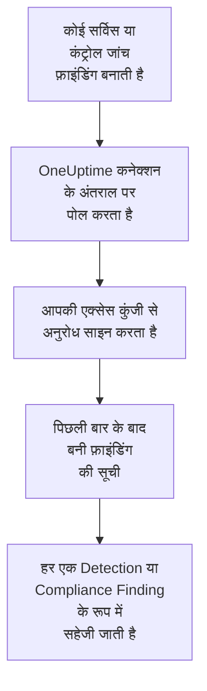

# AWS Security Hub

[AWS Security Hub](https://aws.amazon.com/security-hub/) की फ़ाइंडिंग OneUptime के सुरक्षा इवेंट में इम्पोर्ट करें: GuardDuty, Inspector, Macie और IAM Access Analyzer की फ़ाइंडिंग, Security Hub की अपनी कंट्रोल जांचें, और पार्टनर प्रोडक्ट की फ़ाइंडिंग। वहां आप उन्हें अपने लॉग, ट्रेस और मेट्रिक्स के साथ खोजते हैं, हर दूसरे स्रोत के साथ उनका सहसंबंध देखते हैं, और जो मायने रखती हैं उनके लिए ऑन-कॉल को पेज करते हैं। OneUptime उन्हें आपकी बनाई एक्सेस कुंजी से पढ़ता है, जिसे सिर्फ़ एक रीड-ओनली कार्रवाई की अनुमति होती है, और AWS में कुछ नहीं बदलता। कोई एजेंट, EventBridge नियम या S3 एक्सपोर्ट सेट अप नहीं करना होता।

:::cards
- [कनेक्शन सेट करें](#कनेक्शन-सेट-करें): एक IAM पॉलिसी, एक एक्सेस कुंजी, और कनेक्शन का फ़ॉर्म।
- [क्या इम्पोर्ट होता है](#क्या-इम्पोर्ट-होता-है): हर फ़ाइंडिंग सुरक्षा इवेंट कैसे बनती है।
- [पोलिंग कैसे काम करती है](#पोलिंग-कैसे-काम-करती-है): हर पोल कौन सी विंडो पढ़ता है, और वह पिछली विंडो से 30 मिनट क्यों ओवरलैप करती है।
- [समस्या निवारण](#समस्या-निवारण): हर त्रुटि का मतलब क्या है, और क्या बदलना है।
:::

## यह कैसे काम करता है



हर मिनट OneUptime हर उस सक्षम कनेक्शन से पोल करता है जिसका पोल अंतराल बीत चुका है। एक पोल आपके क्षेत्र में Security Hub का `GetFindings` कॉल करता है, [Signature Version 4](https://docs.aws.amazon.com/IAM/latest/UserGuide/reference_sigv-create-signed-request.html) से साइन करके, पिछले पोल के बाद बनी फ़ाइंडिंग के लिए। यह हर एक को [OCSF](https://schema.ocsf.io/) इवेंट के रूप में सहेजता है: कंट्रोल जांच को Compliance Finding (क्लास `2003`) के रूप में, और बाकी हर फ़ाइंडिंग को Detection Finding (क्लास `2004`) के रूप में। इसके बाद पहचान नियम, मॉनिटर और डैशबोर्ड इसे किसी भी दूसरे स्रोत के सुरक्षा इवेंट की तरह मानते हैं।

## शुरू करने से पहले

- OneUptime में Project Owner, Project Admin या Security Admin रोल। Security Member और Security Viewer कनेक्शन और उनका रन इतिहास देख सकते हैं, पर उन्हें बदल नहीं सकते।
- एक AWS खाता जिसमें उस क्षेत्र में Security Hub सक्षम हो जिसे आप जोड़ते हैं। Security Hub क्षेत्रीय है: एक कनेक्शन वे फ़ाइंडिंग पढ़ता है जो एक खाते के पास एक क्षेत्र में हैं।
- एक ही कनेक्शन से हर खाते और हर क्षेत्र की फ़ाइंडिंग पढ़ने के लिए, Security Hub का डेलिगेटेड एडमिनिस्ट्रेटर खाता, उसके होम क्षेत्र में, [क्रॉस-रीजन एग्रीगेशन](https://docs.aws.amazon.com/securityhub/latest/userguide/finding-aggregation.html) चालू करके। **Security Hub → Settings → Regions** होम क्षेत्र दिखाता है।
- OneUptime ऐप और वर्कर से `securityhub.<region>.amazonaws.com`, या चीन में `securityhub.<region>.amazonaws.com.cn`, तक आउटबाउंड HTTPS, और उनके होस्ट पर सही घड़ी: AWS 5 मिनट से ज़्यादा अंतर पर साइन किया गया अनुरोध अस्वीकार करता है।

## कनेक्शन सेट करें

कनेक्शन अपने अनुरोधों को एक IAM एक्सेस कुंजी से साइन करता है। कुंजी की पहचान को सिर्फ़ एक कार्रवाई चाहिए, `securityhub:GetFindings`, और कुछ नहीं: कनेक्शन कभी कोई फ़ाइंडिंग नहीं बदलता।

:::steps
### फ़ाइंडिंग पढ़ने की अनुमति दें

[IAM कंसोल](https://console.aws.amazon.com/iam/) में **Policies → Create policy** खोलें, **JSON** चुनें, और यह पॉलिसी पेस्ट करें। इसे एक नाम दें, जैसे `OneUptimeSecurityHubRead`:

```json
{
  "Version": "2012-10-17",
  "Statement": [
    {
      "Effect": "Allow",
      "Action": "securityhub:GetFindings",
      "Resource": "*"
    }
  ]
}
```

`GetFindings` को किसी रिसोर्स तक सीमित नहीं किया जा सकता, इसलिए `Resource` `*` ही रहता है। मैनेज्ड पॉलिसी `AWSSecurityHubReadOnlyAccess` भी काम करती है, पर ज़्यादा अनुमति देती है।

### एक्सेस कुंजी बनाएं

1. **Users → Create user** खोलें, यूज़र को एक नाम दें, जैसे `oneuptime-security-hub`, कंसोल एक्सेस बंद रहने दें, और पॉलिसी जोड़ें। दूसरे खातों की फ़ाइंडिंग के लिए यह डेलिगेटेड एडमिनिस्ट्रेटर खाते में करें।
2. यूज़र खोलें, फिर **Security credentials → Access keys → Create access key**, और **Third-party service** चुनें।
3. **एक्सेस कुंजी ID** और **सीक्रेट एक्सेस कुंजी** कॉपी करें। AWS सीक्रेट सिर्फ़ एक बार दिखाता है।

### OneUptime में कनेक्शन जोड़ें

**उत्पाद → Security Events → कनेक्शन** (`/dashboard/{projectId}/security-events/connections`) खोलें, **कनेक्शन जोड़ें** पर क्लिक करें, **AWS Security Hub** चुनें, और **अगला** पर क्लिक करें। नीचे दी गई तालिका की सेटिंग्स भरें, **अगला** पर क्लिक करें, और सीक्रेट को **सीक्रेट एक्सेस कुंजी** में पेस्ट करें।

### सहेजने से पहले इसे टेस्ट करें

**सहेजने से पहले टेस्ट करें** के नीचे **इन सेटिंग्स का परीक्षण करें** पर क्लिक करें। टेस्ट फ़ॉर्म के मानों से एक अनुरोध साइन करता है, और कुछ नहीं सहेजता, इसलिए गलत कुंजी या कोई छूटी हुई अनुमति कनेक्शन बनने से पहले ही सामने आ जाती है। फिर **अगला** पर क्लिक करें, कनेक्शन को एक **नाम** दें, और उसे बनाएं।
:::

| सेटिंग | क्या डालें |
| --- | --- |
| **क्षेत्र** | क्षेत्र का कोड, जैसे `us-east-1`, `eu-central-1` या `us-gov-west-1`: दूसरे खातों की फ़ाइंडिंग के लिए, एडमिनिस्ट्रेटर खाते का होम क्षेत्र। |
| **एक्सेस कुंजी ID** | कुंजी की ID: 16 से 128 अक्षर या अंक, आमतौर पर `AKIA` से शुरू होने वाले 20, या अस्थायी क्रेडेंशियल के लिए `ASIA` से। |
| **सीक्रेट एक्सेस कुंजी** | कुंजी का सीक्रेट। यह एन्क्रिप्ट किया जाता है, API इसे कभी नहीं लौटाता, और यह फिर कभी नहीं दिखता। इसे कनेक्शन पर **क्रेडेंशियल अपडेट करें** से बदलें। |
| **Session token** | सिर्फ़ अस्थायी क्रेडेंशियल के लिए, जिन्हें इसकी ज़रूरत होती है: `ASIA` कुंजी इसके बिना अस्वीकार होती है, और `AKIA` कुंजी इसके साथ अस्वीकार होती है। |

`aws sts assume-role` या `aws sts get-session-token` से मिले अस्थायी क्रेडेंशियल एक्सपायर हो जाते हैं, assume किए गए रोल के लिए ज़्यादा से ज़्यादा 12 घंटे बाद, और पोलिंग तब तक रुकी रहती है जब तक आप **क्रेडेंशियल अपडेट करें** से नए पेस्ट न करें। इस संकरी पॉलिसी वाली लंबे समय तक चलने वाली कुंजी, जिसे आप अपने शेड्यूल पर बदलते हैं, बिना देखरेख के पोलिंग चालू रखती है। अस्थायी क्रेडेंशियल से लंबे समय तक चलने वाली कुंजी पर जाने के लिए, **क्रेडेंशियल अपडेट करें** में नई कुंजी डालें और **Remove the stored Session token** चालू करें।

**पोलिंग** चरण में एक वैकल्पिक **विवरण**, **पोल अंतराल (मिनट)**, जो `1` से `1440` तक की पूर्ण संख्या है और `5` से शुरू होती है, और **सक्षम** भी है, जो शुरू में चालू रहता है।

## क्या इम्पोर्ट होता है

हर फ़ाइंडिंग एक इवेंट बनती है, जिसका वेंडर `Amazon Web Services` और प्रोडक्ट `AWS Security Hub` होता है। `Compliance` ऑब्जेक्ट वाली फ़ाइंडिंग, यानी AWS Foundational Security Best Practices या CIS जैसे किसी स्टैंडर्ड के ख़िलाफ़ कंट्रोल जांच, Compliance Finding (OCSF क्लास `2003`) बनती है। बाकी हर फ़ाइंडिंग Detection Finding (OCSF क्लास `2004`) बनती है।

| फ़ाइंडिंग फ़ील्ड | OneUptime कॉलम |
| --- | --- |
| `Id`, AWS की बनाई फ़ाइंडिंग के लिए एक ARN | इवेंट UID, जिससे डुप्लिकेट भी हटाए जाते हैं |
| `CreatedAt`, नहीं तो `UpdatedAt`, नहीं तो `FirstObservedAt` | इवेंट का समय |
| `Title` | नियम का नाम |
| `GeneratorId`, जैसे GuardDuty फ़ाइंडिंग का प्रकार या कंट्रोल की ID | नियम ID |
| `Title`, नहीं तो `Description` | संदेश |
| `Severity.Label`, नहीं तो `Severity.Normalized` की एक श्रेणी | गंभीरता |
| `Workflow.Status`: `NEW`, `NOTIFIED`, `RESOLVED` या `SUPPRESSED`, नहीं तो पुराना `WorkflowState` | स्थिति |
| `TTPs/` के नीचे `Types`: `TTPs/Initial Access/...` `TA0001` बन जाता है | MITRE ATT&CK टैक्टिक और तकनीकें |
| किसी एक्सेस कुंजी या यूज़र रिसोर्स का IAM यूज़र, `Network.SourceIpV4` या `SourceIpV6`, `Process.Name` या `Process.Path` | प्रिंसिपल यूज़र, IP और प्रोसेस |
| `Process.Name` और `Process.Path` | प्रोसेस का नाम और पाथ। फ़ाइंडिंग में न कमांड लाइन होती है, न पैरेंट प्रोसेस। |
| किसी `AwsEc2Instance` रिसोर्स की इंस्टेंस ID, `Network.DestinationIpV4` या `DestinationIpV6`, `Network.DestinationPort`, पहला `Resources[].Id` | टारगेट होस्ट, IP, पोर्ट और रिसोर्स |
| ये सब, हर `Resources[].Id`, `AwsAccountId`, नेटवर्क के डोमेन, मैलवेयर के नाम और थ्रेट इंटेलिजेंस मान | Observable |
| पूरी फ़ाइंडिंग, डॉट वाली कुंजियों में फैलाई हुई, जैसे `Compliance.Status` और `Remediation.Recommendation.Url` | `attributes` |

जब किसी फ़ाइंडिंग में `Severity.Label` नहीं होता, तो `Severity.Normalized` तय करता है: `0` Informational है, `1` से `39` Low, `40` से `69` Medium, `70` से `89` High, और `90` से `100` Critical। जो फ़ाइंडिंग Security Hub बाद में अपडेट करता है, नए `Workflow.Status` या अब पास होने वाले कंट्रोल के साथ, वह अपना `Id` रखती है, इसलिए वह फिर से इम्पोर्ट नहीं होती: इवेंट फ़ाइंडिंग को वैसा ही रखता है जैसी वह इम्पोर्ट के समय थी।

## पोलिंग कैसे काम करती है

हर पोल अपनी विंडो में बनी फ़ाइंडिंग की सूची बनाता है, सबसे पुरानी पहले, एक पेज में 100, और पूरी विंडो पढ़ लेने तक `NextToken` का पीछा करता है:

```text
POST https://securityhub.{region}.amazonaws.com/findings
    {"Filters": {"CreatedAt": [{"Start": "{window start}", "End": "{window end}"}]},
     "SortCriteria": [{"Field": "CreatedAt", "SortOrder": "asc"}],
     "MaxResults": 100}
```

- **बनने का समय ही कर्सर है।** फ़ाइंडिंग `CreatedAt` के हिसाब से सूचीबद्ध होती हैं, कभी `FirstObservedAt` से नहीं। GuardDuty पर्याप्त गतिविधि देखने के बाद फ़ाइंडिंग बनाता है, और कंट्रोल जांच तब बनती है जब Security Hub पहली बार रिसोर्स की जांच करता है, गतिविधि शुरू होने के घंटों या दिनों बाद। अवलोकन के समय पर रखा कर्सर उन्हें छोड़ देगा।
- **पहला पोल 24 घंटे पीछे देखता है**, इसलिए नया कनेक्शन तुरंत अपनी हाल की फ़ाइंडिंग दिखाता है।
- **हर बाद वाला पोल सहेजे गए कर्सर से 30 मिनट पहले शुरू होता है।** `CreatedAt` समस्या ढूंढने वाली सर्विस सेट करती है, और फ़ाइंडिंग Security Hub तक बाद में पहुंचती है: GuardDuty नई फ़ाइंडिंग पांच मिनट के भीतर भेजता है, और EventBridge से विफल डिलीवरी की 24 घंटे तक दोबारा कोशिश होती है। ओवरलैप ऐसी फ़ाइंडिंग को अगले पोल में पढ़ लेता है। जो फ़ाइंडिंग अपने `CreatedAt` के 30 मिनट से ज़्यादा बाद आती है, वह कर्सर के पीछे छूट सकती है: उसे वापस पाने के लिए उसकी समय सीमा इम्पोर्ट करें।
- **एक पोल कर्सर से आगे ज़्यादा से ज़्यादा 24 घंटे पढ़ता है।** जिस कनेक्शन का कर्सर पीछे रह गया, वह 24 घंटे की लगातार विंडो में बराबर आता है, और उसका **स्वास्थ्य** **Catching up** दिखाता है।
- **डुप्लिकेट फ़ाइंडिंग के `Id` से हटाए जाते हैं**, प्रोजेक्ट के भीतर, इसलिए ओवरलैप, दोबारा कोशिश की गई विंडो और इम्पोर्ट कभी किसी फ़ाइंडिंग को दो बार नहीं सहेजते।

### जब किसी विंडो में एक पोल की क्षमता से ज़्यादा हो

एक पोल 100 फ़ाइंडिंग वाले ज़्यादा से ज़्यादा 20 अनुरोध भेजता है: 2,000 फ़ाइंडिंग। जब किसी विंडो में इससे ज़्यादा हों, तो रन **आंशिक** होता है, इस तरह की चेतावनी के साथ:

```text
Stopped after 20 findings requests (the per-run request limit) before the window was fully read. The last finding read was created at 2026-09-14T08:12:44.000Z.
```

फ़ाइंडिंग सबसे पुरानी पहले पढ़ी जाती हैं, इसलिए OneUptime कर्सर को पढ़ी गई आखिरी फ़ाइंडिंग के बनने के समय पर ले जाता है, और अगला पोल 30 मिनट के ओवरलैप के बिना, उसी विंडो लंबाई के साथ वहीं से शुरू होता है। व्यस्त खाता वही फ़ाइंडिंग दोबारा पढ़ने के बजाय हर पोल में लगभग 2,000 फ़ाइंडिंग पकड़ता है। जब कर्सर उस बिंदु से 30 मिनट आगे निकल जाता है, तो ओवरलैप लौट आता है।

जब कोई रन सहेजे गए कर्सर से आगे बिल्कुल नहीं बढ़ पाता, उदाहरण के लिए क्योंकि सिर्फ़ 30 मिनट के ओवरलैप में ही 2,000 से ज़्यादा फ़ाइंडिंग हैं, तो OneUptime इसके बजाय विंडो छोटी करता है:

1. **छोटा करें।** अगला पोल उसी शुरुआती बिंदु से आधी लंबाई की विंडो पढ़ता है, और तब तक आधा करता रहता है जब तक कोई विंडो पूरी न पढ़ी जाए, कम से कम एक मिनट तक। रन की चेतावनी यही बताती है: `This window holds more records than one poll can read; the next poll reads a {n} minute window from the same starting point.`
2. **वापस बढ़ाएं।** किसी विंडो के पूरा पढ़े जाने के बाद अगली विंडो फिर दोगुनी होती है, ज़्यादा से ज़्यादा 24 घंटे तक।
3. **एक मिनट से आगे बढ़ें।** अगर एक मिनट में भी एक पोल की क्षमता से ज़्यादा हो, तो पोलिंग उससे आगे बढ़ जाती है, ताकि नई फ़ाइंडिंग आती रहें, और बाद के पोल का ओवरलैप अब उस मिनट तक वापस नहीं पहुंचता। रन **आंशिक** ही रहता है, और **पिछली त्रुटि** में `More records were created in the one minute from {cursor} to {end} than one poll can read. Polling moved past this minute so newer records keep arriving; use Import this time range in Diagnostics on this minute to recover what one run can read.` लिखा होता है। एक रन जितना पढ़ सकता है उतना वापस पाने के लिए उस मिनट को **Import this time range** से इम्पोर्ट करें।

जो रन AWS की किसी त्रुटि से पूरी तरह विफल होता है, वह कर्सर और विंडो लंबाई नहीं बदलता, और अगला पोल वही विंडो फिर से पढ़ता है। एकमात्र अपवाद वह अनुरोध है जिसका समय खत्म हो गया: कर्सर वहीं रहता है, लेकिन अगली विंडो आधी लंबी होती है, क्योंकि जो विंडो समय पर जवाब पाने के लिए बहुत भारी हो, वह हर कोशिश में टाइम आउट होगी। **पोल अंतराल (मिनट)** बदलने से इसमें कुछ नहीं बदलता: यह तय करता है कि पोल कितनी बार शुरू होता है, न कि उसकी विंडो कहां से शुरू होती है।

### मांग पर रन, प्रीव्यू और इम्पोर्ट

किसी कनेक्शन पर **निदान** पर क्लिक करें, ताकि उसके हाल के रन देख सकें और उसके साथ हाथ से काम कर सकें। जो भी कनेक्शन बदल सकता है वह इन्हें शुरू कर सकता है; जो भी इसे देख सकता है वह इतिहास पढ़ सकता है।

- **अभी चलाएँ** तुरंत सामान्य कर्सर के साथ एक पोल शुरू करता है, तब भी जब कनेक्शन **सक्षम** न हो।
- **Preview findings** 7 दिन तक की समय सीमा पढ़ता है और कुछ इम्पोर्ट नहीं करता।
- **Import this time range** आपकी पुष्टि के बाद 7 दिन तक की सीमा इम्पोर्ट करता है, कर्सर हिलाए बिना। पहले से इम्पोर्ट की गई फ़ाइंडिंग छोड़ दी जाती हैं।
- किसी रन पर **Copy diagnostics** सपोर्ट के लिए उसकी रिपोर्ट कॉपी करता है। इसमें क्रेडेंशियल कभी शामिल नहीं होते।

## कनेक्शन का परीक्षण करें

कनेक्शन की पंक्ति पर **कनेक्शन का परीक्षण करें**, और फ़ॉर्म में **इन सेटिंग्स का परीक्षण करें**, बैकग्राउंड वर्कर में नहीं बल्कि API प्रोसेस में चलते हैं, इसलिए जब वर्कर ही समस्या हों तब भी टेस्ट जवाब देता है। यह ये जांचें क्रम से चलाता है:

| जांच | यह क्या जांचती है |
| --- | --- |
| **कॉन्फ़िगरेशन** | हर सेटिंग मौजूद है और सही रूप में है। इसके विफल होने पर किसी से संपर्क नहीं किया जाता। |
| **Authenticate with AWS** | AWS पिछले 24 घंटों में बनी एक फ़ाइंडिंग के लिए साइन किया गया `GetFindings` अनुरोध स्वीकार करता है। AWS IAM पॉलिसी से पहले सिग्नेचर जांचता है, इसलिए पॉलिसी से इनकार होने पर भी यह जांच पास होती है: कुंजी सही है। |
| **Read findings** | Security Hub उस अनुरोध का जवाब देता है: पहचान `securityhub:GetFindings` कॉल कर सकती है, और क्षेत्र में Security Hub सक्षम है। |
| **Findings available to import** | पिछले 24 घंटों और पिछले 7 दिनों में कितनी फ़ाइंडिंग बनीं, हर एक के लिए 100 का एक पेज, इसलिए `100+` का मतलब है ज़्यादा। 7 दिनों में एक भी नहीं होना चेतावनी है, विफलता नहीं। |
| **Background workers**, **Poll scheduler**, **Security event storage** | OneUptime का अपना हिस्सा: कोई प्रोसेस Worker कतार के जॉब लेता है, पोल जॉब हर मिनट चलता है, और सुरक्षा इवेंट का स्टोर जवाब देता है। |
| **Scheduled polling** | सहेजे गए कनेक्शन के लिए: पोलिंग चालू है, कोई रन वर्कर के इंतज़ार में अटका नहीं है, और पोल समय पर चलते हैं। |

टेस्ट के हर अनुरोध की समय सीमा 20 सेकंड है। टेस्ट कभी कुछ इम्पोर्ट नहीं करता और न कर्सर हिलाता है, और हर विफल जांच बताती है कि क्या बदलना है।

## समस्या निवारण

कनेक्शन का **पिछली त्रुटि** पूरा त्रुटि संदेश रखता है, क्रेडेंशियल छिपाकर, एक ऐसे प्रीफ़िक्स के पीछे जो विफल चरण का नाम बताता है। जब किसी कनेक्शन में त्रुटि हो, तो उसे पढ़ने के लिए उसके **क्रियाएँ** कॉलम में **त्रुटि देखें** चुनें, और उसे कॉपी करने के लिए डायलॉग में **त्रुटि कॉपी करें** चुनें। हर संदेश `AWS Security Hub findings request` से शुरू होता है; उसके बाद जो आता है वह पढ़ें।

:::details Last Error `failed (HTTP 401)` या `failed (HTTP 403)` कहता है
AWS ने अनुरोध अस्वीकार किया। संदेश AWS का त्रुटि कोड उद्धृत करता है, या AWS के अपने शब्द जब उसने कोई कोड नहीं भेजा:

- `AccessDeniedException`, या `is not authorized to perform`: कुंजी सही है, पर उसकी पहचान `securityhub:GetFindings` कॉल नहीं कर सकती। [कनेक्शन सेट करें](#कनेक्शन-सेट-करें) वाली पॉलिसी जोड़ें। कोई permissions boundary या service control policy भी इसे रोक सकती है।
- `InvalidAccessException`, या `is not subscribed to AWS Security Hub`: इस **क्षेत्र** में इस खाते के लिए Security Hub सक्षम नहीं है, या वहां यह खाता उसका एडमिनिस्ट्रेटर नहीं है।
- `InvalidSignatureException` या `SignatureDoesNotMatch`, या `The request signature we calculated does not match`: **सीक्रेट एक्सेस कुंजी** उस **एक्सेस कुंजी ID** की नहीं है। नई एक्सेस कुंजी बनाएं, और उसे **क्रेडेंशियल अपडेट करें** से सहेजें।
- `UnrecognizedClientException` या `InvalidClientTokenId`, या `The security token included in the request is invalid`: AWS **एक्सेस कुंजी ID** को नहीं पहचानता। यह गलत टाइप हुई है, हटा दी गई है, निष्क्रिय है या किसी दूसरे पार्टिशन की है, या यह अपने **Session token** के बिना एक अस्थायी कुंजी है।
- `ExpiredTokenException`, या `The security token included in the request is expired`: अस्थायी क्रेडेंशियल एक्सपायर हो गए। नए जारी करें, या लंबे समय तक चलने वाली कुंजी पर जाएं।
- `RequestTimeTooSkewed` या `RequestExpired`, या `Signature expired`: OneUptime होस्ट की घड़ी 5 मिनट से ज़्यादा अलग है। ऐप और वर्कर होस्ट पर NTP ठीक करें।
- कोई कोड ही नहीं: AWS ने नहीं बताया कि कुंजी ने इनकार किया या पॉलिसी ने। पहले कुंजी जांचें, फिर पॉलिसी।
:::

:::details Last Error किसी दूसरे स्टेटस के साथ `failed (HTTP ...)` कहता है
- `HTTP 404`: इस **क्षेत्र** में किसी Security Hub एंडपॉइंट ने जवाब नहीं दिया। इसकी तुलना AWS कंसोल के Region मेनू से करें: `us-east-1`, न कि `us-east1` या `N. Virginia`।
- `HTTP 429`: खाता Security Hub की सीमा तक पहुंच गया, किसी क्षेत्र में हर सेकंड 3 `GetFindings` अनुरोध। अगला पोल फिर कोशिश करता है। अगर यह होता रहे, तो कोई दूसरा टूल या कनेक्शन ढूंढें जो वही खाता और क्षेत्र पढ़ता हो।
- `HTTP 5xx`: Security Hub की तरफ़ कोई समस्या थी। अगला पोल फिर कोशिश करता है।
- `HTTP 400`: Security Hub ने क्वेरी अस्वीकार की, जिसे OneUptime बनाता है, आपकी सेटिंग्स नहीं। संदेश OneUptime सपोर्ट को भेजें।
:::

:::details Last Error `returned`, `timed out` या `Could not reach data source` कहता है
- `returned a non-JSON body` या `returned an unrecognized response shape`: Security Hub के बजाय किसी और चीज़ ने जवाब दिया, जैसे किसी प्रॉक्सी का साइन-इन पेज या जवाब बदलने वाला गेटवे। इसे खाली विंडो मानने के बजाय रिपोर्ट किया जाता है, ताकि कर्सर कभी उन फ़ाइंडिंग से आगे न जाए जिन्हें किसी ने नहीं पढ़ा।
- `timed out after 60 seconds with no response`, या `failed: Could not reach data source`: अनुरोध को कोई जवाब नहीं मिला। Security Hub के एंडपॉइंट सार्वजनिक हैं, इसलिए OneUptime ऐप और वर्कर और `securityhub.<region>.amazonaws.com` के बीच DNS, फ़ायरवॉल और प्रॉक्सी जांचें।
:::

:::details Last Polled Never है और Last Error खाली है
इस कनेक्शन का कोई पोल पूरा नहीं हुआ है। **कनेक्शन का परीक्षण करें** चलाएं: उसकी **Background workers** और **Poll scheduler** जांचें कारण बताती हैं। सेल्फ़-होस्टेड इंस्टॉलेशन में आम कारण ऐप पर `DISABLE_QUEUE_WORKERS=true` है, जबकि जॉब लेने के लिए कोई अलग वर्कर डिप्लॉयमेंट नहीं है: इसे `false` पर सेट करें, या वर्कर डिप्लॉयमेंट चलाएं (Helm: `worker.enabled: true`)।
:::

:::details कोई रन Partial है
- `Stopped after 20 findings requests`: विंडो में एक रन द्वारा पढ़ी जाने वाली 2,000 फ़ाइंडिंग से ज़्यादा थीं। कुछ नहीं खोता: अगला पोल पढ़ी गई आखिरी फ़ाइंडिंग के बाद से शुरू होता है। जो कनेक्शन पोल दर पोल **आंशिक** बना रहता है, वह बैकलॉग पकड़ रहा है, और उसके **अंतिम पोल** और **अंतिम इंपोर्ट किया गया इवेंट** आगे बढ़ते रहते हैं। अगर वह कभी नहीं पकड़ पाता, तो खाता हर पोल अंतराल में 2,000 से ज़्यादा फ़ाइंडिंग बनाता है: **पोल अंतराल (मिनट)** छोटा करें।
- `More records were created in the one minute from ... than one poll can read`: पोलिंग उस मिनट से आगे बढ़ गई। उसे **निदान** में **Import this time range** से इम्पोर्ट करें। एक इम्पोर्ट उतना ही पढ़ता है जितना एक पोल।
:::

:::details टेस्ट पास होता है, पर कुछ इम्पोर्ट नहीं होता
टेस्ट की रिपोर्ट में **Findings available to import** पढ़ें। पिछले 7 दिनों में `0` का मतलब है कि Security Hub ने इस खाते और क्षेत्र में कोई फ़ाइंडिंग नहीं बनाई: जांचें कि वहां GuardDuty, Inspector या कोई सुरक्षा स्टैंडर्ड चालू है। दूसरे खातों और क्षेत्रों की फ़ाइंडिंग देखने के लिए, एडमिनिस्ट्रेटर खाते को उसके होम क्षेत्र में जोड़ें।
:::

:::details Security Hub कंसोल की कोई फ़ाइंडिंग कभी नहीं आई
उसके `CreatedAt` की तुलना उसके `ProcessedAt` से करें, जब Security Hub को वह मिली। जो फ़ाइंडिंग अपने `CreatedAt` के 30 मिनट से ज़्यादा बाद आई, वह कर्सर के पीछे छूट सकती है: उसके `CreatedAt` को **Import this time range** से इम्पोर्ट करें।
:::

## आपको क्या मिलता है

- **खोज।** सुरक्षा इवेंट एक्सप्लोरर में, हर दूसरे स्रोत के साथ, फ़ाइंडिंग को गंभीरता, स्थिति, नियम, खाते, रिसोर्स या किसी भी observable से फ़िल्टर करें।
- **सहसंबंध।** हर फ़ाइंडिंग के यूज़र, इंस्टेंस, IP, रिसोर्स ARN और खाता ID observable के रूप में इंडेक्स होते हैं, इसलिए एक सर्च उन सबको ढूंढ लेती है जो उनका ज़िक्र करते हैं।
- **पहचान नियम।** Sigma नियम जो शेड्यूल पर आपके सुरक्षा इवेंट पर चलते हैं, और ऑन-कॉल को पेज करने वाले अलर्ट खोलते हैं।
- **मॉनिटर।** सुरक्षा इवेंट मॉनिटर मेल खाने वाले इवेंट गिनते हैं, जैसे नई गंभीर GuardDuty फ़ाइंडिंग या विफल कंट्रोल, और थ्रेशोल्ड पार होने पर घटनाएं या अलर्ट खोलते हैं।

सुरक्षा इवेंट का बिल आपकी बाकी टेलीमेट्री की तरह, इंजेस्ट किए गए हर GB के हिसाब से बनता है। [मूल्य निर्धारण](https://oneuptime.com/pricing) देखें।

## अगले कदम

:::cards
- [सुरक्षा इवेंट](/docs/telemetry/security-events): जो इम्पोर्ट करते हैं उसे खोजें, उसका सहसंबंध देखें और उस पर अलर्ट करें।
- [Okta System Log](/docs/integrations/okta): अपने आइडेंटिटी प्रोवाइडर के साइन-इन भी इम्पोर्ट करें।
- [रोल](/docs/permissions/reference#भूमिकाएँ): Security रोल क्या देख और बदल सकते हैं।
- [इंटिग्रेशन अवलोकन](/docs/integrations/index): वे दूसरे टूल जिन्हें आप जोड़ सकते हैं।
:::
