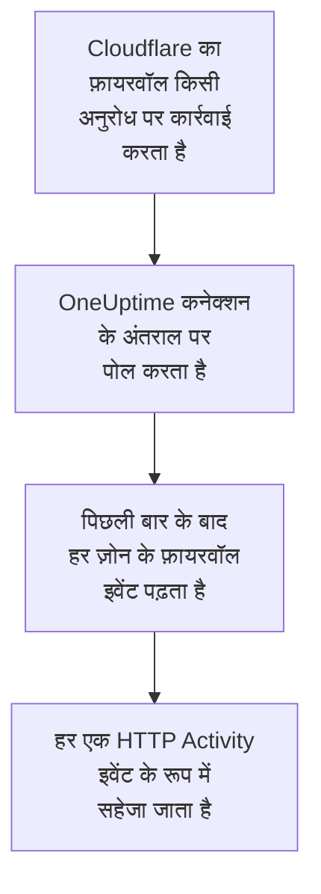

# Cloudflare

[Cloudflare](https://www.cloudflare.com) के फ़ायरवॉल ने एज पर जो किया, उसे OneUptime के सुरक्षा इवेंट में आयात करें: वे अनुरोध जिन्हें उसके मैनेज्ड और कस्टम WAF नियमों, रेट लिमिटिंग, IP Access Rules, बॉट मैनेजमेंट और HTTP DDoS सुरक्षा ने ब्लॉक किया, चुनौती दी या लॉग किया। हर एक आपके ऐप के अपने अनुरोधों के बगल में रहता है, इसलिए केस बताता है कि Cloudflare ने क्या रोका और फिर भी आपके ऐप तक क्या पहुँचा। OneUptime उन्हें ऐसे API टोकन से पढ़ता है जो सिर्फ़ पढ़ सकता है, और Cloudflare में कुछ नहीं बदलता।

:::cards
- [कनेक्शन सेट करें](#कनेक्शन-सेट-करें): पढ़ने की दो अनुमतियों वाला API टोकन, और कनेक्शन का फ़ॉर्म।
- [क्या आयात होता है](#क्या-आयात-होता-है): कौन से इवेंट, और हर एक सुरक्षा इवेंट कैसे बनता है।
- [पोलिंग कैसे काम करती है](#पोलिंग-कैसे-काम-करती-है): हर पोल कौन सी विंडो पढ़ता है, और वह 10 मिनट क्यों ओवरलैप करती है।
- [समस्या निवारण](#समस्या-निवारण): हर त्रुटि का मतलब क्या है, और क्या बदलना है।
:::

## यह कैसे काम करता है

हर मिनट OneUptime हर उस सक्षम कनेक्शन को पोल करता है जिसका पोल अंतराल बीत चुका है। एक पोल खाते के ज़ोन की सूची बनाता है, GraphQL Analytics API के settings नोड से पढ़ता है कि हर ज़ोन का प्लान क्या अनुमति देता है, और `firewallEventsAdaptive` डेटासेट ([Security Events](https://developers.cloudflare.com/waf/analytics/security-events/)) से पिछले पोल के बाद के हर ज़ोन के फ़ायरवॉल इवेंट पढ़ता है, सबसे पुराने पहले। हर इवेंट [OCSF](https://schema.ocsf.io/) HTTP Activity इवेंट के रूप में सहेजा जाता है।

## शुरू करने से पहले

- OneUptime में प्रोजेक्ट स्वामी, प्रोजेक्ट एडमिन या सुरक्षा एडमिन रोल। सुरक्षा सदस्य और सुरक्षा दर्शक कनेक्शन और उनका रन इतिहास देख सकते हैं, पर उन्हें बदल नहीं सकते।
- एक Cloudflare उपयोगकर्ता जो खाते के ज़ोन के लिए API टोकन बना सकता है।
- ऐसे ज़ोन जिनका ट्रैफ़िक Cloudflare से होकर जाता है: उनके DNS रिकॉर्ड प्रॉक्सी किए गए हैं।
- OneUptime ऐप और वर्करों से `api.cloudflare.com` तक आउटबाउंड HTTPS।

## कनेक्शन सेट करें

कनेक्शन [API टोकन](https://developers.cloudflare.com/fundamentals/api/get-started/create-token/) से पढ़ता है, कभी Global API Key से नहीं: टोकन खाते और उसके ज़ोन तक सीमित रहता है, और आप उसे अलग से रद्द कर सकते हैं। इसे दो [अनुमतियाँ](https://developers.cloudflare.com/fundamentals/api/reference/permissions/) चाहिए, दोनों सिर्फ़ पढ़ने की:

| अनुमति | OneUptime इससे क्या पढ़ता है |
| --- | --- |
| `Zone > Zone > Read` | ज़ोन, उनके खातों और प्लान के साथ। |
| `Zone > Analytics > Read` | GraphQL Analytics API के ज़रिए हर ज़ोन के फ़ायरवॉल इवेंट। |

:::steps
### API टोकन बनाएं

1. Cloudflare डैशबोर्ड में **My Profile → API Tokens** खोलें, **Create Token** चुनें, और **Create Custom Token** चुनें।
2. इसका नाम `oneuptime-security-events` रखें। **Permissions** के नीचे `Zone > Zone > Read` और `Zone > Analytics > Read` जोड़ें।
3. **Zone Resources** के नीचे खाते के सभी ज़ोन, या आयात किए जाने वाले ज़ोन शामिल करें।
4. **Continue to summary** चुनें, फिर **Create Token**, और टोकन कॉपी करें। Cloudflare इसे एक ही बार दिखाता है।

### OneUptime में कनेक्शन जोड़ें

**उत्पाद → सुरक्षा इवेंट → कनेक्शन** (`/dashboard/{projectId}/security-events/connections`) खोलें, **कनेक्शन जोड़ें** पर क्लिक करें, **क्लाउड सुरक्षा** के नीचे **Cloudflare** चुनें, और **अगला** पर क्लिक करें। टोकन को **API टोकन** में पेस्ट करें। इसके बाद OneUptime वे खाते और ज़ोन दिखाता है जिन्हें टोकन पढ़ सकता है: **खाता** चुनें, और **ज़ोन** में **सभी ज़ोन** रहने दें, या आयात किए जाने वाले ज़ोन चुनें।

### सहेजने से पहले इसे टेस्ट करें

**सहेजने से पहले टेस्ट करें** के नीचे **इन सेटिंग्स का परीक्षण करें** पर क्लिक करें। टेस्ट फ़ॉर्म के मानों से हर अनुमति जाँचता है, जो भी अनुमति नहीं है उसका नाम बताता है, और कुछ सहेजता नहीं। फिर **अगला** पर क्लिक करें, कनेक्शन को एक **नाम** दें, और उसे बनाएं।
:::

| सेटिंग | क्या डालें |
| --- | --- |
| **खाता** | पढ़ा जाने वाला Cloudflare खाता, उन खातों में से चुना गया जिन्हें आपका API टोकन पढ़ता है। जो टोकन एक ही खाता पढ़ता है, वह उसे आपके लिए चुन लेता है। |
| **ज़ोन** | वैकल्पिक। खाली छोड़ने पर खाते का हर सक्रिय ज़ोन पढ़ा जाता है, बाद में जोड़े गए ज़ोन भी। एक कनेक्शन ज़्यादा से ज़्यादा 50 ज़ोन पढ़ता है। |
| **API टोकन** | सिर्फ़ टोकन, `Bearer` के बिना। यह एन्क्रिप्ट किया जाता है, API इसे कभी नहीं लौटाता और यह फिर कभी नहीं दिखाया जाता। इसे कनेक्शन पर **क्रेडेंशियल अपडेट करें** से बदलें। |

**पोलिंग** चरण में एक वैकल्पिक **विवरण**, **पोल अंतराल (मिनट)**, जो `1` से `1440` तक की पूर्ण संख्या है और `5` से शुरू होती है, और **सक्षम** भी है, जो शुरू में चालू रहता है। Cloudflare के इवेंट अनुरोध हैं, अलर्ट नहीं, इसलिए फ़ॉर्म **केस इस स्तर से खोलें** नहीं पूछता: केस उन पहचान नियमों से आते हैं जो इन्हें पढ़ते हैं।

### लिखने की पहुँच एक अलग विकल्प है

यह कनेक्शन Cloudflare में कभी कुछ नहीं बदलता। वहाँ पते ब्लॉक करना एक अलग ऑप्ट-इन है, जिसके लिए लिखने की अनुमतियाँ चाहिए: सूचियों के लिए `Account > Account Filter Lists > Edit`, जिस भी ज़ोन में ब्लॉक करना हो उस पर `Zone > Zone WAF > Edit`, और पर्याप्त सूचियों के बिना वाले प्लान पर `Account > Account Firewall Access Rules > Edit`। इन्हें टोकन में तभी जोड़ें जब आप ब्लॉक करना चालू करें।

## क्या आयात होता है

हर इवेंट का विक्रेता `Cloudflare` और उत्पाद `Cloudflare WAF` होता है, और वह HTTP Activity (`4002`) इवेंट होता है।

| Cloudflare का फ़ील्ड | सुरक्षा इवेंट में |
| --- | --- |
| `clientIP` | प्रिंसिपल IP, और `client.address` |
| `clientRequestHTTPHost`, `clientRequestPath`, `clientRequestQuery` | लक्ष्य होस्ट, लक्ष्य संसाधन (पाथ और क्वेरी), और `url.original` |
| `clientRequestHTTPMethodName`, `userAgent` | गतिविधि, `http.request.method` और `user_agent.original` |
| `action` | स्थिति, और `oneuptime.edge.action` |
| `source`, `ruleId`, `description` | नियम ID, नियम का नाम, और `cloudflare.source` |
| `rayName`, `clientCountryName`, `clientAsn` | `cloudflare.ray_id`, `cloudflare.client.country` और `cloudflare.client.asn` |
| `sampleInterval` | `oneuptime.edge.sample_interval` |

| Cloudflare ने क्या किया | स्थिति | `oneuptime.edge.action` | अनुरोध का नतीजा | गंभीरता |
| --- | --- | --- | --- | --- |
| ब्लॉक किया, कनेक्शन बंद किया, या चुनौती विफल हुई | Blocked, या बंद कनेक्शन के लिए Dropped | `blocked` | Rejected | Low |
| मैनेज्ड, JS या इंटरैक्टिव चुनौती से जवाब दिया | Challenge | `challenged` | Rejected | Low |
| चुनौती पास हुई, या ऐसा विज़िटर जो पहले ही एक पास कर चुका था | Allowed | `passed-challenge` | कोई नहीं | Informational |
| उसे लॉग किया और जाने दिया | Logged | `logged` | ओरिजिन का स्टेटस कोड | Medium; ओरिजिन के विफल होने पर High; उसके अनुरोध लौटाने पर Low |
| आपके किसी skip या allow नियम पर जाने दिया | Allowed | `let-through` | ओरिजिन का स्टेटस कोड | लॉग किए गए अनुरोध जैसा |

आपके अपने किसी skip या allow नियम ने जिस अनुरोध को जाने दिया, वह तभी आयात होता है जब उसमें कोई हमला हो (SQL इंजेक्शन, पाथ ट्रैवर्सल या Log4Shell लुकअप), या Cloudflare का WAF attack score उसे हमला माने। बाकी वह ट्रैफ़िक है जिसे आप जानबूझकर अनुमति देते हैं, जैसे आपके मॉनिटर: हर रन उसे गिनता है और छोड़ देता है।

Cloudflare व्यस्त ज़ोन के इवेंट का सैंपल लेता है। हर इवेंट अपना सैंपल अंतराल रखता है, यानी उसके जैसे कितने अनुरोधों का वह प्रतिनिधित्व करता है, और OneUptime उनसे जो भी गिनती बनाता है, वह *लगभग* कहती है।

इवेंट, इवेंट में, कैंपेन (पते के अनुसार हमले वाले अनुरोध) में, एंटिटी जोखिम में और पहचान नियमों में दिखते हैं। किसी पते के बारे में केस अपने प्रभाव में **एज पर** के नीचे दिखाता है कि Cloudflare ने उस पते के अनुरोधों के साथ क्या किया, और उसके बगल में यह कि आपके ऐप तक क्या पहुँचा। नियम लाइब्रेरी के Cloudflare नियम उन्हें वैसे ही पढ़ते हैं जैसे वे यहाँ आयात होते हैं: एक पते से मैनेज्ड नियमों पर कई हिट, ऐसा पता जिसने चुनौती पास की और फिर हमले भेजे, और ऐसा हमला जिसे Cloudflare ने जाने दिया और जो आपके ऐप तक पहुँचा।

## प्लान की सीमाएँ

हर प्लान में API के ज़रिए फ़ायरवॉल इवेंट मिलते हैं। **कनेक्शन का परीक्षण करें** में **What each zone's plan gives** हर ज़ोन की अपनी सीमाएँ Cloudflare से पढ़ता है।

| प्लान | Free | Pro | Business | Enterprise |
| --- | --- | --- | --- | --- |
| रखे गए फ़ायरवॉल इवेंट | 31 दिन | 31 दिन | 31 दिन | 31 दिन |
| सबसे लंबी क्वेरी | 30 दिन | 30 दिन | 30 दिन | 31 दिन |

Cloudflare का Logpush भी फ़ायरवॉल इवेंट भेज सकता है, 30 सितंबर 2026 से हर प्लान पर, इस्तेमाल के हिसाब से कीमत पर। यह कनेक्शन इसकी जगह पोल करता है, इसलिए इसे पढ़ने की दो अनुमतियों के अलावा कुछ नहीं चाहिए।

## पोलिंग कैसे काम करती है

- **इवेंट इस आधार पर पढ़े जाते हैं कि वे एज पर कब हुए।** Cloudflare के एनालिटिक्स अनुरोध के एक-दो मिनट बाद क्वेरी किए जा सकते हैं।
- **पहला पोल 24 घंटे पीछे देखता है**, इसलिए नया कनेक्शन तुरंत अपने हाल के इवेंट दिखाता है।
- **हर बाद वाला पोल सहेजे गए कर्सर से 10 मिनट पहले शुरू होता है**, इसलिए जिस इवेंट को Cloudflare देर से पढ़ने लायक बनाता है, वह अगले पोल में पढ़ा जाता है, और डुप्लिकेट प्रोजेक्ट के भीतर हर इवेंट की Ray ID से हटा दिए जाते हैं।
- **एक पोल कर्सर से आगे ज़्यादा से ज़्यादा 24 घंटे पढ़ता है।** जिस कनेक्शन का कर्सर पीछे रह गया, वह 24 घंटे की लगातार विंडो में बराबर आता है।
- **ज़ोन बारी-बारी से पढ़े जाते हैं**, हर एक का 2,000 इवेंट तक का एक पेज, इसलिए कोई व्यस्त ज़ोन किसी शांत ज़ोन के पढ़े जाने से पहले पोल को खत्म नहीं कर सकता।
- **Cloudflare की रेट सीमाओं का पालन होता है।** Cloudflare पाँच मिनट में 1,200 REST अनुरोध और 300 GraphQL क्वेरी की अनुमति देता है। जो `429` 30 सेकंड या उससे कम इंतज़ार करने को कहता है, उसका इंतज़ार करके फिर से अनुरोध किया जाता है; उससे लंबा वाला पोल रोक देता है, और अगला पोल आगे बढ़ता है।
- **जिस ज़ोन को टोकन नहीं पढ़ सकता, वह कुछ नहीं रोकता।** बाकी ज़ोन आयात होते हैं, रन **आंशिक** होता है, और उसकी चेतावनी उस ज़ोन का नाम बताती है। वहाँ टोकन को `Zone > Analytics > Read` दें, फिर विंडो वापस पाने के लिए **यह समय सीमा आयात करें** का इस्तेमाल करें।
- **विफल रन कुछ नहीं बदलता।** नेटवर्क त्रुटि, या Cloudflare की किसी त्रुटि स्थिति के बाद, कर्सर और विंडो की लंबाई जैसी थी वैसी रहती है, और अगला पोल वही विंडो फिर से पढ़ता है। एकमात्र अपवाद टाइमआउट हुआ अनुरोध है: कर्सर वहीं रहता है, लेकिन अगली विंडो आधी लंबी होती है, क्योंकि जो विंडो समय पर जवाब देने के लिए बहुत भारी है, वह हर कोशिश में टाइमआउट होगी।

### जब किसी विंडो में एक पोल की क्षमता से ज़्यादा हो

एक पोल ज़्यादा से ज़्यादा 120 अनुरोध भेजता है, ज़्यादा से ज़्यादा 20,000 इवेंट पढ़ता है, और 4 मिनट बाद रुक जाता है। इवेंट सबसे पुराने पहले पढ़े जाते हैं, इसलिए जब कोई बजट पोल रोकता है, तो रन **आंशिक** होता है और अगला पोल उस सबसे पुराने इवेंट से फिर शुरू होता है जहाँ तक अधूरे ज़ोन पढ़े गए थे। जब हर ज़ोन एक बार भी नहीं पढ़ा जा सका, तो OneUptime इसके बजाय विंडो छोटी करता है:

1. **छोटा करें।** अगला पोल उसी शुरुआती बिंदु से आधी लंबाई की विंडो पढ़ता है, और तब तक आधा करता रहता है जब तक कोई विंडो पूरी न पढ़ी जाए, एक मिनट तक। रन की चेतावनी यही बताती है: `This window holds more records than one poll can read; the next poll reads a {n} minute window from the same starting point.` लंबी विंडो से पहले ही आयात हो चुके इवेंट डुप्लिकेट मानकर छोड़ दिए जाते हैं।
2. **वापस बढ़ाएं।** किसी विंडो के पूरा पढ़े जाने के बाद कर्सर उसके अंत पर जाता है, और अगली विंडो फिर दोगुनी होती है, ज़्यादा से ज़्यादा 24 घंटे तक।
3. **एक मिनट से आगे बढ़ें।** अगर एक मिनट में भी उससे ज़्यादा हो जितना एक पोल पढ़ सकता है, तो पोलिंग उससे आगे बढ़ जाती है, ताकि नए इवेंट आते रहें। रन **आंशिक** रहता है, और **पिछली त्रुटि** में लिखा होता है `More records were created in the one minute from {cursor} to {end} than one poll can read. Polling moved past this minute so newer records keep arriving; use Import this time range in Diagnostics on this minute to recover what one run can read.` एक रन जितना पढ़ सकता है उसे वापस पाने के लिए उस मिनट को **यह समय सीमा आयात करें** से आयात करें।

**पोल अंतराल (मिनट)** बदलने से इसमें कुछ नहीं बदलता: यह तय करता है कि पोल कितनी बार शुरू होता है, न कि उसकी विंडो कहां से शुरू होती है।

### मांग पर रन, प्रीव्यू और आयात

किसी कनेक्शन पर **निदान** पर क्लिक करें, ताकि उसके हाल के रन देख सकें और उसके साथ हाथ से काम कर सकें। जो भी कनेक्शन बदल सकता है वह इन्हें शुरू कर सकता है; जो भी इसे देख सकता है वह इतिहास पढ़ सकता है।

- **अभी चलाएँ** तुरंत सामान्य कर्सर के साथ एक पोल शुरू करता है, तब भी जब कनेक्शन **सक्षम** न हो।
- **पूर्वावलोकन में फ़ायरवॉल इवेंट देखें** 7 दिन तक की समय सीमा पढ़ता है और कुछ आयात नहीं करता।
- **यह समय सीमा आयात करें** आपकी पुष्टि के बाद 7 दिन तक की सीमा आयात करता है, कर्सर हिलाए बिना। पहले से आयात किए गए इवेंट छोड़ दिए जाते हैं। Cloudflare फ़ायरवॉल इवेंट 31 दिन तक रखता है।
- किसी रन पर **निदान कॉपी करें** सपोर्ट के लिए उसकी रिपोर्ट कॉपी करता है। इसमें क्रेडेंशियल कभी शामिल नहीं होते।

## कनेक्शन का परीक्षण करें

कनेक्शन की पंक्ति पर **कनेक्शन का परीक्षण करें**, और फ़ॉर्म में **इन सेटिंग्स का परीक्षण करें**, बैकग्राउंड वर्कर में नहीं बल्कि API प्रोसेस में चलते हैं, इसलिए जब वर्कर ही समस्या हों तब भी टेस्ट जवाब देता है। यह ये जांचें क्रम से चलाता है:

| जांच | यह क्या जांचती है |
| --- | --- |
| **कॉन्फ़िगरेशन** | टोकन, खाता और ज़ोन सही रूप में हैं। इसके विफल होने पर किसी से संपर्क नहीं किया जाता। |
| **Verify the API token** | Cloudflare टोकन स्वीकार करता है, किसी उपयोगकर्ता का या खाते के स्वामित्व वाला, और वह सक्रिय है। जो 14 दिन के भीतर समाप्त होता है, वह चेतावनी है। |
| **List the zones** | टोकन के पास `Zone > Zone > Read` है: वह खाते के ज़ोन, और चुना गया हर ज़ोन दिखाता है। |
| **Read firewall events** | टोकन के पास हर ज़ोन पर `Zone > Analytics > Read` है। विफलता उन ज़ोन का नाम बताती है जिन पर यह नहीं है। |
| **What each zone's plan gives** | हर ज़ोन का प्लान फ़ायरवॉल इवेंट कितने समय तक रखता है, और एक क्वेरी कितनी लंबी हो सकती है। जिस ज़ोन के प्लान में ये नहीं हैं, वह चेतावनी है। |
| **Firewall events available to import** | पिछले 24 घंटों और पिछले 7 दिनों में लगभग कितने इवेंट हैं। एक भी नहीं होना चेतावनी है। |
| **Background workers**, **Poll scheduler**, **Security event storage** | OneUptime का अपना हिस्सा: कोई प्रोसेस Worker क्यू के जॉब लेता है, पोल जॉब हर मिनट चलता है, और सुरक्षा इवेंट का स्टोर जवाब देता है। |
| **शेड्यूल की गई पोलिंग** | सहेजे गए कनेक्शन के लिए: पोलिंग चालू है, कोई रन वर्कर के इंतज़ार में अटका नहीं है, और पोल समय पर चलते हैं। |

टेस्ट के हर अनुरोध की समय सीमा 20 सेकंड है। टेस्ट कभी कुछ आयात नहीं करता और न कर्सर हिलाता है, और हर विफल जांच बताती है कि क्या बदलना है।

## समस्या निवारण

कनेक्शन का **पिछली त्रुटि** पूरा त्रुटि संदेश रखता है, क्रेडेंशियल छिपाकर। जब किसी कनेक्शन में त्रुटि हो, तो उसे पढ़ने के लिए उसके **क्रियाएँ** कॉलम में **त्रुटि देखें** चुनें, और उसे कॉपी करने के लिए डायलॉग में **त्रुटि कॉपी करें** चुनें। हर संदेश विफल अनुरोध का नाम बताता है, और Cloudflare का अपना कारण उद्धृत करता है।

:::details पिछली त्रुटि `Invalid API Token (1000)` कहती है
Cloudflare इस टोकन को नहीं जानता: उसे हटा दिया गया, बदल दिया गया या कभी पूरा पेस्ट नहीं किया गया। Global API Key भेजे जाने से पहले ही अस्वीकार कर दी जाती है। ऊपर बताए अनुसार टोकन बनाएं, और उसे **क्रेडेंशियल अपडेट करें** से सहेजें।
:::

:::details पिछली त्रुटि `Unauthorized to access requested resource (9109)` कहती है
टोकन ज़ोन की सूची नहीं बना सकता। उसे `Zone > Zone > Read` दें, और आयात किए जाने वाले ज़ोन **Zone Resources** के नीचे रखें।
:::

:::details पिछली त्रुटि `cannot read the analytics of` कहती है
संदेश जिन ज़ोन का नाम बताता है, उन पर टोकन के पास `Zone > Analytics > Read` नहीं है। इसे वहाँ जोड़ें, फिर जो आयात नहीं हुआ उसे वापस पाने के लिए **यह समय सीमा आयात करें** का इस्तेमाल करें।
:::

:::details पिछली त्रुटि `rate limit` कहती है
उसी Cloudflare उपयोगकर्ता का इस्तेमाल करने वाली किसी दूसरी चीज़ ने उसका कोटा खत्म कर दिया। पाँच मिनट पूरे होते ही पोलिंग अपने आप आगे बढ़ती है; कोटा अलग रखने के लिए OneUptime को उसके अपने उपयोगकर्ता का टोकन दें।
:::

:::details पिछली त्रुटि `did not complete` कहती है
अनुरोध को कोई जवाब नहीं मिला: टाइमआउट, ऐसा नाम जो रिज़ॉल्व नहीं होता, या अस्वीकार किया गया पता। जाँचें कि OneUptime ऐप और वर्कर, आपके इस्तेमाल किए जाने वाले किसी भी प्रॉक्सी के ज़रिए, `api.cloudflare.com` तक पहुँच सकते हैं।
:::

:::details केस में Cloudflare की कार्रवाइयाँ दिखती हैं, लेकिन आपके ऐप में उस पते का कोई अनुरोध नहीं
Cloudflare के पीछे आपका ऐप Cloudflare के पते देखता है, जब तक वह `CF-Connecting-IP` हेडर से विज़िटर का पता न पढ़े। उस पते को अपने लॉग और ट्रेस में `client.address` के रूप में लिखें, ताकि OneUptime आपके ऐप के अनुरोधों को उस पते से मिला सके जिस पर Cloudflare ने कार्रवाई की।
:::

:::details टेस्ट पास होता है, पर Last Polled Never है
पोल जॉब कभी नहीं चला। **Background workers** और **Poll scheduler** जांचें पढ़ें। सेल्फ़-होस्टेड इंस्टॉलेशन में आम कारण ऐप पर `DISABLE_QUEUE_WORKERS=true` है, जबकि जॉब लेने के लिए कोई अलग वर्कर डिप्लॉयमेंट नहीं है: इसे `false` पर सेट करें, या वर्कर डिप्लॉयमेंट चलाएं (Helm: `worker.enabled: true`, जो डिफ़ॉल्ट रूप से `false` है)।
:::

## अगले कदम

:::cards
- [सुरक्षा इवेंट](/docs/telemetry/security-events): जो आयात करते हैं उसे खोजें, उसका सहसंबंध देखें और उस पर अलर्ट करें।
- [सुरक्षा केस](/docs/telemetry/security-cases): देखें कि Cloudflare ने क्या किया, और उसके बगल में आपके ऐप तक क्या पहुँचा।
- [इंटिग्रेशन अवलोकन](/docs/integrations/index): वे दूसरे टूल जिन्हें आप जोड़ सकते हैं।
:::
