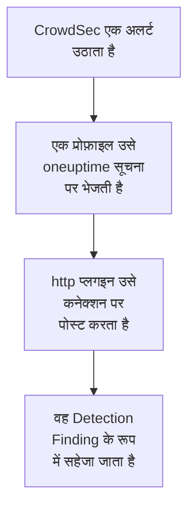

# CrowdSec

[CrowdSec](https://www.crowdsec.net/) के अलर्ट, जैसे ही CrowdSec उन्हें उठाता है, OneUptime के सुरक्षा इवेंट में प्राप्त करें, और अपने प्रोजेक्ट की ब्लॉकलिस्ट के पतों को CrowdSec से ब्लॉक करें। CrowdSec का अपना सूचना प्लगइन हर अलर्ट को एक CrowdSec कनेक्शन पर भेजता है, जो CrowdSec के डिटेक्शन से केस खोलता है। ब्लॉकिंग चालू करने के बाद, OneUptime आपके ब्लॉक किए गए हर पते को CrowdSec के Local API के ज़रिए बैन करता है, और उस Local API को पढ़ने वाला हर बाउंसर उस पते को ब्लॉक करता है।

:::cards
- [कनेक्शन सेट करें](#कनेक्शन-सेट-करें): एक कनेक्शन, और वह सूचना जो CrowdSec के अलर्ट उस पर भेजती है।
- [क्या प्राप्त होता है](#क्या-प्राप्त-होता-है): हर CrowdSec अलर्ट सुरक्षा इवेंट कैसे बनता है।
- [CrowdSec से पते ब्लॉक करें](#crowdsec-से-पते-ब्लॉक-करें): अपनी ब्लॉकलिस्ट के पतों को CrowdSec में बैन करें।
- [CrowdSec की ब्लॉकलिस्ट पढ़ें](#crowdsec-की-ब्लॉकलिस्ट-पढ़ें): CrowdSec Console जो सूचियाँ देता है, थ्रेट इंटेल फ़ीड के रूप में।
- [समस्या निवारण](#समस्या-निवारण): हर त्रुटि का मतलब क्या है, और क्या बदलना है।
:::

## यह कैसे काम करता है



CrowdSec का Local API हर उस अलर्ट को, जिसे कोई प्रोफ़ाइल किसी सूचना पर भेजती है, उस सूचना के प्लगइन को सौंपता है। कनेक्शन की सूचना CrowdSec के `http` प्लगइन का उपयोग करती है: वह अलर्ट को, CrowdSec के अपने JSON में, आपकी इंजेशन कुंजी के साथ और कनेक्शन का नाम लेकर, सुरक्षा इवेंट के इंजेस्ट पर पोस्ट करता है। OneUptime उसे [OCSF](https://schema.ocsf.io/) Detection Finding इवेंट (क्लास `2004`) के रूप में सहेजता है, आपके पहचान नियमों से उसकी जांच करता है, और CrowdSec के हर उस अपने डिटेक्शन से केस खोलता है जो कनेक्शन के **केस इस स्तर से खोलें** पर या उससे ऊपर है। कुछ भी पोल नहीं किया जाता: CrowdSec के अलर्ट उठाने के कुछ सेकंड बाद ही अलर्ट पहुँच जाता है।

## शुरू करने से पहले

- OneUptime में प्रोजेक्ट स्वामी, प्रोजेक्ट एडमिन या सुरक्षा एडमिन रोल। सुरक्षा सदस्य और सुरक्षा दर्शक कनेक्शन देख सकते हैं, पर उन्हें बदल नहीं सकते।
- CrowdSec 1.5 या बाद का संस्करण, उसके Local API और उसके साथ आने वाले `http` सूचना प्लगइन के साथ। यह पेज CrowdSec v1.8.2 के आधार पर लिखा गया है।
- CrowdSec का Local API चलाने वाले होस्ट से आपके OneUptime तक आउटबाउंड HTTPS।
- पते भी ब्लॉक करने के लिए: ऐसा Local API जिस तक OneUptime पहुँच सके, और OneUptime के लिए एक मशीन ([CrowdSec से पते ब्लॉक करें](#crowdsec-से-पते-ब्लॉक-करें) देखें)।

## कनेक्शन सेट करें

:::steps
### OneUptime में कनेक्शन जोड़ें

**उत्पाद → सुरक्षा इवेंट → कनेक्शन** (`/dashboard/{projectId}/security-events/connections`) खोलें, **कनेक्शन जोड़ें** पर क्लिक करें, **CrowdSec** चुनें, और **अगला** पर क्लिक करें। सिर्फ़ अलर्ट प्राप्त करने के लिए नीचे की तालिका की हर सेटिंग खाली छोड़ दें; पते भी ब्लॉक करने के लिए उन्हें भरें।

### सहेजने से पहले इसे टेस्ट करें

**सहेजने से पहले टेस्ट करें** के नीचे **इन सेटिंग्स का परीक्षण करें** पर क्लिक करें। कोई Local API सेट न होने पर टेस्ट यही बताता है और किसी से संपर्क नहीं करता; सेट होने पर वह Local API तक पहुँचता है, मशीन के रूप में साइन इन करता है, और कुछ सहेजता नहीं। फिर **अगला** पर क्लिक करें, **अलर्ट** चरण पर कनेक्शन को एक **नाम** दें, चुनें कि **केस इस स्तर से खोलें** क्या हो, और उसे बनाएं।

### CrowdSec होस्ट पर सूचना सहेजें

कनेक्शन बनाने पर उसका **अलर्ट भेजें** खुलता है, जिसे आप बाद में कनेक्शन की पंक्ति से फिर खोल सकते हैं। **इंजेशन कुंजी चुनें**, फिर यह जो सूचना दिखाता है, आपकी कुंजी और आपके कनेक्शन के साथ पहले से भरी हुई, उसे उस होस्ट पर सहेजें जो CrowdSec का Local API चलाता है:

```yaml title="/etc/crowdsec/notifications/oneuptime.yaml"
type: http
name: oneuptime

# info or quieter: at debug, CrowdSec logs each request's headers.
log_level: info

format: |
  {{.|toJson}}

url: https://oneuptime.com/security-events/v1/ingest?connection=YOUR_CONNECTION_ID&format=crowdsec
method: POST
headers:
  Content-Type: application/json
  x-oneuptime-token: YOUR_INGESTION_TOKEN
```

### अपनी प्रोफ़ाइलों के अलर्ट इस सूचना पर भेजें

`/etc/crowdsec/profiles.yaml` में, हर उस प्रोफ़ाइल के `notifications` में `oneuptime` जोड़ें जिसके अलर्ट OneUptime को मिलने चाहिए, फिर CrowdSec को रीलोड करें:

```yaml title="/etc/crowdsec/profiles.yaml"
notifications:
  - oneuptime
```

```bash
sudo systemctl reload crowdsec
```

### टेस्ट अलर्ट भेजें

```bash
sudo cscli notifications test oneuptime
```

**अलर्ट भेजें** बताता है कि वह कब पहुँचा, और **अलर्ट देखें** उसे सुरक्षा इवेंट में खोलता है। यह Informational गंभीरता वाला इवेंट है, और कोई केस नहीं खोलता।
:::

| सेटिंग | क्या डालें |
| --- | --- |
| **Local API का URL** | सिर्फ़ पते ब्लॉक करने के लिए: जहाँ OneUptime CrowdSec के Local API तक पहुँचता है, जैसे `https://crowdsec.example.com:8080`। जहाँ भी कनेक्शन किसी नेटवर्क को पार करे, `https` का उपयोग करें। |
| **मशीन ID** | सिर्फ़ पते ब्लॉक करने के लिए: वह मशीन जिसके रूप में OneUptime साइन इन करता है, CrowdSec होस्ट पर `sudo cscli machines add oneuptime --auto -f -` से जोड़ी गई। |
| **CrowdSec से पते ब्लॉक करें** | नए कनेक्शन पर बंद रहता है। चालू होने पर यह आपकी ब्लॉकलिस्ट के पतों और रेंज को CrowdSec में बैन करता है, और इसे बाकी तीनों सेटिंग्स चाहिए ([CrowdSec से पते ब्लॉक करें](#crowdsec-से-पते-ब्लॉक-करें) देखें)। |
| **मशीन पासवर्ड** | सिर्फ़ पते ब्लॉक करने के लिए: वह पासवर्ड जो `cscli` ने मशीन के लिए प्रिंट किया। यह एन्क्रिप्ट किया जाता है, API इसे कभी नहीं लौटाता और यह फिर कभी नहीं दिखाया जाता। इसे कनेक्शन पर **क्रेडेंशियल अपडेट करें** से बदलें। |

**अलर्ट** चरण में एक वैकल्पिक **विवरण**, और **सक्षम** भी है, जो शुरू में चालू रहता है। जो कनेक्शन सक्षम नहीं है, वह प्राप्त अलर्ट को इवेंट के रूप में रखता है, और उनसे कोई केस नहीं खोलता।

कंटेनर में सूचना उस फ़ोल्डर में जाती है जो `/etc/crowdsec/notifications/` पर माउंट है, और कंटेनर का रीस्टार्ट उसे पढ़ लेता है। Kubernetes इंस्टॉल उसे अपनी Helm वैल्यू में `config.notifications` के नीचे बताता है, और `profiles.yaml` को उसके बगल में `config` के नीचे।

## क्या प्राप्त होता है

CrowdSec का भेजा हर अलर्ट एक Detection Finding इवेंट (OCSF क्लास `2004`) बनता है, वेंडर और उत्पाद `CrowdSec` के साथ:

| CrowdSec फ़ील्ड | OneUptime कॉलम |
| --- | --- |
| `uuid`, या उसके बिना वाले अलर्ट का एक हैश | इवेंट UID, जिससे डुप्लिकेट भी हटाए जाते हैं |
| `stop_at`, या `start_at` | इवेंट का समय |
| `scenario` | नियम ID, और नियम का नाम: CrowdSec Hub पर परिदृश्य का शीर्षक, या उसका नाम |
| `source.ip`, या किसी `Ip` अलर्ट का `source.value` | प्रिंसिपल IP |
| अलर्ट या उसके इवेंट का `target_fqdn` या `target_host`, नहीं तो उसके इवेंट जिस `machine` का नाम लेते हैं | लक्ष्य होस्ट |
| `target_user`, `target_uri` | लक्ष्य यूज़र और संसाधन |
| पहले निर्णय का `type` | स्थिति: बैन के लिए `Blocked`, कैप्चा के लिए `Challenge`, बिना निर्णय के या सिमुलेशन मोड में `Logged` |
| परिदृश्य का व्यवहार | गंभीरता, और उसकी MITRE ATT&CK टैक्टिक और तकनीकें |
| बाकी सब कुछ, जैसे `source.cn`, `source.as_name` और `events_count` | `attributes`: अलर्ट के फ़ील्ड डॉट वाली कुंजियों में फैलाए हुए, उसके पहले 10 इवेंट पूरे, और `crowdsec.` के नीचे OneUptime की व्याख्या |

CrowdSec अलर्ट की अपनी कोई गंभीरता नहीं होती, इसलिए OneUptime उसे इससे तय करता है कि परिदृश्य क्या पहचानता है, जैसा CrowdSec Hub उसे लेबल करता है (`ssh:bruteforce`, `http:exploit`):

| व्यवहार | गंभीरता |
| --- | --- |
| कोई एक्सप्लॉइट, जैसे कोई CVE या जो AppSec कंपोनेंट ने ब्लॉक किया, या हमलावर अंदर घुसने के बाद जो करता है | High |
| ब्रूट फ़ोर्स, डिनायल ऑफ़ सर्विस, धोखाधड़ी, असंभव साइन-इन, या ऐसा व्यवहार जिसे OneUptime किसी श्रेणी में नहीं रख सकता | Medium |
| स्कैन, प्रोब, क्रॉल, बॉट, स्पैम और क्लाउड ऑडिट में बदलाव | Low |
| CrowdSec के अपने टेस्ट परिदृश्य | Informational |

**केस इस स्तर से खोलें** के **उच्च और ऊपर** पर होने पर CrowdSec के एक्सप्लॉइट केस खोलते हैं, और स्कैनरों और पासवर्ड का अनुमान लगाने वालों पर उसके रोज़ के बैन आपके पहचान नियमों के लिए इवेंट बने रहते हैं। केवल CrowdSec के अपने डिटेक्शन ही केस खोलते हैं। किसी के द्वारा `cscli` से या CrowdSec के Console में जोड़ा गया निर्णय, किसी CrowdSec ब्लॉकलिस्ट का पता, टेस्ट अलर्ट, और वापस आते OneUptime के अपने बैन Informational गंभीरता के होते हैं, और कोई केस नहीं खोलते। दो बार भेजा गया अलर्ट, जैसा `cscli notifications reinject` करता है, एक ही बार सहेजा जाता है।

## CrowdSec से पते ब्लॉक करें

किसी कनेक्शन पर **CrowdSec से पते ब्लॉक करें** चालू करें, और आपके प्रोजेक्ट की [ब्लॉकलिस्ट](/docs/telemetry/security-cases#ब्लॉकलिस्ट) के पते और रेंज CrowdSec में बैन हो जाते हैं। उसके Local API को पढ़ने वाला हर बाउंसर, जैसे उसके फ़ायरवॉल, nginx और Traefik बाउंसर, उन्हें वहीं ब्लॉक करता है जहाँ वह चलता है, जैसे वह CrowdSec के अपने बैन ब्लॉक करता है। ब्लॉक उन्हीं अनुमोदनों और स्वचालित प्रतिक्रिया की उन्हीं सीमाओं से गुज़रते हैं, और उसी **अनब्लॉक करें** से हटते हैं, जैसे हर उस दूसरी जगह जहाँ आपकी ब्लॉकलिस्ट लागू होती है।

नए कनेक्शन पर यह स्विच बंद रहता है। इसे चालू करने के लिए:

1. CrowdSec होस्ट पर OneUptime के लिए एक मशीन जोड़ें; यह कमांड उसका पासवर्ड प्रिंट करती है:

   ```bash
   sudo cscli machines add oneuptime --auto -f -
   ```

2. OneUptime को Local API तक पहुँचने दें, जो अलग से न बताने पर `127.0.0.1:8080` पर सुनता है: CrowdSec की `config.yaml` में `api.server.listen_uri` सेट करें, Local API को TLS पर या किसी `https` प्रॉक्सी के पीछे सर्व करें, और अपने फ़ायरवॉल से OneUptime के पतों को आने दें।
3. कनेक्शन संपादित करें, **Local API का URL** और **मशीन ID** भरें, पासवर्ड **मशीन पासवर्ड** में डालें, **CrowdSec से पते ब्लॉक करें** चालू करें, और सहेजें। इसके बाद **कनेक्शन का परीक्षण करें** जाँचता है कि मशीन साइन इन करती है और OneUptime के बैन पढ़ती है, कुछ भी बदले बिना।

बैन कैसे बनता है, और कैसे खत्म होता है:

- हर ब्लॉक एक बैन निर्णय है, जो वैसे ही बनाया जाता है जैसे `cscli decisions add` बनाता है, परिदृश्य `oneuptime/blocklist` के तहत। CrowdSec उसे मैनुअल निर्णय के रूप में रखता है, इसलिए वह CrowdSec के Central API से कभी साझा नहीं होता, जब तक आप मैनुअल निर्णय साझा न करें। OneUptime केवल अपने ही बैन पढ़ता और हटाता है, किसी व्यक्ति या CrowdSec का बनाया बैन कभी नहीं।
- अंत वाला ब्लॉक ठीक उसी अंत तक का बैन है, और तब CrowdSec उसे खुद हटा देता है, चाहे OneUptime उस तक पहुँच सके या नहीं। हटाए जाने तक चलने वाला ब्लॉक 7 दिन का बैन है, जो 3 दिन या उससे कम बचने पर नवीनीकृत होता है, इसलिए जिस बैन को OneUptime अब नहीं रखता, वह एक हफ़्ते के भीतर खत्म हो जाता है।
- **अनब्लॉक करें** अगले पास में, एक मिनट के भीतर, बैन हटा देता है। CrowdSec में `cscli decisions delete` या फ़्लश से हटाया गया बैन, जब तक ब्लॉक चलता है, अगले पास में फिर बना दिया जाता है।
- CrowdSec की किसी अनुमति सूची में मौजूद पता या रेंज कभी बैन नहीं होता: ब्लॉक उसे वहाँ लागू नहीं के रूप में दिखाता है, अनुमति सूची का नाम बताते हुए, और पहले से बना बैन तब हटा दिया जाता है जब कोई अनुमति सूची उस पते को रखती है।
- आपके प्रोजेक्ट के अपने पते, जैसे आपकी **भरोसेमंद प्रॉक्सी**, लोड बैलेंसर और एज, कहीं भी ब्लॉक नहीं होते, CrowdSec में भी नहीं।
- CrowdSec केवल बैन करता है: वहाँ चैलेंज लागू नहीं होता, और डोमेन, URL या फ़ाइल उसे नहीं भेजी जाती।

जब Local API तक पहुँचा नहीं जा सकता, CrowdSec में कुछ नहीं बदलता: उसके रखे बैन बने रहते हैं, और अपने समय पर खत्म होते हैं। **ब्लॉकलिस्ट** पर **कहाँ लागू है** बताता है कि CrowdSec ने हर ब्लॉक को आखिरी बार कब रखा था, और OneUptime 1 मिनट बाद फिर कोशिश करता है, फिर हर बार दोगुना इंतज़ार करता है, 30 मिनट तक। नया ब्लॉक तब तक इंतज़ार करता है जब तक उसे बनाया न जा सके।

## CrowdSec की ब्लॉकलिस्ट पढ़ें

CrowdSec Console उन ब्लॉकलिस्ट को जिनकी आपका संगठन सदस्यता लेता है, एक Raw IP List इंटिग्रेशन के रूप में देता है: हर पंक्ति में एक पता, उपयोगकर्ता नाम और पासवर्ड के पीछे। एक [थ्रेट इंटेल फ़ीड](/docs/telemetry/threat-intelligence) उन्हें पढ़ती है, और आपके इवेंट का उनसे मिलान करती है:

1. CrowdSec Console में IP एग्रीगेशन (IP aggregation) बंद रखकर एक Raw IP List इंटिग्रेशन बनाएं: OneUptime पतों का मिलान करता है, रेंज का नहीं। उसका एंडपॉइंट, उपयोगकर्ता नाम और पासवर्ड कॉपी करें।
2. OneUptime में **उत्पाद → सुरक्षा इवेंट → डिटेक्शन → थ्रेट इंटेल** खोलें, **थ्रेट इंटेल फ़ीड बनाएँ** पर क्लिक करें, और **संकेतकों की सूची** चुनें।
3. एंडपॉइंट को **सूची URL** के रूप में पेस्ट करें, **साइन-इन** के नीचे **उपयोगकर्ता नाम और पासवर्ड** चुनें, और दोनों पेस्ट करें। CrowdSec के Community प्लान पर, जो दिन में एक डाउनलोड की अनुमति देता है, **पोल अंतराल (मिनट)** को `1440` पर सेट करें।

सूचियाँ CrowdSec की हैं: आप उन्हें अपने टूल में इस्तेमाल कर सकते हैं, आगे नहीं दे सकते। OneUptime अपनी कोई सूची नहीं देता।

## कनेक्शन का परीक्षण करें

कनेक्शन की पंक्ति पर **कनेक्शन का परीक्षण करें**, और फ़ॉर्म में **इन सेटिंग्स का परीक्षण करें**, बैकग्राउंड वर्कर में नहीं बल्कि API प्रोसेस में चलते हैं। वे ये जांचें क्रम से चलाते हैं:

| जांच | यह क्या जांचती है |
| --- | --- |
| **कॉन्फ़िगरेशन** | सेटिंग्स या तो सब खाली हैं या सब दी गई हैं, और सही रूप में हैं। इसके विफल होने पर किसी से संपर्क नहीं किया जाता। |
| **Reach CrowdSec's Local API** | `GET /health` जवाब देता है। कोई Local API सेट न होने पर जांच बताती है कि कनेक्शन सिर्फ़ अलर्ट प्राप्त करता है, और अगली तीन जांचें नहीं चलतीं। |
| **Sign in to the Local API** | `POST /v1/watchers/login` मशीन और उसके पासवर्ड को स्वीकार करता है। |
| **Read CrowdSec's allowlists** | `GET /v1/allowlists` जवाब देता है, और अनुमति सूचियों में कितने पते और रेंज हैं। 1.6.8 से पुराना Local API, जिसमें कोई अनुमति सूची नहीं है, पास होता है। |
| **Block with CrowdSec** | केवल **CrowdSec से पते ब्लॉक करें** चालू होने पर: मशीन OneUptime के बैन वापस पढ़ सकती है, और कितने लागू हैं। यह जांच कुछ नहीं बदलती। |
| **Background workers**, **Security event storage** | OneUptime का अपना हिस्सा: कोई प्रोसेस Worker क्यू के जॉब लेता है, जो CrowdSec का भेजा हुआ सहेजते हैं, और सुरक्षा इवेंट का स्टोर जवाब देता है। |
| **Alerts received** | सहेजे गए कनेक्शन के लिए: आखिरी अलर्ट कब पहुँचा। अभी तक कोई न होना एक चेतावनी है, साथ में यह कि टेस्ट अलर्ट कैसे भेजें। |

टेस्ट कभी कुछ बैन नहीं करता, न कुछ हटाता है। **रिपोर्ट कॉपी करें** चेकलिस्ट को JSON के रूप में कॉपी करता है, बिना पासवर्ड या टोकन के।

## समस्या निवारण

कनेक्शन का **स्वास्थ्य** पहला अलर्ट पहुँचने तक **अलर्ट की प्रतीक्षा** दिखाता है, फिर **अलर्ट मिल रहे हैं**, चाहे अगला अलर्ट कितनी भी देर से आए; **केस रोके गए** का मतलब है कि कनेक्शन सक्षम नहीं है। प्लगइन को जो जवाब मिला, CrowdSec उसे अपने लॉग `/var/log/crowdsec.log` में `HTTP server returned non 200 status code` के रूप में लिखता है।

:::details कोई अलर्ट नहीं पहुँचता
- `sudo cscli notifications list` चलाएं: `oneuptime` सूची में होना चाहिए, और किसी प्रोफ़ाइल में सक्रिय होना चाहिए। जिस सूचना का नाम कोई प्रोफ़ाइल नहीं लेती, वह कुछ नहीं भेजती।
- `401`: `x-oneuptime-token` में इंजेशन कुंजी नहीं है, गलत है या उसकी अवधि खत्म हो गई है, और `422`: वह बंद है। **अलर्ट भेजें** में एक कुंजी चुनें, और सूचना फिर से कॉपी करें।
- `400`: पता इस प्रोजेक्ट के किसी CrowdSec कनेक्शन का नाम नहीं लेता। पता कनेक्शन के **अलर्ट भेजें** से कॉपी करें: वह कनेक्शन की ID पर खत्म होता है।
- लॉग में कुछ भी नहीं: CrowdSec होस्ट आपके OneUptime तक नहीं पहुँच सकता। उससे आउटबाउंड HTTPS, और उसका प्रॉक्सी जाँचें।
:::

:::details कनेक्शन परीक्षण Reach CrowdSec's Local API पर विफल होता है
`CrowdSec Local API health check could not be completed` का मतलब है कि किसी ने जवाब नहीं दिया: Local API डिफ़ॉल्ट रूप से `127.0.0.1` पर सुनता है, इसलिए OneUptime उस तक तब तक नहीं पहुँच सकता जब तक `api.server.listen_uri` और आपका फ़ायरवॉल इसकी अनुमति न दें। यह चेतावनी कि वह `http` पर जवाब देता है, बताती है कि मशीन का पासवर्ड बिना एन्क्रिप्शन के नेटवर्क पार करता है: Local API को TLS पर सर्व करें, या उसके आगे एक `https` प्रॉक्सी लगाएं।
:::

:::details कनेक्शन परीक्षण Sign in to the Local API पर विफल होता है
`CrowdSec Local API login failed (HTTP 401)` के अंत में बताया जाता है कि क्या करना है: `sudo cscli machines list` से मशीन ID और पासवर्ड जाँचें, जो मशीन अभी सत्यापित नहीं है उसे `sudo cscli machines validate oneuptime` से सत्यापित करें, या ऐसी मशीन जोड़ें जो पासवर्ड से साइन इन करे। नया पासवर्ड **क्रेडेंशियल अपडेट करें** से सहेजें।
:::

:::details कोई ब्लॉक CrowdSec में लागू नहीं है
उसके **कहाँ लागू है** पर होवर करें: वह उस अनुमति सूची का नाम बताता है जिसमें पता है, या ऐसा चैलेंज जिसे CrowdSec लागू नहीं करता, या Local API की त्रुटि। जब तक Local API तक पहुँचा नहीं जा सकता, OneUptime कोशिश करता रहता है, और CrowdSec के पहले से रखे बैन लागू रहते हैं।
:::

:::details CrowdSec अपने अलर्ट भेजता है, पर कोई सहेजा नहीं जाता
CrowdSec जो भेजता है, उसे बैकग्राउंड वर्कर सहेजते हैं: ऐप पर `DISABLE_QUEUE_WORKERS=true` वाले और बिना अलग वर्कर डिप्लॉयमेंट वाले सेल्फ़-होस्टेड इंस्टॉलेशन पर अलर्ट ले तो लिए जाते हैं, पर कभी सहेजे नहीं जाते। **कनेक्शन का परीक्षण करें** इसे विफल **Background workers** जांच के रूप में दिखाता है। इसे `false` पर सेट करें, या वर्कर डिप्लॉयमेंट चलाएं (Helm: `worker.enabled: true`)।
:::

## अगले कदम

:::cards
- [सुरक्षा इवेंट](/docs/telemetry/security-events): CrowdSec जो भेजता है उसे खोजें, उसका सहसंबंध देखें और उस पर अलर्ट करें।
- [सुरक्षा केस](/docs/telemetry/security-cases): CrowdSec के डिटेक्शन से खुले केस पर काम करें, और उनसे ब्लॉक करें।
- [थ्रेट इंटेलिजेंस](/docs/telemetry/threat-intelligence): अपने इवेंट का CrowdSec की ब्लॉकलिस्ट से मिलान करें।
- [इंटिग्रेशन अवलोकन](/docs/integrations/index): वे दूसरे टूल जिन्हें आप जोड़ सकते हैं।
:::
