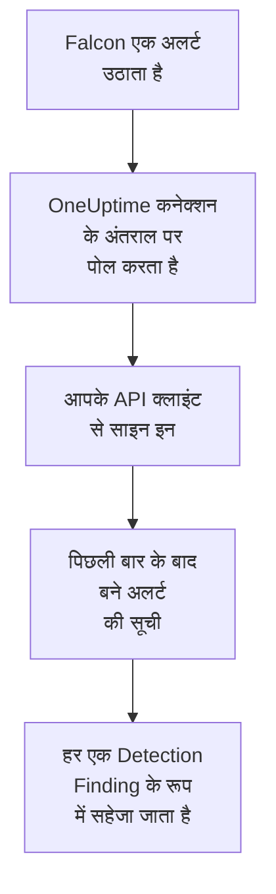

# CrowdStrike Falcon

[CrowdStrike Falcon](https://www.crowdstrike.com/platform/) के अलर्ट, एंडपॉइंट, आइडेंटिटी और क्लाउड पहचान से, OneUptime के सुरक्षा इवेंट में इम्पोर्ट करें। वहां आप उन्हें अपने लॉग, ट्रेस और मेट्रिक्स के साथ खोजते हैं, हर दूसरे स्रोत के साथ उनका सहसंबंध देखते हैं, और ज़रूरी अलर्ट के लिए ऑन-कॉल को पेज करते हैं। OneUptime उन्हें आपके बनाए API क्लाइंट से Falcon Alerts API के ज़रिए पढ़ता है, और Falcon में कभी कुछ नहीं लिखता।

:::cards
- [कनेक्शन सेट करें](#कनेक्शन-सेट-करें): एक स्कोप वाला API क्लाइंट, और कनेक्शन का फ़ॉर्म।
- [क्या इम्पोर्ट होता है](#क्या-इम्पोर्ट-होता-है): हर Falcon अलर्ट सुरक्षा इवेंट कैसे बनता है।
- [पोलिंग कैसे काम करती है](#पोलिंग-कैसे-काम-करती-है): हर पोल कौन सी विंडो पढ़ता है, और व्यस्त CID उस पर क्या असर डालता है।
- [समस्या निवारण](#समस्या-निवारण): हर त्रुटि का मतलब क्या है, और क्या बदलना है।
:::

## यह कैसे काम करता है



हर मिनट OneUptime हर उस सक्षम कनेक्शन से पोल करता है जिसका पोल अंतराल बीत चुका है। एक पोल API क्लाइंट की ID और सीक्रेट से आपके Falcon क्लाउड में साइन इन करता है, Alerts API से पिछले पोल के बाद बने अलर्ट मांगता है, और हर एक को [OCSF](https://schema.ocsf.io/) Detection Finding इवेंट (क्लास `2004`) के रूप में सहेजता है। इसके बाद पहचान नियम, मॉनिटर और डैशबोर्ड उसे किसी भी दूसरे स्रोत के सुरक्षा इवेंट की तरह ही बरतते हैं।

## शुरू करने से पहले

- OneUptime में Project Owner, Project Admin या Security Admin रोल। Security Member और Security Viewer कनेक्शन और उनका रन इतिहास देख सकते हैं, पर उन्हें बदल नहीं सकते।
- एक Falcon कस्टमर ID (CID), और एक Falcon कंसोल यूज़र जो API क्लाइंट प्रबंधित कर सके: Falcon Administrator रोल, या API clients and keys अनुमति वाला कोई कस्टम रोल।
- OneUptime ऐप और वर्कर से आपके Falcon क्लाउड के API होस्ट तक आउटबाउंड HTTPS, जो नीचे **Falcon cloud** में सूचीबद्ध है।

## कनेक्शन सेट करें

:::steps
### एक API क्लाइंट बनाएं

1. Falcon कंसोल में **Support and resources → API clients and keys** खोलें, और **Create API client** चुनें।
2. इसे एक नाम दें, जैसे `OneUptime security events`। **API scopes** में **Alerts → Read** चालू करें, और बाकी हर स्कोप बंद रहने दें: कनेक्शन Falcon में कभी कुछ नहीं लिखता।
3. क्लाइंट बनाएं। Falcon उसकी क्लाइंट ID, उसका सीक्रेट और उसका बेस URL एक बार दिखाता है। तीनों अभी कॉपी करें: सीक्रेट बाद में रीसेट किया जा सकता है, पर फिर कभी दिखाया नहीं जाता।

### अपना Falcon क्लाउड पता करें

Falcon ने जो बेस URL दिखाया, वह बताता है कि आपका CID किस क्लाउड में है। **API clients and keys** पेज भी इसे हर क्लाइंट के पास दिखाता है। एक क्लाउड का क्लाइंट दूसरे क्लाउड अस्वीकार करते हैं।

| Falcon जो बेस URL दिखाता है | Falcon क्लाउड |
| --- | --- |
| `https://api.crowdstrike.com` | US-1 |
| `https://api.us-2.crowdstrike.com` | US-2 |
| `https://api.eu-1.crowdstrike.com` | EU-1 |
| `https://api.laggar.gcw.crowdstrike.com` | US-GOV-1 |

### OneUptime में कनेक्शन जोड़ें

**उत्पाद → Security Events → कनेक्शन** (`/dashboard/{projectId}/security-events/connections`) खोलें, **कनेक्शन जोड़ें** पर क्लिक करें, **CrowdStrike Falcon** चुनें, और **अगला** पर क्लिक करें। नीचे की तालिका की सेटिंग्स भरें, **अगला** पर क्लिक करें, और सीक्रेट **क्लाइंट सीक्रेट** में पेस्ट करें।

### सहेजने से पहले इसे टेस्ट करें

**सहेजने से पहले टेस्ट करें** के नीचे **इन सेटिंग्स का परीक्षण करें** पर क्लिक करें। टेस्ट फ़ॉर्म के मानों से साइन इन करके अलर्ट पढ़ता है, और कुछ सहेजता नहीं, इसलिए गलत क्लाउड या छूटा हुआ स्कोप कनेक्शन बनने से पहले ही सामने आ जाता है। फिर **अगला** पर क्लिक करें, कनेक्शन को एक **नाम** दें, और उसे बनाएं।
:::

| सेटिंग | क्या डालें |
| --- | --- |
| **क्लाइंट ID** | API क्लाइंट की ID, जैसी Falcon ने क्लाइंट बनाते समय दिखाई। |
| **Falcon cloud** | वह क्लाउड जिसमें आपका CID है: **US-1 (api.crowdstrike.com)**, **US-2 (api.us-2.crowdstrike.com)**, **EU-1 (api.eu-1.crowdstrike.com)** या **US-GOV-1 (api.laggar.gcw.crowdstrike.com)**। हर अनुरोध उस क्लाउड के API होस्ट पर जाता है। |
| **क्लाइंट सीक्रेट** | API क्लाइंट का सीक्रेट। यह एन्क्रिप्ट किया जाता है, API इसे कभी नहीं लौटाता और यह फिर कभी नहीं दिखता। इसे कनेक्शन पर **क्रेडेंशियल अपडेट करें** से बदलें। |

**पोलिंग** चरण में एक वैकल्पिक **विवरण**, **पोल अंतराल (मिनट)**, जो `1` से `1440` तक की पूर्ण संख्या है और `5` से शुरू होती है, और **सक्षम** भी है, जो शुरू में चालू रहता है। जो कनेक्शन सक्षम नहीं है, उसे भी टेस्ट किया जा सकता है, और हाथ से पोल किया जा सकता है।

## क्या इम्पोर्ट होता है

कनेक्शन Falcon के अलर्ट पढ़ता है: वह जो Falcon कंसोल **Endpoint security → Endpoint detections** और **Next-Gen SIEM → Alerts** के नीचे दिखाता है, उन्हें उठाने वाले हर उत्पाद से। हर अलर्ट एक Detection Finding इवेंट (OCSF क्लास `2004`) बनता है, वेंडर `CrowdStrike` और उत्पाद `Falcon` के साथ:

| Falcon फ़ील्ड | OneUptime कॉलम |
| --- | --- |
| `composite_id` | इवेंट UID, जिससे डुप्लिकेट भी हटाए जाते हैं |
| `created_timestamp` | इवेंट का समय |
| `display_name`, या `name` | नियम का नाम |
| `pattern_id` | नियम ID |
| `description`, या नियम का नाम | संदेश |
| `severity_name`, या 0 से 100 तक का `severity` | गंभीरता |
| `status`, जैसे `new`, `in_progress` या `closed` | स्थिति |
| `tactic_id`, `technique_id` | MITRE ATT&CK टैक्टिक और तकनीकें |
| `device.hostname`, `device.local_ip`, `user_name`, `filename` या `cmdline` | प्रिंसिपल होस्ट, IP, यूज़र और प्रोसेस |
| `device.hostname`, `device.local_ip`, `device.external_ip`, `user_name`, `sha256` | Observable |
| बाकी सब कुछ, जैसे `device.platform_name`, `falcon_host_link`, `product` और `timestamp` | `attributes`, डॉट वाली कुंजियों में फैलाया हुआ |

इवेंट का समय जानबूझकर वह है जब Falcon ने अलर्ट बनाया: उसके पीछे के व्यवहार का समय, `timestamp`, `attributes.timestamp` में रहता है।

## पोलिंग कैसे काम करती है

- **बनने का समय ही कर्सर है।** अलर्ट `created_timestamp` के हिसाब से सूचीबद्ध होते हैं, उनके पीछे के व्यवहार के समय से कभी नहीं। Falcon किसी अलर्ट को उस गतिविधि के काफ़ी बाद उठा सकता है जिसका वह वर्णन करता है, और गतिविधि के समय पर चलने वाला कर्सर ऐसा हर अलर्ट छोड़ देता।
- **पहला पोल 24 घंटे पीछे देखता है**, इसलिए नया कनेक्शन तुरंत अपने हाल के अलर्ट दिखाता है।
- **हर बाद वाला पोल सहेजे गए कर्सर से 1 मिनट पहले शुरू होता है**, इसलिए दो विंडो की सीमा पर बना अलर्ट कभी नहीं छूटता।
- **एक पोल कर्सर से आगे ज़्यादा से ज़्यादा 24 घंटे पढ़ता है।** जिस कनेक्शन का कर्सर पीछे रह गया, वह 24 घंटे की लगातार विंडो में बराबर आता है।
- **डुप्लिकेट `composite_id` से हटाए जाते हैं**, प्रोजेक्ट के भीतर, इसलिए ओवरलैप और दोबारा कोशिश की गई विंडो कभी एक अलर्ट को दो बार नहीं सहेजते।
- **हर विंडो की लागत** है एक टोकन अनुरोध, जो टोकन की उम्र तक रखा जाता है, फिर हर 1,000 अलर्ट पर एक अलर्ट क्वेरी और एक अलर्ट फ़ेच, हर एक का अपना टाइमआउट।

### जब किसी विंडो में एक पोल की क्षमता से ज़्यादा हो

एक पोल ज़्यादा से ज़्यादा 20 अनुरोध भेजता है। एक टोकन अनुरोध और हर 1,000 अलर्ट पर दो अनुरोधों के साथ, यह ज़्यादा से ज़्यादा 9,000 अलर्ट पढ़ता है। जब किसी विंडो में इससे ज़्यादा हों, तो रन **आंशिक** होता है, ऐसी चेतावनी के साथ:

```text
Stopped after 19 requests before reading the whole window. Alerts are read oldest first; every alert created before 2026-09-14T08:12:44.995Z was read.
```

अलर्ट क्वेरी `created_timestamp` के हिसाब से, सबसे पुराने पहले, क्रम में होती है, इसलिए OneUptime कर्सर को पढ़े गए आखिरी अलर्ट के बनने के समय पर ले जाता है, और अगला पोल वहीं से उसी विंडो लंबाई के साथ, ऑफ़सेट `0` से शुरू होता है। व्यस्त CID वही अलर्ट दोबारा पढ़ने के बजाय हर पोल में लगभग 9,000 अलर्ट बराबर करता है। उसी पल बने अलर्ट दो बार पढ़े जाते हैं, और डुप्लिकेट जांच दूसरी कॉपी हटा देती है।

Falcon की अलर्ट क्वेरी 10,000 नतीजों (`limit` और `offset` मिलाकर) से आगे पेज नहीं कर सकती। अनुरोध सीमा किसी रन को उस छत से पहले, 9,000 अलर्ट पर रोक देती है। अगर कभी वह छत किसी रीड को रोकती है, तो उसे भी उसी तरह संभाला जाता है: रन **आंशिक** होता है, कर्सर पढ़े गए आखिरी अलर्ट पर जाता है, और अगली क्वेरी फिर से ऑफ़सेट `0` से शुरू होती है।

जब कोई रन सहेजे गए कर्सर से आगे बढ़ ही नहीं पाता, उदाहरण के लिए क्योंकि 9,000 से ज़्यादा अलर्ट ओवरलैप वाले मिनट में आते हैं, तो OneUptime इसके बजाय विंडो छोटी करता है:

1. **छोटा करें।** अगला पोल उसी शुरुआती बिंदु से आधी लंबाई की विंडो पढ़ता है, और तब तक आधा करता रहता है जब तक कोई विंडो पूरी न पढ़ी जाए, कम से कम एक मिनट तक। रन की चेतावनी यही बताती है: `This window holds more records than one poll can read; the next poll reads a {n} minute window from the same starting point.`
2. **वापस बढ़ाएं।** किसी विंडो के पूरा पढ़े जाने के बाद अगली विंडो फिर दोगुनी होती है, ज़्यादा से ज़्यादा 24 घंटे तक।
3. **एक मिनट से आगे बढ़ें।** अगर एक मिनट में भी एक पोल की क्षमता से ज़्यादा हो, तो पोलिंग उससे आगे बढ़ जाती है, ताकि नए अलर्ट आते रहें। रन **आंशिक** ही रहता है, और **पिछली त्रुटि** में लिखा होता है `More records were created in the one minute from {cursor} to {end} than one poll can read. Polling moved past this minute so newer records keep arriving; use Import this time range in Diagnostics on this minute to recover what one run can read.` एक रन जितना पढ़ सकता है उतना वापस पाने के लिए उस मिनट को **Import this time range** से इम्पोर्ट करें।

जो रन Falcon की किसी त्रुटि से पूरी तरह विफल होता है, वह कर्सर और विंडो लंबाई नहीं बदलता, और अगला पोल वही विंडो फिर से पढ़ता है। एकमात्र अपवाद वह अनुरोध है जिसका समय खत्म हो गया: कर्सर वहीं रहता है, पर अगली विंडो आधी लंबी होती है, क्योंकि समय पर जवाब के लिए बहुत भारी विंडो हर कोशिश में टाइम आउट होगी। **पोल अंतराल (मिनट)** बदलने से इनमें से कुछ नहीं बदलता: यह तय करता है कि पोल कितनी बार शुरू हो, न कि उसकी विंडो कहां से शुरू हो।

### मांग पर रन, प्रीव्यू और इम्पोर्ट

किसी कनेक्शन पर **निदान** पर क्लिक करें, ताकि उसके हाल के रन देख सकें और उसके साथ हाथ से काम कर सकें। जो भी कनेक्शन बदल सकता है वह इन्हें शुरू कर सकता है; जो भी इसे देख सकता है वह इतिहास पढ़ सकता है।

- **अभी चलाएँ** तुरंत सामान्य कर्सर के साथ एक पोल शुरू करता है, तब भी जब कनेक्शन **सक्षम** न हो।
- **Preview alerts** 7 दिन तक की समय सीमा पढ़ता है और कुछ इम्पोर्ट नहीं करता।
- **Import this time range** आपकी पुष्टि के बाद 7 दिन तक की सीमा इम्पोर्ट करता है, कर्सर हिलाए बिना। पहले से इम्पोर्ट किए गए अलर्ट छोड़ दिए जाते हैं।
- किसी रन पर **Copy diagnostics** सपोर्ट के लिए उसकी रिपोर्ट कॉपी करता है। इसमें क्रेडेंशियल कभी शामिल नहीं होते।

## कनेक्शन का परीक्षण करें

कनेक्शन की पंक्ति पर **कनेक्शन का परीक्षण करें**, और फ़ॉर्म में **इन सेटिंग्स का परीक्षण करें**, बैकग्राउंड वर्कर में नहीं बल्कि API प्रोसेस में चलते हैं, इसलिए जब वर्कर ही समस्या हों तब भी टेस्ट जवाब देता है। यह ये जांचें क्रम से चलाता है:

| जांच | यह क्या जांचती है |
| --- | --- |
| **कॉन्फ़िगरेशन** | **क्लाइंट ID**, **Falcon cloud** और **क्लाइंट सीक्रेट** मौजूद हैं और सही रूप में हैं। इसके विफल होने पर किसी से संपर्क नहीं किया जाता। |
| **Authenticate with CrowdStrike Falcon** | आपके क्लाउड के होस्ट पर, API क्लाइंट की ID और सीक्रेट के साथ `POST /oauth2/token` एक टोकन लौटाता है। |
| **Read alerts from the Falcon Alerts API** | पिछले 24 घंटों पर एक अलर्ट (`limit=1`) की अलर्ट क्वेरी स्वीकार होती है, जिससे **Alerts → Read** स्कोप साबित होता है। |
| **Alerts available to import** | पिछले 24 घंटों और पिछले 7 दिनों में कितने अलर्ट बने। 7 दिनों में एक भी न होना विफलता नहीं, चेतावनी है: Falcon जैसे-जैसे नए अलर्ट बनाता है, पोलिंग उन्हें इम्पोर्ट करती है। |
| **Background workers**, **Poll scheduler**, **Security event storage** | OneUptime का अपना हिस्सा: कोई प्रोसेस Worker कतार के जॉब लेता है, पोल जॉब हर मिनट चलता है, और सुरक्षा इवेंट का स्टोर जवाब देता है। |
| **Scheduled polling** | सहेजे गए कनेक्शन के लिए: पोलिंग चालू है, कोई रन वर्कर के इंतज़ार में अटका नहीं है, और पोल समय पर चलते हैं। |

टेस्ट के हर अनुरोध की समय सीमा 20 सेकंड है। टेस्ट कभी कुछ इम्पोर्ट नहीं करता और न कर्सर हिलाता है, और हर विफल जांच बताती है कि क्या बदलना है। **रिपोर्ट कॉपी करें** चेकलिस्ट को JSON के रूप में कॉपी करता है, बिना क्रेडेंशियल या टोकन के।

## समस्या निवारण

कनेक्शन का **पिछली त्रुटि**, और हर विफल जांच, पूरा त्रुटि संदेश रखते हैं, क्रेडेंशियल छिपाकर, एक ऐसे प्रीफ़िक्स के पीछे जो विफल हुए चरण का नाम बताता है। जब किसी कनेक्शन में त्रुटि हो, तो उसे पढ़ने के लिए उसके **क्रियाएँ** कॉलम में **त्रुटि देखें** चुनें, और कॉपी करने के लिए डायलॉग में **त्रुटि कॉपी करें**। पहले प्रीफ़िक्स पढ़ें।

:::details Last Error `CrowdStrike Falcon token request` से शुरू होता है
- `CrowdStrike Falcon token request failed (HTTP 401)` या `(HTTP 403)`: Alerts API से संपर्क होने से पहले Falcon ने API क्लाइंट की ID और सीक्रेट अस्वीकार कर दिए। जांचें कि **Falcon cloud** आपके CID का क्लाउड है, क्योंकि दूसरे क्लाउड का क्लाइंट यहीं अस्वीकार होता है, कि **क्लाइंट ID** उसी क्लाइंट की है, और कि **क्लाइंट सीक्रेट** उसके साथ जारी हुआ सीक्रेट है। अगर सीक्रेट खो गया है, तो उसे Falcon कंसोल में रीसेट करें, और **क्रेडेंशियल अपडेट करें** से सहेजें।
- `CrowdStrike Falcon token request returned ...`: Falcon ने कुछ अनुपयोगी लौटाया, ऐसी बॉडी जो JSON नहीं है या जिसमें `access_token` नहीं है। आमतौर पर यह बीच में मौजूद कोई प्रॉक्सी या गेटवे होता है, क्रेडेंशियल नहीं।
:::

:::details Last Error `CrowdStrike Falcon alerts` से शुरू होता है
- `CrowdStrike Falcon alerts query failed (HTTP 403)`: टोकन स्वीकार हुआ, पर API क्लाइंट के पास **Alerts → Read** स्कोप नहीं है। **API clients and keys** में क्लाइंट के लिए इसे चालू करें, और सहेजें। यह अगले टोकन पर लागू होता है, इसलिए एक मिनट बाद फिर से टेस्ट करें।
- `CrowdStrike Falcon alerts query failed (HTTP 401)`: Alerts API ने टोकन अस्वीकार किया, जिसका लगभग हमेशा मतलब है कि **Falcon cloud** वह क्लाउड नहीं है जिसने क्लाइंट जारी किया।
- `CrowdStrike Falcon alerts query failed (HTTP 429)` या `CrowdStrike Falcon alerts fetch failed (HTTP 429)`: Falcon इस API क्लाइंट की दर सीमित कर रहा है। OneUptime का HTTP क्लाइंट त्रुटि पर कोई रिस्पॉन्स हेडर नहीं रखता, इसलिए संदेश आमतौर पर उसे बताने के बजाय `the X-RateLimit-RetryAfter header was not available` के साथ खत्म होता है। शेड्यूल किए गए पोल अपने आप फिर से कोशिश करते हैं। अगर यह बार-बार हो, तो OneUptime को दूसरे टूल के साथ साझा क्लाइंट के बजाय उसका अपना API क्लाइंट दें।
- `CrowdStrike Falcon alerts query failed (HTTP 400)`: Falcon ने क्वेरी अस्वीकार की। कनेक्शन `created_timestamp` पर एक तय FQL फ़िल्टर भेजता है, इसलिए रिपोर्ट कॉपी करें और उसे OneUptime सपोर्ट को भेजें।
- `CrowdStrike Falcon alerts query returned ...` या `CrowdStrike Falcon alerts fetch returned ...`: Falcon ने `200` लौटाया, ऐसी बॉडी के साथ जो JSON नहीं है, या ऐसे आकार में नहीं है जिसे कनेक्शन जानता है। इसे खाली विंडो मानने के बजाय रिपोर्ट किया जाता है, ताकि कर्सर कभी उन अलर्ट से आगे न बढ़े जिन्हें किसी ने नहीं पढ़ा।
- `CrowdStrike Falcon alerts fetch failed (HTTP ...)`: अलर्ट सूचीबद्ध हुए, पर उन्हें फ़ेच करना विफल रहा, उन्हीं कारणों से जो क्वेरी के हैं। यहां `403` का मतलब है कि दो कॉल के बीच स्कोप हटा दिया गया।
:::

:::details Last Error कहता है कि अनुरोध पूरा नहीं हो सका
`CrowdStrike Falcon token request could not be completed`, `CrowdStrike Falcon alerts query could not be completed` और `CrowdStrike Falcon alerts fetch could not be completed` का मतलब है कि कुछ वापस नहीं आया: टाइमआउट, DNS विफलता या ब्लॉक किया गया आउटबाउंड ट्रैफ़िक। OneUptime ऐप और वर्कर से आपके क्लाउड के API होस्ट, जैसे `api.crowdstrike.com`, तक आउटबाउंड HTTPS जांचें।
:::

:::details Last Error किसी अज्ञात क्लाउड का नाम लेता है
`CrowdStrike Falcon cloud "..." is not one of us-1, us-2, eu-1, us-gov-1` का मतलब है कि सहेजा गया क्लाउड ऐसा नहीं है जिसे कनेक्शन जानता हो। कनेक्शन संपादित करें, और सूची से एक क्लाउड चुनें।
:::

:::details कोई रन Partial है
- `Stopped after 19 requests before reading the whole window`: विंडो में एक रन द्वारा पढ़े जाने वाले 9,000 अलर्ट से ज़्यादा थे। कुछ नहीं खोता: अगला पोल पढ़े गए आखिरी अलर्ट के बाद से शुरू होता है। जो कनेक्शन पोल दर पोल **आंशिक** रहता है, वह बैकलॉग बराबर कर रहा है, और उसके **अंतिम पोल** और **अंतिम इंपोर्ट किया गया इवेंट** आगे बढ़ते रहते हैं। रन के दौरान टोकन नया होने पर गिनती 19 से थोड़ी ज़्यादा हो सकती है।
- `Falcon returned alerts out of created_timestamp order, so this run cannot name a point to resume from.`: क्वेरी ने सबसे-पुराने-पहले क्रम को अनदेखा किया, इसलिए रन कर्सर को अपने आखिरी अलर्ट तक नहीं ले जा सकता, और अगला पोल इसके बजाय छोटी विंडो पढ़ता है। अगर यह बार-बार हो, तो रन की रिपोर्ट OneUptime सपोर्ट को भेजें।
- `More records were created in the one minute from ... than one poll can read`: पोलिंग उस मिनट से आगे बढ़ गई। उसे **निदान** में **Import this time range** से इम्पोर्ट करें। एक इम्पोर्ट उतना ही पढ़ता है जितना एक पोल।
:::

:::details Last Polled Never है और Last Error खाली है
कोई पोल नहीं चला, इसलिए Falcon तक कुछ नहीं पहुंचा। **कनेक्शन का परीक्षण करें** इसे विफल **Background workers** या **Poll scheduler** जांच के रूप में दिखाता है। सेल्फ़-होस्टेड इंस्टॉलेशन में आम कारण ऐप पर `DISABLE_QUEUE_WORKERS=true` है, जबकि जॉब लेने के लिए कोई अलग वर्कर डिप्लॉयमेंट नहीं है: इसे `false` पर सेट करें, या वर्कर डिप्लॉयमेंट चलाएं (Helm: `worker.enabled: true`)।
:::

:::details टेस्ट पास होता है, पर कोई इवेंट नहीं दिखता
**Alerts available to import** पढ़ें: वहां चेतावनी का मतलब है कि Falcon ने पिछले 7 दिनों में कोई अलर्ट नहीं बनाया, इसलिए अभी इम्पोर्ट करने को कुछ नहीं है। वरना **निदान** खोलें, आखिरी पोल की विंडो और गिनतियां जांचें, और किसी रन पर **View events in this time range** इस्तेमाल करें ताकि उसके इम्पोर्ट किए अलर्ट की समय सीमा खुले।
:::

## आपको क्या मिलता है

- **खोज।** सुरक्षा इवेंट एक्सप्लोरर में, उस होस्ट के लॉग और मेट्रिक्स के साथ, Falcon अलर्ट को गंभीरता, स्थिति, MITRE टैक्टिक, होस्ट, यूज़र या किसी भी observable से फ़िल्टर करें।
- **सहसंबंध।** हर अलर्ट के होस्ट नाम, IP, यूज़र और फ़ाइल हैश observable के रूप में इंडेक्स होते हैं, इसलिए एक खोज हर स्रोत में किसी होस्ट का ज़िक्र करने वाली हर चीज़ ढूंढ लेती है।
- **पहचान नियम।** Sigma नियम जो शेड्यूल पर आपके सुरक्षा इवेंट पर चलते हैं, और ऑन-कॉल को पेज करने वाले अलर्ट खोलते हैं।
- **मॉनिटर।** सुरक्षा इवेंट मॉनिटर मेल खाने वाले इवेंट गिनते हैं, और थ्रेशोल्ड पार होने पर घटनाएं या अलर्ट खोलते हैं।

सुरक्षा इवेंट का बिल आपकी बाकी टेलीमेट्री की तरह, इंजेस्ट किए गए हर GB के हिसाब से बनता है। [मूल्य निर्धारण](https://oneuptime.com/pricing) देखें।

## अगले कदम

:::cards
- [सुरक्षा इवेंट](/docs/telemetry/security-events): जो इम्पोर्ट करते हैं उसे खोजें, उसका सहसंबंध देखें और उस पर अलर्ट करें।
- [Microsoft Defender XDR](/docs/integrations/microsoft-defender-xdr): Microsoft के Defender वर्कलोड के अलर्ट भी इम्पोर्ट करें।
- [रोल](/docs/permissions/reference#भूमिकाएँ): Security रोल क्या देख और बदल सकते हैं।
- [इंटिग्रेशन अवलोकन](/docs/integrations/index): वे दूसरे टूल जिन्हें आप जोड़ सकते हैं।
:::
