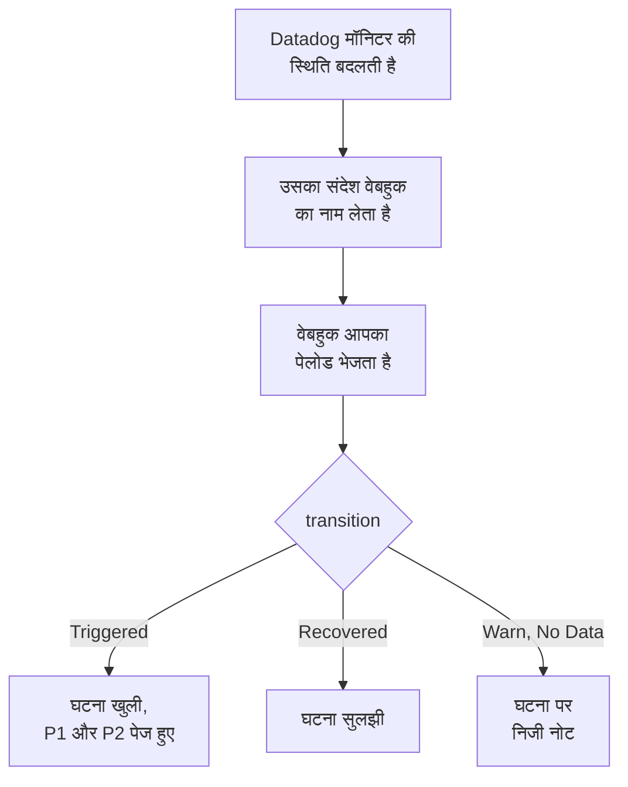

# Datadog

[Datadog](https://www.datadoghq.com) मॉनिटर के अलर्ट OneUptime को भेजें, ताकि हर अलर्ट एक घटना या एक अलर्ट बने, ज़रूरी होने पर आपकी ऑन-कॉल टीम को पेज करे, और Datadog मॉनिटर के ठीक होने पर सुलझ जाए। Datadog अपने अलर्ट अपने [Webhooks इंटीग्रेशन](https://docs.datadoghq.com/integrations/webhooks/) से भेजता है, इसलिए किसी भी तरफ़ कुछ इंस्टॉल नहीं करना पड़ता।

:::cards
- [चुनें कि OneUptime अलर्ट कैसे पाए](#चुनें-कि-oneuptime-अलर्ट-कैसे-पाए): एक वर्कफ़्लो टेम्पलेट, या एक Incoming Request मॉनिटर।
- [टेम्पलेट से शुरू करें](#टेम्पलेट-से-शुरू-करें): पेज करने वाले चुनें, URL कॉपी करें, और देखें कि हर अलर्ट क्या करता है।
- [मॉनिटर से अलर्ट पाएं](#मॉनिटर-से-अलर्ट-पाएं): हर अलर्ट पर एक घटना, रिकवरी पर सुलझी हुई।
- [Datadog कॉन्फ़िगर करें](#datadog-कॉन्फ़िगर-करें): एक वेबहुक, और उसे सूचित करने वाले मॉनिटर।
- [समस्या निवारण](#समस्या-निवारण): जब अलर्ट नहीं पहुंचते, या घटनाएं खुली रहती हैं।
:::

## यह कैसे काम करता है



Datadog मॉनिटर अपनी स्थिति बदलने पर, यानी ट्रिगर होने, चेतावनी देने, ठीक होने या डेटा न मिलने पर, उन वेबहुक को सूचित करता है जिनका उसके संदेश में ज़िक्र है। वेबहुक की JSON बॉडी आप खुद Datadog के [टेम्पलेट वेरिएबल](https://docs.datadoghq.com/integrations/webhooks/#usage) से लिखते हैं, इसलिए यह गाइड आपको एक ऐसी बॉडी देती है जो हर अलर्ट को नाम देती है और बताती है कि उसके साथ क्या हुआ।

## शुरू करने से पहले

- एक Datadog खाता जिसमें आप इंटीग्रेशन कॉन्फ़िगर कर सकें और मॉनिटर संपादित कर सकें।
- OneUptime में वर्कफ़्लो बनाने का अधिकार, या अगर आप वह रास्ता चुनते हैं तो मॉनिटर बनाने का। OneUptime Cloud पर वर्कफ़्लो के लिए **Growth** प्लान या उससे ऊपर का प्लान चाहिए।

## चुनें कि OneUptime अलर्ट कैसे पाए

पहले OneUptime सेट करें: यह आपको वह URL देता है जिस पर Datadog भेजता है।

| तरीका | कब इस्तेमाल करें |
| --- | --- |
| वर्कफ़्लो टेम्पलेट (सुझाए गए) | आप हर अलर्ट को मॉनिटर की प्राथमिकता से तय गंभीरता पर एक घटना या अलर्ट के रूप में चाहते हैं, P1 और P2 के लिए ऑन-कॉल को पेज के साथ, चेतावनियां उस पर दर्ज, और रिकवरी पर सुलझा हुआ। कुछ बनाना नहीं पड़ता। |
| Incoming Request मॉनिटर | आप किसी भी प्लान पर, बिना वर्कफ़्लो के घटनाएं चाहते हैं, और एक मॉनिटर जिसका स्टेटस Datadog के साथ चले। |

दोनों को एक ही वेबहुक से एक जैसा JSON मिलता है, इसलिए आप एक से शुरू करके बाद में Datadog में एक URL बदलकर दूसरे पर जा सकते हैं।

## टेम्पलेट से शुरू करें

**एक वर्कफ़्लो बनाएं** डायलॉग में दो Datadog टेम्पलेट हैं, उसकी कैटेगरी सूची में **Datadog** के नीचे: घटना के लिए **Declare an incident when a Datadog monitor triggers**, और अलर्ट के लिए **Create an alert when a Datadog monitor triggers**। दोनों एक जैसा करते हैं, हर एक अपनी तरह के रिकॉर्ड के साथ।

:::steps
1. **वर्कफ़्लो** पर जाएं और **वर्कफ़्लो बनाएं** पर क्लिक करें। **या किसी टेम्पलेट से शुरू करें** के नीचे कैटेगरी सूची में **Datadog** चुनें, **Declare an incident when a Datadog monitor triggers** पर क्लिक करें, या **Create an alert when a Datadog monitor triggers** पर, और **यह टेम्पलेट इस्तेमाल करें** पर क्लिक करें।
2. **Who to page for P1 and P2 monitors** के अंतर्गत पेज की जाने वाली ऑन-कॉल नीतियाँ चुनें, या किसी को पेज न करने के लिए कोई नहीं, और **वर्कफ़्लो बनाएं** पर क्लिक करें। वर्कफ़्लो **बिल्डर** में बंद हालत में खुलता है।
3. **Webhook** ट्रिगर पर क्लिक करें, फिर **URL कॉपी करें** पर, और URL को Datadog के लिए रख लें।
4. **बिल्डर** के ऊपर **सक्षम** चालू करें। बंद वर्कफ़्लो Datadog को `400` से जवाब देता है।
:::

फिर [Datadog कॉन्फ़िगर करें](#datadog-कॉन्फ़िगर-करें) ताकि वह अपने अलर्ट उस URL पर भेजे। वर्कफ़्लो का `read-event-1` चरण उसी सेटअप के साथ खुलता है, जब आप **बिल्डर** में उस पर लौटें।

### वर्कफ़्लो क्या करता है

**Webhook** ट्रिगर के बाद, `read-event-1` **Check With JavaScript** चरण Datadog के भेजे `transition` को पढ़ता है, और **Incident From Another Tool**, या अलर्ट टेम्पलेट में **Alert From Another Tool**, अलर्ट की साइकिल कुंजी के ज़रिए वही करता है जो उसका मतलब है। Datadog यह कुंजी अलर्ट के ट्रिगर होने से उसके ठीक होने तक रखता है, और अगली बार ट्रिगर होने पर कुंजी नई होती है, इसलिए हर बार की अपनी एक घटना बनती है। घटना कुंजी को अपनी कस्टम फ़ील्ड `datadogAlertCycleKey` में रखती है।

| ट्रांज़िशन | वर्कफ़्लो क्या करता है |
| --- | --- |
| `Triggered`, `Re-Triggered` | `Datadog: <monitor>` शीर्षक वाली एक घटना घोषित करता है, उस गंभीरता पर जिससे मॉनिटर की प्राथमिकता मैप होती है, आपके स्टेटस पेजों से बाहर रखी गई। उसका विवरण Datadog में अलर्ट का लिंक देता है, और प्राथमिकता, होस्ट, स्कोप और मॉनिटर का संदेश दिखाता है। जिस अलर्ट की घटना पहले से है, उसकी सूचना दूसरी घटना नहीं खोलती, और किसी को दोबारा पेज नहीं करती। |
| `Recovered` | अलर्ट की घटना सुलझाता है, जब तक वह पहले से सुलझी न हो। वजह उसकी टाइमलाइन पर होती है। |
| `Warn`, `Re-Warn`, `No Data`, `Re-No Data` | अलर्ट की घटना में निजी नोट जोड़ता है, जिसमें लिखा होता है कि मॉनिटर की स्थिति अब क्या है। |
| `Renotify` | कुछ नहीं: अलर्ट अब भी खुला है। |

जिस अलर्ट की कोई घटना नहीं, उसकी चेतावनी या रिकवरी कुछ नहीं बदलती। बाकी सब कुछ, जैसे किसी दूसरे टूल का अनुरोध, जैसा है वैसा छोड़ दिया जाता है: `read-event-1` **No** लेता है, और रन के **चरण** बताते हैं क्यों। Datadog को कुछ वापस नहीं जाता: वह सिग्नल ठीक होने पर अपने अलर्ट खुद सुलझाता है, और उसी से घटना सुलझती है।

### प्राथमिकताएं और पेज करना

नई घटना आपकी चुनी ऑन-कॉल नीतियों को पेज करती है जब उसका मॉनिटर P1 या P2 हो, या उसकी कोई प्राथमिकता न हो। P3, P4 और P5 घटना खोलते हैं और किसी को पेज नहीं करते। नए प्रोजेक्ट में, प्राथमिकताएं इन घटना और अलर्ट गंभीरताओं पर मैप होती हैं:

| Datadog प्राथमिकता | घटना | अलर्ट | ऑन-कॉल |
| --- | --- | --- | --- |
| P1 | Critical Incident | High | पेज किया गया |
| P2 | Critical Incident | High | पेज किया गया |
| कोई प्राथमिकता नहीं | Critical Incident | High | पेज किया गया |
| P3 | Major Incident | Low | पेज नहीं किया गया |
| P4 | Minor Incident | Low | पेज नहीं किया गया |
| P5 | Minor Incident | Low | पेज नहीं किया गया |

अपनी गंभीरताओं के साथ, P1, P2 और बिना प्राथमिकता वाले आपकी सबसे गंभीर पर जाते हैं, P3 बीच वाली पर, और P4 और P5 आपकी सबसे कम गंभीर पर।

- किसी प्राथमिकता को नाम से अपनी किसी गंभीरता पर मैप करने के लिए, `SEVERITY_BY_NAME` को `read-event-1` चरण में संपादित करें, जैसे `{ P3: 'Minor Incident' }`।
- P3 के लिए भी पेज करने हेतु, `if-page-1` **If / Else** चरण का **Compare with** `3` पर सेट करें।

## मॉनिटर से अलर्ट पाएं

एक [Incoming Request मॉनिटर](/docs/monitor/incoming-request-monitor) आपको एक URL देता है, और उसके मानदंड तय करते हैं कि हर अलर्ट क्या करे।

:::steps
### मॉनिटर बनाएं

**मॉनिटर** पर जाएं और **मॉनिटर बनाएं** पर क्लिक करें। **मॉनिटर प्रकार** में **Incoming Request** चुनें, इसका नाम `Datadog` रखें, और **अगला** पर क्लिक करें।

### हर अलर्ट के लिए घटना घोषित करें

**मानदंड** चरण में पहला मानदंड खोलें, वह जो मॉनिटर को ऑफ़लाइन चिह्नित करता है। उसका फ़िल्टर **अनुरोध बॉडी**, **शामिल है**, `"transition":"Triggered"` पर सेट करें। फ़िल्टर मेल खाने पर यह मानदंड पहले से ही घटना घोषित करता है। घटना भरें:

- **घटना शीर्षक**: `{{requestBody.title}}`।
- **विवरण** के नीचे **घटना विवरण**: `{{requestBody.body}}`, फिर अपनी अलग पंक्ति में `Datadog: {{requestBody.link}}`।
- **गंभीरता**: वह घटना गंभीरता जो इन अलर्ट की होनी चाहिए।
- **ऑन-कॉल** के नीचे **ऑन-कॉल नीतियां**: पेज की जाने वाली नीतियां।
- **और फ़ील्ड** के नीचे **घटना स्वतः सुलझाएं**: इसे चालू रहने दें, जैसा यह शुरू में होता है। इसके बिना रिकवरी को अनदेखा किया जाता है और घटनाएं खुली रहती हैं।

### हर अलर्ट पर एक घटना खोलें

उसी मानदंड में **सेटिंग्स** खोलें और **Group incidents and alerts by a payload field** चालू करें। इसे नीचे की तरह भरें, ताकि हर अलर्ट की अपनी घटना हो, और उसकी रिकवरी उसे सुलझाए:

| फ़ील्ड | मान |
| --- | --- |
| **Open a separate incident for each…** | `requestBody.alert_key` |
| **Field that signals recovery** | `requestBody.transition` |
| **Value that means recovered** | `Recovered` |

### मॉनिटर को वापस ऑनलाइन लाएं

दूसरा मानदंड खोलें, वह जो मॉनिटर को ऑनलाइन चिह्नित करता है, और उसका फ़िल्टर **अनुरोध बॉडी**, **शामिल है**, `"transition":"Recovered"` पर सेट करें।

### URL कॉपी करें

**मॉनिटर बनाएं** पर क्लिक करें। मॉनिटर का **अवलोकन** पेज उसका **Heartbeat URL** दिखाता है। उसे Datadog के लिए कॉपी करें:

```text
https://oneuptime.com/heartbeat/<secret key>
```

सेल्फ़-होस्टेड इंस्टॉलेशन में `oneuptime.com` की जगह उसका अपना होस्ट होता है।
:::

नीचे दिया पेलोड `alert_key` को Datadog मॉनिटर की ID और अलर्ट करने वाले समूह के टैग पर सेट करता है, इसलिए मल्टी अलर्ट मॉनिटर के हर समूह की अपनी घटना होती है, और उस समूह की रिकवरी उसे सुलझाती है। जो मॉनिटर अपनी घटना खुली रहते हुए फिर से ट्रिगर होता है या दोबारा सूचित करता है, वह दूसरी घटना नहीं खोलता। हर सेटिंग क्या करती है, यह जानने के लिए [किसी दूसरे सिस्टम से अलर्ट प्राप्त करना](/docs/monitor/incoming-request-monitor#किसी-दूसरे-सिस्टम-से-अलर्ट-प्राप्त-करना) देखें।

> [!NOTE]
> इन फ़िल्टर के साथ **Warn** या **No Data** सूचना कोई घटना नहीं खोलती। चेतावनियों पर भी पेज होने के लिए **मानदंड जोड़ें** पर क्लिक करें, नए मानदंड को फ़िल्टर **अनुरोध बॉडी**, **शामिल है**, `"transition":"Warn"`, अपनी **गंभीरता** वाली एक घटना, और वही ग्रुपिंग सेटिंग दें, फिर उसे पहले मानदंड के ऊपर खींचें। मानदंड ऊपर से जांचे जाते हैं, और जो पहले मेल खाता है वही तय करता है।

## Datadog कॉन्फ़िगर करें

:::steps
### वेबहुक जोड़ें

Datadog में [Webhooks इंटीग्रेशन टाइल](https://app.datadoghq.com/integrations/webhooks) खोलें, और अगर यह अभी इंस्टॉल नहीं है तो इसे इंस्टॉल करें। इन सेटिंग्स के साथ एक वेबहुक जोड़ें, फिर उसे सहेजें:

- **Name**: `oneuptime`। मॉनिटर इस नाम से वेबहुक का ज़िक्र करते हैं, `@webhook-oneuptime` के रूप में।
- **URL**: वह URL जो आपने OneUptime से कॉपी किया।
- **Payload**:

  ```json
  {
    "alert_key": "$ALERT_ID $ALERT_SCOPE",
    "alert_cycle_key": "$ALERT_CYCLE_KEY",
    "transition": "$ALERT_TRANSITION",
    "alert_priority": "$ALERT_PRIORITY",
    "title": "$EVENT_TITLE",
    "body": "$TEXT_ONLY_MSG",
    "host": "$HOSTNAME",
    "scope": "$ALERT_SCOPE",
    "priority": "$PRIORITY",
    "link": "$LINK"
  }
  ```

### अपने मॉनिटर में वेबहुक का ज़िक्र करें

हर उस Datadog मॉनिटर में जिसे OneUptime के ज़रिए पेज करना चाहिए, मॉनिटर के नोटिफ़िकेशन संदेश में `@webhook-oneuptime` जोड़ें, और मॉनिटर सहेजें। इसके बाद Datadog उस मॉनिटर के अलर्ट और रिकवरी OneUptime को भेजता है।
:::

| वेरिएबल | Datadog इसमें क्या रखता है |
| --- | --- |
| `$ALERT_ID` | अलर्ट करने वाले Datadog मॉनिटर की ID। |
| `$ALERT_SCOPE` | अलर्ट करने वाले समूह के टैग, जैसे `host:web-1`। |
| `$ALERT_CYCLE_KEY` | एक ID जो अलर्ट के ट्रिगर होने से उसके ठीक होने तक वही रहती है। |
| `$ALERT_TRANSITION` | क्या हुआ: `Triggered`, `Re-Triggered`, `Warn`, `Recovered`, `No Data` या `Renotify`, और भी। |
| `$ALERT_PRIORITY` | Datadog मॉनिटर की प्राथमिकता, `P1` से `P5`, या जिसकी कोई प्राथमिकता नहीं उसके लिए कुछ नहीं। |
| `$EVENT_TITLE` | इवेंट का शीर्षक, जैसे `[Triggered] High CPU`। |
| `$TEXT_ONLY_MSG` | मॉनिटर का संदेश, बिना Markdown के। |
| `$LINK` | Datadog में इवेंट का लिंक। |

एक पेलोड दोनों तरीकों के लिए चलता है: टेम्पलेट `alert_cycle_key` और `alert_priority` से चलता है, और मॉनिटर `alert_key` से। इन सबको रखें, और आप बाद में सिर्फ़ URL बदलकर दूसरे तरीके पर जा सकते हैं।

## इसे टेस्ट करें

जो URL आपने कॉपी किया उस पर एक अलर्ट भेजें, जैसे Datadog भेजता:

```bash
curl -X POST "<url>" \
  -H "Content-Type: application/json" \
  -d '{
    "alert_key": "1234 host:web-1",
    "alert_cycle_key": "7151157925468446720",
    "transition": "Triggered",
    "alert_priority": "P1",
    "title": "[Triggered] High CPU",
    "body": "CPU is above 90% on web-1.",
    "host": "web-1",
    "scope": "host:web-1",
    "priority": "normal",
    "link": "https://app.datadoghq.com/event/event?id=1"
  }'
```

टेम्पलेट के साथ, एक घटना खुलती है, जिसका शीर्षक `Datadog: High CPU` है, और आपकी चुनी ऑन-कॉल नीतियों को पेज किया जाता है। मॉनिटर के साथ, एक घटना खुलती है, जिसका शीर्षक `[Triggered] High CPU` है। वही अनुरोध `transition` को `Recovered` पर सेट करके भेजें, और घटना सुलझ जाती है।

फिर Datadog से टेस्ट करें: वेबहुक का ज़िक्र करने वाला कोई मॉनिटर खोलें, **Test Notifications** पर क्लिक करें, और उसकी **Alert** सूचना भेजें। यह देखने के लिए कि वह पहुंची, वर्कफ़्लो का **लॉग → रन**, या OneUptime मॉनिटर की टाइमलाइन खोलें।

## समस्या निवारण

:::details OneUptime में कुछ नहीं पहुंचता
- जांचें कि Datadog मॉनिटर के संदेश में `@webhook-oneuptime` का ज़िक्र है, ठीक उसी वर्तनी में जिस नाम से वेबहुक बना है।
- मॉनिटर कुछ भी जांचने से पहले तुरंत `200` से जवाब देता है, गलत सीक्रेट कुंजी होने पर भी। अलर्ट पहुंच रहे हैं या नहीं, यह मॉनिटर की टाइमलाइन में देखें।
- बंद वर्कफ़्लो `400` से जवाब देता है। उसके **बिल्डर** के ऊपर **सक्षम** चालू करें।
:::

:::details वर्कफ़्लो चलता है, पर कुछ नहीं खोलता
**लॉग → रन** में रन खोलें। उसके **चरण** में `read-event-1` की प्रविष्टि बताती है कि उसने **No** क्यों लिया।

- `Datadog named no alert cycle key`: Datadog में वेबहुक के पेलोड में `"alert_cycle_key": "$ALERT_CYCLE_KEY"` जोड़ें।
- `Datadog named no transition`: Datadog में वेबहुक के पेलोड में `"transition": "$ALERT_TRANSITION"` जोड़ें।
:::

:::details ऑन-कॉल को पेज नहीं किया जाता
- सिर्फ़ P1 और P2 मॉनिटर, और बिना प्राथमिकता वाले मॉनिटर पेज करते हैं। [प्राथमिकताएं और पेज करना](#प्राथमिकताएं-और-पेज-करना) देखें।
- जिस अलर्ट की घटना पहले से है, उसकी सूचना किसी को दोबारा पेज नहीं करती।
- **एक वर्कफ़्लो बनाएं** डायलॉग में किसी को न चुनने पर, वर्कफ़्लो में पेज करने वाला कोई चरण नहीं होता।
:::

:::details घटनाएं खुलती हैं पर कभी सुलझती नहीं
- Datadog मॉनिटर को अपनी रिकवरी की सूचना भी वेबहुक को देनी चाहिए। जो संदेश किसी शर्त के अंदर सिर्फ़ अलर्ट के लिए वेबहुक का ज़िक्र करता है, वह कोई रिकवरी नहीं भेजता।
- टेम्पलेट के साथ, रिकवरी का रन **लॉग → रन** में खोलें: उसका आखिरी चरण बताता है क्यों। रिकवरी का `alert_cycle_key` अलर्ट वाला ही होना चाहिए, इसलिए पेलोड में `$ALERT_CYCLE_KEY` को जैसा है वैसा ही रहने दें।
- मॉनिटर के साथ, मानदंड की घटना में **घटना स्वतः सुलझाएं** चाहिए, **और फ़ील्ड** के नीचे।
- **Value that means recovered** ठीक `Recovered` होना चाहिए। तुलना केस-सेंसिटिव है।
- रिकवरी का `alert_key` अलर्ट वाला ही होना चाहिए: पेलोड में `$ALERT_ID $ALERT_SCOPE` को जैसा है वैसा ही रहने दें।
:::

:::details किसी फ़ील्ड में वेरिएबल का नाम दिखता है, या कुछ नहीं
Datadog सिर्फ़ वे वेरिएबल भरता है जो इवेंट पर लागू होते हैं। एक टेस्ट सूचना भेजें, फिर देखें कि क्या पहुंचा: मॉनिटर की टाइमलाइन में, या वर्कफ़्लो के लिए **लॉग → रन** में।
:::

:::details किसी मॉनिटर के सारे अलर्ट एक घटना में मिल जाते हैं
मॉनिटर के साथ, हर समूह को अपना `alert_key` चाहिए। जांचें कि पेलोड इसे `$ALERT_ID` और `$ALERT_SCOPE` दोनों से बनाता है, और ग्रुपिंग पाथ `requestBody.alert_key` है।
:::

## सुरक्षा

- **URL को पासवर्ड की तरह रखें।** जिसके पास भी यह है, वह घटनाएं खोल सकता है। अगर यह लीक हो जाए, तो इसे रीसेट करें: वर्कफ़्लो के **Webhook** ट्रिगर में **URL रीसेट करें**, या मॉनिटर के **सेटिंग्स** पेज पर **इनकमिंग अनुरोध सीक्रेट कुंजी रीसेट करें**। फिर Datadog में वेबहुक का **URL** अपडेट करें।
- **लिंक Datadog पर जाते हैं।** टेम्पलेट किसी अलर्ट का लिंक सिर्फ़ Datadog साइट पर देता है, अनुरोध चाहे जो कहे, और Datadog ने जो भेजा उसे टेक्स्ट के रूप में लिखता है।
- **सेल्फ़-होस्टेड?** Datadog इंटरनेट से वेबहुक भेजता है, इसलिए आपका OneUptime इंटरनेट से HTTPS पर पहुंचने योग्य होना चाहिए।

## अगले कदम

:::cards
- [वर्कफ़्लो टेम्पलेट](/docs/workflows/authoring): किसी टेम्पलेट से वर्कफ़्लो बनाएं, और उसे बिल्डर में बदलें।
- [आने वाले अनुरोध मॉनिटर](/docs/monitor/incoming-request-monitor): आपके अलर्ट पाने वाले मॉनिटर की हर सेटिंग।
- [New Relic](/docs/integrations/new-relic): यही टेम्पलेट, New Relic इश्यू के लिए।
- [एस्केलेशन नियम](/docs/on-call/escalation-rules): तय करें कि ऑन-कॉल नीति किसे और कब पेज करे।
- [इंटिग्रेशन अवलोकन](/docs/integrations/index): वे दूसरे टूल जिन्हें आप जोड़ सकते हैं।
:::
