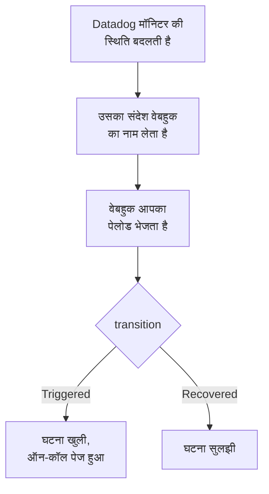

# Datadog

[Datadog](https://www.datadoghq.com) मॉनिटर के अलर्ट OneUptime को भेजें, ताकि हर अलर्ट एक घटना बने जो आपकी ऑन-कॉल टीम को पेज करे, और Datadog मॉनिटर के ठीक होने पर सुलझ जाए। Datadog अपने अलर्ट अपने [Webhooks इंटीग्रेशन](https://docs.datadoghq.com/integrations/webhooks/) से भेजता है, इसलिए किसी भी तरफ़ कुछ इंस्टॉल नहीं करना पड़ता।

:::cards
- [चुनें कि OneUptime अलर्ट कैसे पाए](#चुनें-कि-oneuptime-अलर्ट-कैसे-पाए): एक Incoming Request मॉनिटर, या आपका अपना वर्कफ़्लो।
- [मॉनिटर से अलर्ट पाएं](#मॉनिटर-से-अलर्ट-पाएं): हर अलर्ट पर एक घटना, रिकवरी पर सुलझी हुई।
- [Datadog कॉन्फ़िगर करें](#datadog-कॉन्फ़िगर-करें): एक वेबहुक, और उसे सूचित करने वाले मॉनिटर।
- [समस्या निवारण](#समस्या-निवारण): जब अलर्ट नहीं पहुंचते, या घटनाएं खुली रहती हैं।
:::

## यह कैसे काम करता है



Datadog मॉनिटर अपनी स्थिति बदलने पर, यानी ट्रिगर होने, चेतावनी देने, ठीक होने या डेटा न मिलने पर, उन वेबहुक को सूचित करता है जिनका उसके संदेश में ज़िक्र है। वेबहुक की JSON बॉडी आप खुद Datadog के [टेम्पलेट वेरिएबल](https://docs.datadoghq.com/integrations/webhooks/#usage) से लिखते हैं, इसलिए यह गाइड आपको एक ऐसी बॉडी देती है जो हर अलर्ट को नाम देती है और बताती है कि उसके साथ क्या हुआ।

## शुरू करने से पहले

- एक Datadog खाता जिसमें आप इंटीग्रेशन कॉन्फ़िगर कर सकें और मॉनिटर संपादित कर सकें।
- OneUptime में मॉनिटर बनाने का अधिकार, या वर्कफ़्लो का रास्ता चुनने पर वर्कफ़्लो बनाने का।

## चुनें कि OneUptime अलर्ट कैसे पाए

पहले OneUptime सेट करें: यह आपको वह URL देता है जिस पर Datadog भेजता है।

| तरीका | कब इस्तेमाल करें |
| --- | --- |
| एक Incoming Request मॉनिटर (सुझाया गया) | आप चाहते हैं कि हर अलर्ट एक घटना बने जो ऑन-कॉल को पेज करे, और Datadog मॉनिटर के ठीक होने पर सुलझ जाए। कुछ भी बनाना नहीं पड़ता। |
| Webhook ट्रिगर वाला वर्कफ़्लो | आपको अपना लॉजिक चाहिए: अलर्ट फ़िल्टर करना, उनका रूप बदलना, या पहले दूसरे सिस्टम को कॉल करना। वर्कफ़्लो उसे मिलने वाले हर अलर्ट के लिए एक घटना घोषित करता है, और रिकवरी पर उसे नहीं सुलझाता। |

दोनों को एक ही वेबहुक से एक जैसा JSON मिलता है, इसलिए आप एक से शुरू करके बाद में Datadog में एक URL बदलकर दूसरे पर जा सकते हैं।

## मॉनिटर से अलर्ट पाएं

एक [Incoming Request मॉनिटर](/docs/monitor/incoming-request-monitor) आपको एक URL देता है, और उसके मानदंड तय करते हैं कि हर अलर्ट क्या करे।

:::steps
### मॉनिटर बनाएं

**मॉनिटर** पर जाएं और **मॉनिटर बनाएं** पर क्लिक करें। **मॉनिटर प्रकार** में **Incoming Request** चुनें, इसका नाम `Datadog` रखें, और **अगला** पर क्लिक करें।

### हर अलर्ट के लिए घटना घोषित करें

**मानदंड** चरण में पहला मानदंड खोलें, वह जो मॉनिटर को ऑफ़लाइन चिह्नित करता है। उसका फ़िल्टर **अनुरोध बॉडी**, **शामिल है**, `"transition":"Triggered"` पर सेट करें। फ़िल्टर मेल खाने पर यह मानदंड पहले से ही घटना घोषित करता है। घटना भरें:

- **घटना शीर्षक**: `{{requestBody.title}}`।
- **विवरण** के नीचे **घटना विवरण**: `{{requestBody.body}}`, फिर अपनी अलग पंक्ति में `Datadog: {{requestBody.link}}`।
- **गंभीरता**: वह घटना गंभीरता जो इन अलर्ट की होनी चाहिए।
- **ऑन-कॉल** के नीचे **ऑन-कॉल नीतियां**: पेज की जाने वाली नीतियां।
- **और फ़ील्ड** के नीचे **घटना स्वतः सुलझाएं**: इसे चालू रहने दें, जैसा यह शुरू में होता है। इसके बिना रिकवरी को अनदेखा किया जाता है और घटनाएं खुली रहती हैं।

### हर अलर्ट पर एक घटना खोलें

उसी मानदंड में **सेटिंग्स** खोलें और **Group incidents and alerts by a payload field** चालू करें। इसे नीचे की तरह भरें, ताकि हर अलर्ट की अपनी घटना हो, और उसकी रिकवरी उसे सुलझाए:

| फ़ील्ड | मान |
| --- | --- |
| **Open a separate incident for each…** | `requestBody.alert_key` |
| **Field that signals recovery** | `requestBody.transition` |
| **Value that means recovered** | `Recovered` |

### मॉनिटर को वापस ऑनलाइन लाएं

दूसरा मानदंड खोलें, वह जो मॉनिटर को ऑनलाइन चिह्नित करता है, और उसका फ़िल्टर **अनुरोध बॉडी**, **शामिल है**, `"transition":"Recovered"` पर सेट करें।

### URL कॉपी करें

**मॉनिटर बनाएं** पर क्लिक करें। मॉनिटर का **अवलोकन** पेज उसका **Heartbeat URL** दिखाता है। उसे Datadog के लिए कॉपी करें:

```text
https://oneuptime.com/heartbeat/<secret key>
```

सेल्फ़-होस्टेड इंस्टॉलेशन में `oneuptime.com` की जगह उसका अपना होस्ट होता है।
:::

नीचे दिया पेलोड `alert_key` को Datadog मॉनिटर की ID और अलर्ट करने वाले समूह के टैग पर सेट करता है, इसलिए मल्टी अलर्ट मॉनिटर के हर समूह की अपनी घटना होती है, और उस समूह की रिकवरी उसे सुलझाती है। जो मॉनिटर अपनी घटना खुली रहते हुए फिर से ट्रिगर होता है या दोबारा सूचित करता है, वह दूसरी घटना नहीं खोलता। हर सेटिंग क्या करती है, यह जानने के लिए [किसी दूसरे सिस्टम से अलर्ट प्राप्त करना](/docs/monitor/incoming-request-monitor#किसी-दूसरे-सिस्टम-से-अलर्ट-प्राप्त-करना) देखें।

> [!NOTE]
> इन फ़िल्टर के साथ **Warn** या **No Data** सूचना कोई घटना नहीं खोलती। चेतावनियों पर भी पेज होने के लिए **मानदंड जोड़ें** पर क्लिक करें, नए मानदंड को फ़िल्टर **अनुरोध बॉडी**, **शामिल है**, `"transition":"Warn"`, अपनी **गंभीरता** वाली एक घटना, और वही ग्रुपिंग सेटिंग दें, फिर उसे पहले मानदंड के ऊपर खींचें। मानदंड ऊपर से जांचे जाते हैं, और जो पहले मेल खाता है वही तय करता है।

## Datadog कॉन्फ़िगर करें

:::steps
### वेबहुक जोड़ें

Datadog में [Webhooks इंटीग्रेशन टाइल](https://app.datadoghq.com/integrations/webhooks) खोलें, और अगर यह अभी इंस्टॉल नहीं है तो इसे इंस्टॉल करें। इन सेटिंग्स के साथ एक वेबहुक जोड़ें, फिर उसे सहेजें:

- **Name**: `oneuptime`। मॉनिटर इस नाम से वेबहुक का ज़िक्र करते हैं, `@webhook-oneuptime` के रूप में।
- **URL**: वह URL जो आपने OneUptime से कॉपी किया।
- **Payload**:

  ```json
  {
    "alert_key": "$ALERT_ID $ALERT_SCOPE",
    "transition": "$ALERT_TRANSITION",
    "title": "$EVENT_TITLE",
    "body": "$TEXT_ONLY_MSG",
    "host": "$HOSTNAME",
    "priority": "$PRIORITY",
    "link": "$LINK"
  }
  ```

### अपने मॉनिटर में वेबहुक का ज़िक्र करें

हर उस Datadog मॉनिटर में जिसे OneUptime के ज़रिए पेज करना चाहिए, मॉनिटर के नोटिफ़िकेशन संदेश में `@webhook-oneuptime` जोड़ें, और मॉनिटर सहेजें। इसके बाद Datadog उस मॉनिटर के अलर्ट और रिकवरी OneUptime को भेजता है।
:::

| वेरिएबल | Datadog इसमें क्या रखता है |
| --- | --- |
| `$ALERT_ID` | अलर्ट करने वाले Datadog मॉनिटर की ID। |
| `$ALERT_SCOPE` | अलर्ट करने वाले समूह के टैग, जैसे `host:web-1`। |
| `$ALERT_TRANSITION` | क्या हुआ: `Triggered`, `Re-Triggered`, `Warn`, `Recovered`, `No Data` या `Renotify`, और भी। |
| `$EVENT_TITLE` | इवेंट का शीर्षक, जैसे `[Triggered] High CPU`। |
| `$TEXT_ONLY_MSG` | मॉनिटर का संदेश, बिना Markdown के। |
| `$LINK` | Datadog में इवेंट का लिंक। |

## इसे टेस्ट करें

OneUptime को एक अलर्ट भेजें, जैसे Datadog भेजता:

```bash
curl -X POST "https://oneuptime.com/heartbeat/<secret key>" \
  -H "Content-Type: application/json" \
  -d '{
    "alert_key": "1234 host:web-1",
    "transition": "Triggered",
    "title": "[Triggered] High CPU",
    "body": "CPU is above 90% on web-1.",
    "host": "web-1",
    "priority": "normal",
    "link": "https://app.datadoghq.com/event/event?id=1"
  }'
```

`[Triggered] High CPU` शीर्षक वाली एक घटना खुलती है। `transition` को `Recovered` करके वही अनुरोध भेजें, और घटना सुलझ जाती है।

फिर Datadog से टेस्ट करें: वेबहुक का ज़िक्र करने वाला कोई मॉनिटर खोलें, **Test Notifications** पर क्लिक करें, और उसकी **Alert** सूचना भेजें। यह पहुंची या नहीं, यह OneUptime मॉनिटर की टाइमलाइन में देखें।

## वर्कफ़्लो से अलर्ट पाएं

जब आपको Datadog और घटना के बीच अपने चरण चाहिए, तब [वर्कफ़्लो](/docs/workflows/index) इस्तेमाल करें।

:::steps
### वर्कफ़्लो बनाएं

**वर्कफ़्लो** पर जाएं, **वर्कफ़्लो बनाएं** पर क्लिक करें, फिर **शुरू से बनाएं** पर। इसका नाम `Datadog alerts` रखें और **वर्कफ़्लो बनाएं** पर क्लिक करें।

### Webhook ट्रिगर जोड़ें

डैश वाले **चुनें कि यह वर्कफ़्लो किससे शुरू हो** ब्लॉक पर क्लिक करें और **Webhook** चुनें। ट्रिगर पर क्लिक करें, फिर **URL कॉपी करें** पर, और वह URL Datadog के वेबहुक में इस्तेमाल करें।

### जांचें कि मॉनिटर ट्रिगर हुआ

**घटक जोड़ें** पर क्लिक करें, एक **If / Else** ब्लॉक जोड़ें, और ट्रिगर के **Out** बिंदु को उससे जोड़ें। **Value to check** को `{{local.components.webhook-1.returnValues.request-body.transition}}` पर, **Comparison** को **is equal to** पर, और **Compare with** को `Triggered` पर सेट करें।

### घटना घोषित करें

एक **Create One Incident** ब्लॉक जोड़ें, और **If / Else** ब्लॉक की **Yes** साइड को उससे जोड़ें। **Incident Template** में ऐसा टेम्पलेट चुनें जो गंभीरता और पेज की जाने वाली ऑन-कॉल नीतियां सेट करता हो ([घटना टेम्पलेट](/docs/incidents/settings#घटना-टेम्पलेट) देखें)। **JSON Object** में वह सेट करें जो Datadog से आता है:

```json
{
  "title": "{{local.components.webhook-1.returnValues.request-body.title}}",
  "description": "{{local.components.webhook-1.returnValues.request-body.body}}\nDatadog: {{local.components.webhook-1.returnValues.request-body.link}}"
}
```

बिना टेम्पलेट के, **JSON Object** में `incidentSeverityId` भी चाहिए, जो प्रोजेक्ट की किसी घटना गंभीरता का ID है।

### वर्कफ़्लो चालू करें

**बिल्डर** के ऊपर **सक्षम** चालू करें। बंद वर्कफ़्लो Datadog को `400` से जवाब देता है।
:::

हर `Triggered` सूचना एक नई घटना घोषित करती है। रिकवरी **If / Else** ब्लॉक की **No** साइड पर जाती है, जहां कुछ नहीं जुड़ा है, इसलिए रन वहीं खत्म हो जाता है। हर अलर्ट पर एक घटना, जो रिकवरी पर सुलझे, के लिए मॉनिटर इस्तेमाल करें।

## समस्या निवारण

:::details OneUptime में कुछ नहीं पहुंचता
- जांचें कि Datadog मॉनिटर के संदेश में `@webhook-oneuptime` का ज़िक्र है, ठीक उसी वर्तनी में जिस नाम से वेबहुक बना है।
- मॉनिटर कुछ भी जांचने से पहले तुरंत `200` से जवाब देता है, गलत सीक्रेट कुंजी होने पर भी। अलर्ट पहुंच रहे हैं या नहीं, यह मॉनिटर की टाइमलाइन में देखें।
- बंद वर्कफ़्लो `400` से जवाब देता है। उसके **बिल्डर** के ऊपर **सक्षम** चालू करें।
:::

:::details घटनाएं खुलती हैं पर कभी सुलझती नहीं
- Datadog मॉनिटर को अपनी रिकवरी की सूचना भी वेबहुक को देनी चाहिए। जो संदेश किसी शर्त के अंदर सिर्फ़ अलर्ट के लिए वेबहुक का ज़िक्र करता है, वह कोई रिकवरी नहीं भेजता।
- मानदंड की घटना में **और फ़ील्ड** के नीचे **घटना स्वतः सुलझाएं** होना चाहिए।
- **Value that means recovered** ठीक `Recovered` होना चाहिए। तुलना केस-सेंसिटिव है।
- रिकवरी का `alert_key` अलर्ट वाला ही होना चाहिए: पेलोड में `$ALERT_ID $ALERT_SCOPE` को जैसा है वैसा ही रहने दें।
:::

:::details किसी फ़ील्ड में वेरिएबल का नाम दिखता है, या कुछ नहीं
Datadog सिर्फ़ वे वेरिएबल भरता है जो इवेंट पर लागू होते हैं। एक टेस्ट सूचना भेजें, फिर देखें कि क्या पहुंचा: मॉनिटर की टाइमलाइन में, या वर्कफ़्लो के लिए **लॉग → रन** में।
:::

:::details किसी मॉनिटर के सारे अलर्ट एक घटना में मिल जाते हैं
हर समूह को अपना `alert_key` चाहिए। जांचें कि पेलोड इसे `$ALERT_ID` और `$ALERT_SCOPE` दोनों से बनाता है, और ग्रुपिंग पाथ `requestBody.alert_key` है।
:::

## सुरक्षा

- **URL को पासवर्ड की तरह रखें।** जिसके पास भी यह है, वह घटनाएं खोल सकता है। अगर यह लीक हो जाए, तो इसे रीसेट करें: मॉनिटर के **सेटिंग्स** पेज पर **इनकमिंग अनुरोध सीक्रेट कुंजी रीसेट करें**, या वर्कफ़्लो के **Webhook** ट्रिगर में **URL रीसेट करें**। फिर Datadog में वेबहुक का **URL** अपडेट करें।
- **सेल्फ़-होस्टेड?** Datadog इंटरनेट से वेबहुक भेजता है, इसलिए आपका OneUptime इंटरनेट से HTTPS पर पहुंचने योग्य होना चाहिए।

## अगले कदम

:::cards
- [आने वाले अनुरोध मॉनिटर](/docs/monitor/incoming-request-monitor): आपके अलर्ट पाने वाले मॉनिटर की हर सेटिंग।
- [Prometheus Alertmanager](/docs/integrations/prometheus-alertmanager): Alertmanager के लिए यही सेटअप।
- [एस्केलेशन नियम](/docs/on-call/escalation-rules): तय करें कि ऑन-कॉल नीति किसे और कब पेज करे।
- [इंटिग्रेशन अवलोकन](/docs/integrations/index): वे दूसरे टूल जिन्हें आप जोड़ सकते हैं।
:::
