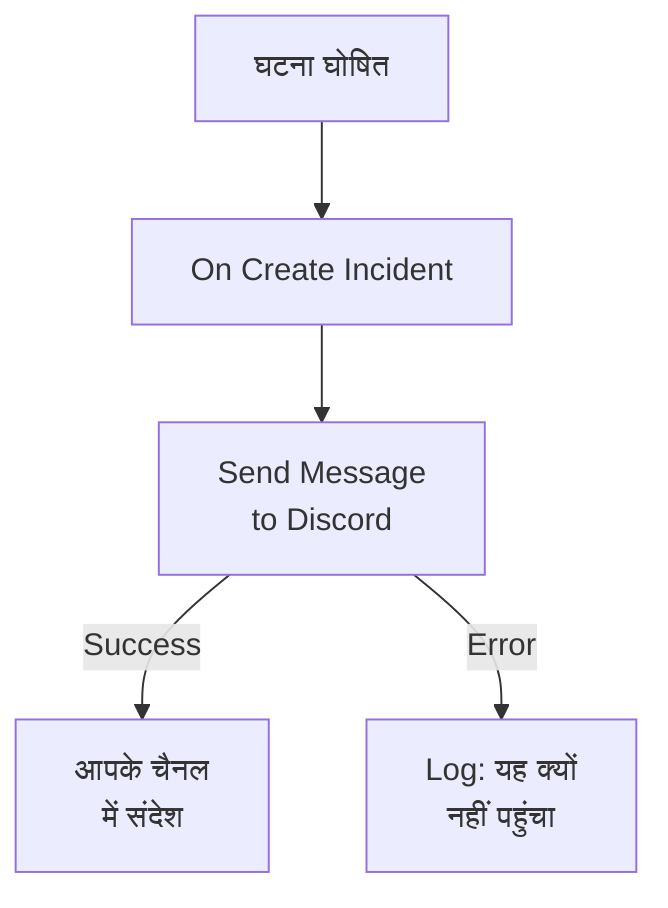

# Discord

जब कोई घटना खुलती है, तो किसी [Discord](https://discord.com) चैनल में एक संदेश पोस्ट करें, ताकि उस चैनल पर नज़र रखने वाले लोगों को तुरंत पता चले। OneUptime का **Send Message to Discord** वर्कफ़्लो चरण चैनल के वेबहुक के ज़रिए पोस्ट करता है, और एक तैयार टेम्पलेट आपके लिए पूरा वर्कफ़्लो बना देता है। यह इंटीग्रेशन **आउटबाउंड** है: OneUptime चैनल में पोस्ट करता है, और वहां कही गई बातें नहीं पढ़ता।

:::cards
- [यह कैसे काम करता है](#यह-कैसे-काम-करता-है): घटना खुलने पर वर्कफ़्लो क्या करता है।
- [सेटअप](#इंटीग्रेशन-सेट-अप-करें): Discord में एक वेबहुक, फिर वर्कफ़्लो: टेम्पलेट से या शुरू से।
- [सुझाव](#सुझाव): फ़ॉर्मैटिंग, लंबे संदेश, और ज़्यादा इवेंट।
- [समस्या निवारण](#समस्या-निवारण): चरण की त्रुटियों का मतलब, और क्या बदलना है।
:::

## यह कैसे काम करता है



चरण **Message Text** को चैनल के वेबहुक पर पोस्ट करता है। जब Discord संदेश ले लेता है तो यह अपने **Success** आउटपुट पर जाता है, और जब Discord उसे अस्वीकार करता है तो Discord के कारण के साथ अपने **Error** आउटपुट पर। टेम्पलेट **Error** से एक **Log** चरण जोड़ता है, ताकि जो रन पोस्ट नहीं कर सका वह कारण बताए।

## शुरू करने से पहले

- Discord में, चैनल पर **Manage Webhooks** अनुमति।
- OneUptime में वर्कफ़्लो और वेरिएबल बनाने का अधिकार। OneUptime Cloud पर वर्कफ़्लो के लिए **Growth** प्लान या उससे ऊपर चाहिए।

## इंटीग्रेशन सेट अप करें

:::steps
### Discord में वेबहुक बनाएं

1. Discord में, **Edit Channel** से चैनल की सेटिंग्स खोलें, फिर **Integrations → Webhooks**, और **New Webhook** चुनें।
2. इसे एक नाम दें, उदाहरण के लिए `OneUptime`, और जांचें कि यह सही चैनल में पोस्ट करता है।
3. **Copy Webhook URL** चुनें।

जिसके पास भी URL है वह चैनल में पोस्ट कर सकता है, इसलिए इसे पासवर्ड जितना सुरक्षित रखें।

### वर्कफ़्लो बनाएं

टेम्पलेट से शुरू करें, जो आपके लिए पूरा वर्कफ़्लो बना देता है, या शुरू से बनाएं।

:::tabs
@tab Template से
1. **वर्कफ़्लो** खोलें और **वर्कफ़्लो बनाएं** पर क्लिक करें।
2. **टेम्पलेट खोजें…** में `Discord` लिखें, **Tell Discord when an incident opens** पर क्लिक करें, फिर **यह टेम्पलेट इस्तेमाल करें** पर क्लिक करें।
3. नाम, **Notify Discord on new incident**, रहने दें या बदलें, और **अगला** पर क्लिक करें।
4. URL को **Discord Webhook URL** में पेस्ट करें, और **वर्कफ़्लो बनाएं** पर क्लिक करें।

वर्कफ़्लो **बिल्डर** में तीन चरणों के साथ खुलता है: **On Create Incident**; **Send Message to Discord**, जो घटना का नंबर, शीर्षक, गंभीरता और स्थिति पोस्ट करता है; और उसके **Error** आउटपुट पर एक **Log** चरण। URL वर्कफ़्लो के सीक्रेट वेरिएबल `discordWebhookUrl` के रूप में सहेजा जाता है।
@tab शुरू से
1. URL को सीक्रेट ग्लोबल वेरिएबल के रूप में सहेजें: **वर्कफ़्लो → ग्लोबल वेरिएबल** पर जाएं, **वर्कफ़्लो वेरिएबल बनाएँ** पर क्लिक करें, इसका नाम `DISCORD_WEBHOOK_URL` रखें, और **अगला** पर क्लिक करें। URL को **सामग्री** में पेस्ट करें, **रहस्य** चालू करें, और **वर्कफ़्लो वेरिएबल बनाएँ** पर क्लिक करें।
2. **वर्कफ़्लो** पर जाएं, **वर्कफ़्लो बनाएं** पर क्लिक करें, **शुरू से बनाएं** चुनें, वर्कफ़्लो को नाम दें, और **वर्कफ़्लो बनाएं** पर क्लिक करें।
3. **बिल्डर** में **चुनें कि यह वर्कफ़्लो किससे शुरू हो** पर क्लिक करें और **लोकप्रिय** के नीचे **On Create Incident** चुनें। ट्रिगर पर क्लिक करें: उसके **Fields to pass on** में पहले से **शीर्षक** है, इसलिए **फ़ील्ड जोड़ें** पर क्लिक करें और वे बाकी फ़ील्ड चुनें जो आपका संदेश दिखाता है, जैसे **Incident Number With Prefix**।
4. **घटक जोड़ें** पर क्लिक करें, `discord` खोजें, और **Send Message to Discord** पर क्लिक करें। ट्रिगर के **Success** आउटपुट को इससे जोड़ें।
5. नए चरण पर क्लिक करें। **Discord Incoming Webhook URL** में **{ }** पर क्लिक करें और **Global variables** के नीचे `DISCORD_WEBHOOK_URL` चुनें। **Message Text** में संदेश लिखें, और **{ }** से घटना के फ़ील्ड डालें।
:::

शुरू से बना संदेश घटना के फ़ील्ड ऐसे रेफ़रेंस से पढ़ता है:

```text
🚨 **Incident {{local.components.incident-on-create-1.returnValues.model.incidentNumberWithPrefix}} declared**
**Title:** {{local.components.incident-on-create-1.returnValues.model.title}}
```

### चालू करें और जाँचें

**बिल्डर** के ऊपर **सक्षम** चालू करें। अब से हर नई घटना चैनल में पोस्ट होती है।

नई घटना खोले बिना इसे जांचने के लिए, **वर्कफ़्लो चलाएं** पर क्लिक करें और **घटना** के नीचे कोई मौजूदा घटना चुनें: सबसे हाल की घटनाएं सूची में दिखती हैं, और उसका नंबर या शीर्षक का हिस्सा टाइप करने पर कोई दूसरी मिल जाती है। **वर्कफ़्लो मैन्युअल रूप से चलाएं** पर क्लिक करें और **चलाएं** से पुष्टि करें। **वर्कफ़्लो रन** पैनल रन के साथ चलता है, और संदेश चैनल में दिखता है। अगर चरण इसके बजाय **Error** पर जाता है, तो **Log** चरण की लाइन कारण बताती है: [समस्या निवारण](#समस्या-निवारण) देखें।
:::

## सुझाव

- **Discord के Markdown से फ़ॉर्मैट करें।** टेक्स्ट जैसा लिखा है वैसा ही भेजा जाता है, इसलिए उसमें Discord का Markdown काम करता है: किसी शब्द के दोनों ओर तारांकन उसे बोल्ड बनाते हैं, और URL लिंक के रूप में दिखता है।
- **2,000 अक्षरों की सीमा का ध्यान रखें।** Discord 2,000 अक्षरों तक के संदेश लेता है। इससे लंबा संदेश अस्वीकार होने के बजाय काट दिया जाता है, और "… (truncated — see OneUptime for the full text)" पर खत्म होता है।
- **नई घटनाओं से ज़्यादा पोस्ट करें।** उसी चरण के साथ, स्थिति बदलावों के लिए **On Update Incident** पर, या अलर्ट के लिए **On Create Alert** पर एक और वर्कफ़्लो बनाएं। सिर्फ़ कुछ घटनाएं पोस्ट करने के लिए, चरण से पहले एक **If / Else** ब्लॉक रखें।
- **सिर्फ़ Discord के अपने पते।** चरण `discord.com` या `discordapp.com` के `https` URL पर पोस्ट करता है, और रीडायरेक्ट का पीछा नहीं करता, इसलिए कहीं और इशारा करने वाला URL रन रोक देता है।

## समस्या निवारण

जब चरण **Error** पर जाता है, तो रन कारण बताता है: टेम्पलेट का **Log** चरण `❌ Discord could not deliver the incident notification:` और Discord का कारण लिखता है।

:::details Discord "Unknown Webhook" या "Invalid Webhook Token" से जवाब देता है
वेबहुक हटा दिया गया, या URL गलत कॉपी हुआ। नया वेबहुक बनाएं, और URL बदलें: टेम्पलेट वाले वर्कफ़्लो में `discordWebhookUrl` वेरिएबल; अपने खुद के वर्कफ़्लो में `DISCORD_WEBHOOK_URL` की सामग्री।
:::

:::details Discord "You are being rate limited" से जवाब देता है
Discord सीमित करता है कि एक वेबहुक कितनी बार पोस्ट कर सकता है। घटनाओं की बौछार इस सीमा तक पहुंच सकती है: कम संदेश पोस्ट करें, उदाहरण के लिए सिर्फ़ कुछ गंभीरताओं के लिए।
:::

:::details रन "Discord Webhook URL must be an https URL on discord.com or discordapp.com" के साथ रुकता है
**Discord Incoming Webhook URL** में Discord वेबहुक के अलावा कुछ और है, या जिस वेरिएबल को वह पढ़ता है वह खाली है। **Copy Webhook URL** से URL फिर से पेस्ट करें।
:::

## अगले कदम

:::cards
- [वर्कफ़्लो घटक](/docs/workflows/components#discord): चरण की हर सेटिंग, और उसके आउटपुट का मतलब।
- [Telegram](/docs/integrations/telegram): यही विचार, Telegram चैट में।
- [वर्कफ़्लो रन](/docs/workflows/runs-and-logs): पढ़ें कि वर्कफ़्लो के हर रन ने क्या किया।
- [इंटिग्रेशन अवलोकन](/docs/integrations/index): आउटबाउंड पैटर्न, और दूसरे टूल जिन्हें आप जोड़ सकते हैं।
:::
