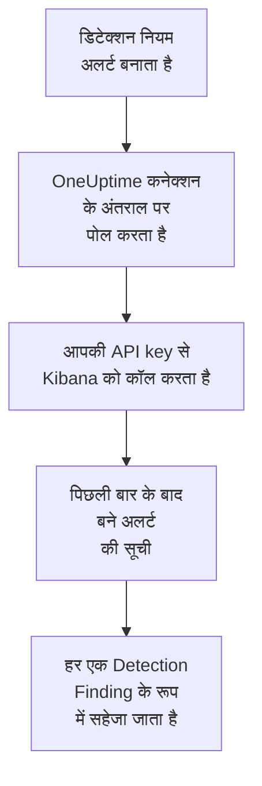

# Elastic Security

आपके [Elastic Security](https://www.elastic.co/security) नियम जो डिटेक्शन अलर्ट उठाते हैं, उन्हें OneUptime के सुरक्षा इवेंट में इम्पोर्ट करें। वहां आप उन्हें अपने लॉग, ट्रेस और मेट्रिक्स के साथ खोजते हैं, हर दूसरे स्रोत के साथ उनका सहसंबंध देखते हैं, और जो मायने रखते हैं उनके लिए ऑन-कॉल को पेज करते हैं। OneUptime उन्हें आपकी बनाई API key से, Kibana के डिटेक्शन इंजन API के ज़रिए पढ़ता है, और Elastic में कुछ नहीं बदलता।

:::cards
- [कनेक्शन सेट करें](#कनेक्शन-सेट-करें): एक API key, उसकी अनुमतियां, और कनेक्शन का फ़ॉर्म।
- [क्या इम्पोर्ट होता है](#क्या-इम्पोर्ट-होता-है): हर डिटेक्शन अलर्ट सुरक्षा इवेंट कैसे बनता है।
- [पोलिंग कैसे काम करती है](#पोलिंग-कैसे-काम-करती-है): हर पोल कौन सी विंडो पढ़ता है, और व्यस्त स्पेस उसके साथ क्या करता है।
- [समस्या निवारण](#समस्या-निवारण): हर त्रुटि का मतलब क्या है, और क्या बदलना है।
:::

## यह कैसे काम करता है



हर मिनट OneUptime हर उस सक्षम कनेक्शन से पोल करता है जिसका पोल अंतराल बीत चुका है। एक पोल Kibana से पिछले पोल के बाद आपके स्पेस में बने डिटेक्शन अलर्ट मांगता है, एक बार में 1,000, और हर एक को [OCSF](https://schema.ocsf.io/) Detection Finding इवेंट (क्लास `2004`) के रूप में सहेजता है। हर तरह का नियम गिना जाता है: कस्टम क्वेरी, थ्रेशोल्ड, EQL, इंडिकेटर मैच, मशीन लर्निंग और नए टर्म। इसके बाद पहचान नियम, मॉनिटर और डैशबोर्ड इन अलर्ट को किसी भी दूसरे स्रोत के सुरक्षा इवेंट की तरह मानते हैं।

## शुरू करने से पहले

- OneUptime में Project Owner, Project Admin या Security Admin रोल। Security Member और Security Viewer कनेक्शन और उनका रन इतिहास देख सकते हैं, पर उन्हें बदल नहीं सकते।
- Elastic Security 8.x या बाद का, Elastic Cloud पर या आपके अपने Elastic स्टैक पर, जिसमें डिटेक्शन नियम किसी Kibana स्पेस में चलते हों।
- ऐसी Kibana पहुंच जो उस स्पेस के डिटेक्शन अलर्ट देख सके: `.alerts-security.alerts-<space-id>` पर इंडेक्स अनुमतियां `read` और `view_index_metadata`, और Kibana की Security फ़ीचर अनुमति जो उसे वहां अलर्ट पढ़ने दे।
- एक Kibana जिस तक OneUptime HTTPS पर पहुंच सके। OneUptime Cloud इंटरनेट से कनेक्ट करता है, इसलिए Kibana को एक सार्वजनिक पते की ज़रूरत है, जैसा Elastic Cloud डिप्लॉयमेंट के पास होता है: निजी पते अस्वीकार किए जाते हैं। सेल्फ-होस्टेड OneUptime अपने ऐप और वर्कर कंटेनर से कनेक्ट करता है, और आपके निजी नेटवर्क पर Kibana तक पहुंच सकता है, जब तक `DATA_SOURCE_BLOCK_PRIVATE_ADDRESSES` `true` न हो।

## कनेक्शन सेट करें

:::steps
### API key बनाएं

1. Kibana में **Stack Management → API keys** खोलें और **Create API key** चुनें।
2. इसे एक नाम दें, जैसे `oneuptime-security-events`। key के पास उसे बनाने वाले यूज़र की अनुमतियां होती हैं, जब तक आप उसे कम न दें: उसे सिर्फ़ ऊपर वाली अनुमतियां चाहिए।
3. चुनें कि यह कब एक्सपायर हो, या कभी नहीं। एक्सपायर होने वाली key कनेक्शन को तब तक रोक देती है जब तक आप उसे बदल न दें।
4. key बनाएं और उसका **Base64** मान कॉपी करें, जिसे Kibana सिर्फ़ एक बार दिखाता है। key की ID नहीं, और `id:api_key` जोड़ी भी नहीं।

### अपने स्पेस की ID ढूंढें

अलर्ट स्पेस के हिसाब से रखे जाते हैं। वह स्पेस खोलें जहां आपके नियम चलते हैं: उसकी ID Kibana पते में `/s/` के बाद वाला हिस्सा है, जैसे `https://kibana.example.com/s/security/app/security` में `security`। डिफ़ॉल्ट स्पेस में `/s/` वाला हिस्सा नहीं होता और उसे किसी ID की ज़रूरत नहीं।

### OneUptime में कनेक्शन जोड़ें

**उत्पाद → Security Events → कनेक्शन** (`/dashboard/{projectId}/security-events/connections`) खोलें, **कनेक्शन जोड़ें** पर क्लिक करें, **Elastic Security** चुनें, और **अगला** पर क्लिक करें। नीचे दी गई तालिका की सेटिंग्स भरें, **अगला** पर क्लिक करें, और key को **API कुंजी** में पेस्ट करें।

### सहेजने से पहले इसे टेस्ट करें

**सहेजने से पहले टेस्ट करें** के नीचे **इन सेटिंग्स का परीक्षण करें** पर क्लिक करें। टेस्ट फ़ॉर्म के मानों से ऑथेंटिकेट करता है और अलर्ट पढ़ता है, और कुछ नहीं सहेजता, इसलिए गलत स्पेस या कोई छूटी हुई अनुमति कनेक्शन बनने से पहले ही सामने आ जाती है। फिर **अगला** पर क्लिक करें, कनेक्शन को एक **नाम** दें, और उसे बनाएं।
:::

| सेटिंग | क्या डालें |
| --- | --- |
| **Kibana URL** | वह पता जहां से Kibana दिया जाता है, जैसे `https://kibana.example.com` या `https://<deployment>.kb.<region>.cloud.es.io`। कोई पाथ नहीं: न `/app/security`, न `/api`, न `/s/<space>` वाला हिस्सा। |
| **Kibana space** | स्पेस की ID, उसका नाम नहीं: अक्षर, अंक, हाइफ़न और अंडरस्कोर। डिफ़ॉल्ट स्पेस के लिए खाली छोड़ें। |
| **API कुंजी** | key का **Base64** मान, अकेले: `ApiKey` स्कीम OneUptime खुद जोड़ता है। यह एन्क्रिप्ट किया जाता है, API इसे कभी नहीं लौटाता, और यह फिर कभी नहीं दिखता। इसे कनेक्शन पर **क्रेडेंशियल अपडेट करें** से बदलें। |

**पोलिंग** चरण में एक वैकल्पिक **विवरण**, **पोल अंतराल (मिनट)**, जो `1` से `1440` तक की पूर्ण संख्या है और `5` से शुरू होती है, और **सक्षम** भी है, जो शुरू में चालू रहता है।

## क्या इम्पोर्ट होता है

हर डिटेक्शन अलर्ट एक Detection Finding इवेंट (OCSF क्लास `2004`) बनता है, जिसका वेंडर `Elastic` और प्रोडक्ट `Elastic Security` होता है:

| अलर्ट फ़ील्ड | OneUptime कॉलम |
| --- | --- |
| `_id`, अलर्ट की ID | इवेंट UID, जिससे डुप्लिकेट भी हटाए जाते हैं |
| `kibana.alert.original_time`, नहीं तो `kibana.alert.start`, नहीं तो `@timestamp` | इवेंट का समय |
| `kibana.alert.rule.name` | नियम का नाम |
| `kibana.alert.rule.uuid`, नहीं तो `kibana.alert.rule.rule_id` | नियम ID |
| `kibana.alert.reason`, नहीं तो नियम का नाम, नहीं तो `kibana.alert.rule.description` | संदेश |
| `kibana.alert.severity`, नहीं तो `kibana.alert.risk_score` की एक श्रेणी | गंभीरता |
| `kibana.alert.workflow_status`: `open`, `acknowledged` या `closed` | स्थिति |
| `kibana.alert.rule.threat`, सब-तकनीकों समेत | MITRE ATT&CK टैक्टिक और तकनीकें |
| `user.name`, `host.name`, `source.ip` या `host.ip`, `process.name` या `process.executable` | प्रिंसिपल यूज़र, होस्ट, IP और प्रोसेस |
| `user.target.name`, `destination.domain`, `destination.ip`, `destination.port`, `file.path` | टारगेट यूज़र, होस्ट, IP, पोर्ट और रिसोर्स |
| ये सब, और `related.*`, `dns.question.name`, `url.domain` और फ़ाइल हैश | Observable |
| पूरा अलर्ट, डॉट वाली कुंजियों में फैलाया हुआ, `_index` और `_id` के साथ | `attributes` |

अलर्ट का समय जानबूझकर उस गतिविधि का समय है जिसके बारे में वह है। उसका `@timestamp`, जब नियम ने उसे बनाया, वही है जो पोलिंग पढ़ती है, इसलिए कल की गतिविधि के बारे में आज बना अलर्ट सुरक्षा इवेंट एक्सप्लोरर में कल के नीचे दिखता है। जब किसी अलर्ट की गंभीरता नहीं होती, तो उसका रिस्क स्कोर तय करता है: `74` और ऊपर Critical, `48` High, `22` Medium, और उससे नीचे Low।

## पोलिंग कैसे काम करती है

हर पोल अपनी विंडो में बने अलर्ट की सूची बनाता है, सबसे पुराने पहले, एक पेज में 1,000। डिफ़ॉल्ट के अलावा किसी और स्पेस में पाथ `/s/{Kibana space}` से शुरू होता है:

```text
POST {Kibana URL}/api/detection_engine/signals/search
    {"query": {"range": {"@timestamp": {"gte": "{window start}", "lt": "{window end}"}}},
     "size": 1000, "sort": [{"@timestamp": "asc"}]}
```

- **बनने का समय ही कर्सर है।** अलर्ट अपने `@timestamp` के हिसाब से सूचीबद्ध होते हैं, जब नियम के रन ने उन्हें बनाया, न कि उस गतिविधि के समय से जिसके बारे में वे हैं। हर घंटे चलने वाला नियम ज़्यादा से ज़्यादा एक घंटे पुरानी गतिविधि पर अलर्ट बनाता है, और गतिविधि के समय पर रखा कर्सर उन सबको छोड़ देगा।
- **पहला पोल 24 घंटे पीछे देखता है**, इसलिए नया कनेक्शन तुरंत अपने हाल के अलर्ट दिखाता है।
- **हर बाद वाला पोल सहेजे गए कर्सर से 1 मिनट पहले शुरू होता है**, इसलिए दो विंडो की सीमा पर बना अलर्ट कभी नहीं छूटता।
- **एक पोल कर्सर से आगे ज़्यादा से ज़्यादा 24 घंटे पढ़ता है।** जिस कनेक्शन का कर्सर पीछे रह गया, वह 24 घंटे की लगातार विंडो में बराबर आता है, और उसका **स्वास्थ्य** **Catching up** दिखाता है।
- **डुप्लिकेट अलर्ट के `_id` से हटाए जाते हैं**, प्रोजेक्ट के भीतर, इसलिए ओवरलैप, दोबारा कोशिश की गई विंडो और इम्पोर्ट कभी किसी अलर्ट को दो बार नहीं सहेजते।

Kibana की अलर्ट सर्च एक साइज़ और एक क्रम लेती है, पर कोई पेज टोकन नहीं। इसलिए OneUptime हर पेज के आखिरी अलर्ट पर सीमा की शुरुआत ले जाकर पेज बदलता है, और उस पल तक पढ़े जा चुके अलर्ट को `_id` के हिसाब से छोड़ देता है। एक नियम का रन अक्सर कई अलर्ट पर एक ही समय लगाता है, और ऐसा समूह पेज दर पेज पढ़ा जाता है, कोई दो बार नहीं और कोई छूटता नहीं।

### जब किसी विंडो में एक पोल की क्षमता से ज़्यादा हो

एक पोल ज़्यादा से ज़्यादा 20 अनुरोधों में ज़्यादा से ज़्यादा 10,000 अलर्ट पढ़ता है। जब किसी विंडो में इससे ज़्यादा हों, तो रन **आंशिक** होता है, इस तरह की चेतावनी के साथ:

```text
Stopped after collecting 10000 alerts; the window holds more.
```

अलर्ट सबसे पुराने पहले पढ़े जाते हैं, इसलिए OneUptime कर्सर को पढ़े गए आखिरी अलर्ट के बनने के समय पर ले जाता है, और अगला पोल उसी विंडो लंबाई के साथ वहीं से शुरू होता है। व्यस्त स्पेस वही अलर्ट दोबारा पढ़ने के बजाय हर पोल में 10,000 अलर्ट पकड़ता है। ठीक उसी पल में बने अलर्ट दो बार पढ़े जाते हैं, और डुप्लिकेट जांच दूसरी कॉपी हटा देती है।

छोड़ी गई ID हर अनुरोध के साथ जाती हैं, और Kibana अनुरोध का आकार सीमित करता है। जब एक पल को इतने अलर्ट साझा करें कि एक अनुरोध उन्हें छोड़ न सके, लगभग 7,800, तो रन वहीं **आंशिक** के रूप में रुक जाता है, उस पल का नाम बताने वाली चेतावनी के साथ।

जब कोई रन सहेजे गए कर्सर से आगे बढ़ ही नहीं पाता, तो OneUptime इसके बजाय विंडो छोटी करता है:

1. **छोटा करें।** अगला पोल उसी शुरुआती बिंदु से आधी लंबाई की विंडो पढ़ता है, और तब तक आधा करता रहता है जब तक कोई विंडो पूरी न पढ़ी जाए, कम से कम एक मिनट तक। रन की चेतावनी यही बताती है: `This window holds more records than one poll can read; the next poll reads a {n} minute window from the same starting point.`
2. **वापस बढ़ाएं।** किसी विंडो के पूरा पढ़े जाने के बाद अगली विंडो फिर दोगुनी होती है, ज़्यादा से ज़्यादा 24 घंटे तक।
3. **एक मिनट से आगे बढ़ें।** अगर एक मिनट में भी एक पोल की क्षमता से ज़्यादा हो, तो पोलिंग उससे आगे बढ़ जाती है, ताकि नए अलर्ट आते रहें। रन **आंशिक** ही रहता है, और **पिछली त्रुटि** में लिखा होता है `More records were created in the one minute from {cursor} to {end} than one poll can read. Polling moved past this minute so newer records keep arriving; use Import this time range in Diagnostics on this minute to recover what one run can read.` एक रन जितना पढ़ सकता है उतना वापस पाने के लिए उस मिनट को **Import this time range** से इम्पोर्ट करें।

जो रन Kibana की किसी त्रुटि से पूरी तरह विफल होता है, वह कर्सर और विंडो लंबाई नहीं बदलता, और अगला पोल वही विंडो फिर से पढ़ता है। एकमात्र अपवाद वह अनुरोध है जिसका समय खत्म हो गया: कर्सर वहीं रहता है, लेकिन अगली विंडो आधी लंबी होती है, क्योंकि जो विंडो समय पर जवाब पाने के लिए बहुत भारी हो, वह हर कोशिश में टाइम आउट होगी। **पोल अंतराल (मिनट)** बदलने से इसमें कुछ नहीं बदलता: यह तय करता है कि पोल कितनी बार शुरू होता है, न कि उसकी विंडो कहां से शुरू होती है।

### मांग पर रन, प्रीव्यू और इम्पोर्ट

किसी कनेक्शन पर **निदान** पर क्लिक करें, ताकि उसके हाल के रन देख सकें और उसके साथ हाथ से काम कर सकें। जो भी कनेक्शन बदल सकता है वह इन्हें शुरू कर सकता है; जो भी इसे देख सकता है वह इतिहास पढ़ सकता है।

- **अभी चलाएँ** तुरंत सामान्य कर्सर के साथ एक पोल शुरू करता है, तब भी जब कनेक्शन **सक्षम** न हो।
- **Preview alerts** 7 दिन तक की समय सीमा पढ़ता है और कुछ इम्पोर्ट नहीं करता।
- **Import this time range** आपकी पुष्टि के बाद 7 दिन तक की सीमा इम्पोर्ट करता है, कर्सर हिलाए बिना। पहले से इम्पोर्ट किए गए अलर्ट छोड़ दिए जाते हैं।
- किसी रन पर **Copy diagnostics** सपोर्ट के लिए उसकी रिपोर्ट कॉपी करता है। इसमें क्रेडेंशियल कभी शामिल नहीं होते।

## कनेक्शन का परीक्षण करें

कनेक्शन की पंक्ति पर **कनेक्शन का परीक्षण करें**, और फ़ॉर्म में **इन सेटिंग्स का परीक्षण करें**, बैकग्राउंड वर्कर में नहीं बल्कि API प्रोसेस में चलते हैं, इसलिए जब वर्कर ही समस्या हों तब भी टेस्ट जवाब देता है। यह ये जांचें क्रम से चलाता है:

| जांच | यह क्या जांचती है |
| --- | --- |
| **कॉन्फ़िगरेशन** | हर सेटिंग मौजूद है और सही रूप में है। इसके विफल होने पर किसी से संपर्क नहीं किया जाता। |
| **Authenticate with Kibana** | Kibana का `/api/status` पूरा जवाब देता है। Kibana उन कॉल करने वालों को भी कम जानकारी के साथ जवाब देता है जिन्हें उसने ऑथेंटिकेट नहीं किया, इसलिए छोटा जवाब इस जांच को विफल कर देता है। |
| **Read detection alerts** | पिछले 24 घंटों में बना एक अलर्ट पढ़ा जा सकता है। इससे अनुमतियां और स्पेस साबित होते हैं। |
| **Alerts available to import** | पिछले 24 घंटों और पिछले 7 दिनों में कितने अलर्ट बने, जहां Elasticsearch ने सिर्फ़ उनका एक हिस्सा गिना वहां `+` के साथ। 7 दिनों में एक भी नहीं होना चेतावनी है, विफलता नहीं। |
| **Background workers**, **Poll scheduler**, **Security event storage** | OneUptime का अपना हिस्सा: कोई प्रोसेस Worker कतार के जॉब लेता है, पोल जॉब हर मिनट चलता है, और सुरक्षा इवेंट का स्टोर जवाब देता है। |
| **Scheduled polling** | सहेजे गए कनेक्शन के लिए: पोलिंग चालू है, कोई रन वर्कर के इंतज़ार में अटका नहीं है, और पोल समय पर चलते हैं। |

टेस्ट के हर अनुरोध की समय सीमा 20 सेकंड है। टेस्ट कभी कुछ इम्पोर्ट नहीं करता और न कर्सर हिलाता है, और हर विफल जांच बताती है कि क्या बदलना है।

## Elastic Security को सुरक्षा इवेंट भेजें

OneUptime जो पाता है उसे डेटा स्ट्रीम में Elastic Common Schema (ECS) दस्तावेज़ों के रूप में Elasticsearch को भी भेज सकता है, ताकि Elastic Security के अलर्ट, टाइमलाइन और डिटेक्शन नियम आपके अपने डिटेक्शन के साथ OneUptime के डिटेक्शन भी देखें। डिटेक्शन `event.kind` `alert` वाला दस्तावेज़ होता है, और बाकी हर इवेंट का `event.kind` `event` होता है।

:::steps
### लिखने वाली API कुंजी बनाएँ

Kibana में **Stack Management → API keys** खोलें, **Create API key** पर क्लिक करें, उसे नीचे दिए अधिकार दें, और उसका **Encoded** मान कॉपी करें।

### गंतव्य जोड़ें

**उत्पाद → Security Events → कनेक्शन** खोलें। **अपने SIEM में भेजें** के नीचे **गंतव्य जोड़ें** पर क्लिक करें, **SIEM** में Elastic Security चुनें और **अगला** पर क्लिक करें। **Elasticsearch URL** में Kibana का नहीं, बल्कि डिप्लॉयमेंट का Elasticsearch एंडपॉइंट भरें, और कुंजी को **API कुंजी** में चिपकाएँ। **डेटा स्ट्रीम** वैकल्पिक है: खाली छोड़ने पर दस्तावेज़ `logs-oneuptime.security-default` में जाते हैं, जिसे Elasticsearch पहली बार लिखते समय बनाता है।

### टेस्ट इवेंट भेजें और भेजना शुरू करें

**टेस्ट इवेंट भेजें** पर क्लिक करें: डेटा स्ट्रीम में एक दस्तावेज़ पहुँचता है। फिर **क्या भेजना है** में **सिर्फ़ डिटेक्शन** रहने दें या **सभी सुरक्षा इवेंट** चुनें, और **भेजना शुरू करें** पर क्लिक करें।
:::

डिफ़ॉल्ट डेटा स्ट्रीम के लिए कुंजी के अधिकार:

```json title="oneuptime-writer-role.json"
{
  "oneuptime-writer": {
    "indices": [
      {
        "names": [
          "logs-oneuptime.security-*"
        ],
        "privileges": [
          "create_doc",
          "auto_configure"
        ]
      }
    ]
  }
}
```

- दस्तावेज़ 500 तक के बैच में जाते हैं, हर एक अपने इवेंट की अपनी id के साथ, इसलिए दो बार भेजा गया इवेंट एक ही बार सहेजा जाता है।
- जिस दस्तावेज़ को Elasticsearch मैप नहीं कर पाता, उसे छोड़ दिया जाता है और **त्रुटि देखें** में बताया जाता है, और जिसे वह अभी नहीं ले सकता (`429`), उसे फिर भेजा जाता है।
- OneUptime ने Elastic Security से जो अलर्ट इम्पोर्ट किए हैं, वे कभी वापस Elastic Security को नहीं भेजे जाते।

## समस्या निवारण

कनेक्शन का **पिछली त्रुटि** पूरा त्रुटि संदेश रखता है, क्रेडेंशियल छिपाकर, एक ऐसे प्रीफ़िक्स के पीछे जो विफल हुए चरण का नाम बताता है। जब किसी कनेक्शन में त्रुटि हो, तो उसे पढ़ने के लिए उसके **क्रियाएँ** कॉलम में **त्रुटि देखें** चुनें, और कॉपी करने के लिए डायलॉग में **त्रुटि कॉपी करें**। पहले प्रीफ़िक्स पढ़ें।

:::details Last Error `Elastic Security status request` से शुरू होता है
- `Elastic Security status request failed (HTTP ...)`: Kibana ने स्टेटस अनुरोध अस्वीकार किया।
  - `HTTP 401`: Kibana ने API key स्वीकार नहीं की। यह **Base64** मान नहीं है, या यह एक्सपायर हो गई या अमान्य कर दी गई। नई key बनाएं, और उसे **क्रेडेंशियल अपडेट करें** से सहेजें।
  - `HTTP 404`: **Kibana URL** में पाथ है, या यह Kibana नहीं है।
  - `HTTP 503`: Kibana खुद को अनुपलब्ध बताता है, आमतौर पर इसलिए कि वह Elasticsearch तक नहीं पहुंच पाता।
  - `HTTP 3xx`: Kibana ने अनुरोध को रीडायरेक्ट किया, और रीडायरेक्ट अस्वीकार किए जाते हैं। वह पता इस्तेमाल करें जहां से Kibana दिया जाता है।
- `Elastic Security status request returned ...`: Kibana के बजाय किसी और चीज़ ने जवाब दिया, जैसे साइन-इन पेज या कोई प्रॉक्सी।
- जब सिर्फ़ टेस्ट विफल हो, यह कहते हुए कि Kibana ने `answered without authenticating the request`, तो key Kibana तक नहीं पहुंची। जांचें कि यह **Base64** मान है, और कि Kibana के आगे कोई प्रॉक्सी `Authorization` हेडर नहीं हटाता।
:::

:::details Last Error `Elastic Security alerts search` से शुरू होता है
- `Elastic Security alerts search failed (HTTP ...)`: Kibana ने अलर्ट सर्च अस्वीकार की।
  - `HTTP 403`: key साइन इन करती है, पर स्पेस के अलर्ट नहीं पढ़ सकती। उसे [शुरू करने से पहले](#शुरू-करने-से-पहले) वाली अनुमतियां दें।
  - `HTTP 404`: किसी स्पेस की वह **Kibana space** ID नहीं है, या उसमें Elastic Security सक्षम नहीं है।
  - `HTTP 429` या `HTTP 5xx`: Kibana या Elasticsearch अनुरोधों को सीमित कर रहा है या विफल हो रहा है। अगला पोल फिर कोशिश करता है।
- `Elastic Security alerts search returned ...`: Kibana ने `200` जवाब दिया, पर अलर्ट का कोई पढ़ने लायक पेज नहीं, जैसे उसकी अपनी कोई त्रुटि। संदेश उसे उद्धृत करता है। इसे खाली विंडो मानने के बजाय रिपोर्ट किया जाता है, ताकि कर्सर कभी उन अलर्ट से आगे न जाए जिन्हें किसी ने नहीं पढ़ा।
:::

:::details Last Error `did not complete` पर खत्म होता है
`Elastic Security alerts search did not complete`, और स्टेटस अनुरोध के लिए भी ऐसा ही, का मतलब है कि अनुरोध को कोई जवाब नहीं मिला: टाइम आउट, ऐसा नाम जो रिज़ॉल्व नहीं होता, अस्वीकार किया गया कनेक्शन, या अस्वीकार किया गया निजी पता। जांचें कि OneUptime ऐप और वर्कर सही स्कीम और पोर्ट पर Kibana तक पहुंच सकते हैं। टाइम आउट के बाद अगला पोल आधी लंबी विंडो पढ़ता है।
:::

:::details Last Polled Never है और Last Error खाली है
इस कनेक्शन का कोई पोल पूरा नहीं हुआ है। **कनेक्शन का परीक्षण करें** चलाएं: उसकी **Background workers** और **Poll scheduler** जांचें कारण बताती हैं। सेल्फ़-होस्टेड इंस्टॉलेशन में आम कारण ऐप पर `DISABLE_QUEUE_WORKERS=true` है, जबकि जॉब लेने के लिए कोई अलग वर्कर डिप्लॉयमेंट नहीं है: इसे `false` पर सेट करें, या वर्कर डिप्लॉयमेंट चलाएं (Helm: `worker.enabled: true`)।
:::

:::details कोई रन Partial है
- `Stopped after collecting 10000 alerts; the window holds more`: विंडो में एक रन द्वारा पढ़े जाने वाले 10,000 अलर्ट से ज़्यादा थे। कुछ नहीं खोता: अगला पोल पढ़े गए आखिरी अलर्ट के बाद से शुरू होता है। जो कनेक्शन पोल दर पोल **आंशिक** बना रहता है, वह बैकलॉग पकड़ रहा है, और उसके **अंतिम पोल** और **अंतिम इंपोर्ट किया गया इवेंट** आगे बढ़ते रहते हैं। अगर वह कभी नहीं पकड़ पाता, तो स्पेस हर पोल अंतराल में 10,000 से ज़्यादा अलर्ट बनाता है: **पोल अंतराल (मिनट)** छोटा करें।
- `More records were created in the one minute from ... than one poll can read`: पोलिंग उस मिनट से आगे बढ़ गई। उसे **निदान** में **Import this time range** से इम्पोर्ट करें। एक इम्पोर्ट उतना ही पढ़ता है जितना एक पोल।
:::

:::details टेस्ट पास होता है, पर कुछ इम्पोर्ट नहीं होता
टेस्ट की रिपोर्ट में **Alerts available to import** पढ़ें। पिछले 7 दिनों में `0` का मतलब है कि उस स्पेस में किसी नियम ने अलर्ट नहीं बनाया: जांचें कि वहां नियम सक्षम हैं, और कि **Kibana space** वही स्पेस है जिसमें वे चलते हैं। अगर अलर्ट मौजूद हैं, तो सुरक्षा इवेंट एक्सप्लोरर में समय सीमा बढ़ाएं: अलर्ट अपनी गतिविधि के समय के नीचे दिखते हैं, जो उनके बनने से काफ़ी पहले का हो सकता है।
:::

## आपको क्या मिलता है

- **खोज।** सुरक्षा इवेंट एक्सप्लोरर में, हर दूसरे स्रोत के साथ, अलर्ट को गंभीरता, स्थिति, नियम, MITRE ATT&CK तकनीक, यूज़र, होस्ट या किसी भी observable से फ़िल्टर करें।
- **सहसंबंध।** हर अलर्ट के यूज़र, होस्ट, IP, डोमेन और हैश observable के रूप में इंडेक्स होते हैं, इसलिए एक सर्च उन सबको ढूंढ लेती है जो उनका ज़िक्र करते हैं।
- **पहचान नियम।** Sigma नियम जो शेड्यूल पर आपके सुरक्षा इवेंट पर चलते हैं, और ऑन-कॉल को पेज करने वाले अलर्ट खोलते हैं।
- **मॉनिटर।** सुरक्षा इवेंट मॉनिटर मेल खाने वाले इवेंट गिनते हैं, जैसे नए गंभीर अलर्ट, और थ्रेशोल्ड पार होने पर घटनाएं या अलर्ट खोलते हैं।

सुरक्षा इवेंट का बिल आपकी बाकी टेलीमेट्री की तरह, इंजेस्ट किए गए हर GB के हिसाब से बनता है। [मूल्य निर्धारण](https://oneuptime.com/pricing) देखें।

## अगले कदम

:::cards
- [सुरक्षा इवेंट](/docs/telemetry/security-events): जो इम्पोर्ट करते हैं उसे खोजें, उसका सहसंबंध देखें और उस पर अलर्ट करें।
- [Splunk Enterprise Security](/docs/integrations/splunk): किसी Splunk search head के notable event भी इम्पोर्ट करें।
- [रोल](/docs/permissions/reference#भूमिकाएँ): Security रोल क्या देख और बदल सकते हैं।
- [इंटिग्रेशन अवलोकन](/docs/integrations/index): वे दूसरे टूल जिन्हें आप जोड़ सकते हैं।
:::
