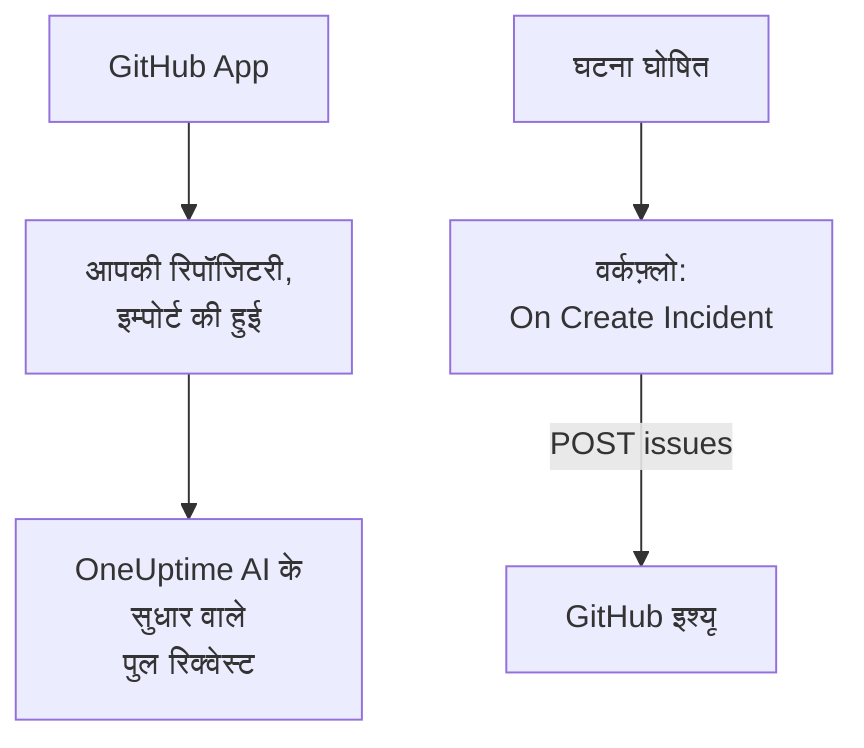

# GitHub

OneUptime [GitHub](https://github.com) के साथ दो तरह से काम करता है। OneUptime GitHub App के ज़रिए अपनी रिपॉजिटरी जोड़ें, और OneUptime का AI जो पाता है उसे ठीक करने वाले पुल रिक्वेस्ट खोलता है, और जब आप किसी इश्यू या पुल रिक्वेस्ट पर उसका ज़िक्र करते हैं तो जवाब देता है। या ऐसा वर्कफ़्लो बनाएं जो हर घटना के लिए एक GitHub इश्यू खोले, ताकि आगे का काम उसी रिपॉजिटरी में ट्रैक हो जिसकी वह सर्विस है।

:::cards
- [जोड़ने का तरीका चुनें](#जोड़ने-का-तरीका-चुनें): GitHub App या वर्कफ़्लो, और हर एक क्या करता है।
- [अपनी रिपॉजिटरी जोड़ें](#अपनी-रिपॉजिटरी-जोड़ें): GitHub App, सुधार वाले पुल रिक्वेस्ट के लिए।
- [हर घटना के लिए एक इश्यू खोलें](#हर-घटना-के-लिए-एक-github-इश्यू-खोलें): एक वर्कफ़्लो, दो ब्लॉक।
- [समस्या निवारण](#समस्या-निवारण): जब GitHub कोई अनुरोध अस्वीकार करता है।
:::

## यह कैसे काम करता है



दोनों अलग हैं, और आप इनमें से कोई एक या दोनों इस्तेमाल कर सकते हैं। GitHub App उन रिपॉजिटरी में काम करता है जिन पर आप उसे इंस्टॉल करते हैं। वर्कफ़्लो को सिर्फ़ एक टोकन चाहिए, और वह किसी भी दूसरे API की तरह GitHub के [REST API](https://docs.github.com/en/rest/issues/issues#create-an-issue) को कॉल करता है।

## जोड़ने का तरीका चुनें

| तरीका | यह क्या करता है | इसे क्या चाहिए |
| --- | --- | --- |
| GitHub App | आपकी रिपॉजिटरी इम्पोर्ट करता है। OneUptime AI उनमें ऐसे पुल रिक्वेस्ट खोलता है जो एक्सेप्शन, धीमे ट्रेस और उसकी जांचों में मिले कारणों को ठीक करते हैं, और इश्यू और पुल रिक्वेस्ट पर ज़िक्र का जवाब देता है। | ऐप इंस्टॉल करने के लिए एक संगठन या खाता। OneUptime Cloud पर, **Growth** प्लान। |
| एक वर्कफ़्लो | हर घटना के लिए आपकी चुनी हुई रिपॉजिटरी में एक GitHub इश्यू खोलता है। | इश्यू बना सकने वाला एक GitHub टोकन, और दो ब्लॉक का एक वर्कफ़्लो। |

## अपनी रिपॉजिटरी जोड़ें

**उत्पाद → कोड** खोलें और **GitHub जोड़ें** पर क्लिक करें। GitHub पूछता है कि ऐप कहां इंस्टॉल करना है और वह कौन सी रिपॉजिटरी इस्तेमाल कर सकता है। इंस्टॉलेशन की हर रिपॉजिटरी इम्पोर्ट होती है, और जब आप इंस्टॉलेशन में रिपॉजिटरी जोड़ते या उससे हटाते हैं, तो साथ-साथ अपडेट रहती है।

अगर ऐप उस खाते पर पहले से इंस्टॉल है, किसी दूसरे प्रोजेक्ट के लिए या सीधे GitHub से, तो उसे फिर से इंस्टॉल करने के बजाय **GitHub जोड़ें** के नीचे **मौजूदा इंस्टॉलेशन कनेक्ट करें** पर क्लिक करें। इसके लिए ऐसा GitHub खाता चाहिए जो उस इंस्टॉलेशन का प्रबंधन करता हो: यानी निजी खाते का मालिक, या कोई ऐसा व्यक्ति जिसके पास उन सभी रिपॉजिटरी पर admin अधिकार हो जिन तक इंस्टॉलेशन पहुँच सकता है, जैसा संगठन के मालिक के पास होता है।

सेल्फ-होस्टेड इंस्टेंस को पहले अपना खुद का GitHub App चाहिए: [GitHub एकीकरण](/docs/self-hosted/github-integration) बताता है कि उसे कैसे बनाएं। उसके बाद, AI [कोड](/docs/ai/ai-agent) से आपकी रिपॉजिटरी में पुल रिक्वेस्ट खोलता है, और [GitHub App](/docs/ai/github-app) पेज दिखाता है कि जब आप किसी इश्यू या पुल रिक्वेस्ट पर उसका ज़िक्र करते हैं तो वह क्या करता है।

## शुरू करने से पहले

इस पेज का बाकी हिस्सा वर्कफ़्लो बनाता है। इसके लिए चाहिए:

- रिपॉजिटरी में इश्यू बना सकने वाला एक GitHub टोकन: उस रिपॉजिटरी के लिए एक fine-grained personal access token, जिसकी **Issues** अनुमति **Read and write** पर सेट हो, या `repo` स्कोप वाला classic टोकन। इसे GitHub की [टोकन सेटिंग्स](https://github.com/settings/tokens) में बनाएं।
- OneUptime में वर्कफ़्लो और ग्लोबल वेरिएबल बनाने का अधिकार। OneUptime Cloud पर वर्कफ़्लो के लिए **Growth** प्लान या उससे ऊपर चाहिए।

## टोकन सहेजें

:::steps
1. **वर्कफ़्लो → ग्लोबल वेरिएबल** पर जाएं और **वर्कफ़्लो वेरिएबल बनाएँ** पर क्लिक करें।
2. इसका नाम `GITHUB_TOKEN` रखें और **अगला** पर क्लिक करें।
3. टोकन को **सामग्री** में पेस्ट करें, **रहस्य** चालू करें, और **वर्कफ़्लो वेरिएबल बनाएँ** पर क्लिक करें।
:::

सीक्रेट वेरिएबल रन लॉग में `[REDACTED]` से बदल दिया जाता है, इसलिए टोकन किसी रन में कभी नहीं दिखता।

## हर घटना के लिए एक GitHub इश्यू खोलें

:::steps
### वर्कफ़्लो बनाएं

**वर्कफ़्लो** पर जाएं, **वर्कफ़्लो बनाएं** पर क्लिक करें, फिर **शुरू से बनाएं** पर। इसका नाम `Incidents to GitHub` रखें और **वर्कफ़्लो बनाएं** पर क्लिक करें।

### ट्रिगर जोड़ें

डैश वाले **चुनें कि यह वर्कफ़्लो किससे शुरू हो** ब्लॉक पर क्लिक करें और **On Create Incident** चुनें। ट्रिगर पर क्लिक करें: उसके **Fields to pass on** में पहले से **शीर्षक** है, इसलिए **फ़ील्ड जोड़ें** पर क्लिक करें और **विवरण** और **Incident Number With Prefix** चुनें।

### इश्यू खोलें

**घटक जोड़ें** पर क्लिक करें, एक **API Post (JSON)** ब्लॉक जोड़ें, और ट्रिगर के **Success** बिंदु को उससे जोड़ें। उसका **URL** आपकी रिपॉजिटरी के मालिक और नाम के साथ `https://api.github.com/repos/your-org/your-repo/issues` पर सेट करें। **और फ़ील्ड** के नीचे उसके **Request Headers** इस पर सेट करें:

```json
{
  "Authorization": "Bearer {{global.variables.GITHUB_TOKEN}}",
  "Accept": "application/vnd.github+json",
  "X-GitHub-Api-Version": "2022-11-28"
}
```

और उसकी **Request Body** इस पर:

```json
{
  "title": "{{local.components.incident-on-create-1.returnValues.model.title}}",
  "body": "{{local.components.incident-on-create-1.returnValues.model.description}}\n\nOpened by OneUptime for incident {{local.components.incident-on-create-1.returnValues.model.incidentNumberWithPrefix}}.",
  "labels": ["incident"]
}
```

### टेस्ट करें, फिर चालू करें

**वर्कफ़्लो चलाएं** पर क्लिक करें, **घटना** के नीचे कोई टेस्ट घटना चुनें, और चलाएं। **API Post (JSON)** चरण एक `201` जवाब दिखाता है जिसमें नया इश्यू होता है, उसके `number` और उसके `html_url` के साथ। फिर **बिल्डर** के ऊपर **सक्षम** चालू करें।
:::

घटना सुलझने पर इश्यू खुला रहता है, क्योंकि आगे का काम आमतौर पर घटना के बाद भी चलता है। ऐसे टिकट के लिए जो दोनों तरफ़ से घटना के साथ-साथ अपडेट रहें, [Jira](/docs/integrations/jira) देखें।

## सुझाव

- **GitHub Enterprise Server.** इसके बजाय अनुरोध अपने सर्वर पर भेजें: `https://your-github-host/api/v3/repos/your-org/your-repo/issues`। निजी नेटवर्क पते वाले सर्वर के लिए ऐसा सेल्फ-होस्टेड OneUptime चाहिए जिसका एडमिनिस्ट्रेटर इसकी अनुमति दे: [आउटबाउंड नेटवर्क एक्सेस](/docs/workflows/configuration#बाहर-जाने-वाली-नेटवर्क-पहुँच) देखें।
- **इसे असाइन करें।** बॉडी में `"assignees": ["octocat"]` या `"milestone": 3` जोड़ें। जब टोकन रिपॉजिटरी में पुश नहीं कर सकता, तो GitHub लेबल, असाइनी और माइलस्टोन बिना कुछ कहे हटा देता है।
- **सिर्फ़ कुछ घटनाएं।** ट्रिगर और API ब्लॉक के बीच एक **If / Else** ब्लॉक रखें, और इश्यू सिर्फ़ उसकी **Yes** साइड पर खोलें, उदाहरण के लिए किसी एक गंभीरता के लिए।

## समस्या निवारण

जब GitHub अनुरोध अस्वीकार करता है, तो **API Post (JSON)** चरण **Error** पर जाता है। रन में उसका **Response Status** और **Response Body** कारण बताते हैं।

:::details GitHub 401 से जवाब देता है
टोकन गलत है, एक्सपायर हो गया है या रद्द कर दिया गया है। नया टोकन बनाएं, और `GITHUB_TOKEN` की सामग्री बदल दें।
:::

:::details GitHub 403 से जवाब देता है
टोकन वहां इश्यू नहीं बना सकता: ऐसा fine-grained टोकन जिसकी **Issues** अनुमति इस रिपॉजिटरी पर **Read and write** पर सेट नहीं है, ऐसा टोकन जिसे आपके संगठन ने मंज़ूरी नहीं दी, या ऐसा classic टोकन जो आपके संगठन के सिंगल साइन-ऑन के लिए अधिकृत नहीं है। जिस 403 की बॉडी रेट लिमिट की बात करती है, उसका मतलब है कि टोकन ने बहुत ज़्यादा अनुरोध भेजे: इंतज़ार करें, या कम घटनाओं के लिए इश्यू खोलें।
:::

:::details GitHub 404 से जवाब देता है
**URL** में मालिक या रिपॉजिटरी गलत है, या टोकन रिपॉजिटरी नहीं देख सकता। जिस प्राइवेट रिपॉजिटरी को टोकन नहीं देख सकता, उसके लिए GitHub 403 नहीं, 404 से जवाब देता है।
:::

:::details GitHub 410 या 422 से जवाब देता है
- `410`: रिपॉजिटरी की सेटिंग्स में इश्यू बंद हैं।
- `422`: GitHub बॉडी नहीं पढ़ सकता। जांचें कि यह मान्य JSON है, कि `title` सेट है, और कि `labels` और `assignees` सूचियां हैं।
:::

## अगले कदम

:::cards
- [GitHub App](/docs/ai/github-app): GitHub से ही OneUptime AI से कोई बदलाव, संशोधन या समीक्षा मांगें।
- [GitLab](/docs/integrations/gitlab): वही वर्कफ़्लो, GitLab इश्यू के लिए।
- [वर्कफ़्लो घटक](/docs/workflows/components#api): API ब्लॉक की हर सेटिंग।
- [इंटिग्रेशन अवलोकन](/docs/integrations/index): हर इंटिग्रेशन के पीछे के पैटर्न।
:::
