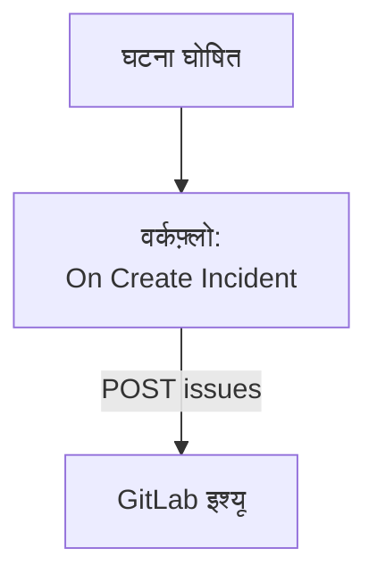

# GitLab

हर OneUptime घटना के लिए एक [GitLab](https://gitlab.com) इश्यू खोलें, ताकि आगे का काम उसी प्रोजेक्ट में ट्रैक हो जिसकी वह सर्विस है। एक वर्कफ़्लो GitLab के [Issues API](https://docs.gitlab.com/api/issues/#new-issue) को कॉल करता है, GitLab.com पर या आपके अपने GitLab पर।

:::cards
- [टोकन सहेजें](#टोकन-सहेजें): GitLab के टोकन को अपने वर्कफ़्लो से बाहर रखें।
- [हर घटना के लिए एक इश्यू खोलें](#हर-घटना-के-लिए-एक-gitlab-इश्यू-खोलें): एक वर्कफ़्लो, दो ब्लॉक।
- [सुझाव](#सुझाव): आपका अपना GitLab, प्रोजेक्ट पाथ और असाइनी।
- [समस्या निवारण](#समस्या-निवारण): जब GitLab कोई अनुरोध अस्वीकार करता है।
:::

> [!NOTE]
> OneUptime AI GitLab रिपॉजिटरी में भी काम करता है: उन्हें एक्सेस टोकन से कोड में जोड़ें, और यह हर सुधार के लिए मर्ज रिक्वेस्ट खोलता है। [रिपॉजिटरी जोड़ना](/docs/ai/ai-agent#रिपॉजिटरी-जोड़ना) देखें।

## यह कैसे काम करता है



वर्कफ़्लो हर नई घटना के लिए एक बार चलता है। उसका **API Post (JSON)** ब्लॉक घटना का शीर्षक और विवरण प्रोजेक्ट के इश्यू में भेजता है, एक एक्सेस टोकन से साइन करके।

## शुरू करने से पहले

- GitLab प्रोजेक्ट का ID। प्रोजेक्ट के ओवरव्यू पेज पर एक्शन मेन्यू चुनें, यानी खड़े तीन बिंदु, फिर **Copy project ID**।
- `api` स्कोप वाला एक GitLab एक्सेस टोकन, किसी ऐसे यूज़र या बॉट के लिए जिसकी प्रोजेक्ट में भूमिका इश्यू बना सकती है: प्रोजेक्ट, ग्रुप या पर्सनल एक्सेस टोकन। इसे प्रोजेक्ट, ग्रुप या अपनी यूज़र सेटिंग्स में **Settings → Access tokens** के नीचे बनाएं।
- OneUptime में वर्कफ़्लो और ग्लोबल वेरिएबल बनाने का अधिकार। OneUptime Cloud पर वर्कफ़्लो के लिए **Growth** प्लान या उससे ऊपर चाहिए।

## टोकन सहेजें

:::steps
1. **वर्कफ़्लो → ग्लोबल वेरिएबल** पर जाएं और **वर्कफ़्लो वेरिएबल बनाएँ** पर क्लिक करें।
2. इसका नाम `GITLAB_TOKEN` रखें और **अगला** पर क्लिक करें।
3. टोकन को **सामग्री** में पेस्ट करें, **रहस्य** चालू करें, और **वर्कफ़्लो वेरिएबल बनाएँ** पर क्लिक करें।
:::

सीक्रेट वेरिएबल रन लॉग में `[REDACTED]` से बदल दिया जाता है, इसलिए टोकन किसी रन में कभी नहीं दिखता।

## हर घटना के लिए एक GitLab इश्यू खोलें

:::steps
### वर्कफ़्लो बनाएं

**वर्कफ़्लो** पर जाएं, **वर्कफ़्लो बनाएं** पर क्लिक करें, फिर **शुरू से बनाएं** पर। इसका नाम `Incidents to GitLab` रखें और **वर्कफ़्लो बनाएं** पर क्लिक करें।

### ट्रिगर जोड़ें

डैश वाले **चुनें कि यह वर्कफ़्लो किससे शुरू हो** ब्लॉक पर क्लिक करें और **On Create Incident** चुनें। ट्रिगर पर क्लिक करें: उसके **Fields to pass on** में पहले से **शीर्षक** है, इसलिए **फ़ील्ड जोड़ें** पर क्लिक करें और **विवरण** और **Incident Number With Prefix** चुनें।

### इश्यू खोलें

**घटक जोड़ें** पर क्लिक करें, एक **API Post (JSON)** ब्लॉक जोड़ें, और ट्रिगर के **Success** बिंदु को उससे जोड़ें। उसका **URL** `https://gitlab.com/api/v4/projects/12345678/issues` पर सेट करें, `12345678` की जगह अपने प्रोजेक्ट के ID के साथ। **और फ़ील्ड** के नीचे उसके **Request Headers** इस पर सेट करें:

```json
{
  "PRIVATE-TOKEN": "{{global.variables.GITLAB_TOKEN}}"
}
```

और उसकी **Request Body** इस पर:

```json
{
  "title": "{{local.components.incident-on-create-1.returnValues.model.title}}",
  "description": "{{local.components.incident-on-create-1.returnValues.model.description}}\n\nOpened by OneUptime for incident {{local.components.incident-on-create-1.returnValues.model.incidentNumberWithPrefix}}.",
  "labels": "incident,oneuptime"
}
```

### टेस्ट करें, फिर चालू करें

**वर्कफ़्लो चलाएं** पर क्लिक करें, **घटना** के नीचे कोई टेस्ट घटना चुनें, और चलाएं। **API Post (JSON)** चरण एक `201` जवाब दिखाता है जिसमें नया इश्यू होता है, उसके `iid` और उसके `web_url` के साथ। फिर **बिल्डर** के ऊपर **सक्षम** चालू करें।
:::

ब्लॉक JSON भेजता है, इसलिए उसे `Content-Type` हेडर की ज़रूरत नहीं। GitLab ऐसे लेबल खुद बना लेता है जो उसने पहले नहीं देखे, इसलिए `incident` और `oneuptime` को पहले से सेट करने की ज़रूरत नहीं। घटना सुलझने पर इश्यू खुला रहता है, क्योंकि आगे का काम आमतौर पर घटना के बाद भी चलता है।

## सुझाव

- **आपका अपना GitLab।** इसके बजाय अनुरोध अपने सर्वर पर भेजें: `https://gitlab.example.com/api/v4/projects/12345678/issues`। निजी नेटवर्क पते वाले सर्वर के लिए ऐसा सेल्फ-होस्टेड OneUptime चाहिए जिसका एडमिनिस्ट्रेटर इसकी अनुमति दे: [आउटबाउंड नेटवर्क एक्सेस](/docs/workflows/configuration#बाहर-जाने-वाली-नेटवर्क-पहुँच) देखें।
- **ID की जगह प्रोजेक्ट का पाथ।** ID की जगह पाथ भी काम करता है, उसके `/` को `%2F` लिखकर: `projects/your-group%2Fyour-project/issues`। URL ठीक वैसा ही भेजा जाता है जैसा लिखा है, इसलिए उसे खुद एनकोड करें।
- **इसे असाइन करें।** बॉडी में `"assignee_ids": [42]` या `"due_date": "2026-12-31"` जोड़ें, या इसे सिर्फ़ प्रोजेक्ट के सदस्यों को दिखाने के लिए `"confidential": true`।
- **सिर्फ़ कुछ घटनाएं।** ट्रिगर और API ब्लॉक के बीच एक **If / Else** ब्लॉक रखें, और इश्यू सिर्फ़ उसकी **Yes** साइड पर खोलें, उदाहरण के लिए किसी एक गंभीरता के लिए।

## समस्या निवारण

जब GitLab अनुरोध अस्वीकार करता है, तो **API Post (JSON)** चरण **Error** पर जाता है। रन में उसका **Response Status** और **Response Body** कारण बताते हैं।

:::details GitLab 401 से जवाब देता है
टोकन गलत है, एक्सपायर हो गया है या रद्द कर दिया गया है। नया टोकन बनाएं, और `GITLAB_TOKEN` की सामग्री बदल दें।
:::

:::details GitLab 403 से जवाब देता है
टोकन के पास `api` स्कोप नहीं है, या प्रोजेक्ट में उसके यूज़र की भूमिका इश्यू नहीं बना सकती। जब कारण स्कोप होता है, तो बॉडी में `insufficient_scope` लिखा होता है।
:::

:::details GitLab 404 से जवाब देता है
**URL** में प्रोजेक्ट का ID गलत है, या टोकन प्रोजेक्ट नहीं देख सकता। जिस प्राइवेट प्रोजेक्ट को टोकन नहीं देख सकता, उसके लिए GitLab 403 नहीं, 404 से जवाब देता है।
:::

:::details GitLab 400 से जवाब देता है
GitLab बॉडी नहीं पढ़ सकता: `title` नहीं है, या किसी फ़ील्ड का प्रकार गलत है। बॉडी उस फ़ील्ड का नाम बताती है।
:::

## अगले कदम

:::cards
- [GitHub](/docs/integrations/github): GitHub के लिए वही वर्कफ़्लो, और GitHub App।
- [वर्कफ़्लो घटक](/docs/workflows/components#api): API ब्लॉक की हर सेटिंग।
- [वर्कफ़्लो रन](/docs/workflows/runs-and-logs): देखें कि हर अनुरोध ने क्या भेजा और क्या वापस पाया।
- [इंटिग्रेशन अवलोकन](/docs/integrations/index): हर इंटिग्रेशन के पीछे के पैटर्न।
:::
