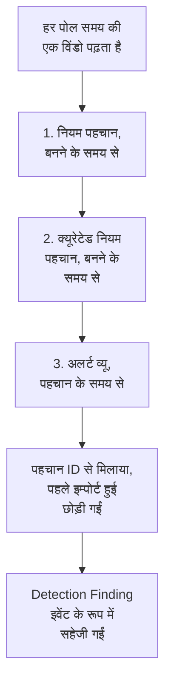

# Google SecOps

[Google SecOps](https://cloud.google.com/security/products/security-operations) (पहले Chronicle) के अलर्ट और पहचान OneUptime के सुरक्षा इवेंट में लाएं। वहां आप उन्हें अपने लॉग, ट्रेस और मेट्रिक्स के साथ खोजते हैं, हर दूसरे स्रोत के साथ उनका सहसंबंध देखते हैं, और ज़रूरी चीज़ों के लिए ऑन-कॉल को पेज करते हैं।

:::cards
- [चुनें कि कैसे कनेक्ट करें](#चुनें-कि-कैसे-कनेक्ट-करें): एक SOAR प्लेबुक वेबहुक, प्रबंधित कनेक्टर, या UDM फ़ॉरवर्डिंग।
- [प्रबंधित कनेक्टर सेट करें](#प्रबंधित-कनेक्टर-सेट-करें): एक सर्विस अकाउंट कुंजी, और कनेक्शन का फ़ॉर्म।
- [कनेक्टर कैसे पोल करता है](#कनेक्टर-कैसे-पोल-करता-है): हर विंडो को तीन तरह से पढ़ना, और उनके बजट।
- [समस्या निवारण](#समस्या-निवारण): Last Error क्या कहता है, और क्या करना है।
- [Google SecOps को सुरक्षा इवेंट भेजें](#google-secops-को-सुरक्षा-इवेंट-भेजें): Google SecOps में OneUptime के डिटेक्शन।
:::

## चुनें कि कैसे कनेक्ट करें

| तरीका | क्या पहुंचता है | कब इस्तेमाल करें |
| --- | --- | --- |
| एक SOAR प्लेबुक वेबहुक | प्लेबुक का भेजा हर अलर्ट, कुछ ही सेकंड में | आप SOAR प्लेबुक चलाते हैं, और बिना पोलिंग के उनके अलर्ट OneUptime में चाहते हैं। |
| प्रबंधित कनेक्टर | अलर्ट, और आपके चुनने पर नियम पहचान, एक अंतराल पर पोल किए हुए | आप चाहते हैं कि OneUptime उन्हें आपके लिए लाए, और SecOps में कुछ कॉन्फ़िगर न करना पड़े। |
| UDM इवेंट फ़ॉरवर्डिंग | पूरी खोज और सहसंबंध के लिए कच्चे UDM इवेंट | आप पहले से UDM इवेंट एक्सपोर्ट करते हैं, और उनमें से हर एक चाहते हैं। |

हर तरीका जो पहुंचता है उसे [OCSF](https://schema.ocsf.io/) में सामान्य करता है, यानी Open Cybersecurity Schema Framework, जिसमें OneUptime हर सुरक्षा इवेंट सहेजता है, इसलिए पहचान नियम और डैशबोर्ड स्रोत चाहे जो हो, एक जैसे काम करते हैं।

## शुरू करने से पहले

- प्रबंधित कनेक्टर के लिए, OneUptime में Project Owner, Project Admin या Security Admin रोल। Security Member और Security Viewer कनेक्शन पढ़ सकते हैं, पर बना नहीं सकते।
- वेबहुक और UDM फ़ॉरवर्डिंग के लिए, एक इन्जेशन कुंजी: **प्रोजेक्ट सेटिंग्स → टेलीमेट्री और APM → इंजेशन कुंजियाँ** खोलें और **इन्जेशन कुंजी बनाएँ** पर क्लिक करें।
- प्रबंधित कनेक्टर के लिए, उस प्रोजेक्ट पर Google Cloud सर्विस अकाउंट बनाने का अधिकार जिससे आपका SecOps इंस्टेंस बंधा है।

## SOAR प्लेबुक से अलर्ट भेजें

Google SecOps SOAR प्लेबुक किसी भी HTTP एंडपॉइंट पर अलर्ट भेज सकते हैं। किसी एक को OneUptime के सुरक्षा इवेंट इन्जेस्ट की ओर करें।

:::steps
### एक HTTP अनुरोध एक्शन जोड़ें

अपने SecOps SOAR प्लेबुक में एक **HTTP request** एक्शन जोड़ें जो नए अलर्ट पर चले।

### इसे OneUptime की ओर करें

इसका **Method** `POST` पर, और **URL** `https://oneuptime.com/security-events/v1/ingest` पर सेट करें, या सेल्फ़-होस्टेड इंस्टॉलेशन पर `https://<your-host>/security-events/v1/ingest`। ये हेडर जोड़ें:

```text
Content-Type: application/json
x-oneuptime-token: <your telemetry ingestion key>
```

अलर्ट का JSON **Body** के रूप में भेजें। कोई पहचान, यानी `collectionElements` के नीचे मेल खाए UDM इवेंट वाला नियम विवरण, अपने आप पहचानी जाती है, Detection Finding इवेंट के रूप में सहेजी जाती है, और उसके मेल खाए इवेंट के यूज़र, होस्ट और IP observable के रूप में रखे जाते हैं।

### जांचें कि अलर्ट पहुंचते हैं

प्लेबुक चलाएं। उसके अलर्ट कुछ ही सेकंड में **उत्पाद → Security Events** में दिखते हैं।
:::

## UDM इवेंट फ़ॉरवर्ड करें

पूरी खोज और सहसंबंध के लिए, खुद UDM इवेंट फ़ॉरवर्ड करें, उदाहरण के लिए किसी BigQuery एक्सपोर्ट पाइपलाइन, किसी Cloud Function, या पहले से चल रहे किसी भी फ़ॉरवर्डर से:

```bash
curl -X POST "https://oneuptime.com/security-events/v1/ingest?format=udm" \
  -H "Content-Type: application/json" \
  -H "x-oneuptime-token: <your telemetry ingestion key>" \
  -d '{
    "events": [
      {
        "metadata": {
          "event_type": "USER_LOGIN",
          "event_timestamp": "2026-08-21T10:00:00Z",
          "vendor_name": "Google",
          "product_name": "Google SecOps"
        },
        "principal": { "user": { "userid": "alice" }, "ip": ["203.0.113.7"] },
        "target": { "hostname": "vpn-gw-01" },
        "security_result": [{ "severity": "HIGH", "action": ["BLOCK"] }]
      }
    ]
  }'
```

- `format` `udm`, `ocsf`, `google-secops-alert` या `generic` हो सकता है। इसे छोड़ दें, तो फ़ॉर्मेट हर इवेंट के लिए अलग से पहचाना जाता है।
- बॉडी एक इवेंट, इवेंट की सूची, या `{ "events": [...] }` हो सकती है।
- `x-oneuptime-service-name` उस टेलीमेट्री सेवा का नाम बताता है जिससे इवेंट जुड़े हैं। इसके बिना, वे पेलोड के उत्पाद के नाम वाली सेवा से जुड़ते हैं।

## प्रबंधित कनेक्टर सेट करें

OneUptime आपके टेनेंट की पहचान और अलर्ट एक अंतराल पर पोल करता है, बिना किसी SOAR कॉन्फ़िगरेशन के। Google SecOps, Security Event Connections का एक प्रदाता है, इसलिए इसे हर दूसरे प्रबंधित कनेक्टर वाले पेज पर और उसी तरह बनाया, टेस्ट किया, पोल किया और जांचा जाता है।

:::steps
### एक सर्विस अकाउंट कुंजी बनाएं

Google Cloud में, उस प्रोजेक्ट पर एक सर्विस अकाउंट बनाएं जिससे आपका SecOps इंस्टेंस बंधा है, और उसे **Chronicle API Viewer** रोल (`roles/chronicle.viewer`) दें। उस रोल में `legacySearchDetections`, `legacySearchCuratedDetections`, `countAllCuratedRuleSetDetections` और `legacyFetchAlertsView` अनुमतियां शामिल हैं, जिनसे कनेक्टर पढ़ता है।

सर्विस अकाउंट के **Keys** टैब पर **JSON** प्रकार की एक कुंजी जोड़ें और उसे डाउनलोड करें। आप पूरी फ़ाइल कनेक्शन में पेस्ट करते हैं। इसका `token_uri` किसी Google होस्ट पर एक `https` URL होना चाहिए, जो Google Cloud से डाउनलोड की गई कुंजी में पहले से होता है।

### क्षेत्र और इंस्टेंस रिसोर्स नाम पाएं

Google SecOps में **SIEM Settings → Profile** खोलें। इंस्टेंस रिसोर्स नाम का रूप `projects/{project}/locations/{location}/instances/{instance}` होता है, जहां instance वाला हिस्सा SecOps इंस्टेंस ID है; कनेक्शन का डिस्प्ले नाम या सर्विस अकाउंट का नाम इसकी जगह नहीं ले सकता। क्षेत्र वह क्षेत्रीय एंडपॉइंट है जो उस लोकेशन को सर्व करता है, और यह इंस्टेंस रिसोर्स नाम के locations हिस्से से मेल खाना चाहिए, वरना सहेजते समय कनेक्शन अस्वीकार हो जाता है।

### कनेक्शन जोड़ें

**उत्पाद → Security Events → Connections** (`/dashboard/{projectId}/security-events/connections`) खोलें, **कनेक्शन जोड़ें** चुनें, **Google SecOps** चुनें, और नीचे की तालिका की सेटिंग्स से फ़ॉर्म भरें।

### सहेजने से पहले टेस्ट करें

सहेजने से पहले **सहेजने से पहले टेस्ट करें** के नीचे **Test these settings** चुनें। टेस्ट कुछ सहेजे बिना फ़ॉर्म के मानों पर चलता है, इसलिए गलत बनी कुंजी, छूटा हुआ रोल या गलत इंस्टेंस कनेक्शन बनने से पहले पकड़ में आ जाता है। संपादन फ़ॉर्म पर वही बटन स्क्रीन पर दिख रहे **क्षेत्र**, **इंस्टेंस रिसोर्स नाम** और **Data to import** को सहेजी गई कुंजी के साथ टेस्ट करता है; खाली छोड़ा गया क्रेडेंशियल फ़ील्ड सहेजी गई कुंजी रखता है। जब टेस्ट की गई कोई भी चीज़ कनेक्शन में सहेजी गई चीज़ से अलग हो, नई डाली गई कुंजी समेत, तो कोई रन-इतिहास पंक्ति दर्ज नहीं होती, क्योंकि कनेक्शन के पास अभी वे सेटिंग्स नहीं हैं।
:::

| सेटिंग | कहां मिलेगी | ज़रूरी |
| --- | --- | --- |
| **क्षेत्र** | Google SecOps का क्षेत्रीय एंडपॉइंट (`us`, `europe`, `asia-southeast1`, ...) जो आपके इंस्टेंस रिसोर्स नाम की लोकेशन से मेल खाता है। कोई डिफ़ॉल्ट नहीं है, ताकि अमेरिका के बाहर का टेनेंट गलती से गलत एंडपॉइंट न सहेज सके। | हां |
| **इंस्टेंस रिसोर्स नाम** | Google SecOps **SIEM Settings → Profile**: `projects/{project}/locations/{location}/instances/{instance}`। | हां |
| **केस बंद होने पर उसके अलर्ट बंद करें** | फ़ॉर्म के आखिरी चरण पर, जब तक आप इसे चालू न करें तब तक बंद। चालू होने पर, केस बंद करने से उसके Google SecOps अलर्ट बंद हो जाते हैं: [केस बंद होने पर उसके अलर्ट बंद करें](#केस-बंद-होने-पर-उसके-अलर्ट-बंद-करें) देखें। | नहीं |
| **सेवा खाता JSON** | Google Cloud, सर्विस अकाउंट का **Keys** टैब। पूरी JSON कुंजी फ़ाइल पेस्ट करें। सिर्फ़ लिखने के लिए: रखे जाने पर एन्क्रिप्टेड, API इसे कभी नहीं लौटाता, पेज पर कभी वापस नहीं दिखती। इसे बदलने के लिए कनेक्शन पर **Update credentials** इस्तेमाल करें। | हां |
| **Data to import** | **अलर्ट** हमेशा इम्पोर्ट होते हैं क्योंकि Google का अलर्ट API उन्हें हमेशा लौटाता है। ऐसे नियम मेल भी इम्पोर्ट करने के लिए जिन्होंने अलर्ट नहीं बनाया, **Detections** चुनें। यह कच्चे UDM इवेंट फ़ॉरवर्ड नहीं करता: उन्हें ऊपर बताए तरीके से खुद फ़ॉरवर्ड करें। | अलर्ट हमेशा |

फ़ॉर्म का पोलिंग चरण एक **नाम**, एक वैकल्पिक **विवरण**, कनेक्शन **सक्षम** है या नहीं, और **Poll Interval (Minutes)** मांगता है: `1` से `1440` तक की पूर्ण संख्या, डिफ़ॉल्ट `5`। उस सीमा से बाहर का कुछ भी सहेजते समय अस्वीकार हो जाता है।

नई पहचान Detection Finding इवेंट के रूप में इम्पोर्ट होती हैं, जो `Google SecOps` टेलीमेट्री सेवा से जुड़े होते हैं।

## कनेक्शन की हेल्थ पढ़ें

कनेक्शन सूची **नाम**, **प्रदाता** (नीचे कनेक्शन के Data to import चुनाव के साथ), **स्थिति** (सक्षम या अक्षम), **Health**, **Interval (Minutes)**, **Last Polled**, **Last Successful Poll** और **Last Event Imported** दिखाती है। जब किसी कनेक्शन में त्रुटि होती है, तो उसके **क्रियाएँ** कॉलम में **कनेक्शन का परीक्षण करें**, **Run now**, **Diagnostics**, **संपादित करें** और **Update credentials** के पास **त्रुटि देखें** दिखता है। सक्षम का मतलब है कि अपने आप पोलिंग कॉन्फ़िगर है। Last Polled एक कोशिश दर्ज करता है; सफल खाली विंडो यह साबित नहीं करती कि कोई खास पहचान इम्पोर्ट हुई।

**Health** **Last poll succeeded** तभी दिखाता है जब कोई इवेंट इम्पोर्ट हो चुका हो। तब तक सफल होता कनेक्शन **Polling, no events imported yet** दिखाता है, और इसी स्थिति की जांच कनेक्शन टेस्ट से करनी चाहिए। बाकी स्थितियां हैं **No records returned**, **Partial import**, **Catching up**, **Last poll failed**, **Poll overdue**, **Schedule paused** और **पहले पोल की प्रतीक्षा**; किसी स्थिति का मतलब जानने के लिए उस पर होवर करें।

> [!NOTE]
> कनेक्टर Chronicle के `v1alpha` लेगेसी पहचान और अलर्ट API इस्तेमाल करता है, जिन्हें Google प्री-GA के रूप में देता है। जब कोई पोल विफल होता है, तो कनेक्शन का **पिछली त्रुटि** फ़ील्ड पूरा त्रुटि संदेश रखता है, क्रेडेंशियल छिपाकर, एक ऐसे प्रीफ़िक्स के पीछे जो विफल हुए चरण का नाम बताता है, उस मामले समेत जहां Chronicle `200` लौटाता है और अस्वीकृति बॉडी के अंदर रखता है। संदेश पढ़ने के लिए कनेक्शन के **क्रियाएँ** कॉलम में **त्रुटि देखें** चुनें, फिर सपोर्ट के लिए उसे कॉपी करने को डायलॉग में **त्रुटि कॉपी करें**।

## कनेक्टर कैसे पोल करता है



हर मिनट एक बैकग्राउंड वर्कर हर उस सक्षम कनेक्शन के लिए पोल कतार में डालता है जिसका अंतराल पिछले पोल के बाद बीत चुका है। हर पोल कनेक्शन के इतिहास में एक रन है, जिसे एक वर्कर चलाता है। यह समय की एक विंडो को तीन तरह से पढ़ता है और नतीजों को पहचान ID से मिलाता है, इसलिए एक से ज़्यादा पास से लौटा रिकॉर्ड एक बार सहेजा जाता है:

1. **बनने के समय से नियम पहचान।** `ruleId=-` (हर नियम का हर संशोधन) और `listBasis=CREATED_TIME` के साथ `legacy:legacySearchDetections`, `nextPageToken` का पीछा करते हुए जब तक पेज आखिरी न हो।
2. **बनने के समय से क्यूरेटेड नियम पहचान।** `legacy:legacySearchCuratedDetections`, उसी तरह, हर क्यूरेटेड (Google के लिखे) नियम के लिए एक बार। वह एंडपॉइंट एक क्यूरेटेड नियम ID (`ur_...`) लेता है और उसमें "हर नियम" वाइल्डकार्ड नहीं है, इसलिए यह पास पहले विंडो से पहले के हफ़्ते से विंडो के अंत तक `:countAllCuratedRuleSetDetections` कॉल करता है, और हर उस क्यूरेटेड नियम को खोजता है जिसने पहचान बनाई। जो क्यूरेटेड नियम उस हफ़्ते फ़ायर नहीं हुआ, उसके पास इम्पोर्ट करने को कुछ नहीं है। क्यूरेटेड नियमों की पहुंच के बिना वाला टेनेंट इस पास का जवाब `400`, `403` या `404` से देता है; इसे रन पर चेतावनी के रूप में दर्ज किया जाता है, विफलता के रूप में नहीं।
3. **पहचान के समय से अलर्ट व्यू।** `legacy:legacyFetchAlertsView`, जो नियम अलर्ट के साथ-साथ टेलीमेट्री अलर्ट, SOAR अलर्ट और मशीन-इंटेलिजेंस अलर्ट भी कवर करता है। इस एंडपॉइंट में पेजिनेशन नहीं है, इसलिए Google जिस जवाब को सीमित करता है उसे छोटी विंडो में बांटकर फिर से पढ़ा जाता है।

अलर्ट व्यू सिर्फ़ पहचान के समय से फ़िल्टर कर सकता है, और Google अक्सर किसी अलर्ट को उसके पहचान के समय के बहुत बाद पढ़ने लायक बनाता है (इन्जेशन में देरी, शेड्यूल किए नियम, देर से आए डेटा पर दोबारा रन)। इसलिए शेड्यूल किया गया पोल **अपनी विंडो से पहले के 24 घंटों पर अलर्ट व्यू को एक बार और खंगालता है**, सिर्फ़ अलर्ट, जो **Read late alerts by detection time** जांच के रूप में दर्ज होता है। पहले से इम्पोर्ट हुए रिकॉर्ड छोड़ दिए जाते हैं, इसलिए खंगालने में दोहराए गए रिकॉर्ड **Already imported** के नीचे दिखते हैं। यह खंगालना सर्वोत्तम प्रयास है: जब Google इसे सीमित करता है, इसका बजट खत्म हो जाता है या यह विफल होता है, तो रन को एक चेतावनी मिलती है, पर पोल Partial या Failed नहीं होता और कर्सर फिर भी आगे बढ़ता है, क्योंकि जिस दिन तक यह पीछे पहुंचता है उसे पहले के पोल पढ़ चुके हैं।

**बनने के समय** से पोल करना ही पूरा डिज़ाइन है। Google SecOps का नियम शेड्यूल पर चलता है (हर 10 मिनट, हर घंटे, रोज़), और जो पहचान वह बनाता है उसमें `detectionTime` होता है, जो नियम की समय विंडो का अंत या मेल खाए इवेंट का समय है, जबकि `createdTime` वह समय है जब पहचान इंजन ने उसे सच में बनाया। 09:00 पर खत्म होने वाली विंडो के लिए 10:05 पर बनी पहचान का पहचान समय उस कर्सर से पहले का है जो कई पोल पहले 09:00 के पार जा चुका, इसलिए पहचान के समय से पोल करने वाला कनेक्टर उसे कभी नहीं देखता, और न ही देर से आने वाला कोई इवेंट। बनने के समय से पढ़ने पर हर पोल पूछता है "मैंने पिछली बार देखने के बाद Google ने क्या बनाया", और यही वह सवाल है जिसका जवाब है। हर रन अपना क्रिएशन लैग दर्ज करता है, यानी लाए गए कितने रिकॉर्ड अपने पहचान समय के बाद एक पोल अंतराल (और एक मिनट) से ज़्यादा देर से बने, और सबसे बड़ा अंतर, इसलिए इसका असर Diagnostics में दिखता है।

नए कनेक्शन का पहला पोल बनने के समय से **24 घंटे** पीछे देखता है। उसके बाद हर पोल कनेक्शन के सहेजे कर्सर से **1 मिनट** के ओवरलैप के साथ फिर शुरू होता है; विंडो की सीमा पर बना रिकॉर्ड दोनों पोल पढ़ते हैं और वह एक बार सहेजा जाता है, क्योंकि पोल उसी स्रोत पहचानकर्ता के साथ पहले से सहेजे इवेंट छोड़ देते हैं। हर शेड्यूल किया गया पोल कर्सर से आगे ज़्यादा से ज़्यादा **24 घंटे** पढ़ता है, इसलिए पुराने सहेजे कर्सर वाला कनेक्शन बीच की पहचान छोड़ने के बजाय लगातार 24 घंटे की विंडो में बराबर आता है (Health **Catching up** दिखाता है)। पहली 24 घंटे की विंडो से पहले बने रिकॉर्ड के लिए Diagnostics में **Import this time range** इस्तेमाल करें।

### जब किसी विंडो में एक पोल की क्षमता से ज़्यादा हो

कनेक्टर हर पोल को तय बजट देता है: नियम पहचान पास के पास **20** खोज पेज हैं, क्यूरेटेड पास के पास **200** तक अनुरोध (गिनती, और पिछले हफ़्ते फ़ायर हुए हर क्यूरेटेड नियम के लिए कम से कम एक पेज, सबसे व्यस्त नियम पहले), अलर्ट व्यू और उसकी देर-से-आए-अलर्ट वाली खंगाल **16** अनुरोध साझा करते हैं, और पूरी रीड **4 मिनट** बाद रुक जाती है। उस समय का 60% खर्च हो जाने पर क्यूरेटेड पास कोई और क्यूरेटेड नियम शुरू नहीं करता, ताकि अलर्ट व्यू फिर भी चले। जब कोई पोल हर सक्रिय क्यूरेटेड नियम नहीं खोज पाता, तो वह कर्सर रोकने के बजाय एक चेतावनी दर्ज करता है जो बताती है कि कितने नहीं खोजे गए, क्योंकि छोटी विंडो में भी उन सभी नियमों को खोजना ही होगा। जिस पास को कोई बजट बीच में रोक देता है, उसे बजट का नाम लेने वाली चेतावनी जांच के रूप में दर्ज किया जाता है (उदाहरण के लिए `Read rule detections by created time was stopped by the request budget after 20 requests.`), और जिस पास को बजट ने शुरू ही नहीं होने दिया, वह रन की चेतावनियों में उसी कारण के साथ छोड़ी गई जांच होती है, कभी सफलता नहीं। इससे ज़्यादा पहचान वाली विंडो एक पोल में नहीं पढ़ी जा सकती, और पोलिंग कभी एक ही विंडो हमेशा दोबारा नहीं पढ़ती:

1. **छोटा करें।** Google के खोज एंडपॉइंट सबसे नई पहचान पहले लौटाते हैं, इसलिए जल्दी रुके पोल के पास फिर शुरू करने का कोई बिंदु नहीं होता। पोल **Partial** दर्ज होता है, कर्सर जहां था वहीं रहता है, और अगला पोल उसी शुरुआती बिंदु से आधी लंबाई की विंडो पढ़ता है, इस चेतावनी के साथ `This window holds more records than one poll can read; the next poll reads a {n} minute window from the same starting point.` विंडो के समा जाने तक आधा करना एक मिनट तक जारी रहता है।
2. **वापस बढ़ाएं।** हर पूरा पोल अगली विंडो को दोगुना करता है, 24 घंटे की अधिकतम सीमा तक, इसलिए कोई बर्स्ट हमेशा के लिए धीमे कनेक्शन के बजाय कुछ छोटे पोल की कीमत लेता है।
3. **एक मिनट से आगे बढ़ें।** अगर एक मिनट में भी एक पोल की क्षमता से ज़्यादा पहचान हों, तो पोलिंग कर्सर को उस मिनट से आगे ले जाती है ताकि नई पहचान आती रहें। रन **Partial** होता है और **पिछली त्रुटि** की शुरुआत में यही टेक्स्ट होता है: `More records were created in the one minute from {start} to {end} than one poll can read. Polling moved past this minute so newer records keep arriving; use Import this time range in Diagnostics on this minute to recover what one run can read.` एक रन जितना पढ़ सकता है उतना वापस पाने के लिए **Diagnostics** खोलें, उस मिनट को कवर करने वाली कस्टम सीमा चुनें (सीमा के इनपुट आपके स्थानीय समय में हैं; संदेश UTC में है) और **Import this time range** चलाएं; एक इम्पोर्ट की प्रति-रन सीमाएं पोल जैसी ही हैं। पहले से इम्पोर्ट हुई पहचान छोड़ दी जाती हैं।

Partial पोल अपनी चेतावनियां भी **पिछली त्रुटि** में रखता है, जहां वे तब तक रहती हैं जब तक कोई पूरा पोल उन्हें साफ़ न कर दे। जो पोल पूरी तरह विफल होता है (कोई त्रुटि, न कि बहुत ज़्यादा रिकॉर्ड), वह अपना कर्सर और विंडो लंबाई रखता है और अगले टिक पर फिर से आज़माया जाता है। एकमात्र अपवाद वह अनुरोध है जिसका समय खत्म हो गया: अगला पोल उसी शुरुआती बिंदु से आधी लंबाई की विंडो पढ़ता है (`The source did not answer in time for this window; the next poll reads a {n} minute window from the same starting point.`), क्योंकि वरना समय पर जवाब के लिए बहुत भारी विंडो हर दोबारा कोशिश में टाइम आउट होगी। पोल अंतराल छोटा करने से इनमें से कुछ नहीं बदलता: विंडो कर्सर और पिछले पोल के नतीजे से तय होती है, इस बात से नहीं कि पोल कितनी बार चलते हैं।

## कनेक्शन का परीक्षण करें

**कनेक्शन का परीक्षण करें**, कनेक्शन की पंक्ति पर या **Diagnostics** में, API प्रोसेस में सिंक्रोनस रूप से चलता है। इसे बैकग्राउंड वर्कर की ज़रूरत नहीं, और ठीक इसी वजह से यह बता सकता है कि कोई वर्कर नहीं चल रहा। चेकलिस्ट:

1. **कॉन्फ़िगरेशन**: हर फ़ील्ड मौजूद है और सही रूप में है: इंस्टेंस की लोकेशन से मेल खाता एक समर्थित **क्षेत्र**, सही आकार का **इंस्टेंस रिसोर्स नाम**, और `client_email`, पढ़ने लायक `private_key` और Google `token_uri` वाली एक **सेवा खाता JSON** कुंजी। इसके विफल होने पर किसी से संपर्क नहीं किया जाता।
2. **Authenticate with Google**: Chronicle से संपर्क से पहले, Google के OAuth एंडपॉइंट पर कुंजी के बदले एक्सेस टोकन लिया जाता है।
3. **Read rule detections**, **Read curated rule detections** और **Read the alerts view**: पिछले 24 घंटों पर हर पास की एक-रिकॉर्ड जांच। क्यूरेटेड जांच पिछले 7 दिनों की क्यूरेटेड नियम गिनतियां पढ़ती है और सबसे ज़्यादा पहचान वाले क्यूरेटेड नियम को जांचती है; अगर उस हफ़्ते कोई क्यूरेटेड नियम फ़ायर नहीं हुआ, तो यह बिना कुछ जांचे पास हो जाती है। `400`, `403` या `404` से जवाब पाई क्यूरेटेड रीड एक चेतावनी है, क्योंकि हो सकता है टेनेंट के पास क्यूरेटेड नियमों की पहुंच ही न हो।
4. **Detections available to import**: पिछले 24 घंटों और पिछले 7 दिनों में, सहेजे गए **Data to import** चुनाव के साथ और दूसरे चुनाव के साथ (सिर्फ़ अलर्ट, या अलर्ट और **Detections**), Google के पास क्या है: हर सीमा के लिए अलर्ट व्यू की मेल गिनती और बनने-के-समय का एक खोज पेज, एक संख्या या `1000+` के रूप में बताया गया। जब सहेजे गए चुनाव में कुछ न हो पर दूसरे में हो, तो जांच चेतावनी देती है: आपके नियम पहचान बनाते हैं पर उन पर अलर्टिंग सक्षम नहीं है। कनेक्शन संपादित करें और **Data to import** के नीचे **Detections** चुनें, या Google SecOps में नियमों पर अलर्टिंग सक्षम करें।
5. **Background workers**, **Poll scheduler** और **Security event storage**: क्या कोई प्रोसेस OneUptime की Worker कतार ले रहा है, क्या मिनट-दर-मिनट चलने वाला पोल जॉब पंजीकृत है, और क्या सुरक्षा इवेंट स्टोर वही डुप्लिकेट लुकअप जवाब देता है जो पोलिंग हर इन्सर्ट से पहले चलाती है, ताकि खराब एनालिटिक्स डेटाबेस एक घंटे बाद पोल त्रुटि बनने के बजाय यहीं नाम के साथ विफल हो।
6. **Scheduled polling** (सिर्फ़ सहेजे गए कनेक्शन): क्या पोलिंग सक्षम है, क्या कोई कतार में डाला गया रन वर्कर के इंतज़ार में अटका है, और क्या कनेक्शन शेड्यूल के मुताबिक पोल हो रहा है।

टेस्ट के हर अनुरोध की समय सीमा 20 सेकंड है। टेस्ट पोलिंग कर्सर और इवेंट स्टोर को नहीं छूते। अपनी सहेजी सेटिंग्स से टेस्ट किए गए सहेजे कनेक्शन को test प्रकार की एक रन-इतिहास पंक्ति मिलती है, और पंक्ति का विवरण वही चेकलिस्ट दिखाता है।

## मांग पर प्रीव्यू, रन और इम्पोर्ट

हाल के रन देखने और कनेक्टर चलाने के लिए किसी कनेक्शन पर **Diagnostics** खोलें। Project Owner, Project Admin और Security Admin ऑपरेशन शुरू कर सकते हैं। Security Member और Security Viewer इतिहास पढ़ सकते हैं।

- **Run now** सामान्य कर्सर और इन्जेशन पाथ से तुरंत एक पोल कतार में डालता है, तब भी जब शेड्यूल की गई पोलिंग अक्षम हो। वर्कर के अनुरोध चलाते समय कतार में और चल रही स्थितियां दिखती रहती हैं। अगर कोई रन कतार में ही रहे, तो जांचें कि वर्कर Worker कतार प्रोसेस कर रहे हैं; कनेक्शन टेस्ट की **Background workers** जांच बताती है कि कोई प्रोसेस कर रहा है या नहीं।
- **Preview detections** इम्पोर्ट किए या कर्सर बदले बिना चुनी हुई समय सीमा पढ़ता है। पिछला एक घंटा, 24 घंटे, 7 दिन, या 7 दिन तक की कस्टम सीमा इस्तेमाल करें। सीमा SecOps अलर्ट व्यू से मेल खाती है, जो पहचान के समय से पढ़ता है, और दोनों खोज पास उसमें बनी पहचान के साथ-साथ वे पहचान भी पढ़ते हैं जिनका पहचान समय उसमें आता है, इसलिए कल का प्रीव्यू पुराने इवेंट के बारे में कल बनी पहचान भी दिखाता है। प्रीव्यू पहचान समय और बनने का समय अलग-अलग दिखाता है। नतीजे कनेक्शन के सहेजे गए **Data to import** चुनाव को दर्शाते हैं।
- **Import this time range** आपकी पुष्टि के बाद चुनी हुई सीमा इम्पोर्ट करता है, पोलिंग कर्सर हिलाए बिना। ऊपर बताए अनुसार, पोलिंग जिस मिनट से आगे बढ़ गई उसे वापस पाने का तरीका भी यही है। पहले सीमा का प्रीव्यू करें। दोहराए गए पोल और इम्पोर्ट प्रोजेक्ट में उसी स्रोत पहचानकर्ता के साथ पहले से सहेजे इवेंट छोड़ देते हैं। इम्पोर्ट शेड्यूल की गई पोलिंग की तरह ही कॉन्फ़िगर किए गए पहचान नियम और मॉनिटर ट्रिगर कर सकते हैं।

हर रन का विवरण **Requested window (UTC)**, कनेक्शन का **Data to import** चुनाव और पांच गिनतियां दिखाता है:

| गिनती | यह क्या गिनती है |
| --- | --- |
| **Returned by Google SecOps** | तीनों पास में Google के लौटाए रिकॉर्ड, ID से मिलाने के बाद। |
| **Imported into OneUptime** | इवेंट स्टोर में लिखी गई पंक्तियां। |
| **Already imported** | वे रिकॉर्ड जो इसलिए छोड़े गए क्योंकि उसी स्रोत पहचानकर्ता वाला रिकॉर्ड इस प्रोजेक्ट में पहले से सहेजा है; 1 मिनट का ओवरलैप और दोबारा रन इसे सामान्य बनाते हैं। |
| **Rejected** | लौटाए गए ऑब्जेक्ट जो Google SecOps पहचान नहीं हैं। वे गिने जाते हैं और उन पर चेतावनी दी जाती है, कभी दोबारा कोशिश नहीं होती, और वे कर्सर नहीं रोकते। |
| **विफल** | वे रिकॉर्ड जिन्हें सामान्य नहीं किया जा सका। पोल उन्हें छोटी विंडो में फिर से आज़माता है। |

**Provider details** **Time basis read**, **Returned by each pass** रिकॉर्ड (नियम पहचान, क्यूरेटेड नियम पहचान और अलर्ट व्यू) और **Creation lag** जोड़ते हैं। उसके बाद जांचें, हर पास के लिए एक, चेतावनियां और पहचान के नमूने आते हैं। शेड्यूल किए गए पोल का विवरण **Window read by this poll** और **Next scheduled poll reads** भी दिखाता है, और Partial पोल बताता है कि उसने अपना शुरुआती बिंदु रखा और अगली विंडो छोटी की, या जिस मिनट का नाम लेता है उससे आगे बढ़ गया। **सफलता**, **No records returned**, **Partial** और **विफल** अलग-अलग नतीजे हैं।

किसी रन पर **View events in this time range** इस्तेमाल करें ताकि उसकी लौटाई पहचान की इवेंट-समय सीमा खुले। वरना आज बनी, पर कल के पहचान समय वाली पहचान, हाल-के-इवेंट वाले फ़िल्टर में छिप सकती है। बाद का पूरा पोल Last Error साफ़ कर दे, तब भी रन इतिहास विफलताएं बचाकर रखता है। सपोर्ट से संपर्क करते समय **Copy diagnostics** इस्तेमाल करें; सर्विस अकाउंट क्रेडेंशियल और टोकन कभी शामिल नहीं होते।

## मुझे इवेंट क्यों नहीं दिख रहे?

इन्हें क्रम से जांचें। **Diagnostics** में या **कनेक्शन का परीक्षण करें** से, हर एक को अगले से अलग पहचाना जा सकता है।

1. **Data to import।** डिफ़ॉल्ट रूप से सिर्फ़ **अलर्ट** इम्पोर्ट होते हैं, और कोई नियम पहचान तभी अलर्ट होती है जब Google SecOps में उस नियम पर अलर्टिंग सक्षम हो। जिस टेनेंट के नियम बिना अलर्टिंग के पहचान बनाते हैं, उसकी पोलिंग ईमानदारी से हमेशा खाली रहती है। **कनेक्शन का परीक्षण करें** चलाएं: **Detections available to import** जांच **Detections** के साथ और उसके बिना गिनती करती है और बताती है जब उसे चुनने से रिकॉर्ड जुड़ेंगे। कनेक्शन संपादित करें और **Data to import** के नीचे **Detections** चुनें, या नियमों पर अलर्टिंग सक्षम करें।
2. **नियम चलने की आवृत्ति और पहचान की देरी।** पहचान तब बनती है जब नियम चलता है, जो उन इवेंट के एक घंटे या एक दिन बाद तक हो सकता है जिनका वह वर्णन करती है। कनेक्टर बनने के समय से पोल करता है, इसलिए पहचान Google के उन्हें बनाने के बाद के पहले पोल पर आती हैं, उनके पहचान समय पर नहीं। जो नियम आपने अभी सक्षम किया उसने अभी कुछ नहीं बनाया, और शांत टेनेंट के पास बनाने को कुछ नहीं होता। उपलब्धता जांच बताती है कि पिछले 24 घंटों और 7 दिनों में कितनी पहचान बनीं; **Detections** के साथ और उसके बिना शून्य का मतलब है कि Google के पास अभी OneUptime के इम्पोर्ट करने को कुछ नहीं है।
3. **पिछले रन की गिनतियां पढ़ें।** Diagnostics में, **Returned by Google SecOps** के साथ शून्य **Imported into OneUptime** और मेल खाती **Already imported** गिनती का मतलब है कि कनेक्टर डिज़ाइन के मुताबिक काम कर रहा है: वे पहचान पहले के किसी पोल ने इम्पोर्ट कर लीं। **Rejected** रिकॉर्ड वे ऑब्जेक्ट हैं जो Google ने लौटाए पर जो पहचान हैं ही नहीं।
4. **क्या कुछ पोल हो भी रहा है?** Last Polled का `Never` दिखाना और Last Error का खाली होना बताता है कि इस कनेक्शन का कोई पोल पूरा नहीं हुआ। कनेक्शन टेस्ट **Background workers** (Worker कतार लेने वाले प्रोसेस), **Poll scheduler** (मिनट-दर-मिनट शेड्यूलर पंजीकरण) और **Scheduled polling** (इस कनेक्शन का अपना शेड्यूल, जिसमें बकाया पोल या कतार में अटका रन शामिल है) बताता है। इसकी वजह बनने वाली डिप्लॉयमेंट सेटिंग्स के लिए नीचे समस्या निवारण की एंट्री देखें।
5. **सही जगह देखें।** इवेंट अपने पहचान समय के तहत सहेजे जाते हैं, जो उनके बनने और इम्पोर्ट होने से घंटों या दिनों पहले हो सकता है, इसलिए सुरक्षा इवेंट में "पिछला एक घंटा" फ़िल्टर एक मिनट पहले इम्पोर्ट हुई, कल के बारे में पहचान छिपा देता है। Diagnostics में किसी रन पर **View events in this time range** इस्तेमाल करें: यह उस रन की लौटाई पहचान की इवेंट-समय सीमा खोलता है।

## गंभीरता कैसे तय होती है

Google SecOps किसी पहचान की गंभीरता इस पर निर्भर करते हुए अलग-अलग जगहों पर रखता है कि नियम किसने लिखा, और OneUptime उन्हें इस क्रम में पढ़ता है, पहली वह इस्तेमाल करते हुए जो कोई गंभीरता बताती है:

1. **Google की अपनी गंभीरता** (`detection[].severity`)। Google इसे क्यूरेटेड नियमों पर सेट करता है, जैसे Applied Threat Intelligence और क्यूरेटेड नियम सेट।
2. **अलर्ट की गंभीरता** (Collection का `severity`), SOAR अलर्ट और वेबहुक बॉडी के लिए।
3. **नियम की `meta` गंभीरता।** कस्टम YARA-L नियम के लिए, Google `detection[].severity` खाली छोड़ता है और नियम का `meta` सेक्शन `ruleLabels` के रूप में लौटाता है। OneUptime `severity` लेबल पढ़ता है, जो वह मान है जो Google SecOps नियम डैशबोर्ड दिखाता है। Info, Informational, Low, Medium, High और Critical पहचाने जाते हैं, किसी भी अक्षर केस में।
4. **नियम का `$risk_score` आउटकम**, अगर नियम कोई गंभीरता सेट नहीं करता, [Google की सुझाई सीमाओं](https://docs.cloud.google.com/chronicle/docs/yara-l/outcome-syntax) से ग्रेड किया गया: 90–100 Critical, 80–89 High, 50–79 Medium, 20–49 Low, 1–19 Informational। OneUptime सिर्फ़ वही स्कोर इस्तेमाल करता है जो नियम खुद सेट करता है। वह `riskScore` अनदेखा करता है जो Google बिना स्कोर वाले नियमों के लिए भरता है (अलर्टिंग नियमों के लिए 40, बाकी के लिए 15), क्योंकि वह डिफ़ॉल्ट इस बारे में कुछ नहीं बताता कि पहचान कितनी गंभीर है।

जिस पहचान को इनमें से कोई ग्रेड नहीं करता, वह Unknown दिखती है। किसी कस्टम नियम को ग्रेड करने के लिए, Google SecOps में उसके `meta` सेक्शन में एक गंभीरता जोड़ें, उदाहरण के लिए `severity = "High"`, या उसके `outcome` सेक्शन में `$risk_score` सेट करें। उसके बाद नियम जो पहचान बनाता है, वे उसी गंभीरता के साथ इम्पोर्ट होती हैं।

## केस बंद होने पर उसके अलर्ट बंद करें

**केस बंद होने पर उसके अलर्ट बंद करें** चालू होने पर, किसी [सुरक्षा केस](/docs/telemetry/security-cases#केस-बंद-करें) को बंद करने से वे Google SecOps अलर्ट बंद हो जाते हैं जिनसे वह आया था। हर अलर्ट केस के निर्णय के साथ बंद चिह्नित होता है, True Positive दुर्भावनापूर्ण के रूप में और False Positive या Benign Positive दुर्भावनापूर्ण नहीं के रूप में, साथ में केस का बंद करने वाला नोट और केस पर वापस जाने का लिंक। केस की टाइमलाइन बताती है कि कितने अलर्ट बंद हुए।

- सर्विस अकाउंट को `chronicle.legacies.legacyUpdateAlert` चाहिए, जो `roles/chronicle.editor` भूमिका में है। `roles/chronicle.viewer` भूमिका अलर्ट पढ़ती है लेकिन उन्हें बंद नहीं कर सकती, और तब केस पर `403` दिखता है।
- जो अलर्ट Google SecOps में अब नहीं है, उसे छोड़ दिया जाता है। जब Google SecOps तक नहीं पहुँचा जा सकता, तो OneUptime लगभग एक घंटे तक फिर कोशिश करता है, फिर केस पर लिखता है कि वह क्या बंद नहीं कर सका।

## अपने दूसरे इवेंट में इसके संकेतकों पर नज़र रखें

जिस [थ्रेट इंटेल फ़ीड](/docs/telemetry/threat-intelligence#google-secops-कैसे-पढ़ा-जाता-है) का **स्रोत** **Google SecOps** है, वह इस कनेक्शन से वे संकेतक पढ़ती है जो Google SecOps की थ्रेट इंटेलिजेंस ने उसके इवेंट में पाए, और आपके प्रोजेक्ट के बाकी इवेंट में उन पर नज़र रखती है: वे साइन-इन, नेटवर्क फ़्लो और एंडपॉइंट इवेंट जो Google SecOps ने कभी नहीं देखे।

## Google SecOps को सुरक्षा इवेंट भेजें

OneUptime जो पाता है उसे Google SecOps को भी भेज सकता है, ताकि आपकी टीम जिस SIEM में काम करती है वह OneUptime के डिटेक्शन को अपने डिटेक्शन के साथ देखे। हर सुरक्षा इवेंट उसकी गंभीरता, उसके MITRE ATT&CK टैग और उसे खोजने वाले नियम के साथ एक UDM इवेंट के रूप में इम्पोर्ट होता है:

| सुरक्षा इवेंट | UDM इवेंट टाइप |
| --- | --- |
| साइन-इन | `USER_LOGIN` |
| प्रोसेस का शुरू होना, खुलना, उसमें इंजेक्शन होना या उसका बंद होना | `PROCESS_LAUNCH`, `PROCESS_OPEN`, `PROCESS_INJECTION`, `PROCESS_TERMINATION` |
| अपने अधिकार बढ़ाने वाली प्रोसेस | `PROCESS_PRIVILEGE_ESCALATION` |
| प्रोसेस की कोई और गतिविधि | `PROCESS_UNCATEGORIZED` |
| नेटवर्क कनेक्शन | `NETWORK_CONNECTION` |
| बाकी सब, या ऐसा इवेंट जिसमें उसके टाइप के लिए ज़रूरी फ़ील्ड नहीं हैं | `GENERIC_EVENT` |

प्रोसेस इवेंट में `principal` वह प्रोसेस है जिसने काम किया और `target` वह प्रोसेस जिस पर काम हुआ: लॉन्च में, पैरेंट प्रोसेस और वह प्रोसेस जिसे उसने शुरू किया।

:::steps
### ऐसी की बनाएँ जो इवेंट इम्पोर्ट कर सके

Google Cloud में उस प्रोजेक्ट पर एक सर्विस अकाउंट बनाएँ जिससे आपका SecOps इंस्टेंस जुड़ा है, और उसे `chronicle.events.import` अनुमति वाली भूमिका दें, जैसे **Chronicle API Editor** (`roles/chronicle.editor`)। उसके **Keys** टैब पर **JSON** प्रकार की की जोड़ें और उसे डाउनलोड करें।

### गंतव्य जोड़ें

**उत्पाद → Security Events → Connections** खोलें। **अपने SIEM में भेजें** के नीचे **गंतव्य जोड़ें** पर क्लिक करें, **SIEM** में Google SecOps चुनें और **अगला** पर क्लिक करें। **क्षेत्र** चुनें, ऊपर के कनेक्टर की तरह **इंस्टेंस रिसोर्स नाम** भरें, और की को **सेवा खाता JSON** में चिपकाएँ।

### परीक्षण इवेंट भेजें

**टेस्ट इवेंट भेजें** पर क्लिक करें। उत्पाद `OneUptime Security Events` का एक `GENERIC_EVENT` फ़ॉर्म की सेटिंग के साथ Google SecOps को जाता है, और कुछ भी सहेजा नहीं जाता। यह कुछ ही मिनटों में Google SecOps में दिखता है।

### चुनें कि क्या भेजना है

**क्या भेजना है** के नीचे **सिर्फ़ डिटेक्शन** रहने दें, यानी जो आपके नियमों और थ्रेट इंटेलिजेंस ने पाया और आपके कनेक्ट किए गए उत्पादों ने जो अलर्ट उठाए, या **सभी सुरक्षा इवेंट** चुनें। **भेजना शुरू करें** पर क्लिक करें।
:::

- गंतव्य उसे सहेजे जाने के क्षण से आने वाले इवेंट भेजता है, प्रोजेक्ट का इतिहास कभी नहीं, और नए इवेंट हर मिनट भेजता है।
- OneUptime ने Google SecOps से जो अलर्ट इम्पोर्ट किए, वे उसे कभी वापस नहीं भेजे जाते।
- जब Google SecOps जवाब नहीं देता या किसी बैच को अस्वीकार करता है, तो गंतव्य अपनी जगह बनाए रखता है और अगली बार चलने पर फिर कोशिश करता है। उसकी **स्थिति** **विफल** दिखाती है, और **त्रुटि देखें** बताता है कि Google SecOps ने क्या जवाब दिया।

## समस्या निवारण

:::details कस्टम-नियम पहचान की गंभीरता Unknown दिखती है जबकि क्यूरेटेड वाली ग्रेड होती हैं
नियम कोई गंभीरता सेट नहीं करता। नियम के `meta` सेक्शन में `severity = "Low"`, `"Medium"`, `"High"` या `"Critical"` जोड़ें, या उसके `outcome` सेक्शन में `$risk_score` सेट करें (देखें [गंभीरता कैसे तय होती है](#गंभीरता-कैसे-तय-होती-है))। इस बदलाव से पहले के रिलीज़ कस्टम नियम की `meta` गंभीरता को भी अनदेखा करते थे; अपग्रेड करने पर, हर पहचान के साथ सहेजे गए नियम लेबल से, उन रिलीज़ की इम्पोर्ट की गई पहचान फिर से ग्रेड होती हैं।
:::

:::details अलर्ट Google SecOps में दिखते हैं पर OneUptime में कभी नहीं
ऐसे रिलीज़ पर अपग्रेड करें जो क्यूरेटेड नियम पहचान एक-एक क्यूरेटेड नियम करके पढ़ता है और देर से आए अलर्ट के लिए अलर्ट व्यू खंगालता है। पहले के रिलीज़ `legacySearchCuratedDetections` को `ruleId=-` भेजते थे, जिसमें कोई वाइल्डकार्ड नहीं है, इसलिए Google हर क्यूरेटेड खोज का जवाब खाली सफलता से देता था; और वे अलर्ट व्यू सिर्फ़ पोल के अपने कुछ मिनट के पहचान समय पर पढ़ते थे, इसलिए जिस अलर्ट को Google ने बाद में पढ़ने लायक बनाया, वह कभी नहीं दिखा। दोनों एक स्वस्थ, शांत कनेक्शन जैसे दिखते थे। अपग्रेड करने के बाद, पिछले 7 दिन इम्पोर्ट करने के लिए Diagnostics में **Import this time range** इस्तेमाल करें।
:::

:::details Google शून्य रिकॉर्ड लौटाता है
Diagnostics में सटीक समय विंडो, समय आधार और सहेजा गया **Data to import** चुनाव जांचें, और **Detections** के साथ और उसके बिना उपलब्धता गिनतियां पढ़ने के लिए कनेक्शन टेस्ट चलाएं। बिना अलर्टिंग वाले नियम मेल के लिए **Detections** चेकबॉक्स चाहिए। ऐसी अवधि का प्रीव्यू करें जो उसका पहचान समय और बनने का समय, दोनों कवर करे। पहला शेड्यूल किया गया पोल बनने के समय से 24 घंटे पीछे देखता है; पुराने रिकॉर्ड के लिए **Import this time range** इस्तेमाल करें।
:::

:::details Health Partial import है
**Diagnostics** में नवीनतम रन खोलें और उसकी चेतावनियां पढ़ें; वही चेतावनियां Last Error में हैं। `This window holds more records than one poll can read; ...` का मतलब है कि पोलिंग उसी शुरुआती बिंदु से अपनी विंडो छोटी कर रही है और कुछ करने की ज़रूरत नहीं: पोल पूरे होने पर विंडो वापस बढ़ती है। `More records were created in the one minute from ...` का मतलब है कि पोलिंग उस मिनट से आगे बढ़ गई; छोड़ी गई पहचान वापस पाने के लिए उसे **Import this time range** से इम्पोर्ट करें। जो चेतावनी कहती है कि कोई पास अनुरोध बजट या पोल समय बजट से रुका, या उसकी वजह से नहीं चला, वह बीच में कटे पास का नाम बताती है। पोल अंतराल छोटा करने से विंडो नहीं बदलती। अकेला खाली Last Error पूरी कवरेज साबित नहीं करता।
:::

:::details Health Poll overdue है
शेड्यूल किए गए पोल समय पर नहीं चल रहे। वर्कर कतार जांचें, और **Background workers** और **Scheduled polling** जांचों के लिए कनेक्शन टेस्ट चलाएं।
:::

:::details स्थिति अक्षम है
शेड्यूल की गई पोलिंग कनेक्शन को छोड़ देती है। अधिकृत यूज़र फिर भी Diagnostics से टेस्ट, प्रीव्यू, **Run now** से पोल, या इम्पोर्ट कर सकते हैं।
:::

:::details Last Polled `Never` है और Last Error खाली है
इस कनेक्शन का कोई पोल पूरा नहीं हुआ। **Diagnostics** खोलें: जब उसके रन इतिहास में कोई पोल न हो, या सिर्फ़ कतार में अटका एक पोल हो, तो बैकग्राउंड वर्कर ने पोल जॉब कभी चलाया ही नहीं, इसलिए Chronicle तक कभी कुछ नहीं पहुंचा। सेल्फ़-होस्टेड डिप्लॉयमेंट में आम कारण ऐप कंटेनर पर `DISABLE_QUEUE_WORKERS=true` है, जबकि कतारें खाली करने के लिए कोई अलग वर्कर डिप्लॉयमेंट नहीं है। या तो `DISABLE_QUEUE_WORKERS=false` सेट करें (`config.example.env` का डिफ़ॉल्ट, जिसके साथ Docker Compose आता है), या समर्पित वर्कर डिप्लॉयमेंट चलाएं (Helm: `worker.enabled: true`, जो डिफ़ॉल्ट रूप से `false` है)। कनेक्शन टेस्ट इसे विफल **Background workers**, **Poll scheduler** या **Scheduled polling** जांच के रूप में बताता है। जो पोल चला पर कनेक्शन तक पहुंचने से पहले रुक गया, वह इसके बजाय उस इतिहास में एक विफल रन है: `Another poll or import for this source is still running in this project` का मतलब है कि इस प्रोजेक्ट में किसी दूसरे Google SecOps पोल या इम्पोर्ट ने स्रोत लॉक पकड़ रखा था, और कनेक्शन अगले टिक पर फिर कतार में डाला जाता है। जो शेड्यूलर पोल को कतार में भी नहीं डाल सका, वह Last Error पर `Scheduler could not queue a poll:` और कारण दर्ज करता है।
:::

:::details Last Error भरा हुआ है
किसी पोल की कोशिश हुई और उसमें कुछ विफल हुआ, कोई पोल अपनी पूरी विंडो नहीं पढ़ सका, या शेड्यूलर पोल को कतार में नहीं डाल सका। विफल पोल के लिए यह फ़ील्ड पूरा त्रुटि संदेश रखता है, क्रेडेंशियल छिपाकर। जब किसी कनेक्शन में त्रुटि हो, तो पूरा संदेश खोलने के लिए उसके **क्रियाएँ** कॉलम में **त्रुटि देखें** चुनें, फिर सपोर्ट के लिए कॉपी करने को डायलॉग में **त्रुटि कॉपी करें**। यह फ़ील्ड अगले पूरे पोल पर साफ़ होता है, जो **त्रुटि देखें** एक्शन भी हटा देता है; रन इतिहास उसे रखता है। पहले प्रीफ़िक्स पढ़ें। `More records were created in the one minute from` से शुरू होने वाला संदेश विफलता नहीं, बल्कि वह छोड़ा गया मिनट है; ऊपर **Health Partial import है** देखें। सिर्फ़ चार प्रीफ़िक्स में HTTP स्टेटस होता है, इसलिए बिना स्टेटस वाला संदेश OneUptime की तरफ़ की गड़बड़ी का सबूत नहीं है:

- `Google token exchange failed (HTTP ...)`: सर्विस अकाउंट क्रेडेंशियल Google के OAuth एंडपॉइंट पर अस्वीकार हुआ, Chronicle से कभी संपर्क होने से पहले। आमतौर पर गलत बनी, रद्द की गई, या गलत प्रोजेक्ट की कुंजी।
- `Google token exchange returned ...`: उसी OAuth एंडपॉइंट ने जवाब दिया, पर कुछ अनुपयोगी के साथ: कोई `access_token` नहीं, या ऐसी बॉडी जो JSON नहीं है। यह भी Chronicle से पहले है, और आमतौर पर खुद कुंजी के बजाय बीच में बैठा कोई प्रॉक्सी या गेटवे।
- `Google SecOps detections search failed (HTTP ...)`: खुद Chronicle ने बनने-के-समय की खोज (`legacySearchDetections` या `legacySearchCuratedDetections`) अस्वीकार की। `403` का आमतौर पर मतलब है कि सर्विस अकाउंट के पास उस प्रोजेक्ट पर **Chronicle API Viewer** रोल नहीं है जिससे इंस्टेंस बंधा है; क्यूरेटेड पास पर `400`, `403` या `404` चेतावनी में बदल दिया जाता है, क्योंकि हो सकता है टेनेंट के पास क्यूरेटेड नियमों की पहुंच ही न हो।
- `Google SecOps detections search returned ...`: Chronicle ने खोज का जवाब `200` से दिया, पर बॉडी पढ़ने लायक पहचान पेज नहीं थी: खाली, JSON नहीं, या ऐसा आकार जिसे पार्सर नहीं पहचानता। इसे शांत विंडो गिनने के बजाय रिपोर्ट किया जाता है, ताकि कर्सर छूटी चीज़ से आगे न बढ़ सके।
- `Google SecOps curated rule detection counts failed (HTTP ...)`: Chronicle ने `countAllCuratedRuleSetDetections` अस्वीकार किया, वह कॉल जो बताती है कि क्यूरेटेड पास किन क्यूरेटेड नियमों को खोजता है। `400`, `403` या `404` क्यूरेटेड खोज वाले कारण से ही चेतावनी में बदल दिया जाता है; बाकी कुछ भी पोल को विफल करता है।
- `Google SecOps curated rule detection counts returned ...`: Chronicle ने क्यूरेटेड नियम गिनतियों का जवाब `200` से दिया, पर बॉडी खाली थी, JSON नहीं थी, या ऐसा आकार था जिसे पार्सर नहीं पहचानता। इसे "कोई क्यूरेटेड नियम फ़ायर नहीं हुआ" पढ़ने के बजाय रिपोर्ट किया जाता है, ताकि क्यूरेटेड पहचान चुपचाप न छूटें।
- `Google SecOps alerts fetch failed (HTTP ...)`: खुद Chronicle ने अलर्ट-व्यू अनुरोध अस्वीकार किया। `403` का आमतौर पर मतलब है कि सर्विस अकाउंट के पास उस प्रोजेक्ट पर **Chronicle API Viewer** रोल नहीं है जिससे इंस्टेंस बंधा है; `404` का आमतौर पर मतलब है कि इंस्टेंस रिसोर्स नाम किसी दूसरे इंस्टेंस की ओर है, या क्षेत्र प्रीफ़िक्स ऐसा नहीं है जिसे Chronicle सर्व करता है।
- `Google SecOps alerts fetch returned ...`: Chronicle ने `200` से जवाब दिया, पर बॉडी पढ़ने लायक detection-alerts स्ट्रीम नहीं थी: खाली, JSON नहीं, या ऐसा आकार जिसे पार्सर नहीं पहचानता। इसे जानबूझकर खाली विंडो गिनने के बजाय रिपोर्ट किया जाता है: न पढ़ी जा सकी बॉडी को "कोई अलर्ट नहीं" मानने से कर्सर छूटी हर चीज़ से आगे बढ़ जाता।
- `Google SecOps alerts query was rejected by Chronicle on an HTTP 200`: Chronicle ने अनुरोध स्वीकार किया, उसे चलाया, और लौटाई बॉडी के अंदर क्वेरी अस्वीकार कर दी (`validSnapshotQuery` या `validBaselineQuery` false, या `queryValidationErrors`)। यह Google की अस्वीकृति है, और इसमें कहीं कोई HTTP स्टेटस नहीं है।
- `timed out after 60 seconds with no response`: क्लाइंट के हार मानने से पहले न Google के OAuth एंडपॉइंट ने जवाब दिया, न Chronicle ने (कनेक्शन टेस्ट हर अनुरोध के लिए 20 सेकंड की समय सीमा इस्तेमाल करता है और उसी संख्या के साथ यही शब्द बताता है)। कुछ वापस नहीं आया, इसलिए संदेश किसी पक्ष को ज़िम्मेदार नहीं ठहराता; टेनेंट के साथ-साथ OneUptime वर्कर का आउटबाउंड ट्रैफ़िक भी जांचें।
- ऊपर के किसी से मेल न खाने वाला संदेश Google से नहीं आया। जो संदेश किसी फ़ील्ड के नाम से शुरू होता है, `Region`, `Instance resource name` या `Service account JSON`, उसका मतलब है कि सहेजी गई सेटिंग्स वैलिडेशन पास नहीं करतीं: कनेक्शन संपादित करें, या **Update credentials** से कुंजी बदलें। पहले के Google SecOps कनेक्टर से आया कनेक्शन, जिसकी सहेजी सेटिंग्स आज के नियम पास नहीं करतीं, संपादित होने तक यहीं आता है। वरना विफलता OneUptime की तरफ़ थी: आमतौर पर पहचान पहुंच गईं और उन्हें टेलीमेट्री स्टोर में लिखना विफल रहा।
:::

:::details Last Error `Unknown name "pageSize": Cannot bind query parameter` दिखाता है
संदेश `Google SecOps alerts fetch failed (HTTP 400)` है, और अलर्ट व्यू पर एक असमर्थित अनुरोध पैरामीटर की पहचान करता है। अपस्ट्रीम **13.0.0** उस एंडपॉइंट पर पहले ही `pageSize` को `alertListOptions.maxReturnedAlerts` से बदल चुका है। अगर यह त्रुटि अब भी दिखे, तो कस्टम बिल्ड और अलग से डिप्लॉय किए वर्कर समेत असल ऐप और वर्कर इमेज जांचें। सर्विस अकाउंट कुंजी बदलने से असमर्थित क्वेरी पैरामीटर ठीक नहीं होता। सफल OAuth टोकन एक्सचेंज क्रेडेंशियल के स्वीकार होने की पुष्टि करता है; अकेली पैरामीटर अस्वीकृति ऑथेंटिकेशन या ऑथराइज़ेशन के बारे में कुछ साबित नहीं करती।
:::

### अलर्ट अनुरोध अब भी `400 INVALID_ARGUMENT` लौटाता है

सफल OAuth टोकन एक्सचेंज पुष्टि करता है कि Google ने सर्विस अकाउंट क्रेडेंशियल स्वीकार किया। यह SecOps इंस्टेंस रिसोर्स नाम या उस इंस्टेंस को पढ़ने की अनुमति की पुष्टि नहीं करता। एक सामान्य `Request contains an invalid argument` जवाब यह नहीं बताता कि कौन सा आर्गुमेंट विफल हुआ।

अपस्ट्रीम **13.0.0** रिलीज़ अलर्ट व्यू पर पहले से `alertListOptions.maxReturnedAlerts` इस्तेमाल करती है। अगर वह वर्शन बताने वाला कोई डिप्लॉयमेंट अब भी वहां `pageSize` भेजता है, तो अलग से डिप्लॉय किए वर्कर और कस्टम बिल्ड समेत हर पोलिंग वर्कर की असल इस्तेमाल हो रही इमेज जांचें।

1. **चल रहे ऐप और वर्कर इमेज के वर्शन** जांचें। लोकल कनेक्टर सोर्स फ़ाइल अपडेट करने या सर्विस अकाउंट JSON दोबारा अपलोड करने से डिप्लॉय किया हुआ कंटेनर अपडेट नहीं होता। कनेक्टर सुधार वाली इमेज हर उस ऐप या समर्पित वर्कर पर डिप्लॉय करें जो पोल जॉब चलाता है। अगर आप अपनी इमेज खुद बनाते हैं, तो सुधरे सोर्स से उसे फिर बनाएं और एक नया, अपरिवर्तनीय टैग डिप्लॉय करें; पुरानी इमेज के साथ पॉड रीस्टार्ट करना काफ़ी नहीं है।
2. अलर्ट-व्यू अनुरोध को [Google API संदर्भ](https://docs.cloud.google.com/chronicle/docs/reference/rest/v1alpha/projects.locations.instances.legacy/legacyFetchAlertsView) से मिलाकर जांचें। यह `timeRange.startTime`, `timeRange.endTime`, `snapshotQuery=` (खाली मान सभी अलर्ट स्थितियां शामिल करता है), `alertListOptions.maxReturnedAlerts`, और सहेजे गए **Data to import** चुनाव से स्पष्ट रूप से सेट किया गया `includeNonAlertingDetections` इस्तेमाल करता है। इसे उस एंडपॉइंट पर `pageSize` या `pageToken` नहीं भेजना चाहिए। बनने-के-समय वाले दोनों पास [`legacySearchDetections`](https://docs.cloud.google.com/chronicle/docs/reference/rest/v1alpha/projects.locations.instances.legacy/legacySearchDetections) और `legacySearchCuratedDetections` इस्तेमाल करते हैं, जहां `ruleId`, `listBasis`, `alertState`, `pageSize` और `pageToken` दस्तावेज़ में दिए पैरामीटर हैं, और उनकी विफलताओं पर इसके बजाय detections-search प्रीफ़िक्स होता है। `legacySearchCuratedDetections` को हमेशा एक क्यूरेटेड नियम ID मिलती है, कभी `-` नहीं। बंद अलर्ट हटाने वाला फ़िल्टर इसकी जगह न लगाएं, क्योंकि उससे पहचान खो जाती हैं।
3. पूरे `projects/{project}/locations/{location}/instances/{instance}` रिसोर्स की तुलना अपने Google SecOps टेनेंट सेटिंग्स के मानों से करें। instance वाला हिस्सा SecOps इंस्टेंस ID होना चाहिए; कनेक्शन का डिस्प्ले नाम या सर्विस अकाउंट का नाम इसकी जगह नहीं ले सकता। पुष्टि करें कि क्षेत्रीय एंडपॉइंट इंस्टेंस की लोकेशन से मेल खाता है।
4. रोलआउट पूरा होने के बाद अगले कॉन्फ़िगर किए पोल अंतराल का इंतज़ार करें। पूरे पोल पर **Last Polled** आगे बढ़ना चाहिए और **पिछली त्रुटि** साफ़ होना चाहिए। अगर विंडो में पहचान हैं, तो उन्हें **उत्पाद → Security Events** के नीचे दिखना चाहिए; शांत विंडो का शून्य इवेंट इन्जेस्ट करना पूरी तरह सही हो सकता है।

अगर वही त्रुटि बनी रहे, तो कनेक्शन के **क्रियाएँ** कॉलम से **त्रुटि देखें** खोलें, डायलॉग में **त्रुटि कॉपी करें** इस्तेमाल करें, और सपोर्ट को वह संदेश, इमेज टैग या डाइजेस्ट, क्षेत्र, और इंस्टेंस रिसोर्स नाम दें। दर्ज संदेश में क्रेडेंशियल छिपाए जाते हैं; सर्विस अकाउंट की प्राइवेट कुंजी, JWT असर्शन या एक्सेस टोकन अलग से न भेजें। अपग्रेड से पहले दर्ज हुई त्रुटियां पहले से कटी हुई हो सकती हैं; बाद का विफल पोल पूरा संदेश दर्ज करता है। विफल पोल दोबारा कोशिश के लिए अपनी विंडो रखता है, और आंशिक पोल अपनी अगली विंडो छोटी करता है या Last Error में बताए किसी एक मिनट से आगे बढ़ जाता है। शेड्यूल की गई कैच-अप हर रन में 24 घंटे तक प्रोसेस करती है।

## पहले के Google SecOps कनेक्टर से अपग्रेड करना

Google SecOps का पहले अपना कनेक्शन कार्ड, API और पोलर था। अब यह Security Event Connections का एक प्रदाता है, और अपग्रेड करने पर मौजूदा कनेक्शन आपके लिए अपने आप चले जाते हैं।

- **कनेक्शन अपने आप चले जाते हैं।** जब अपग्रेड हुआ रिलीज़ अपने डेटा माइग्रेशन चलाता है, तो हर Google SecOps कनेक्शन प्रदाता `google-secops` के साथ Security Event Connections में कॉपी हो जाता है। यह अपनी ID, नाम, **क्षेत्र**, **इंस्टेंस रिसोर्स नाम**, सर्विस अकाउंट कुंजी, **सक्षम** स्थिति, पोल अंतराल, **Data to import** चुनाव, पोलिंग कर्सर, Last Polled, Last Successful Poll, Last Event Imported और Last Error रखता है, इसलिए पोलिंग वहीं से फिर शुरू होती है जहां रुकी थी। कनेक्टर वही `Google` / `Google SecOps` पहचान रखता है जिसके तहत पहले वाला इम्पोर्ट करता था, इसलिए पहले से इम्पोर्ट हुई पहचान दो बार सहेजे जाने के बजाय **Already imported** गिनी जाती हैं।
- **हाल का रन इतिहास भी साथ आता है।** हर कनेक्शन के सबसे हाल के 500 रन **Diagnostics** में उसके रन इतिहास में कॉपी होते हैं। जो रन अभी कतार में था या चल रहा था, उसे `This operation was still in progress when Google SecOps moved to Security Event Connections, so its outcome was not recorded here. Check the imported security events before running it again.` के साथ विफल के रूप में कॉपी किया जाता है।
- **पहले की पंक्तियां मिटाई नहीं जातीं, अक्षम की जाती हैं।** इसलिए रोलिंग डिप्लॉय के दौरान अब भी चल रहा कोई पुराना वर्कर उसी इंस्टेंस को दूसरी बार पोल नहीं कर सकता। पहले वाले कनेक्टर वाली रिलीज़ पर वापस जाने के लिए उन पंक्तियों को फिर से सक्षम करना होता है।
- **जो कनेक्शन नहीं ले जाया जा सकता, वह वहीं रहता है।** जिस कनेक्शन की कोई सहेजी कुंजी नहीं है, या जिसकी कुंजी इस सर्वर के `ENCRYPTION_SECRET` से डिक्रिप्ट नहीं हो सकती, उसे छोड़ दिया जाता है और वर्कर लॉग में उसका नाम आता है; उसे **उत्पाद → Security Events → Connections** के नीचे फिर से जोड़ें। जिसकी सहेजी सेटिंग्स आज का वैलिडेशन पास नहीं करतीं, वह फिर भी ले जाया जाता है, और जब तक आप उसे संपादित न करें, उसके पोल फ़ील्ड का नाम बताने वाले संदेश के साथ विफल होते हैं। जिसे किसी अस्थायी डेटाबेस त्रुटि ने रोका, वह अगले वर्कर स्टार्ट पर माइग्रेशन फिर चलने पर ले जाया जाता है, और पोलिंग उसके कॉपी किए गए कर्सर से फिर शुरू होती है।
- **API रूट बदल गए।** `/google-secops-connection` और `/google-secops-connection-run` रूट, `/google-secops-connection/test` और `/google-secops-connection/:connectionId/run` समेत, प्रदाता `google-secops` के साथ `/security-event-connection` और `/security-event-connection-run` से बदल दिए गए हैं; ऑपरेशन `/security-event-connection/test` और `/security-event-connection/:connectionId/run` हैं। पहले के टॉप-लेवल फ़ील्ड `config` और `secrets` में चले जाते हैं:

  ```json
  {
    "data": {
      "name": "Google SecOps production",
      "provider": "google-secops",
      "config": {
        "region": "us",
        "instanceResourceName": "projects/{project}/locations/{location}/instances/{instance}"
      },
      "secrets": {
        "serviceAccountJson": "<the service account key file, as a JSON string>"
      },
      "alertingOnly": true,
      "pollIntervalInMinutes": 5,
      "isEnabled": true
    }
  }
  ```

  `alertingOnly` पहले के `includeNonAlertingDetections` का उल्टा है: **Detections** भी इम्पोर्ट करने के लिए इसे `false` पर सेट करें। `secrets` सिर्फ़ लिखने के लिए है, जैसा `serviceAccountJson` था।

- **इवेंट में एक नया कनेक्शन एट्रिब्यूट होता है।** माइग्रेशन से पहले इम्पोर्ट हुई पहचान एट्रिब्यूट `oneuptime.google_secops.connection_id` रखती हैं। उसके बाद इम्पोर्ट हुई पहचान में, हर प्रबंधित कनेक्टर की तरह, `oneuptime.security_connection.id` होता है (`oneuptime.security_connection.provider` `google-secops` पर सेट)। दोनों में वही कनेक्शन ID है, इसलिए अपग्रेड के आर-पार खोजने के लिए दोनों पर फ़िल्टर करें। साथ आए रन पर **View events in this time range** वही एट्रिब्यूट इस्तेमाल करता है जिसके साथ उसके इवेंट लिखे गए थे।

## आपको क्या मिलता है

- **खोज।** सुरक्षा इवेंट एक्सप्लोरर में इवेंट को गंभीरता, OCSF क्लास, एक्टर, टारगेट या किसी भी observable से फ़िल्टर करें।
- **सहसंबंध।** हर इवेंट के यूज़र, होस्ट, IP और डोमेन observable के रूप में इंडेक्स होते हैं, इसलिए एक खोज किसी होस्ट का ज़िक्र करने वाली हर चीज़ ढूंढ लेती है, उस होस्ट के लॉग और मेट्रिक्स के बगल में।
- **पहचान नियम।** Sigma नियम जो शेड्यूल पर आपके सुरक्षा इवेंट पर चलते हैं, ऑन-कॉल को पेज करने वाले अलर्ट खोलते हैं, और Detection Finding इवेंट लिखते हैं।
- **मॉनिटर।** सुरक्षा इवेंट मॉनिटर मेल खाने वाले इवेंट गिनते हैं, और थ्रेशोल्ड पार होने पर घटनाएं या अलर्ट खोलते हैं।
- **डैशबोर्ड और AI।** डैशबोर्ड पर सुरक्षा इवेंट विजेट, उनमें एक Sankey फ़्लो व्यू, और सादी भाषा में सवालों के लिए AI टूल `search_security_events` और `security_event_summary`।

सुरक्षा इवेंट का बिल आपकी बाकी टेलीमेट्री की तरह, इंजेस्ट किए गए हर GB के हिसाब से बनता है। [मूल्य निर्धारण](https://oneuptime.com/pricing) देखें।

## अगले कदम

:::cards
- [सुरक्षा इवेंट](/docs/telemetry/security-events): जो इम्पोर्ट करते हैं उसे खोजें, उसका सहसंबंध देखें और उस पर अलर्ट करें।
- [Microsoft Sentinel](/docs/integrations/microsoft-sentinel): किसी Sentinel वर्कस्पेस की घटनाएं भी इम्पोर्ट करें।
- [रोल](/docs/permissions/reference#भूमिकाएँ): Security रोल क्या देख और बदल सकते हैं।
- [इंटिग्रेशन अवलोकन](/docs/integrations/index): वे दूसरे टूल जिन्हें आप जोड़ सकते हैं।
:::
