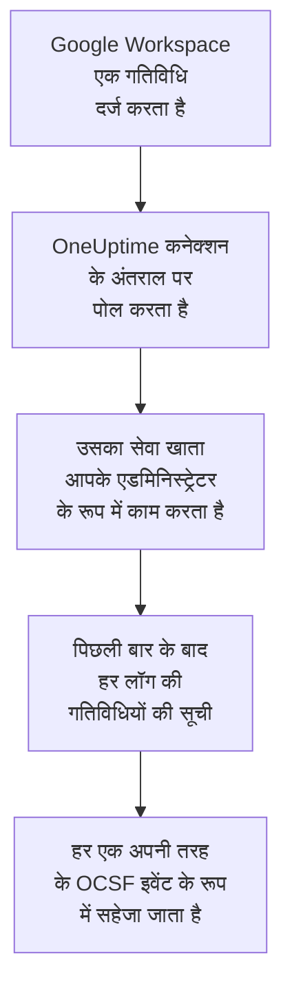

# Google Workspace

[Google Workspace](https://workspace.google.com) के ऑडिट लॉग OneUptime के सुरक्षा इवेंट में इम्पोर्ट करें: साइन-इन और उनमें Google ने जो चिह्नित किया, एडमिनिस्ट्रेटर के बदलाव, डेटा तक पहुंच पाने वाले ऐप, सिंगल साइन-ऑन, खातों की अपनी सुरक्षा सेटिंग्स और, चाहें तो, संगठन के बाहर शेयर की गई या Google Drive में डाउनलोड की गई फ़ाइलें। वहां आप उन्हें अपने लॉग, ट्रेस और मेट्रिक्स के साथ खोजते हैं, हर दूसरे स्रोत के साथ उनका सहसंबंध देखते हैं, और ज़रूरी चीज़ों के लिए ऑन-कॉल को पेज करते हैं। OneUptime उन्हें एक सेवा खाते से पढ़ता है जो आपके किसी एडमिनिस्ट्रेटर के रूप में काम करता है, और Google Workspace में कुछ नहीं बदलता।

:::cards
- [कनेक्शन सेट करें](#कनेक्शन-सेट-करें): एक सेवा खाता, डोमेन-व्यापी डेलिगेशन, और कनेक्शन का फ़ॉर्म।
- [क्या इम्पोर्ट होता है](#क्या-इम्पोर्ट-होता-है): कौन सी गतिविधियां, और हर एक सुरक्षा इवेंट कैसे बनती है।
- [पोलिंग कैसे काम करती है](#पोलिंग-कैसे-काम-करती-है): हर पोल कौन सी विंडो पढ़ता है, और वह 2 घंटे क्यों ओवरलैप करती है।
- [समस्या निवारण](#समस्या-निवारण): हर त्रुटि का मतलब क्या है, और क्या बदलना है।
:::

## यह कैसे काम करता है

हर मिनट OneUptime हर उस सक्षम कनेक्शन से पोल करता है जिसका पोल अंतराल बीत चुका है। एक पोल आपके बताए एडमिनिस्ट्रेटर की ओर से आपके सेवा खाते के रूप में साइन इन करता है, और पिछले पोल के बाद हर ऑडिट लॉग की गतिविधियों की सूची लेता है ([Activities: list](https://developers.google.com/admin-sdk/reports/reference/rest/v1/activities/list)): एडमिन, साइन-इन, OAuth टोकन, SAML, खाता सुरक्षा और, जब **Drive गतिविधि** विकल्प चालू हो, Drive। किसी गतिविधि का हर इवेंट एक [OCSF](https://schema.ocsf.io/) इवेंट के रूप में सहेजा जाता है: साइन-इन एक Authentication इवेंट के रूप में, सौंपा गया एडमिन रोल एक User Access Management इवेंट के रूप में, Google का चिह्नित साइन-इन एक Detection Finding के रूप में।

## शुरू करने से पहले

- OneUptime में Project Owner, Project Admin या Security Admin रोल। Security Member और Security Viewer कनेक्शन और उनका रन इतिहास देख सकते हैं, पर उन्हें बदल नहीं सकते।
- डोमेन-व्यापी डेलिगेशन की अनुमति देने के लिए एक Google Workspace सुपर एडमिनिस्ट्रेटर, और एक एडमिनिस्ट्रेटर जिसके रूप में सेवा खाता काम करे, Reports विशेषाधिकार के साथ। सुपर एडमिनिस्ट्रेटर के पास यह होता है।
- एक Google Cloud प्रोजेक्ट जिसमें आप सेवा खाता बना सकें और Admin SDK API चालू कर सकें।
- Drive गतिविधि के लिए, Drive के ऑडिट लॉग वाला संस्करण, जैसे Business Standard, Business Plus, Enterprise या Education।
- OneUptime ऐप और वर्कर से `oauth2.googleapis.com` और `admin.googleapis.com` तक आउटबाउंड HTTPS।

## कनेक्शन सेट करें

कनेक्शन एक सेवा खाते की कुंजी और [डोमेन-व्यापी डेलिगेशन](https://developers.google.com/identity/protocols/oauth2/service-account#delegatingauthority) से साइन इन करता है, सिर्फ़ पढ़ने वाले एक ही स्कोप के साथ: `https://www.googleapis.com/auth/admin.reports.audit.readonly`।

:::steps
### एक सेवा खाता और कुंजी बनाएं

1. [Google Cloud कंसोल](https://console.cloud.google.com) में एक प्रोजेक्ट चुनें, **APIs & Services → Library** खोलें, **Admin SDK API** ढूंढें, और **Enable** चुनें।
2. **IAM & Admin → Service accounts → Create service account** खोलें, इसका नाम `oneuptime-security-events` रखें, और **Done** चुनें। इसे प्रोजेक्ट में किसी रोल की ज़रूरत नहीं।
3. सेवा खाता खोलें और उसकी **Unique ID** कॉपी करें, जो वह क्लाइंट ID है जिसका नाम डेलिगेशन में दिया जाता है। **Keys** टैब पर **Add key → Create new key → JSON** चुनें, और फ़ाइल संभालकर रखें: यही कुंजी है।

### डोमेन-व्यापी डेलिगेशन की अनुमति दें

1. [Google एडमिन कंसोल](https://admin.google.com) में, सुपर एडमिनिस्ट्रेटर के रूप में, **Security → Access and data control → API controls → Manage domain-wide delegation** खोलें, और **Add new** चुनें।
2. सेवा खाते की **Unique ID** को **Client ID** के रूप में, और `https://www.googleapis.com/auth/admin.reports.audit.readonly` को एकमात्र **OAuth scope** के रूप में डालें। **Authorize** चुनें। Google को इसे लागू करने में कुछ मिनट लग सकते हैं।

### OneUptime में कनेक्शन जोड़ें

**उत्पाद → Security Events → कनेक्शन** (`/dashboard/{projectId}/security-events/connections`) खोलें, **कनेक्शन जोड़ें** पर क्लिक करें, **पहचान** के नीचे **Google Workspace** चुनें, और **अगला** पर क्लिक करें। **Administrator email** डालें, **अगला** पर क्लिक करें, और कुंजी फ़ाइल की सामग्री **सेवा खाता JSON** में पेस्ट करें। **पोलिंग** चरण में Drive भी पढ़ने के लिए **Drive गतिविधि** चालू करें।

### सहेजने से पहले इसे टेस्ट करें

**सहेजने से पहले टेस्ट करें** के नीचे **इन सेटिंग्स का परीक्षण करें** पर क्लिक करें। टेस्ट फ़ॉर्म के मानों से साइन इन करके साइन-इन और एडमिन लॉग पढ़ता है, और कुछ सहेजता नहीं, इसलिए छूटा हुआ डेलिगेशन कनेक्शन बनने से पहले ही सामने आ जाता है। फिर **अगला** पर क्लिक करें, कनेक्शन को एक **नाम** दें, और उसे बनाएं।
:::

| सेटिंग | क्या डालें |
| --- | --- |
| **Administrator email** | उस एडमिनिस्ट्रेटर का पता जिसके रूप में सेवा खाता काम करता है, जैसे `admin@example.com`। इसके पास Reports विशेषाधिकार होना चाहिए। |
| **Drive गतिविधि** | वैकल्पिक, डिफ़ॉल्ट रूप से बंद। चालू होने पर हर पोल Drive की शेयरिंग और डाउनलोड भी पढ़ता है। |
| **सेवा खाता JSON** | पूरी कुंजी फ़ाइल, जिसमें `client_email` और `private_key` होते हैं। यह एन्क्रिप्ट की जाती है, API इसे कभी नहीं लौटाता और यह फिर कभी नहीं दिखती। इसे कनेक्शन पर **क्रेडेंशियल अपडेट करें** से बदलें। |

**पोलिंग** चरण में एक वैकल्पिक **विवरण**, **पोल अंतराल (मिनट)**, जो `1` से `1440` तक की पूर्ण संख्या है और `5` से शुरू होती है, और **सक्षम** भी है, जो शुरू में चालू रहता है।

## क्या इम्पोर्ट होता है

हर इवेंट का वेंडर `Google` और उत्पाद `Google Workspace` होता है। कई इवेंट वाली गतिविधि हर इवेंट के लिए एक सुरक्षा इवेंट बनती है, और हर इवेंट गतिविधि के फ़ील्ड और अपने फ़ील्ड रखता है, `event.name`, `event.type` और `parameters.<name>` के रूप में, ताकि कोई नियम उन्हें Google के नामों से पढ़े।

| लॉग | इवेंट | OCSF क्लास | गंभीरता |
| --- | --- | --- | --- |
| साइन-इन (`login`) | `login_success`, कारण के साथ `login_failure`, `login_challenge`। साइन-आउट पढ़ा जाता है पर इम्पोर्ट नहीं होता। | Authentication (`3002`) | Informational; विफलता के लिए Low; जब Google उसे `is_suspicious` चिह्नित करे तो Medium |
| Google की पहचानें (`login`) | `suspicious_login` और उसके प्रकार, `gov_attack_warning`, `account_disabled_hijacked` और वे दूसरे खाते जिन्हें Google ने निष्क्रिय किया | Detection Finding (`2004`) | Medium; सरकार समर्थित हमले, हाईजैक हुए खाते या लीक हुए पासवर्ड के लिए High |
| एडमिन (`admin`) | दिए या वापस लिए गए एडमिन विशेषाधिकार और रोल, डोमेन-व्यापी डेलिगेशन, बनाए, हटाए या निलंबित किए गए उपयोगकर्ता, बंद की गई दो-चरणीय सत्यापन, ग्रुप सदस्य, सेटिंग्स | User Access Management (`3005`), Account Change (`3001`), Group Management (`3006`), Entity Management (`3004`) | दी गई शक्ति के लिए Medium; हटाए गए उपयोगकर्ता या बंद दो-चरणीय सत्यापन के लिए Low |
| OAuth टोकन (`token`) | ऐसा ऐप जिसे उसके स्कोप के साथ किसी के डेटा तक पहुंच मिली, या जिससे वह पहुंच छीन ली गई | Authorize Session (`3003`) | Informational |
| SAML (`saml`) | किसी ऐप में सिंगल साइन-ऑन | Authentication (`3002`) | विफलता के लिए Low |
| खाता सुरक्षा (`user_accounts`) | दो-चरणीय सत्यापन, पासवर्ड और रिकवरी में बदलाव | Account Change (`3001`) | जब यह खाते को कमज़ोर करे तो Low |
| Drive (`drive`), विकल्प चालू होने पर | `change_user_access`, `change_document_visibility`, `change_document_access_scope`, `change_acl_editors`, `download` | File Hosting Activity (`6006`) | मालिक के डोमेन के बाहर शेयर की गई या किसी लिंक के लिए खोली गई फ़ाइल के लिए Low |

Google Workspace के लिए नियम लाइब्रेरी के नियम इन्हें वैसे ही पढ़ते हैं जैसे ये यहां इम्पोर्ट होते हैं, जैसे Google के चिह्नित साइन-इन, दिए गए एडमिन विशेषाधिकार और Drive में सार्वजनिक की गई फ़ाइल के नियम।

## पोलिंग कैसे काम करती है

- **गतिविधियां इस आधार पर पढ़ी जाती हैं कि वे कब हुईं।** Reports API के पास उन्हें सूचीबद्ध करने के लिए कोई दूसरा समय नहीं है, और Google बताता है कि उसके लॉग कुछ मिनट से कुछ घंटे तक देर से आते हैं।
- **पहला पोल 24 घंटे पीछे देखता है**, इसलिए नया कनेक्शन तुरंत अपनी हाल की गतिविधियां दिखाता है।
- **हर बाद वाला पोल सहेजे गए कर्सर से 120 मिनट पहले शुरू होता है**, इसलिए जिस गतिविधि को Google 2 घंटे तक की देरी से पढ़ने लायक बनाता है, वह अगले पोल में पढ़ी जाती है, और डुप्लिकेट प्रोजेक्ट के भीतर हर इवेंट की ID से हटा दिए जाते हैं। इससे भी देर से आने वाली गतिविधि पोलिंग नहीं पढ़ती: **निदान** से उसकी समय सीमा इम्पोर्ट करें।
- **एक पोल कर्सर से आगे ज़्यादा से ज़्यादा 24 घंटे पढ़ता है।** जिस कनेक्शन का कर्सर पीछे रह गया, वह 24 घंटे की लगातार विंडो में बराबर आता है।
- **Drive एक बार में एक इवेंट पढ़ा जाता है**, क्योंकि Drive हर वह फ़ाइल दर्ज करता है जिसे कोई खोलता है। जब Google, Drive का लॉग अस्वीकार करता है, तो रन चेतावनी देता है, और बाकी लॉग फिर भी इम्पोर्ट होते हैं।
- **विफल रन कुछ नहीं बदलता।** नेटवर्क त्रुटि, या Google की किसी त्रुटि स्थिति के बाद, कर्सर और विंडो की लंबाई जैसी थी वैसी रहती है, और अगला पोल वही विंडो फिर से पढ़ता है। एकमात्र अपवाद वह अनुरोध है जिसका समय खत्म हो गया: कर्सर वहीं रहता है, लेकिन अगली विंडो आधी लंबी होती है, क्योंकि जो विंडो समय पर जवाब पाने के लिए बहुत भारी हो, वह हर कोशिश में टाइम आउट होगी।

### जब किसी विंडो में एक पोल की क्षमता से ज़्यादा हो

हर लॉग का अपना बजट है, 1,000 गतिविधियों के पेज में: साइन-इन के लिए 10, एडमिन, OAuth टोकन और SAML में से हर एक के लिए 5, खाता सुरक्षा के लिए 3, और Drive के हर इवेंट के लिए 4। एक पोल 4 मिनट बाद रुक जाता है। जब कोई बजट किसी लॉग को उसकी विंडो के अंत से पहले रोक देता है, तो रन **आंशिक** होता है, और उसकी चेतावनी लॉग और बजट का नाम बताती है। Google सबसे नई गतिविधियां पहले देता है, इसलिए OneUptime कर्सर को उन गतिविधियों से आगे ले जाने के बजाय जिन तक वह कभी पहुंचा ही नहीं, विंडो छोटी कर देता है:

1. **छोटा करें।** अगला पोल उसी शुरुआती बिंदु से आधी लंबाई की विंडो पढ़ता है, और तब तक आधा करता रहता है जब तक कोई विंडो पूरी न पढ़ी जाए, कम से कम एक मिनट तक। रन की चेतावनी यही बताती है: `This window holds more records than one poll can read; the next poll reads a {n} minute window from the same starting point.` लंबी विंडो से पहले ही इम्पोर्ट हो चुकी गतिविधियां डुप्लिकेट मानकर छोड़ दी जाती हैं।
2. **वापस बढ़ाएं।** किसी विंडो के पूरा पढ़े जाने के बाद कर्सर उसके अंत पर जाता है, और अगली विंडो फिर दोगुनी होती है, ज़्यादा से ज़्यादा 24 घंटे तक।
3. **एक मिनट से आगे बढ़ें।** अगर एक मिनट में भी उससे ज़्यादा हो जितना एक पोल पढ़ सकता है, तो पोलिंग उससे आगे बढ़ जाती है, ताकि नई गतिविधियां आती रहें। रन **आंशिक** ही रहता है, और **पिछली त्रुटि** में लिखा होता है `More records were created in the one minute from {cursor} to {end} than one poll can read. Polling moved past this minute so newer records keep arriving; use Import this time range in Diagnostics on this minute to recover what one run can read.` एक रन जितना पढ़ सकता है उतना वापस पाने के लिए उस मिनट को **Import this time range** से इम्पोर्ट करें।

**पोल अंतराल (मिनट)** बदलने से इसमें कुछ नहीं बदलता: यह तय करता है कि पोल कितनी बार शुरू होता है, न कि उसकी विंडो कहां से शुरू होती है।

### मांग पर रन, प्रीव्यू और इम्पोर्ट

किसी कनेक्शन पर **निदान** पर क्लिक करें, ताकि उसके हाल के रन देख सकें और उसके साथ हाथ से काम कर सकें। जो भी कनेक्शन बदल सकता है वह इन्हें शुरू कर सकता है; जो भी इसे देख सकता है वह इतिहास पढ़ सकता है।

- **अभी चलाएँ** तुरंत सामान्य कर्सर के साथ एक पोल शुरू करता है, तब भी जब कनेक्शन **सक्षम** न हो।
- **Preview audit events** 7 दिन तक की समय सीमा पढ़ता है और कुछ इम्पोर्ट नहीं करता।
- **Import this time range** आपकी पुष्टि के बाद 7 दिन तक की सीमा इम्पोर्ट करता है, कर्सर हिलाए बिना। पहले से इम्पोर्ट की गई गतिविधियां छोड़ दी जाती हैं। Google 6 महीने के ऑडिट लॉग रखता है।
- किसी रन पर **Copy diagnostics** सपोर्ट के लिए उसकी रिपोर्ट कॉपी करता है। इसमें क्रेडेंशियल कभी शामिल नहीं होते।

## कनेक्शन का परीक्षण करें

कनेक्शन की पंक्ति पर **कनेक्शन का परीक्षण करें**, और फ़ॉर्म में **इन सेटिंग्स का परीक्षण करें**, बैकग्राउंड वर्कर में नहीं बल्कि API प्रोसेस में चलते हैं, इसलिए जब वर्कर ही समस्या हों तब भी टेस्ट जवाब देता है। यह ये जांचें क्रम से चलाता है:

| जांच | यह क्या जांचती है |
| --- | --- |
| **कॉन्फ़िगरेशन** | एडमिनिस्ट्रेटर का पता और कुंजी सही रूप में हैं। इसके विफल होने पर किसी से संपर्क नहीं किया जाता। |
| **Authenticate with Google** | Google सेवा खाते को एडमिनिस्ट्रेटर के रूप में काम करने देता है: डोमेन-व्यापी डेलिगेशन मौजूद है। |
| **Read the audit logs** | पिछले 24 घंटों के साइन-इन और एडमिन लॉग पढ़े जा सकते हैं। |
| **Read Drive activity** | सिर्फ़ विकल्प चालू होने पर: Drive का लॉग पढ़ा जा सकता है। |
| **Activities available to import** | पिछले 24 घंटों में कितनी साइन-इन और एडमिन गतिविधियां हैं, हर एक की ज़्यादा से ज़्यादा 1,000, इसलिए `1000+` का मतलब है ज़्यादा। एक भी न होना चेतावनी है। |
| **Background workers**, **Poll scheduler**, **Security event storage** | OneUptime का अपना हिस्सा: कोई प्रोसेस Worker कतार के जॉब लेता है, पोल जॉब हर मिनट चलता है, और सुरक्षा इवेंट का स्टोर जवाब देता है। |
| **Scheduled polling** | सहेजे गए कनेक्शन के लिए: पोलिंग चालू है, कोई रन वर्कर के इंतज़ार में अटका नहीं है, और पोल समय पर चलते हैं। |

टेस्ट के हर अनुरोध की समय सीमा 20 सेकंड है। टेस्ट कभी कुछ इम्पोर्ट नहीं करता और न कर्सर हिलाता है, और हर विफल जांच बताती है कि क्या बदलना है।

## समस्या निवारण

कनेक्शन का **पिछली त्रुटि** पूरा त्रुटि संदेश रखता है, क्रेडेंशियल छिपाकर। जब किसी कनेक्शन में त्रुटि हो, तो उसे पढ़ने के लिए उसके **क्रियाएँ** कॉलम में **त्रुटि देखें** चुनें, और उसे कॉपी करने के लिए डायलॉग में **त्रुटि कॉपी करें** चुनें। हर संदेश `Google Workspace` से शुरू होता है, फिर विफल अनुरोध का नाम बताता है, और Google का अपना कारण उद्धृत करता है।

:::details पिछली त्रुटि `token request failed` कहती है
- `unauthorized_client`: सेवा खाते के पास उस स्कोप के लिए डोमेन-व्यापी डेलिगेशन नहीं है। **Manage domain-wide delegation** में उसकी **Unique ID** को `https://www.googleapis.com/auth/admin.reports.audit.readonly` के साथ जोड़ें।
- `Invalid email or User ID` के साथ `invalid_grant`: **Administrator email** इस Google Workspace का उपयोगकर्ता नहीं है।
- `Invalid JWT Signature` के साथ `invalid_grant`: कुंजी हटा दी गई या निष्क्रिय कर दी गई। नई कुंजी बनाएं, और उसे **क्रेडेंशियल अपडेट करें** से सहेजें।
:::

:::details पिछली त्रुटि `activities request failed (HTTP 403)` कहती है
- कारण `SERVICE_DISABLED` या `accessNotConfigured`: सेवा खाते के प्रोजेक्ट में Admin SDK API बंद है। इसे चालू करें, और कुछ मिनट में फिर से टेस्ट करें।
- कारण `forbidden`: एडमिनिस्ट्रेटर के पास Reports विशेषाधिकार नहीं है। Google एडमिन कंसोल में **Account → Admin roles** के नीचे इसे सौंपें, या किसी सुपर एडमिनिस्ट्रेटर का नाम दें।
:::

:::details Drive गतिविधि नहीं पढ़ी जाती
Drive के लॉग के लिए ऐसा संस्करण चाहिए जिसमें यह हो, और Reports विशेषाधिकार वाला एडमिनिस्ट्रेटर। हर रन `Drive activity was not read` की चेतावनी देता है, और बाकी लॉग फिर भी इम्पोर्ट होते हैं। जब आपके संस्करण में Drive लॉग न हो, तो **Drive गतिविधि** बंद करें।
:::

:::details पिछली त्रुटि `did not complete` कहती है
अनुरोध को कोई जवाब नहीं मिला: टाइमआउट, ऐसा नाम जो रिज़ॉल्व नहीं होता, या अस्वीकार किया गया पता। जांचें कि OneUptime ऐप और वर्कर, आपके इस्तेमाल किए किसी भी प्रॉक्सी के ज़रिए, `oauth2.googleapis.com` और `admin.googleapis.com` तक पहुंच सकते हैं।
:::

:::details टेस्ट पास होता है, पर Last Polled Never है
पोल जॉब कभी नहीं चला। **Background workers** और **Poll scheduler** जांचें पढ़ें। सेल्फ़-होस्टेड इंस्टॉलेशन में आम कारण ऐप पर `DISABLE_QUEUE_WORKERS=true` है, जबकि जॉब लेने के लिए कोई अलग वर्कर डिप्लॉयमेंट नहीं है: इसे `false` पर सेट करें, या वर्कर डिप्लॉयमेंट चलाएं (Helm: `worker.enabled: true`, जो डिफ़ॉल्ट रूप से `false` है)।
:::

## अगले कदम

:::cards
- [सुरक्षा इवेंट](/docs/telemetry/security-events): जो इम्पोर्ट करते हैं उसे खोजें, उसका सहसंबंध देखें और उस पर अलर्ट करें।
- [Microsoft Entra ID](/docs/integrations/microsoft-entra-id): Microsoft के साइन-इन और डायरेक्टरी बदलाव इम्पोर्ट करें।
- [Google SecOps](/docs/integrations/google-secops): Google SecOps की पहचानें भी लाएं।
- [इंटिग्रेशन अवलोकन](/docs/integrations/index): वे दूसरे टूल जिन्हें आप जोड़ सकते हैं।
:::
