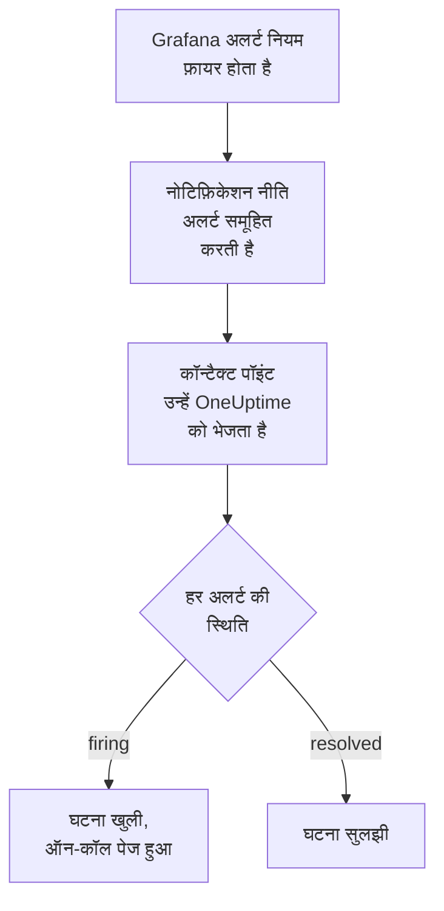

# Grafana

[Grafana](https://grafana.com) के अलर्ट OneUptime को भेजें, ताकि फ़ायर होने वाला हर अलर्ट एक घटना बने जो आपकी ऑन-कॉल टीम को पेज करे, और अलर्ट के ठीक होने पर सुलझ जाए। Grafana अपने अलर्ट एक वेबहुक कॉन्टैक्ट पॉइंट से भेजता है, इसलिए किसी भी तरफ़ कुछ इंस्टॉल नहीं करना पड़ता।

:::cards
- [चुनें कि OneUptime अलर्ट कैसे पाए](#चुनें-कि-oneuptime-अलर्ट-कैसे-पाए): एक Incoming Request मॉनिटर, या आपका अपना वर्कफ़्लो।
- [मॉनिटर से अलर्ट पाएं](#मॉनिटर-से-अलर्ट-पाएं): हर अलर्ट पर एक घटना, रिकवरी पर सुलझी हुई।
- [Grafana कॉन्फ़िगर करें](#grafana-कॉन्फ़िगर-करें): एक वेबहुक कॉन्टैक्ट पॉइंट, और उसे इस्तेमाल करने वाली नीति।
- [समस्या निवारण](#समस्या-निवारण): जब अलर्ट नहीं पहुंचते, या घटनाएं खुली रहती हैं।
:::

## यह कैसे काम करता है



Grafana की नोटिफ़िकेशन नीतियां फ़ायर होने वाले अलर्ट को समूहित करती हैं, और एक वेबहुक कॉन्टैक्ट पॉइंट हर समूह को एक JSON सूचना के रूप में भेजता है। इसका आकार [Prometheus Alertmanager](/docs/integrations/prometheus-alertmanager) की सूचना जैसा ही है: एक `status`, एक `alerts` सूची जिसमें हर अलर्ट का अपना `status` और `fingerprint` होता है, और उसके अलर्ट के साझा `commonLabels` और `commonAnnotations`। Grafana लोगों के पढ़ने के लिए लिखे गए `title` और `message` भी जोड़ता है।

## शुरू करने से पहले

- Grafana 9 या बाद का, Grafana Alerting के साथ, जो Grafana 9 से डिफ़ॉल्ट है। यह HTTPS पर आपके OneUptime तक पहुंच पाना चाहिए।
- OneUptime में मॉनिटर बनाने का अधिकार, या वर्कफ़्लो का रास्ता चुनने पर वर्कफ़्लो बनाने का।

## चुनें कि OneUptime अलर्ट कैसे पाए

पहले OneUptime सेट करें: यह आपको वह URL देता है जिस पर Grafana भेजता है।

| तरीका | कब इस्तेमाल करें |
| --- | --- |
| एक Incoming Request मॉनिटर (सुझाया गया) | आप चाहते हैं कि हर अलर्ट एक घटना बने जो ऑन-कॉल को पेज करे, और अलर्ट ठीक होने पर सुलझ जाए। कुछ भी बनाना नहीं पड़ता। |
| Webhook ट्रिगर वाला वर्कफ़्लो | आपको अपना लॉजिक चाहिए: अलर्ट फ़िल्टर करना, उनका रूप बदलना, या पहले दूसरे सिस्टम को कॉल करना। वर्कफ़्लो हर अलर्ट पर नहीं, बल्कि हर सूचना पर एक घटना खोलता है, और रिकवरी पर उसे नहीं सुलझाता। |

दोनों को एक ही कॉन्टैक्ट पॉइंट से एक जैसा JSON मिलता है, इसलिए आप एक से शुरू करके बाद में Grafana में एक URL बदलकर दूसरे पर जा सकते हैं।

## मॉनिटर से अलर्ट पाएं

एक [Incoming Request मॉनिटर](/docs/monitor/incoming-request-monitor) आपको एक URL देता है, और उसके मानदंड तय करते हैं कि हर सूचना क्या करे।

:::steps
### मॉनिटर बनाएं

**मॉनिटर** पर जाएं और **मॉनिटर बनाएं** पर क्लिक करें। **मॉनिटर प्रकार** में **Incoming Request** चुनें, इसका नाम `Grafana` रखें, और **अगला** पर क्लिक करें।

### फ़ायर होने वाले हर अलर्ट के लिए घटना घोषित करें

**मानदंड** चरण में पहला मानदंड खोलें, वह जो मॉनिटर को ऑफ़लाइन चिह्नित करता है। उसका फ़िल्टर **अनुरोध बॉडी**, **शामिल है**, `"status":"firing"` पर सेट करें। फ़िल्टर मेल खाने पर यह मानदंड पहले से ही घटना घोषित करता है। घटना भरें:

- **घटना शीर्षक**: `{{requestBody.commonLabels.alertname}}`।
- **विवरण** के नीचे **घटना विवरण**: `{{requestBody.message}}`, वह टेक्स्ट जो Grafana सूचना के लिए लिखता है।
- **गंभीरता**: वह घटना गंभीरता जो इन अलर्ट की होनी चाहिए।
- **ऑन-कॉल** के नीचे **ऑन-कॉल नीतियां**: पेज की जाने वाली नीतियां।
- **और फ़ील्ड** के नीचे **घटना स्वतः सुलझाएं**: इसे चालू रहने दें, जैसा यह शुरू में होता है। इसके बिना रिकवरी को अनदेखा किया जाता है और घटनाएं खुली रहती हैं।

### हर अलर्ट पर एक घटना खोलें

उसी मानदंड में **सेटिंग्स** खोलें और **Group incidents and alerts by a payload field** चालू करें। इसे नीचे की तरह भरें, ताकि हर अलर्ट की अपनी घटना हो, और उसकी रिकवरी उसे सुलझाए:

| फ़ील्ड | मान |
| --- | --- |
| **Open a separate incident for each…** | `requestBody.alerts[*].fingerprint` |
| **Field that signals recovery** | `requestBody.alerts[*].status` |
| **Value that means recovered** | `resolved` |

### मॉनिटर को वापस ऑनलाइन लाएं

दूसरा मानदंड खोलें, वह जो मॉनिटर को ऑनलाइन चिह्नित करता है, और उसका फ़िल्टर **अनुरोध बॉडी**, **शामिल है**, `"status":"resolved"` पर सेट करें।

### URL कॉपी करें

**मॉनिटर बनाएं** पर क्लिक करें। मॉनिटर का **अवलोकन** पेज उसका **Heartbeat URL** दिखाता है। उसे Grafana के लिए कॉपी करें:

```text
https://oneuptime.com/heartbeat/<secret key>
```

सेल्फ़-होस्टेड इंस्टॉलेशन में `oneuptime.com` की जगह उसका अपना होस्ट होता है।
:::

सूचना का हर अलर्ट अपनी घटना खोलता है, ज़्यादा से ज़्यादा **Max incidents per request** जितनी (जब तक आप इसे न बदलें, `100`), और हर अलर्ट की अपनी `status` तय करती है कि उसकी घटना कब सुलझे। Grafana का `fingerprint` अलर्ट को उसके लेबल से पहचानता है, इसलिए समूहित करने के लिए यही मान सही है। हर सेटिंग क्या करती है, यह जानने के लिए [किसी दूसरे सिस्टम से अलर्ट प्राप्त करना](/docs/monitor/incoming-request-monitor#किसी-दूसरे-सिस्टम-से-अलर्ट-प्राप्त-करना) देखें।

> [!WARNING]
> ऐसे लेबल से समूहित न करें जो सूचना के सभी अलर्ट में साझा हो। Grafana की डिफ़ॉल्ट नोटिफ़िकेशन नीति अलर्ट को `grafana_folder` और `alertname` से समूहित करती है, इसलिए एक सूचना के हर अलर्ट का `alertname` एक ही होता है: `requestBody.alerts[*].labels.alertname` से समूहित करने पर पूरी सूचना एक घटना में मिल जाती है।

`{{requestBody.commonLabels.alertname}}` और `{{requestBody.message}}` पूरी सूचना का वर्णन करते हैं, जो डिफ़ॉल्ट नीति में एक अलर्ट नियम होती है। ग्रुपिंग कुंजी भी एक वेरिएबल है, `{{fingerprint}}`, पर यह एक हैश है जिससे रिस्पॉन्डर को कुछ पता नहीं चलता। इस्तेमाल किए जा सकने वाले हर वेरिएबल के लिए [घटना और अलर्ट टेम्पलेट](/docs/monitor/incident-alert-templating) देखें।

## Grafana कॉन्फ़िगर करें

:::steps
### एक वेबहुक कॉन्टैक्ट पॉइंट जोड़ें

Grafana में **Alerting → Contact points** पर जाएं और **+ Add contact point** पर क्लिक करें। Grafana 11 और बाद में, **Alerting** **Alerts & IRM** के नीचे है, और **Contact points** **Notification configuration** का एक टैब है।

कॉन्टैक्ट पॉइंट का नाम `OneUptime` रखें, **Integration** में **Webhook** चुनें, और कॉपी किया गया URL **URL** में पेस्ट करें। **HTTP Method** को `POST` पर रहने दें, और **Save contact point** पर क्लिक करें।

### अलर्ट उस पर भेजें

**Alerting → Notification policies** पर जाएं। डिफ़ॉल्ट नीति का कॉन्टैक्ट पॉइंट `OneUptime` पर सेट करें, या एक चाइल्ड नीति जोड़ें जो उन अलर्ट से मेल खाए जो OneUptime को मिलने चाहिए, और जिसका कॉन्टैक्ट पॉइंट `OneUptime` हो।
:::

Grafana `Content-Type: application/json` भेजता है, जिसकी ज़रूरत मॉनिटर को सूचना के फ़ील्ड पढ़ने के लिए होती है। कॉन्टैक्ट पॉइंट की **Max Alerts** सेटिंग एक सूचना के अलर्ट सीमित करती है: इसे `0` पर रखें, यानी कोई सीमा नहीं, या ज़्यादा से ज़्यादा मॉनिटर के **Max incidents per request** जितना।

## इसे टेस्ट करें

1. Grafana में `OneUptime` कॉन्टैक्ट पॉइंट खोलें और **Test** पर क्लिक करें। Grafana एक फ़ायर हो रहा टेस्ट अलर्ट भेजता है, और OneUptime में एक घटना खुलती है। टेस्ट अलर्ट कभी ठीक नहीं होता, इसलिए वह घटना हाथ से सुलझाएं।
2. किसी असली अलर्ट नियम को फ़ायर होने दें, जैसे थोड़ी देर के लिए उसका थ्रेशोल्ड कम करके, और उसकी घटना खुलते देखें, फिर थ्रेशोल्ड वापस करने पर सुलझते देखें।

## वर्कफ़्लो से अलर्ट पाएं

जब आपको Grafana और घटना के बीच अपने चरण चाहिए, तब [वर्कफ़्लो](/docs/workflows/index) इस्तेमाल करें।

:::steps
### वर्कफ़्लो बनाएं

**वर्कफ़्लो** पर जाएं, **वर्कफ़्लो बनाएं** पर क्लिक करें, फिर **शुरू से बनाएं** पर। इसका नाम `Grafana alerts` रखें और **वर्कफ़्लो बनाएं** पर क्लिक करें।

### Webhook ट्रिगर जोड़ें

डैश वाले **चुनें कि यह वर्कफ़्लो किससे शुरू हो** ब्लॉक पर क्लिक करें और **Webhook** चुनें। ट्रिगर पर क्लिक करें, फिर **URL कॉपी करें** पर, और वह URL Grafana के कॉन्टैक्ट पॉइंट में इस्तेमाल करें।

### जांचें कि सूचना फ़ायर हो रही है

**घटक जोड़ें** पर क्लिक करें, एक **If / Else** ब्लॉक जोड़ें, और ट्रिगर के **Out** बिंदु को उससे जोड़ें। **Value to check** को `{{local.components.webhook-1.returnValues.request-body.status}}` पर, **Comparison** को **is equal to** पर, और **Compare with** को `firing` पर सेट करें।

### घटना घोषित करें

एक **Create One Incident** ब्लॉक जोड़ें, और **If / Else** ब्लॉक की **Yes** साइड को उससे जोड़ें। **Incident Template** में ऐसा टेम्पलेट चुनें जो गंभीरता और पेज की जाने वाली ऑन-कॉल नीतियां सेट करता हो ([घटना टेम्पलेट](/docs/incidents/settings#घटना-टेम्पलेट) देखें)। **JSON Object** में वह सेट करें जो Grafana से आता है:

```json
{
  "title": "{{local.components.webhook-1.returnValues.request-body.title}}",
  "description": "{{local.components.webhook-1.returnValues.request-body.message}}"
}
```

बिना टेम्पलेट के, **JSON Object** में `incidentSeverityId` भी चाहिए, जो प्रोजेक्ट की किसी घटना गंभीरता का ID है।

### वर्कफ़्लो चालू करें

**बिल्डर** के ऊपर **सक्षम** चालू करें। बंद वर्कफ़्लो Grafana को `400` से जवाब देता है।
:::

एक रन एक सूचना संभालता है, इसलिए सूचना में चाहे जितने अलर्ट हों, वह एक ही घटना घोषित करता है। `resolved` वाली सूचना **If / Else** ब्लॉक की **No** साइड पर जाती है, जहां कुछ नहीं जुड़ा है, इसलिए रन वहीं खत्म हो जाता है। हर अलर्ट पर एक घटना, जो रिकवरी पर सुलझे, के लिए मॉनिटर इस्तेमाल करें।

## समस्या निवारण

:::details OneUptime में कुछ नहीं पहुंचता
- कॉन्टैक्ट पॉइंट पर **Test** पर क्लिक करें: URL तक न पहुंच पाने पर Grafana त्रुटि दिखाता है। विवरण Grafana के सर्वर लॉग में होते हैं।
- मॉनिटर कुछ भी जांचने से पहले तुरंत `200` से जवाब देता है, गलत सीक्रेट कुंजी होने पर भी। सूचनाएं पहुंच रही हैं या नहीं, यह मॉनिटर की टाइमलाइन में देखें।
- बंद वर्कफ़्लो `400` से जवाब देता है। उसके **बिल्डर** के ऊपर **सक्षम** चालू करें।
:::

:::details घटनाएं खुलती हैं पर कभी सुलझती नहीं
- मानदंड की घटना में **और फ़ील्ड** के नीचे **घटना स्वतः सुलझाएं** होना चाहिए।
- **Field that signals recovery** ठीक `requestBody.alerts[*].status` होना चाहिए, और **Value that means recovered** ठीक `resolved`। तुलना केस-सेंसिटिव है।
- ग्रुपिंग पाथ `requestBody.` से शुरू होने चाहिए, और पाथ में सिर्फ़ पहला `[*]` सूची पढ़ता है। जो पाथ इनमें से कोई भी नियम तोड़ता है, वह बिना किसी त्रुटि के किसी चीज़ से मेल नहीं खाता।
:::

:::details अलर्ट से भरी सूचना के लिए एक ही घटना
आपने ऐसे लेबल से समूहित किया जो सूचना के हर अलर्ट के लिए एक जैसा है, जैसे डिफ़ॉल्ट नीति में `alertname`। इसके बजाय `requestBody.alerts[*].fingerprint` से समूहित करें।
:::

:::details घटना में मान की जगह रेफ़रेंस दिखता है
जो फ़ील्ड सूचना में नहीं है, उसका रेफ़रेंस कोष्ठकों समेत जैसा लिखा है वैसा ही छोड़ दिया जाता है। फ़ील्ड का नाम Grafana की भेजी चीज़ से मिलाएं: वर्कफ़्लो के लिए **लॉग → रन** में रन खोलें और उसकी तुलना ट्रिगर को मिली चीज़ से करें।
:::

[Prometheus Alertmanager](/docs/integrations/prometheus-alertmanager#समस्या-निवारण) गाइड और भी मामलों को कवर करती है, और वे Grafana की सूचनाओं पर भी लागू होते हैं।

## सुरक्षा

- **URL को पासवर्ड की तरह रखें।** जिसके पास भी यह है, वह घटनाएं खोल सकता है। अगर यह लीक हो जाए, तो इसे रीसेट करें: मॉनिटर के **सेटिंग्स** पेज पर **इनकमिंग अनुरोध सीक्रेट कुंजी रीसेट करें**, या वर्कफ़्लो के **Webhook** ट्रिगर में **URL रीसेट करें**। फिर Grafana में कॉन्टैक्ट पॉइंट का **URL** अपडेट करें।
- **सेल्फ़-होस्टेड?** Grafana को अपने फ़ायरवॉल से होकर HTTPS पर अपने OneUptime तक पहुंचने दें।

## अगले कदम

:::cards
- [आने वाले अनुरोध मॉनिटर](/docs/monitor/incoming-request-monitor): आपके अलर्ट पाने वाले मॉनिटर की हर सेटिंग।
- [Prometheus Alertmanager](/docs/integrations/prometheus-alertmanager): यही सेटअप, आपकी अलर्टिंग के लिए एक डेड मैन्स स्विच के साथ।
- [मेट्रिक्स मॉनिटर](/docs/monitor/metrics-monitor): उन्हीं मेट्रिक्स पर OneUptime में ही अलर्ट करें।
- [इंटिग्रेशन अवलोकन](/docs/integrations/index): वे दूसरे टूल जिन्हें आप जोड़ सकते हैं।
:::
