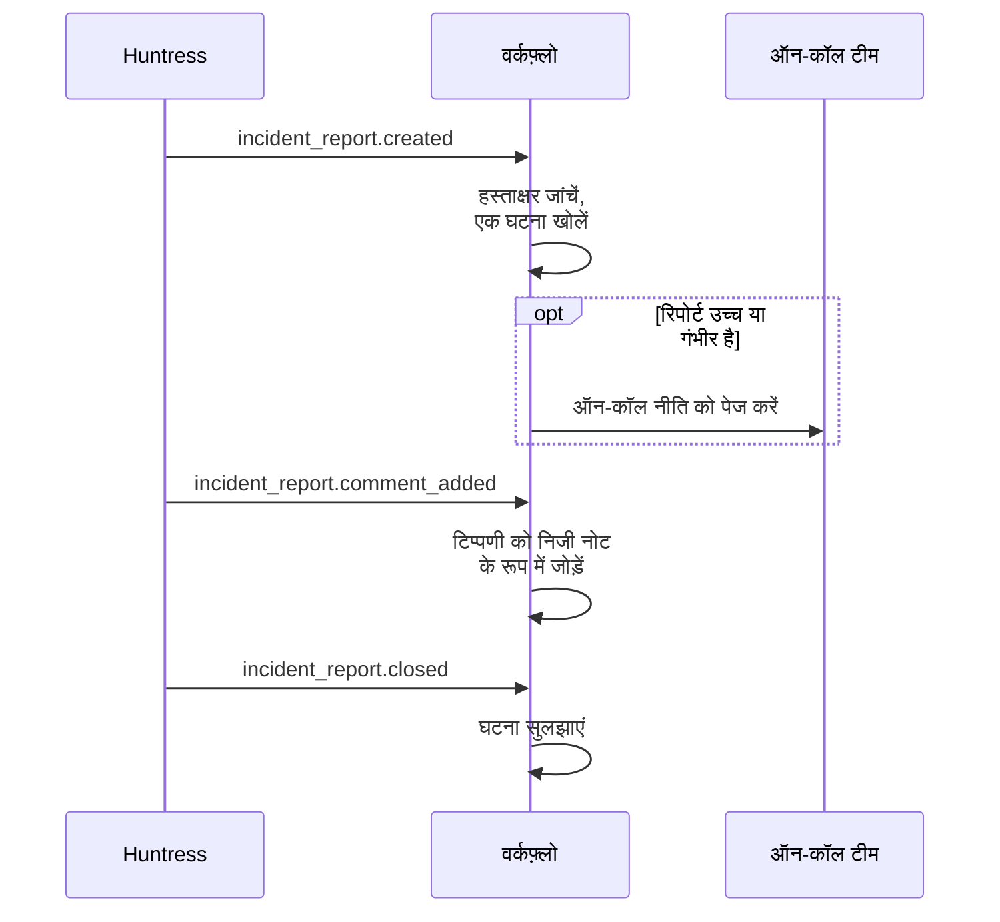

# Huntress इंटीग्रेशन

एक वर्कफ़्लो से Huntress घटना रिपोर्टों के लिए अपनी ऑन-कॉल टीम को पेज करें। जब Huntress SOC किसी एंडपॉइंट या पहचान के बारे में घटना रिपोर्ट भेजता है, तो वर्कफ़्लो उसके लिए एक घटना खोलता है, आपकी चुनी ऑन-कॉल नीति को पेज करता है, Huntress में की गई टिप्पणियों को निजी नोट के रूप में जोड़ता है, और Huntress में रिपोर्ट बंद होने पर घटना सुलझा देता है।

यह इंटीग्रेशन **इनबाउंड** है: Huntress किसी घटना रिपोर्ट का हर इवेंट वर्कफ़्लो के अपने URL पर भेजता है, एंडपॉइंट के साइनिंग सीक्रेट से हस्ताक्षरित करके। OneUptime कभी Huntress को कॉल नहीं करता, इसलिए उसे Huntress API कुंजी की ज़रूरत नहीं है।

:::cards
- [यह कैसे काम करता है](#यह-कैसे-काम-करता-है): रिपोर्ट के हर इवेंट के साथ वर्कफ़्लो क्या करता है।
- [सेट अप](#इंटीग्रेशन-सेट-अप-करें): वर्कफ़्लो बनाएं, Huntress में एंडपॉइंट जोड़ें, उसका साइनिंग सीक्रेट सहेजें, टेस्ट भेजें।
- [ट्रिगर](#huntress-incident-report-ट्रिगर): वे मान जो रिपोर्ट वर्कफ़्लो को देती है, और ट्रिगर की सेटिंग्स।
- [समस्या निवारण](#समस्या-निवारण): ट्रिगर की त्रुटियों का मतलब, और क्या बदलें।
:::

## यह कैसे काम करता है

Huntress किसी घटना रिपोर्ट के बारे में इवेंट तब भेजता है जब रिपोर्ट भेजी जाती है, जब कोई उस पर टिप्पणी करता है और जब वह बंद होती है। **Huntress Incident Report** ट्रिगर हर इवेंट के लिए वर्कफ़्लो को एक बार शुरू करता है, और उसका **Event** बताता है कि वह कौन-सा इवेंट था: `created`, `comment-added` या `closed`।

1. **जांचें।** अनुरोध पर एंडपॉइंट के साइनिंग सीक्रेट से हस्ताक्षर होना चाहिए, पहुंचने से अधिकतम पांच मिनट पहले। बाकी सब अस्वीकार होता है, और ट्रिगर की सेटिंग्स बताती हैं क्यों।
2. **वर्कफ़्लो शुरू करें।** हर इवेंट एक रन शुरू करता है, और रिपोर्ट के फ़ील्ड ट्रिगर के मान बनते हैं। Huntress का दोबारा भेजा इवेंट और कुछ शुरू नहीं करता।
3. **एक घटना खोलें।** `created` पर वर्कफ़्लो रिपोर्ट के नाम वाली घटना खोलता है, जैसे `Huntress: Incident on DESKTOP-01 (Acme Corp)`। इसके विवरण में रिपोर्ट का सारांश, Huntress में उसकी गंभीरता, संगठन, प्रभावित होस्ट या पहचान, Huntress को मिले संकेतक, और Huntress में रिपोर्ट का लिंक होता है। घटना को रिपोर्ट के संगठन का लेबल मिलता है, और रिपोर्ट उच्च या गंभीर हो तो वह आपकी चुनी ऑन-कॉल नीति को पेज करती है।
4. **रिपोर्ट के साथ चलें।** `comment-added` पर टिप्पणी घटना पर निजी नोट बन जाती है। `closed` पर घटना सुलझ जाती है, और कारण उसकी टाइमलाइन पर दर्ज होता है।

घटना रिपोर्ट का नंबर अपने कस्टम फ़ील्ड में `huntressReportId` के रूप में रखती है: जब Huntress रिपोर्ट पर टिप्पणी करता है या उसे बंद करता है, तो वर्कफ़्लो इसी से घटना को फिर से ढूंढता है। इस तरह खुली घटनाएं कभी स्टेटस पेज पर नहीं दिखतीं, और आपके घटना नियम (ऑन-कॉल, मालिक, लेबल और गोपनीयता नियम) इन पर भी किसी दूसरी घटना की तरह लागू होते हैं।

## शुरू करने से पहले

- OneUptime में ऐसी भूमिका जो वर्कफ़्लो बना और संपादित कर सके, जैसे **प्रोजेक्ट स्वामी**, **प्रोजेक्ट एडमिन** या **वर्कफ़्लो एडमिन**।
- Huntress में **Account Admin** भूमिका: केवल खाता एडमिन वेबहुक जोड़ सकते हैं।
- पेज करने के लिए एक ऑन-कॉल नीति।
- OneUptime Cloud पर, वर्कफ़्लो वाला प्लान: Growth या उससे ऊपर। Huntress का भेजा हर इवेंट एक वर्कफ़्लो रन है।
- सेल्फ-होस्टेड इंस्टॉलेशन पर, ऐसा OneUptime जिस तक Huntress इंटरनेट से HTTPS पर पहुंच सके: Huntress वेबहुक केवल `https://` URL पर भेजता है।

## इंटीग्रेशन सेट अप करें

:::steps
### वर्कफ़्लो बनाएं

**वर्कफ़्लो** खोलें और **वर्कफ़्लो बनाएं** पर क्लिक करें। **या किसी टेम्पलेट से शुरू करें** में **Huntress** श्रेणी चुनें, **Open an incident for each Huntress incident report** चुनें, और **यह टेम्पलेट इस्तेमाल करें** पर क्लिक करें।

### चुनें कि किसे पेज करना है

इसके बाद डायलॉग पूछता है कि किसे पेज करना है: **Who to page for high and critical reports** के अंतर्गत पेज करने के लिए ऑन-कॉल नीतियाँ चुनें, या किसी को पेज न करने के लिए कोई नहीं, और **वर्कफ़्लो बनाएं** पर क्लिक करें। वर्कफ़्लो **बिल्डर** में बंद अवस्था में खुलता है। बाद में यह बदलने के लिए कि यह किसे पेज करता है, इसके **Page an On-Call Policy** चरण पर क्लिक करें और इसकी **ऑन-कॉल नीतियां** बदलें।

### Huntress में वेबहुक एंडपॉइंट जोड़ें

**Huntress Incident Report** ट्रिगर पर क्लिक करें, और **Huntress में वेबहुक एंडपॉइंट जोड़ें** के नीचे **URL कॉपी करें** पर क्लिक करें। URL `https://oneuptime.com/workflow/huntress/<key>` जैसा दिखता है; सेल्फ-होस्टेड इंस्टॉलेशन पर यह आपके अपने होस्ट से शुरू होता है।

Huntress में ऊपर दाईं ओर का मेनू खोलें और **Integrations** चुनें। **Add an Integration** पर क्लिक करें, **Webhooks** चुनें और **Add Endpoint** पर क्लिक करें। URL चिपकाएं, **Incident Reports** चालू करें और सहेजें। **Escalations**, **Platform Actions** और **Account Notices** बंद ही रहने दें: ट्रिगर ये इवेंट ले लेता है और इनके लिए कुछ शुरू नहीं करता।

### एंडपॉइंट का साइनिंग सीक्रेट सहेजें

Huntress में एंडपॉइंट का मेनू (⋯) खोलें और **View Signing Secret** चुनें। पूरा कॉपी करें: यह `whsec_` से शुरू होता है। ट्रिगर में **साइनिंग सीक्रेट सहेजें** पर क्लिक करें, इसे चिपकाएं और **साइनिंग सीक्रेट सहेजें** पर क्लिक करें। सीक्रेट एन्क्रिप्ट किया जाता है और फिर कभी नहीं दिखाया जाता।

जब तक सीक्रेट सहेजा नहीं जाता, ट्रिगर हर अनुरोध अस्वीकार करता है। Huntress अस्वीकार हुए इवेंट को बाद में दोबारा भेजता है, इसलिए अभी अस्वीकार हुआ इवेंट भी पहुंच जाता है।

### वर्कफ़्लो चालू करें, और टेस्ट भेजें

**बिल्डर** में सबसे ऊपर **सक्षम** चालू करें। Huntress में एंडपॉइंट का मेनू (⋯) खोलें और **Send Test** चुनें। कुछ ही सेकंड में ट्रिगर **रिपोर्टें मिल रही हैं** दिखाता है।

> [!NOTE]
> टेस्ट में जो भी हो, ट्रिगर दिखाता है कि वह पहुंच गया। घटना रिपोर्ट वाला टेस्ट किसी दूसरी रिपोर्ट की तरह वर्कफ़्लो शुरू करता है।
:::

## वर्कफ़्लो क्या करता है

ट्रिगर के बाद, **Incident From Another Tool** रिपोर्ट के नंबर के ज़रिए वही करता है जो हर **Event** कहता है:

| Event | वर्कफ़्लो क्या करता है |
| --- | --- |
| `created` | ट्रिगर की **Incident Severity ID** पर घटना खोलता है, और उस पर **Organization Label ID** का लेबल लगाता है। उच्च या गंभीर रिपोर्ट के लिए **Page an On-Call Policy** आपकी नीति को पेज करता है; निम्न रिपोर्ट किसी को पेज नहीं करती। जिस रिपोर्ट की पहले से कोई घटना है, वह दूसरी नहीं खोलती। |
| `comment-added` | रिपोर्ट की घटना ढूंढता है और टिप्पणी को उस पर निजी नोट के रूप में जोड़ता है। |
| `closed` | रिपोर्ट की घटना ढूंढता है और उसे सुलझाता है, जब तक वह पहले से सुलझी न हो। कारण उसकी टाइमलाइन पर रहता है: Huntress ने रिपोर्ट बंद की। |

यह किसी भी दूसरे वर्कफ़्लो जैसा है, इसलिए आप बदल सकते हैं कि यह क्या करे: **Incident From Another Tool** के बाद वाला **If / Else** जिस चीज़ की तुलना करता है उसे बदलकर केवल गंभीर रिपोर्टों पर पेज करें, Slack या Microsoft Teams चरण से हर रिपोर्ट किसी चैट चैनल में पोस्ट करें, या **Organization** पर **Switch / Case** से हर संगठन को उसकी अपनी ऑन-कॉल नीति पर भेजें। हर रन वर्कफ़्लो के रन में दिखता है, साथ में यह कि हर चरण ने क्या किया।

### गंभीरता

Huntress हर घटना रिपोर्ट को तीन में से एक गंभीरता देता है। ट्रिगर की **Incident Severity ID** वह घटना गंभीरता है जिस पर रिपोर्ट खुलती है: जो उसकी सेटिंग चुनती है, नहीं तो आपकी घटना गंभीरताओं का क्रम, जैसे **घटनाएं → सेटिंग्स → घटना गंभीरता** उन्हें दिखाता है:

| Huntress गंभीरता | Huntress इससे क्या समझता है | सेटिंग | सेटिंग खाली होने पर घटना गंभीरता |
| --- | --- | --- | --- |
| Critical | कीबोर्ड पर सक्रिय हमलावर, ख़तरनाक मैलवेयर या जारी सेंधमारी, जिसे तुरंत रोकना है। | **गंभीर रिपोर्टों के लिए गंभीरता** | सबसे ऊँची |
| High | पुष्ट मैलवेयर जिसे तुरंत ठीक करना ज़रूरी है, या पहचान से समझौता जिस पर कार्रवाई चाहिए। | **उच्च रिपोर्टों के लिए गंभीरता** | दूसरी |
| Low | संभावित रूप से अवांछित प्रोग्राम, मैलवेयर के अवशेष और पहचान से जुड़े पुराने निष्कर्ष। | **निम्न रिपोर्टों के लिए गंभीरता** | तीसरी |

कम गंभीरताओं वाला प्रोजेक्ट बाकी के लिए अपनी सबसे निचली गंभीरता इस्तेमाल करता है। बिना गंभीरता वाली रिपोर्ट को उच्च माना जाता है। अगर आपकी चुनी गंभीरता हटा दी जाए, तो फिर से क्रम तय करता है।

### संगठन

ट्रिगर की **Organization Label ID** रिपोर्ट के Huntress संगठन के नाम वाला लेबल है, जैसे _Acme Corp_, जिसे वह उस संगठन की पहली रिपोर्ट आने पर बनाता है। एक वर्कफ़्लो आपके Huntress खाते के हर संगठन की रिपोर्टें पाता है, और ट्रिगर का **केवल ये संगठन** इसे सीमित करता है: हर पंक्ति में एक संगठन का नाम या ID, और नामों में छोटे-बड़े अक्षरों का फ़र्क नहीं।

> [!TIP]
> हर ग्राहक की अपनी टीम को पेज करने के लिए, हर संगठन के लिए एक घटना ऑन-कॉल नियम जोड़ें, जैसे "अगर **घटना लेबल** में _Acme Corp_ में से कोई भी है", जो उस ग्राहक की नीति चलाए। [घटना ऑन-कॉल नियम](/docs/incidents/settings#घटना-ऑन-कॉल-नियम) देखें।

## Huntress Incident Report ट्रिगर

ट्रिगर Huntress की जानकारी के साथ खुलता है: उसका URL, सेटअप के हर पूरे हुए चरण के पास एक निशान, और Huntress ने आख़िरी बार क्या भेजा। इसकी सेटिंग्स, जो सभी वैकल्पिक हैं, **और फ़ील्ड** में बंद रहती हैं: **केवल ये संगठन**, **गंभीर रिपोर्टों के लिए गंभीरता**, **उच्च रिपोर्टों के लिए गंभीरता** और **निम्न रिपोर्टों के लिए गंभीरता**।

| मान | इसमें क्या है |
| --- | --- |
| **Event** | `created`, `comment-added` या `closed`। जो रिपोर्ट पहले से बंद या खारिज है, वह `closed` है, चाहे वह किसी भी इवेंट से आई हो। |
| **Report ID** | Huntress में रिपोर्ट का नंबर। |
| **Severity** | `critical`, `high` या `low`। |
| **Status** | Huntress में रिपोर्ट की स्थिति, जैसे `sent`, `closed` या `dismissed`। |
| **Subject** | रिपोर्ट का विषय, जैसा Huntress लिखता है। |
| **Summary** | SOC विश्लेषक ने जो लिखा। |
| **Organization**, **Organization ID** | वह Huntress संगठन जिसके बारे में रिपोर्ट है। |
| **Affected** | वह होस्ट या पहचान जिसके बारे में रिपोर्ट है। |
| **Platform**, **Indicators** | Huntress को यह कहाँ मिला, और क्या मिला। |
| **Comment** | `comment-added` पर किसी की जोड़ी गई टिप्पणी। |
| **Report URL** | Huntress में रिपोर्ट कहाँ खुलती है। |
| **Incident Title**, **Incident Description** | रिपोर्ट के बारे में घटना के लिए एक शीर्षक और Markdown विवरण। |
| **Note** | इवेंट के बारे में नोट के लिए Markdown: टिप्पणी, या यह कि Huntress ने रिपोर्ट बंद की। |
| **Incident Severity ID**, **Organization Label ID** | घटना गंभीरता और लेबल, जैसा ऊपर बताया गया है। |
| **Received At** | OneUptime को इवेंट कब मिला। |

**Summary** और **Comment** Huntress के विश्लेषकों का लिखा टेक्स्ट है। इन्हें किसी घटना या नोट में डालने के लिए **Incident Description** और **Note** इस्तेमाल करें: ये फ़ॉर्मैटिंग बनाए रखते हैं, और इनमें कुछ भी कोई इमेज नहीं लाता या किसी का उल्लेख नहीं करता।

Huntress के बिना वर्कफ़्लो आज़माने के लिए, **बिल्डर** में **वर्कफ़्लो चलाएं** पर क्लिक करें और एक **Event**, एक **Report ID** और ज़रूरी फ़ील्ड लिखें। एक रिपोर्ट को `created` से `closed` तक देखने के लिए वही **Report ID** इस्तेमाल करें।

## पहले बने Huntress कनेक्शन

Huntress पहले **घटनाएं → इंटीग्रेशन → Huntress** में सेट अप होता था। हर Huntress कनेक्शन उसी नाम का एक चालू वर्कफ़्लो बन गया, जो वही करता है जो कनेक्शन करता था: वही रिपोर्टों के लिए वही ऑन-कॉल नीतियां पेज करता है, वही लेबल जोड़ता है, और उसी तरह सुलझाता (या सिर्फ़ नोट करता) है। इसका URL अब भी कनेक्शन वाला है, `https://oneuptime.com/api/huntress/webhook/<connection-id>`, और इसका साइनिंग सीक्रेट भी वही है, इसलिए Huntress में कुछ बदलने की ज़रूरत नहीं। कनेक्शन की खोली घटनाएं अपनी रिपोर्ट का नंबर रखती हैं, इसलिए जब Huntress उन रिपोर्टों पर टिप्पणी करता है या उन्हें बंद करता है, तो वर्कफ़्लो उन्हें ढूंढ लेता है।

## सुरक्षा

- **केवल हस्ताक्षरित अनुरोध।** ट्रिगर, Huntress के भेजे `svix-id`, `svix-timestamp` और `svix-signature` हेडर को अनुरोध की बॉडी से वैसे ही मिलाता है जैसी वह पहुंची। जो अनुरोध सहेजे गए सीक्रेट से हस्ताक्षरित न हो, या पांच मिनट से ज़्यादा पहले या बाद में हस्ताक्षरित हुआ हो, वह अस्वीकार होता है।
- **सीक्रेट गुप्त रहता है।** इसे एन्क्रिप्ट करके रखा जाता है, API इसे कभी नहीं लौटाता और यह फिर कभी नहीं दिखाया जाता। ट्रिगर में **साइनिंग सीक्रेट बदलें** दूसरा सीक्रेट सहेजता है, जैसे किसी नए एंडपॉइंट का सीक्रेट।
- **URL एक पता है, पासवर्ड नहीं।** यह वर्कफ़्लो की कुंजी पर ख़त्म होता है; केवल एंडपॉइंट के सीक्रेट से हस्ताक्षरित अनुरोध वर्कफ़्लो शुरू करता है।
- **हर वर्कफ़्लो के लिए एक एंडपॉइंट।** हर वर्कफ़्लो का अपना URL और सीक्रेट होता है। दूसरे Huntress खाते की रिपोर्टें पाने के लिए दूसरा वर्कफ़्लो बनाएं।

## इसके बजाय ईमेल इस्तेमाल करें

Huntress घटना रिपोर्टें ईमेल से भी भेजता है, और एक [आने वाले ईमेल मॉनिटर](/docs/monitor/incoming-email-monitor) उन ईमेल से घटनाएं खोल सकता है, जैसे जब विषय में `Critical Incident Report` हो। लेकिन वह ईमेल को एक मॉनिटर की स्थिति की तरह देखता है: जब तक उसकी घटना खुली है, अगली रिपोर्ट कोई घटना नहीं खोलती, और घटना Huntress के रिपोर्ट बंद करने पर नहीं, बल्कि मॉनिटर के मानदंडों से सुलझती है। वर्कफ़्लो हर रिपोर्ट के लिए एक घटना खोलता है और हर घटना को उसकी रिपोर्ट के साथ सुलझाता है, इसलिए इसे चुनें। वर्कफ़्लो को रिपोर्टें मिलने लगें, तो मॉनिटर को ईमेल भेजना बंद करें, नहीं तो हर रिपोर्ट दो बार पेज करेगी।

## समस्या निवारण

जब ट्रिगर कोई अनुरोध अस्वीकार करता है, तो उसकी सेटिंग्स **पिछला अनुरोध अस्वीकार किया गया** के नीचे कारण दिखाती हैं। Huntress में, एंडपॉइंट के मेनू (⋯) में **View Delivery Attempts** हर डिलीवरी को OneUptime के जवाब के साथ दिखाता है।

:::details "A request arrived but was refused, because no signing secret is saved for this workflow yet"
एंडपॉइंट का साइनिंग सीक्रेट सहेजें: [इंटीग्रेशन सेट अप करें](#इंटीग्रेशन-सेट-अप-करें) देखें। Huntress अस्वीकार हुआ अनुरोध दोबारा भेजता है।
:::

:::details "The request's signature does not match the signing secret"
सहेजा गया सीक्रेट इस एंडपॉइंट का नहीं है। हर एंडपॉइंट का अपना सीक्रेट होता है: Huntress में एंडपॉइंट का मेनू (⋯) खोलें, **View Signing Secret** चुनें, पूरा कॉपी करें और **साइनिंग सीक्रेट बदलें** से सहेजें।
:::

:::details "The request was signed more than five minutes from now"
Huntress और आपके OneUptime सर्वर की घड़ियों में पांच मिनट से ज़्यादा का अंतर है, या अनुरोध किसी पुराने अनुरोध का दोहराव है। सेल्फ-होस्टेड इंस्टॉलेशन पर जांचें कि सर्वर की घड़ी सही है।
:::

:::details "A request arrived while this workflow is off"
**बिल्डर** में सबसे ऊपर **सक्षम** चालू करें। Huntress अस्वीकार हुआ अनुरोध दोबारा भेजता है, और तब वह वर्कफ़्लो शुरू करता है।
:::

:::details "No Huntress workflow has this address."
वर्कफ़्लो हटा दिया गया या संग्रहित कर दिया गया, उसका ट्रिगर अब **Huntress Incident Report** नहीं है, या Huntress में एंडपॉइंट का URL इस वर्कफ़्लो का नहीं है। ट्रिगर से URL कॉपी करें और उसे Huntress के एंडपॉइंट में फिर से चिपकाएं।
:::

:::details कोई घटना नहीं खुली
वर्कफ़्लो के रन और उस रिपोर्ट का रन खोलें। अगर **Incident From Another Tool** `This project has no incident severities to put the incident at.` के साथ विफल हुआ, तो **घटनाएं → सेटिंग्स → घटना गंभीरता** में एक जोड़ें।
:::

:::details किसी को पेज नहीं किया गया
निम्न रिपोर्ट बिना पेज किए घटना खोलती है। नहीं तो, उस रिपोर्ट का रन बताता है कि **Page an On-Call Policy** ने क्या किया, और घटना का **ऑन-कॉल निष्पादन** पेज दिखाता है कि हर नीति ने क्या किया।
:::

## अगले कदम

:::cards
- [वर्कफ़्लो ट्रिगर](/docs/workflows/triggers): वर्कफ़्लो शुरू करने के दूसरे तरीके।
- [घटना ऑन-कॉल नियम](/docs/incidents/settings#घटना-ऑन-कॉल-नियम): हर संगठन की अपनी टीम को उसके लेबल से पेज करें।
- [घटना स्थितियाँ और गंभीरता](/docs/incidents/states-and-severities): उन गंभीरताओं का क्रम तय करें जिन पर Huntress रिपोर्टें खुलती हैं।
- [इंटिग्रेशन अवलोकन](/docs/integrations/index): वे दूसरे टूल जिन्हें आप कनेक्ट कर सकते हैं।
:::
