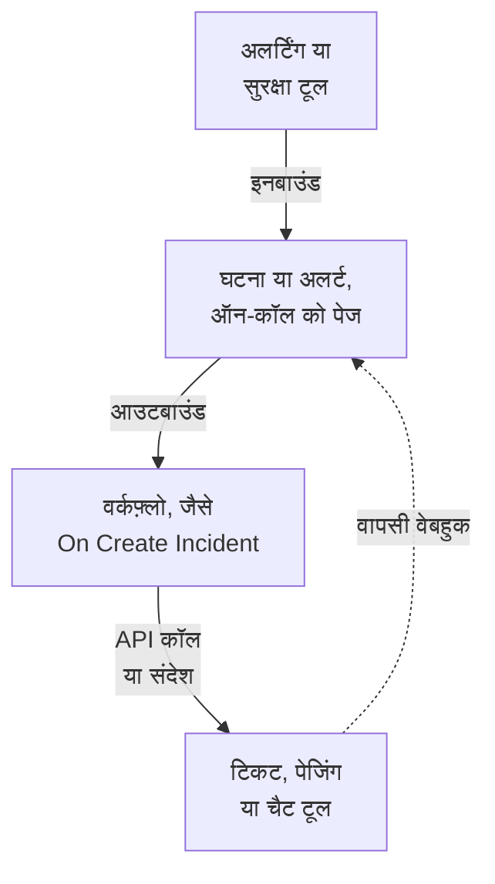

# इंटिग्रेशन अवलोकन

OneUptime उन टूल के साथ काम करता है जिन्हें आपकी टीम पहले से इस्तेमाल करती है। अलर्टिंग टूल इसमें घटनाएं खोलते हैं, और यह दूसरे टूल में टिकट, पेज और चैट संदेश खोलता है। कुछ टूल एक फ़ॉर्म से जुड़ते हैं, और कुछ तैयार वर्कफ़्लो टेम्पलेट से। वेबहुक या API वाला कोई भी दूसरा टूल आपके बनाए वर्कफ़्लो के ज़रिए जुड़ता है।

:::cards
- [जोड़ने का तरीका चुनें](#जोड़ने-का-तरीका-चुनें): जोड़ने के चार तरीके, और हर एक कब इस्तेमाल करें।
- [कैटलॉग](#कैटलॉग): गाइड वाला हर टूल, उसके काम के अनुसार समूहों में।
- [अपना इंटिग्रेशन बनाएं](#अपना-इंटिग्रेशन-बनाएं): किसी भी दूसरे टूल के लिए इनबाउंड और आउटबाउंड पैटर्न।
- [क्रेडेंशियल सुरक्षित रखें](#क्रेडेंशियल-सुरक्षित-रखें): सीक्रेट वेरिएबल, और हर टूल को चाहिए हेडर।
:::

## इंटिग्रेशन कैसे काम करते हैं

हर इंटिग्रेशन डेटा को एक दिशा में या दोनों दिशाओं में ले जाता है। **इनबाउंड** में कोई दूसरा टूल OneUptime को बताता है कि कुछ गड़बड़ है, और OneUptime एक घटना या अलर्ट खोलकर ऑन-कॉल टीम को पेज करता है। **आउटबाउंड** में OneUptime में कुछ होता है, और एक वर्कफ़्लो किसी दूसरे टूल को बताता है: वह टिकट दर्ज करता है, किसी को पेज करता है या संदेश पोस्ट करता है।



Jira या Dynamics 365 जैसा दो-तरफ़ा इंटिग्रेशन दोनों दिशाओं का इस्तेमाल करता है: एक वर्कफ़्लो घटना को बाहर भेजता है, और दूसरा, जो दूसरे टूल के वेबहुक से शुरू होता है, बदलावों को वापस लाता है।

## जोड़ने का तरीका चुनें

| तरीका | किसके लिए सबसे अच्छा | उदाहरण |
| --- | --- | --- |
| बिल्ट-इन कनेक्शन | ऐसे टूल जिनसे OneUptime खुद जुड़ता है। आप एक फ़ॉर्म भरते हैं, और बनाने को कुछ नहीं होता। | [Slack](/docs/workspace-connections/slack), [Microsoft Teams](/docs/workspace-connections/microsoft-teams), [सुरक्षा इवेंट](/docs/telemetry/security-events) कनेक्शन |
| वर्कफ़्लो टेम्पलेट | टिकटिंग टूल, जो दोनों ओर से तालमेल में रहते हैं, मॉनिटरिंग की समस्याएं, सुरक्षा घटना रिपोर्ट और चैट संदेश। आप एक टेम्पलेट चुनते हैं और कुछ सेटिंग भरते हैं। | [Jira](/docs/integrations/jira), [Microsoft Dynamics 365](/docs/integrations/microsoft-dynamics-365), [Huntress](/docs/integrations/huntress), [Zabbix](/docs/integrations/zabbix) |
| Incoming Request मॉनिटर | वेबहुक भेजने वाले अलर्टिंग टूल। हर अलर्ट पर एक घटना मिलती है, जो ऑन-कॉल को पेज होती है और अलर्ट ठीक होने पर सुलझ जाती है, बिना किसी वर्कफ़्लो के। | [Zabbix](/docs/integrations/zabbix), [Prometheus Alertmanager](/docs/integrations/prometheus-alertmanager), [Grafana](/docs/integrations/grafana) |
| आपका बनाया वर्कफ़्लो | वेबहुक या REST API वाला कोई भी टूल, और आपका अपना कोई भी लॉजिक। | [PagerDuty](/docs/integrations/pagerduty), [Opsgenie](/docs/integrations/opsgenie), [ServiceNow](/docs/integrations/servicenow) |

तालिका में ऊपर से शुरू करें: तरीका जितना ऊपर है, उसमें संभालने को उतना ही कम है।

## कैटलॉग

### मॉनिटरिंग और अलर्टिंग टूल

| टूल | दिशा | क्या करता है |
| --- | --- | --- |
| [Zabbix](/docs/integrations/zabbix) | दोनों | Zabbix की समस्याओं को घटनाओं या अलर्ट में बदलता है, ठीक होने पर उन्हें सुलझाता है, और OneUptime से समस्याओं को स्वीकार या बंद करता है। |
| [Prometheus Alertmanager](/docs/integrations/prometheus-alertmanager) | इनबाउंड | Alertmanager की सूचनाओं को घटनाओं में बदलता है। |
| [Grafana](/docs/integrations/grafana) | इनबाउंड | Grafana अलर्ट को घटनाओं में बदलता है। |
| [Datadog](/docs/integrations/datadog) | इनबाउंड | Datadog मॉनिटर अलर्ट को घटनाओं में बदलता है। |

### सुरक्षा टूल

| टूल | दिशा | क्या करता है |
| --- | --- | --- |
| [Huntress](/docs/integrations/huntress) | इनबाउंड | Huntress घटना रिपोर्ट पर ऑन-कॉल को पेज करता है, और रिपोर्ट बंद होने पर घटना सुलझाता है। |
| [Google SecOps](/docs/integrations/google-secops) | दोनों | Google SecOps डिटेक्शन और संकेतकों को सुरक्षा इवेंट में लाता है, और OneUptime जो पाता है उसे Google SecOps को भेजता है। |
| [Microsoft Sentinel](/docs/integrations/microsoft-sentinel) | दोनों | Microsoft Sentinel घटनाओं को सुरक्षा इवेंट में लाता है, और OneUptime जो पाता है उसे Microsoft Sentinel को भेजता है। |
| [Microsoft Defender XDR](/docs/integrations/microsoft-defender-xdr) | इनबाउंड | Microsoft Defender XDR अलर्ट को सुरक्षा इवेंट में लाता है। |
| [CrowdStrike Falcon](/docs/integrations/crowdstrike-falcon) | इनबाउंड | CrowdStrike Falcon अलर्ट को सुरक्षा इवेंट में लाता है। |
| [Splunk Enterprise Security](/docs/integrations/splunk) | दोनों | Splunk notable event को सुरक्षा इवेंट में लाता है, और OneUptime जो पाता है उसे Splunk को भेजता है। |
| [Elastic Security](/docs/integrations/elastic-security) | दोनों | Elastic Security डिटेक्शन अलर्ट को सुरक्षा इवेंट में लाता है, और OneUptime जो पाता है उसे Elastic Security को भेजता है। |
| [AWS Security Hub](/docs/integrations/aws-security-hub) | इनबाउंड | AWS Security Hub फ़ाइंडिंग को सुरक्षा इवेंट में लाता है। |
| [Okta System Log](/docs/integrations/okta) | इनबाउंड | Okta साइन-इन, खाते के बदलाव और खतरे के डिटेक्शन को सुरक्षा इवेंट में लाता है। |
| [Microsoft Entra ID](/docs/integrations/microsoft-entra-id) | इनबाउंड | Microsoft Entra ID साइन-इन और डायरेक्टरी बदलाव, और Microsoft 365 ऑडिट लॉग को सुरक्षा इवेंट में लाता है। |
| [Google Workspace](/docs/integrations/google-workspace) | इनबाउंड | Google Workspace साइन-इन, एडमिन बदलाव और Google के अपने डिटेक्शन को सुरक्षा इवेंट में लाता है। |

### टिकटिंग और IT सर्विस मैनेजमेंट

| टूल | दिशा | क्या करता है |
| --- | --- | --- |
| [Jira](/docs/integrations/jira) | दोनों | हर घटना या अलर्ट के लिए Jira इश्यू खोलता है, और स्टेटस बदलाव और टिप्पणियां वापस लाता है। |
| [Microsoft Dynamics 365](/docs/integrations/microsoft-dynamics-365) | दोनों | हर घटना या अलर्ट के लिए Dynamics 365 केस खोलता है, और स्टेटस बदलाव और नोट वापस लाता है। |
| [ServiceNow](/docs/integrations/servicenow) | आउटबाउंड | हर OneUptime घटना के लिए ServiceNow incident खोलता है, और घटना के साथ उसे सुलझाता है। |
| [GitHub](/docs/integrations/github) | आउटबाउंड | किसी घटना के लिए GitHub issue खोलता है। |
| [GitLab](/docs/integrations/gitlab) | आउटबाउंड | किसी घटना के लिए GitLab issue खोलता है। |

### पेजिंग टूल

| टूल | दिशा | क्या करता है |
| --- | --- | --- |
| [PagerDuty](/docs/integrations/pagerduty) | आउटबाउंड | हर OneUptime घटना के लिए PagerDuty incident ट्रिगर करता है, और घटना के साथ उसे सुलझाता है। |
| [Opsgenie](/docs/integrations/opsgenie) | आउटबाउंड | हर OneUptime घटना के लिए Opsgenie अलर्ट बनाता है, और घटना के साथ उसे बंद करता है। |

### चैट टूल

| टूल | दिशा | क्या करता है |
| --- | --- | --- |
| [Slack](/docs/workspace-connections/slack) | दोनों | बिल्ट-इन कनेक्शन: घटना चैनल, Slack से कार्रवाइयां, और ऑन-कॉल। |
| [Microsoft Teams](/docs/workspace-connections/microsoft-teams) | दोनों | बिल्ट-इन कनेक्शन: घटना चैनल, Teams से कार्रवाइयां, और ऑन-कॉल। |
| [Mattermost](/docs/workflows/components#mattermost) | आउटबाउंड | घटना के अपडेट Mattermost चैनल में पोस्ट करता है। |
| [Discord](/docs/integrations/discord) | आउटबाउंड | घटना के अपडेट Discord चैनल में पोस्ट करता है। |
| [Telegram](/docs/integrations/telegram) | आउटबाउंड | कोई अलर्ट फ़ायर होने पर Telegram चैट में एक संदेश भेजता है। |
| [IRC](/docs/integrations/irc) | आउटबाउंड | घटना के अपडेट IRC चैनल में पोस्ट करता है। |

> [!TIP]
> Slack और Microsoft Teams में वर्कफ़्लो चरण भी हैं। घटना चैनल और ऑन-कॉल के लिए बिल्ट-इन कनेक्शन इस्तेमाल करें, और जब आपको बस किसी चैनल में एक संदेश चाहिए, तब वर्कफ़्लो चरण।

### होस्टिंग प्लेटफ़ॉर्म

| टूल | दिशा | क्या करता है |
| --- | --- | --- |
| [Vercel](/docs/integrations/vercel) | इनबाउंड | Vercel Marketplace से OneUptime जोड़ें: आपके Vercel प्रोजेक्ट के लिए ट्रेस, लॉग, अपटाइम मॉनिटर और एक स्टेटस पेज। |

## किसी दूसरे टूल से आना

किसी दूसरे ऑन-कॉल, अपटाइम या स्टेटस पेज टूल को छोड़ने के लिए, दोनों को जोड़ने के बजाय अपनी टीम को यहां ले आएं। **प्रोजेक्ट सेटिंग्स → उन्नत → किसी दूसरे टूल से इंपोर्ट करें** एक API कुंजी से आपका खाता पढ़ता है, जो मिला वह दिखाता है, और जिन पर आप टिक करते हैं उन्हें बनाता है। हर टूल की एक गाइड है:

- ऑन-कॉल और घटना टूल: [Opsgenie](/docs/moving-to-oneuptime/opsgenie), [PagerDuty](/docs/moving-to-oneuptime/pagerduty), [incident.io](/docs/moving-to-oneuptime/incident-io), [Splunk On-Call](/docs/moving-to-oneuptime/splunk-on-call) और [Grafana OnCall](/docs/moving-to-oneuptime/grafana-oncall)।
- अपटाइम और स्टेटस पेज टूल: [UptimeRobot](/docs/moving-to-oneuptime/uptimerobot), [Atlassian Statuspage](/docs/moving-to-oneuptime/atlassian-statuspage), [Better Stack](/docs/moving-to-oneuptime/better-stack), [Pingdom](/docs/moving-to-oneuptime/pingdom), [StatusCake](/docs/moving-to-oneuptime/statuscake) और [Uptime Kuma](/docs/moving-to-oneuptime/uptime-kuma)।

## अपना इंटिग्रेशन बनाएं

बिना गाइड वाला टूल भी दो पैटर्न में से किसी एक में फ़िट होता है। अगर वह वेबहुक भेज सकता है, तो इनबाउंड पैटर्न इस्तेमाल करें। अगर उसके पास REST API है, तो आउटबाउंड पैटर्न इस्तेमाल करें। दोनों वर्कफ़्लो हैं: शुरू करने के लिए [वर्कफ़्लो अवलोकन](/docs/workflows/index) देखें।

### इनबाउंड: कोई दूसरा टूल OneUptime में डेटा भेजता है

अलर्टिंग टूल के लिए [Incoming Request मॉनिटर](/docs/monitor/incoming-request-monitor#किसी-दूसरे-सिस्टम-से-अलर्ट-प्राप्त-करना) से शुरू करें: यह हर अलर्ट पर एक घटना खोलता है और ठीक होने पर उसे सुलझाता है, बनाने को कुछ नहीं। जब आपको अपना लॉजिक चाहिए, तब वर्कफ़्लो बनाएं:

:::steps
1. **वर्कफ़्लो** खोलें, **वर्कफ़्लो बनाएं** पर क्लिक करें, फिर **शुरू से बनाएं** पर। वर्कफ़्लो को नाम दें और **वर्कफ़्लो बनाएं** पर क्लिक करें।
2. डैश वाले **चुनें कि यह वर्कफ़्लो किससे शुरू हो** ब्लॉक पर क्लिक करें और **Webhook** चुनें। ट्रिगर पर क्लिक करें, फिर **URL कॉपी करें** पर।
3. दूसरे टूल में, उसका वेबहुक उस URL पर `Content-Type: application/json` के साथ `POST` के रूप में भेजें।
4. उस पर काम करने वाले ब्लॉक जोड़ें। वे `{{local.components.webhook-1.returnValues.request-body.status}}` जैसे रेफ़रेंस से अनुरोध पढ़ते हैं: किसी फ़ील्ड को जांचने के लिए **If / Else** ब्लॉक, फिर घटना घोषित करने के लिए **Create One Incident**।
5. **बिल्डर** के ऊपर **सक्षम** चालू करें, दूसरे टूल से एक टेस्ट भेजें, और जो आया उसे देखने के लिए **लॉग → रन** खोलें।
:::

URL ही एकमात्र क्रेडेंशियल है, इसलिए उसे पासवर्ड की तरह रखें। [Webhook](/docs/workflows/triggers#webhook) देखें।

### आउटबाउंड: OneUptime किसी दूसरे टूल को डेटा भेजता है

:::steps
1. टूल की API कुंजी को एक सीक्रेट ग्लोबल वेरिएबल के रूप में सहेजें, जैसा [नीचे](#क्रेडेंशियल-सुरक्षित-रखें) दिखाया गया है।
2. एक वर्कफ़्लो बनाएं, डैश वाले ब्लॉक पर क्लिक करें और कोई इवेंट ट्रिगर चुनें, जैसे **On Create Incident**। ट्रिगर पर क्लिक करें: उसके **Fields to pass on** में पहले से **शीर्षक** है, इसलिए **फ़ील्ड जोड़ें** पर क्लिक करें और भेजने वाले बाकी फ़ील्ड चुनें, जैसे **विवरण**।
3. **घटक जोड़ें** पर क्लिक करें और एक **API Post (JSON)** ब्लॉक जोड़ें। ट्रिगर के **Success** बिंदु को उससे जोड़ें।
4. उसका **URL** भरें, `Authorization` हेडर के साथ उसके **Request Headers** भरें, और घटना के फ़ील्ड के साथ उसकी **Request Body** भरें, जैसे `{{local.components.incident-on-create-1.returnValues.model.title}}`।
5. **वर्कफ़्लो चलाएं** पर क्लिक करें, **घटना** के नीचे कोई घटना चुनें, और चलाएं। टेस्ट रन सचमुच अनुरोध भेजता है। फिर **सक्षम** चालू करें।
:::

जब टूल को पहले डेटा का रूप बदला हुआ चाहिए, तो दोनों के बीच एक [Run Custom JavaScript](/docs/workflows/components#custom-code) ब्लॉक जोड़ें। Zendesk, New Relic, AWS (SNS के ज़रिए), StatusCake और बाकी सभी टूल के लिए तरीका यही है: बस URL और बॉडी बदलते हैं।

## क्रेडेंशियल सुरक्षित रखें

किसी ब्लॉक में कभी भी API कुंजी या टोकन पेस्ट न करें। उसे एक बार सीक्रेट ग्लोबल वेरिएबल के रूप में सहेजें:

:::steps
1. **वर्कफ़्लो → ग्लोबल वेरिएबल** पर जाएं और **वर्कफ़्लो वेरिएबल बनाएँ** पर क्लिक करें।
2. उसे नाम दें, जैसे `JIRA_AUTH`, और **अगला** पर क्लिक करें।
3. कुंजी को **सामग्री** में पेस्ट करें, **रहस्य** चालू करें, और **वर्कफ़्लो वेरिएबल बनाएँ** पर क्लिक करें।
:::

कोई भी ब्लॉक उसे `{{global.variables.JIRA_AUTH}}` के रूप में पढ़ता है। सहेजने के बाद वेरिएबल की सामग्री वापस नहीं पढ़ी जा सकती, और सीक्रेट वेरिएबल रन लॉग में `[REDACTED]` से बदल दिया जाता है। समाप्त होने वाले टोकन के लिए, जैसे Microsoft Entra ID के, एक [OAuth 2.0 वेरिएबल](/docs/workflows/variables#oauth-20-वेरिएबल-ऐसे-टोकन-जो-खुद-रिफ्रेश-होते-हैं) अपने-आप नया टोकन लाता है। [वर्कफ़्लो वेरिएबल](/docs/workflows/variables#ग्लोबल-वेरिएबल) देखें।

### ऑथेंटिकेशन चीट शीट

ज़्यादातर आउटबाउंड इंटिग्रेशन कुंजी को अनुरोध के हेडर में रखते हैं। आम रूप:

| स्कीम | क्या भेजें | कौन इस्तेमाल करता है |
| --- | --- | --- |
| Bearer टोकन | `Authorization: Bearer {{global.variables.TOKEN}}` | GitHub, और ज़्यादातर आधुनिक API |
| Basic ऑथ | `Authorization: Basic {{global.variables.BASE64_USER_PASS}}` | Jira Cloud, ServiceNow |
| API कुंजी हेडर | `Authorization: GenieKey {{global.variables.OPSGENIE_KEY}}` | Opsgenie |
| प्राइवेट टोकन हेडर | `PRIVATE-TOKEN: {{global.variables.GITLAB_TOKEN}}` | GitLab |
| बॉडी में कुंजी | JSON बॉडी में `routing_key` | PagerDuty Events API |
| OAuth 2.0 क्लाइंट क्रेडेंशियल | OAuth 2.0 वेरिएबल से `Authorization: Bearer {{local.variables.dynamicsAccessToken}}` | Microsoft Dynamics 365 |

Basic ऑथ के लिए `username:password`, या `email:api_token`, को एक बार एनकोड करें, और नतीजे को सीक्रेट के रूप में सहेजें। macOS या Linux पर:

```bash
printf '%s' 'you@example.com:your_api_token' | base64 | tr -d '\n'
```

`echo` नहीं, `printf` इस्तेमाल करें: `echo` एक नई लाइन जोड़ता है, जो बाकी के साथ एनकोड हो जाती है और क्रेडेंशियल बिगाड़ देती है। `tr` लंबे नतीजे को एक ही लाइन में रखता है।

## सेल्फ़-होस्टेड इंस्टॉलेशन

सेल्फ़-होस्टेड OneUptime आपके नेटवर्क से दूसरे टूल को कॉल करता है, और दूसरे टूल अपने नेटवर्क से इसे कॉल करते हैं:

- **आउटबाउंड:** निजी नेटवर्क पतों पर वर्कफ़्लो के अनुरोध तब तक अस्वीकार होते हैं, जब तक कोई एडमिनिस्ट्रेटर उन्हें अनुमति न दे। [आउटबाउंड नेटवर्क एक्सेस](/docs/workflows/configuration#बाहर-जाने-वाली-नेटवर्क-पहुँच) देखें।
- **इनबाउंड:** किसी टूल के वेबहुक को HTTPS पर आपके OneUptime तक पहुंचना चाहिए, इसलिए क्लाउड में चल रहे टूल को कॉल करने के लिए एक सार्वजनिक पता चाहिए।
- **बिल्ट-इन इंटिग्रेशन** में से हर एक की सेटअप गाइड है: [Slack](/docs/self-hosted/slack-integration), [Microsoft Teams](/docs/self-hosted/microsoft-teams-integration), [GitHub](/docs/self-hosted/github-integration), [Twilio](/docs/self-hosted/twilio-integration), [SendGrid आने वाला ईमेल](/docs/self-hosted/sendgrid-inbound-email) और [पुश सूचनाएँ](/docs/self-hosted/push-notifications)।

## अगले कदम

:::cards
- [वर्कफ़्लो अवलोकन](/docs/workflows/index): वर्कफ़्लो कैसे चलते हैं, और अपना पहला वर्कफ़्लो कैसे बनाएं।
- [आने वाले अनुरोध मॉनिटर](/docs/monitor/incoming-request-monitor): बिना वर्कफ़्लो के किसी भी टूल से अलर्ट पाएं।
- [Jira](/docs/integrations/jira): टेम्पलेट से बना एक पूरा दो-तरफ़ा इंटिग्रेशन।
- [वर्कफ़्लो वेरिएबल](/docs/workflows/variables): ब्लॉक के बीच डेटा भेजें, और सीक्रेट को उनसे बाहर रखें।
:::
